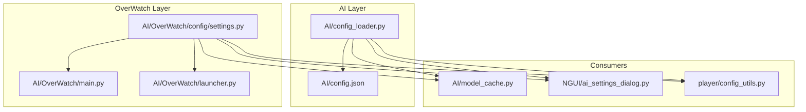
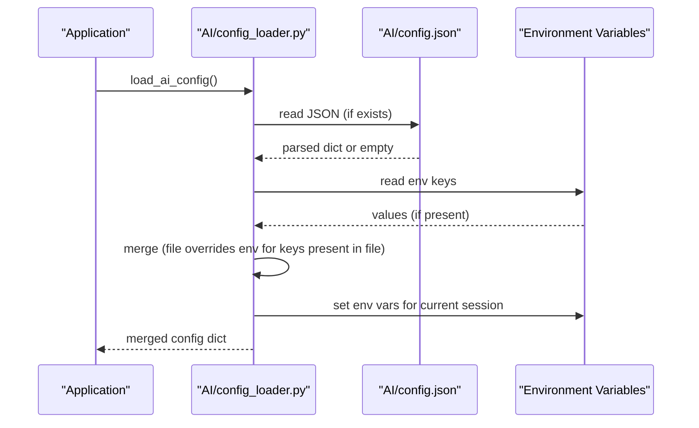
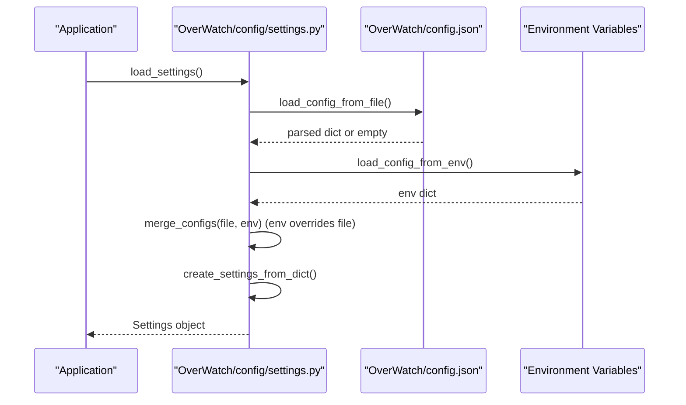
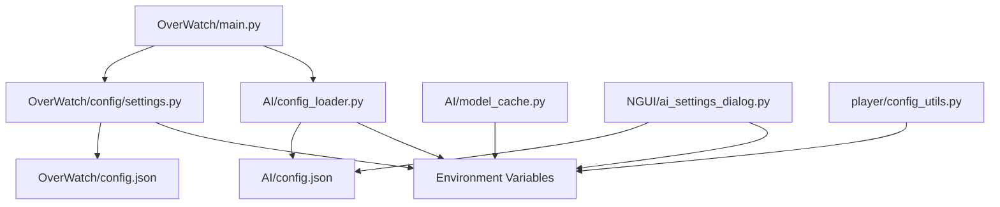

# AI Configuration Management

<cite>
**Referenced Files in This Document**
- [config_loader.py](file://LoOper/AI/config_loader.py)
- [config.json](file://LoOper/AI/config.json)
- [settings.py](file://LoOper/AI/settings.py)
- [OverWatch config settings.py](file://LoOper/AI/OverWatch/config/settings.py)
- [OverWatch main.py](file://LoOper/AI/OverWatch/main.py)
- [launcher.py](file://LoOper/AI/OverWatch/launcher.py)
- [model_cache.py](file://LoOper/AI/model_cache.py)
- [ai_settings_dialog.py](file://LoOper/NGUI/dialogs/ai_settings_dialog.py)
- [config_utils.py](file://LoOper/player/multi_sequence/llm_executor_resources/config_utils.py)
</cite>

## Table of Contents
1. [Introduction](#introduction)
2. [Project Structure](#project-structure)
3. [Core Components](#core-components)
4. [Architecture Overview](#architecture-overview)
5. [Detailed Component Analysis](#detailed-component-analysis)
6. [Dependency Analysis](#dependency-analysis)
7. [Performance Considerations](#performance-considerations)
8. [Troubleshooting Guide](#troubleshooting-guide)
9. [Conclusion](#conclusion)
10. [Appendices](#appendices)

## Introduction
This document explains the AI configuration management system with a focus on the centralized configuration loader and environment variable management. It describes the hierarchical configuration system that merges default values, file-based configuration, and environment variables, along with precedence rules, runtime environment injection, and validation. Practical examples illustrate configuration file structure, environment variable overrides, and session-wide propagation. Guidance is provided for TAILSCALE integration, API ports, model paths, and auto-start behaviors, alongside common configuration issues, debugging techniques, and best practices for consistency across development and production environments.

## Project Structure
The configuration system spans two primary modules:
- AI-level configuration loader and simple environment injection for basic AI services
- OverWatch configuration system with structured settings, environment overrides, validation, and logging setup

**Diagram sources**
- [config_loader.py:1-66](file://LoOper/AI/config_loader.py#L1-L66)
- [config.json:1-9](file://LoOper/AI/config.json#L1-L9)
- [settings.py:1-439](file://LoOper/AI/settings.py#L1-L439)
- [OverWatch config settings.py:1-440](file://LoOper/AI/OverWatch/config/settings.py#L1-L440)
- [OverWatch main.py:1-767](file://LoOper/AI/OverWatch/main.py#L1-L767)
- [launcher.py:1-333](file://LoOper/AI/OverWatch/launcher.py#L1-L333)
- [model_cache.py:1-217](file://LoOper/AI/model_cache.py#L1-L217)
- [ai_settings_dialog.py:338-368](file://LoOper/NGUI/dialogs/ai_settings_dialog.py#L338-L368)
- [config_utils.py:1-20](file://LoOper/player/multi_sequence/llm_executor_resources/config_utils.py#L1-L20)

**Section sources**
- [config_loader.py:1-66](file://LoOper/AI/config_loader.py#L1-L66)
- [settings.py:1-439](file://LoOper/AI/settings.py#L1-L439)
- [OverWatch config settings.py:1-440](file://Looper/AI/OverWatch/config/settings.py#L1-L440)

## Core Components
- AI-level configuration loader: Loads defaults, merges file-based config, applies environment overrides, and injects environment variables for the current session. Provides convenience getters for API URL and auto-start flags.
- OverWatch settings system: Defines strongly typed settings via dataclasses, loads from JSON and environment variables, merges them with environment overrides, validates settings, sets up logging, and exposes helpers to compute API URLs and manage defaults.

Key responsibilities:
- Hierarchical merging: file → environment (with controlled override behavior)
- Runtime environment injection: ensures environment variables are set for the current process
- Validation: simple and comprehensive checks for correctness and safety
- API URL computation: respects Tailscale overrides and handles special host values

**Section sources**
- [config_loader.py:9-66](file://LoOper/AI/config_loader.py#L9-L66)
- [settings.py:265-283](file://LoOper/AI/settings.py#L265-L283)
- [OverWatch config settings.py:265-283](file://LoOper/AI/OverWatch/config/settings.py#L265-L283)

## Architecture Overview
The configuration architecture supports two complementary approaches:
- Lightweight AI loader for simple scenarios
- Rich OverWatch settings system for production-grade configuration

**Diagram sources**
- [config_loader.py:9-48](file://LoOper/AI/config_loader.py#L9-L48)
- [config.json:1-9](file://LoOper/AI/config.json#L1-L9)

**Diagram sources**
- [settings.py:265-283](file://LoOper/AI/settings.py#L265-L283)
- [OverWatch config settings.py:265-283](file://LoOper/AI/OverWatch/config/settings.py#L265-L283)

## Detailed Component Analysis

### AI Configuration Loader
Purpose:
- Provide a minimal configuration loader for AI services
- Merge defaults, file config, and environment variables
- Inject environment variables into the current process
- Compute derived values like API URL and auto-start flags

Precedence rules:
- File-based keys take precedence over environment variables for overlapping keys
- Environment variables not present in the file are accepted as-is
- After merging, all keys are injected into the current process environment

Runtime environment injection:
- All merged keys are written to os.environ for the current session

API URL computation:
- Uses TAILSCALE_SERVER_IP and API_PORT
- Falls back to localhost when TAILSCALE_SERVER_IP is empty

Auto-start detection:
- Reads AUTO_START_API and normalizes to boolean

Practical examples:
- Configuration file structure: see [config.json:1-9](file://LoOper/AI/config.json#L1-L9)
- Environment variable overrides: see [config_loader.py:36-42](file://LoOper/AI/config_loader.py#L36-L42)
- Session-wide propagation: see [config_loader.py:44-46](file://LoOper/AI/config_loader.py#L44-L46)

Validation and error handling:
- File parsing errors are caught and logged as warnings
- No explicit validation is performed in this loader

**Section sources**
- [config_loader.py:9-66](file://LoOper/AI/config_loader.py#L9-L66)
- [config.json:1-9](file://LoOper/AI/config.json#L1-L9)

### OverWatch Settings System
Purpose:
- Provide a robust, typed configuration system for OverWatch
- Support hierarchical configuration from file and environment
- Enforce validation and produce actionable diagnostics
- Configure logging and compute API URLs

Data model:
- Settings object aggregates OllamaSettings, ComoRAGSettings, APISettings, TailscaleSettings, and LoggingSettings
- Properties expose commonly used values for backward compatibility

Configuration loading:
- File path resolution supports OVERWATCH_CONFIG_PATH environment variable
- load_config_from_file reads JSON safely with error logging
- load_config_from_env maps environment variables to nested configuration sections
- merge_configs recursively merges dictionaries with environment overrides

Validation:
- validate_settings returns a list of issues for misconfiguration
- validate_settings_simple returns a boolean for quick checks

Logging setup:
- setup_logging configures root logger with console and optional rotating file handler

API URL computation:
- get_api_url respects Tailscale overrides and handles special host values

Practical examples:
- Configuration file structure: see [OverWatch config settings.py:98-106](file://LoOper/AI/OverWatch/config/settings.py#L98-L106) and [OverWatch config settings.py:109-125](file://LoOper/AI/OverWatch/config/settings.py#L109-L125)
- Environment variable overrides: see [OverWatch config settings.py:128-173](file://LoOper/AI/OverWatch/config/settings.py#L128-L173)
- Validation usage: see [OverWatch main.py:35-41](file://LoOper/AI/OverWatch/main.py#L35-L41)

**Section sources**
- [settings.py:76-283](file://LoOper/AI/settings.py#L76-L283)
- [OverWatch config settings.py:98-283](file://LoOper/AI/OverWatch/config/settings.py#L98-L283)

### Consumers and Runtime Integration
- Model cache: resolves default API URL using environment variables and falls back to sensible defaults
- GUI settings dialog: writes configuration to file and injects environment variables for the current session
- Player config utilities: computes default API URL using environment variables with fallbacks

These consumers demonstrate consistent patterns for reading configuration and ensuring runtime availability.

**Section sources**
- [model_cache.py:26-34](file://LoOper/AI/model_cache.py#L26-L34)
- [ai_settings_dialog.py:338-368](file://LoOper/NGUI/dialogs/ai_settings_dialog.py#L338-L368)
- [config_utils.py:4-20](file://LoOper/player/multi_sequence/llm_executor_resources/config_utils.py#L4-L20)

## Dependency Analysis
The configuration system exhibits clear separation of concerns:
- AI loader depends on a local JSON file and environment variables
- OverWatch settings depend on a configurable JSON file path and environment variables
- Consumers depend on either the AI loader or the OverWatch settings system

**Diagram sources**
- [config_loader.py:1-66](file://LoOper/AI/config_loader.py#L1-L66)
- [config.json:1-9](file://LoOper/AI/config.json#L1-L9)
- [settings.py:1-439](file://LoOper/AI/settings.py#L1-L439)
- [OverWatch config settings.py:1-440](file://LoOper/AI/OverWatch/config/settings.py#L1-L440)
- [OverWatch main.py:1-767](file://LoOper/AI/OverWatch/main.py#L1-L767)
- [model_cache.py:1-217](file://LoOper/AI/model_cache.py#L1-L217)
- [ai_settings_dialog.py:338-368](file://LoOper/NGUI/dialogs/ai_settings_dialog.py#L338-L368)
- [config_utils.py:1-20](file://LoOper/player/multi_sequence/llm_executor_resources/config_utils.py#L1-L20)

**Section sources**
- [config_loader.py:1-66](file://LoOper/AI/config_loader.py#L1-L66)
- [settings.py:1-439](file://LoOper/AI/settings.py#L1-L439)
- [OverWatch config settings.py:1-440](file://LoOper/AI/OverWatch/config/settings.py#L1-L440)

## Performance Considerations
- Minimizing repeated file I/O: Prefer caching settings in long-running processes (OverWatch settings system already caches a default instance)
- Efficient environment variable access: Use environment variable lookups sparingly; cache results when feasible
- Validation cost: Perform validation at startup or on configuration change; avoid repeated validation during hot paths
- Logging overhead: Configure file logging judiciously; consider rotating logs to limit I/O impact

## Troubleshooting Guide
Common configuration issues and resolutions:
- Invalid API port: Ensure port is within the allowed range; validation enforces bounds
- Tailscale enabled without server IP: When Tailscale is enabled, a server IP must be provided
- Invalid Ollama context length or temperature ranges: Respect configured bounds to avoid runtime errors
- API URL not resolving: Verify TAILSCALE_SERVER_IP and API_PORT; confirm environment variables are set and not overridden unexpectedly
- Configuration file not found: The loader gracefully falls back to defaults; ensure the file path is correct or set OVERWATCH_CONFIG_PATH

Debugging techniques:
- Inspect loaded settings: Use the OverWatch settings system’s logging and validation outputs
- Verify environment variables: Confirm that environment variables are exported before launching the application
- Check file permissions: Ensure the configuration file is readable by the process
- Use the launcher: The OverWatch launcher demonstrates how to override settings via command-line arguments and how to start the server with configured settings

**Section sources**
- [settings.py:382-420](file://LoOper/AI/settings.py#L382-L420)
- [OverWatch config settings.py:382-420](file://LoOper/AI/OverWatch/config/settings.py#L382-L420)
- [OverWatch main.py:35-41](file://LoOper/AI/OverWatch/main.py#L35-L41)
- [launcher.py:30-72](file://LoOper/AI/OverWatch/launcher.py#L30-L72)

## Conclusion
The AI configuration management system provides a pragmatic, layered approach to configuration:
- The AI loader offers a lightweight, file-and-env-based solution suitable for simple deployments
- The OverWatch settings system delivers a comprehensive, validated, and strongly typed configuration suitable for production-grade services

By understanding the hierarchical merging rules, precedence behavior, and runtime environment injection, teams can maintain consistent configuration across development and production environments while leveraging environment variables for flexibility.

## Appendices

### Configuration Precedence and Examples
- File-based configuration: Keys defined in the JSON file are merged into defaults
- Environment variable overrides: For keys not present in the file, environment variables are accepted
- Example keys:
  - TAILSCALE_SERVER_IP, API_PORT, OLLAMA_HOST, OLLAMA_PORT, API_TIMEOUT, AUTO_START_API
  - OverWatch-specific: OVERWATCH_HOST, OVERWATCH_PORT, OVERWATCH_DEBUG, TAILSCALE_* variants, COMORAG_* variants, LOG_* variants

**Section sources**
- [config_loader.py:11-42](file://LoOper/AI/config_loader.py#L11-L42)
- [settings.py:128-173](file://LoOper/AI/settings.py#L128-L173)
- [OverWatch config settings.py:128-173](file://LoOper/AI/OverWatch/config/settings.py#L128-L173)

### Best Practices for Consistency
- Define a single source of truth: Prefer environment variables for deployment-specific values and JSON for application defaults
- Validate early: Use the validation routines to catch misconfigurations at startup
- Document environment variables: Keep a reference of supported environment variables and their effects
- Use the launcher: Leverage the OverWatch launcher to verify configuration and start the service with desired settings
- Cache settings: Reuse the default settings instance to avoid repeated file and environment parsing

**Section sources**
- [settings.py:265-283](file://LoOper/AI/settings.py#L265-L283)
- [OverWatch config settings.py:265-283](file://LoOper/AI/OverWatch/config/settings.py#L265-L283)
- [launcher.py:248-333](file://LoOper/AI/OverWatch/launcher.py#L248-L333)