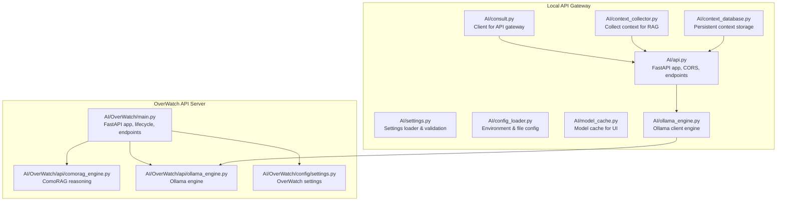
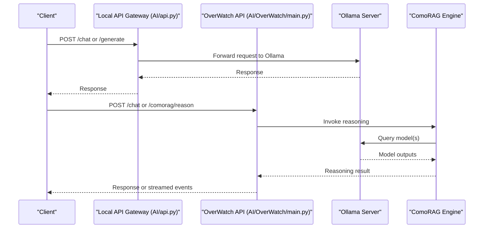
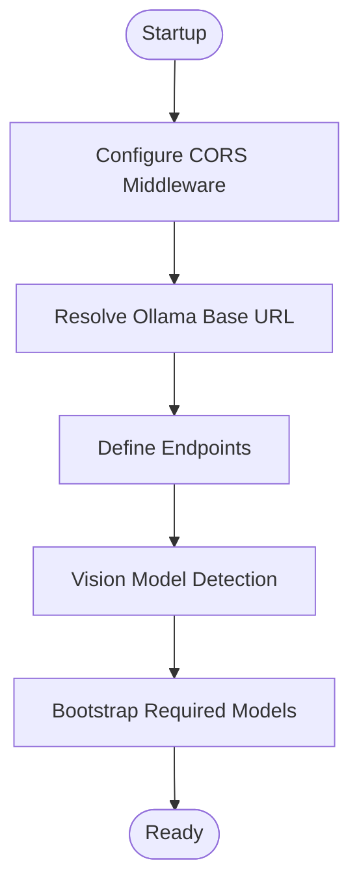
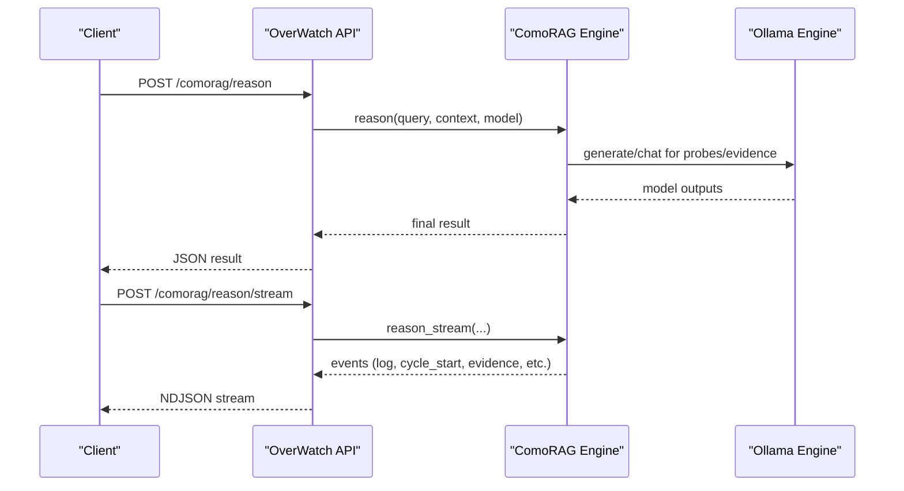
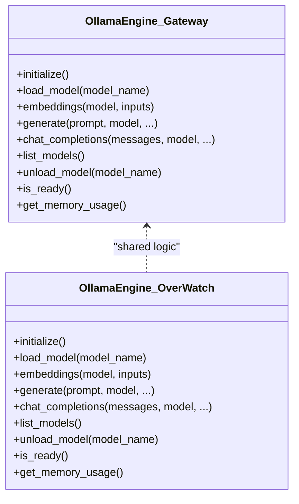
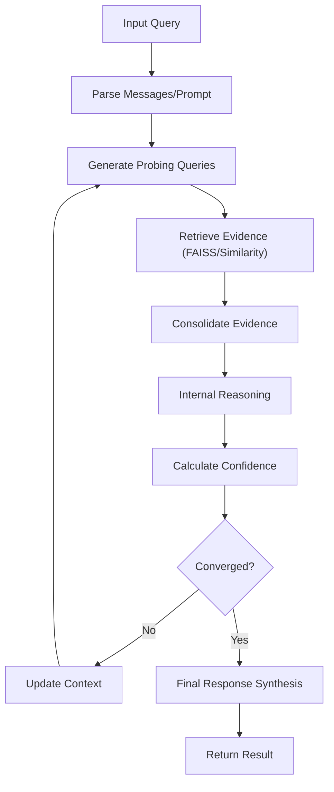
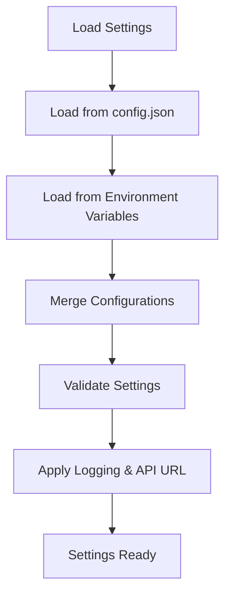
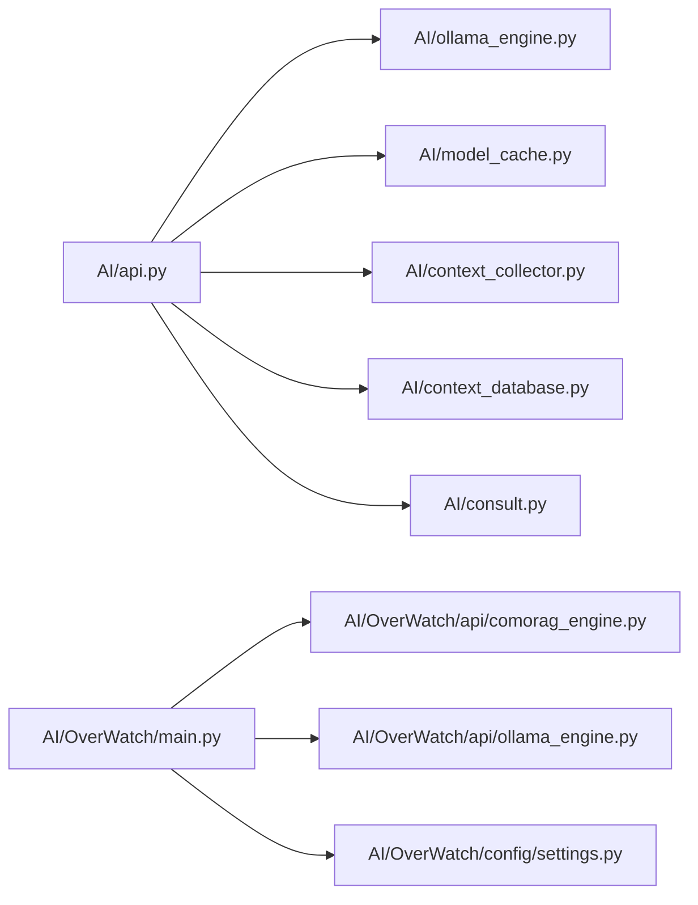

# AI Integration Layer

<cite>
**Referenced Files in This Document**
- [AI/api.py](file://LoOper/AI/api.py)
- [AI/settings.py](file://LoOper/AI/settings.py)
- [AI/config_loader.py](file://LoOper/AI/config_loader.py)
- [AI/model_cache.py](file://LoOper/AI/model_cache.py)
- [AI/context_collector.py](file://LoOper/AI/context_collector.py)
- [AI/context_database.py](file://LoOper/AI/context_database.py)
- [AI/consult.py](file://LoOper/AI/consult.py)
- [AI/ollama_engine.py](file://LoOper/AI/ollama_engine.py)
- [AI/OverWatch/main.py](file://LoOper/AI/OverWatch/main.py)
- [AI/OverWatch/api/comorag_engine.py](file://LoOper/AI/OverWatch/api/comorag_engine.py)
- [AI/OverWatch/api/ollama_engine.py](file://LoOper/AI/OverWatch/api/ollama_engine.py)
- [AI/OverWatch/config/settings.py](file://LoOper/AI/OverWatch/config/settings.py)
- [AI/config.json](file://LoOper/AI/config.json)
</cite>

## Table of Contents
1. [Introduction](#introduction)
2. [Project Structure](#project-structure)
3. [Core Components](#core-components)
4. [Architecture Overview](#architecture-overview)
5. [Detailed Component Analysis](#detailed-component-analysis)
6. [Dependency Analysis](#dependency-analysis)
7. [Performance Considerations](#performance-considerations)
8. [Troubleshooting Guide](#troubleshooting-guide)
9. [Conclusion](#conclusion)

## Introduction
This document describes the AI integration layer responsible for local AI inference, RAG orchestration, and workflow enhancement. It covers the FastAPI-based local API server, Uvicorn management, CORS/security configuration, Ollama integration, model management, response processing, and the ComoRAG reasoning engine. It also documents the configuration system, environment variable management, auto-start capabilities, and relationships with the visual workflow builder for AI-enhanced nodes.

## Project Structure
The AI integration layer is organized into two primary subsystems:
- Local API Gateway: A FastAPI service exposing inference and RAG endpoints with CORS and security middleware.
- OverWatch: An advanced API server with Ollama integration, ComoRAG reasoning, and lifecycle management.

**Diagram sources**
- [AI/api.py:37-41](file://LoOper/AI/api.py#L37-L41)
- [AI/OverWatch/main.py:106-121](file://LoOper/AI/OverWatch/main.py#L106-L121)
- [AI/OverWatch/api/comorag_engine.py:233-286](file://LoOper/AI/OverWatch/api/comorag_engine.py#L233-L286)
- [AI/OverWatch/api/ollama_engine.py:34-95](file://LoOper/AI/OverWatch/api/ollama_engine.py#L34-L95)

**Section sources**
- [AI/api.py:37-41](file://LoOper/AI/api.py#L37-L41)
- [AI/OverWatch/main.py:106-121](file://LoOper/AI/OverWatch/main.py#L106-L121)

## Core Components
- Local API Gateway (AI/api.py): FastAPI app with CORS, health checks, model listing, chat/generate endpoints, streaming, embeddings, and cleanup helpers. Includes model bootstrapping and vision model detection.
- OverWatch API Server (AI/OverWatch/main.py): Advanced FastAPI app with lifecycle management, health monitoring, Ollama engine initialization, ComoRAG endpoints, and streaming reasoning.
- Ollama Engines: Two implementations—one for the gateway (AI/ollama_engine.py) and one for OverWatch (AI/OverWatch/api/ollama_engine.py) with async HTTP sessions and model lifecycle management.
- ComoRAG Engine (AI/OverWatch/api/comorag_engine.py): Cognitive-inspired memory-organized RAG with dynamic memory workspace, FAISS-backed similarity search, and streaming reasoning.
- Configuration System (AI/settings.py, AI/OverWatch/config/settings.py, AI/config_loader.py): Environment-driven settings, validation, and logging configuration.
- Context Management (AI/context_collector.py, AI/context_database.py): Collects screenshots, OCR text, workflow state, and persists context for LLM nodes.
- Client Utilities (AI/consult.py): Client for the API gateway with queueing, fallbacks, and optional integration with external memory systems.
- Model Cache (AI/model_cache.py): Preloads model lists for UI responsiveness.

**Section sources**
- [AI/api.py:547-653](file://LoOper/AI/api.py#L547-L653)
- [AI/OverWatch/main.py:352-542](file://LoOper/AI/OverWatch/main.py#L352-L542)
- [AI/OverWatch/api/comorag_engine.py:233-642](file://LoOper/AI/OverWatch/api/comorag_engine.py#L233-L642)
- [AI/OverWatch/api/ollama_engine.py:34-95](file://LoOper/AI/OverWatch/api/ollama_engine.py#L34-L95)
- [AI/settings.py:76-82](file://LoOper/AI/settings.py#L76-L82)
- [AI/OverWatch/config/settings.py:76-82](file://LoOper/AI/OverWatch/config/settings.py#L76-L82)
- [AI/context_collector.py:17-106](file://LoOper/AI/context_collector.py#L17-L106)
- [AI/context_database.py:21-98](file://LoOper/AI/context_database.py#L21-L98)
- [AI/consult.py:30-88](file://LoOper/AI/consult.py#L30-L88)
- [AI/model_cache.py:15-25](file://LoOper/AI/model_cache.py#L15-L25)

## Architecture Overview
The AI integration layer consists of:
- Local API Gateway: Exposes endpoints for chat, generate, embeddings, and health checks. It manages model availability, vision processing, and cleanup tasks.
- OverWatch API Server: Provides advanced reasoning via ComoRAG, integrates Ollama engines, and supports streaming reasoning with rich visualization.
- Configuration and Environment: Centralized settings management with environment variable overrides and validation.
- Context Pipeline: Collects and stores context for LLM nodes, enabling intelligent automation.

**Diagram sources**
- [AI/api.py:655-761](file://LoOper/AI/api.py#L655-L761)
- [AI/OverWatch/main.py:442-477](file://LoOper/AI/OverWatch/main.py#L442-L477)
- [AI/OverWatch/main.py:603-626](file://LoOper/AI/OverWatch/main.py#L603-L626)

## Detailed Component Analysis

### Local API Gateway (FastAPI + Uvicorn + CORS)
- FastAPI app creation with title, description, version, and lifespan management.
- CORS middleware configured for Tailscale network access.
- Environment-based Ollama base URL resolution.
- Endpoints:
  - GET /: Root with server info and environment variables.
  - GET /health: Health status with bootstrap state.
  - GET /models: List available Ollama models.
  - POST /chat and /generate: Chat and generation with optional streaming.
  - POST /generate_stream: Streaming generation endpoint.
  - POST /embeddings: Embeddings generation.
  - Cleanup helpers for model runners.
- Vision model detection and image processing utilities.
- Model bootstrap: Automatic model pulling and availability checks.

**Diagram sources**
- [AI/api.py:37-50](file://LoOper/AI/api.py#L37-L50)
- [AI/api.py:53-59](file://LoOper/AI/api.py#L53-L59)
- [AI/api.py:581-601](file://LoOper/AI/api.py#L581-L601)
- [AI/api.py:608-653](file://LoOper/AI/api.py#L608-L653)
- [AI/api.py:655-761](file://LoOper/AI/api.py#L655-L761)
- [AI/api.py:795-800](file://LoOper/AI/api.py#L795-L800)

**Section sources**
- [AI/api.py:37-50](file://LoOper/AI/api.py#L37-L50)
- [AI/api.py:53-59](file://LoOper/AI/api.py#L53-L59)
- [AI/api.py:581-601](file://LoOper/AI/api.py#L581-L601)
- [AI/api.py:608-653](file://LoOper/AI/api.py#L608-L653)
- [AI/api.py:655-761](file://LoOper/AI/api.py#L655-L761)
- [AI/api.py:795-800](file://LoOper/AI/api.py#L795-L800)

### OverWatch API Server (Advanced LLM + RAG)
- Lifespan-managed initialization of Ollama and ComoRAG engines.
- Health endpoint reporting engine readiness and memory usage.
- Model management endpoints: load/unload/list.
- Chat and generate endpoints supporting streaming and ephemeral models.
- Embeddings endpoint with cleanup hooks.
- Cleanup endpoint to stop lingering model runners.
- ComoRAG endpoints:
  - POST /comorag/reason: Stateless reasoning.
  - POST /comorag/reason/stream: Streaming reasoning with structured events.
  - Memory management: add, state, clear.
  - Status endpoint to check readiness.

**Diagram sources**
- [AI/OverWatch/main.py:352-542](file://LoOper/AI/OverWatch/main.py#L352-L542)
- [AI/OverWatch/main.py:603-626](file://LoOper/AI/OverWatch/main.py#L603-L626)
- [AI/OverWatch/main.py:632-657](file://LoOper/AI/OverWatch/main.py#L632-L657)
- [AI/OverWatch/api/comorag_engine.py:328-642](file://LoOper/AI/OverWatch/api/comorag_engine.py#L328-L642)

**Section sources**
- [AI/OverWatch/main.py:77-102](file://LoOper/AI/OverWatch/main.py#L77-L102)
- [AI/OverWatch/main.py:352-542](file://LoOper/AI/OverWatch/main.py#L352-L542)
- [AI/OverWatch/main.py:603-626](file://LoOper/AI/OverWatch/main.py#L603-L626)
- [AI/OverWatch/main.py:632-657](file://LoOper/AI/OverWatch/main.py#L632-L657)

### Ollama Integration (Engines and Model Management)
- OllamaEngine (gateway): Sync-style HTTP client with aiohttp session, model lifecycle, embeddings normalization, and fallbacks.
- OllamaEngine (OverWatch): Async HTTP client with session lifecycle, cleanup runners, embeddings with batch and per-input fallbacks, and streaming generation.
- Shared capabilities: model existence checks, automatic pulling, test generation/embeddings, memory usage reporting.

**Diagram sources**
- [AI/ollama_engine.py:34-95](file://LoOper/AI/ollama_engine.py#L34-L95)
- [AI/OverWatch/api/ollama_engine.py:34-95](file://LoOper/AI/OverWatch/api/ollama_engine.py#L34-L95)

**Section sources**
- [AI/ollama_engine.py:34-95](file://LoOper/AI/ollama_engine.py#L34-L95)
- [AI/OverWatch/api/ollama_engine.py:34-95](file://LoOper/AI/OverWatch/api/ollama_engine.py#L34-L95)

### ComoRAG Reasoning Engine
- DynamicMemoryWorkspace: Manages memory pool with FAISS-backed similarity search and LRU eviction.
- Reasoning pipeline: Probing queries, evidence retrieval, consolidation, confidence scoring, iterative refinement, and final synthesis.
- Streaming reasoning: Yields structured events for UI visualization and progress tracking.
- Vision integration: Optional image analysis to enrich context.

**Diagram sources**
- [AI/OverWatch/api/comorag_engine.py:328-642](file://LoOper/AI/OverWatch/api/comorag_engine.py#L328-L642)

**Section sources**
- [AI/OverWatch/api/comorag_engine.py:233-286](file://LoOper/AI/OverWatch/api/comorag_engine.py#L233-L286)
- [AI/OverWatch/api/comorag_engine.py:328-642](file://LoOper/AI/OverWatch/api/comorag_engine.py#L328-L642)

### Configuration System and Environment Management
- Settings containers: Ollama, ComoRAG, API, Tailscale, and Logging settings.
- Loading order: File config → Environment variables → Validation and merging.
- Environment variables override file settings.
- Logging setup with rotating file handlers.
- API URL construction based on Tailscale or standard host/port.

**Diagram sources**
- [AI/settings.py:265-283](file://LoOper/AI/settings.py#L265-L283)
- [AI/settings.py:328-341](file://LoOper/AI/settings.py#L328-L341)
- [AI/OverWatch/config/settings.py:265-283](file://LoOper/AI/OverWatch/config/settings.py#L265-L283)

**Section sources**
- [AI/settings.py:98-106](file://LoOper/AI/settings.py#L98-L106)
- [AI/settings.py:128-173](file://LoOper/AI/settings.py#L128-L173)
- [AI/settings.py:176-187](file://LoOper/AI/settings.py#L176-L187)
- [AI/settings.py:265-283](file://LoOper/AI/settings.py#L265-L283)
- [AI/OverWatch/config/settings.py:98-106](file://LoOper/AI/OverWatch/config/settings.py#L98-L106)
- [AI/OverWatch/config/settings.py:128-173](file://LoOper/AI/OverWatch/config/settings.py#L128-L173)

### Auto-start and Model Availability
- Auto-start capability via environment variable and config file.
- Model bootstrap pulls required models and tracks missing models.
- Model cache preloads model lists for UI responsiveness with fallbacks.

**Section sources**
- [AI/config_loader.py:7-48](file://LoOper/AI/config_loader.py#L7-L48)
- [AI/config.json:1-9](file://LoOper/AI/config.json#L1-L9)
- [AI/api.py:181-216](file://LoOper/AI/api.py#L181-L216)
- [AI/model_cache.py:36-110](file://LoOper/AI/model_cache.py#L36-L110)

### Context Collection and Persistence
- ContextCollector: Gathers screenshots, OCR text, automation JSON, and workflow state; formats for LLM consumption.
- ContextDatabase: Persistent storage for context items and images with indexing and cleanup.

**Section sources**
- [AI/context_collector.py:17-106](file://LoOper/AI/context_collector.py#L17-L106)
- [AI/context_database.py:21-98](file://LoOper/AI/context_database.py#L21-L98)

### Client Utilities and Integration
- OllamaClient: Health checks, model listing, chat/generate with fallbacks, embeddings with robust error handling, and optional queueing for ComoRAG requests.
- Integration with external memory systems and session context formatting.

**Section sources**
- [AI/consult.py:30-88](file://LoOper/AI/consult.py#L30-L88)
- [AI/consult.py:98-131](file://LoOper/AI/consult.py#L98-L131)
- [AI/consult.py:162-255](file://LoOper/AI/consult.py#L162-L255)
- [AI/consult.py:294-483](file://LoOper/AI/consult.py#L294-L483)

## Dependency Analysis
- Local API Gateway depends on:
  - OllamaEngine (gateway) for inference and embeddings.
  - ModelCache for UI model lists.
  - ContextCollector and ContextDatabase for context-aware nodes.
  - Consult client for remote API access.
- OverWatch API Server depends on:
  - OllamaEngine (OverWatch) and ComoRAG engine for advanced reasoning.
  - Settings for configuration and logging.
- Both servers share Ollama integration and rely on environment variables for network configuration.

**Diagram sources**
- [AI/api.py:25-31](file://LoOper/AI/api.py#L25-L31)
- [AI/OverWatch/main.py:24-26](file://LoOper/AI/OverWatch/main.py#L24-L26)

**Section sources**
- [AI/api.py:25-31](file://LoOper/AI/api.py#L25-L31)
- [AI/OverWatch/main.py:24-26](file://LoOper/AI/OverWatch/main.py#L24-L26)

## Performance Considerations
- Streaming responses reduce latency and improve UX for long generations.
- Embeddings normalization and per-input fallbacks ensure robustness under varying Ollama versions.
- FAISS-backed similarity search accelerates memory retrieval; fallback to cosine similarity is provided when unavailable.
- Ephemeral model usage and cleanup tasks help manage memory footprint.
- Queueing and async processing in the client prevent UI blocking for long-running requests.

[No sources needed since this section provides general guidance]

## Troubleshooting Guide
Common issues and resolutions:
- Model availability:
  - Use bootstrap to pull missing models; verify with health and models endpoints.
  - Check Ollama base URL environment variables.
- API connectivity:
  - Confirm server host/port and CORS configuration.
  - Use health endpoints to diagnose readiness.
- Performance optimization:
  - Prefer ephemeral models for short-lived tasks.
  - Use streaming for long responses.
  - Monitor memory usage via health reports.

**Section sources**
- [AI/api.py:581-601](file://LoOper/AI/api.py#L581-L601)
- [AI/api.py:608-653](file://LoOper/AI/api.py#L608-L653)
- [AI/OverWatch/main.py:352-382](file://LoOper/AI/OverWatch/main.py#L352-L382)

## Conclusion
The AI integration layer provides a robust foundation for local LLM inference, RAG reasoning, and intelligent automation. It combines a flexible local API gateway with advanced OverWatch capabilities, comprehensive configuration management, and context-aware workflows. By leveraging Ollama, ComoRAG, and efficient caching, it enables scalable and responsive AI-enhanced automation suitable for both beginners and advanced users.