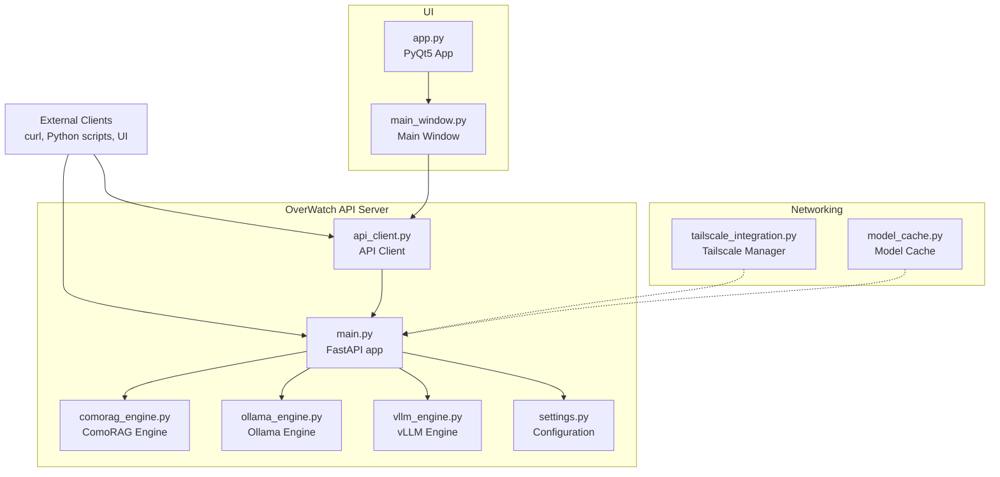
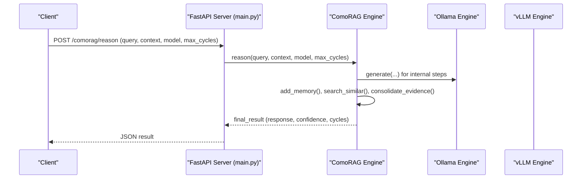
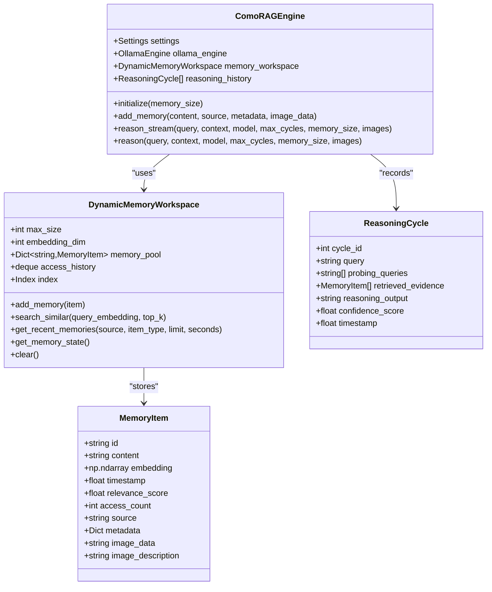
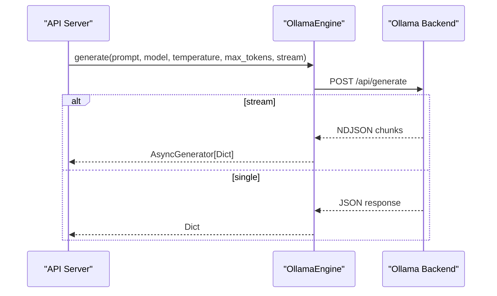
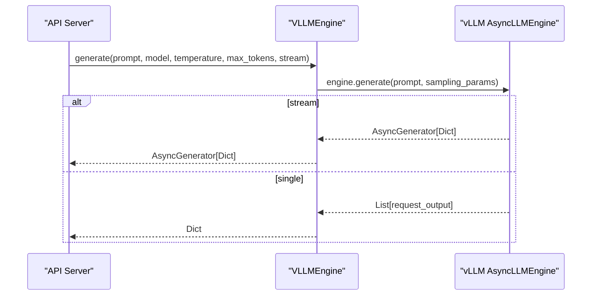
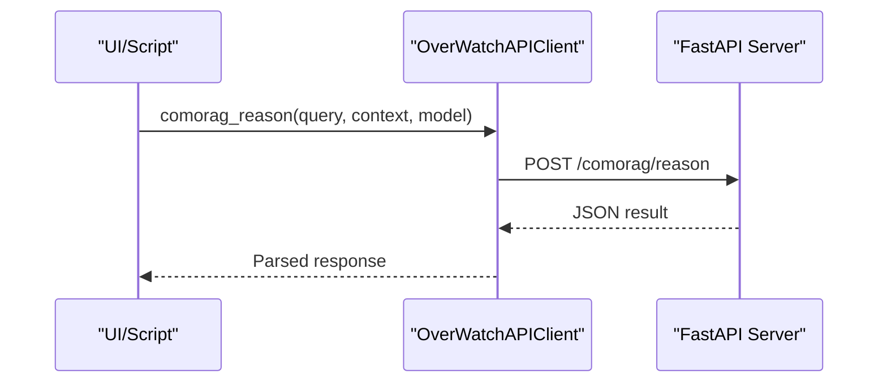
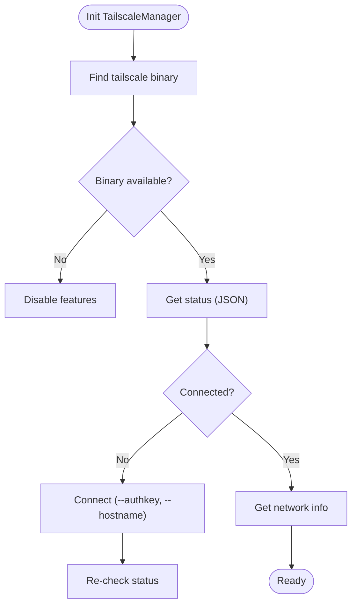
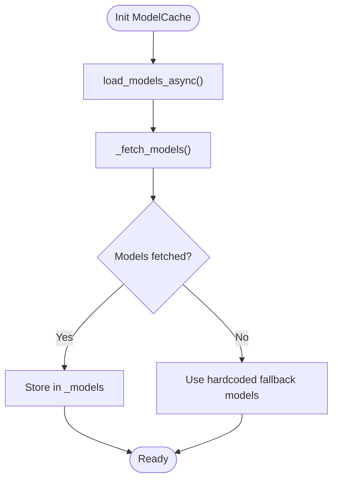
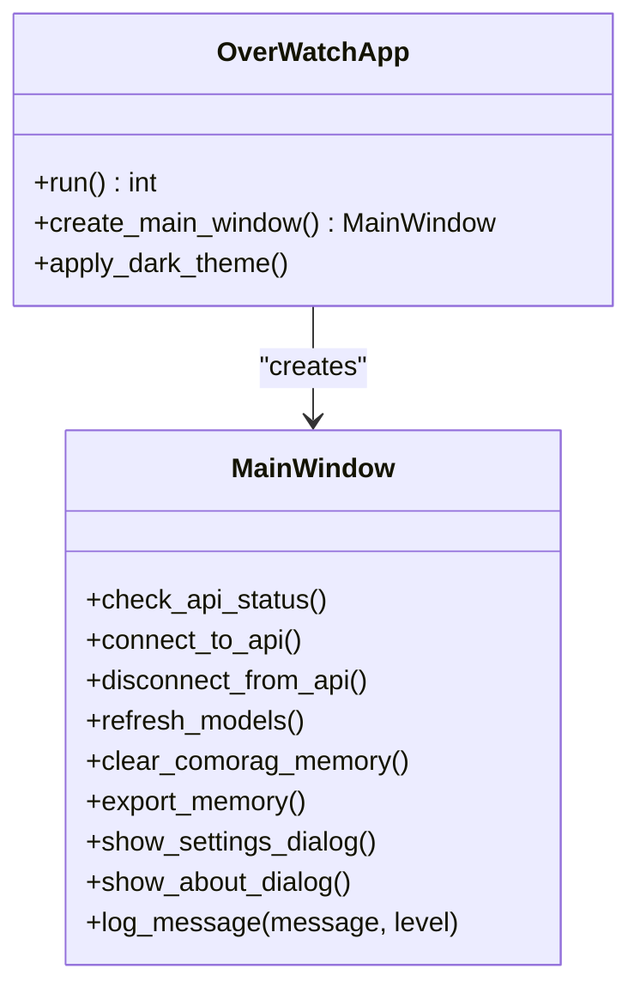
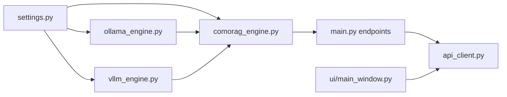

# ComoRAG Engine

<cite>
**Referenced Files in This Document**
- [comorag_engine.py](file://LoOper/AI/OverWatch/api/comorag_engine.py)
- [vllm_engine.py](file://LoOper/AI/OverWatch/api/vllm_engine.py)
- [ollama_engine.py](file://LoOper/AI/OverWatch/api/ollama_engine.py)
- [api_client.py](file://LoOper/AI/OverWatch/api/api_client.py)
- [settings.py](file://LoOper/AI/OverWatch/config/settings.py)
- [main.py](file://LoOper/AI/OverWatch/main.py)
- [tailscale_integration.py](file://LoOper/AI/OverWatch/tailscale_integration.py)
- [model_cache.py](file://LoOper/AI/model_cache.py)
- [test_comorag_stream.py](file://LoOper/AI/OverWatch/test_comorag_stream.py)
- [simple_comorag_chat.py](file://LoOper/AI/OverWatch/simple_comorag_chat.py)
- [app.py](file://LoOper/AI/OverWatch/ui/app.py)
- [main_window.py](file://LoOper/AI/OverWatch/ui/main_window.py)
</cite>

## Table of Contents
1. [Introduction](#introduction)
2. [Project Structure](#project-structure)
3. [Core Components](#core-components)
4. [Architecture Overview](#architecture-overview)
5. [Detailed Component Analysis](#detailed-component-analysis)
6. [Dependency Analysis](#dependency-analysis)
7. [Performance Considerations](#performance-considerations)
8. [Troubleshooting Guide](#troubleshooting-guide)
9. [Conclusion](#conclusion)
10. [Appendices](#appendices)

## Introduction
This document explains the ComoRAG engine architecture and its integration with the OverWatch platform. It covers advanced cognitive reasoning and retrieval-augmented generation (RAG) capabilities, memory management, and streaming inference. It also documents integration with Ollama and vLLM engines, API client communication, engine coordination, Tailscale networking, model caching, and resource management. Practical guidance is provided for configuring reasoning parameters, monitoring performance, and extending the system with custom reasoning capabilities.

## Project Structure
The ComoRAG engine resides under the OverWatch module and integrates with:
- API engines (Ollama and vLLM)
- FastAPI server exposing endpoints for reasoning, memory, and model management
- UI application for configuration and monitoring
- Tailscale integration for distributed reasoning and secure remote access
- Model cache for efficient model discovery and selection

**Diagram sources**
- [main.py:105-122](file://LoOper/AI/OverWatch/main.py#L105-L122)
- [comorag_engine.py:233-287](file://LoOper/AI/OverWatch/api/comorag_engine.py#L233-L287)
- [ollama_engine.py:34-96](file://LoOper/AI/OverWatch/api/ollama_engine.py#L34-L96)
- [vllm_engine.py:91-143](file://LoOper/AI/OverWatch/api/vllm_engine.py#L91-L143)
- [api_client.py:25-40](file://LoOper/AI/OverWatch/api/api_client.py#L25-L40)
- [settings.py:76-83](file://Looper/AI/OverWatch/config/settings.py#L76-L83)
- [app.py:21-45](file://Looper/AI/OverWatch/ui/app.py#L21-L45)
- [main_window.py:32-55](file://Looper/AI/OverWatch/ui/main_window.py#L32-L55)
- [tailscale_integration.py:43-55](file://Looper/AI/OverWatch/tailscale_integration.py#L43-L55)
- [model_cache.py:15-25](file://Looper/AI/model_cache.py#L15-L25)

**Section sources**
- [main.py:105-122](file://Looper/AI/OverWatch/main.py#L105-L122)
- [settings.py:76-83](file://Looper/AI/OverWatch/config/settings.py#L76-L83)

## Core Components
- ComoRAG Engine: Implements cognitive-inspired memory-organized RAG with dynamic memory workspace, probing queries, evidence consolidation, confidence scoring, and iterative final response generation.
- Ollama Engine: Provides model loading, inference, embeddings, and streaming via the Ollama backend.
- vLLM Engine: Provides high-throughput asynchronous inference for HuggingFace models with configurable GPU/CPU execution.
- API Client: Communicates with the OverWatch API server for health checks, model management, memory operations, and reasoning.
- Settings: Centralized configuration for Ollama, ComoRAG, API, Tailscale, and logging.
- UI Application: PyQt5-based desktop app for connecting to the API, managing models, and monitoring memory and logs.
- Tailscale Integration: Secure networking and distributed reasoning via Tailscale.
- Model Cache: Preloads and caches model lists to avoid UI blocking and improve responsiveness.

**Section sources**
- [comorag_engine.py:233-287](file://Looper/AI/OverWatch/api/comorag_engine.py#L233-L287)
- [ollama_engine.py:34-96](file://Looper/AI/OverWatch/api/ollama_engine.py#L34-L96)
- [vllm_engine.py:91-143](file://Looper/AI/OverWatch/api/vllm_engine.py#L91-L143)
- [api_client.py:25-40](file://Looper/AI/OverWatch/api/api_client.py#L25-L40)
- [settings.py:76-83](file://Looper/AI/OverWatch/config/settings.py#L76-L83)
- [app.py:21-45](file://Looper/AI/OverWatch/ui/app.py#L21-L45)
- [main_window.py:32-55](file://Looper/AI/OverWatch/ui/main_window.py#L32-L55)
- [tailscale_integration.py:43-55](file://Looper/AI/OverWatch/tailscale_integration.py#L43-L55)
- [model_cache.py:15-25](file://Looper/AI/model_cache.py#L15-L25)

## Architecture Overview
The system initializes engines, exposes REST endpoints, and coordinates reasoning across memory, retrieval, and generation. The UI connects to the API, while clients can use the API client module or direct HTTP calls.

**Diagram sources**
- [main.py:602-629](file://Looper/AI/OverWatch/main.py#L602-L629)
- [comorag_engine.py:328-642](file://Looper/AI/OverWatch/api/comorag_engine.py#L328-L642)
- [ollama_engine.py:519-574](file://Looper/AI/OverWatch/api/ollama_engine.py#L519-L574)

## Detailed Component Analysis

### ComoRAG Engine
- Memory Workspace: Maintains a bounded pool of memory items with FAISS-based similarity search and LRU-like eviction. Supports structured JSON context ingestion for large-screen mapping scenarios.
- Reasoning Loop: Iterative probing, retrieval, consolidation, confidence calculation, and optional exploratory query refinement until convergence or cycle limit.
- Streaming: Emits structured events (logs, cycles, probing queries, evidence, reasoning output, confidence, final result) enabling real-time UI updates.
- Vision Integration: Optional image analysis pipeline integrated into the reasoning loop.
- Final Response Generation: Iterative consolidation of reasoning cycles to bypass context limits and produce detailed outputs.

**Diagram sources**
- [comorag_engine.py:51-231](file://Looper/AI/OverWatch/api/comorag_engine.py#L51-L231)
- [comorag_engine.py:233-664](file://Looper/AI/OverWatch/api/comorag_engine.py#L233-L664)

**Section sources**
- [comorag_engine.py:82-231](file://Looper/AI/OverWatch/api/comorag_engine.py#L82-L231)
- [comorag_engine.py:328-664](file://Looper/AI/OverWatch/api/comorag_engine.py#L328-L664)

### Ollama Engine
- Initializes an aiohttp session, ensures Ollama availability, loads default models, and provides embeddings, generation, and streaming.
- Handles model lifecycle, pulls missing models, and normalizes responses for downstream components.
- Supports ephemeral inference and cleanup hooks.

**Diagram sources**
- [ollama_engine.py:519-626](file://Looper/AI/OverWatch/api/ollama_engine.py#L519-L626)

**Section sources**
- [ollama_engine.py:34-96](file://Looper/AI/OverWatch/api/ollama_engine.py#L34-L96)
- [ollama_engine.py:519-626](file://Looper/AI/OverWatch/api/ollama_engine.py#L519-L626)

### vLLM Engine
- Asynchronous inference engine for HuggingFace models with configurable GPU/CPU execution, tensor parallelism, and quantization.
- Provides streaming and non-streaming generation, chat completion, and model lifecycle management.

**Diagram sources**
- [vllm_engine.py:249-318](file://Looper/AI/OverWatch/api/vllm_engine.py#L249-L318)

**Section sources**
- [vllm_engine.py:91-143](file://Looper/AI/OverWatch/api/vllm_engine.py#L91-L143)
- [vllm_engine.py:249-378](file://Looper/AI/OverWatch/api/vllm_engine.py#L249-L378)

### API Client and Server Coordination
- API Client encapsulates HTTP requests to the OverWatch server for health checks, model management, memory operations, and reasoning.
- Server endpoints expose health, models, embeddings, generation, streaming, and ComoRAG-specific routes.

**Diagram sources**
- [api_client.py:147-168](file://Looper/AI/OverWatch/api/api_client.py#L147-L168)
- [main.py:602-629](file://Looper/AI/OverWatch/main.py#L602-L629)

**Section sources**
- [api_client.py:25-203](file://Looper/AI/OverWatch/api/api_client.py#L25-L203)
- [main.py:352-746](file://Looper/AI/OverWatch/main.py#L352-L746)

### Tailscale Integration
- Manages Tailscale connectivity, status, device discovery, and network configuration for secure distributed reasoning.
- Provides auto-configuration and connectivity testing for the OverWatch API.

**Diagram sources**
- [tailscale_integration.py:43-180](file://Looper/AI/OverWatch/tailscale_integration.py#L43-L180)

**Section sources**
- [tailscale_integration.py:43-391](file://Looper/AI/OverWatch/tailscale_integration.py#L43-L391)

### Model Cache
- Preloads model lists asynchronously, falls back to hardcoded defaults on failure, and exposes convenience functions for UI responsiveness.

**Diagram sources**
- [model_cache.py:36-110](file://Looper/AI/model_cache.py#L36-L110)

**Section sources**
- [model_cache.py:15-217](file://Looper/AI/model_cache.py#L15-L217)

### UI Application
- PyQt5 application with menus, toolbars, tabs for models, reasoning, memory, and logs.
- Integrates API client for health checks, model refresh, memory operations, and settings management.

**Diagram sources**
- [app.py:21-45](file://Looper/AI/OverWatch/ui/app.py#L21-L45)
- [main_window.py:32-55](file://Looper/AI/OverWatch/ui/main_window.py#L32-L55)

**Section sources**
- [app.py:21-436](file://Looper/AI/OverWatch/ui/app.py#L21-L436)
- [main_window.py:32-462](file://Looper/AI/OverWatch/ui/main_window.py#L32-L462)

## Dependency Analysis
- Engine initialization order: Ollama engine initializes first, then ComoRAG engine uses it for internal steps.
- Streaming relies on structured NDJSON events emitted by the engine and consumed by clients.
- Settings drive engine behavior and API exposure, including Tailscale configuration for distributed access.

**Diagram sources**
- [settings.py:76-83](file://Looper/AI/OverWatch/config/settings.py#L76-L83)
- [main.py:50-75](file://Looper/AI/OverWatch/main.py#L50-L75)
- [comorag_engine.py:233-287](file://Looper/AI/OverWatch/api/comorag_engine.py#L233-L287)

**Section sources**
- [main.py:50-75](file://Looper/AI/OverWatch/main.py#L50-L75)
- [settings.py:328-380](file://Looper/AI/OverWatch/config/settings.py#L328-L380)

## Performance Considerations
- Memory Management
  - FAISS-enabled similarity search accelerates retrieval; fallback to cosine similarity is provided when unavailable.
  - Periodic eviction removes least-accessed items to maintain bounded memory.
  - Structured JSON parsing splits large contexts into discrete memory items to improve retrieval granularity.
- Streaming
  - NDJSON streaming enables incremental UI updates and early feedback.
  - Streaming endpoints for generation and reasoning reduce latency perception.
- Model Execution
  - Ollama engine supports ephemeral inference to free resources after use.
  - vLLM engine supports CPU/GPU configuration and quantization to balance throughput and memory.
- Networking
  - Tailscale reduces latency and improves reliability for distributed reasoning.
  - Model cache avoids repeated network calls to discover models.

[No sources needed since this section provides general guidance]

## Troubleshooting Guide
- Memory Leaks
  - Ensure proper cleanup of engines and sessions. The cleanup routines close HTTP sessions and reset internal state.
  - For vLLM, force garbage collection and CUDA cache clearing when unloading models.
- Stream Processing Errors
  - Verify NDJSON parsing on the client side and handle partial lines gracefully.
  - Confirm streaming endpoints are invoked with appropriate parameters.
- Performance Bottlenecks
  - Monitor memory usage via health endpoints and adjust memory pool sizes.
  - Enable FAISS for faster similarity search; otherwise expect slower fallback behavior.
  - Use ephemeral inference to release model resources promptly.
- Connectivity Issues
  - Use Tailscale manager to check connectivity and auto-configure network settings.
  - Validate API URL resolution from settings and environment variables.

**Section sources**
- [vllm_engine.py:219-248](file://Looper/AI/OverWatch/api/vllm_engine.py#L219-L248)
- [vllm_engine.py:441-452](file://Looper/AI/OverWatch/api/vllm_engine.py#L441-L452)
- [ollama_engine.py:722-737](file://Looper/AI/OverWatch/api/ollama_engine.py#L722-L737)
- [tailscale_integration.py:298-391](file://Looper/AI/OverWatch/tailscale_integration.py#L298-L391)

## Conclusion
The ComoRAG engine delivers advanced cognitive reasoning with robust memory management, streaming inference, and flexible integration with Ollama and vLLM. The OverWatch API server and UI provide practical control surfaces, while Tailscale and model caching enhance distribution and performance. Proper configuration of reasoning parameters, careful resource management, and structured error handling ensure reliable operation across diverse workloads.

[No sources needed since this section summarizes without analyzing specific files]

## Appendices

### Example Reasoning Workflows
- Basic reasoning with streaming:
  - Use the streaming endpoint to receive structured events for each reasoning cycle.
  - See [test_comorag_stream.py:22-137](file://Looper/AI/OverWatch/test_comorag_stream.py#L22-L137) for a client that consumes NDJSON events.
- Memory persistence and inspection:
  - Add memory items via the API and inspect state using dedicated endpoints.
  - See [simple_comorag_chat.py:50-72](file://Looper/AI/OverWatch/simple_comorag_chat.py#L50-L72) for a simple client that reasons with context.
- Response streaming:
  - The server emits NDJSON lines for logs, cycles, probing queries, evidence, reasoning output, confidence, and final results.

**Section sources**
- [test_comorag_stream.py:22-137](file://Looper/AI/OverWatch/test_comorag_stream.py#L22-L137)
- [simple_comorag_chat.py:50-72](file://Looper/AI/OverWatch/simple_comorag_chat.py#L50-L72)
- [main.py:632-657](file://Looper/AI/OverWatch/main.py#L632-L657)

### Configuring Reasoning Parameters
- Adjust ComoRAG settings (memory size, max cycles, confidence threshold) via configuration or environment variables.
- Configure API host/port, Tailscale settings, and logging levels centrally.

**Section sources**
- [settings.py:32-83](file://Looper/AI/OverWatch/config/settings.py#L32-L83)
- [settings.py:128-174](file://Looper/AI/OverWatch/config/settings.py#L128-L174)

### Monitoring Engine Performance
- Health endpoint reports engine readiness, loaded models, and memory usage.
- Use UI status widgets and periodic checks to monitor connectivity and performance.

**Section sources**
- [main.py:352-382](file://Looper/AI/OverWatch/main.py#L352-L382)
- [main_window.py:289-312](file://Looper/AI/OverWatch/ui/main_window.py#L289-L312)

### Extending the System
- Add custom reasoning capabilities by integrating new prompts or external tools within the engine’s reasoning loop.
- Extend API endpoints to support additional workflows and expose them through the FastAPI app.

**Section sources**
- [comorag_engine.py:328-664](file://Looper/AI/OverWatch/api/comorag_engine.py#L328-L664)
- [main.py:352-746](file://Looper/AI/OverWatch/main.py#L352-L746)