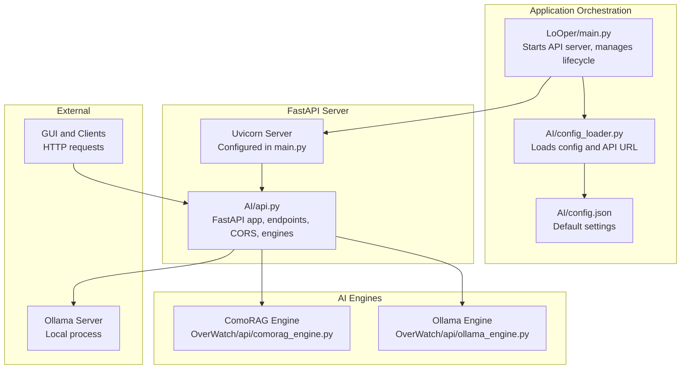
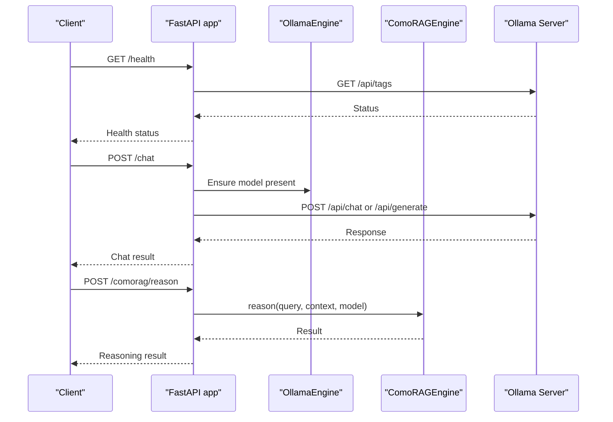
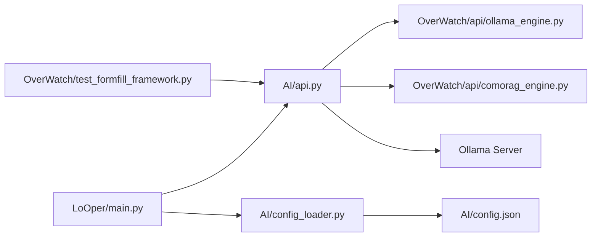

# Local API Server

<cite>
**Referenced Files in This Document**
- [api.py](file://LoOper/AI/api.py)
- [main.py](file://LoOper/main.py)
- [config_loader.py](file://LoOper/AI/config_loader.py)
- [config.json](file://LoOper/AI/config.json)
- [ollama_engine.py](file://LoOper/AI/OverWatch/api/ollama_engine.py)
- [comorag_engine.py](file://LoOper/AI/OverWatch/api/comorag_engine.py)
- [api_client.py](file://LoOper/AI/OverWatch/api/api_client.py)
- [test_formfill_framework.py](file://LoOper/AI/OverWatch/test_formfill_framework.py)
</cite>

## Table of Contents
1. [Introduction](#introduction)
2. [Project Structure](#project-structure)
3. [Core Components](#core-components)
4. [Architecture Overview](#architecture-overview)
5. [Detailed Component Analysis](#detailed-component-analysis)
6. [Dependency Analysis](#dependency-analysis)
7. [Performance Considerations](#performance-considerations)
8. [Troubleshooting Guide](#troubleshooting-guide)
9. [Conclusion](#conclusion)
10. [Appendices](#appendices)

## Introduction
This document explains the local API server built with FastAPI that exposes AI capabilities within the application. It covers server initialization, Uvicorn management, CORS configuration, security settings, endpoint structure, request/response schemas, error handling, concurrency, lifecycle management, logging, and integration with the GUI and external clients. It also provides guidance for monitoring, debugging, and optimizing the server for production use.

## Project Structure
The local API server is implemented as a FastAPI application that integrates:
- A Tailscale-aware gateway to a local Ollama instance
- Optional embedded AI engines (ComoRAG and Ollama engine)
- A CLI entrypoint for standalone operation
- Application orchestration that starts/stops the server and initializes engines

**Diagram sources**
- [main.py:171-353](file://LoOper/main.py#L171-L353)
- [api.py:37-50](file://LoOper/AI/api.py#L37-L50)
- [ollama_engine.py:34-96](file://LoOper/AI/OverWatch/api/ollama_engine.py#L34-L96)
- [comorag_engine.py:82-200](file://LoOper/AI/OverWatch/api/comorag_engine.py#L82-L200)

**Section sources**
- [api.py:37-50](file://LoOper/AI/api.py#L37-L50)
- [main.py:171-353](file://LoOper/main.py#L171-L353)
- [config_loader.py:9-66](file://LoOper/AI/config_loader.py#L9-L66)
- [config.json:1-9](file://LoOper/AI/config.json#L1-L9)

## Core Components
- FastAPI application with endpoints for health, model listing, chat/generate, streaming, embeddings, vision model discovery, and ComoRAG reasoning.
- CORS middleware configured for Tailscale network access.
- Uvicorn server management in-process and as a subprocess, with configurable host/port and logging.
- Environment-driven configuration for Ollama base URL, API host/port, and Tailscale integration.
- Optional embedded engines (OllamaEngine and ComoRAGEngine) initialized on demand.
- Robust error handling with HTTP exceptions and fallback logic.

**Section sources**
- [api.py:37-50](file://LoOper/AI/api.py#L37-L50)
- [api.py:581-761](file://LoOper/AI/api.py#L581-L761)
- [api.py:1066-1116](file://LoOper/AI/api.py#L1066-L1116)
- [main.py:171-353](file://LoOper/main.py#L171-L353)

## Architecture Overview
The server acts as a gateway to Ollama and optionally hosts local AI engines. It supports:
- Health checks against Ollama
- Listing models and vision-capable models
- Chat and generation with optional image inputs
- Streaming generation
- Embeddings with robust fallbacks
- ComoRAG reasoning and streaming
- Cleanup utilities for model runners

**Diagram sources**
- [api.py:581-601](file://LoOper/AI/api.py#L581-L601)
- [api.py:655-761](file://LoOper/AI/api.py#L655-L761)
- [api.py:1117-1170](file://LoOper/AI/api.py#L1117-L1170)
- [ollama_engine.py:153-159](file://LoOper/AI/OverWatch/api/ollama_engine.py#L153-L159)
- [comorag_engine.py:82-200](file://LoOper/AI/OverWatch/api/comorag_engine.py#L82-L200)

## Detailed Component Analysis

### Server Initialization and Lifecycle
- In-process server: The application constructs a Uvicorn Config with a custom log configuration and runs the server in a dedicated thread. Logs are written to a file under the executable’s logs directory.
- Subprocess server: When not in a frozen environment, the application spawns a subprocess running the API module directly, forwarding stdout/stderr and registering an atexit handler to terminate the process cleanly.
- Startup events: The FastAPI app initializes engines on startup and lazily creates them on first use.

Key behaviors:
- Host and port are derived from environment variables and configuration.
- Logging configuration uses uvicorn formatters when available, with a fallback to standard logging formatters.
- Graceful shutdown is handled via atexit and process termination signals.

**Section sources**
- [main.py:171-353](file://LoOper/main.py#L171-L353)
- [api.py:1066-1116](file://LoOper/AI/api.py#L1066-L1116)

### Uvicorn Management
- In-process: Creates uvicorn.Config(app, host, port, log_level, log_config), then uvicorn.Server(config).run() in a daemon thread.
- Subprocess: Spawns a new Python process pointing to the API module path, captures output, and forwards it to stdout/stderr.
- Port conflict handling: The subprocess path waits briefly and checks process exit status; the in-process path relies on Uvicorn to report binding failures.

**Section sources**
- [main.py:198-270](file://LoOper/main.py#L198-L270)
- [main.py:281-353](file://LoOper/main.py#L281-L353)

### CORS Configuration and Security
- CORS middleware is configured to allow all origins, methods, and headers, enabling access from Tailscale networks and browsers.
- Security posture:
  - CORS is permissive for local/Tailscale contexts; adjust origins in production deployments.
  - No authentication or rate limiting is implemented in the API server; restrict exposure and use secure transport.
  - Environment variables control host/port and Ollama base URL; keep sensitive configuration out of public repos.

**Section sources**
- [api.py:43-50](file://LoOper/AI/api.py#L43-L50)

### API Endpoint Structure and Schemas
- Root: Returns server metadata, environment variable hints, and endpoint summaries.
- Health: Checks Ollama availability and bootstrap status.
- Models: Lists Ollama models with metadata.
- Vision models: Filters models capable of vision processing.
- Chat/Generate: Supports text prompts and optional images for vision models; includes streaming variant.
- Embeddings: Robust normalization across Ollama endpoints and fallbacks.
- Cleanup: Stops model runners and cleans up resources.
- ComoRAG: Local reasoning and streaming, with status and memory management endpoints.

Request/response models:
- ChatRequest: model, prompt/messages, stream, temperature, max_tokens, system, images, cleanup_after
- ChatResponse: response, model, created_at, done, plus timing metrics
- EmbeddingsRequest/Response: inputs, normalize, pooling, embeddings
- ModelInfo: name, size, digest, modified_at
- ComoRAGReasonRequest: query, model, max_cycles, memory_size, context, images, max_tokens, temperature
- ComoRAGAddMemoryRequest: content, source, metadata, image_data

Error handling patterns:
- HTTPException with explicit status codes for timeouts, communication failures, and validation errors.
- Fallback logic for model detection and embeddings endpoints.
- Background cleanup tasks to release model runners.

**Section sources**
- [api.py:547-579](file://LoOper/AI/api.py#L547-L579)
- [api.py:581-601](file://LoOper/AI/api.py#L581-L601)
- [api.py:608-653](file://LoOper/AI/api.py#L608-L653)
- [api.py:997-1029](file://LoOper/AI/api.py#L997-L1029)
- [api.py:655-761](file://LoOper/AI/api.py#L655-L761)
- [api.py:768-793](file://LoOper/AI/api.py#L768-L793)
- [api.py:795-980](file://LoOper/AI/api.py#L795-L980)
- [api.py:981-995](file://LoOper/AI/api.py#L981-L995)
- [api.py:1046-1064](file://LoOper/AI/api.py#L1046-L1064)
- [api.py:1117-1170](file://LoOper/AI/api.py#L1117-L1170)
- [api.py:1172-1228](file://LoOper/AI/api.py#L1172-L1228)
- [api.py:1230-1291](file://LoOper/AI/api.py#L1230-L1291)
- [api.py:1293-1383](file://LoOper/AI/api.py#L1293-L1383)

### Integration with AI Engines
- OllamaEngine: Manages model loading, status checks, and runner cleanup. Used by the API for model availability and inference.
- ComoRAGEngine: Provides stateful reasoning and streaming. The API lazily initializes and uses it for advanced workflows.

Initialization:
- On startup, the app attempts to create engines and initialize them asynchronously.
- Endpoints may lazily create engines if not present.

**Section sources**
- [api.py:1066-1116](file://LoOper/AI/api.py#L1066-L1116)
- [ollama_engine.py:34-96](file://LoOper/AI/OverWatch/api/ollama_engine.py#L34-L96)
- [comorag_engine.py:82-200](file://LoOper/AI/OverWatch/api/comorag_engine.py#L82-L200)

### Logging Configuration
- In-process server: Uses a custom log_config with uvicorn.DefaultFormatter and AccessFormatter, writing to a file under the executable’s logs directory.
- Fallback: If uvicorn formatters are unavailable, falls back to standard logging formatters.
- Subprocess server: Inherits logging configuration from the parent process; output is forwarded to stdout/stderr.

**Section sources**
- [main.py:207-258](file://LoOper/main.py#L207-L258)
- [api.py:1406-1447](file://LoOper/AI/api.py#L1406-L1447)

### Concurrency and Background Tasks
- Streaming endpoints use StreamingResponse to emit ND-JSON chunks.
- Background tasks clean up model runners after requests.
- Thread-based startup for bootstrap and engine initialization.
- Subprocess-based server with output forwarding threads.

**Section sources**
- [api.py:768-793](file://LoOper/AI/api.py#L768-L793)
- [api.py:742-743](file://LoOper/AI/api.py#L742-L743)
- [api.py:1393-1403](file://LoOper/AI/api.py#L1393-L1403)
- [main.py:339-340](file://LoOper/main.py#L339-L340)

### Graceful Shutdown Procedures
- In-process server: Runs inside a thread; atexit handler triggers process termination for subprocess mode.
- Subprocess server: atexit registers a cleanup routine that terminates the child process tree on Windows or sends termination signals on Unix-like systems.

**Section sources**
- [main.py:310-326](file://LoOper/main.py#L310-L326)
- [main.py:314-318](file://LoOper/main.py#L314-L318)

## Dependency Analysis

**Diagram sources**
- [main.py:171-353](file://LoOper/main.py#L171-L353)
- [api.py:1066-1116](file://LoOper/AI/api.py#L1066-L1116)
- [ollama_engine.py:34-96](file://LoOper/AI/OverWatch/api/ollama_engine.py#L34-L96)
- [comorag_engine.py:82-200](file://LoOper/AI/OverWatch/api/comorag_engine.py#L82-L200)
- [config_loader.py:9-66](file://LoOper/AI/config_loader.py#L9-L66)
- [config.json:1-9](file://LoOper/AI/config.json#L1-L9)
- [test_formfill_framework.py:72-85](file://LoOper/AI/OverWatch/test_formfill_framework.py#L72-L85)

**Section sources**
- [main.py:171-353](file://LoOper/main.py#L171-L353)
- [api.py:1066-1116](file://LoOper/AI/api.py#L1066-L1116)
- [config_loader.py:9-66](file://LoOper/AI/config_loader.py#L9-L66)

## Performance Considerations
- Model bootstrap: Background thread ensures required models are pulled; consider staggering pulls and caching model availability.
- Runner cleanup: Automatic cleanup reduces resource contention; tune cleanup_after and background tasks for workload patterns.
- Streaming: Use streaming endpoints for long-running generations to reduce latency and memory pressure.
- Embeddings: Prefer batched inputs when possible; the implementation includes robust fallbacks for various server responses.
- Logging: File-based logging avoids overhead in production; ensure disk I/O does not bottleneck under heavy load.

[No sources needed since this section provides general guidance]

## Troubleshooting Guide
Common issues and resolutions:
- Port conflicts
  - Symptom: Server fails to bind to the configured port.
  - Resolution: Change API_PORT or stop the conflicting process. In subprocess mode, the application checks process status briefly; verify logs for binding errors.
  - Section sources
    - [main.py:289-300](file://LoOper/main.py#L289-L300)
    - [api.py:1386-1388](file://LoOper/AI/api.py#L1386-L1388)

- CORS problems
  - Symptom: Browser or client receives CORS errors despite permissive settings.
  - Resolution: Confirm that the client origin matches the allowed pattern; for production, tighten allowed_origins to trusted domains.
  - Section sources
    - [api.py:43-50](file://LoOper/AI/api.py#L43-L50)

- Ollama connectivity
  - Symptom: Health endpoint reports unhealthy or endpoints timeout.
  - Resolution: Verify OLLAMA_HOST and OLLAMA_PORT; ensure the Ollama server is running and reachable.
  - Section sources
    - [api.py:53-59](file://LoOper/AI/api.py#L53-L59)
    - [api.py:581-601](file://LoOper/AI/api.py#L581-L601)

- Model not found or slow loads
  - Symptom: Requests hang or fail due to missing models.
  - Resolution: Use bootstrap endpoints or ensure models are present; consider increasing timeouts and enabling cleanup_after.
  - Section sources
    - [api.py:181-216](file://LoOper/AI/api.py#L181-L216)
    - [api.py:664-667](file://LoOper/AI/api.py#L664-L667)

- Streaming errors
  - Symptom: Client stops receiving chunks or receives partial data.
  - Resolution: Validate client-side ND-JSON parsing; ensure network stability and adequate timeouts.
  - Section sources
    - [api.py:768-793](file://LoOper/AI/api.py#L768-L793)

- Logging and diagnostics
  - Symptom: Difficulty tracing server activity.
  - Resolution: Check the API log file under the executable’s logs directory; enable debug prints during development.
  - Section sources
    - [main.py:206-207](file://LoOper/main.py#L206-L207)
    - [api.py:1406-1447](file://LoOper/AI/api.py#L1406-L1447)

## Conclusion
The local API server provides a robust, Tailscale-friendly gateway to Ollama with optional embedded AI engines. It supports essential operations—health checks, model management, chat/generation, streaming, embeddings, and reasoning—while offering flexible startup modes, logging, and cleanup. For production, tighten CORS, add authentication, monitor resource usage, and configure reliable storage for logs and model caches.

[No sources needed since this section summarizes without analyzing specific files]

## Appendices

### Example: Starting and Stopping the Server
- Start in-process: Call the server starter from the main application; it configures Uvicorn, sets up logging, and runs the server in a thread.
- Start as subprocess: Launch the API module directly; the parent process forwards output and registers cleanup.
- Stop gracefully: Use atexit handlers to terminate the subprocess or rely on process signals.

**Section sources**
- [main.py:171-353](file://LoOper/main.py#L171-L353)

### Example: Handling Concurrent Requests
- Streaming endpoints emit ND-JSON chunks incrementally.
- Background tasks handle cleanup after requests complete.
- Thread-based initialization prevents blocking the main thread.

**Section sources**
- [api.py:768-793](file://LoOper/AI/api.py#L768-L793)
- [api.py:742-743](file://LoOper/AI/api.py#L742-L743)
- [api.py:1393-1403](file://LoOper/AI/api.py#L1393-L1403)

### Monitoring and Debugging
- Health endpoint: Monitor Ollama availability and bootstrap status.
- Logs: Inspect the API log file for request traces and errors.
- Client testing: Use the included API client to exercise endpoints and validate responses.

**Section sources**
- [api.py:581-601](file://LoOper/AI/api.py#L581-L601)
- [main.py:206-207](file://LoOper/main.py#L206-L207)
- [api_client.py:48-76](file://LoOper/AI/OverWatch/api/api_client.py#L48-L76)

### Production Hardening Checklist
- Tighten CORS to specific origins.
- Add authentication and rate limiting.
- Enable TLS termination or reverse proxy with HTTPS.
- Configure persistent logging and structured logs.
- Set up health probes and circuit breakers.
- Monitor CPU, memory, and disk usage for Ollama and engines.

[No sources needed since this section provides general guidance]