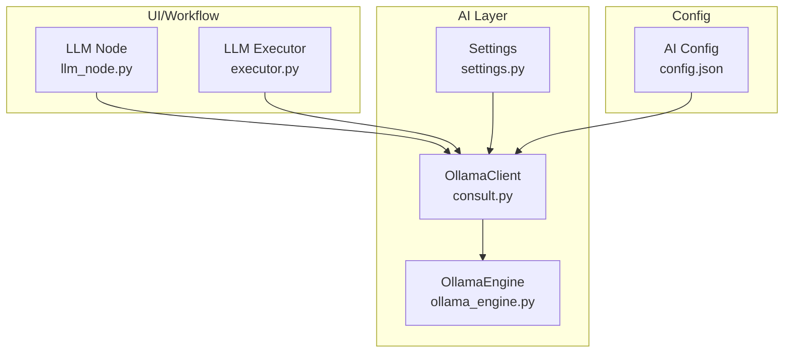
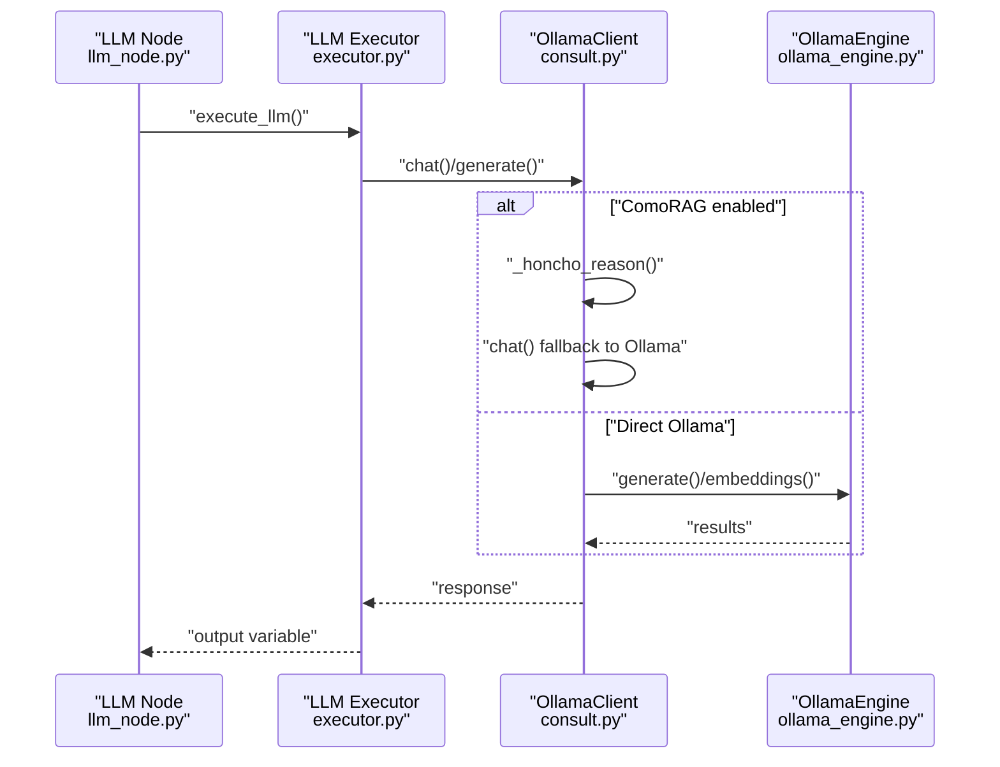
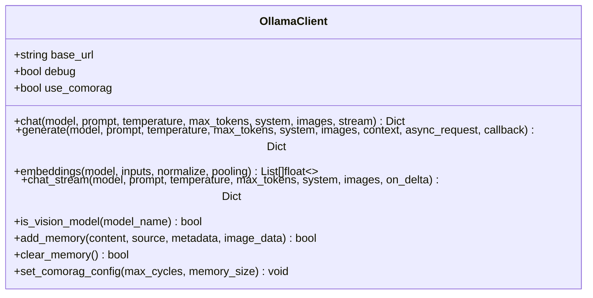
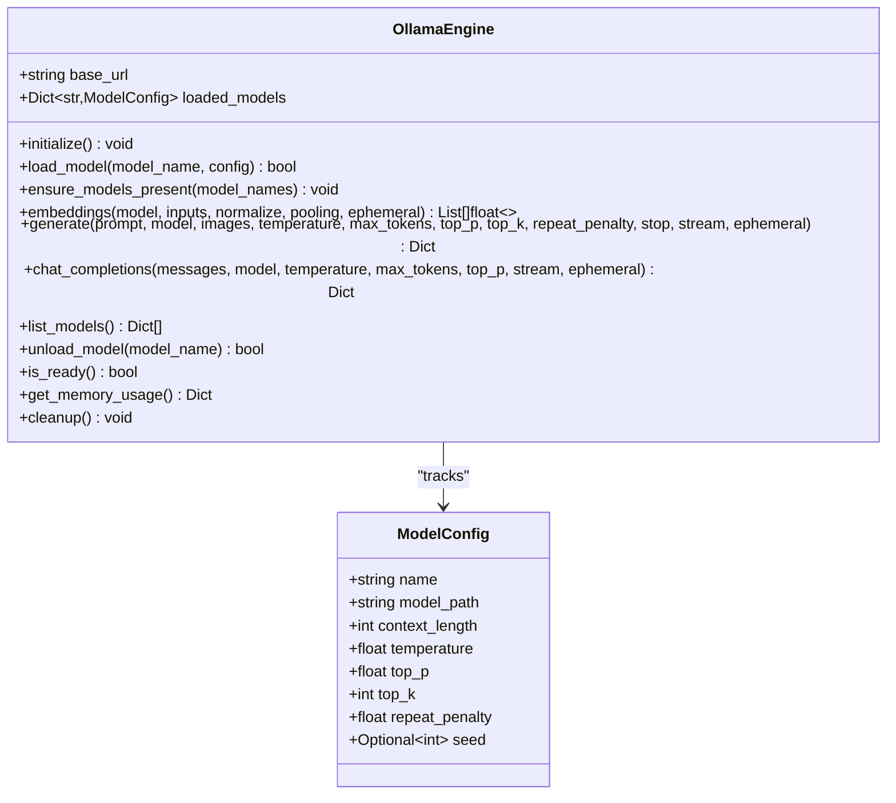
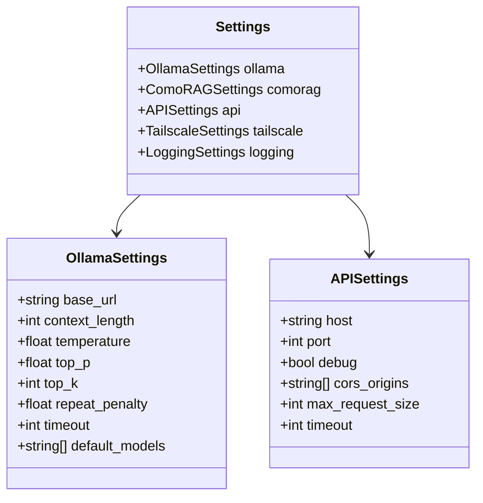
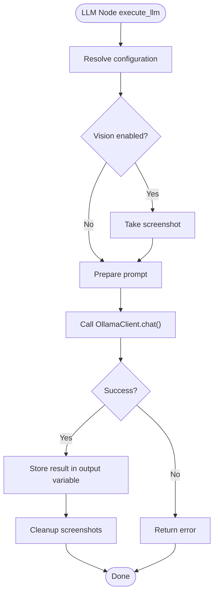
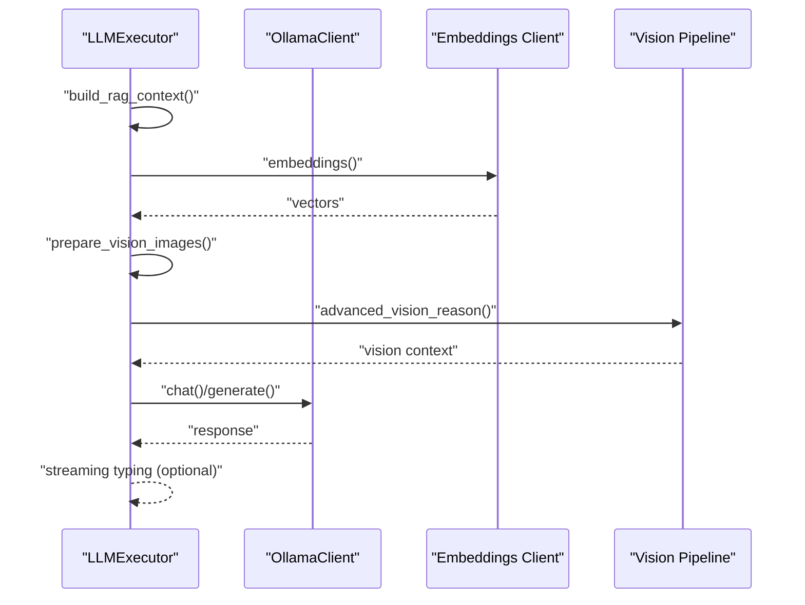
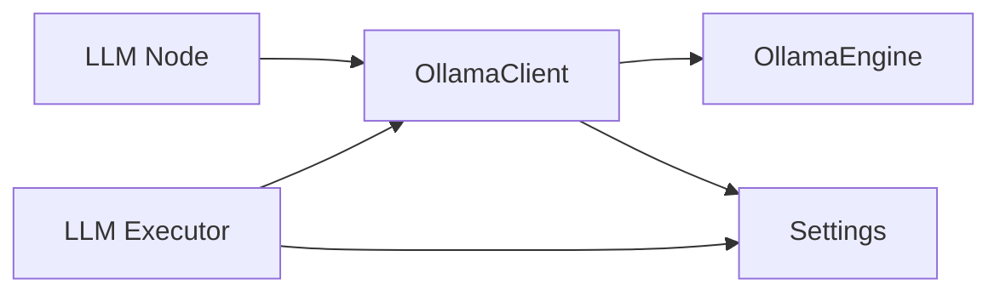

# Ollama Integration

<cite>
**Referenced Files in This Document**
- [ollama_engine.py](file://LoOper/AI/OverWatch/api/ollama_engine.py)
- [consult.py](file://LoOper/AI/consult.py)
- [settings.py](file://LoOper/AI/OverWatch/config/settings.py)
- [settings.py](file://LoOper/AI/settings.py)
- [llm_node.py](file://LoOper/NGUI/nodes_resources/llm_node.py)
- [executor.py](file://LoOper/player/multi_sequence/llm_executor_resources/executor.py)
- [config.json](file://LoOper/AI/config.json)
- [README.md](file://LoOper/README.md)
</cite>

## Table of Contents
1. [Introduction](#introduction)
2. [Project Structure](#project-structure)
3. [Core Components](#core-components)
4. [Architecture Overview](#architecture-overview)
5. [Detailed Component Analysis](#detailed-component-analysis)
6. [Dependency Analysis](#dependency-analysis)
7. [Performance Considerations](#performance-considerations)
8. [Troubleshooting Guide](#troubleshooting-guide)
9. [Conclusion](#conclusion)

## Introduction
This document explains the Ollama integration system for local Large Language Model (LLM) access and model management within the LoOper platform. It covers the Ollama client implementation, model discovery and loading, inference request handling, supported model formats, parameter configuration, response processing, and integration patterns with the visual workflow builder. Practical examples demonstrate model selection, prompt formatting, and result interpretation. The guide also details error handling for model unavailability, performance optimization techniques, and the relationship between Ollama models and workflow execution, including context management and memory handling.

## Project Structure
The Ollama integration spans several modules:
- AI client for LLM requests and embeddings
- Ollama engine for model lifecycle and inference
- Configuration settings for Ollama and API endpoints
- Visual workflow integration via LLM nodes
- Executor for workflow execution and context management

**Diagram sources**
- [consult.py:30-1394](file://LoOper/AI/consult.py#L30-L1394)
- [ollama_engine.py:34-737](file://LoOper/AI/OverWatch/api/ollama_engine.py#L34-L737)
- [settings.py:16-82](file://LoOper/AI/OverWatch/config/settings.py#L16-L82)
- [llm_node.py:11-390](file://LoOper/NGUI/nodes_resources/llm_node.py#L11-L390)
- [executor.py:22-1599](file://LoOper/player/multi_sequence/llm_executor_resources/executor.py#L22-L1599)
- [config.json:1-9](file://LoOper/AI/config.json#L1-L9)

**Section sources**
- [README.md:357-386](file://LoOper/README.md#L357-L386)
- [config.json:1-9](file://LoOper/AI/config.json#L1-L9)

## Core Components
- OllamaClient: High-level client for chat, embeddings, streaming, and vision-capable models. Supports fallback to direct Ollama endpoints and integrates with ComoRAG memory when enabled.
- OllamaEngine: Asynchronous engine for model lifecycle (status check, load, pull, test, unload), embeddings, and generation with streaming support.
- Settings: Centralized configuration for Ollama base URL, default models, timeouts, and API endpoints.
- LLM Node: Visual node in the workflow builder that exposes model selection, prompts, system messages, and vision options.
- LLM Executor: Workflow execution engine that orchestrates LLM requests, context collection, RAG, vision preprocessing, and streaming output.

**Section sources**
- [consult.py:30-1394](file://LoOper/AI/consult.py#L30-L1394)
- [ollama_engine.py:34-737](file://LoOper/AI/OverWatch/api/ollama_engine.py#L34-L737)
- [settings.py:16-82](file://LoOper/AI/OverWatch/config/settings.py#L16-L82)
- [llm_node.py:11-390](file://LoOper/NGUI/nodes_resources/llm_node.py#L11-L390)
- [executor.py:22-1599](file://LoOper/player/multi_sequence/llm_executor_resources/executor.py#L22-L1599)

## Architecture Overview
The integration follows a layered approach:
- UI/Workflow Layer: LLM nodes define model and prompt parameters; the executor resolves context, prepares inputs, and invokes the client.
- Client Layer: OllamaClient encapsulates HTTP requests, fallback logic, and streaming; optionally integrates with ComoRAG memory.
- Engine Layer: OllamaEngine manages model availability, pulls missing models, tests models, and performs embeddings and generation.
- Configuration Layer: Settings and environment variables control base URLs, ports, and default models.

**Diagram sources**
- [llm_node.py:314-390](file://Looper/NGUI/nodes_resources/llm_node.py#L314-L390)
- [executor.py:1027-1335](file://LoOper/player/multi_sequence/llm_executor_resources/executor.py#L1027-L1335)
- [consult.py:162-292](file://LoOper/AI/consult.py#L162-L292)
- [ollama_engine.py:519-626](file://LoOper/AI/OverWatch/api/ollama_engine.py#L519-L626)

## Detailed Component Analysis

### OllamaClient (consult.py)
- Purpose: Unified client for chat, embeddings, streaming, and vision. Integrates with ComoRAG memory and provides fallback to direct Ollama endpoints.
- Key capabilities:
  - Chat and generate with temperature, max_tokens, system messages, and optional images.
  - Streaming via /generate_stream or fallback to /api/generate.
  - Embeddings with batch and per-input fallbacks, supporting both new and legacy endpoints.
  - Vision model detection and image processing (base64 encoding, screen capture).
  - ComoRAG integration with Honcho-backed memory and queue processing.
- Configuration:
  - Base URL resolution from environment variables and settings.
  - Session pooling and connection management.
  - Request queuing for ComoRAG with status tracking.

**Diagram sources**
- [consult.py:30-1394](file://LoOper/AI/consult.py#L30-L1394)

**Section sources**
- [consult.py:30-1394](file://LoOper/AI/consult.py#L30-L1394)

### OllamaEngine (ollama_engine.py)
- Purpose: Asynchronous engine for model lifecycle and inference via Ollama API.
- Key capabilities:
  - Initialization with status checks and default model loading.
  - Model discovery, pulling, and testing (generation vs embedding).
  - Embeddings with normalization and fallback strategies.
  - Generation and streaming with parameter mapping and usage metrics.
  - Memory usage reporting and cleanup.
- Supported endpoints:
  - /api/tags, /api/pull, /api/generate, /api/embed, /api/embeddings, /api/ps, /api/stop.

**Diagram sources**
- [ollama_engine.py:21-737](file://LoOper/AI/OverWatch/api/ollama_engine.py#L21-L737)

**Section sources**
- [ollama_engine.py:34-737](file://LoOper/AI/OverWatch/api/ollama_engine.py#L34-L737)

### Settings and Configuration
- OllamaSettings: Base URL, context length, sampling parameters, timeout, and default models.
- APISettings/TailscaleSettings: API host/port, CORS, and Tailscale networking.
- Environment variables override configuration for flexible deployment.

**Diagram sources**
- [settings.py:16-82](file://LoOper/AI/OverWatch/config/settings.py#L16-L82)
- [settings.py:16-82](file://LoOper/AI/settings.py#L16-L82)

**Section sources**
- [settings.py:16-82](file://LoOper/AI/OverWatch/config/settings.py#L16-L82)
- [settings.py:16-82](file://LoOper/AI/settings.py#L16-L82)
- [config.json:1-9](file://LoOper/AI/config.json#L1-L9)

### LLM Node Integration (llm_node.py)
- Purpose: Visual representation of an LLM node with configurable parameters.
- Key properties:
  - Model selection, prompt, system message, temperature, max tokens, output variable.
  - Vision options: enable/disable, separate vision model, advanced vision, screenshot capture.
  - RAG options: embedding model, chunk size, overlap, top_k, and document injection.
  - Tool descriptions and intelligent tool selection.
- Execution:
  - Resolves configuration, optionally takes screenshots for vision models, and calls OllamaClient.chat().
  - Stores results in output variables and cleans up temporary screenshots.

**Diagram sources**
- [llm_node.py:314-390](file://LoOper/NGUI/nodes_resources/llm_node.py#L314-L390)

**Section sources**
- [llm_node.py:11-390](file://LoOper/NGUI/nodes_resources/llm_node.py#L11-L390)

### LLM Executor (executor.py)
- Purpose: Executes LLM nodes within workflow graphs, integrating context, RAG, and vision.
- Key responsibilities:
  - Context collection and database integration.
  - Input text extraction, OCR, and RAG context building.
  - Vision preprocessing and advanced vision pipeline.
  - Streaming typing integration and action handlers.
  - Model pre-stop optimization and memory management.
  - ComoRAG integration with memory and fallback logic.

**Diagram sources**
- [executor.py:22-1599](file://LoOper/player/multi_sequence/llm_executor_resources/executor.py#L22-L1599)

**Section sources**
- [executor.py:22-1599](file://LoOper/player/multi_sequence/llm_executor_resources/executor.py#L22-L1599)

## Dependency Analysis
- OllamaClient depends on:
  - Requests session for HTTP communication.
  - Environment variables for base URL and ports.
  - Optional ComoRAG/Honcho SDK for memory integration.
- OllamaEngine depends on:
  - aiohttp for asynchronous HTTP requests.
  - psutil for memory usage reporting.
  - Ollama API endpoints for model lifecycle and inference.
- LLM Node and Executor depend on:
  - OllamaClient for inference.
  - Context collectors and databases for memory.
  - Vision utilities for preprocessing and analysis.

**Diagram sources**
- [llm_node.py:314-390](file://LoOper/NGUI/nodes_resources/llm_node.py#L314-L390)
- [executor.py:22-1599](file://LoOper/player/multi_sequence/llm_executor_resources/executor.py#L22-L1599)
- [consult.py:30-1394](file://LoOper/AI/consult.py#L30-L1394)
- [ollama_engine.py:34-737](file://LoOper/AI/OverWatch/api/ollama_engine.py#L34-L737)
- [settings.py:16-82](file://LoOper/AI/OverWatch/config/settings.py#L16-L82)

**Section sources**
- [consult.py:30-1394](file://LoOper/AI/consult.py#L30-L1394)
- [ollama_engine.py:34-737](file://LoOper/AI/OverWatch/api/ollama_engine.py#L34-L737)
- [settings.py:16-82](file://LoOper/AI/OverWatch/config/settings.py#L16-L82)

## Performance Considerations
- Model pre-stopping: The executor queries running models and stops non-target models to free VRAM before inference, reducing contention.
- Streaming typing: Enables responsive UI updates during long generations by flushing buffered text at configurable intervals.
- Embedding reuse: Embedding models are reused across nodes when possible to reduce reload overhead.
- Vision optimization: Separate vision model pass can offload heavy analysis to a dedicated model while keeping the main model lean.
- Memory management: OllamaEngine tracks loaded models and provides memory usage metrics; cleanup routines release resources.

[No sources needed since this section provides general guidance]

## Troubleshooting Guide
Common issues and resolutions:
- Model unavailability:
  - Use ensure_models_present to pull missing models automatically.
  - Verify base URL and port; check Ollama status via /api/tags.
- API connectivity problems:
  - Confirm Ollama service is running and accessible.
  - Validate base_url and environment variables (OLLAMA_HOST, OLLAMA_PORT).
- Resource optimization:
  - Stop competing models before inference using /api/ps and /api/stop.
  - Adjust temperature, top_p, top_k, and repeat_penalty for stability.
- Vision model errors:
  - Ensure vision model names are recognized; use is_vision_model to detect capability.
  - Validate image paths or base64 encoding for vision requests.
- Streaming failures:
  - Fallback to non-streaming generation when streaming endpoints fail.
  - Tune streaming flush parameters for responsiveness.

**Section sources**
- [ollama_engine.py:153-159](file://LoOper/AI/OverWatch/api/ollama_engine.py#L153-L159)
- [executor.py:567-617](file://LoOper/player/multi_sequence/llm_executor_resources/executor.py#L567-L617)
- [consult.py:1116-1171](file://LoOper/AI/consult.py#L1116-L1171)

## Conclusion
The Ollama integration in LoOper provides a robust, configurable system for local LLM access with strong workflow integration. The OllamaClient and OllamaEngine handle model lifecycle and inference, while the LLM Node and Executor orchestrate context, RAG, and vision capabilities. Proper configuration, error handling, and performance tuning ensure reliable and efficient automation workflows.