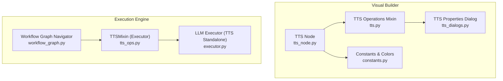
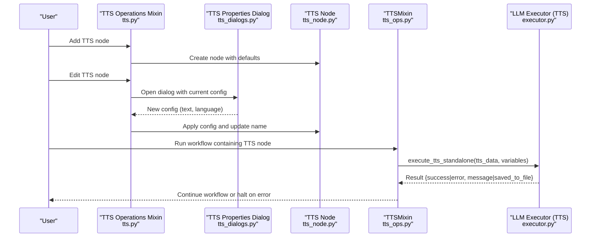
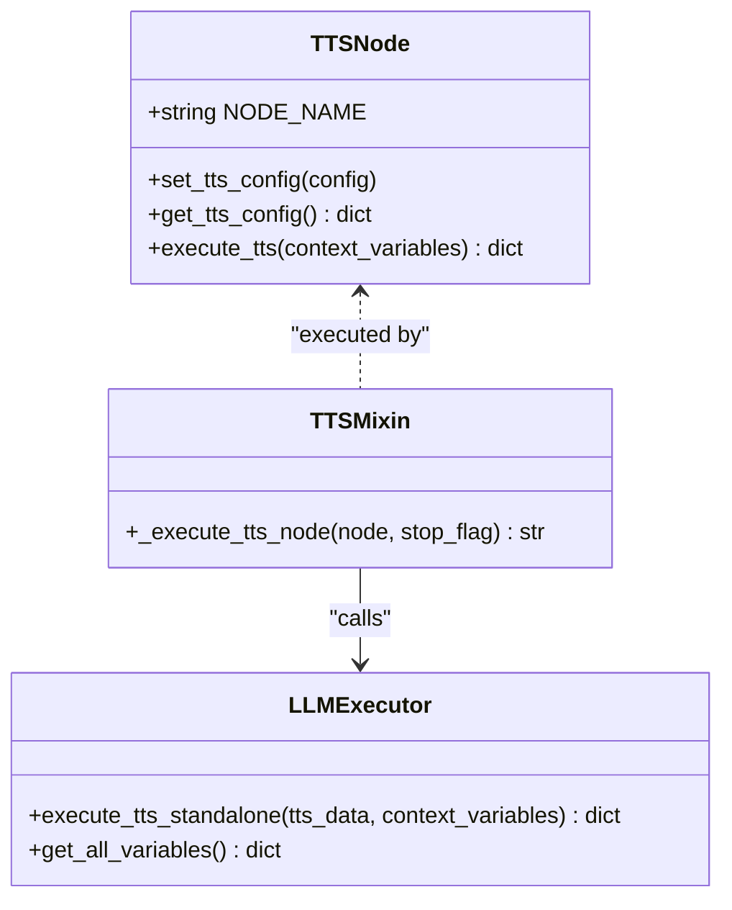
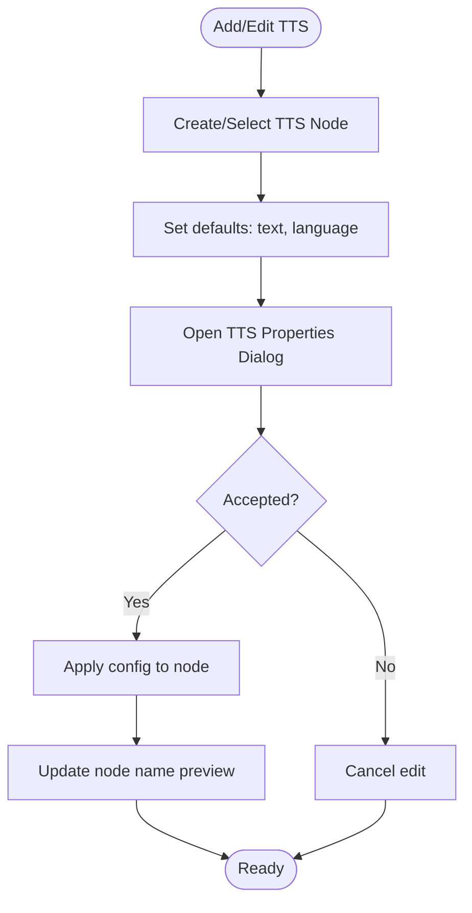
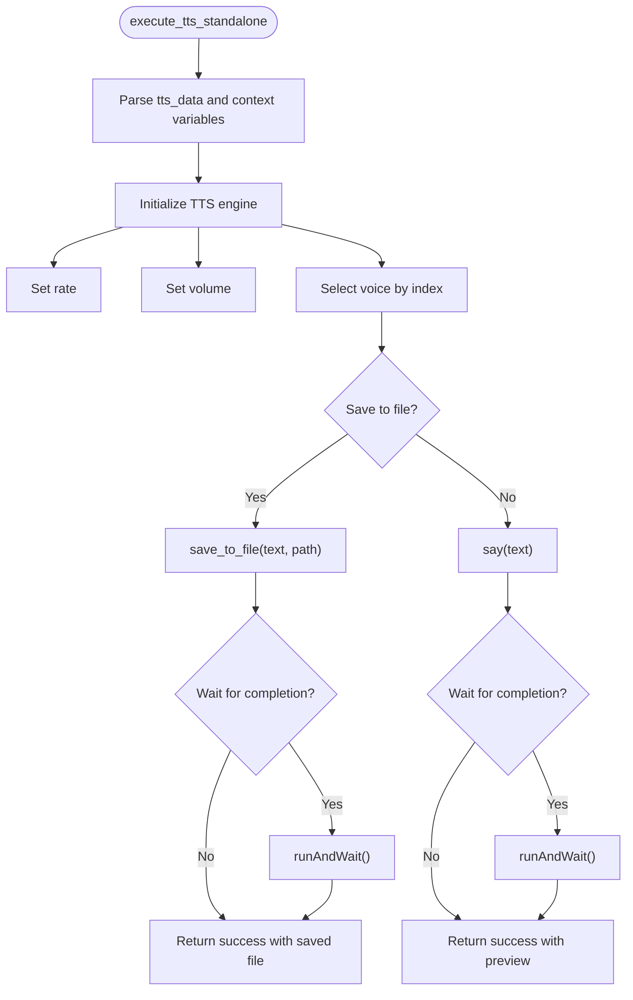
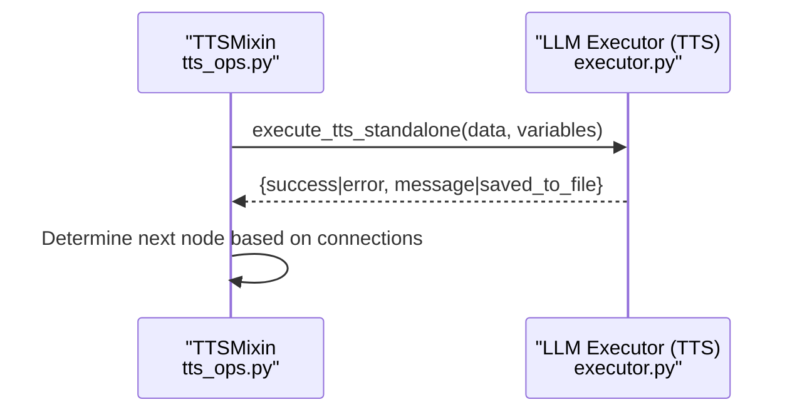
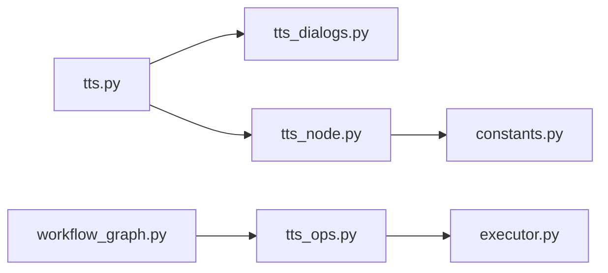

# Text-to-Speech Integration

<cite>
**Referenced Files in This Document**
- [tts.py](file://LoOper/NGUI/graph_elements/node_operations_modules/tts.py)
- [tts_dialogs.py](file://LoOper/NGUI/dialogs/tts_dialogs.py)
- [tts_node.py](file://LoOper/NGUI/nodes_resources/tts_node.py)
- [tts_ops.py](file://LoOper/player/multi_sequence/worflow_interpreter_modules/executor_modules/tts_ops.py)
- [executor.py](file://LoOper/player/multi_sequence/llm_executor_resources/executor.py)
- [constants.py](file://LoOper/NGUI/constants.py)
- [workflow_graph.py](file://LoOper/player/multi_sequence/workflow_graph.py)
</cite>

## Table of Contents
1. [Introduction](#introduction)
2. [Project Structure](#project-structure)
3. [Core Components](#core-components)
4. [Architecture Overview](#architecture-overview)
5. [Detailed Component Analysis](#detailed-component-analysis)
6. [Dependency Analysis](#dependency-analysis)
7. [Performance Considerations](#performance-considerations)
8. [Troubleshooting Guide](#troubleshooting-guide)
9. [Conclusion](#conclusion)
10. [Appendices](#appendices)

## Introduction
This document explains the Text-to-Speech (TTS) integration within the AI workflow system. It covers the TTS node implementation, the audio processing pipeline, and how TTS integrates with the visual workflow builder. It documents supported synthesis parameters, audio behavior, and the relationship between TTS operations and the playback engine. Practical guidance is included for configuring TTS nodes, integrating speech synthesis into workflows, handling audio output, and optimizing performance. Common issues such as missing libraries, voice availability, and audio device conflicts are addressed along with customization tips and troubleshooting advice.

## Project Structure
The TTS integration spans several modules:
- Visual workflow builder: node creation, editing, and property dialogs
- Audio execution: standalone TTS execution via a local engine
- Workflow executor: orchestrating TTS nodes during automated runs

**Diagram sources**
- [tts_node.py:1-150](file://LoOper/NGUI/nodes_resources/tts_node.py#L1-L150)
- [tts.py:1-77](file://LoOper/NGUI/graph_elements/node_operations_modules/tts.py#L1-L77)
- [tts_dialogs.py:1-88](file://LoOper/NGUI/dialogs/tts_dialogs.py#L1-L88)
- [constants.py:1-32](file://LoOper/NGUI/constants.py#L1-L32)
- [tts_ops.py:1-44](file://LoOper/player/multi_sequence/worflow_interpreter_modules/executor_modules/tts_ops.py#L1-L44)
- [executor.py:1846-1938](file://LoOper/player/multi_sequence/llm_executor_resources/executor.py#L1846-L1938)
- [workflow_graph.py:1-10](file://LoOper/player/multi_sequence/workflow_graph.py#L1-L10)

**Section sources**
- [tts_node.py:1-150](file://LoOper/NGUI/nodes_resources/tts_node.py#L1-L150)
- [tts.py:1-77](file://LoOper/NGUI/graph_elements/node_operations_modules/tts.py#L1-L77)
- [tts_dialogs.py:1-88](file://LoOper/NGUI/dialogs/tts_dialogs.py#L1-L88)
- [constants.py:1-32](file://LoOper/NGUI/constants.py#L1-L32)
- [tts_ops.py:1-44](file://LoOper/player/multi_sequence/worflow_interpreter_modules/executor_modules/tts_ops.py#L1-L44)
- [executor.py:1846-1938](file://LoOper/player/multi_sequence/llm_executor_resources/executor.py#L1846-L1938)
- [workflow_graph.py:1-10](file://LoOper/player/multi_sequence/workflow_graph.py#L1-L10)

## Core Components
- TTS Node: A visual node representing a TTS action with configurable properties and execution behavior.
- TTS Operations Mixin: Adds TTS node creation and editing capabilities to the visual builder.
- TTS Properties Dialog: Provides a localized UI for setting text, language, and other synthesis parameters.
- TTSMixin (Executor): Executes TTS nodes during workflow runs using a standalone TTS engine.
- LLM Executor (TTS Standalone): Implements the actual synthesis using a local engine and returns structured results.
- Constants: Defines visual theming and port colors for TTS nodes.

Key synthesis parameters exposed by the TTS node and executor include:
- text: The input text to synthesize
- language: Language code for voice selection
- rate: Speech rate (words per minute)
- volume: Volume level (0.0 to 1.0)
- voice_id: Index of the selected voice
- save_to_file: Whether to write audio to a file
- output_file: Path to the output audio file
- wait_for_completion: Whether to block until synthesis completes

**Section sources**
- [tts_node.py:82-93](file://LoOper/NGUI/nodes_resources/tts_node.py#L82-L93)
- [tts_dialogs.py:24-28](file://LoOper/NGUI/dialogs/tts_dialogs.py#L24-L28)
- [executor.py:1847-1938](file://LoOper/player/multi_sequence/llm_executor_resources/executor.py#L1847-L1938)

## Architecture Overview
The TTS pipeline connects the visual workflow builder to the execution engine. Users configure TTS nodes visually, then run workflows that execute TTS nodes using a local engine.

**Diagram sources**
- [tts.py:8-39](file://LoOper/NGUI/graph_elements/node_operations_modules/tts.py#L8-L39)
- [tts_dialogs.py:16-87](file://LoOper/NGUI/dialogs/tts_dialogs.py#L16-L87)
- [tts_node.py:68-93](file://LoOper/NGUI/nodes_resources/tts_node.py#L68-L93)
- [tts_ops.py:3-43](file://LoOper/player/multi_sequence/worflow_interpreter_modules/executor_modules/tts_ops.py#L3-L43)
- [executor.py:1847-1938](file://LoOper/player/multi_sequence/llm_executor_resources/executor.py#L1847-L1938)

## Detailed Component Analysis

### TTS Node Implementation
The TTS node encapsulates synthesis configuration and execution. It exposes properties for text, language, and synthesis parameters. Execution supports saving to file or speaking aloud, with optional blocking behavior.

**Diagram sources**
- [tts_node.py:95-149](file://LoOper/NGUI/nodes_resources/tts_node.py#L95-L149)
- [tts_ops.py:3-43](file://LoOper/player/multi_sequence/worflow_interpreter_modules/executor_modules/tts_ops.py#L3-L43)
- [executor.py:1847-1938](file://LoOper/player/multi_sequence/llm_executor_resources/executor.py#L1847-L1938)

**Section sources**
- [tts_node.py:9-93](file://LoOper/NGUI/nodes_resources/tts_node.py#L9-L93)
- [tts_node.py:95-149](file://LoOper/NGUI/nodes_resources/tts_node.py#L95-L149)

### Visual Workflow Builder Integration
The builder adds and edits TTS nodes and opens a properties dialog to configure synthesis parameters. It sets default values and updates the node’s display name based on the configured text.

**Diagram sources**
- [tts.py:8-77](file://LoOper/NGUI/graph_elements/node_operations_modules/tts.py#L8-L77)
- [tts_dialogs.py:16-87](file://LoOper/NGUI/dialogs/tts_dialogs.py#L16-L87)

**Section sources**
- [tts.py:8-77](file://LoOper/NGUI/graph_elements/node_operations_modules/tts.py#L8-L77)
- [tts_dialogs.py:16-87](file://LoOper/NGUI/dialogs/tts_dialogs.py#L16-L87)

### Audio Processing Pipeline
The pipeline executes TTS either by speaking aloud or saving to a file. It performs variable substitution, selects a voice, and optionally blocks until completion.

**Diagram sources**
- [executor.py:1847-1938](file://LoOper/player/multi_sequence/llm_executor_resources/executor.py#L1847-L1938)

**Section sources**
- [executor.py:1847-1938](file://LoOper/player/multi_sequence/llm_executor_resources/executor.py#L1847-L1938)

### Supported Voice Models, Languages, and Formats
- Voice model: Local engine via a third-party library integrated into the executor. The code initializes the engine and selects voices by index.
- Languages: The dialog offers a predefined set of language codes suitable for the underlying engine’s installed voices.
- Audio formats: The engine writes audio to a file when requested; otherwise, it speaks aloud. The specific format depends on the engine’s capabilities and platform drivers.

Note: The integration relies on a local engine initialization and voice selection by index. No cloud service or external provider is invoked in the analyzed code.

**Section sources**
- [tts_dialogs.py:50-52](file://LoOper/NGUI/dialogs/tts_dialogs.py#L50-L52)
- [executor.py:1898-1904](file://LoOper/player/multi_sequence/llm_executor_resources/executor.py#L1898-L1904)

### Synthesis Parameters and Behavior
- text: Supports variable substitution using placeholders in the form {var_name}.
- language: Used to select a voice when available; the dialog pre-populates language codes.
- rate: Controls speech speed.
- volume: Controls audio volume.
- voice_id: Zero-based index of the voice to use.
- save_to_file: When enabled, audio is written to the specified output file.
- output_file: Required when saving to file.
- wait_for_completion: Blocks execution until synthesis finishes.

**Section sources**
- [tts_node.py:82-93](file://LoOper/NGUI/nodes_resources/tts_node.py#L82-L93)
- [executor.py:1860-1868](file://LoOper/player/multi_sequence/llm_executor_resources/executor.py#L1860-L1868)

### Relationship Between TTS Operations and the Playback Engine
During workflow execution, the executor delegates TTS to the standalone engine method, which mirrors the node’s behavior. Results are logged and used to determine the next node in the workflow.

**Diagram sources**
- [tts_ops.py:3-43](file://LoOper/player/multi_sequence/worflow_interpreter_modules/executor_modules/tts_ops.py#L3-L43)
- [executor.py:1847-1938](file://LoOper/player/multi_sequence/llm_executor_resources/executor.py#L1847-L1938)

**Section sources**
- [tts_ops.py:3-43](file://LoOper/player/multi_sequence/worflow_interpreter_modules/executor_modules/tts_ops.py#L3-L43)
- [executor.py:1847-1938](file://LoOper/player/multi_sequence/llm_executor_resources/executor.py#L1847-L1938)

### Dialog System for TTS Configuration
The dialog provides:
- Text area for the speech content
- Language selection dropdown with common codes
- OK/Cancel actions

It loads existing configuration and returns the updated values to the builder for applying to the node.

**Section sources**
- [tts_dialogs.py:16-87](file://LoOper/NGUI/dialogs/tts_dialogs.py#L16-L87)

### Practical Examples
- Creating a TTS node: Use the builder’s TTS operations mixin to add a node and set defaults.
- Editing a TTS node: Open the properties dialog, adjust text and language, then apply.
- Integrating into a workflow: Connect the TTS node in the visual graph; during execution, the executor will process it.
- Saving audio to file: Enable saving and specify an output path; the executor writes the file and optionally waits for completion.

**Section sources**
- [tts.py:8-39](file://LoOper/NGUI/graph_elements/node_operations_modules/tts.py#L8-L39)
- [tts_dialogs.py:16-87](file://LoOper/NGUI/dialogs/tts_dialogs.py#L16-L87)
- [executor.py:1906-1928](file://LoOper/player/multi_sequence/llm_executor_resources/executor.py#L1906-L1928)

## Dependency Analysis
The TTS integration exhibits clear separation of concerns:
- Visual builder manages node creation/editing and UI dialogs.
- Node encapsulates configuration and execution logic.
- Executor handles synthesis and returns structured results.
- Constants define visual theming for nodes.

**Diagram sources**
- [tts.py:1-77](file://LoOper/NGUI/graph_elements/node_operations_modules/tts.py#L1-L77)
- [tts_dialogs.py:1-88](file://LoOper/NGUI/dialogs/tts_dialogs.py#L1-L88)
- [tts_node.py:1-150](file://LoOper/NGUI/nodes_resources/tts_node.py#L1-L150)
- [constants.py:1-32](file://LoOper/NGUI/constants.py#L1-L32)
- [tts_ops.py:1-44](file://LoOper/player/multi_sequence/worflow_interpreter_modules/executor_modules/tts_ops.py#L1-L44)
- [executor.py:1846-1938](file://LoOper/player/multi_sequence/llm_executor_resources/executor.py#L1846-L1938)
- [workflow_graph.py:1-10](file://LoOper/player/multi_sequence/workflow_graph.py#L1-L10)

**Section sources**
- [tts.py:1-77](file://LoOper/NGUI/graph_elements/node_operations_modules/tts.py#L1-L77)
- [tts_dialogs.py:1-88](file://LoOper/NGUI/dialogs/tts_dialogs.py#L1-L88)
- [tts_node.py:1-150](file://LoOper/NGUI/nodes_resources/tts_node.py#L1-L150)
- [constants.py:1-32](file://LoOper/NGUI/constants.py#L1-L32)
- [tts_ops.py:1-44](file://LoOper/player/multi_sequence/worflow_interpreter_modules/executor_modules/tts_ops.py#L1-L44)
- [executor.py:1846-1938](file://LoOper/player/multi_sequence/llm_executor_resources/executor.py#L1846-L1938)
- [workflow_graph.py:1-10](file://LoOper/player/multi_sequence/workflow_graph.py#L1-L10)

## Performance Considerations
- Blocking behavior: Enabling wait_for_completion ensures deterministic flow but blocks execution. Disable it for non-blocking workflows.
- Voice selection: Selecting a voice by index avoids runtime lookup overhead; ensure the index is valid.
- Variable substitution: Substituting placeholders in large texts can be costly; minimize nested substitutions.
- File I/O: Writing to disk introduces latency; consider asynchronous writes for long-running workflows.
- Engine initialization: Initializing the engine per execution is lightweight but avoid repeated initializations unnecessarily.

[No sources needed since this section provides general guidance]

## Troubleshooting Guide
Common issues and resolutions:
- Missing engine library: The executor returns an error indicating the required library is not installed. Install the library as directed by the error message.
- No voices available: If voice selection fails, verify that voices are installed and accessible on the system.
- Audio device conflicts: If speech does not play, check the system audio device and driver settings.
- Invalid voice index: Ensure the voice_id is within the range of available voices.
- File path errors: When saving to file, confirm the output path exists and is writable.
- Language mismatch: Choose a language compatible with the installed voices.

**Section sources**
- [executor.py:1930-1937](file://LoOper/player/multi_sequence/llm_executor_resources/executor.py#L1930-L1937)
- [tts_node.py:142-149](file://LoOper/NGUI/nodes_resources/tts_node.py#L142-L149)

## Conclusion
The TTS integration provides a robust, modular solution for speech synthesis within the visual workflow system. It combines a user-friendly dialog for configuration, a configurable node for placement in workflows, and a reliable execution engine for both file-based and real-time synthesis. By understanding the parameters, execution flow, and potential pitfalls, users can effectively integrate TTS into automated workflows and optimize performance for their use cases.

[No sources needed since this section summarizes without analyzing specific files]

## Appendices

### Appendix A: Visual Theming for TTS Nodes
TTS nodes use a distinct color scheme and hover styling for easy identification in the visual builder.

**Section sources**
- [constants.py:18](file://LoOper/NGUI/constants.py#L18)
- [tts_node.py:22-32](file://LoOper/NGUI/nodes_resources/tts_node.py#L22-L32)