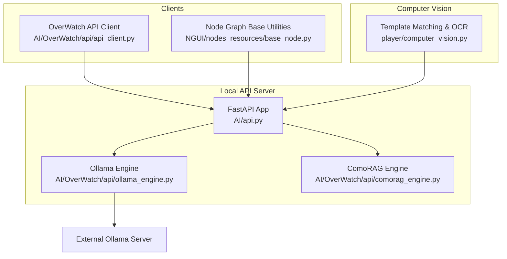
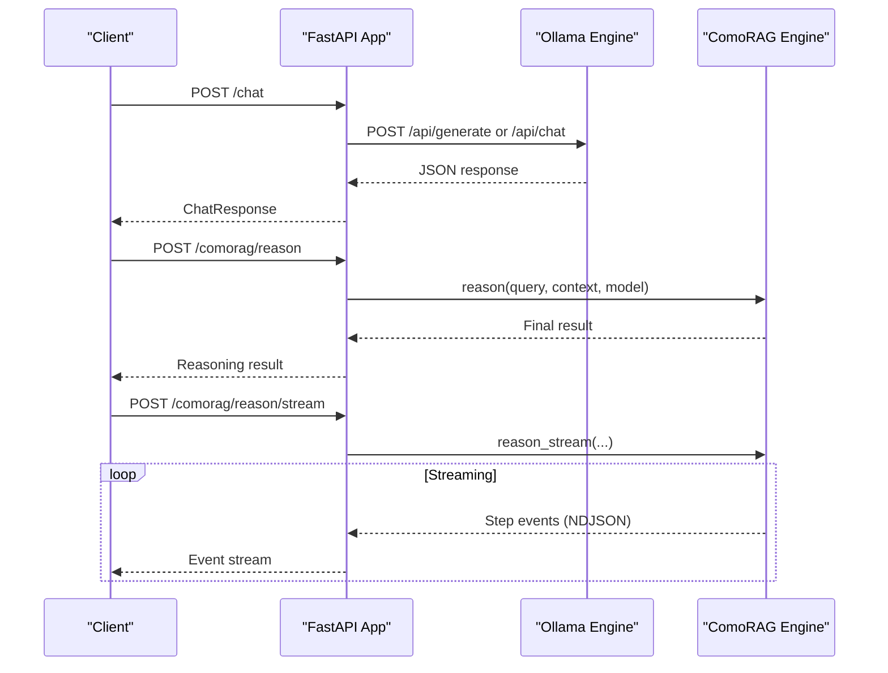
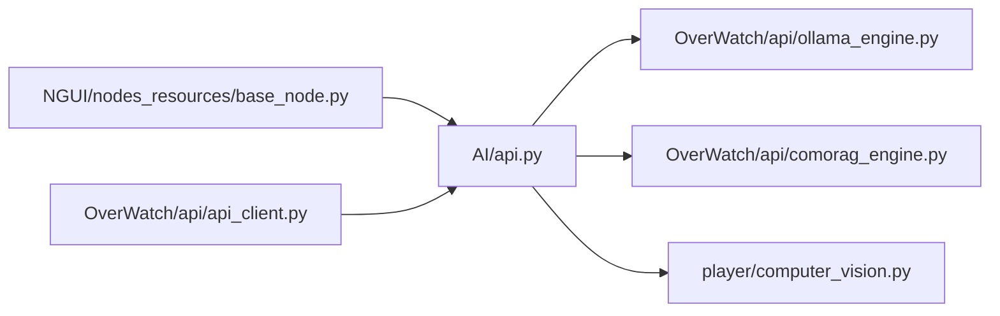

# API Reference

<cite>
**Referenced Files in This Document**
- [LoOper\main.py](file://LoOper/main.py)
- [LoOper\AI\api.py](file://LoOper/AI/api.py)
- [LoOper\AI\OverWatch\api\api_client.py](file://LoOper/AI/OverWatch/api/api_client.py)
- [LoOper\AI\OverWatch\api\comorag_engine.py](file://LoOper/AI/OverWatch/api/comorag_engine.py)
- [LoOper\AI\OverWatch\api\ollama_engine.py](file://LoOper/AI/OverWatch/api/ollama_engine.py)
- [LoOper\AI\OverWatch\api\vllm_engine.py](file://LoOper/AI/OverWatch/api/vllm_engine.py)
- [LoOper\player\computer_vision.py](file://LoOper/player/computer_vision.py)
- [LoOper\NGUI\nodes_resources\base_node.py](file://LoOper/NGUI/nodes_resources/base_node.py)
- [docs\USER_GUIDE.md](file://docs/USER_GUIDE.md)
</cite>

## Table of Contents
1. [Introduction](#introduction)
2. [Project Structure](#project-structure)
3. [Core Components](#core-components)
4. [Architecture Overview](#architecture-overview)
5. [Detailed Component Analysis](#detailed-component-analysis)
6. [Dependency Analysis](#dependency-analysis)
7. [Performance Considerations](#performance-considerations)
8. [Troubleshooting Guide](#troubleshooting-guide)
9. [Conclusion](#conclusion)
10. [Appendices](#appendices)

## Introduction
This document provides a comprehensive API reference for the LoOper V2 REST API and internal interfaces. It covers:
- FastAPI-based local API server endpoints for LLM and ComoRAG services
- Authentication and environment configuration
- Request/response schemas and streaming behavior
- Computer vision interfaces for template matching and OCR
- Node-based programming interface for workflow composition
- Internal APIs used for component communication and extension points
- Client implementation guidelines, integration examples, and performance optimization tips
- API versioning, backwards compatibility, and migration guidance

## Project Structure
The LoOper V2 API surface centers on a FastAPI application that proxies to Ollama and exposes local LLM and ComoRAG capabilities. Supporting modules include:
- Local API server and gateway
- Ollama engine abstraction
- ComoRAG engine for cognitive reasoning
- Computer vision utilities for template matching and OCR
- Node graph base utilities for workflow composition

**Diagram sources**
- [LoOper\AI\api.py:37-41](file://LoOper/AI/api.py#L37-L41)
- [LoOper\AI\OverWatch\api\ollama_engine.py:34-51](file://LoOper/AI/OverWatch/api/ollama_engine.py#L34-L51)
- [LoOper\AI\OverWatch\api\comorag_engine.py:233-242](file://Looper/AI/OverWatch/api/comorag_engine.py#L233-L242)
- [LoOper\AI\OverWatch\api\api_client.py:25-40](file://Looper/AI/OverWatch/api/api_client.py#L25-L40)
- [LoOper\NGUI\nodes_resources\base_node.py:15-24](file://Looper/NGUI/nodes_resources/base_node.py#L15-L24)
- [LoOper\player\computer_vision.py:47-50](file://Looper/player/computer_vision.py#L47-L50)

**Section sources**
- [LoOper\AI\api.py:37-41](file://Looper/AI/api.py#L37-L41)
- [LoOper\main.py:171-354](file://Looper/main.py#L171-L354)

## Core Components
- Local API server (FastAPI): Exposes endpoints for health, models, chat, generate, embeddings, and ComoRAG reasoning. It integrates with Ollama and manages model lifecycle and cleanup.
- Ollama Engine: Provides asynchronous inference, embeddings, and model lifecycle management.
- ComoRAG Engine: Implements cognitive reasoning with memory consolidation, confidence scoring, and optional vision analysis.
- Computer Vision: Offers template matching, OCR, and screenshot capture utilities.
- Node Graph Base Utilities: Provide default API URL resolution and multi-input port handling for node composition.

**Section sources**
- [LoOper\AI\api.py:547-766](file://Looper/AI/api.py#L547-L766)
- [LoOper\AI\OverWatch\api\ollama_engine.py:519-573](file://Looper/AI/OverWatch/api/ollama_engine.py#L519-L573)
- [Looper\AI\OverWatch\api\comorag_engine.py:328-664](file://Looper/AI/OverWatch/api/comorag_engine.py#L328-L664)
- [Looper\player\computer_vision.py:47-551](file://Looper/player/computer_vision.py#L47-L551)
- [Looper\NGUI\nodes_resources\base_node.py:15-60](file://Looper/NGUI/nodes_resources/base_node.py#L15-L60)

## Architecture Overview
The API server initializes engines on startup, exposes endpoints for LLM and vision tasks, and streams ComoRAG reasoning steps. Clients (including the node graph) can call the API directly or use the provided client library.

**Diagram sources**
- [Looper\AI\api.py:655-766](file://Looper/AI/api.py#L655-L766)
- [Looper\AI\OverWatch\api\ollama_engine.py:519-573](file://Looper/AI/OverWatch/api/ollama_engine.py#L519-L573)
- [Looper\AI\OverWatch\api\comorag_engine.py:328-664](file://Looper/AI/OverWatch/api/comorag_engine.py#L328-L664)

## Detailed Component Analysis

### Local API Server Endpoints
The server is a FastAPI application with CORS enabled for Tailscale networks. It exposes health, model listing, chat/generate, embeddings, cleanup, and ComoRAG endpoints.

- Root and Health
  - GET /
  - GET /health

- Models and Vision
  - GET /models
  - GET /vision-models

- LLM Endpoints
  - POST /chat
  - POST /generate
  - POST /generate_stream
  - POST /embeddings

- Cleanup and Bootstrap
  - POST /cleanup
  - GET /bootstrap/status

- ComoRAG Endpoints
  - POST /comorag/reason
  - POST /comorag/reason/stream
  - GET /comorag/status
  - POST /comorag/init
  - GET /comorag/memory
  - POST /comorag/memory
  - DELETE /comorag/memory

Authentication and Authorization
- No authentication is enforced by default. CORS allows "*" for Tailscale networks. Environment variables control host, port, and Ollama base URL.

Environment Variables
- TAILSCALE_IP, TAILSCALE_SERVER_IP, API_PORT, OLLAMA_HOST, OLLAMA_PORT

Request/Response Schemas
- ChatRequest: model, prompt, messages, stream, temperature, max_tokens, system, images, cleanup_after
- ChatResponse: response, model, created_at, done (+ timing fields)
- EmbeddingsRequest: model, inputs, normalize, pooling, cleanup_after
- EmbeddingsResponse: embeddings
- ComoRAGReasonRequest: query, model, max_cycles, memory_size, context, images, max_tokens, temperature
- ComoRAGAddMemoryRequest: content, source, metadata, image_data

Streaming
- /generate_stream and /comorag/reason/stream return NDJSON events.

Error Handling
- HTTP 4xx/5xx with detail messages for timeouts, connectivity, and internal errors.

Rate Limiting
- Not implemented at the API layer. Consider client-side throttling and Ollama runner cleanup to manage resource contention.

**Section sources**
- [Looper\AI\api.py:547-766](file://Looper/AI/api.py#L547-L766)
- [Looper\AI\api.py:795-980](file://Looper/AI/api.py#L795-L980)
- [Looper\AI\api.py:981-1044](file://Looper/AI/api.py#L981-L1044)
- [Looper\AI\api.py:1046-1065](file://Looper/AI/api.py#L1046-L1065)
- [Looper\AI\api.py:1117-1228](file://Looper/AI/api.py#L1117-L1228)
- [Looper\AI\api.py:1230-1291](file://Looper/AI/api.py#L1230-L1291)
- [Looper\AI\api.py:1293-1383](file://Looper/AI/api.py#L1293-L1383)

### Ollama Engine
The Ollama Engine provides asynchronous inference, embeddings, and model lifecycle management. It supports streaming generation and robust fallbacks for legacy endpoints.

Key Methods
- initialize(): Validates Ollama availability and loads required models
- generate(...): Single or streaming generation
- chat_completions(...): OpenAI-compatible chat
- embeddings(...): Vector embeddings with normalization and per-input fallback
- load_model(...), unload_model(...): Lifecycle management
- list_models(), get_loaded_models(), get_memory_usage()

Notes
- Uses aiohttp for async HTTP calls
- Cleans up other Ollama runners before inference
- Supports legacy /api/embeddings fallback

**Section sources**
- [Looper\AI\OverWatch\api\ollama_engine.py:53-96](file://Looper/AI/OverWatch/api/ollama_engine.py#L53-L96)
- [Looper\AI\OverWatch\api\ollama_engine.py:519-671](file://Looper/AI/OverWatch/api/ollama_engine.py#L519-L671)
- [Looper\AI\OverWatch\api\ollama_engine.py:320-501](file://Looper/AI/OverWatch/api/ollama_engine.py#L320-L501)

### ComoRAG Engine
The ComoRAG Engine implements cognitive reasoning with memory consolidation, confidence scoring, and optional vision analysis. It supports both blocking and streaming reasoning.

Key Methods
- initialize(memory_size, embedding_dim)
- reason(query, context, model, max_cycles, memory_size, images)
- reason_stream(...): yields NDJSON events
- add_memory(content, source, metadata, image_data)
- get_memory_state(), clear_memory()
- is_ready(), get_memory_usage()

Behavior
- Embedding-based retrieval with FAISS-backed similarity search
- Structured JSON context parsing for screen maps
- Vision analysis via vision model when enabled
- Confidence calculation and iterative reasoning cycles

**Section sources**
- [Looper\AI\OverWatch\api\comorag_engine.py:256-287](file://Looper/AI/OverWatch/api/comorag_engine.py#L256-L287)
- [Looper\AI\OverWatch\api\comorag_engine.py:328-664](file://Looper/AI/OverWatch/api/comorag_engine.py#L328-L664)
- [Looper\AI\OverWatch\api\comorag_engine.py:826-1033](file://Looper/AI/OverWatch/api/comorag_engine.py#L826-L1033)
- [Looper\AI\OverWatch\api\comorag_engine.py:1121-1167](file://Looper/AI/OverWatch/api/comorag_engine.py#L1121-L1167)

### Computer Vision Interfaces
The computer vision module provides:
- TemplateMatching: multi-scale template matching, region-based search, OCR text detection, and screenshot capture
- OCR integration via extract_text_elements
- Adaptive strategies for repeated checks and performance tuning

Parameters and Tuning
- Confidence thresholds, scale sets, grayscale conversion, region expansion factors
- Stop flags for cooperative cancellation
- Performance: prefer OpenCV with mss for fast screenshots; fallback to pyautogui

**Section sources**
- [Looper\player\computer_vision.py:47-551](file://Looper/player/computer_vision.py#L47-L551)

### Node-Based Programming Interface
The node graph base utilities support:
- Default API URL resolution using environment variables
- Robust multi-input port creation across NodeGraphQt versions
- Fallback property registration for compatibility

Usage Patterns
- Nodes can call the API directly or use the OverWatch API client
- Multi-input ports enable flexible chaining and fan-out

**Section sources**
- [Looper\NGUI\nodes_resources\base_node.py:15-60](file://Looper/NGUI/nodes_resources/base_node.py#L15-L60)

### Client Implementation Guidelines
The OverWatch API Client simplifies integration:
- Health checks, model listing, generate, chat completion, and ComoRAG operations
- Automatic JSON parsing and error propagation
- Configurable timeout and base URL

Integration Examples
- Initialize client with base URL and timeout
- Call health_check() before heavy operations
- Use generate() or chat_completion() for LLM tasks
- Use comorag_reason() for stateful reasoning

**Section sources**
- [Looper\AI\OverWatch\api\api_client.py:25-242](file://Looper/AI/OverWatch/api/api_client.py#L25-L242)

## Dependency Analysis
The API server depends on:
- Ollama Engine for inference and embeddings
- ComoRAG Engine for advanced reasoning
- Node Graph utilities for default API URL and port wiring
- Computer Vision for UI element detection and OCR

**Diagram sources**
- [Looper\AI\api.py:25-31](file://Looper/AI/api.py#L25-L31)
- [Looper\AI\OverWatch\api\ollama_engine.py:34-51](file://Looper/AI/OverWatch/api/ollama_engine.py#L34-L51)
- [Looper\AI\OverWatch\api\comorag_engine.py:233-242](file://Looper/AI/OverWatch/api/comorag_engine.py#L233-L242)
- [Looper\player\computer_vision.py:11-12](file://Looper/player/computer_vision.py#L11-L12)
- [Looper\NGUI\nodes_resources\base_node.py:15-24](file://Looper/NGUI/nodes_resources/base_node.py#L15-L24)
- [Looper\AI\OverWatch\api\api_client.py:25-40](file://Looper/AI/OverWatch/api/api_client.py#L25-L40)

**Section sources**
- [Looper\AI\api.py:25-31](file://Looper/AI/api.py#L25-L31)
- [Looper\AI\OverWatch\api\ollama_engine.py:34-51](file://Looper/AI/OverWatch/api/ollama_engine.py#L34-L51)
- [Looper\AI\OverWatch\api\comorag_engine.py:233-242](file://Looper/AI/OverWatch/api/comorag_engine.py#L233-L242)
- [Looper\player\computer_vision.py:11-12](file://Looper/player/computer_vision.py#L11-L12)
- [Looper\NGUI\nodes_resources\base_node.py:15-24](file://Looper/NGUI/nodes_resources/base_node.py#L15-L24)
- [Looper\AI\OverWatch\api\api_client.py:25-40](file://Looper/AI/OverWatch/api/api_client.py#L25-L40)

## Performance Considerations
- Model lifecycle: The API cleans up other Ollama runners before inference to reduce memory pressure. Use cleanup_after flags to release models promptly.
- Streaming: Prefer /generate_stream and /comorag/reason/stream for long-running tasks to reduce latency and improve responsiveness.
- Vision: Vision analysis adds overhead; enable only when needed and tune confidence thresholds to minimize false positives.
- OCR: Adjust OCR confidence thresholds and language settings to balance accuracy and speed.
- Template matching: Use multi-scale and region-based strategies judiciously; cache templates when possible to reduce disk I/O.
- Embeddings: The API normalizes responses and falls back per-input when needed; batch inputs when feasible to reduce overhead.

[No sources needed since this section provides general guidance]

## Troubleshooting Guide
Common issues and resolutions:
- Ollama not reachable: Verify OLLAMA_HOST/PORT and network connectivity; use /health to confirm status.
- Missing models: Use bootstrap status and ensure required models are pulled; the API maintains a bootstrap state.
- Timeout errors: Increase client timeout or reduce max_tokens; consider streaming endpoints.
- Vision model mismatches: Confirm model capability detection and use supported vision models.
- Cleanup failures: Use /cleanup endpoint with retries and wait intervals to force-stop lingering runners.

**Section sources**
- [Looper\AI\api.py:581-606](file://Looper/AI/api.py#L581-L606)
- [Looper\AI\api.py:1031-1044](file://Looper/AI/api.py#L1031-L1044)
- [Looper\AI\api.py:981-995](file://Looper/AI/api.py#L981-L995)

## Conclusion
The LoOper V2 API provides a cohesive set of endpoints for local LLM inference, embeddings, and advanced reasoning with ComoRAG. It integrates tightly with Ollama, offers streaming capabilities, and supports robust computer vision workflows. The node graph utilities and client library simplify integration for both programmatic and visual workflow construction.

[No sources needed since this section summarizes without analyzing specific files]

## Appendices

### Endpoint Specifications

- GET /
  - Description: Returns API info, server configuration, and available endpoints
  - Response: Server info, environment variables, endpoints list, vision support

- GET /health
  - Description: Checks Ollama server health and bootstrap status
  - Response: Status, models readiness, bootstrap state

- GET /models
  - Description: Lists available Ollama models
  - Response: Array of ModelInfo

- GET /vision-models
  - Description: Lists vision-enabled models
  - Response: Array of ModelInfo

- POST /chat
  - Description: Chat with a model; supports images for vision models
  - Request: ChatRequest
  - Response: ChatResponse

- POST /generate
  - Description: Alias for /chat
  - Request: ChatRequest
  - Response: ChatResponse

- POST /generate_stream
  - Description: Streams generation tokens
  - Request: ChatRequest
  - Response: NDJSON stream

- POST /embeddings
  - Description: Generates embeddings for input texts
  - Request: EmbeddingsRequest
  - Response: EmbeddingsResponse

- POST /cleanup
  - Description: Stops Ollama runners
  - Request: { all: bool, model: string, retries: int, wait: float }
  - Response: { ok: bool, model?: string }

- POST /comorag/reason
  - Description: Performs ComoRAG reasoning
  - Request: ComoRAGReasonRequest
  - Response: Reasoning result

- POST /comorag/reason/stream
  - Description: Streams ComoRAG reasoning steps
  - Request: ComoRAGReasonRequest
  - Response: NDJSON stream

- GET /comorag/status
  - Description: Checks ComoRAG engine readiness
  - Query: init_if_needed: bool
  - Response: { ready: bool, error?: string }

- POST /comorag/init
  - Description: Initializes ComoRAG engine
  - Query: memory_size: int
  - Response: { ready: bool, memory_size: int }

- GET /comorag/memory
  - Description: Returns memory workspace stats
  - Response: { memory_items: int, max_memory_size: int, recent_access?: [...] }

- POST /comorag/memory
  - Description: Adds memory item
  - Request: ComoRAGAddMemoryRequest
  - Response: { status: "memory_added" }

- DELETE /comorag/memory
  - Description: Clears memory workspace
  - Response: { status: "memory_cleared" }

**Section sources**
- [Looper\AI\api.py:547-766](file://Looper/AI/api.py#L547-L766)
- [Looper\AI\api.py:795-980](file://Looper/AI/api.py#L795-L980)
- [Looper\AI\api.py:981-1044](file://Looper/AI/api.py#L981-L1044)
- [Looper\AI\api.py:1046-1065](file://Looper/AI/api.py#L1046-L1065)
- [Looper\AI\api.py:1117-1228](file://Looper/AI/api.py#L1117-L1228)
- [Looper\AI\api.py:1230-1291](file://Looper/AI/api.py#L1230-L1291)
- [Looper\AI\api.py:1293-1383](file://Looper/AI/api.py#L1293-L1383)

### Computer Vision Parameters

- TemplateMatching.multiscale_template_match
  - Parameters: template_path, confidence, scales, grayscale, screen_cv
  - Behavior: Multi-scale matching with adaptive strategy

- TemplateMatching.region_based_search
  - Parameters: template_path, hint_x, hint_y, confidence, expand_factor, grayscale, screen_cv
  - Behavior: Region expansion around hint coordinates

- TemplateMatching.ocr_text_detection
  - Parameters: target_text, confidence, case_sensitive, screen_cv, stop_flag
  - Behavior: OCR-based text detection with confidence and bounding boxes

- TemplateMatching.ocr_extract_all_text
  - Parameters: min_confidence, screen_cv, stop_flag
  - Behavior: Extracts all readable text elements

**Section sources**
- [Looper\player\computer_vision.py:198-331](file://Looper/player/computer_vision.py#L198-L331)
- [Looper\player\computer_vision.py:333-450](file://Looper/player/computer_vision.py#L333-L450)
- [Looper\player\computer_vision.py:452-550](file://Looper/player/computer_vision.py#L452-L550)

### Client Implementation Notes
- Use OverWatchAPIClient for robust HTTP handling and error propagation
- Configure base_url and timeout according to deployment
- Leverage streaming endpoints for responsive UX

**Section sources**
- [Looper\AI\OverWatch\api\api_client.py:25-242](file://Looper/AI/OverWatch/api/api_client.py#L25-L242)

### API Versioning and Backwards Compatibility
- The API title indicates version 1.0.0; maintain backward compatibility for existing endpoints.
- Migration guidance:
  - Prefer /generate_stream and /comorag/reason/stream for new integrations
  - Use /embeddings with normalize/pooling for embedding workflows
  - Monitor bootstrap status for model readiness

**Section sources**
- [Looper\AI\api.py:37-41](file://Looper/AI/api.py#L37-L41)
- [Looper\AI\api.py:1031-1044](file://Looper/AI/api.py#L1031-L1044)