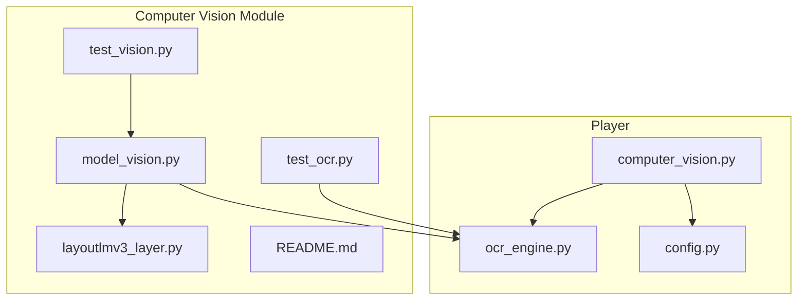
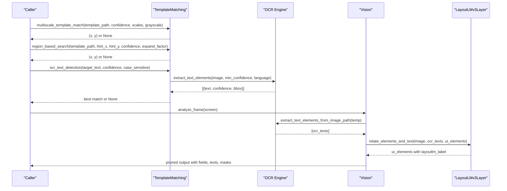
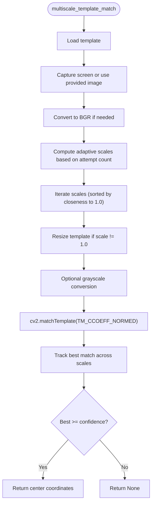
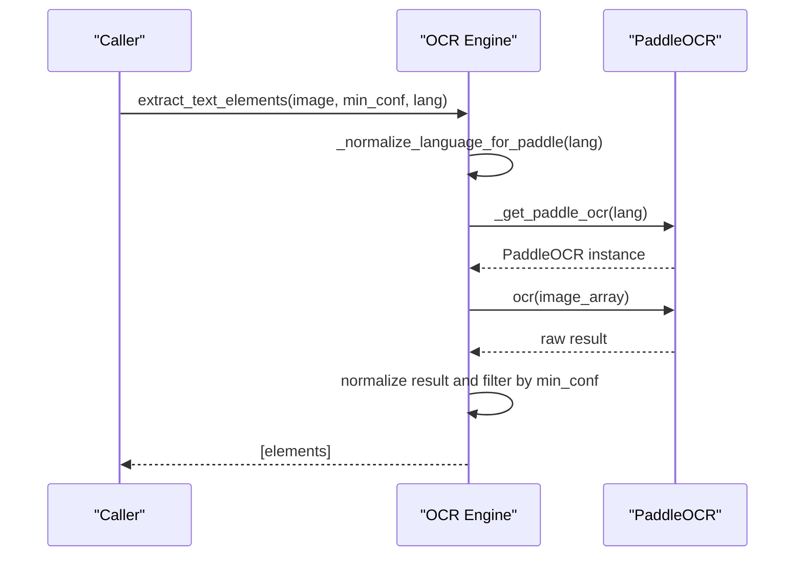
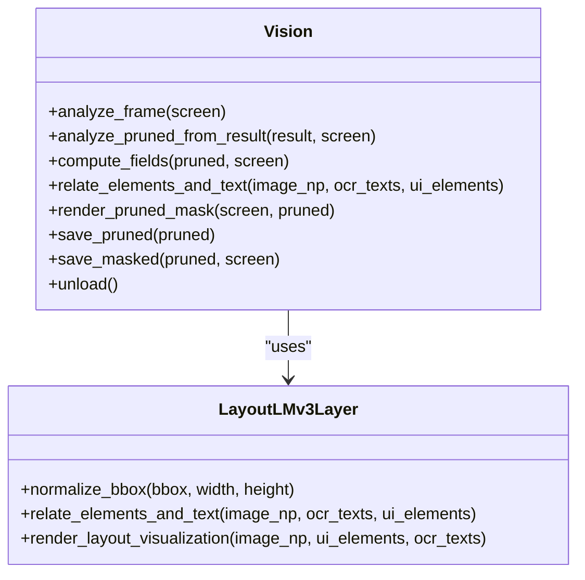
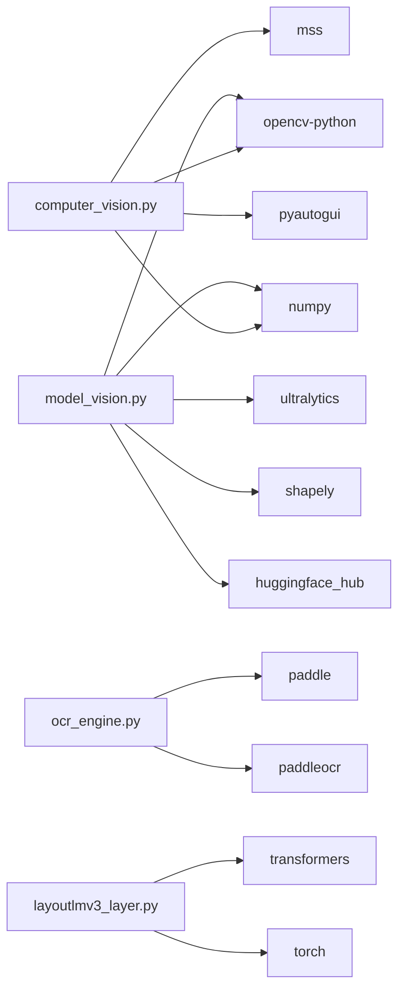

# Computer Vision API

<cite>
**Referenced Files in This Document**
- [computer_vision.py](file://LoOper/player/computer_vision.py)
- [ocr_engine.py](file://LoOper/player/ocr_engine.py)
- [config.py](file://LoOper/player/config.py)
- [model_vision.py](file://LoOper/player/Computer_vision/model_vision.py)
- [layoutlmv3_layer.py](file://LoOper/player/Computer_vision/layoutlmv3_layer.py)
- [README.md](file://LoOper/player/Computer_vision/README.md)
- [test_vision.py](file://LoOper/player/Computer_vision/test_vision.py)
- [test_ocr.py](file://LoOper/player/Computer_vision/test_ocr.py)
</cite>

## Table of Contents
1. [Introduction](#introduction)
2. [Project Structure](#project-structure)
3. [Core Components](#core-components)
4. [Architecture Overview](#architecture-overview)
5. [Detailed Component Analysis](#detailed-component-analysis)
6. [Dependency Analysis](#dependency-analysis)
7. [Performance Considerations](#performance-considerations)
8. [Troubleshooting Guide](#troubleshooting-guide)
9. [Conclusion](#conclusion)
10. [Appendices](#appendices)

## Introduction
This document describes the computer vision system interfaces for template matching, OCR integration, and vision model processing. It covers:
- Template matching APIs with confidence thresholds, adaptive scaling, and performance optimization settings
- OCR engine configuration for PaddleOCR, text recognition accuracy controls, and region-based processing parameters
- Vision model interfaces for ONNX-based inference, LayoutLMv3 integration, and model loading/caching mechanisms
- Examples of image preprocessing, object detection workflows, and text extraction patterns
- Guidelines for performance tuning, memory management, and error handling

## Project Structure
The computer vision system is organized into modular components:
- Template matching and screen capture utilities
- OCR engine abstraction and PaddleOCR integration
- Vision pipeline with YOLO-based detection, LayoutLMv3 reasoning, and output pruning
- Tests and documentation for quick validation

**Diagram sources**
- [computer_vision.py:1-606](file://LoOper/player/computer_vision.py#L1-L606)
- [ocr_engine.py:1-367](file://LoOper/player/ocr_engine.py#L1-L367)
- [config.py:1-46](file://LoOper/player/config.py#L1-L46)
- [model_vision.py:1-2544](file://LoOper/player/Computer_vision/model_vision.py#L1-L2544)
- [layoutlmv3_layer.py:1-203](file://LoOper/player/Computer_vision/layoutlmv3_layer.py#L1-L203)
- [test_vision.py:1-52](file://LoOper/player/Computer_vision/test_vision.py#L1-L52)
- [test_ocr.py:1-62](file://LoOper/player/Computer_vision/test_ocr.py#L1-L62)
- [README.md:1-108](file://LoOper/player/Computer_vision/README.md#L1-L108)

**Section sources**
- [README.md:1-108](file://LoOper/player/Computer_vision/README.md#L1-L108)

## Core Components
- TemplateMatching: Provides multi-scale template matching, region-based search, and OCR-driven text detection. Supports adaptive scaling and grayscale matching.
- OCR Engine: Abstraction layer for PaddleOCR with language normalization, model bundling, and result normalization.
- Vision: Orchestrates YOLO-based detection, ROI-aware refinement, OCR integration, LayoutLMv3 reasoning, and structured output pruning.
- LayoutLMv3Layer: Embedding-based relation between UI elements and OCR text using LayoutLMv3.

Key capabilities:
- Template matching with confidence thresholds and adaptive scaling
- Region-based search around hints with expandable regions
- Full-screen OCR extraction and targeted text detection
- Structured UI field extraction with label-value association and spatial clustering
- ONNX/YOLO inference and LayoutLMv3 reasoning

**Section sources**
- [computer_vision.py:47-606](file://LoOper/player/computer_vision.py#L47-L606)
- [ocr_engine.py:13-367](file://LoOper/player/ocr_engine.py#L13-L367)
- [model_vision.py:310-1756](file://LoOper/player/Computer_vision/model_vision.py#L310-L1756)
- [layoutlmv3_layer.py:6-136](file://LoOper/player/Computer_vision/layoutlmv3_layer.py#L6-L136)

## Architecture Overview
The system integrates template matching, OCR, and vision models into a cohesive pipeline. The Vision class orchestrates detection and reasoning, while OCR is used for text extraction and LayoutLMv3 relates UI elements to textual labels.

**Diagram sources**
- [computer_vision.py:198-550](file://LoOper/player/computer_vision.py#L198-L550)
- [ocr_engine.py:131-241](file://LoOper/player/ocr_engine.py#L131-L241)
- [model_vision.py:423-637](file://LoOper/player/Computer_vision/model_vision.py#L423-L637)
- [layoutlmv3_layer.py:29-136](file://LoOper/player/Computer_vision/layoutlmv3_layer.py#L29-L136)

## Detailed Component Analysis

### Template Matching API
Capabilities:
- Multi-scale template matching with adaptive scaling strategy
- Region-based search around hint coordinates with expandable regions
- OCR-driven text detection and extraction
- Screen capture via mss/pyautogui with optional sandbox agent integration

Parameters and behaviors:
- Confidence threshold: numeric threshold for match acceptance
- Scales: list of scale factors to try; defaults prioritize 1.0 for speed
- Grayscale: optional grayscale matching for robustness
- Expand factor: region expansion multiplier relative to template size
- Case sensitivity: controls OCR text matching sensitivity

Adaptive scaling:
- Tracks attempts per template and adjusts scale sets progressively
- Resets counters periodically to balance responsiveness and accuracy

**Diagram sources**
- [computer_vision.py:198-332](file://LoOper/player/computer_vision.py#L198-L332)

**Section sources**
- [computer_vision.py:47-332](file://LoOper/player/computer_vision.py#L47-L332)

### OCR Engine API (PaddleOCR)
Configuration:
- Engine availability detection and engine type reporting
- Language normalization for PaddleOCR ("en", "ch")
- Bundled model discovery for frozen executables (PyInstaller)
- MKLDNN flags disabled to avoid OneDnnContext errors

Key functions:
- extract_text_elements(image, min_confidence, language): returns structured text elements with confidence and bounding boxes
- extract_text(image, min_confidence, language): concatenates recognized text
- extract_text_elements_from_image_path(image_path, min_confidence, language): convenience wrapper for file-based images

Accuracy controls:
- min_confidence threshold filters low-confidence detections
- Language parameter normalizes to PaddleOCR-supported codes
- Result normalization supports both PaddleOCR and PaddleX formats

**Diagram sources**
- [ocr_engine.py:131-241](file://LoOper/player/ocr_engine.py#L131-L241)
- [config.py:21-31](file://LoOper/player/config.py#L21-L31)

**Section sources**
- [ocr_engine.py:13-367](file://LoOper/player/ocr_engine.py#L13-L367)
- [config.py:1-46](file://LoOper/player/config.py#L1-L46)

### Vision Model Interfaces (ONNX/YOLO + LayoutLMv3)
Vision class responsibilities:
- Load Structure/Text YOLO model and optional Icon YOLO model
- Load LayoutLMv3Layer for semantic-spatial text-element association
- Screen capture and multi-augmentation inference (original, grayscale-high contrast, inverted)
- Non-maximum suppression averaging and large-element masking pass
- ROI detection and focused element extraction
- Field computation with OCR-based label/value association and spatial clustering
- Output pruning into structured JSON with masks and visualizations

ONNX/YOLO integration:
- YOLO models loaded from local paths or HuggingFace
- Confidence thresholds applied per inference pass
- NMS averaging merges overlapping detections
- Large-area element masking improves downstream detection

LayoutLMv3 integration:
- Processor and model initialization
- Normalized bounding boxes mapped to 1000x1000 grid
- Word embeddings aggregated and compared via cosine similarity
- Spatial heuristics boost above/left relationships

**Diagram sources**
- [model_vision.py:310-1756](file://LoOper/player/Computer_vision/model_vision.py#L310-L1756)
- [layoutlmv3_layer.py:6-136](file://LoOper/player/Computer_vision/layoutlmv3_layer.py#L6-L136)

**Section sources**
- [model_vision.py:310-1756](file://LoOper/player/Computer_vision/model_vision.py#L310-L1756)
- [layoutlmv3_layer.py:6-136](file://LoOper/player/Computer_vision/layoutlmv3_layer.py#L6-L136)

### Examples and Workflows
- Image preprocessing: Ensure BGR format, optional grayscale/high-contrast, and inversion for dark-mode forms
- Object detection workflow: Multi-pass inference with augmentation, NMS averaging, and masking refinement
- Text extraction pattern: Full-screen OCR for context, then spatial association with UI fields

Validation scripts:
- test_vision.py: Loads Vision, analyzes an image file, prints extracted fields, and saves outputs
- test_ocr.py: Creates a test image, runs OCR extraction, and prints results

**Section sources**
- [test_vision.py:15-52](file://LoOper/player/Computer_vision/test_vision.py#L15-L52)
- [test_ocr.py:34-62](file://LoOper/player/Computer_vision/test_ocr.py#L34-L62)

## Dependency Analysis
External dependencies and integrations:
- OpenCV and NumPy for template matching and image processing
- PaddleOCR for text recognition with MKLDNN disabled
- Ultralytics YOLO for object detection
- Transformers/LayoutLMv3 for semantic-spatial text-element relations
- mss for fast screenshot capture; pyautogui as fallback
- Shapely for polygon intersection calculations

**Diagram sources**
- [computer_vision.py:34-44](file://LoOper/player/computer_vision.py#L34-L44)
- [ocr_engine.py:42-49](file://LoOper/player/ocr_engine.py#L42-L49)
- [model_vision.py:65-88](file://LoOper/player/Computer_vision/model_vision.py#L65-L88)
- [layoutlmv3_layer.py:1-4](file://LoOper/player/Computer_vision/layoutlmv3_layer.py#L1-L4)

**Section sources**
- [config.py:11-31](file://LoOper/player/config.py#L11-L31)
- [model_vision.py:65-88](file://LoOper/player/Computer_vision/model_vision.py#L65-L88)

## Performance Considerations
- Template matching
  - Adaptive scaling reduces unnecessary multi-scale scans after several failed attempts
  - Grayscale matching can improve robustness at the cost of speed
  - Pre-capture screen images avoids redundant screenshots
- OCR
  - Minimizing min_confidence increases recall but may reduce precision
  - Language normalization ensures efficient model selection
  - Caching of PaddleOCR instances reduces initialization overhead
- Vision pipeline
  - Multi-pass inference with augmentation improves detection robustness
  - NMS averaging reduces duplicates and stabilizes coordinates
  - Large-element masking prevents detector saturation and improves recall
  - ROI-focused inference limits computation to relevant areas
- Memory management
  - Explicit unload() clears models and empties CUDA cache when available
  - Garbage collection invoked after unloading
  - Temporary files cleaned up post-OCR

[No sources needed since this section provides general guidance]

## Troubleshooting Guide
Common issues and resolutions:
- OpenCV/Pillow import failures
  - Symptom: Template matching disabled warnings
  - Resolution: Install opencv-python and numpy
- PaddleOCR not available
  - Symptom: OCR not available or initialization errors
  - Resolution: Install paddle and paddleocr; ensure MKLDNN flags are disabled
- Model loading failures
  - Symptom: YOLO or LayoutLMv3 layer load errors
  - Resolution: Verify model paths; ensure HuggingFace downloads succeed; check transformers/torch compatibility
- Performance bottlenecks
  - Symptom: Slow inference or high CPU/GPU usage
  - Resolution: Reduce confidence thresholds, limit scales, disable grayscale, or restrict ROI
- Memory pressure
  - Symptom: Out-of-memory errors or slowdowns
  - Resolution: Call unload() to release models and caches; reduce batch sizes or image dimensions

**Section sources**
- [config.py:11-31](file://LoOper/player/config.py#L11-L31)
- [model_vision.py:2134-2181](file://LoOper/player/Computer_vision/model_vision.py#L2134-L2181)

## Conclusion
The computer vision system provides a robust, modular pipeline for template matching, OCR, and structured UI understanding. By combining multi-scale template matching, region-based search, PaddleOCR text extraction, and LayoutLMv3 reasoning, it enables accurate and efficient UI automation workflows. Proper configuration of confidence thresholds, adaptive scaling, and inference parameters yields optimal performance and reliability.

[No sources needed since this section summarizes without analyzing specific files]

## Appendices

### Supported Image Formats and Resolution Requirements
- Supported formats: PNG, JPEG, BMP; internally converted to BGR arrays
- Typical resolution: Full HD and higher; adjust ROI and masking to manage computational load
- Preprocessing: Ensure consistent color channels (BGR) and handle RGBA by conversion

**Section sources**
- [computer_vision.py:224-236](file://LoOper/player/computer_vision.py#L224-L236)
- [ocr_engine.py:112-129](file://LoOper/player/ocr_engine.py#L112-L129)

### API Parameter Reference
- TemplateMatching.multiscale_template_match
  - template_path: path to template image
  - confidence: float threshold for match acceptance
  - scales: list of scale factors to try
  - grayscale: whether to convert to grayscale
  - screen_cv: optional pre-captured screen image
- TemplateMatching.region_based_search
  - template_path: path to template image
  - hint_x, hint_y: hint coordinates for region center
  - confidence: float threshold
  - expand_factor: region expansion multiplier
  - grayscale: whether to convert to grayscale
  - screen_cv: optional pre-captured screen image
- TemplateMatching.ocr_text_detection
  - target_text: text to locate
  - confidence: float threshold for OCR matches
  - case_sensitive: boolean flag
  - screen_cv: optional pre-captured screen image
  - stop_flag: callable to abort processing
- TemplateMatching.ocr_extract_all_text
  - min_confidence: float threshold for OCR elements
  - screen_cv: optional pre-captured screen image
  - stop_flag: callable to abort processing
- OCR Engine
  - extract_text_elements(image, min_confidence, language)
  - extract_text(image, min_confidence, language)
  - extract_text_elements_from_image_path(image_path, min_confidence, language)
- Vision
  - analyze_frame(screen)
  - analyze_pruned_from_result(result, screen)
  - compute_fields(pruned, screen)
  - render_pruned_mask(screen, pruned)
  - save_pruned(pruned)
  - save_masked(pruned, screen)
  - unload()

**Section sources**
- [computer_vision.py:198-550](file://LoOper/player/computer_vision.py#L198-L550)
- [ocr_engine.py:131-367](file://LoOper/player/ocr_engine.py#L131-L367)
- [model_vision.py:423-1756](file://LoOper/player/Computer_vision/model_vision.py#L423-L1756)