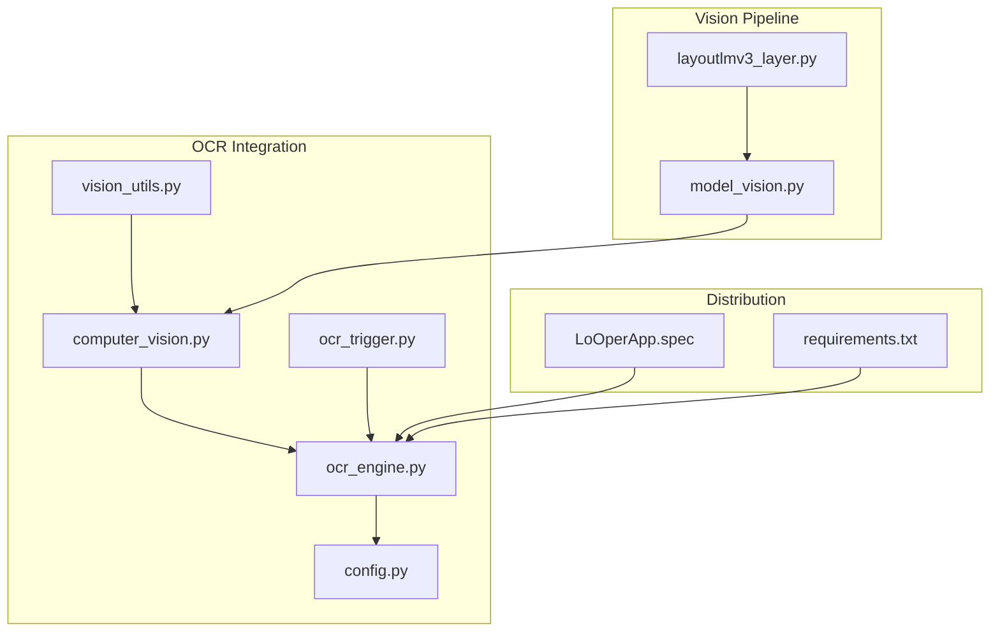
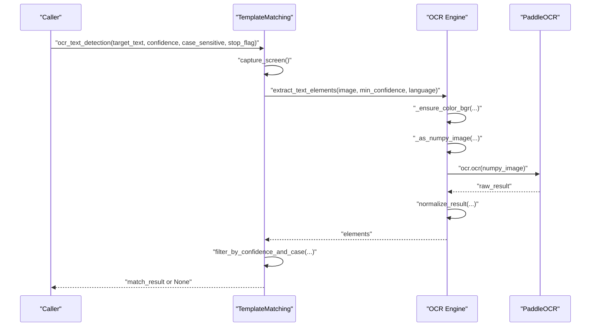
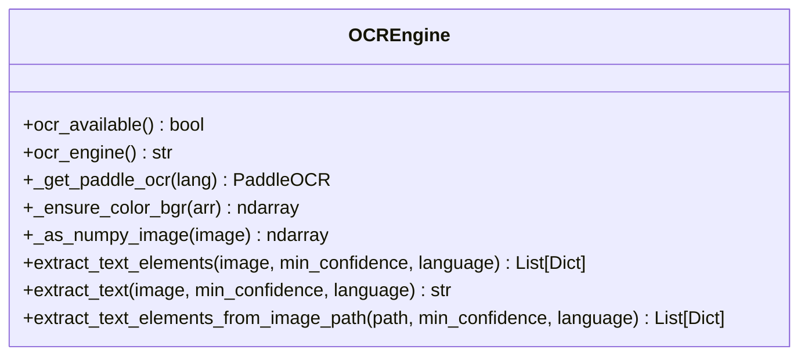
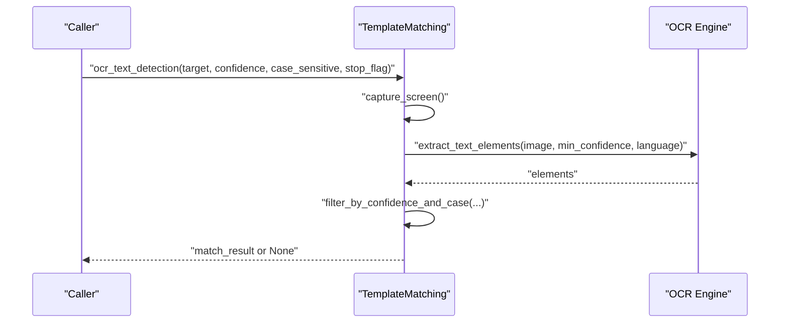
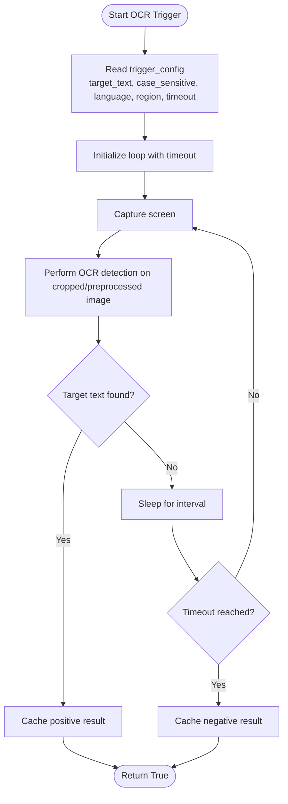
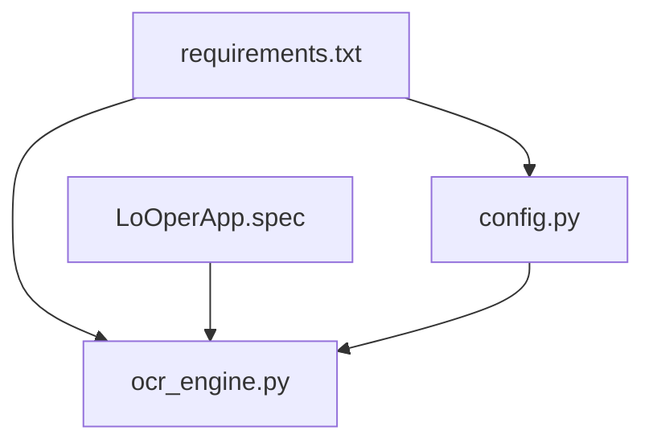

# OCR Integration API

<cite>
**Referenced Files in This Document**
- [ocr_engine.py](file://LoOper/player/ocr_engine.py)
- [computer_vision.py](file://LoOper/player/computer_vision.py)
- [ocr_trigger.py](file://LoOper/player/multi_sequence/conditional_fallback_resources/ocr_trigger.py)
- [vision_utils.py](file://LoOper/player/multi_sequence/llm_executor_resources/vision_utils.py)
- [config.py](file://LoOper/player/config.py)
- [test_ocr.py](file://LoOper/player/Computer_vision/test_ocr.py)
- [requirements.txt](file://requirements.txt)
- [LoOperApp.spec](file://LoOperApp.spec)
- [model_vision.py](file://LoOper/player/Computer_vision/model_vision.py)
- [layoutlmv3_layer.py](file://LoOper/player/Computer_vision/layoutlmv3_layer.py)
</cite>

## Table of Contents
1. [Introduction](#introduction)
2. [Project Structure](#project-structure)
3. [Core Components](#core-components)
4. [Architecture Overview](#architecture-overview)
5. [Detailed Component Analysis](#detailed-component-analysis)
6. [Dependency Analysis](#dependency-analysis)
7. [Performance Considerations](#performance-considerations)
8. [Troubleshooting Guide](#troubleshooting-guide)
9. [Conclusion](#conclusion)
10. [Appendices](#appendices)

## Introduction
This document describes the OCR integration API used by the automation system. It covers text detection, text extraction, and the PaddleOCR engine configuration. It explains the OCR engine methods with parameters for target text searching, confidence thresholds, case sensitivity options, and stop flag handling. It also documents the text element extraction process with bounding box coordinates, confidence scores, and language support. The OCR processing pipeline includes image preprocessing, text recognition accuracy controls, and result filtering. Examples demonstrate single text detection, batch text extraction, region-based OCR processing, and performance optimization techniques. Guidelines are provided for OCR model configuration, accuracy tuning, memory management, and error recovery in OCR operations.

## Project Structure
The OCR integration spans several modules:
- OCR engine wrapper and utilities
- Computer vision orchestration and OCR-based text detection
- Conditional fallback OCR triggers
- Vision pipeline integration and screenshot capture
- Configuration and dependency management
- Test utilities and model bundling for distribution

**Diagram sources**
- [ocr_engine.py:1-367](file://LoOper/player/ocr_engine.py#L1-L367)
- [computer_vision.py:1-606](file://LoOper/player/computer_vision.py#L1-L606)
- [ocr_trigger.py:1-266](file://LoOper/player/multi_sequence/conditional_fallback_resources/ocr_trigger.py#L1-L266)
- [vision_utils.py:1-66](file://LoOper/player/multi_sequence/llm_executor_resources/vision_utils.py#L1-L66)
- [config.py:1-46](file://LoOper/player/config.py#L1-L46)
- [model_vision.py:1-800](file://LoOper/player/Computer_vision/model_vision.py#L1-L800)
- [layoutlmv3_layer.py:1-203](file://LoOper/player/Computer_vision/layoutlmv3_layer.py#L1-L203)
- [LoOperApp.spec:205-231](file://LoOperApp.spec#L205-L231)
- [requirements.txt:1-195](file://requirements.txt#L1-L195)

**Section sources**
- [ocr_engine.py:1-367](file://LoOper/player/ocr_engine.py#L1-L367)
- [computer_vision.py:1-606](file://LoOper/player/computer_vision.py#L1-L606)
- [ocr_trigger.py:1-266](file://LoOper/player/multi_sequence/conditional_fallback_resources/ocr_trigger.py#L1-L266)
- [vision_utils.py:1-66](file://LoOper/player/multi_sequence/llm_executor_resources/vision_utils.py#L1-L66)
- [config.py:1-46](file://LoOper/player/config.py#L1-L46)
- [requirements.txt:1-195](file://requirements.txt#L1-L195)
- [LoOperApp.spec:205-231](file://LoOperApp.spec#L205-L231)

## Core Components
- OCR engine wrapper: Provides OCR availability checks, PaddleOCR initialization with language normalization, and image preprocessing helpers.
- Computer vision orchestrator: Offers OCR-based text detection and extraction APIs, including stop-flag-aware processing and confidence filtering.
- Conditional OCR trigger: Implements OCR-based conditional triggers with optional region cropping and preprocessing.
- Vision utilities: Captures screenshots and prepares images for vision-based workflows.
- Configuration: Manages OCR availability, environment flags, and logging.

Key responsibilities:
- OCR engine: Initialize PaddleOCR with bundled models when applicable, normalize languages, convert images to the expected format, and extract text elements with confidence and geometry.
- Computer vision: Provide high-level OCR operations (single detection, batch extraction) with robust error handling and stop-flag support.
- Conditional trigger: Run OCR checks with configurable timeouts, case sensitivity, and region constraints.
- Vision utilities: Save screenshots and return image paths for downstream processing.

**Section sources**
- [ocr_engine.py:13-367](file://LoOper/player/ocr_engine.py#L13-L367)
- [computer_vision.py:452-606](file://LoOper/player/computer_vision.py#L452-L606)
- [ocr_trigger.py:29-266](file://LoOper/player/multi_sequence/conditional_fallback_resources/ocr_trigger.py#L29-L266)
- [vision_utils.py:9-66](file://LoOper/player/multi_sequence/llm_executor_resources/vision_utils.py#L9-L66)
- [config.py:21-31](file://LoOper/player/config.py#L21-L31)

## Architecture Overview
The OCR integration follows a layered design:
- Engine layer: PaddleOCR initialization and image conversion.
- Orchestration layer: High-level OCR APIs with stop flags and confidence thresholds.
- Trigger layer: Conditional OCR checks integrated into workflow execution.
- Vision pipeline: Optional screenshot capture and image preparation for vision tasks.

**Diagram sources**
- [computer_vision.py:452-550](file://LoOper/player/computer_vision.py#L452-L550)
- [ocr_engine.py:131-240](file://LoOper/player/ocr_engine.py#L131-L240)

**Section sources**
- [computer_vision.py:452-550](file://LoOper/player/computer_vision.py#L452-L550)
- [ocr_engine.py:131-240](file://LoOper/player/ocr_engine.py#L131-L240)

## Detailed Component Analysis

### OCR Engine Methods
Methods exposed by the OCR engine:
- Availability and engine identification
  - ocr_available(): Returns whether OCR is available.
  - ocr_engine(): Returns the OCR engine identifier (e.g., "paddle").
- PaddleOCR initialization
  - _get_paddle_ocr(lang): Initializes PaddleOCR with language normalization and bundled model discovery for frozen builds.
- Image preprocessing helpers
  - _ensure_color_bgr(arr): Ensures BGR color channel order and removes alpha.
  - _as_numpy_image(image): Converts PIL or array-like images to NumPy arrays.
- Text extraction
  - extract_text_elements(image, min_confidence, language): Extracts text elements with bounding polygons, confidence scores, and computed centers.
  - extract_text(image, min_confidence, language): Returns concatenated text from elements.
  - extract_text_elements_from_image_path(image_path, min_confidence, language): Loads an image from disk and extracts text elements.

Parameters and behavior:
- min_confidence: Numeric threshold for filtering low-confidence detections.
- language: Language code normalized to "en" or "ch" for PaddleOCR.
- stop_flag: Optional callable checked during OCR operations to abort early.

Output data model for text elements:
- text: Detected text string.
- confidence: Confidence score in [0, 1].
- box: Polygon vertices as list of [x, y] pairs.
- center: Computed centroid (x, y).
- bbox: Alternative bounding box representation (x, y, w, h) when available.

Notes:
- The engine supports both PaddleOCR predict and ocr APIs and normalizes results across formats.
- Bundled models are discovered automatically in frozen builds under _internal/paddle_models.

**Section sources**
- [ocr_engine.py:13-367](file://LoOper/player/ocr_engine.py#L13-L367)

#### Class Diagram: OCR Engine Internals

**Diagram sources**
- [ocr_engine.py:13-367](file://LoOper/player/ocr_engine.py#L13-L367)

### Computer Vision OCR APIs
High-level OCR APIs:
- ocr_text_detection(target_text, confidence, case_sensitive, screen_cv, stop_flag)
  - Searches for a specific target text on screen.
  - Returns a dictionary with found flag, matched text, confidence, and bounding box.
- ocr_extract_all_text(min_confidence, screen_cv, stop_flag)
  - Extracts all readable text from the screen.
  - Returns a list of text elements with geometry and confidence.

Processing logic:
- Captures screenshot if none provided.
- Invokes extract_text_elements with min_confidence and language.
- Filters results by case sensitivity and balanced substring matching to reduce false positives.
- Supports stop_flag checks at multiple stages to abort long-running operations.

**Section sources**
- [computer_vision.py:452-606](file://LoOper/player/computer_vision.py#L452-L606)

#### Sequence Diagram: OCR Text Detection

**Diagram sources**
- [computer_vision.py:452-550](file://LoOper/player/computer_vision.py#L452-L550)
- [ocr_engine.py:131-240](file://LoOper/player/ocr_engine.py#L131-L240)

### Conditional OCR Trigger
The OCR trigger integrates OCR checks into conditional fallback workflows:
- check_ocr_trigger(trigger_config, stop_flag)
  - Periodically checks for target text presence with timeout and interval.
  - Supports case sensitivity and language options.
- check_ocr_immediate(trigger_config, screen_cv)
  - Single-shot OCR check with optional pre-captured screen.
- extract_text_from_region(region, language)
  - Extracts text from a specified screen region with optional preprocessing.

Preprocessing steps:
- Crops to region if provided.
- Converts to grayscale and adjusts contrast for better OCR.

**Section sources**
- [ocr_trigger.py:29-266](file://LoOper/player/multi_sequence/conditional_fallback_resources/ocr_trigger.py#L29-L266)

#### Flowchart: OCR Trigger Loop

**Diagram sources**
- [ocr_trigger.py:29-110](file://LoOper/player/multi_sequence/conditional_fallback_resources/ocr_trigger.py#L29-L110)

### Vision Utilities and Screenshot Capture
Vision utilities provide:
- capture_screenshot(stop_flag): Captures a screenshot via TemplateMatching and saves it to disk.
- prepare_vision_images(should_use_vision, screenshot_enabled, stop_flag): Returns image paths for vision models when enabled.

Integration:
- Used by vision pipeline components to supply images for downstream analysis.

**Section sources**
- [vision_utils.py:9-66](file://LoOper/player/multi_sequence/llm_executor_resources/vision_utils.py#L9-L66)
- [computer_vision.py:9-177](file://LoOper/player/computer_vision.py#L9-L177)

## Dependency Analysis
External dependencies and integrations:
- PaddleOCR and PaddlePaddle: Core OCR engine and inference runtime.
- OpenCV and NumPy: Image preprocessing and array operations.
- Pillow: Image loading and conversion.
- mss: Fast screenshot capture.
- Ultralytics YOLO: Optional vision pipeline components.
- Transformers/LayoutLMv3: Optional layout understanding.

Build-time bundling:
- PaddleOCR models are bundled under _internal/paddle_models for frozen builds.
- Patched paddleocr init ensures torch import compatibility.

**Diagram sources**
- [requirements.txt:98-99](file://requirements.txt#L98-L99)
- [config.py:21-31](file://LoOper/player/config.py#L21-L31)
- [LoOperApp.spec:205-231](file://LoOperApp.spec#L205-L231)

**Section sources**
- [requirements.txt:98-99](file://requirements.txt#L98-L99)
- [config.py:21-31](file://LoOper/player/config.py#L21-L31)
- [LoOperApp.spec:205-231](file://LoOperApp.spec#L205-L231)

## Performance Considerations
- Confidence thresholds: Tune min_confidence to balance recall vs. precision. Higher thresholds reduce false positives but may miss valid detections.
- Case sensitivity: Disabling case sensitivity reduces overhead but may increase search space; use judiciously.
- Stop flags: Always pass stop_flag to OCR operations to allow cooperative cancellation during long-running workflows.
- Image preprocessing: Grayscale conversion and contrast adjustments improve OCR accuracy in conditional triggers.
- Region-based processing: Limit OCR to regions of interest to reduce computation.
- Model bundling: Ensure bundled models are available in frozen builds to avoid runtime model downloads.
- Memory management: Avoid retaining large images unnecessarily; release references promptly and leverage garbage collection when needed.

[No sources needed since this section provides general guidance]

## Troubleshooting Guide
Common issues and resolutions:
- OCR not available
  - Verify OCR_AVAILABLE and OCR_ENGINE are set correctly.
  - Ensure paddleocr and paddlepaddle are installed.
- PaddleOCR initialization failures
  - Check MKLDNN environment flags and disable them if encountering OneDnnContext errors.
  - Confirm bundled models are present in _internal/paddle_models for frozen builds.
- Low OCR accuracy
  - Increase min_confidence or adjust preprocessing (contrast, grayscale).
  - Use region-based OCR to focus on relevant areas.
- Long-running OCR operations
  - Pass stop_flag to abort on demand.
  - Reduce image size or resolution where feasible.
- Error recovery
  - Wrap OCR calls in try-except blocks and log exceptions.
  - Fall back to simpler preprocessing or lower resolution captures.

**Section sources**
- [config.py:21-31](file://LoOper/player/config.py#L21-L31)
- [ocr_engine.py:30-103](file://LoOper/player/ocr_engine.py#L30-L103)
- [computer_vision.py:452-550](file://LoOper/player/computer_vision.py#L452-L550)

## Conclusion
The OCR integration provides a robust, configurable pipeline for text detection and extraction. It supports stop-flag-aware operations, confidence filtering, and region-based processing. The PaddleOCR engine is initialized with language normalization and model bundling for reliable operation in both development and frozen distributions. By tuning confidence thresholds, leveraging preprocessing, and using region constraints, users can achieve accurate and efficient OCR results tailored to automation workflows.

[No sources needed since this section summarizes without analyzing specific files]

## Appendices

### API Reference Summary
- OCR Engine
  - ocr_available(): bool
  - ocr_engine(): Optional[str]
  - _get_paddle_ocr(lang: str): PaddleOCR
  - _ensure_color_bgr(arr): ndarray
  - _as_numpy_image(image): ndarray
  - extract_text_elements(image, min_confidence: float, language: str): List[Dict]
  - extract_text(image, min_confidence: float, language: str): str
  - extract_text_elements_from_image_path(path: str, min_confidence: float, language: str): List[Dict]
- Computer Vision
  - ocr_text_detection(target_text: str, confidence: float, case_sensitive: bool, screen_cv, stop_flag): Optional[Dict]
  - ocr_extract_all_text(min_confidence: float, screen_cv, stop_flag): List[Dict]
- Conditional OCR Trigger
  - check_ocr_trigger(trigger_config: Dict, stop_flag): bool
  - check_ocr_immediate(trigger_config: Dict, screen_cv): bool
  - extract_text_from_region(region: Tuple[int, int, int, int], language: str): str
- Vision Utilities
  - capture_screenshot(stop_flag): Optional[str]
  - prepare_vision_images(should_use_vision: bool, screenshot_enabled: bool, stop_flag): Tuple[Optional[List[str]], Optional[str]]

**Section sources**
- [ocr_engine.py:13-367](file://LoOper/player/ocr_engine.py#L13-L367)
- [computer_vision.py:452-606](file://LoOper/player/computer_vision.py#L452-L606)
- [ocr_trigger.py:29-266](file://LoOper/player/multi_sequence/conditional_fallback_resources/ocr_trigger.py#L29-L266)
- [vision_utils.py:9-66](file://LoOper/player/multi_sequence/llm_executor_resources/vision_utils.py#L9-L66)

### Example Workflows
- Single text detection
  - Call ocr_text_detection with target_text, confidence, case_sensitive, and stop_flag.
- Batch text extraction
  - Call ocr_extract_all_text with min_confidence and stop_flag to retrieve all elements.
- Region-based OCR processing
  - Use extract_text_from_region with a region tuple and language to extract text from a specific area.
- Performance optimization
  - Lower min_confidence for speed, crop regions, preprocess images to grayscale and adjust contrast, and pass stop_flag for cancellation.

**Section sources**
- [computer_vision.py:452-606](file://LoOper/player/computer_vision.py#L452-L606)
- [ocr_trigger.py:111-266](file://LoOper/player/multi_sequence/conditional_fallback_resources/ocr_trigger.py#L111-L266)