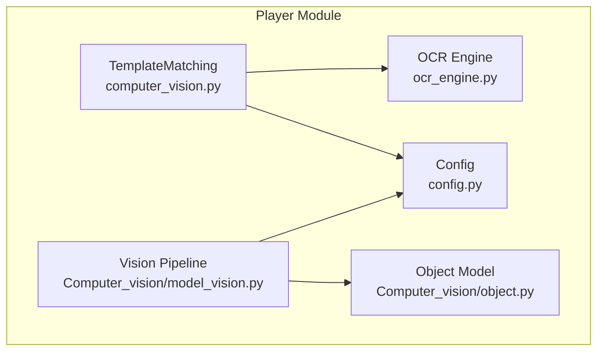
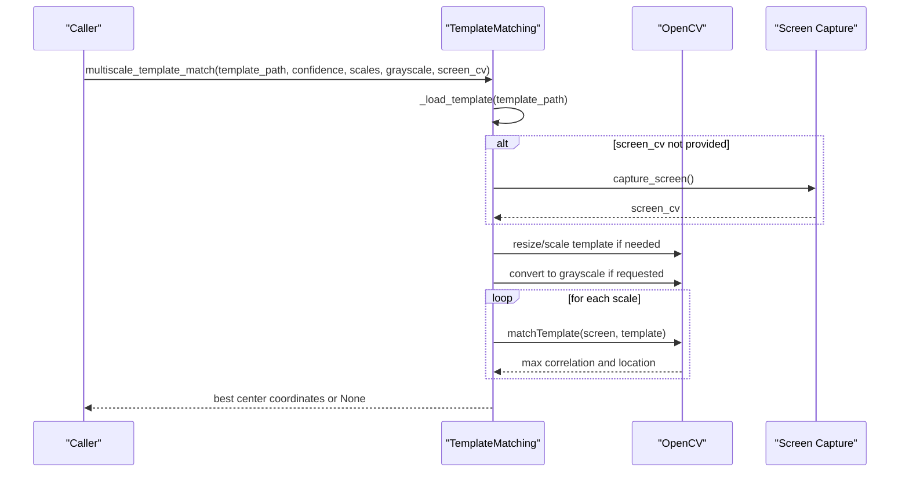
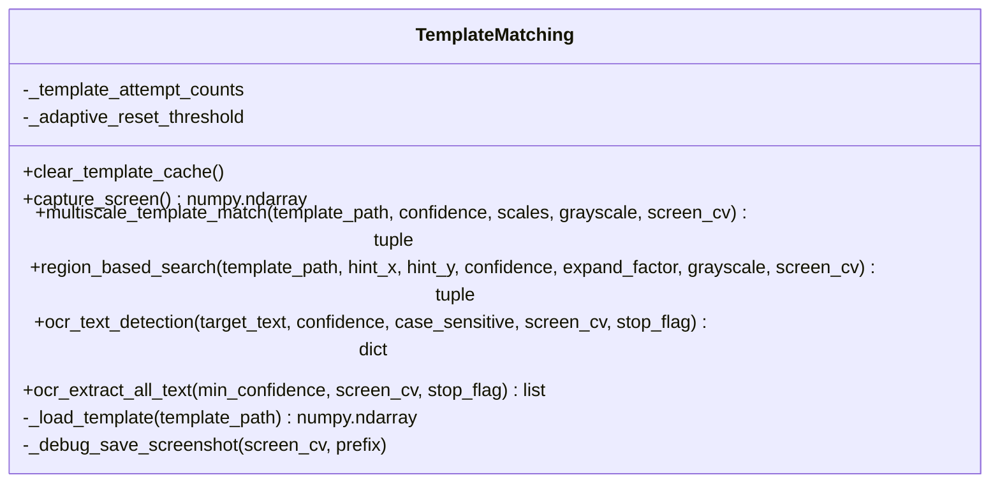
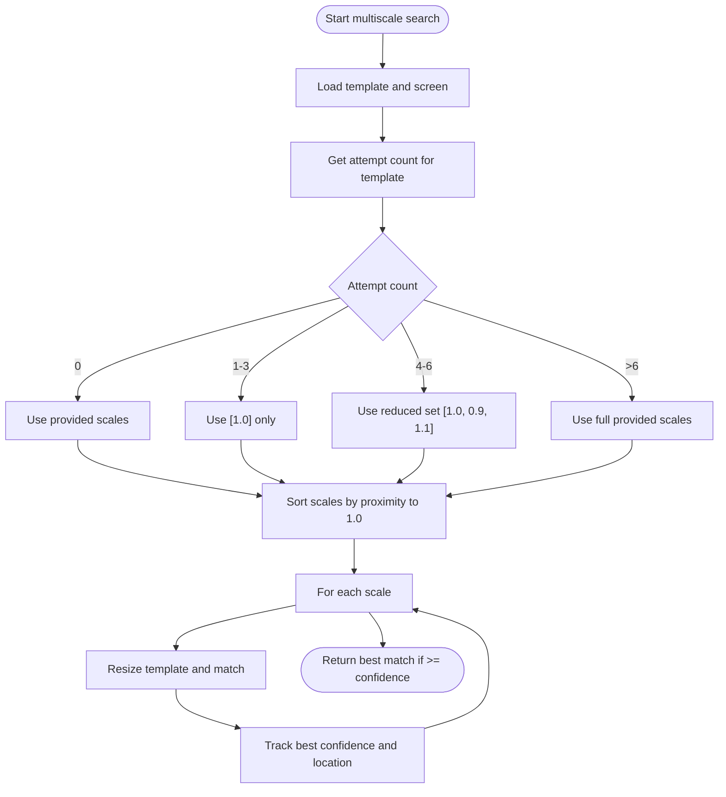
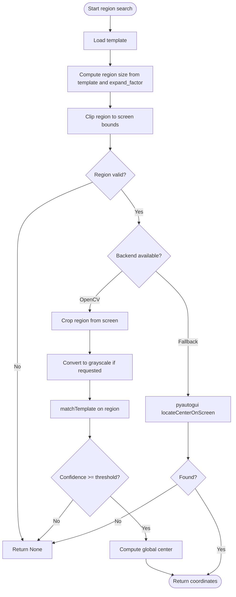
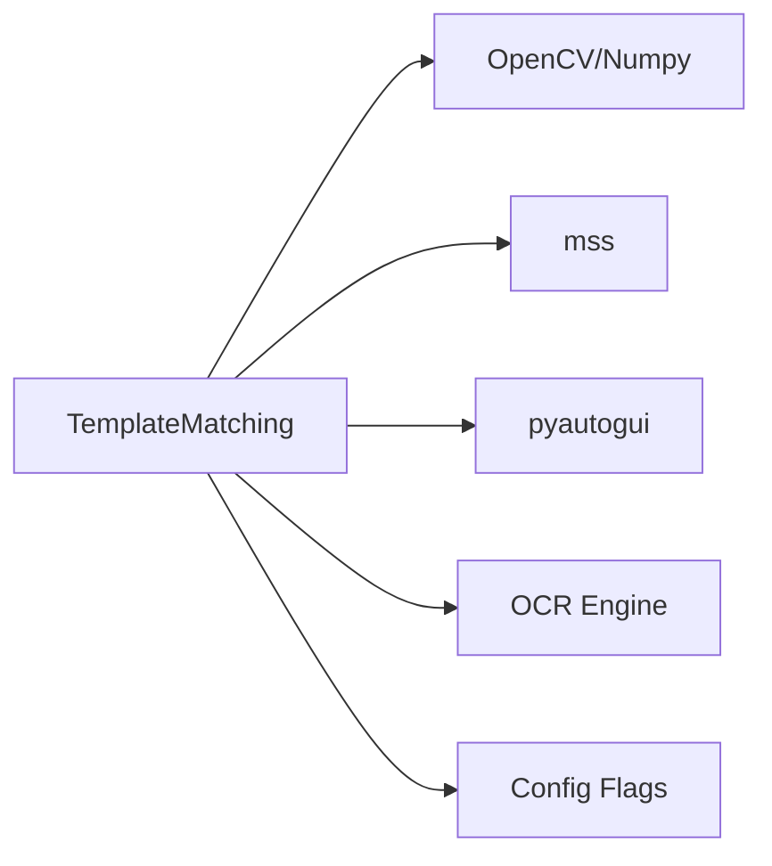

# Template Matching API

<cite>
**Referenced Files in This Document**
- [computer_vision.py](file://LoOper/player/computer_vision.py)
- [config.py](file://LoOper/player/config.py)
- [ocr_engine.py](file://LoOper/player/ocr_engine.py)
- [model_vision.py](file://LoOper/player/Computer_vision/model_vision.py)
- [object.py](file://LoOper/player/Computer_vision/object.py)
</cite>

## Table of Contents
1. [Introduction](#introduction)
2. [Project Structure](#project-structure)
3. [Core Components](#core-components)
4. [Architecture Overview](#architecture-overview)
5. [Detailed Component Analysis](#detailed-component-analysis)
6. [Dependency Analysis](#dependency-analysis)
7. [Performance Considerations](#performance-considerations)
8. [Troubleshooting Guide](#troubleshooting-guide)
9. [Conclusion](#conclusion)

## Introduction
This document describes the template matching subsystem used for automated UI interaction. It covers:
- Multiscale template matching with adaptive scaling
- Region-based search around hints
- Screen capture integration and optimization
- Confidence threshold management
- Coordinate calculation and result interpretation
- Guidelines for template preparation, performance tuning, and error handling

The primary class is TemplateMatching, which provides methods for:
- Loading templates efficiently
- Capturing the screen via optimized backends
- Performing multiscale template matching with adaptive strategies
- Performing region-based search around hint coordinates
- Optional OCR-based fallbacks and validation

## Project Structure
The template matching system is primarily implemented in the player module’s computer vision utilities, with supporting OCR and configuration modules.

**Diagram sources**
- [computer_vision.py:47-606](file://LoOper/player/computer_vision.py#L47-L606)
- [config.py:11-31](file://LoOper/player/config.py#L11-L31)
- [ocr_engine.py:131-345](file://LoOper/player/ocr_engine.py#L131-L345)
- [model_vision.py:310-637](file://LoOper/player/Computer_vision/model_vision.py#L310-L637)
- [object.py:3-167](file://LoOper/player/Computer_vision/object.py#L3-L167)

**Section sources**
- [computer_vision.py:47-606](file://LoOper/player/computer_vision.py#L47-L606)
- [config.py:11-31](file://LoOper/player/config.py#L11-L31)
- [ocr_engine.py:131-345](file://LoOper/player/ocr_engine.py#L131-L345)
- [model_vision.py:310-637](file://LoOper/player/Computer_vision/model_vision.py#L310-L637)
- [object.py:3-167](file://LoOper/player/Computer_vision/object.py#L3-L167)

## Core Components
- TemplateMatching: Central class offering template loading, screen capture, multiscale matching, region-based search, and OCR-based text detection/extraction.
- Config flags: CV2_AVAILABLE and OCR_AVAILABLE gate optional functionality.
- OCR engine: Provides text extraction and element metadata for OCR-based workflows.

Key capabilities:
- Efficient template caching and loading
- Fast screen capture via mss or pyautogui fallback
- Multiscale matching with adaptive scale selection based on prior attempts
- Region-based search with dynamic expansion and boundary checks
- Optional grayscale conversion for robustness
- OCR-based fallbacks and validation

**Section sources**
- [computer_vision.py:47-606](file://LoOper/player/computer_vision.py#L47-L606)
- [config.py:11-31](file://LoOper/player/config.py#L11-L31)
- [ocr_engine.py:131-345](file://LoOper/player/ocr_engine.py#L131-L345)

## Architecture Overview
The template matching pipeline integrates OpenCV-based template matching with optional OCR and region constraints. The system adapts search scales based on historical attempt counts to balance speed and accuracy.

**Diagram sources**
- [computer_vision.py:198-332](file://LoOper/player/computer_vision.py#L198-L332)

## Detailed Component Analysis

### TemplateMatching Class
The TemplateMatching class encapsulates all template matching operations. It manages:
- Template cache and loading
- Screen capture with multiple backends
- Multiscale matching with adaptive strategy
- Region-based search with hint coordinates
- OCR-based text detection and extraction

**Diagram sources**
- [computer_vision.py:47-606](file://LoOper/player/computer_vision.py#L47-L606)

#### Method: multiscale_template_match
Purpose:
- Perform multiscale template matching with adaptive scaling based on previous attempts.

Parameters:
- template_path: Path to the template image file.
- confidence: Confidence threshold (0.0 to 1.0).
- scales: Optional list of scale factors to try; defaults to [1.0, 0.9, 1.1].
- grayscale: Boolean to convert template and screen to grayscale.
- screen_cv: Optional pre-captured screen image to avoid extra captures.

Behavior:
- Loads template and optionally converts to grayscale.
- Adapts scale set based on attempt history:
  - First few attempts: prioritize 1.0 scale for speed.
  - Medium attempts: reduced set [1.0, 0.9, 1.1].
  - Many attempts: full provided scales.
- Resets attempt counter after a threshold.
- Evaluates all scales to select the best match across scales.
- Returns center coordinates if best confidence meets threshold; otherwise None.

Notes:
- Sorting scales prioritizes 1.0 to improve responsiveness for frequent retries.
- Early exit was removed to ensure the globally best match is selected.

Example usage references:
- [computer_vision.py:198-332](file://LoOper/player/computer_vision.py#L198-L332)

**Section sources**
- [computer_vision.py:198-332](file://LoOper/player/computer_vision.py#L198-L332)

#### Method: region_based_search
Purpose:
- Search for a template within a region around a hint coordinate.

Parameters:
- template_path: Path to the template image file.
- hint_x, hint_y: Hint coordinates for the search region.
- confidence: Confidence threshold for matching.
- expand_factor: Factor to expand the search region relative to template size.
- grayscale: Boolean to convert to grayscale.
- screen_cv: Optional pre-captured screen region.

Behavior:
- Computes region size based on template dimensions and expand_factor with minimum constraints.
- Validates region fits on screen.
- Uses OpenCV matchTemplate on the cropped region if available and CV2 is enabled.
- Falls back to pyautogui locateCenterOnScreen if OpenCV is unavailable or region is invalid.
- Returns global center coordinates if found; otherwise None.

Example usage references:
- [computer_vision.py:333-451](file://LoOper/player/computer_vision.py#L333-L451)

**Section sources**
- [computer_vision.py:333-451](file://LoOper/player/computer_vision.py#L333-L451)

#### Method: capture_screen
Purpose:
- Capture the screen using the fastest available backend.

Behavior:
- If a sandbox agent URL is configured, requests a screenshot from the remote agent.
- Otherwise, prefers mss for fast capture; falls back to pyautogui.
- Converts to BGR format for OpenCV compatibility.

Example usage references:
- [computer_vision.py:92-178](file://LoOper/player/computer_vision.py#L92-L178)

**Section sources**
- [computer_vision.py:92-178](file://LoOper/player/computer_vision.py#L92-L178)

#### Method: ocr_text_detection and ocr_extract_all_text
Purpose:
- Detect specific text or extract all readable text using OCR.

Parameters:
- target_text/min_confidence: Text to find or minimum confidence threshold.
- case_sensitive: Case sensitivity for matching.
- screen_cv: Optional pre-captured screen.
- stop_flag: Optional callable to abort long-running operations.

Behavior:
- Validates OCR availability via OCR_AVAILABLE.
- Captures screen if not provided.
- Extracts text elements and computes bounding boxes.
- Returns best match by confidence or full list depending on method.

Example usage references:
- [computer_vision.py:452-606](file://LoOper/player/computer_vision.py#L452-L606)
- [ocr_engine.py:131-345](file://LoOper/player/ocr_engine.py#L131-L345)

**Section sources**
- [computer_vision.py:452-606](file://LoOper/player/computer_vision.py#L452-L606)
- [ocr_engine.py:131-345](file://LoOper/player/ocr_engine.py#L131-L345)

### Adaptive Multi-Scale Tracking Mechanism
The system tracks the number of attempts per template and dynamically adjusts the scale set to optimize performance.

**Diagram sources**
- [computer_vision.py:198-332](file://LoOper/player/computer_vision.py#L198-L332)

**Section sources**
- [computer_vision.py:198-332](file://LoOper/player/computer_vision.py#L198-L332)

### Region-Based Search Logic
The region-based search constrains the search area around a hint coordinate and validates boundaries.

**Diagram sources**
- [computer_vision.py:333-451](file://LoOper/player/computer_vision.py#L333-L451)

**Section sources**
- [computer_vision.py:333-451](file://LoOper/player/computer_vision.py#L333-L451)

## Dependency Analysis
TemplateMatching depends on:
- OpenCV/Numpy for image processing and template matching
- mss/pyautogui for fast screen capture
- OCR engine for text-based fallbacks
- Config flags to conditionally enable/disable features

**Diagram sources**
- [computer_vision.py:47-606](file://LoOper/player/computer_vision.py#L47-L606)
- [config.py:11-31](file://LoOper/player/config.py#L11-L31)
- [ocr_engine.py:131-345](file://LoOper/player/ocr_engine.py#L131-L345)

**Section sources**
- [computer_vision.py:47-606](file://LoOper/player/computer_vision.py#L47-L606)
- [config.py:11-31](file://LoOper/player/config.py#L11-L31)
- [ocr_engine.py:131-345](file://LoOper/player/ocr_engine.py#L131-L345)

## Performance Considerations
- Prefer grayscale matching when templates and screens are not color-dependent; reduces computation.
- Use region-based search with appropriate expand_factor to limit search space.
- Leverage multiscale_template_match with default scales to quickly converge on 1.0 scale for frequent retries.
- Cache templates via the built-in cache to avoid repeated disk I/O.
- Use provided screen_cv to avoid redundant captures in tight loops.
- For OCR-based workflows, set min_confidence appropriately to reduce false positives.

[No sources needed since this section provides general guidance]

## Troubleshooting Guide
Common issues and resolutions:
- OpenCV not available:
  - Symptom: Multiscale matching returns None.
  - Resolution: Install OpenCV and NumPy; verify CV2_AVAILABLE.
- OCR not available:
  - Symptom: OCR methods return None or empty results.
  - Resolution: Ensure PaddleOCR is installed and OCR_AVAILABLE is True.
- Template loading failures:
  - Symptom: Template not found or None returned.
  - Resolution: Verify template_path exists and is readable.
- Region too small:
  - Symptom: Region-based search returns None.
  - Resolution: Increase expand_factor or adjust hint coordinates.
- Low confidence matches:
  - Symptom: Best confidence below threshold.
  - Resolution: Adjust confidence threshold or use grayscale matching.

**Section sources**
- [config.py:11-31](file://LoOper/player/config.py#L11-L31)
- [computer_vision.py:56-84](file://LoOper/player/computer_vision.py#L56-L84)
- [computer_vision.py:333-451](file://LoOper/player/computer_vision.py#L333-L451)

## Conclusion
The TemplateMatching subsystem provides robust, adaptive template matching with region constraints and OCR fallbacks. By leveraging multiscale matching with adaptive scaling, region-based search, and efficient screen capture, it balances accuracy and performance. Proper template preparation, confidence tuning, and awareness of platform-specific constraints ensure reliable automation across diverse UIs.