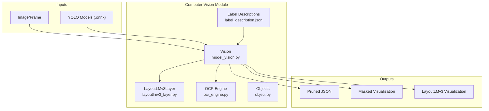
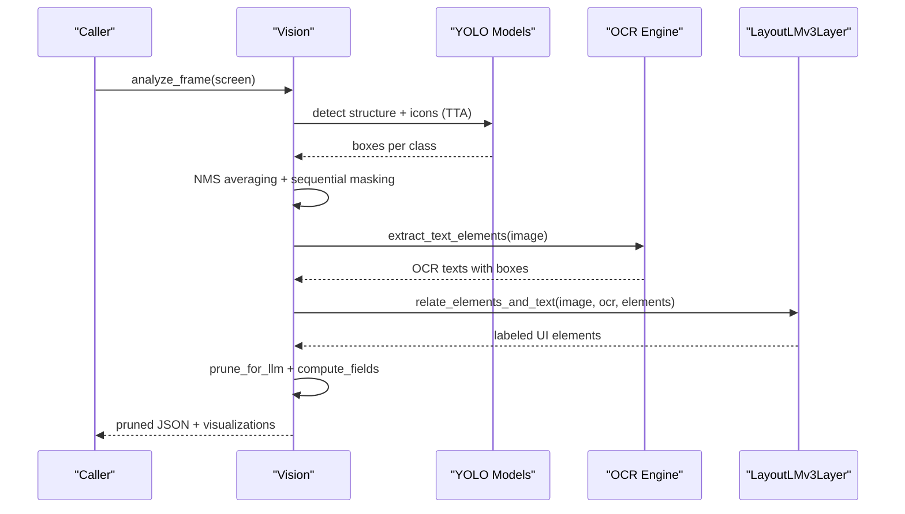
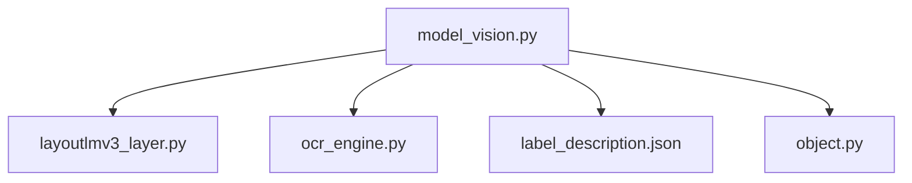

# Vision Models API

<cite>
**Referenced Files in This Document**
- [model_vision.py](file://LoOper/player/Computer_vision/model_vision.py)
- [layoutlmv3_layer.py](file://LoOper/player/Computer_vision/layoutlmv3_layer.py)
- [ocr_engine.py](file://LoOper/player/ocr_engine.py)
- [object.py](file://LoOper/player/Computer_vision/object.py)
- [test_vision.py](file://LoOper/player/Computer_vision/test_vision.py)
- [test_ocr.py](file://LoOper/player/Computer_vision/test_ocr.py)
- [label_description.json](file://LoOper/player/Computer_vision/label_description.json)
- [view_output.json](file://LoOper/player/Computer_vision/view_output.json)
- [computer_vision.py](file://LoOper/player/computer_vision.py)
</cite>

## Table of Contents
1. [Introduction](#introduction)
2. [Project Structure](#project-structure)
3. [Core Components](#core-components)
4. [Architecture Overview](#architecture-overview)
5. [Detailed Component Analysis](#detailed-component-analysis)
6. [Dependency Analysis](#dependency-analysis)
7. [Performance Considerations](#performance-considerations)
8. [Troubleshooting Guide](#troubleshooting-guide)
9. [Conclusion](#conclusion)
10. [Appendices](#appendices)

## Introduction
This document describes the vision models system that combines YOLO-based UI detection, OCR text extraction, and LayoutLMv3-based layout understanding for document and UI analysis. It covers:
- Vision model interfaces and initialization parameters
- ONNX-based inference and model loading/caching
- LayoutLMv3 integration for text localization, layout analysis, and structured information extraction
- Batch processing and inference optimization strategies
- Memory management and hardware acceleration configuration
- Practical examples and troubleshooting guidance

## Project Structure
The vision system is centered in the Computer Vision module with supporting OCR and LayoutLMv3 components:
- Vision orchestration and inference pipeline
- LayoutLMv3 processor and model wrapper
- OCR engine abstraction for text extraction
- Supporting data structures and configuration

**Diagram sources**
- [model_vision.py:310-342](file://LoOper/player/Computer_vision/model_vision.py#L310-L342)
- [layoutlmv3_layer.py:6-12](file://LoOper/player/Computer_vision/layoutlmv3_layer.py#L6-L12)
- [ocr_engine.py:131-240](file://LoOper/player/ocr_engine.py#L131-L240)
- [label_description.json:1-9](file://LoOper/player/Computer_vision/label_description.json#L1-L9)

**Section sources**
- [model_vision.py:310-342](file://LoOper/player/Computer_vision/model_vision.py#L310-L342)
- [layoutlmv3_layer.py:6-12](file://LoOper/player/Computer_vision/layoutlmv3_layer.py#L6-L12)
- [ocr_engine.py:131-240](file://LoOper/player/ocr_engine.py#L131-L240)
- [label_description.json:1-9](file://LoOper/player/Computer_vision/label_description.json#L1-L9)

## Core Components
- Vision: orchestrates YOLO-based UI detection, OCR integration, LayoutLMv3 labeling, pruning, and visualization.
- LayoutLMv3Layer: wraps LayoutLMv3 processor and model for contextual text-element alignment.
- OCR Engine: abstraction over PaddleOCR for text extraction and bounding boxes.
- Object/Interaction/Text: data structures representing detected UI elements and relationships.

Key initialization parameters:
- Vision.__init__: accepts a structure model path (ONNX) and loads:
  - Structure detection model (YOLO)
  - Icon detection model (YOLO via Hugging Face)
  - LayoutLMv3Layer for layout-aware labeling

Inference configuration highlights:
- Multi-scale TTA (Test-Time Augmentation) with grayscale/high-contrast/inverted masks
- Non-Maximum Suppression averaging across overlapped detections
- Sequential masking pass to improve large element detection
- ROI-based refinement and deduplication
- Layout-aware field computation using LayoutLMv3

**Section sources**
- [model_vision.py:310-342](file://LoOper/player/Computer_vision/model_vision.py#L310-L342)
- [model_vision.py:423-637](file://LoOper/player/Computer_vision/model_vision.py#L423-L637)
- [model_vision.py:1201-1506](file://LoOper/player/Computer_vision/model_vision.py#L1201-L1506)
- [layoutlmv3_layer.py:6-12](file://LoOper/player/Computer_vision/layoutlmv3_layer.py#L6-L12)
- [object.py:3-100](file://LoOper/player/Computer_vision/object.py#L3-L100)

## Architecture Overview
End-to-end flow from raw frames to structured UI understanding:

**Diagram sources**
- [model_vision.py:423-637](file://LoOper/player/Computer_vision/model_vision.py#L423-L637)
- [model_vision.py:1201-1506](file://LoOper/player/Computer_vision/model_vision.py#L1201-L1506)
- [layoutlmv3_layer.py:29-136](file://LoOper/player/Computer_vision/layoutlmv3_layer.py#L29-L136)
- [ocr_engine.py:131-240](file://LoOper/player/ocr_engine.py#L131-L240)

## Detailed Component Analysis

### Vision Class
Responsibilities:
- Load YOLO models (structure and icons)
- Capture frames and run detection with TTA
- Merge detections across augmentations and masks
- Extract OCR text and compute fields with LayoutLMv3
- Prune outputs and generate visual overlays

Key methods and parameters:
- __init__(structure_model_path): initializes YOLO models and LayoutLMv3Layer
- analyze_frame(screen): full pipeline from detection to annotations
- analyze_pruned_from_result(result, screen): post-process detection results
- compute_fields(pruned, screen): associate labels/values to UI fields
- render_pruned_mask(screen, pruned): generate masked visualization
- save_pruned/save_masked: persist outputs
- unload(): release models and empty GPU cache

Optimization strategies:
- TTA with grayscale/high-contrast/inverted masks improves robustness
- NMS averaging reduces duplicates
- Sequential masking pass increases recall for large elements
- ROI-based refinement narrows focus areas
- Deduplication by overlap thresholds prevents redundant entries

Memory and caching:
- Model unloading and CUDA cache emptying reduce memory footprint
- OCR engine uses LRU cache for model instances

**Section sources**
- [model_vision.py:310-342](file://LoOper/player/Computer_vision/model_vision.py#L310-L342)
- [model_vision.py:423-637](file://LoOper/player/Computer_vision/model_vision.py#L423-L637)
- [model_vision.py:1201-1506](file://LoOper/player/Computer_vision/model_vision.py#L1201-L1506)
- [model_vision.py:1717-1756](file://LoOper/player/Computer_vision/model_vision.py#L1717-L1756)
- [model_vision.py:2134-2181](file://LoOper/player/Computer_vision/model_vision.py#L2134-L2181)

### LayoutLMv3 Integration
The LayoutLMv3Layer provides:
- Processor and model initialization
- Bounding box normalization to LayoutLMv3’s 1000-grid
- Element-text relationship mapping via embedding similarity
- Spatial heuristics to bias above/left relationships
- Visualization overlay rendering

Key method:
- relate_elements_and_text(image_np, ocr_texts, ui_elements): computes embeddings and assigns labels
- render_layout_visualization(image_np, ui_elements, ocr_texts): draws unified overlay

Integration points:
- Called from compute_fields to enrich UI elements with contextual labels
- Outputs saved as visualization images

**Section sources**
- [layoutlmv3_layer.py:6-12](file://LoOper/player/Computer_vision/layoutlmv3_layer.py#L6-L12)
- [layoutlmv3_layer.py:29-136](file://LoOper/player/Computer_vision/layoutlmv3_layer.py#L29-L136)
- [layoutlmv3_layer.py:138-203](file://LoOper/player/Computer_vision/layoutlmv3_layer.py#L138-L203)
- [model_vision.py:1456-1470](file://LoOper/player/Computer_vision/model_vision.py#L1456-L1470)

### OCR Engine
Abstraction layer over PaddleOCR:
- Supports language normalization and bundled model discovery in frozen environments
- Provides extract_text_elements and extract_text_elements_from_image_path
- Normalizes results to consistent structure with text, confidence, and bounding boxes

Usage:
- Used by Vision to extract OCR texts for layout-aware labeling
- Supports min_confidence filtering and language selection

**Section sources**
- [ocr_engine.py:131-240](file://LoOper/player/ocr_engine.py#L131-L240)
- [ocr_engine.py:355-367](file://LoOper/player/ocr_engine.py#L355-L367)

### Data Structures
- Object/Interaction/Text: represent detected UI elements, interactions, and associated text
- Pruned output: structured JSON with fields, OCR texts, text blocks, and context items

**Section sources**
- [object.py:3-100](file://LoOper/player/Computer_vision/object.py#L3-L100)
- [model_vision.py:669-908](file://LoOper/player/Computer_vision/model_vision.py#L669-L908)
- [view_output.json:1-1292](file://LoOper/player/Computer_vision/view_output.json#L1-L1292)

## Dependency Analysis
Inter-module dependencies and relationships:

**Diagram sources**
- [model_vision.py:332-339](file://LoOper/player/Computer_vision/model_vision.py#L332-L339)
- [layoutlmv3_layer.py:1-12](file://LoOper/player/Computer_vision/layoutlmv3_layer.py#L1-L12)
- [ocr_engine.py:1-20](file://LoOper/player/ocr_engine.py#L1-L20)
- [label_description.json:1-9](file://LoOper/player/Computer_vision/label_description.json#L1-L9)

**Section sources**
- [model_vision.py:332-339](file://LoOper/player/Computer_vision/model_vision.py#L332-L339)
- [layoutlmv3_layer.py:1-12](file://LoOper/player/Computer_vision/layoutlmv3_layer.py#L1-L12)
- [ocr_engine.py:1-20](file://LoOper/player/ocr_engine.py#L1-L20)
- [label_description.json:1-9](file://LoOper/player/Computer_vision/label_description.json#L1-L9)

## Performance Considerations
- Hardware acceleration
  - Torch CUDA cache emptying and garbage collection during unload
  - Ensure GPU drivers and CUDA availability for optimal LayoutLMv3 performance
- Model loading and caching
  - OCR engine caches PaddleOCR instances with LRU to avoid repeated initialization
  - Vision unloads models when not in use to free memory
- Inference optimization
  - TTA with grayscale/high-contrast/inverted masks improves accuracy at minimal cost
  - NMS averaging reduces duplicate detections
  - Sequential masking pass improves recall for large UI elements
  - ROI-based refinement limits downstream processing
- Batch processing
  - Frame capture via mss for fast screen grabs
  - Thread pool executor used for overlay rendering and async analysis
- Memory management
  - Explicit del and gc.collect calls during unload
  - Temporary image cleanup after OCR

[No sources needed since this section provides general guidance]

## Troubleshooting Guide
Common issues and resolutions:
- OCR not available
  - Verify OCR_AVAILABLE and OCR_ENGINE configuration
  - Ensure PaddleOCR models are bundled or accessible
- LayoutLMv3 errors
  - Check model initialization and device availability
  - Validate image preprocessing and bounding box normalization
- YOLO model loading failures
  - Confirm ONNX model path and compatibility
  - Validate model names mapping against label_description.json
- Memory leaks or high memory usage
  - Call unload() to release models and empty CUDA cache
  - Reduce batch sizes or resolution for inference
- Slow inference
  - Enable hardware acceleration (CUDA)
  - Reduce image resolution or disable TTA variants
  - Limit ROI to focused regions

**Section sources**
- [model_vision.py:2134-2181](file://LoOper/player/Computer_vision/model_vision.py#L2134-L2181)
- [ocr_engine.py:30-104](file://LoOper/player/ocr_engine.py#L30-L104)
- [layoutlmv3_layer.py:6-12](file://LoOper/player/Computer_vision/layoutlmv3_layer.py#L6-L12)
- [label_description.json:1-9](file://LoOper/player/Computer_vision/label_description.json#L1-L9)

## Conclusion
The vision models system integrates YOLO-based UI detection, OCR, and LayoutLMv3 contextual understanding to produce structured UI analyses. Its modular design enables efficient inference, robust text-field association, and extensible visualization. Proper configuration of hardware acceleration, model caching, and memory management ensures reliable performance across diverse UI scenarios.

[No sources needed since this section summarizes without analyzing specific files]

## Appendices

### API Reference: Vision
- Initialization
  - Parameters: structure_model_path (ONNX)
  - Behavior: loads structure and icon models; initializes LayoutLMv3Layer
- Methods
  - analyze_frame(screen): full pipeline inference
  - analyze_pruned_from_result(result, screen): post-processing
  - compute_fields(pruned, screen): layout-aware field labeling
  - render_pruned_mask(screen, pruned): masked visualization
  - save_pruned/save_masked: persist outputs
  - unload(): release resources

**Section sources**
- [model_vision.py:310-342](file://LoOper/player/Computer_vision/model_vision.py#L310-L342)
- [model_vision.py:423-637](file://LoOper/player/Computer_vision/model_vision.py#L423-L637)
- [model_vision.py:1201-1506](file://LoOper/player/Computer_vision/model_vision.py#L1201-L1506)
- [model_vision.py:1717-1756](file://LoOper/player/Computer_vision/model_vision.py#L1717-L1756)
- [model_vision.py:2134-2181](file://LoOper/player/Computer_vision/model_vision.py#L2134-L2181)

### Example Workflows
- Single image analysis
  - Load Vision with structure model path
  - Call analyze_image_file(image_path)
  - Inspect pruned JSON and saved visualizations
- Live screen overlay
  - Initialize Vision
  - Call start_vision(monitor_index)
  - Press trigger key to capture and describe screen

**Section sources**
- [test_vision.py:15-52](file://LoOper/player/Computer_vision/test_vision.py#L15-L52)
- [model_vision.py:1759-2133](file://LoOper/player/Computer_vision/model_vision.py#L1759-L2133)

### Model Selection Guidelines
- Choose YOLO models appropriate for target UI domains
- Use LayoutLMv3 for documents/forms requiring contextual text-field alignment
- Prefer GPU acceleration for LayoutLMv3 and OCR engines
- Validate label_description.json mappings for custom models

**Section sources**
- [label_description.json:1-9](file://LoOper/player/Computer_vision/label_description.json#L1-L9)
- [model_vision.py:423-637](file://LoOper/player/Computer_vision/model_vision.py#L423-L637)