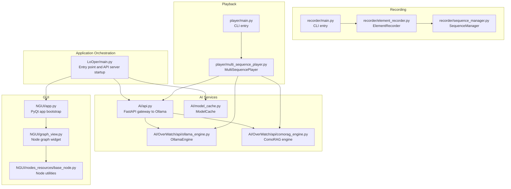
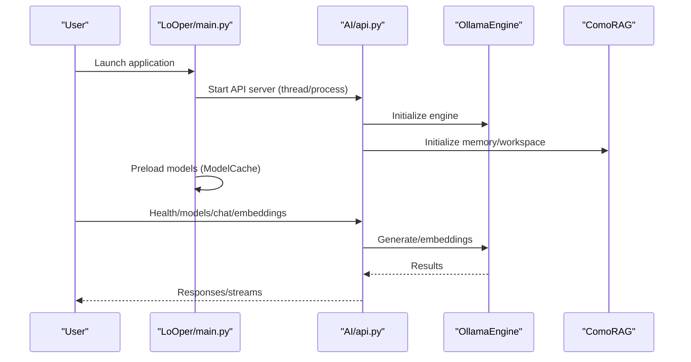
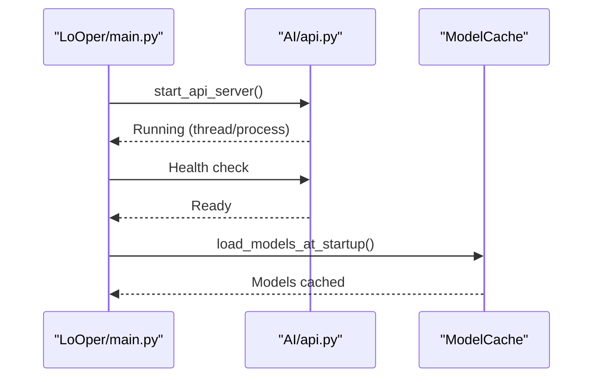
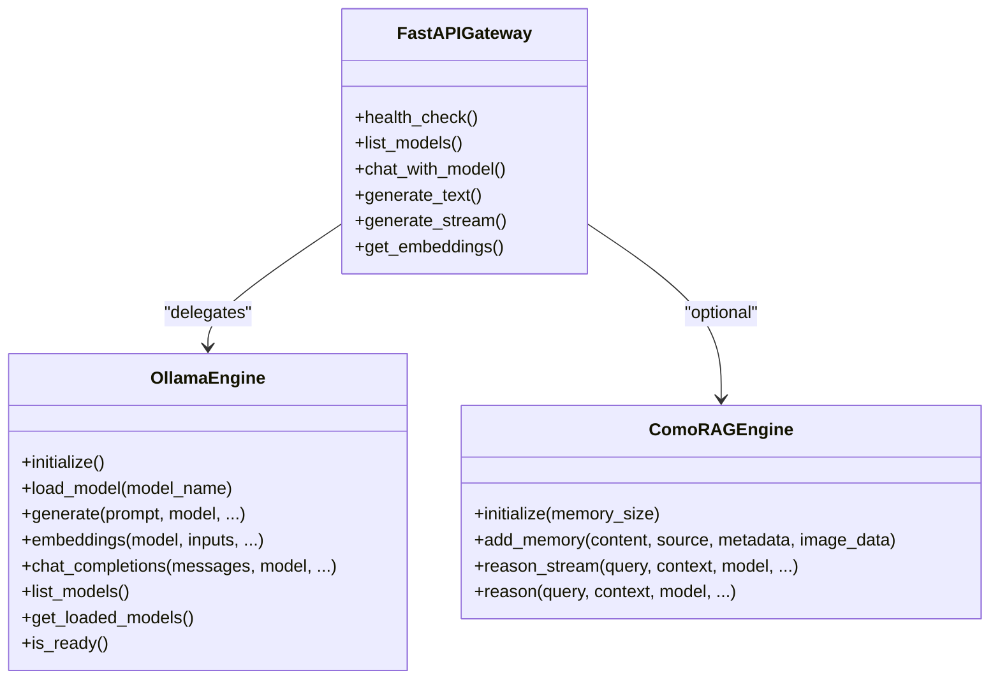
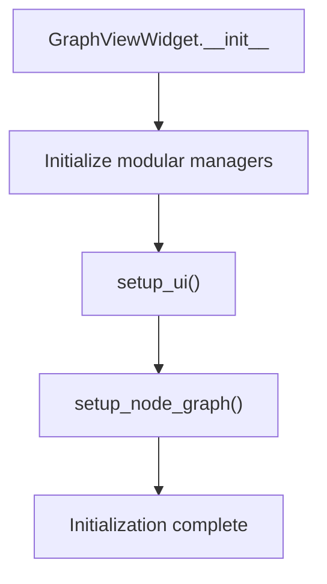
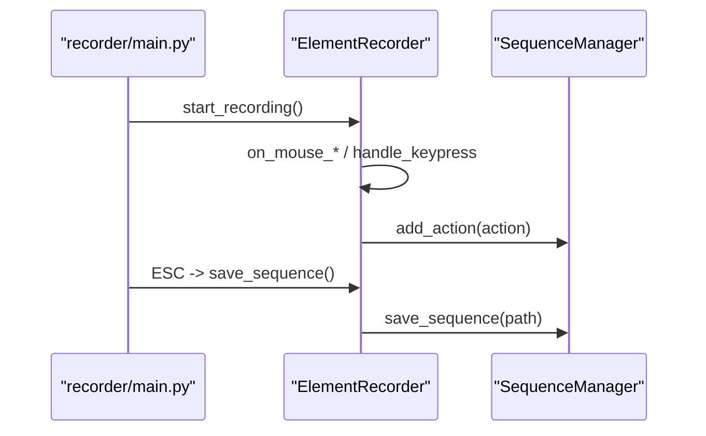
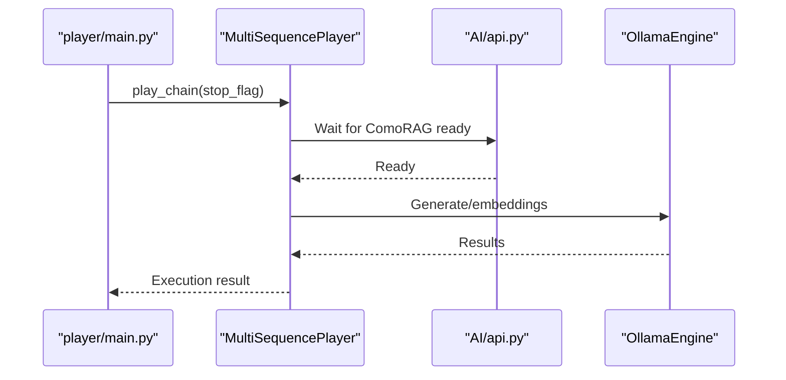
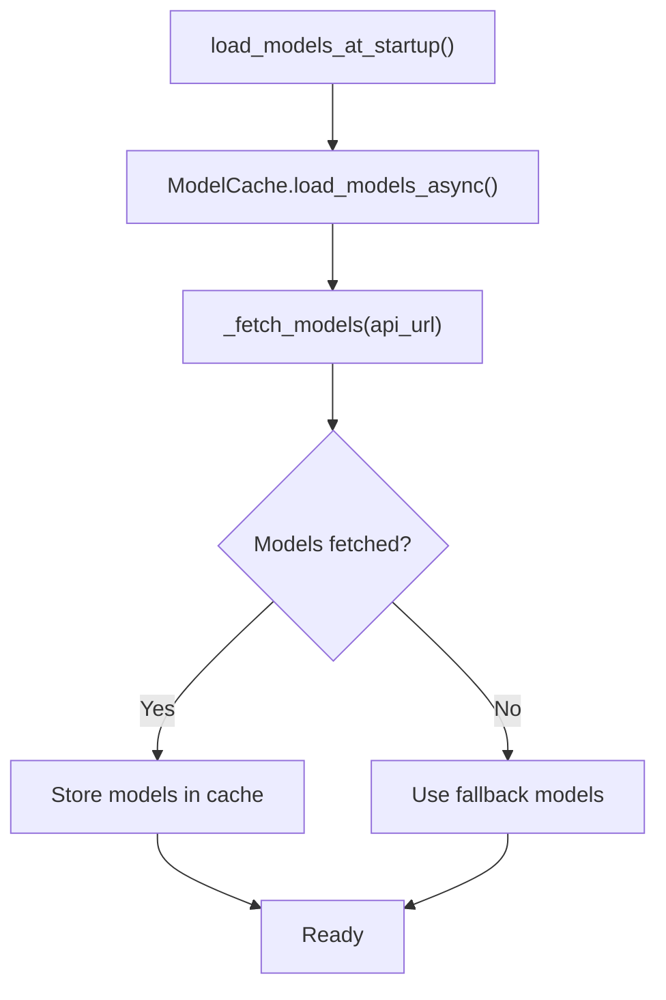
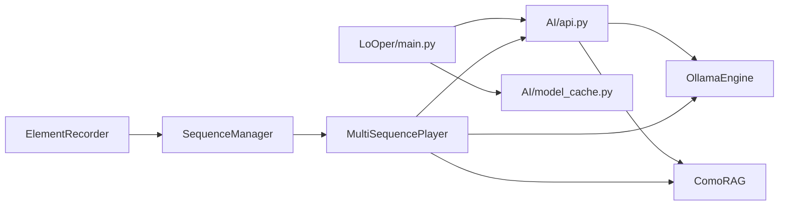

# Internal Communication API

<cite>
**Referenced Files in This Document**
- [main.py](file://LoOper/main.py)
- [api.py](file://LoOper/AI/api.py)
- [comorag_engine.py](file://LoOper/AI/OverWatch/api/comorag_engine.py)
- [ollama_engine.py](file://LoOper/AI/OverWatch/api/ollama_engine.py)
- [model_cache.py](file://LoOper/AI/model_cache.py)
- [app.py](file://LoOper/NGUI/app.py)
- [graph_view.py](file://LoOper/NGUI/graph_view.py)
- [base_node.py](file://LoOper/NGUI/nodes_resources/base_node.py)
- [main.py](file://LoOper/player/main.py)
- [multi_sequence_player.py](file://LoOper/player/multi_sequence_player.py)
- [main.py](file://LoOper/recorder/main.py)
- [element_recorder.py](file://LoOper/recorder/element_recorder.py)
- [sequence_manager.py](file://LoOper/recorder/sequence_manager.py)
</cite>

## Table of Contents
1. [Introduction](#introduction)
2. [Project Structure](#project-structure)
3. [Core Components](#core-components)
4. [Architecture Overview](#architecture-overview)
5. [Detailed Component Analysis](#detailed-component-analysis)
6. [Dependency Analysis](#dependency-analysis)
7. [Performance Considerations](#performance-considerations)
8. [Troubleshooting Guide](#troubleshooting-guide)
9. [Conclusion](#conclusion)
10. [Appendices](#appendices)

## Introduction
This document describes the internal component communication interfaces used for inter-process communication and component coordination across the desktop automation platform. It focuses on messaging protocols between the main application, GUI components, recording engine, playback engine, and AI services. It explains event-driven communication patterns, data flow between components, synchronization mechanisms, and lifecycle management. It also provides guidelines for component integration, debugging communication issues, maintaining component isolation, thread-safety considerations, memory sharing patterns, and performance optimization.

## Project Structure
The system is composed of:
- Main application entry and orchestration
- AI service gateway and engines (Ollama, ComoRAG)
- GUI for workflow authoring and visualization
- Recording engine for capturing user actions
- Playback engine for executing recorded and authored workflows
- Model caching and API initialization utilities

**Diagram sources**
- [main.py:355-381](file://LoOper/main.py#L355-L381)
- [api.py:1-120](file://LoOper/AI/api.py#L1-L120)
- [ollama_engine.py:34-96](file://LoOper/AI/OverWatch/api/ollama_engine.py#L34-L96)
- [comorag_engine.py:233-287](file://LoOper/AI/OverWatch/api/comorag_engine.py#L233-L287)
- [model_cache.py:15-45](file://LoOper/AI/model_cache.py#L15-L45)
- [app.py:11-41](file://LoOper/NGUI/app.py#L11-L41)
- [graph_view.py:43-128](file://LoOper/NGUI/graph_view.py#L43-L128)
- [base_node.py:1-60](file://LoOper/NGUI/nodes_resources/base_node.py#L1-L60)
- [main.py:7-71](file://LoOper/recorder/main.py#L7-L71)
- [element_recorder.py:11-25](file://LoOper/recorder/element_recorder.py#L11-L25)
- [sequence_manager.py:18-25](file://LoOper/recorder/sequence_manager.py#L18-L25)
- [main.py:18-105](file://LoOper/player/main.py#L18-L105)
- [multi_sequence_player.py:32-135](file://LoOper/player/multi_sequence_player.py#L32-L135)

**Section sources**
- [main.py:355-381](file://LoOper/main.py#L355-L381)
- [api.py:1-120](file://LoOper/AI/api.py#L1-L120)
- [ollama_engine.py:34-96](file://LoOper/AI/OverWatch/api/ollama_engine.py#L34-L96)
- [comorag_engine.py:233-287](file://LoOper/AI/OverWatch/api/comorag_engine.py#L233-L287)
- [model_cache.py:15-45](file://LoOper/AI/model_cache.py#L15-L45)
- [app.py:11-41](file://LoOper/NGUI/app.py#L11-L41)
- [graph_view.py:43-128](file://LoOper/NGUI/graph_view.py#L43-L128)
- [base_node.py:1-60](file://LoOper/NGUI/nodes_resources/base_node.py#L1-L60)
- [main.py:7-71](file://LoOper/recorder/main.py#L7-L71)
- [element_recorder.py:11-25](file://LoOper/recorder/element_recorder.py#L11-L25)
- [sequence_manager.py:18-25](file://LoOper/recorder/sequence_manager.py#L18-L25)
- [main.py:18-105](file://LoOper/player/main.py#L18-L105)
- [multi_sequence_player.py:32-135](file://LoOper/player/multi_sequence_player.py#L32-L135)

## Core Components
- Application entry and API server lifecycle
  - Starts the LLM API server (FastAPI) and initializes AI services.
  - Provides health checks and background initialization of the ComoRAG engine.
  - Manages process lifecycle and graceful shutdown.

- AI service gateway and engines
  - FastAPI gateway routes requests to Ollama and exposes streaming and non-streaming endpoints.
  - OllamaEngine manages model loading, embeddings, generation, and streaming.
  - ComoRAG engine orchestrates memory workspace, reasoning cycles, and vision processing.

- GUI and workflow authoring
  - PyQt application bootstrap with DPI awareness and dark theme.
  - GraphViewWidget composes modular managers for UI, graph, clipboard, DnD, and configuration.
  - Node utilities provide API URL defaults and port configuration helpers.

- Recording engine
  - CLI entrypoint for recording sessions.
  - ElementRecorder coordinates screenshot capture, scroll grouping, keyboard and mouse handlers, and sequence persistence.
  - SequenceManager attaches app context metadata and persists sequences to disk.

- Playback engine
  - CLI entrypoint for standalone playback.
  - MultiSequencePlayer orchestrates workflow execution, conditional fallbacks, and sandboxed contexts.
  - Integrates with AI services for vision and LLM-based decisions.

- Model caching and initialization
  - ModelCache caches model lists and provides fallbacks to prevent UI blocking.
  - Startup preload and refresh mechanisms ensure models are available before GUI launch.

**Section sources**
- [main.py:138-170](file://LoOper/main.py#L138-L170)
- [api.py:547-601](file://LoOper/AI/api.py#L547-L601)
- [ollama_engine.py:520-574](file://LoOper/AI/OverWatch/api/ollama_engine.py#L520-L574)
- [comorag_engine.py:328-366](file://LoOper/AI/OverWatch/api/comorag_engine.py#L328-L366)
- [app.py:11-41](file://LoOper/NGUI/app.py#L11-L41)
- [graph_view.py:43-128](file://LoOper/NGUI/graph_view.py#L43-L128)
- [base_node.py:15-24](file://LoOper/NGUI/nodes_resources/base_node.py#L15-L24)
- [main.py:7-71](file://LoOper/recorder/main.py#L7-L71)
- [element_recorder.py:11-25](file://LoOper/recorder/element_recorder.py#L11-L25)
- [sequence_manager.py:138-164](file://LoOper/recorder/sequence_manager.py#L138-L164)
- [main.py:18-105](file://LoOper/player/main.py#L18-L105)
- [multi_sequence_player.py:192-358](file://LoOper/player/multi_sequence_player.py#L192-L358)
- [model_cache.py:36-45](file://LoOper/AI/model_cache.py#L36-L45)

## Architecture Overview
The system uses a hybrid synchronous/asynchronous architecture:
- Synchronous orchestration in the main application for process and service startup.
- Asynchronous AI operations via FastAPI and asyncio-based engines.
- Event-driven GUI interactions via PyQt signals and node graph updates.
- File-based persistence for sequences and chain configurations.
- Environment-driven configuration for network endpoints and ports.

**Diagram sources**
- [main.py:355-381](file://LoOper/main.py#L355-L381)
- [api.py:581-601](file://LoOper/AI/api.py#L581-L601)
- [ollama_engine.py:520-574](file://LoOper/AI/OverWatch/api/ollama_engine.py#L520-L574)
- [comorag_engine.py:256-287](file://LoOper/AI/OverWatch/api/comorag_engine.py#L256-L287)
- [model_cache.py:36-45](file://LoOper/AI/model_cache.py#L36-L45)

## Detailed Component Analysis

### Application Orchestration and API Lifecycle
- API server startup
  - Determines whether to run in-process or spawn a subprocess.
  - Configures logging and forwards child output to console.
  - Registers cleanup hooks to terminate the API server on exit.
- Health and initialization
  - Waits for API readiness and triggers background initialization of the ComoRAG engine.
  - Verifies model availability and refreshes model cache.

**Diagram sources**
- [main.py:171-277](file://LoOper/main.py#L171-L277)
- [main.py:355-381](file://LoOper/main.py#L355-L381)
- [model_cache.py:213-217](file://LoOper/AI/model_cache.py#L213-L217)

**Section sources**
- [main.py:171-277](file://LoOper/main.py#L171-L277)
- [main.py:355-381](file://LoOper/main.py#L355-L381)
- [model_cache.py:36-45](file://LoOper/AI/model_cache.py#L36-L45)

### AI Service Gateway and Engines
- FastAPI gateway
  - Exposes endpoints for health, models, chat, generate, generate_stream, and embeddings.
  - Streams responses and supports vision-capable models.
  - Bootstraps required models and tracks missing models.
- OllamaEngine
  - Manages model lifecycle, pulls missing models, and tests generation/embeddings.
  - Supports streaming generation and per-input fallbacks for embeddings.
  - Provides OpenAI-compatible chat completions.
- ComoRAG engine
  - Manages a dynamic memory workspace with FAISS-backed similarity search.
  - Performs iterative reasoning cycles with probing queries, evidence consolidation, and confidence scoring.
  - Streams intermediate reasoning steps and final results.

**Diagram sources**
- [api.py:581-761](file://LoOper/AI/api.py#L581-L761)
- [ollama_engine.py:520-671](file://LoOper/AI/OverWatch/api/ollama_engine.py#L520-L671)
- [comorag_engine.py:328-664](file://LoOper/AI/OverWatch/api/comorag_engine.py#L328-L664)

**Section sources**
- [api.py:581-761](file://LoOper/AI/api.py#L581-L761)
- [ollama_engine.py:520-671](file://LoOper/AI/OverWatch/api/ollama_engine.py#L520-L671)
- [comorag_engine.py:328-664](file://LoOper/AI/OverWatch/api/comorag_engine.py#L328-L664)

### GUI and Workflow Authoring
- PyQt application bootstrap
  - Sets DPI scaling and applies a dark theme stylesheet.
  - Creates the main window and enters the event loop.
- GraphViewWidget
  - Composes modular managers: UIComponents, GraphManager, NodeOperations, ViewManager, ConfigManager, ExportUtils, NodeTransforms, DragDropManager, ClipboardManager.
  - Provides node creation, editing, copying/pasting, and auto-layout.
  - Emits signals for node and sequence selection.
- Node utilities
  - Provides default API URL resolution and multi-input port configuration helpers.

**Diagram sources**
- [app.py:11-41](file://LoOper/NGUI/app.py#L11-L41)
- [graph_view.py:43-128](file://LoOper/NGUI/graph_view.py#L43-L128)
- [base_node.py:15-24](file://LoOper/NGUI/nodes_resources/base_node.py#L15-L24)

**Section sources**
- [app.py:11-41](file://LoOper/NGUI/app.py#L11-L41)
- [graph_view.py:43-128](file://LoOper/NGUI/graph_view.py#L43-L128)
- [base_node.py:15-24](file://LoOper/NGUI/nodes_resources/base_node.py#L15-L24)

### Recording Engine
- CLI entrypoint
  - Starts listeners for mouse and keyboard events and captures ESC to save.
- ElementRecorder
  - Coordinates screenshot capture, scroll grouping, keyboard and mouse handlers, and sequence persistence.
  - Translates modifier keys into action types (e.g., ctrl_click, shift_click).
- SequenceManager
  - Attaches active application context metadata to actions.
  - Persists sequences to JSON and clears caches to reflect changes immediately.

**Diagram sources**
- [main.py:7-71](file://LoOper/recorder/main.py#L7-L71)
- [element_recorder.py:11-25](file://LoOper/recorder/element_recorder.py#L11-L25)
- [sequence_manager.py:138-164](file://LoOper/recorder/sequence_manager.py#L138-L164)

**Section sources**
- [main.py:7-71](file://LoOper/recorder/main.py#L7-L71)
- [element_recorder.py:11-25](file://LoOper/recorder/element_recorder.py#L11-L25)
- [sequence_manager.py:138-164](file://LoOper/recorder/sequence_manager.py#L138-L164)

### Playback Engine
- CLI entrypoint
  - Loads and executes sequences or chains from JSON files.
  - Supports ESC cancellation and JSON cache clearing.
- MultiSequencePlayer
  - Supports legacy linear chains and new workflow format with conditional branches.
  - Integrates with AI services for vision and LLM-based decisions.
  - Manages sandboxed contexts and selection memory across nodes.

**Diagram sources**
- [main.py:18-105](file://LoOper/player/main.py#L18-L105)
- [multi_sequence_player.py:192-358](file://LoOper/player/multi_sequence_player.py#L192-L358)
- [api.py:581-601](file://LoOper/AI/api.py#L581-L601)
- [ollama_engine.py:520-574](file://LoOper/AI/OverWatch/api/ollama_engine.py#L520-L574)

**Section sources**
- [main.py:18-105](file://LoOper/player/main.py#L18-L105)
- [multi_sequence_player.py:192-358](file://LoOper/player/multi_sequence_player.py#L192-L358)

### Model Caching and Initialization
- ModelCache
  - Asynchronously loads model lists from the API and falls back to hardcoded defaults if unavailable.
  - Provides thread-safe access with locks and refresh capability.
  - Used by the main application to preload models before launching the GUI.

**Diagram sources**
- [model_cache.py:36-45](file://LoOper/AI/model_cache.py#L36-L45)
- [model_cache.py:46-77](file://LoOper/AI/model_cache.py#L46-L77)
- [model_cache.py:102-163](file://LoOper/AI/model_cache.py#L102-L163)

**Section sources**
- [model_cache.py:36-45](file://LoOper/AI/model_cache.py#L36-L45)
- [model_cache.py:46-77](file://LoOper/AI/model_cache.py#L46-L77)
- [model_cache.py:102-163](file://LoOper/AI/model_cache.py#L102-L163)

## Dependency Analysis
- Inter-process communication
  - The main application spawns or runs the API server in-process and communicates via HTTP endpoints.
  - Playback and GUI components communicate with the API server using environment-configured URLs.
- Component coupling and cohesion
  - The API gateway delegates to OllamaEngine and optionally to ComoRAG engine.
  - MultiSequencePlayer depends on the API server for AI services and on local caches for model availability.
  - ElementRecorder writes to disk, which affects the JSON cache used by the playback engine.
- External dependencies and integration points
  - OllamaEngine integrates with the Ollama HTTP API and supports streaming and embeddings.
  - ComoRAG engine integrates with OllamaEngine for generation and embeddings.
  - GUI components depend on NodeGraphQt and PyQt for rendering and interaction.

**Diagram sources**
- [main.py:355-381](file://LoOper/main.py#L355-L381)
- [api.py:581-601](file://LoOper/AI/api.py#L581-L601)
- [ollama_engine.py:520-574](file://LoOper/AI/OverWatch/api/ollama_engine.py#L520-L574)
- [comorag_engine.py:328-366](file://LoOper/AI/OverWatch/api/comorag_engine.py#L328-L366)
- [multi_sequence_player.py:192-358](file://LoOper/player/multi_sequence_player.py#L192-L358)
- [element_recorder.py:11-25](file://LoOper/recorder/element_recorder.py#L11-L25)
- [sequence_manager.py:138-164](file://LoOper/recorder/sequence_manager.py#L138-L164)

**Section sources**
- [main.py:355-381](file://LoOper/main.py#L355-L381)
- [api.py:581-601](file://LoOper/AI/api.py#L581-L601)
- [ollama_engine.py:520-574](file://LoOper/AI/OverWatch/api/ollama_engine.py#L520-L574)
- [comorag_engine.py:328-366](file://LoOper/AI/OverWatch/api/comorag_engine.py#L328-L366)
- [multi_sequence_player.py:192-358](file://LoOper/player/multi_sequence_player.py#L192-L358)
- [element_recorder.py:11-25](file://LoOper/recorder/element_recorder.py#L11-L25)
- [sequence_manager.py:138-164](file://LoOper/recorder/sequence_manager.py#L138-L164)

## Performance Considerations
- Asynchronous model loading
  - Use ModelCache to avoid blocking the UI during model discovery.
- Streaming responses
  - Prefer streaming endpoints for long-running generations to reduce perceived latency.
- Memory management
  - OllamaEngine cleans up runners before generation to prevent resource leaks.
  - ComoRAG engine maintains a bounded memory workspace and periodically evicts least-used items.
- I/O and caching
  - SequenceManager clears caches after saving to keep playback state consistent.
  - MultiSequencePlayer preloads chains to minimize on-demand I/O during execution.

[No sources needed since this section provides general guidance]

## Troubleshooting Guide
- API server startup failures
  - Verify environment variables for TAILSCALE_IP, TAILSCALE_SERVER_IP, and API_PORT.
  - Check logs written to the API server’s log directory.
- Health and readiness
  - Use the health endpoint to confirm Ollama availability and bootstrap status.
  - If models are missing, ensure the bootstrap process completes and required models are pulled.
- Playback interruptions
  - ESC cancels playback; ensure stop flags are respected by components.
  - For sandboxed contexts, verify that the top-level chain properly manages the sandbox lifecycle.
- Recording issues
  - Confirm that screenshot and sequence directories exist and are writable.
  - Ensure modifiers (Ctrl/Shift) are recognized for specialized click types.

**Section sources**
- [main.py:171-277](file://LoOper/main.py#L171-L277)
- [api.py:581-601](file://LoOper/AI/api.py#L581-L601)
- [ollama_engine.py:114-153](file://LoOper/AI/OverWatch/api/ollama_engine.py#L114-L153)
- [comorag_engine.py:117-138](file://LoOper/AI/OverWatch/api/comorag_engine.py#L117-L138)
- [main.py:37-54](file://LoOper/player/main.py#L37-L54)
- [multi_sequence_player.py:326-358](file://LoOper/player/multi_sequence_player.py#L326-L358)
- [sequence_manager.py:155-164](file://LoOper/recorder/sequence_manager.py#L155-L164)

## Conclusion
The system employs a clear separation of concerns: the main application orchestrates services and UI, the AI gateway provides unified access to Ollama and ComoRAG, the GUI enables workflow authoring, the recording engine captures user actions, and the playback engine executes workflows. Communication relies on HTTP APIs, environment-driven configuration, and file-based persistence. Robust initialization, asynchronous loading, and streaming responses contribute to a responsive and scalable architecture.

[No sources needed since this section summarizes without analyzing specific files]

## Appendices

### Component Initialization Examples
- Application startup and API server
  - See [main.py:355-381](file://LoOper/main.py#L355-L381) for the main entrypoint and [main.py:171-277](file://LoOper/main.py#L171-L277) for API server startup.
- Model cache preload
  - See [model_cache.py:213-217](file://LoOper/AI/model_cache.py#L213-L217) for preload invocation.
- GUI bootstrap
  - See [app.py:11-41](file://LoOper/NGUI/app.py#L11-L41) for PyQt initialization and theme application.
- Recording session
  - See [main.py:7-71](file://LoOper/recorder/main.py#L7-L71) for CLI entrypoint and [element_recorder.py:11-25](file://LoOper/recorder/element_recorder.py#L11-L25) for recorder coordination.
- Playback execution
  - See [main.py:18-105](file://LoOper/player/main.py#L18-L105) for CLI entrypoint and [multi_sequence_player.py:192-358](file://LoOper/player/multi_sequence_player.py#L192-L358) for workflow execution.

**Section sources**
- [main.py:355-381](file://LoOper/main.py#L355-L381)
- [main.py:171-277](file://LoOper/main.py#L171-L277)
- [model_cache.py:213-217](file://LoOper/AI/model_cache.py#L213-L217)
- [app.py:11-41](file://LoOper/NGUI/app.py#L11-L41)
- [main.py:7-71](file://LoOper/recorder/main.py#L7-L71)
- [element_recorder.py:11-25](file://LoOper/recorder/element_recorder.py#L11-L25)
- [main.py:18-105](file://LoOper/player/main.py#L18-L105)
- [multi_sequence_player.py:192-358](file://LoOper/player/multi_sequence_player.py#L192-L358)

### State Management and Error Propagation
- State management
  - MultiSequencePlayer resets component states and selection memory between runs to prevent cross-run contamination.
  - GraphViewWidget tracks initialization completion and exposes readiness checks.
- Error propagation
  - API gateway raises explicit HTTP exceptions for timeouts and communication failures.
  - Engines wrap operations with try/catch and return structured results or streams.

**Section sources**
- [multi_sequence_player.py:235-251](file://LoOper/player/multi_sequence_player.py#L235-L251)
- [graph_view.py:569-574](file://LoOper/NGUI/graph_view.py#L569-L574)
- [api.py:747-761](file://LoOper/AI/api.py#L747-L761)
- [ollama_engine.py:575-597](file://LoOper/AI/OverWatch/api/ollama_engine.py#L575-L597)

### Plugin Interfaces and Lifecycle Management
- Node-based extensibility
  - Nodes are defined under NGUI nodes_resources and integrated via the node graph.
  - Utilities in base_node.py provide API URL defaults and multi-input port configuration helpers.
- Workflow lifecycle
  - GraphViewWidget initializes modular managers and exposes save/load/build operations.
  - MultiSequencePlayer constructs workflow graphs and executes them with conditional fallbacks.

**Section sources**
- [base_node.py:15-24](file://LoOper/NGUI/nodes_resources/base_node.py#L15-L24)
- [graph_view.py:548-622](file://LoOper/NGUI/graph_view.py#L548-L622)
- [multi_sequence_player.py:94-118](file://LoOper/player/multi_sequence_player.py#L94-L118)

### Thread Safety and Memory Sharing
- Threading
  - API server runs in a dedicated thread; output forwarding occurs on separate threads.
  - ModelCache uses locks to guard access to model lists.
- Memory sharing
  - Selection memory is shared across sequence players and workflow executors to maintain deterministic behavior.
  - Sandbox agent URLs are propagated to action handlers and computer vision components.

**Section sources**
- [main.py:268-277](file://LoOper/main.py#L268-L277)
- [model_cache.py:20-25](file://LoOper/AI/model_cache.py#L20-L25)
- [multi_sequence_player.py:120-135](file://LoOper/player/multi_sequence_player.py#L120-L135)
- [multi_sequence_player.py:272-288](file://LoOper/player/multi_sequence_player.py#L272-L288)