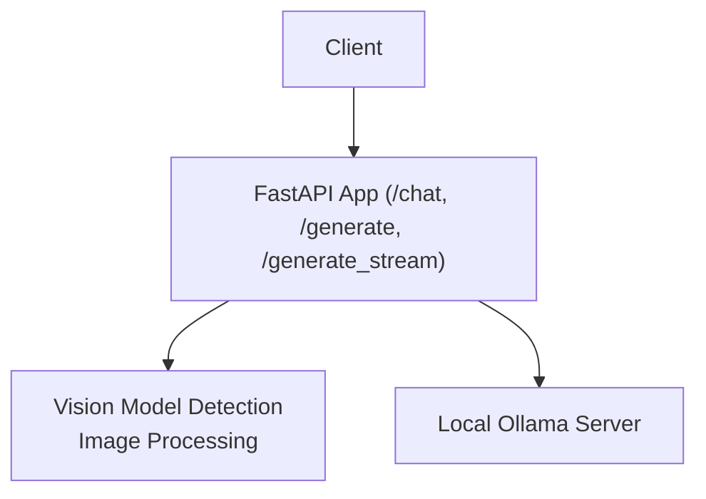
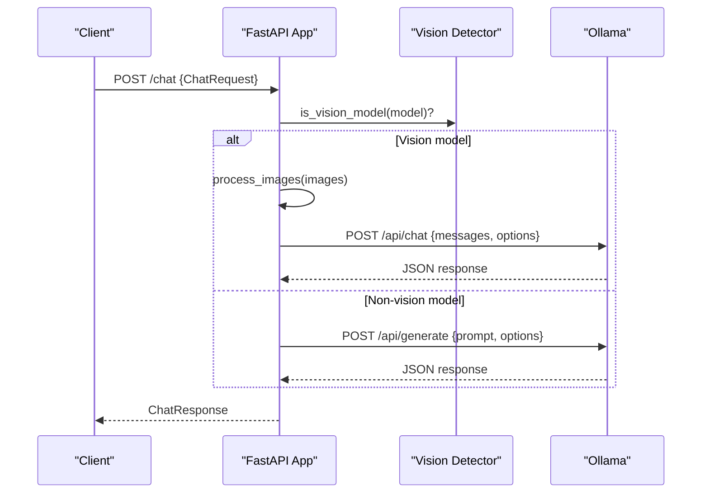
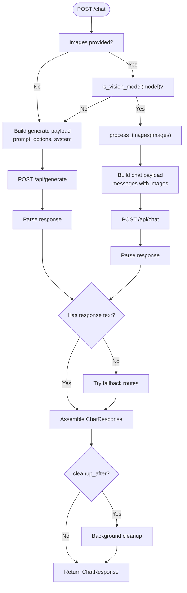
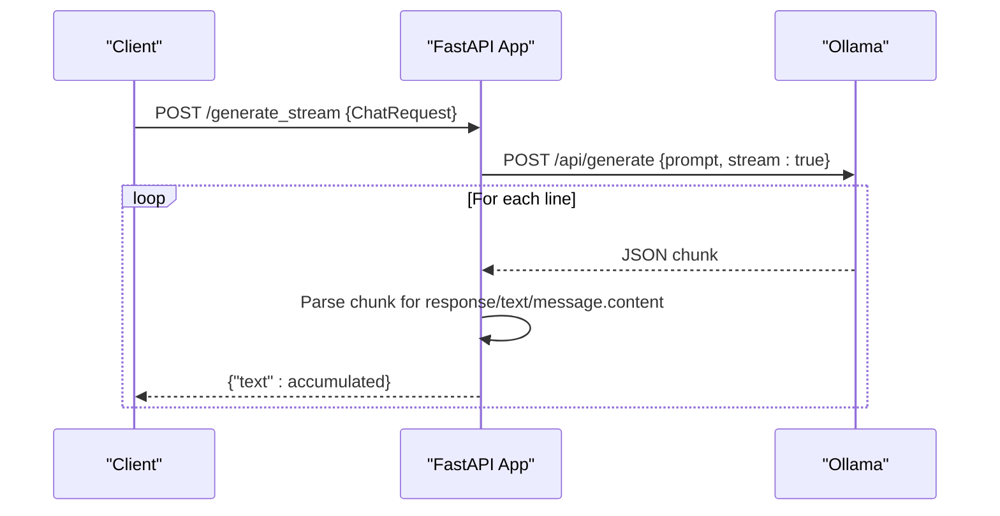
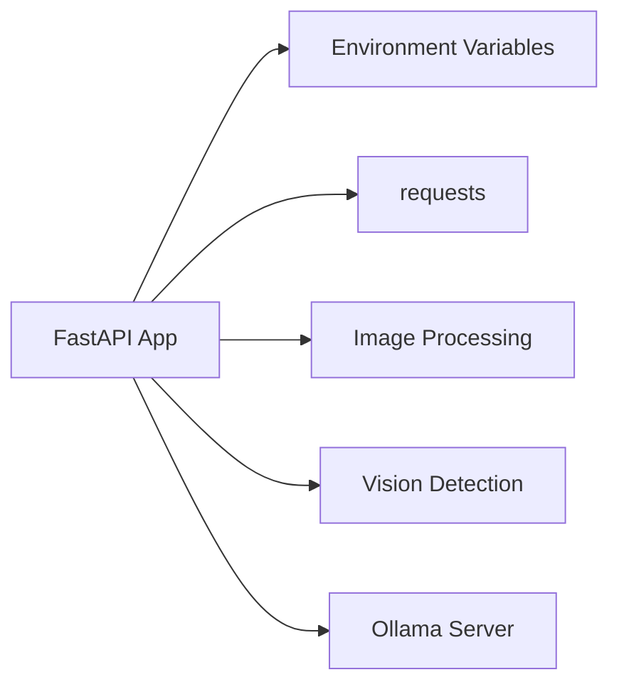

# Chat and Generate Endpoints

<cite>
**Referenced Files in This Document**
- [api.py](file://LoOper/AI/api.py)
- [ollama_engine.py](file://LoOper/AI/ollama_engine.py)
- [simple_comorag_chat.py](file://LoOper/AI/OverWatch/simple_comorag_chat.py)
</cite>

## Table of Contents
1. [Introduction](#introduction)
2. [Project Structure](#project-structure)
3. [Core Components](#core-components)
4. [Architecture Overview](#architecture-overview)
5. [Detailed Component Analysis](#detailed-component-analysis)
6. [Dependency Analysis](#dependency-analysis)
7. [Performance Considerations](#performance-considerations)
8. [Troubleshooting Guide](#troubleshooting-guide)
9. [Conclusion](#conclusion)
10. [Appendices](#appendices)

## Introduction
This document describes the chat and text generation APIs exposed by the application, focusing on:
- POST /chat: Unified endpoint supporting both text-only and multimodal (vision-capable) models, with optional streaming and cleanup behavior.
- POST /generate: Alias to /chat for backward compatibility.
- POST /generate_stream: Streaming text generation endpoint for continuous token delivery.
It also documents request/response schemas, error handling, cleanup operations, and client usage examples using Python requests.

## Project Structure
The API surface is implemented in a FastAPI application that proxies requests to the local Ollama server. Key elements:
- FastAPI app with CORS and environment-driven Ollama base URL.
- Request/response models for chat and embeddings.
- Vision model detection and image preprocessing utilities.
- Cleanup routines to stop stale model runners.
- Streaming response generator for incremental text.

**Diagram sources**
- [api.py:37-60](file://LoOper/AI/api.py#L37-L60)
- [api.py:655-766](file://LoOper/AI/api.py#L655-L766)
- [api.py:768-793](file://LoOper/AI/api.py#L768-L793)

**Section sources**
- [api.py:37-60](file://LoOper/AI/api.py#L37-L60)
- [api.py:655-766](file://LoOper/AI/api.py#L655-L766)
- [api.py:768-793](file://LoOper/AI/api.py#L768-L793)

## Core Components
- ChatRequest (POST /chat, POST /generate)
  - model: string
  - prompt: optional string
  - messages: optional array of {role: string, content: string}
  - stream: boolean
  - temperature: optional number
  - max_tokens: optional integer
  - system: optional string
  - images: optional array of base64 strings or file paths
  - cleanup_after: optional boolean
- ChatResponse (POST /chat, POST /generate)
  - response: string
  - model: string
  - created_at: string
  - done: boolean
  - total_duration: optional number
  - load_duration: optional number
  - prompt_eval_count: optional number
  - eval_count: optional number
- Streaming response (POST /generate_stream)
  - NDJSON stream of {"text": "..."} chunks

**Section sources**
- [api.py:512-540](file://LoOper/AI/api.py#L512-L540)
- [api.py:524-540](file://LoOper/AI/api.py#L524-L540)
- [api.py:768-793](file://LoOper/AI/api.py#L768-L793)

## Architecture Overview
The API acts as a gateway to Ollama:
- Validates and normalizes incoming requests.
- Detects vision-capable models and processes images.
- Proxies to Ollama’s /api/generate or /api/chat.
- Streams incremental tokens for /generate_stream.
- Performs cleanup of stale model runners.

**Diagram sources**
- [api.py:655-766](file://LoOper/AI/api.py#L655-L766)
- [api.py:217-252](file://LoOper/AI/api.py#L217-L252)
- [api.py:254-288](file://LoOper/AI/api.py#L254-L288)

## Detailed Component Analysis

### Chat Endpoint (/chat)
- Purpose: Unified chat and generation endpoint supporting text-only and vision-capable models.
- Behavior:
  - If images are provided and the model is vision-capable, constructs a message array with images and sends to /api/chat.
  - Otherwise, sends to /api/generate with optional system prompt.
  - Attempts fallbacks if primary response lacks text.
  - Adds background cleanup task when cleanup_after is true.
- Error handling:
  - Propagates timeouts as 408.
  - Propagates communication failures as 503.
  - Propagates explicit HTTP exceptions.
  - Raises 400 for invalid image processing.

**Diagram sources**
- [api.py:655-766](file://LoOper/AI/api.py#L655-L766)
- [api.py:254-288](file://LoOper/AI/api.py#L254-L288)
- [api.py:217-252](file://LoOper/AI/api.py#L217-L252)

**Section sources**
- [api.py:655-766](file://LoOper/AI/api.py#L655-L766)
- [api.py:254-288](file://LoOper/AI/api.py#L254-L288)
- [api.py:217-252](file://LoOper/AI/api.py#L217-L252)

### Generate Endpoint (/generate)
- Alias to /chat with identical logic.
- Useful for clients expecting a distinct generation endpoint.

**Section sources**
- [api.py:763-766](file://LoOper/AI/api.py#L763-L766)

### Generate Stream Endpoint (/generate_stream)
- Purpose: Stream incremental text tokens as NDJSON.
- Behavior:
  - Sends POST /api/generate with stream=true.
  - Iterates response lines, extracts incremental text, yields {"text": "..."}.
  - Media type: application/x-ndjson.

**Diagram sources**
- [api.py:768-793](file://LoOper/AI/api.py#L768-L793)

**Section sources**
- [api.py:768-793](file://LoOper/AI/api.py#L768-L793)

### Vision Model Support
- Vision detection:
  - Static detection by model name substring.
  - Runtime detection via /api/show and heuristics on modality/template.
- Image processing:
  - Accepts base64 strings, file paths, or data URLs.
  - Encodes to base64 and validates.
- Unsupported vision models:
  - Image processing raises 400 with a descriptive detail.

**Section sources**
- [api.py:61-64](file://LoOper/AI/api.py#L61-L64)
- [api.py:217-252](file://LoOper/AI/api.py#L217-L252)
- [api.py:254-288](file://LoOper/AI/api.py#L254-L288)

### Cleanup Operations
- Before generation, attempts to stop stale model runners via /api/ps and /api/stop.
- Supports CLI fallback via ollama ps/stop.
- Background cleanup scheduled when cleanup_after is true.

**Section sources**
- [api.py:290-386](file://LoOper/AI/api.py#L290-L386)
- [api.py:506-511](file://LoOper/AI/api.py#L506-L511)

## Dependency Analysis
- FastAPI app depends on:
  - Ollama base URL resolved from environment.
  - Requests library for proxying to Ollama.
  - Vision detection and image processing utilities.
  - Background tasks for cleanup.

**Diagram sources**
- [api.py:53-59](file://LoOper/AI/api.py#L53-L59)
- [api.py:254-288](file://LoOper/AI/api.py#L254-L288)
- [api.py:217-252](file://LoOper/AI/api.py#L217-L252)

**Section sources**
- [api.py:53-59](file://LoOper/AI/api.py#L53-L59)
- [api.py:254-288](file://LoOper/AI/api.py#L254-L288)
- [api.py:217-252](file://LoOper/AI/api.py#L217-L252)

## Performance Considerations
- Streaming reduces perceived latency by delivering tokens incrementally.
- Cleanup helps prevent resource exhaustion from stale model runners.
- Vision processing adds overhead; avoid unnecessary image conversions.
- Temperature and max_tokens influence generation speed and cost.

## Troubleshooting Guide
Common issues and resolutions:
- Ollama not reachable:
  - Health endpoint returns unhealthy; verify Ollama service and base URL.
- Timeout errors (408):
  - Model is slow or under heavy load; retry or adjust expectations.
- Communication failures (503):
  - Proxy request to Ollama failed; check network and firewall.
- Unsupported vision model with images:
  - Image processing fails; confirm model supports vision or omit images.
- Stale model runners:
  - Use cleanup routines or restart Ollama.

**Section sources**
- [api.py:581-606](file://LoOper/AI/api.py#L581-L606)
- [api.py:747-761](file://LoOper/AI/api.py#L747-L761)
- [api.py:282-285](file://LoOper/AI/api.py#L282-L285)
- [api.py:290-386](file://LoOper/AI/api.py#L290-L386)

## Conclusion
The /chat and /generate endpoints provide a unified interface to Ollama, supporting both text-only and vision-capable models. The /generate_stream endpoint enables efficient streaming. Robust error handling, vision detection, and cleanup operations ensure reliability and performance.

## Appendices

### API Definitions

- POST /chat
  - Request: ChatRequest
  - Response: ChatResponse
  - Notes: Uses /api/chat for vision-capable models; /api/generate otherwise.

- POST /generate
  - Request: ChatRequest
  - Response: ChatResponse
  - Notes: Alias to /chat.

- POST /generate_stream
  - Request: ChatRequest (stream=true)
  - Response: NDJSON stream of {"text": "..."}
  - Notes: Media type: application/x-ndjson.

**Section sources**
- [api.py:655-766](file://LoOper/AI/api.py#L655-L766)
- [api.py:763-766](file://LoOper/AI/api.py#L763-L766)
- [api.py:768-793](file://LoOper/AI/api.py#L768-L793)

### Client Examples (Python requests)

- Synchronous chat (text-only)
  - Send POST /chat with ChatRequest (prompt, model, optional system, temperature).
  - Receive ChatResponse.

- Multi-turn conversation
  - Send POST /chat with ChatRequest (messages array, model, optional system, temperature).

- Vision-capable model
  - Send POST /chat with ChatRequest (prompt, model, images, optional system, temperature).
  - Images can be base64 strings, file paths, or data URLs.

- Streaming
  - Send POST /generate_stream with ChatRequest (stream=true).
  - Iterate over NDJSON lines and read the "text" field.

- Health and models
  - GET /health to check Ollama status.
  - GET /models to list available models.

Note: These examples describe request/response shapes and flows. Use the schemas and endpoints documented above to construct requests and parse responses.

**Section sources**
- [api.py:512-540](file://LoOper/AI/api.py#L512-L540)
- [api.py:524-540](file://LoOper/AI/api.py#L524-L540)
- [api.py:655-766](file://LoOper/AI/api.py#L655-L766)
- [api.py:768-793](file://LoOper/AI/api.py#L768-L793)
- [simple_comorag_chat.py:20-82](file://LoOper/AI/OverWatch/simple_comorag_chat.py#L20-L82)