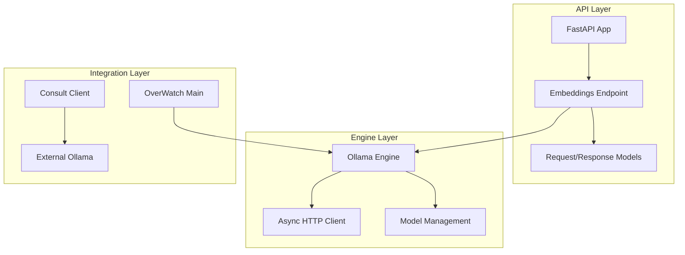
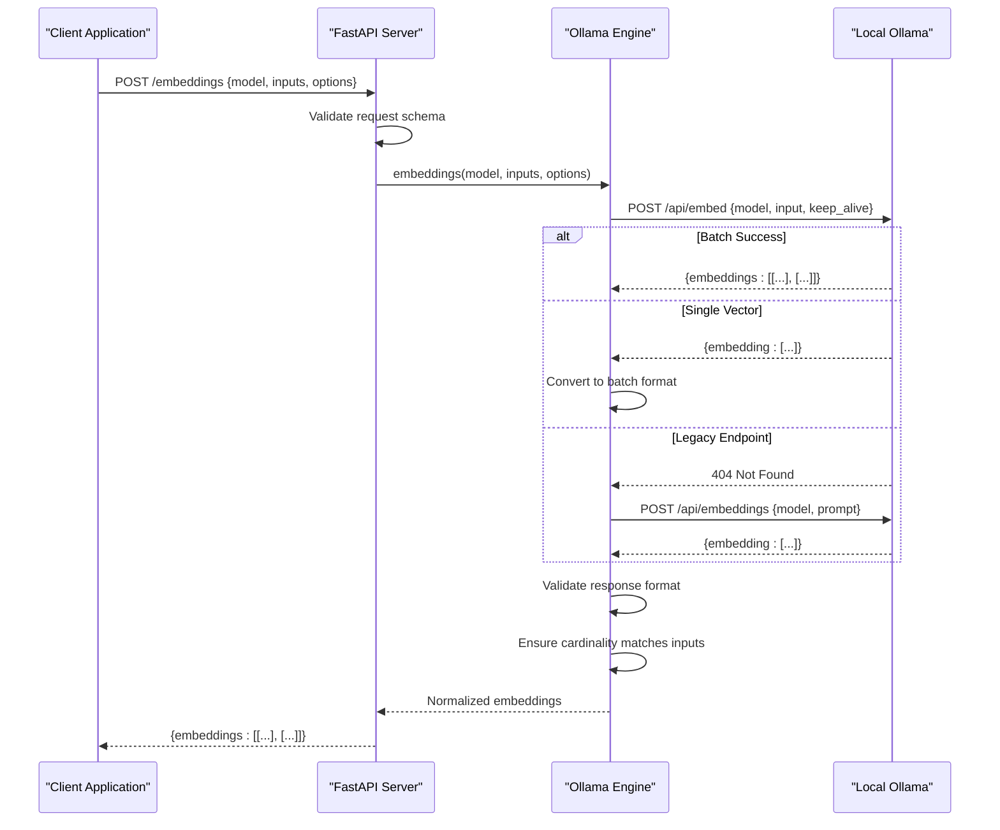
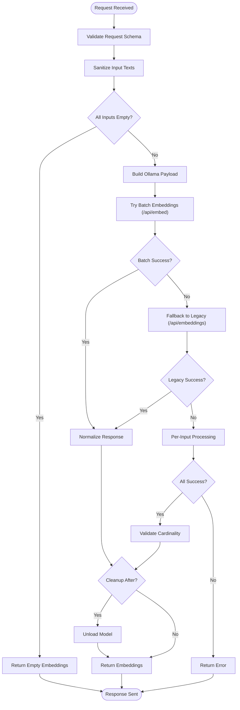
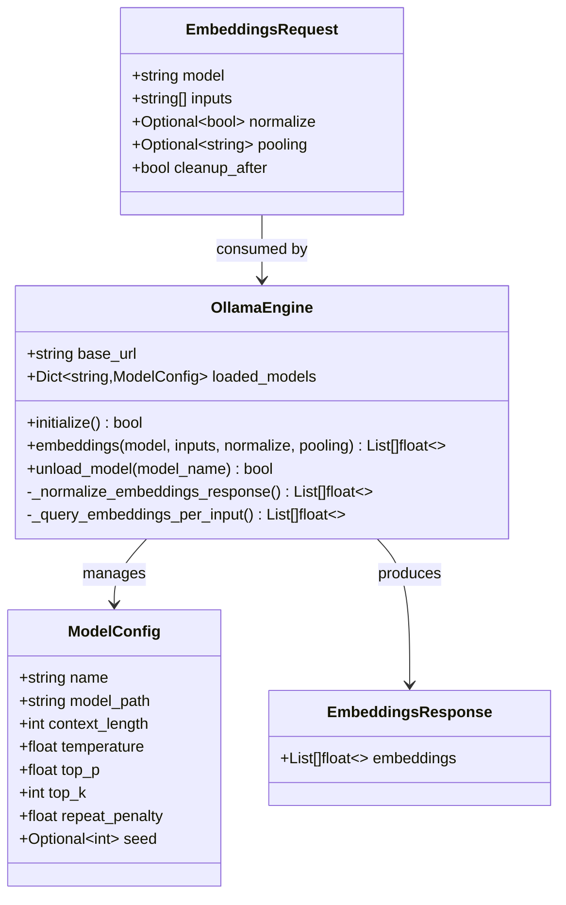
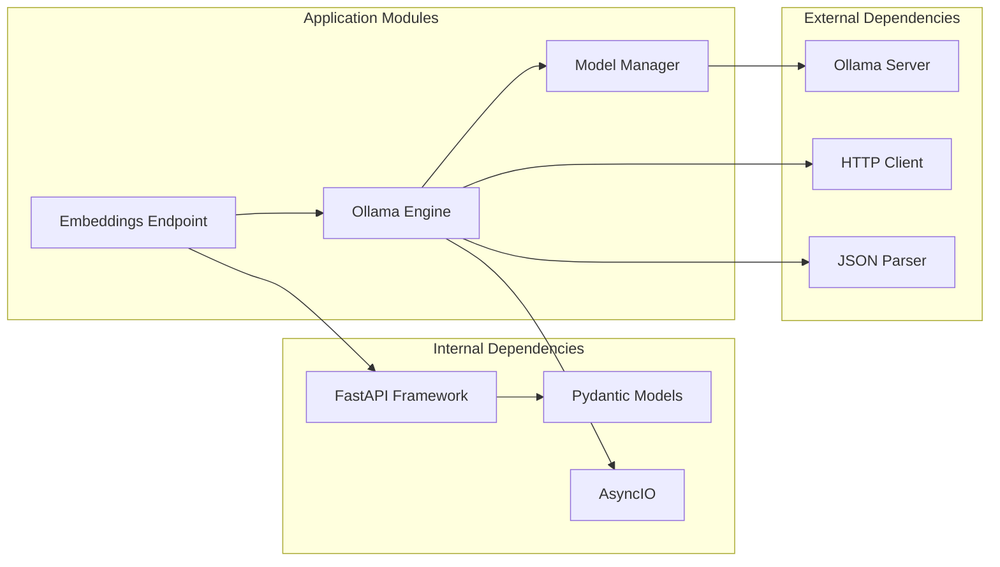

# Embeddings Endpoint

<cite>
**Referenced Files in This Document**
- [api.py](file://LoOper/AI/api.py)
- [main.py](file://LoOper/AI/OverWatch/main.py)
- [ollama_engine.py](file://LoOper/AI/OverWatch/api/ollama_engine.py)
- [consult.py](file://LoOper/AI/consult.py)
- [README.md](file://LoOper/AI/OverWatch/README.md)
</cite>

## Table of Contents
1. [Introduction](#introduction)
2. [Project Structure](#project-structure)
3. [Core Components](#core-components)
4. [Architecture Overview](#architecture-overview)
5. [Detailed Component Analysis](#detailed-component-analysis)
6. [Dependency Analysis](#dependency-analysis)
7. [Performance Considerations](#performance-considerations)
8. [Troubleshooting Guide](#troubleshooting-guide)
9. [Conclusion](#conclusion)

## Introduction
This document provides comprehensive API documentation for the `/embeddings` endpoint that generates vector embeddings from text inputs using Ollama models. The endpoint accepts a POST request with an EmbeddingsRequest schema containing model name, input texts array, and optional normalization/pooling parameters. It returns an EmbeddingsResponse schema with an array of embedding vectors suitable for similarity search and retrieval applications.

## Project Structure
The embeddings functionality spans multiple components within the LoOper AI framework:

**Diagram sources**
- [api.py:795-999](file://LoOper/AI/api.py#L795-L999)
- [main.py:480-503](file://LoOper/AI/OverWatch/main.py#L480-L503)
- [ollama_engine.py:320-423](file://LoOper/AI/OverWatch/api/ollama_engine.py#L320-L423)

**Section sources**
- [api.py:795-999](file://LoOper/AI/api.py#L795-L999)
- [main.py:480-503](file://LoOper/AI/OverWatch/main.py#L480-L503)

## Core Components

### EmbeddingsRequest Schema
The request schema defines the structure for embedding generation requests:

- **model** (string, required): Name of the Ollama model to use for embeddings
- **inputs** (array[string], required): Array of text inputs to embed
- **normalize** (boolean, optional): Enable vector normalization for cosine similarity
- **pooling** (string, optional): Pooling strategy (e.g., "mean")
- **cleanup_after** (boolean, optional): Automatically clean up model resources after request

### EmbeddingsResponse Schema
The response schema provides the generated embeddings:

- **embeddings** (array[array[float]], required): Array of embedding vectors, one per input text

**Section sources**
- [api.py:530-540](file://LoOper/AI/api.py#L530-L540)
- [main.py:163-170](file://LoOper/AI/OverWatch/main.py#L163-L170)

## Architecture Overview

**Diagram sources**
- [api.py:800-980](file://LoOper/AI/api.py#L800-L980)
- [ollama_engine.py:320-423](file://LoOper/AI/OverWatch/api/ollama_engine.py#L320-L423)

## Detailed Component Analysis

### FastAPI Implementation
The primary implementation resides in the main API module with comprehensive error handling and fallback mechanisms:

**Diagram sources**
- [api.py:800-980](file://LoOper/AI/api.py#L800-L980)

### Ollama Engine Integration
The OverWatch implementation provides an async engine with robust fallback handling:

**Diagram sources**
- [ollama_engine.py:34-518](file://LoOper/AI/OverWatch/api/ollama_engine.py#L34-L518)
- [main.py:163-170](file://LoOper/AI/OverWatch/main.py#L163-L170)

**Section sources**
- [api.py:800-980](file://LoOper/AI/api.py#L800-L980)
- [ollama_engine.py:320-423](file://LoOper/AI/OverWatch/api/ollama_engine.py#L320-L423)

### Request Processing Pipeline
The system implements a sophisticated fallback mechanism to ensure compatibility across different Ollama versions:

1. **Primary Endpoint**: `/api/embed` with modern payload format
2. **Legacy Fallback**: `/api/embeddings` with older payload format
3. **Per-Input Processing**: Individual requests for robustness
4. **Validation**: Ensures output cardinality matches input count

**Section sources**
- [api.py:848-862](file://LoOper/AI/api.py#L848-L862)
- [ollama_engine.py:377-395](file://LoOper/AI/OverWatch/api/ollama_engine.py#L377-L395)

## Dependency Analysis

**Diagram sources**
- [api.py:1-14](file://LoOper/AI/api.py#L1-L14)
- [ollama_engine.py:9-18](file://LoOper/AI/OverWatch/api/ollama_engine.py#L9-L18)

**Section sources**
- [api.py:1-14](file://LoOper/AI/api.py#L1-L14)
- [ollama_engine.py:9-18](file://LoOper/AI/OverWatch/api/ollama_engine.py#L9-L18)

## Performance Considerations

### Batch Processing Optimization
- **Single Request Batching**: The system automatically batches multiple inputs into a single request when possible
- **Fallback Mechanism**: If batch processing fails, it falls back to individual requests per input
- **Memory Management**: Automatic cleanup of model resources after processing when enabled

### Large Batch Handling
- **Input Validation**: Empty or invalid inputs are filtered out before processing
- **Error Recovery**: Robust error handling ensures partial failures don't crash the entire operation
- **Resource Cleanup**: Automatic model unloading prevents memory accumulation during batch processing

### Integration Patterns
- **Similarity Search**: Embeddings are designed for cosine similarity calculations
- **Vector Databases**: Compatible with FAISS, Pinecone, and other vector database systems
- **Caching**: Consider implementing application-level caching for frequently accessed embeddings

**Section sources**
- [api.py:822-825](file://LoOper/AI/api.py#L822-L825)
- [README.md:85-99](file://LoOper/AI/OverWatch/README.md#L85-L99)

## Troubleshooting Guide

### Common Issues and Solutions

**Model Not Found**
- Ensure the embedding model is pulled and available in Ollama
- Check Ollama server connectivity and status
- Verify model name matches exactly (case-sensitive)

**Empty Embeddings Response**
- Validate input texts are not empty or whitespace-only
- Check Ollama server logs for processing errors
- Enable debug mode to inspect raw responses

**Performance Issues**
- Monitor system memory usage during batch processing
- Consider reducing batch sizes for large inputs
- Ensure adequate GPU/CPU resources for model inference

**Network Connectivity**
- Verify Ollama server is running on the expected host/port
- Check firewall settings and network accessibility
- Confirm environment variables for OLLAMA_HOST and OLLAMA_PORT

**Section sources**
- [api.py:974-979](file://LoOper/AI/api.py#L974-L979)
- [consult.py:330-370](file://LoOper/AI/consult.py#L330-L370)

## Conclusion

The `/embeddings` endpoint provides a robust, production-ready solution for generating vector embeddings using Ollama models. Its comprehensive fallback mechanisms ensure compatibility across different Ollama versions, while the sophisticated error handling and validation guarantee reliable operation in diverse deployment scenarios. The endpoint integrates seamlessly with similarity search systems and supports efficient batch processing for scalable applications.

Key strengths include:
- Automatic fallback to legacy endpoints
- Comprehensive input validation and sanitization  
- Robust error handling and recovery mechanisms
- Support for both batch and single-input processing
- Integration with existing Ollama infrastructure

The implementation demonstrates best practices for API design, error handling, and resource management, making it suitable for production deployment in various AI and machine learning applications.