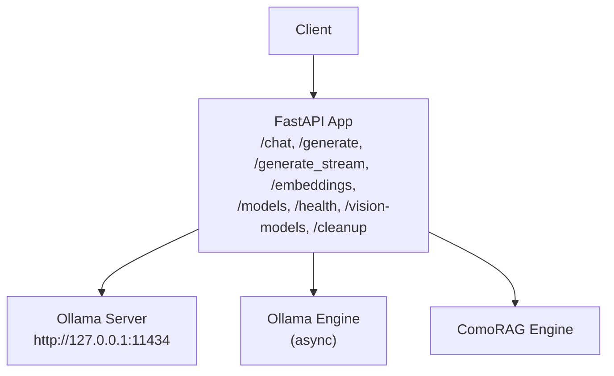
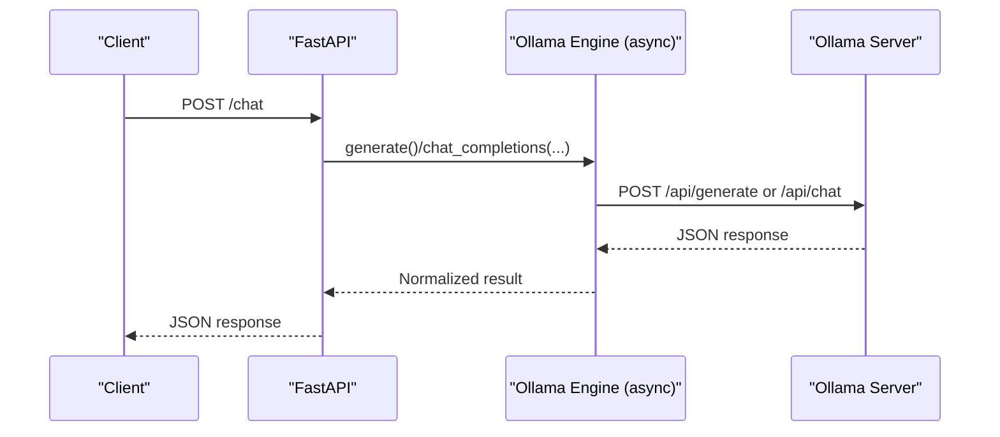
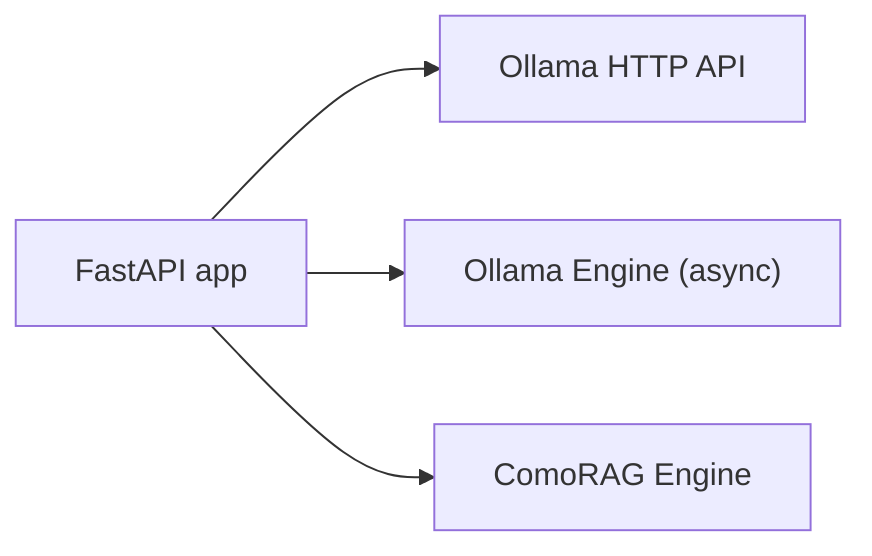

# Local AI API

<cite>
**Referenced Files in This Document**
- [api.py](file://LoOper/AI/api.py)
- [ollama_engine.py](file://LoOper/AI/OverWatch/api/ollama_engine.py)
- [comorag_engine.py](file://LoOper/AI/OverWatch/api/comorag_engine.py)
- [settings.py](file://LoOper/AI/settings.py)
</cite>

## Table of Contents
1. [Introduction](#introduction)
2. [Project Structure](#project-structure)
3. [Core Components](#core-components)
4. [Architecture Overview](#architecture-overview)
5. [Detailed Component Analysis](#detailed-component-analysis)
6. [Dependency Analysis](#dependency-analysis)
7. [Performance Considerations](#performance-considerations)
8. [Troubleshooting Guide](#troubleshooting-guide)
9. [Conclusion](#conclusion)

## Introduction
This document describes the Local AI API built with FastAPI, exposing endpoints to interact with Ollama models and the ComoRAG service. It covers endpoint definitions, request/response schemas, authentication, CORS configuration for Tailscale networks, streaming responses, error handling, and operational guidance for clients and administrators.

## Project Structure
The API server is implemented as a FastAPI application that:
- Proxies requests to the local Ollama server
- Provides convenience endpoints for chat, generation, embeddings, model discovery, health checks, and cleanup
- Integrates optional vision model detection and image preprocessing
- Exposes endpoints for the ComoRAG cognitive reasoning engine

**Diagram sources**
- [api.py:37-50](file://LoOper/AI/api.py#L37-L50)
- [api.py:581-653](file://LoOper/AI/api.py#L581-L653)
- [ollama_engine.py:34-51](file://LoOper/AI/OverWatch/api/ollama_engine.py#L34-L51)
- [comorag_engine.py:233-242](file://LoOper/AI/OverWatch/api/comorag_engine.py#L233-L242)

**Section sources**
- [api.py:37-50](file://LoOper/AI/api.py#L37-L50)
- [api.py:581-653](file://LoOper/AI/api.py#L581-L653)
- [settings.py:16-30](file://LoOper/AI/settings.py#L16-L30)

## Core Components
- FastAPI application with CORS configured for Tailscale access
- Ollama integration for model inference, embeddings, and model management
- Vision model detection and image preprocessing utilities
- Optional ComoRAG engine for cognitive reasoning workflows
- Health and bootstrap status endpoints for model readiness

Key behaviors:
- Environment-driven Ollama base URL resolution
- Automatic model availability checks and pulls
- Cleanup utilities to stop lingering model runners
- Streaming responses for generation endpoints

**Section sources**
- [api.py:52-59](file://LoOper/AI/api.py#L52-L59)
- [api.py:69-78](file://LoOper/AI/api.py#L69-L78)
- [api.py:181-216](file://LoOper/AI/api.py#L181-L216)
- [api.py:290-326](file://LoOper/AI/api.py#L290-L326)

## Architecture Overview
The API acts as a thin proxy to Ollama, adding convenience features such as:
- Unified chat/generate endpoints with optional vision support
- Batch embeddings with robust response normalization
- Model discovery and vision model filtering
- Health and bootstrap status reporting
- Cleanup endpoints to manage model runners

**Diagram sources**
- [api.py:655-761](file://LoOper/AI/api.py#L655-L761)
- [ollama_engine.py:519-573](file://LoOper/AI/OverWatch/api/ollama_engine.py#L519-L573)

**Section sources**
- [api.py:655-761](file://LoOper/AI/api.py#L655-L761)
- [ollama_engine.py:519-573](file://LoOper/AI/OverWatch/api/ollama_engine.py#L519-L573)

## Detailed Component Analysis

### Endpoint Catalog

#### GET /
- Purpose: Root info and environment hints
- Response: Server metadata, endpoints overview, and environment variables

**Section sources**
- [api.py:547-579](file://LoOper/AI/api.py#L547-L579)

#### GET /health
- Purpose: Health check for Ollama server and bootstrap status
- Response fields:
  - status: healthy/unhealthy
  - ollama_server: running/not responding
  - models_ready: boolean indicating required models readiness
  - bootstrap: in_progress, completed, required, missing, errors

**Section sources**
- [api.py:581-606](file://LoOper/AI/api.py#L581-L606)

#### GET /models
- Purpose: List available Ollama models
- Response: Array of ModelInfo objects

ModelInfo fields:
- name: string
- size: integer
- digest: string
- modified_at: string

**Section sources**
- [api.py:608-653](file://LoOper/AI/api.py#L608-L653)
- [api.py:541-546](file://LoOper/AI/api.py#L541-L546)

#### GET /vision-models
- Purpose: List vision-enabled models by detecting multimodal capability
- Response: Array of ModelInfo objects

Detection logic:
- Static keyword match against known vision model prefixes
- Runtime inspection via /api/show and heuristics on modality/template

**Section sources**
- [api.py:997-1029](file://LoOper/AI/api.py#L997-L1029)
- [api.py:61-64](file://LoOper/AI/api.py#L61-L64)
- [api.py:217-252](file://LoOper/AI/api.py#L217-L252)

#### POST /chat
- Purpose: Chat with a model; supports images for vision-capable models
- Request: ChatRequest
- Response: Chat response object with normalized fields

Request fields (ChatRequest):
- model: string
- prompt: optional string
- messages: optional array of {role: string, content: string}
- stream: boolean
- temperature: optional number
- max_tokens: optional integer
- system: optional string
- images: optional array of base64 strings or file paths
- cleanup_after: optional boolean

Response fields:
- response: string
- model: string
- created_at: string
- done: boolean
- total_duration: optional number
- load_duration: optional number
- prompt_eval_count: optional number
- eval_count: optional number

Behavior:
- If images provided and model is vision-capable, sends to /api/chat with images
- Otherwise falls back to /api/generate
- Attempts fallbacks if primary response lacks text
- Optionally triggers background cleanup

**Section sources**
- [api.py:513-522](file://LoOper/AI/api.py#L513-L522)
- [api.py:655-761](file://LoOper/AI/api.py#L655-L761)
- [api.py:254-288](file://LoOper/AI/api.py#L254-L288)

#### POST /generate
- Alias to /chat
- Request: ChatRequest
- Response: Same as /chat

**Section sources**
- [api.py:763-766](file://LoOper/AI/api.py#L763-L766)

#### POST /generate_stream
- Purpose: Stream generation tokens
- Request: ChatRequest with stream=true
- Response: StreamingResponse with NDJSON lines containing incremental text

**Section sources**
- [api.py:768-793](file://LoOper/AI/api.py#L768-L793)

#### POST /embeddings
- Purpose: Compute embeddings for input texts
- Request: EmbeddingsRequest
- Response: EmbeddingsResponse

Request fields (EmbeddingsRequest):
- model: string
- inputs: array of strings
- normalize: optional boolean
- pooling: optional string
- cleanup_after: optional boolean

Response fields (EmbeddingsResponse):
- embeddings: array of arrays of numbers

Behavior:
- Sends to /api/embed (preferred) or /api/embeddings (legacy)
- Robust normalization across response variants
- Per-input fallback if batch response is malformed
- Optional cleanup after request

**Section sources**
- [api.py:530-536](file://LoOper/AI/api.py#L530-L536)
- [api.py:795-980](file://LoOper/AI/api.py#L795-L980)

#### POST /cleanup
- Purpose: Stop model runners or clean up
- Body: { all?: boolean, model?: string, retries?: number, wait?: number }
- Response: { ok: boolean, model?: string }

**Section sources**
- [api.py:981-995](file://LoOper/AI/api.py#L981-L995)

### Authentication and Security
- No authentication middleware is configured by default.
- CORS is configured to allow all origins, enabling Tailscale network access.
- For production, consider adding authentication and restricting CORS origins.

**Section sources**
- [api.py:43-50](file://LoOper/AI/api.py#L43-L50)

### CORS Configuration for Tailscale
- The API sets allow_origins to "*" to facilitate Tailscale access.
- Bind host and port are controlled by environment variables:
  - API_BIND_HOST or TAILSCALE_IP
  - API_PORT (default 8000)

**Section sources**
- [api.py:43-50](file://LoOper/AI/api.py#L43-L50)
- [api.py:1385-1448](file://LoOper/AI/api.py#L1385-L1448)

### Error Handling
Common HTTP statuses:
- 400: Bad request (e.g., invalid image processing)
- 408: Request timeout (Ollama slow or unresponsive)
- 500: Internal server error
- 503: Service unavailable (Ollama not reachable)

Error propagation:
- Exceptions from Ollama calls are translated to HTTP exceptions with meaningful details
- Streaming endpoints return generic 500 on unexpected errors

**Section sources**
- [api.py:744-761](file://LoOper/AI/api.py#L744-L761)
- [api.py:974-979](file://LoOper/AI/api.py#L974-L979)

### Streaming Responses
- /generate_stream returns application/x-ndjson
- Each line contains a JSON object with the accumulated text so far
- Useful for progressive UI updates

**Section sources**
- [api.py:768-793](file://LoOper/AI/api.py#L768-L793)

### Client Implementation Guidelines
Recommended client patterns:
- Use requests for synchronous calls
- For streaming, iterate over response.iter_lines() and parse JSON
- Respect model availability and consider bootstrap status before heavy workloads
- For images, send base64-encoded data or file paths; the server will normalize to base64

Example patterns (no code):
- Chat with text-only model: POST /chat with prompt and model
- Chat with vision model: POST /chat with images and model
- Stream generation: POST /generate_stream with stream=true
- Generate embeddings: POST /embeddings with inputs and model

**Section sources**
- [api.py:655-761](file://LoOper/AI/api.py#L655-L761)
- [api.py:768-793](file://LoOper/AI/api.py#L768-L793)
- [api.py:795-980](file://LoOper/AI/api.py#L795-L980)

### Rate Limiting and Performance
- No built-in rate limiting in the API
- Consider client-side throttling and batching
- Use cleanup endpoints to free resources after use
- Prefer embeddings with normalize/pooling when supported by the model

**Section sources**
- [api.py:981-995](file://LoOper/AI/api.py#L981-L995)

### Model Management and Vision Model Detection
- Automatic model pull for required models during bootstrap
- Vision model detection via static keywords and runtime inspection
- Cleanup utilities to stop lingering model runners

**Section sources**
- [api.py:69-78](file://LoOper/AI/api.py#L69-L78)
- [api.py:181-216](file://LoOper/AI/api.py#L181-L216)
- [api.py:217-252](file://LoOper/AI/api.py#L217-L252)
- [api.py:290-326](file://LoOper/AI/api.py#L290-L326)

### ComoRAG Integration
The API also exposes endpoints for the ComoRAG engine:
- POST /comorag/reason: Blocking reasoning
- POST /comorag/reason/stream: Streaming reasoning
- GET /comorag/status: Engine readiness
- POST /comorag/init: Initialize engine
- GET /comorag/memory and POST/DELETE /comorag/memory: Memory introspection and management

These endpoints integrate with the Ollama engine for model inference and optionally process images for vision analysis.

**Section sources**
- [api.py:1117-1170](file://LoOper/AI/api.py#L1117-L1170)
- [api.py:1172-1228](file://LoOper/AI/api.py#L1172-L1228)
- [api.py:1230-1291](file://LoOper/AI/api.py#L1230-L1291)
- [api.py:1293-1383](file://LoOper/AI/api.py#L1293-L1383)

## Dependency Analysis
- FastAPI app depends on:
  - Ollama server (HTTP)
  - Optional async Ollama engine for advanced features
  - Optional ComoRAG engine for cognitive reasoning

**Diagram sources**
- [api.py:37-50](file://LoOper/AI/api.py#L37-L50)
- [ollama_engine.py:34-51](file://LoOper/AI/OverWatch/api/ollama_engine.py#L34-L51)
- [comorag_engine.py:233-242](file://LoOper/AI/OverWatch/api/comorag_engine.py#L233-L242)

**Section sources**
- [api.py:37-50](file://LoOper/AI/api.py#L37-L50)
- [ollama_engine.py:34-51](file://LoOper/AI/OverWatch/api/ollama_engine.py#L34-L51)
- [comorag_engine.py:233-242](file://LoOper/AI/OverWatch/api/comorag_engine.py#L233-L242)

## Performance Considerations
- Use cleanup endpoints after heavy inference to release model runners
- Prefer batch embeddings when possible to reduce overhead
- For streaming, handle partial lines carefully and reconnect on failures
- Tune model parameters (temperature, max_tokens) to balance quality and latency

[No sources needed since this section provides general guidance]

## Troubleshooting Guide
Common issues and resolutions:
- Ollama not reachable: Check OLLAMA_HOST/OLLAMA_PORT and firewall rules
- Missing models: Use bootstrap status endpoint and ensure required models are pulled
- Vision model errors: Confirm model name matches known vision prefixes or inspect model metadata
- Slow responses: Use cleanup endpoints and consider reducing max_tokens or disabling streaming

**Section sources**
- [api.py:581-606](file://LoOper/AI/api.py#L581-L606)
- [api.py:1031-1044](file://LoOper/AI/api.py#L1031-L1044)
- [api.py:217-252](file://LoOper/AI/api.py#L217-L252)

## Conclusion
The Local AI API provides a pragmatic interface to Ollama with convenient features for chat, generation, embeddings, model discovery, and cleanup. It integrates optional vision capabilities and a cognitive reasoning engine, while supporting Tailscale deployments through broad CORS configuration. Administrators should consider adding authentication and tightening CORS for production environments.