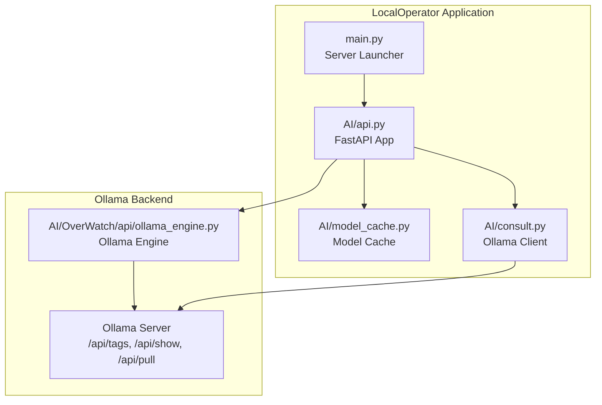
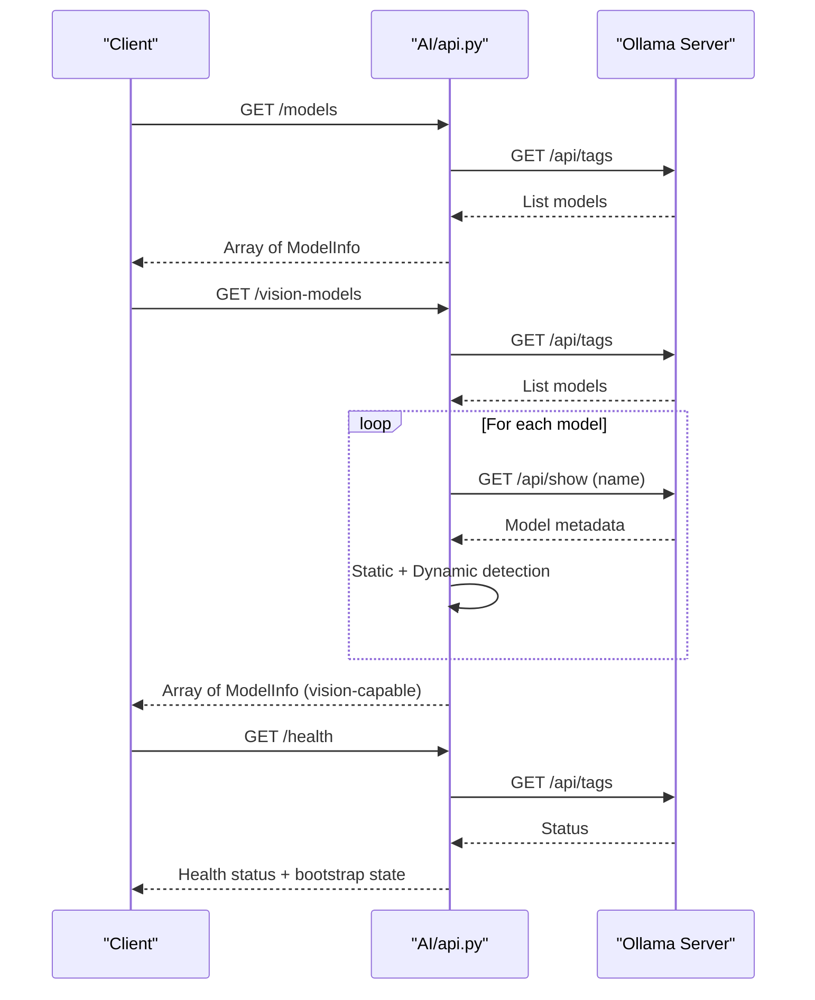
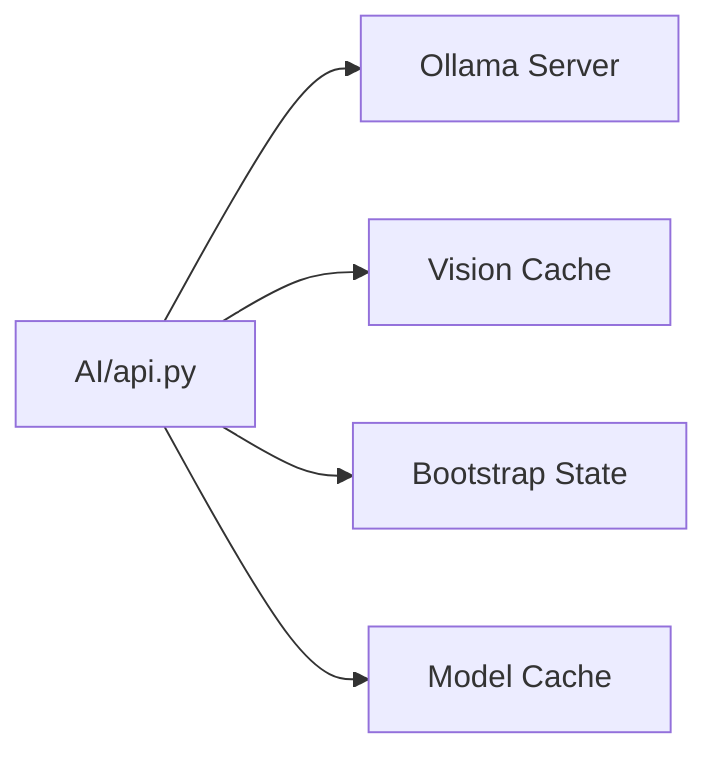

# Model Management Endpoints

<cite>
**Referenced Files in This Document**
- [api.py](file://LoOper/AI/api.py)
- [model_cache.py](file://LoOper/AI/model_cache.py)
- [consult.py](file://LoOper/AI/consult.py)
- [ollama_engine.py](file://LoOper/AI/OverWatch/api/ollama_engine.py)
- [api_client.py](file://LoOper/AI/OverWatch/api/api_client.py)
- [main.py](file://LoOper/main.py)
</cite>

## Table of Contents
1. [Introduction](#introduction)
2. [Project Structure](#project-structure)
3. [Core Components](#core-components)
4. [Architecture Overview](#architecture-overview)
5. [Detailed Component Analysis](#detailed-component-analysis)
6. [Dependency Analysis](#dependency-analysis)
7. [Performance Considerations](#performance-considerations)
8. [Troubleshooting Guide](#troubleshooting-guide)
9. [Conclusion](#conclusion)

## Introduction
This document describes the model management endpoints exposed by the LocalOperator application, focusing on:
- Listing available Ollama models
- Filtering and listing vision-capable models
- Health checking the Ollama server and bootstrap progress

It explains how models are discovered, how vision capability is determined (static pattern matching and dynamic metadata queries), and how the system bootstraps required models automatically. It also covers health monitoring and provides practical examples of model listing, vision model detection, and health monitoring.

## Project Structure
The model management functionality is implemented in the AI API gateway module and integrates with the Ollama engine and model caching layer. The main entry point starts the API server and orchestrates health checks and model bootstrap.

**Diagram sources**
- [main.py:171-381](file://LoOper/main.py#L171-L381)
- [api.py:1-120](file://LoOper/AI/api.py#L1-L120)
- [model_cache.py:15-100](file://LoOper/AI/model_cache.py#L15-L100)
- [consult.py:30-131](file://Looper/AI/consult.py#L30-L131)
- [ollama_engine.py:34-96](file://Looper/AI/OverWatch/api/ollama_engine.py#L34-L96)

**Section sources**
- [main.py:171-381](file://Looper/main.py#L171-L381)
- [api.py:1-120](file://Looper/AI/api.py#L1-L120)

## Core Components
- FastAPI application exposing model management endpoints
- Vision model detection logic combining static heuristics and dynamic metadata inspection
- Bootstrap pipeline for ensuring required models are present
- Model cache for preloading model lists to avoid UI blocking
- Ollama engine for model loading, testing, and inference

**Section sources**
- [api.py:547-653](file://Looper/AI/api.py#L547-L653)
- [api.py:997-1029](file://Looper/AI/api.py#L997-L1029)
- [api.py:581-606](file://Looper/AI/api.py#L581-L606)
- [api.py:217-252](file://Looper/AI/api.py#L217-L252)
- [api.py:181-216](file://Looper/AI/api.py#L181-L216)
- [model_cache.py:15-100](file://Looper/AI/model_cache.py#L15-L100)
- [ollama_engine.py:34-96](file://Looper/AI/OverWatch/api/ollama_engine.py#L34-L96)

## Architecture Overview
The model management endpoints are served by the AI API gateway. They delegate to Ollama for model discovery and metadata, and maintain a bootstrap state to track required models. Vision model detection uses both static heuristics and dynamic metadata inspection against Ollama’s model show endpoint.

**Diagram sources**
- [api.py:608-653](file://Looper/AI/api.py#L608-L653)
- [api.py:997-1029](file://Looper/AI/api.py#L997-L1029)
- [api.py:581-606](file://Looper/AI/api.py#L581-L606)
- [api.py:221-252](file://Looper/AI/api.py#L221-L252)

## Detailed Component Analysis

### GET /models
Purpose: List all available Ollama models with a standardized ModelInfo schema.

Response model: Array of ModelInfo objects with fields:
- name: string
- size: integer
- digest: string
- modified_at: string

Behavior:
- Fetches model tags from Ollama
- Converts raw tag entries to ModelInfo objects
- Handles malformed or missing fields gracefully

Example usage:
- Use an HTTP client to call GET /models on the API server
- Parse the returned array of ModelInfo objects

Notes:
- Uses Ollama’s /api/tags endpoint
- Robustness: gracefully handles missing fields by defaulting values

**Section sources**
- [api.py:608-653](file://Looper/AI/api.py#L608-L653)
- [api.py:541-546](file://Looper/AI/api.py#L541-L546)

### GET /vision-models
Purpose: Filter and return only models capable of vision processing.

Detection logic:
- Static heuristic: Checks if model name contains any of a predefined set of substrings indicating multimodal/vision capability
- Dynamic metadata inspection: Queries Ollama’s /api/show endpoint for the model and inspects:
  - Template content for “image” or “images”
  - Modality fields for “image”, “vision”, or “multimodal”
  - Model metadata modality for “image”, “vision”, or “multimodal”

Caching:
- Vision capability results are cached in-memory to avoid repeated metadata queries

Example usage:
- Call GET /vision-models to retrieve only vision-capable models
- Use the returned ModelInfo array to populate UI model selectors

**Section sources**
- [api.py:997-1029](file://Looper/AI/api.py#L997-L1029)
- [api.py:217-252](file://Looper/AI/api.py#L217-L252)
- [api.py:61-64](file://Looper/AI/api.py#L61-L64)

### GET /health
Purpose: Check Ollama server health and report bootstrap progress.

Response fields:
- status: "healthy" or "unhealthy"
- ollama_server: "running" or "not responding"
- models_ready: boolean indicating whether required models are present
- bootstrap: object containing:
  - in_progress: boolean
  - completed: boolean
  - required: array of required model identifiers
  - missing: array of currently missing models
  - errors: array of error messages encountered during bootstrap

Behavior:
- Probes Ollama’s /api/tags endpoint to determine server responsiveness
- Returns current bootstrap state snapshot

Example usage:
- Poll GET /health to monitor service readiness
- Use models_ready to gate UI actions that depend on model availability

**Section sources**
- [api.py:581-606](file://Looper/AI/api.py#L581-L606)
- [api.py:162-216](file://Looper/AI/api.py#L162-L216)

### Model Bootstrap and Automatic Model Pulling
The system ensures required models are present at startup and during runtime.

Required models:
- Embedding models: e.g., nomic-embed-text
- LLM models: e.g., llama3.2:1b
- Vision models: e.g., minicpm-v:latest

Bootstrap process:
- Collect required model names from hard-coded lists and environment overrides
- For each required model, check if it is present locally
- If missing, initiate a pull from the Ollama registry and stream progress
- Update bootstrap state atomically and expose status via /bootstrap/status

Runtime behavior:
- The API server starts a background bootstrap thread on startup
- Health endpoint reflects bootstrap completion and missing models

**Section sources**
- [api.py:69-77](file://Looper/AI/api.py#L69-L77)
- [api.py:147-160](file://Looper/AI/api.py#L147-L160)
- [api.py:181-216](file://Looper/AI/api.py#L181-L216)
- [api.py:1031-1044](file://Looper/AI/api.py#L1031-L1044)

### Vision Model Capability Detection
Two-tier detection strategy:

Static pattern matching:
- Predefined substrings such as "llava", "bakllava", "moondream", "llava-llama3", "llava-phi3", "minicpm-v"
- Applied to model names to quickly filter candidates

Dynamic metadata inspection:
- Calls Ollama’s /api/show endpoint
- Inspects:
  - template for “image” or “images”
  - modality for “image”, “vision”, or “multimodal”
  - model metadata modality for “image”, “vision”, or “multimodal”
- Falls back to static detection if metadata inspection fails

Caching:
- Results are cached in a dictionary keyed by model name

**Section sources**
- [api.py:61-64](file://Looper/AI/api.py#L61-L64)
- [api.py:217-252](file://Looper/AI/api.py#L217-L252)

### Model Cache and Preloading
The model cache improves UI responsiveness by preloading model lists and providing fallbacks when the API is unavailable.

Key behaviors:
- Asynchronous preload at application startup
- Fallback to hardcoded model names if API calls fail
- Thread-safe access with locks
- Refresh mechanism to update cache on demand

Integration:
- The main entry point triggers model preload before launching the GUI
- The cache is used by the client to avoid blocking UI operations

**Section sources**
- [model_cache.py:15-100](file://Looper/AI/model_cache.py#L15-L100)
- [model_cache.py:102-163](file://Looper/AI/model_cache.py#L102-L163)
- [main.py:368-369](file://Looper/main.py#L368-L369)

### Client Integration Examples
The following examples illustrate how clients can interact with the model management endpoints.

- Model listing:
  - Use the OverWatch API client to call list_models()
  - Alternatively, call GET /models directly on the API server

- Vision model detection:
  - Use the OverWatch API client to call list_models() and filter results
  - Or call GET /vision-models directly on the API server

- Health monitoring:
  - Use the OverWatch API client to call health_check()
  - Or call GET /health directly on the API server

These examples demonstrate how to integrate with the API without requiring deep knowledge of the underlying implementation.

**Section sources**
- [api_client.py:91-94](file://Looper/AI/OverWatch/api/api_client.py#L91-L94)
- [api_client.py:87-89](file://Looper/AI/OverWatch/api/api_client.py#L87-L89)
- [consult.py:98-131](file://Looper/AI/consult.py#L98-L131)

## Dependency Analysis
The model management endpoints depend on:
- Ollama server for model tags, model show metadata, and model pulls
- In-memory caches for vision capability and model lists
- Bootstrap state for tracking required models

**Diagram sources**
- [api.py:162-216](file://Looper/AI/api.py#L162-L216)
- [api.py:61-64](file://Looper/AI/api.py#L61-L64)
- [model_cache.py:15-100](file://Looper/AI/model_cache.py#L15-L100)

**Section sources**
- [api.py:162-216](file://Looper/AI/api.py#L162-L216)
- [api.py:61-64](file://Looper/AI/api.py#L61-L64)
- [model_cache.py:15-100](file://Looper/AI/model_cache.py#L15-L100)

## Performance Considerations
- Vision capability detection caches results to avoid repeated metadata queries
- Model listing and vision filtering iterate through the full model list; consider pagination or server-side filtering if model counts grow large
- Bootstrap pulls are streamed; ensure clients handle partial progress updates
- Model cache avoids UI blocking by preloading asynchronously

## Troubleshooting Guide
Common issues and resolutions:
- Ollama server not reachable:
  - Health endpoint reports unhealthy; verify Ollama is running and accessible
  - Check environment variables for Ollama host/port

- Missing required models:
  - Health endpoint shows models_ready false; review bootstrap status
  - Confirm that pull operations completed successfully

- Vision model detection failures:
  - Static detection may miss models without explicit keywords
  - Ensure /api/show metadata is available; otherwise static detection applies

- Model listing returns empty:
  - Verify Ollama /api/tags endpoint responds
  - Check for network or permission issues

**Section sources**
- [api.py:581-606](file://Looper/AI/api.py#L581-L606)
- [api.py:1031-1044](file://Looper/AI/api.py#L1031-L1044)
- [api.py:221-252](file://Looper/AI/api.py#L221-L252)

## Conclusion
The model management endpoints provide a robust foundation for discovering, filtering, and monitoring models within the LocalOperator ecosystem. By combining static heuristics with dynamic metadata inspection, the system reliably identifies vision-capable models. The bootstrap pipeline ensures required models are present, and health monitoring enables reliable orchestration of dependent services. Clients can leverage these endpoints to power UIs, automate workflows, and maintain system readiness.