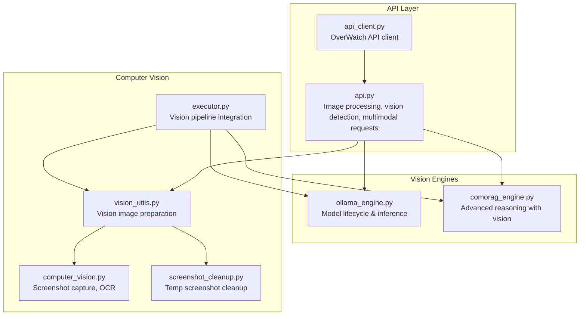
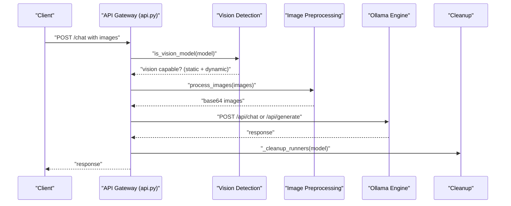
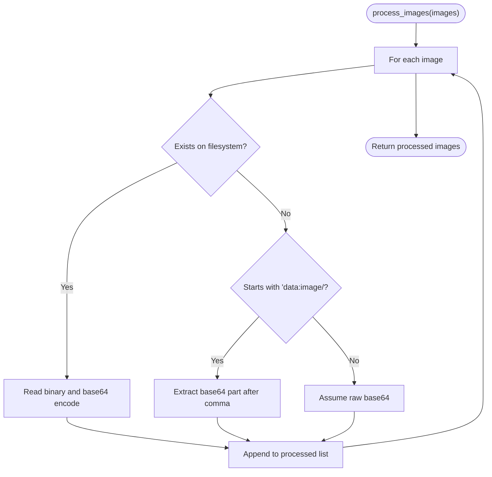
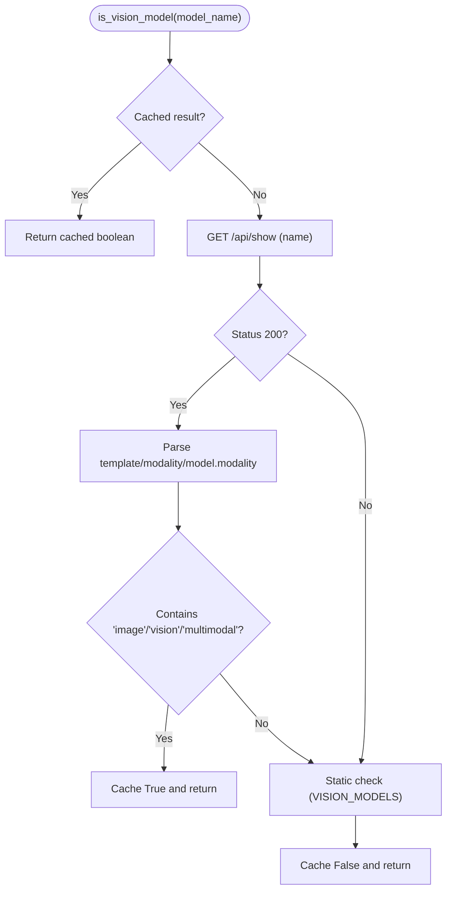
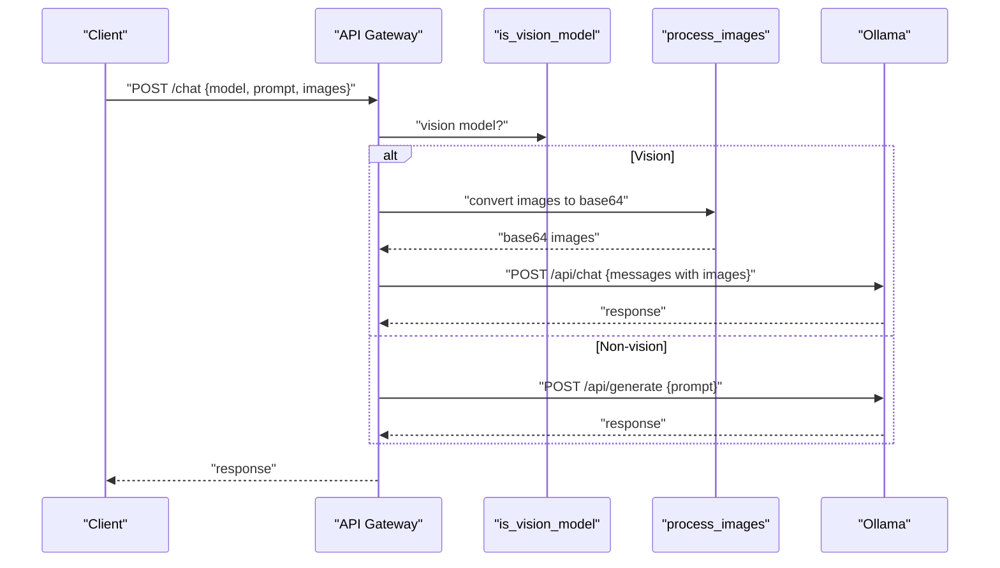
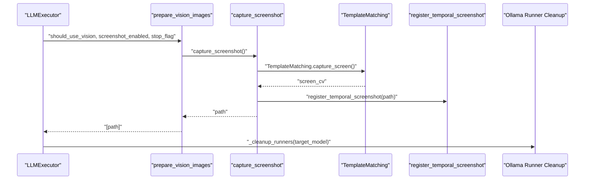
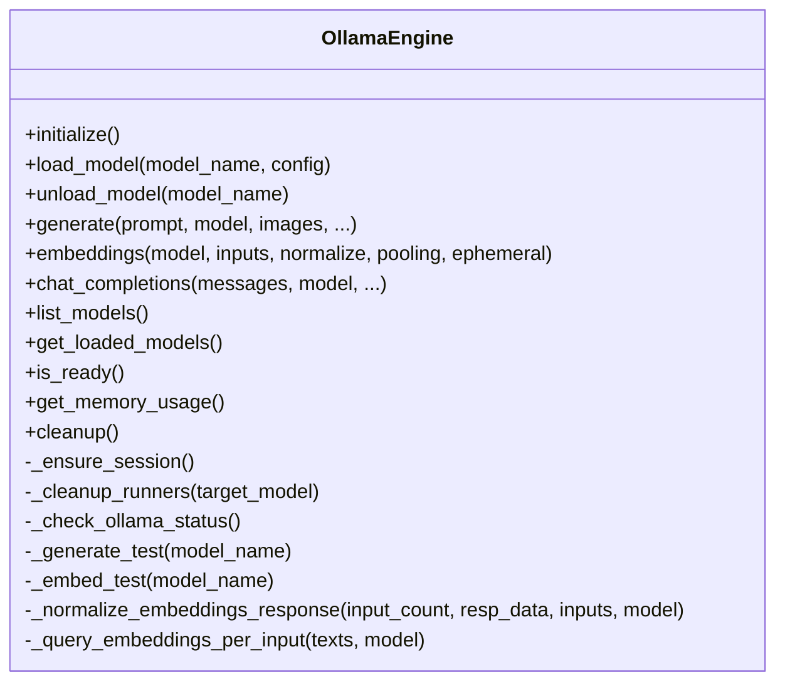
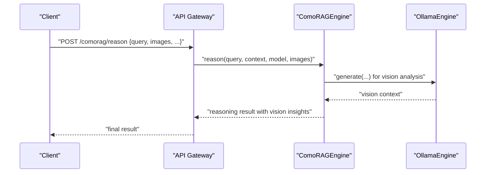
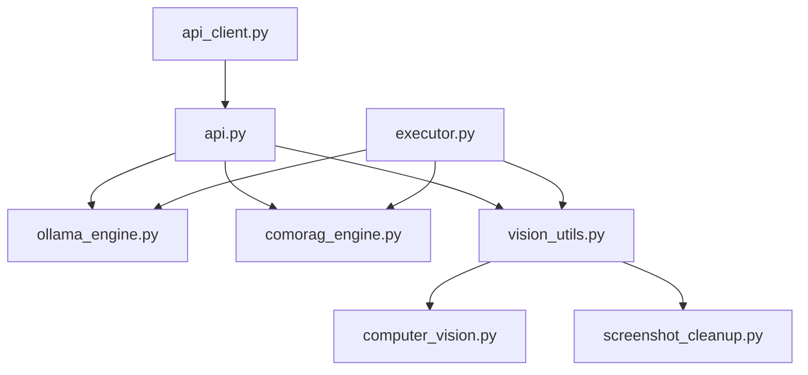

# Vision Processing and Image Handling

<cite>
**Referenced Files in This Document**
- [api.py](file://LoOper/AI/api.py)
- [ollama_engine.py](file://LoOper/AI/OverWatch/api/ollama_engine.py)
- [comorag_engine.py](file://LoOper/AI/OverWatch/api/comorag_engine.py)
- [computer_vision.py](file://LoOper/player/computer_vision.py)
- [screenshot_cleanup.py](file://LoOper/player/screenshot_cleanup.py)
- [vision_utils.py](file://LoOper/player/multi_sequence/llm_executor_resources/vision_utils.py)
- [executor.py](file://LoOper/player/multi_sequence/llm_executor_resources/executor.py)
- [api_client.py](file://LoOper/AI/OverWatch/api/api_client.py)
</cite>

## Table of Contents
1. [Introduction](#introduction)
2. [Project Structure](#project-structure)
3. [Core Components](#core-components)
4. [Architecture Overview](#architecture-overview)
5. [Detailed Component Analysis](#detailed-component-analysis)
6. [Dependency Analysis](#dependency-analysis)
7. [Performance Considerations](#performance-considerations)
8. [Troubleshooting Guide](#troubleshooting-guide)
9. [Conclusion](#conclusion)

## Introduction
This document describes the vision processing and image handling capabilities of the system, focusing on:
- Image preprocessing supporting file paths, base64-encoded data, and data URLs
- Vision model detection using both static keyword matching and dynamic model capability queries
- Multimodal request handling for vision-capable models
- Cleanup operations for model runners and resource management
- Performance optimization strategies for vision processing workflows

## Project Structure
The vision pipeline spans several modules:
- API gateway for image preprocessing, vision model detection, and multimodal requests
- Ollama engine for model lifecycle and inference
- Computer vision utilities for screenshot capture and OCR
- Cleanup utilities for temporary screenshots
- Executor resources for advanced vision workflows and integration with the API

**Diagram sources**
- [api.py:547-766](file://LoOper/AI/api.py#L547-L766)
- [ollama_engine.py:34-737](file://LoOper/AI/OverWatch/api/ollama_engine.py#L34-L737)
- [comorag_engine.py:233-642](file://LoOper/AI/OverWatch/api/comorag_engine.py#L233-L642)
- [computer_vision.py:93-177](file://LoOper/player/computer_vision.py#L93-L177)
- [screenshot_cleanup.py:6-125](file://LoOper/player/screenshot_cleanup.py#L6-L125)
- [vision_utils.py:9-66](file://Looper/player/multi_sequence/llm_executor_resources/vision_utils.py#L9-L66)
- [executor.py:126-200](file://Looper/player/multi_sequence/llm_executor_resources/executor.py#L126-L200)
- [api_client.py:25-268](file://Looper/AI/OverWatch/api/api_client.py#L25-L268)

**Section sources**
- [api.py:547-766](file://LoOper/AI/api.py#L547-L766)
- [ollama_engine.py:34-737](file://LoOper/AI/OverWatch/api/ollama_engine.py#L34-L737)
- [comorag_engine.py:233-642](file://Looper/AI/OverWatch/api/comorag_engine.py#L233-L642)
- [computer_vision.py:93-177](file://Looper/player/computer_vision.py#L93-L177)
- [screenshot_cleanup.py:6-125](file://Looper/player/screenshot_cleanup.py#L6-L125)
- [vision_utils.py:9-66](file://Looper/player/multi_sequence/llm_executor_resources/vision_utils.py#L9-L66)
- [executor.py:126-200](file://Looper/player/multi_sequence/llm_executor_resources/executor.py#L126-L200)
- [api_client.py:25-268](file://Looper/AI/OverWatch/api/api_client.py#L25-L268)

## Core Components
- Image preprocessing: Converts file paths, data URLs, and raw base64 strings into base64 format suitable for Ollama vision models.
- Vision model detection: Uses static keyword matching and dynamic model capability queries to determine vision support.
- Multimodal request handling: Integrates images into chat/generate requests for vision-capable models.
- Cleanup operations: Stops model runners and cleans up temporary screenshots.
- Resource management: Manages model lifecycle and memory footprint for efficient vision processing.

**Section sources**
- [api.py:254-288](file://Looper/AI/api.py#L254-L288)
- [api.py:217-252](file://Looper/AI/api.py#L217-L252)
- [api.py:655-766](file://Looper/AI/api.py#L655-L766)
- [ollama_engine.py:114-152](file://Looper/AI/OverWatch/api/ollama_engine.py#L114-L152)
- [screenshot_cleanup.py:16-47](file://Looper/player/screenshot_cleanup.py#L16-L47)

## Architecture Overview
The vision processing architecture integrates image preprocessing, model detection, and multimodal inference with robust cleanup and resource management.

**Diagram sources**
- [api.py:655-766](file://Looper/AI/api.py#L655-L766)
- [api.py:217-252](file://Looper/AI/api.py#L217-L252)
- [api.py:254-288](file://Looper/AI/api.py#L254-L288)
- [ollama_engine.py:114-152](file://Looper/AI/OverWatch/api/ollama_engine.py#L114-L152)

## Detailed Component Analysis

### Image Preprocessing
The API gateway provides a unified function to normalize various image inputs into base64 format for Ollama:
- Accepts file paths, data URLs, or raw base64 strings
- Validates and converts inputs to base64
- Raises HTTP exceptions on processing failures

**Diagram sources**
- [api.py:254-288](file://Looper/AI/api.py#L254-L288)

**Section sources**
- [api.py:254-288](file://Looper/AI/api.py#L254-L288)

### Vision Model Detection
Two-tier detection ensures accurate identification of vision-capable models:
- Static keyword matching against known vision model prefixes
- Dynamic capability query via Ollama show endpoint for modality/template hints

**Diagram sources**
- [api.py:217-252](file://Looper/AI/api.py#L217-L252)

**Section sources**
- [api.py:217-252](file://Looper/AI/api.py#L217-L252)

### Multimodal Request Handling
The API gateway routes requests to appropriate endpoints and attaches images when supported:
- Vision-capable models receive images under the "images" field
- Non-vision models fall back to text-only prompts
- Background cleanup stops competing model runners post-request

**Diagram sources**
- [api.py:655-766](file://Looper/AI/api.py#L655-L766)
- [api.py:254-288](file://Looper/AI/api.py#L254-L288)
- [api.py:217-252](file://Looper/AI/api.py#L217-L252)

**Section sources**
- [api.py:655-766](file://Looper/AI/api.py#L655-L766)

### Advanced Vision Pipelines and Cleanup
The executor module integrates vision utilities and manages cleanup:
- prepare_vision_images captures screenshots and returns image lists
- Cleanup utilities register and remove temporal screenshots
- Ollama runner cleanup stops competing model instances

**Diagram sources**
- [executor.py:174-187](file://Looper/player/multi_sequence/llm_executor_resources/executor.py#L174-L187)
- [vision_utils.py:9-66](file://Looper/player/multi_sequence/llm_executor_resources/vision_utils.py#L9-L66)
- [computer_vision.py:93-177](file://Looper/player/computer_vision.py#L93-L177)
- [screenshot_cleanup.py:16-20](file://Looper/player/screenshot_cleanup.py#L16-L20)
- [ollama_engine.py:114-152](file://Looper/AI/OverWatch/api/ollama_engine.py#L114-L152)

**Section sources**
- [executor.py:174-187](file://Looper/player/multi_sequence/llm_executor_resources/executor.py#L174-L187)
- [vision_utils.py:9-66](file://Looper/player/multi_sequence/llm_executor_resources/vision_utils.py#L9-L66)
- [computer_vision.py:93-177](file://Looper/player/computer_vision.py#L93-L177)
- [screenshot_cleanup.py:16-20](file://Looper/player/screenshot_cleanup.py#L16-L20)
- [ollama_engine.py:114-152](file://Looper/AI/OverWatch/api/ollama_engine.py#L114-L152)

### Ollama Engine Integration
The Ollama engine encapsulates model lifecycle and inference:
- Initialization and status checks
- Model loading and testing
- Embeddings generation with robust normalization
- Cleanup of model runners and sessions

**Diagram sources**
- [ollama_engine.py:34-737](file://Looper/AI/OverWatch/api/ollama_engine.py#L34-L737)

**Section sources**
- [ollama_engine.py:34-737](file://Looper/AI/OverWatch/api/ollama_engine.py#L34-L737)

### ComoRAG Vision Integration
ComoRAG can optionally analyze images and incorporate vision insights into reasoning:
- Vision analysis can be enabled via settings
- Images are attached to memory items and reasoning context
- Streaming reasoning exposes vision analysis results

**Diagram sources**
- [api.py:1117-1170](file://Looper/AI/api.py#L1117-L1170)
- [comorag_engine.py:328-642](file://Looper/AI/OverWatch/api/comorag_engine.py#L328-L642)

**Section sources**
- [api.py:1117-1170](file://Looper/AI/api.py#L1117-L1170)
- [comorag_engine.py:328-642](file://Looper/AI/OverWatch/api/comorag_engine.py#L328-L642)

## Dependency Analysis
The vision processing stack exhibits clear separation of concerns with well-defined dependencies:
- API gateway depends on Ollama engine and vision utilities
- Executor depends on vision utilities and computer vision modules
- Cleanup utilities are shared across vision workflows
- OverWatch API client communicates with the API gateway

**Diagram sources**
- [api.py:547-766](file://Looper/AI/api.py#L547-L766)
- [ollama_engine.py:34-737](file://Looper/AI/OverWatch/api/ollama_engine.py#L34-L737)
- [comorag_engine.py:233-642](file://Looper/AI/OverWatch/api/comorag_engine.py#L233-L642)
- [vision_utils.py:9-66](file://Looper/player/multi_sequence/llm_executor_resources/vision_utils.py#L9-L66)
- [computer_vision.py:93-177](file://Looper/player/computer_vision.py#L93-L177)
- [screenshot_cleanup.py:6-125](file://Looper/player/screenshot_cleanup.py#L6-L125)
- [executor.py:126-200](file://Looper/player/multi_sequence/llm_executor_resources/executor.py#L126-L200)
- [api_client.py:25-268](file://Looper/AI/OverWatch/api/api_client.py#L25-L268)

**Section sources**
- [api.py:547-766](file://Looper/AI/api.py#L547-L766)
- [ollama_engine.py:34-737](file://Looper/AI/OverWatch/api/ollama_engine.py#L34-L737)
- [comorag_engine.py:233-642](file://Looper/AI/OverWatch/api/comorag_engine.py#L233-L642)
- [vision_utils.py:9-66](file://Looper/player/multi_sequence/llm_executor_resources/vision_utils.py#L9-L66)
- [computer_vision.py:93-177](file://Looper/player/computer_vision.py#L93-L177)
- [screenshot_cleanup.py:6-125](file://Looper/player/screenshot_cleanup.py#L6-L125)
- [executor.py:126-200](file://Looper/player/multi_sequence/llm_executor_resources/executor.py#L126-L200)
- [api_client.py:25-268](file://Looper/AI/OverWatch/api/api_client.py#L25-L268)

## Performance Considerations
- Minimize redundant model runner instances by stopping competing models before inference
- Prefer base64 conversion once per request and reuse processed images
- Limit screenshot capture frequency and size; leverage cleanup to avoid disk bloat
- Use streaming responses for long-running multimodal generations
- Cache vision capability detection results to avoid repeated Ollama queries

[No sources needed since this section provides general guidance]

## Troubleshooting Guide
Common issues and resolutions:
- Unsupported vision model: The API raises explicit HTTP exceptions when images are provided to non-vision models. Validate model capabilities using the vision detection logic before attaching images.
- Ollama connectivity: Health checks and status endpoints surface connection and model availability issues. Ensure the Ollama service is reachable and models are pulled.
- Resource cleanup: Use cleanup endpoints or background tasks to stop model runners and remove temporary screenshots. Leverage the cleanup utilities for temporal screenshots.
- Vision capture failures: Verify computer vision dependencies and permissions. Check logs for template matching and screenshot capture errors.

**Section sources**
- [api.py:655-766](file://Looper/AI/api.py#L655-L766)
- [api.py:581-606](file://Looper/AI/api.py#L581-L606)
- [screenshot_cleanup.py:16-47](file://Looper/player/screenshot_cleanup.py#L16-L47)
- [computer_vision.py:93-177](file://Looper/player/computer_vision.py#L93-L177)

## Conclusion
The vision processing pipeline provides robust image preprocessing, accurate model detection, and seamless multimodal inference with strong cleanup and resource management. By leveraging static and dynamic detection, unified image processing, and integrated cleanup routines, the system delivers reliable vision-capable model workflows.