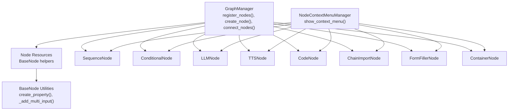
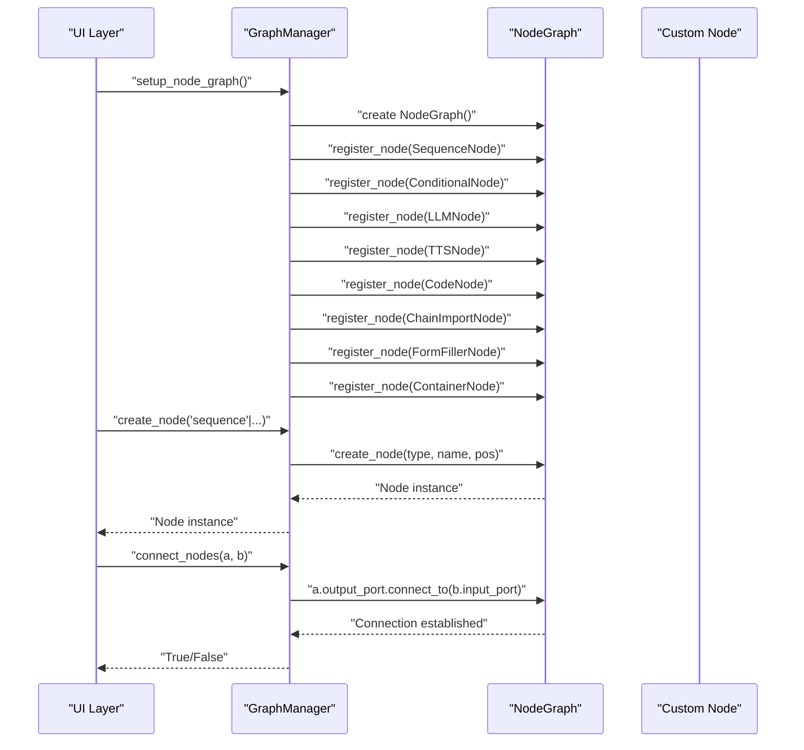
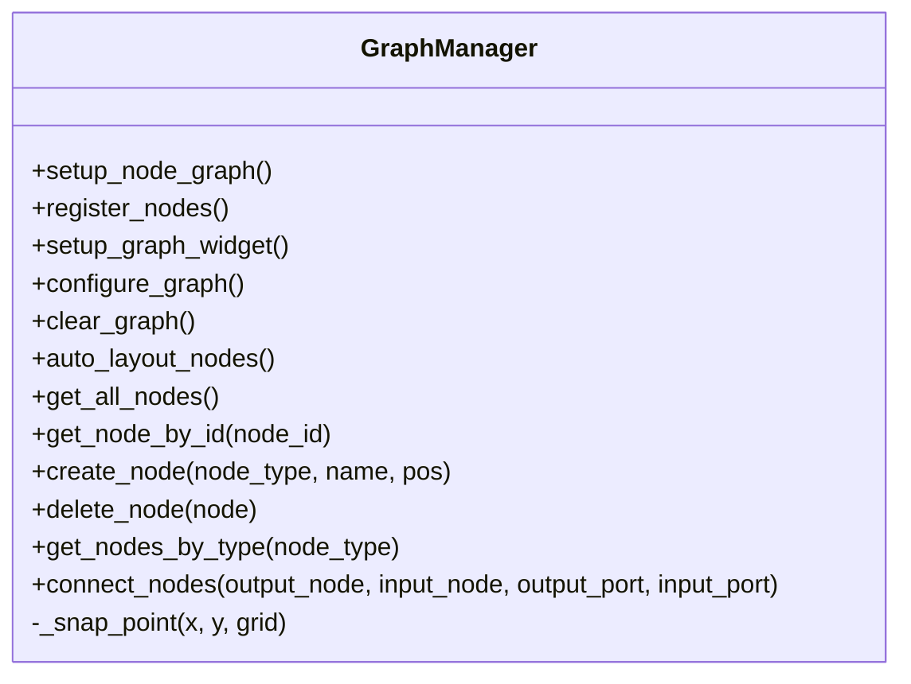
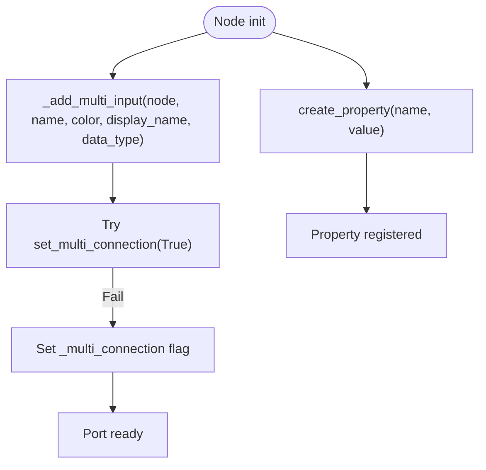
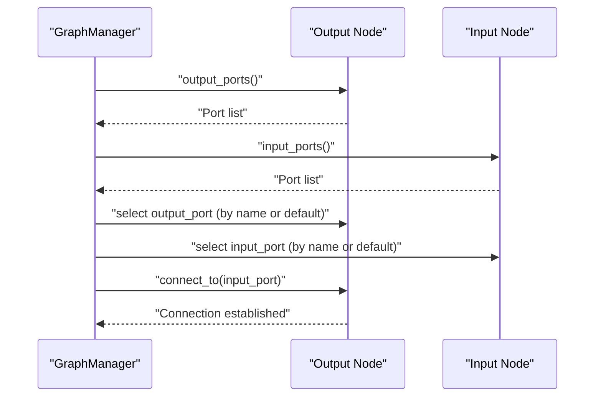
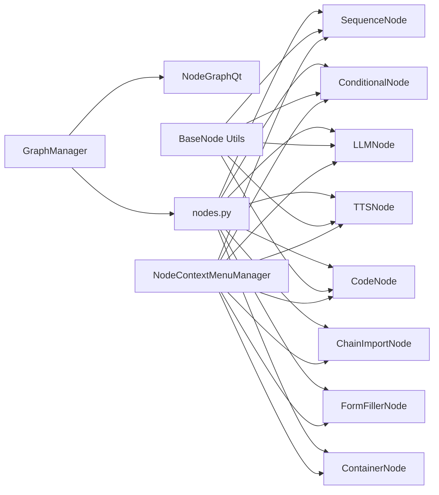

# Node Programming API

<cite>
**Referenced Files in This Document**
- [base_node.py](file://LoOper/NGUI/nodes_resources/base_node.py)
- [graph_manager.py](file://LoOper/NGUI/graph_elements/graph_manager.py)
- [nodes.py](file://LoOper/NGUI/nodes.py)
- [node_context_menu.py](file://LoOper/NGUI/node_context_menu.py)
- [sequence_node.py](file://LoOper/NGUI/nodes_resources/sequence_node.py)
- [conditional_node.py](file://LoOper/NGUI/nodes_resources/conditional_node.py)
- [llm_node.py](file://LoOper/NGUI/nodes_resources/llm_node.py)
- [tts_node.py](file://LoOper/NGUI/nodes_resources/tts_node.py)
- [code_node.py](file://LoOper/NGUI/nodes_resources/code_node.py)
</cite>

## Table of Contents
1. [Introduction](#introduction)
2. [Project Structure](#project-structure)
3. [Core Components](#core-components)
4. [Architecture Overview](#architecture-overview)
5. [Detailed Component Analysis](#detailed-component-analysis)
6. [Dependency Analysis](#dependency-analysis)
7. [Performance Considerations](#performance-considerations)
8. [Troubleshooting Guide](#troubleshooting-guide)
9. [Conclusion](#conclusion)
10. [Appendices](#appendices)

## Introduction
This document describes the node-based programming interface used to compose workflows. It covers the node system architecture, built-in node types (sequence, conditional, LLM, TTS, chain import, code, container), node property interfaces, creation and configuration APIs, event handling, inter-node communication, dialog systems, validation patterns, and extension guidelines. It also documents serialization and persistence mechanisms for nodes and graphs.

## Project Structure
The node programming interface centers around:
- A graph manager that registers and manipulates nodes
- A base node utility layer for compatibility and multi-input wiring
- Node resource classes for each node type
- A context menu manager for editing and graph actions
- A thin re-export module aggregating node resources



**Diagram sources**
- [graph_manager.py:93-116](file://LoOper/NGUI/graph_elements/graph_manager.py#L93-L116)
- [nodes.py:1-14](file://LoOper/NGUI/nodes.py#L1-L14)
- [base_node.py:1-60](file://LoOper/NGUI/nodes_resources/base_node.py#L1-L60)
- [node_context_menu.py:8-44](file://LoOper/NGUI/node_context_menu.py#L8-L44)

**Section sources**
- [graph_manager.py:64-120](file://LoOper/NGUI/graph_elements/graph_manager.py#L64-L120)
- [nodes.py:1-14](file://LoOper/NGUI/nodes.py#L1-L14)
- [base_node.py:1-60](file://LoOper/NGUI/nodes_resources/base_node.py#L1-L60)
- [node_context_menu.py:8-44](file://LoOper/NGUI/node_context_menu.py#L8-L44)

## Core Components
- GraphManager: Initializes the NodeGraphQt graph, registers node types, sets up the UI widget, configures pipes/grid, and exposes APIs to create/delete nodes, connect nodes, auto-layout, and query nodes.
- NodeContextMenuManager: Provides context menus for nodes and the graph background, dispatching to editor actions and node addition commands.
- BaseNode utilities: Ensures property registration compatibility across NodeGraphQt versions and adds robust multi-input wiring helpers.
- Node resource classes: Implement node-specific properties, ports, and optional execution helpers.

Key APIs and responsibilities:
- Graph creation and configuration: setup_node_graph(), register_nodes(), setup_graph_widget(), configure_graph()
- Node lifecycle: create_node(), delete_node(), get_all_nodes(), get_node_by_id(), get_nodes_by_type()
- Inter-node connectivity: connect_nodes()
- Layout and persistence: auto_layout_nodes(), clear_graph()

**Section sources**
- [graph_manager.py:64-445](file://LoOper/NGUI/graph_elements/graph_manager.py#L64-L445)
- [node_context_menu.py:14-158](file://LoOper/NGUI/node_context_menu.py#L14-L158)
- [base_node.py:25-60](file://LoOper/NGUI/nodes_resources/base_node.py#L25-L60)

## Architecture Overview
The system integrates NodeGraphQt with custom node types and a UI layer. The GraphManager encapsulates graph setup and operations, while node resources define ports and properties. The context menu routes user actions to editor functions.



**Diagram sources**
- [graph_manager.py:64-120](file://LoOper/NGUI/graph_elements/graph_manager.py#L64-L120)
- [graph_manager.py:277-334](file://LoOper/NGUI/graph_elements/graph_manager.py#L277-L334)
- [graph_manager.py:366-437](file://LoOper/NGUI/graph_elements/graph_manager.py#L366-L437)

## Detailed Component Analysis

### GraphManager
Responsibilities:
- Initialize and configure the NodeGraphQt graph
- Register custom node types
- Inject the graph widget into the UI
- Provide CRUD and connection APIs
- Auto-layout and clear operations

Notable behaviors:
- Robust node creation with snapping and multi-connection port setup
- Safe connection resolution by name or default ports
- Monkey-patched error handling for NodeGraphQt internal errors



**Diagram sources**
- [graph_manager.py:51-445](file://LoOper/NGUI/graph_elements/graph_manager.py#L51-L445)

**Section sources**
- [graph_manager.py:64-445](file://LoOper/NGUI/graph_elements/graph_manager.py#L64-L445)

### NodeContextMenuManager
Responsibilities:
- Build context menus based on node identifier
- Dispatch to editor actions (edit dialogs) and graph actions (add nodes)
- Provide node-specific actions (e.g., edit properties, expand chain)

```mermaid
flowchart TD
Start(["Context Menu Request"]) --> Detect["Detect node identifier"]
Detect --> Seq{"sequence?"}
Seq --> |Yes| EditSeq["Edit Sequence Properties"]
Seq --> |No| Act{"action?"}
Act --> |Yes| DelAct["Remove Action"]
Act --> |No| Cond{"conditional?"}
Cond --> |Yes| EditCond["Edit Conditionals"]
Cond --> |No| LLM{"llm?"}
LLM --> |Yes| EditLLM["Edit LLM Configuration"]
LLM --> |No| TTS{"tts?"}
TTS --> |Yes| EditTTS["Edit TTS Properties"]
TTS --> |No| CI{"chain_import?"}
CI --> |Yes| EditCI["Edit Chain Import Configuration"] + ExpandCI["Expand Chain"]
CI --> |No| Code{"code?"}
Code --> |Yes| EditCode["Edit Code"]
Code --> |No| Cont{"container?"}
Cont --> |Yes| EditCont["Edit Container Configuration"]
Cont --> |No| Graph["Graph Actions: Add Nodes"]
EditSeq --> End(["Done"])
DelAct --> End
EditCond --> End
EditLLM --> End
EditTTS --> End
EditCI --> End
ExpandCI --> End
EditCode --> End
EditCont --> End
Graph --> End
```

**Diagram sources**
- [node_context_menu.py:14-158](file://LoOper/NGUI/node_context_menu.py#L14-L158)

**Section sources**
- [node_context_menu.py:14-158](file://LoOper/NGUI/node_context_menu.py#L14-L158)

### BaseNode Utilities
Responsibilities:
- Provide a fallback create_property() for NodeGraphQt compatibility
- Add multi-input ports with robust fallbacks for multi_connection
- Provide default API URL helper for LLM nodes



**Diagram sources**
- [base_node.py:5-60](file://LoOper/NGUI/nodes_resources/base_node.py#L5-L60)

**Section sources**
- [base_node.py:5-60](file://LoOper/NGUI/nodes_resources/base_node.py#L5-L60)

### Node Types

#### SequenceNode
Ports:
- Input: multi-connection
- Output: multi-connection

Properties:
- sequence_file: string
- loop_count: string number
- extra_delay: string number
- use_app_opened: string boolean

Behavior:
- Stores only the filename to avoid GUI numbering interference
- Updates node name to the sequence filename
- Highlights color if fallbacks exist

Execution:
- No built-in execution; used for sequencing and playback orchestration

**Section sources**
- [sequence_node.py:12-127](file://LoOper/NGUI/nodes_resources/sequence_node.py#L12-L127)

#### ConditionalNode
Ports:
- Input: multi-connection
- Outputs: true, false

Properties:
- condition_type: string
- image_path: string
- confidence: string number
- threshold: string number
- timeout: string number
- wait_time: string number
- max_loops: string number
- max_attempts: string number
- delay_between_attempts: string number
- target_x/y/w/h: string numbers
- position_tolerance: string number
- code: string (Python expression body)
- target_text: string
- ocr_text: string
- case_sensitive: string boolean
- loop_type: string
- loop_position: string
- sequence_file: string
- iteration_delay: string number
- loop_condition: string

Behavior:
- Sets node name reflecting condition type
- Persists condition data and updates properties accordingly

Execution:
- No built-in execution; used for branching and loops

**Section sources**
- [conditional_node.py:10-162](file://LoOper/NGUI/nodes_resources/conditional_node.py#L10-L162)

#### LLMNode
Ports:
- Inputs: input (multi), tools (multi), context (multi)
- Outputs: output (multi), context (multi)

Properties:
- model: string
- prompt: string
- system_message: string
- temperature: string number
- max_tokens: string number
- output_variable: string
- api_url: string
- write_text: string boolean
- use_vision: string boolean
- vision_model: string
- use_advanced_vision: string boolean
- screenshot_enabled: string boolean
- use_comorag: string boolean
- max_cycles: string number
- memory_size: string number
- input_source: string
- ocr_confidence: string number
- ocr_preprocessing: string boolean
- typing_batch_size: string number
- typing_batch_delay: string number
- use_async: string boolean
- use_direct_rag: string boolean
- rag_embedding_model: string
- rag_chunk_size: string number
- rag_overlap: string number
- rag_top_k: string number
- rag_include_raw_input: string boolean
- rag_max_chars: string number
- rag_documents: JSON array string
- tool_descriptions: JSON object string

Execution:
- execute_llm(context_variables): performs chat completion via configured client, optionally captures screenshots for vision, and cleans up temporaries

Validation:
- is_vision_model(model_name): checks model capability or common vision model names

**Section sources**
- [llm_node.py:11-390](file://LoOper/NGUI/nodes_resources/llm_node.py#L11-L390)

#### TTSNode
Ports:
- Input: multi-connection
- Output: single

Properties:
- text: string
- language: string
- rate: string number
- volume: string number
- voice_id: string number
- save_to_file: string boolean
- output_file: string
- wait_for_completion: string boolean

Execution:
- execute_tts(context_variables): synthesizes speech using pyttsx3, supports saving to file or speaking immediately

**Section sources**
- [tts_node.py:9-150](file://LoOper/NGUI/nodes_resources/tts_node.py#L9-L150)

#### CodeNode
Ports:
- Input: multi-connection
- Output: multi-connection

Properties:
- code: string (Python script)
- file_path: string (path to Python file)
- execute_on_input: string boolean
- output_variable: string
- timeout: string number
- gen_model: string
- gen_prompt: string

Execution:
- execute_code(input_data, args, runtime_code): executes code from property, file, or runtime override; returns success/result/error

**Section sources**
- [code_node.py:11-141](file://LoOper/NGUI/nodes_resources/code_node.py#L11-L141)

### Dialog System and Validation Patterns
- Context menu actions route to editor functions that open dialogs for node configuration (e.g., edit sequence, edit LLM, edit TTS, edit code, edit container).
- Property definitions are exposed via create_property() and edited through dialogs; values are persisted to node properties.
- Validation patterns:
  - String-to-boolean normalization for booleans
  - String-to-number conversions for numeric properties
  - JSON parsing for structured properties (e.g., rag_documents, tool_descriptions)
  - Multi-connection port setup to support fan-out/fan-in wiring

**Section sources**
- [node_context_menu.py:14-158](file://LoOper/NGUI/node_context_menu.py#L14-L158)
- [sequence_node.py:119-127](file://LoOper/NGUI/nodes_resources/sequence_node.py#L119-L127)
- [conditional_node.py:129-162](file://LoOper/NGUI/nodes_resources/conditional_node.py#L129-L162)
- [llm_node.py:187-250](file://LoOper/NGUI/nodes_resources/llm_node.py#L187-L250)
- [tts_node.py:82-93](file://LoOper/NGUI/nodes_resources/tts_node.py#L82-L93)
- [code_node.py:72-82](file://LoOper/NGUI/nodes_resources/code_node.py#L72-L82)

### Inter-Node Communication
- Ports:
  - Multi-connection inputs for flexible fan-in
  - Multi-connection outputs for flexible fan-out
- Connections:
  - connect_nodes() resolves default or named ports and creates connections
  - Supports explicit port selection by name or falls back to first available port



**Diagram sources**
- [graph_manager.py:366-437](file://LoOper/NGUI/graph_elements/graph_manager.py#L366-L437)

**Section sources**
- [graph_manager.py:366-437](file://LoOper/NGUI/graph_elements/graph_manager.py#L366-L437)

### Node Creation, Configuration, and Execution APIs
- Creation:
  - GraphManager.create_node(node_type, name=None, pos=None)
  - Automatically enables multi-connection on input/output ports
- Configuration:
  - Node.set_property(name, value) and Node.get_property(name)
  - Node-specific setters (e.g., SequenceNode.set_sequence_data, ConditionalNode.set_condition_data, LLMNode.set_llm_config, TTSNode.set_tts_config, CodeNode.get_code_config)
- Execution:
  - LLMNode.execute_llm(context_variables)
  - TTSNode.execute_tts(context_variables)
  - CodeNode.execute_code(input_data, args, runtime_code)

**Section sources**
- [graph_manager.py:277-334](file://LoOper/NGUI/graph_elements/graph_manager.py#L277-L334)
- [sequence_node.py:71-127](file://LoOper/NGUI/nodes_resources/sequence_node.py#L71-L127)
- [conditional_node.py:101-162](file://LoOper/NGUI/nodes_resources/conditional_node.py#L101-L162)
- [llm_node.py:143-250](file://LoOper/NGUI/nodes_resources/llm_node.py#L143-L250)
- [tts_node.py:68-150](file://LoOper/NGUI/nodes_resources/tts_node.py#L68-L150)
- [code_node.py:84-141](file://LoOper/NGUI/nodes_resources/code_node.py#L84-L141)

### Examples and Workflows
- Custom node development:
  - Subclass BaseNode, define ports via _add_multi_input() and add_output()
  - Register properties with create_property()
  - Optionally implement a node-specific setter/getter pair
  - Register the node type with GraphManager.register_nodes()
- Node transformation operations:
  - Use connect_nodes() to wire outputs to inputs
  - Use auto_layout_nodes() to arrange nodes
- Workflow graph manipulation:
  - Use create_node() to add nodes
  - Use delete_node() to remove nodes
  - Use clear_graph() to reset the canvas

**Section sources**
- [base_node.py:25-60](file://LoOper/NGUI/nodes_resources/base_node.py#L25-L60)
- [graph_manager.py:93-120](file://LoOper/NGUI/graph_elements/graph_manager.py#L93-L120)
- [graph_manager.py:277-334](file://LoOper/NGUI/graph_elements/graph_manager.py#L277-L334)
- [graph_manager.py:366-437](file://LoOper/NGUI/graph_elements/graph_manager.py#L366-L437)
- [graph_manager.py:230-243](file://LoOper/NGUI/graph_elements/graph_manager.py#L230-L243)

### Serialization, Deserialization, and Persistence
- Node properties:
  - Persisted via NodeGraphQt property storage; accessed via set_property()/get_property()
- Node graph:
  - NodeGraphQt provides built-in serialization for node positions, ports, and connections
- Practical guidance:
  - Store filenames and identifiers in properties (e.g., sequence_file) to avoid absolute path drift
  - Normalize boolean and numeric values to strings for consistent persistence
  - For structured data (e.g., rag_documents, tool_descriptions), persist as JSON strings and parse on load

**Section sources**
- [sequence_node.py:102-111](file://LoOper/NGUI/nodes_resources/sequence_node.py#L102-L111)
- [llm_node.py:181-186](file://LoOper/NGUI/nodes_resources/llm_node.py#L181-L186)
- [llm_node.py:213-218](file://LoOper/NGUI/nodes_resources/llm_node.py#L213-L218)

## Dependency Analysis
- GraphManager depends on NodeGraphQt and imports node types from nodes.py
- Node resources depend on BaseNode utilities for property registration and multi-input wiring
- Context menu manager depends on node identifiers and editor functions



**Diagram sources**
- [graph_manager.py:4-16](file://LoOper/NGUI/graph_elements/graph_manager.py#L4-L16)
- [nodes.py:1-14](file://LoOper/NGUI/nodes.py#L1-L14)
- [base_node.py:1-60](file://LoOper/NGUI/nodes_resources/base_node.py#L1-L60)
- [node_context_menu.py:3-6](file://LoOper/NGUI/node_context_menu.py#L3-L6)

**Section sources**
- [graph_manager.py:4-16](file://LoOper/NGUI/graph_elements/graph_manager.py#L4-L16)
- [nodes.py:1-14](file://LoOper/NGUI/nodes.py#L1-L14)
- [base_node.py:1-60](file://LoOper/NGUI/nodes_resources/base_node.py#L1-L60)
- [node_context_menu.py:3-6](file://LoOper/NGUI/node_context_menu.py#L3-L6)

## Performance Considerations
- Multi-connection ports reduce the need for intermediate nodes and improve throughput
- Asynchronous processing is enabled by default for LLM nodes; tune max_cycles and memory_size appropriately
- Screenshot capture for vision is optional and cleaned up post-execution
- Use auto_layout_nodes() sparingly in large graphs to maintain responsiveness

## Troubleshooting Guide
- NodeGraphQt KeyError during move:
  - The system applies a monkey patch to catch and log the error, preventing crashes
- Property registration failures:
  - BaseNode provides a fallback create_property() to ensure compatibility
- Multi-connection port setup:
  - Fallback logic attempts multiple strategies to enable multi_connection

**Section sources**
- [graph_manager.py:19-47](file://LoOper/NGUI/graph_elements/graph_manager.py#L19-L47)
- [base_node.py:5-13](file://LoOper/NGUI/nodes_resources/base_node.py#L5-L13)
- [base_node.py:25-60](file://LoOper/NGUI/nodes_resources/base_node.py#L25-L60)

## Conclusion
The node programming interface offers a robust, extensible framework for building workflows. It provides clear APIs for node creation, configuration, and inter-node communication, along with a context-driven dialog system and strong property persistence. Developers can extend the system by adding new node types following the established patterns and registering them with the GraphManager.

## Appendices

### Node Type Reference
- SequenceNode: Sequencing and playback orchestration
- ConditionalNode: Branching and looping with diverse condition types
- LLMNode: Large language model generation with vision and RAG support
- TTSNode: Text-to-speech synthesis
- CodeNode: Executable code blocks with variable exposure
- ChainImportNode: Import and expand external chains
- FormFillerNode: Deprecated
- ContainerNode: Group and organize nodes

**Section sources**
- [nodes.py:1-14](file://LoOper/NGUI/nodes.py#L1-L14)
- [node_context_menu.py:35-38](file://LoOper/NGUI/node_context_menu.py#L35-L38)