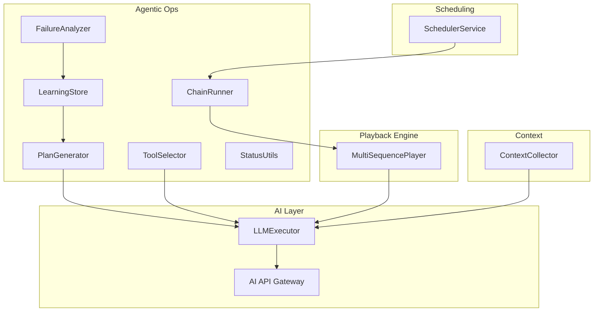
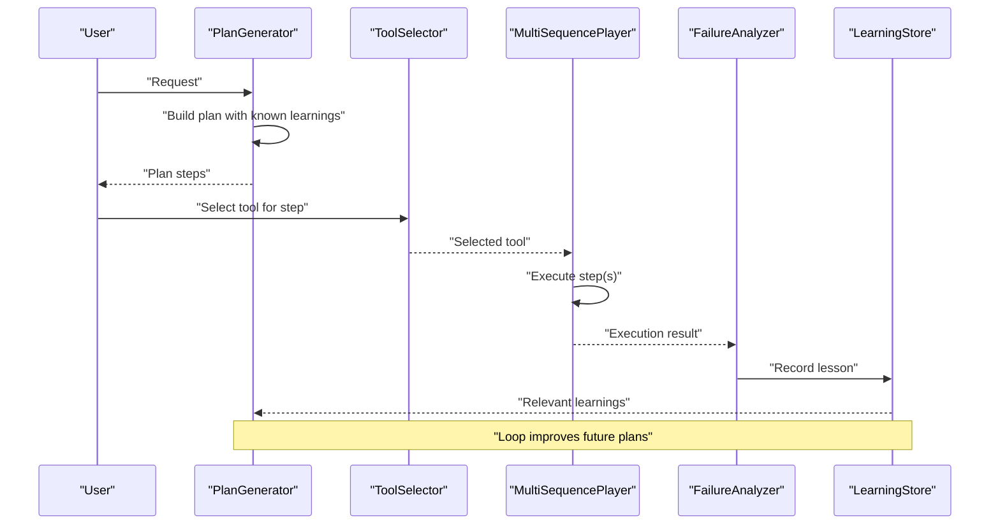
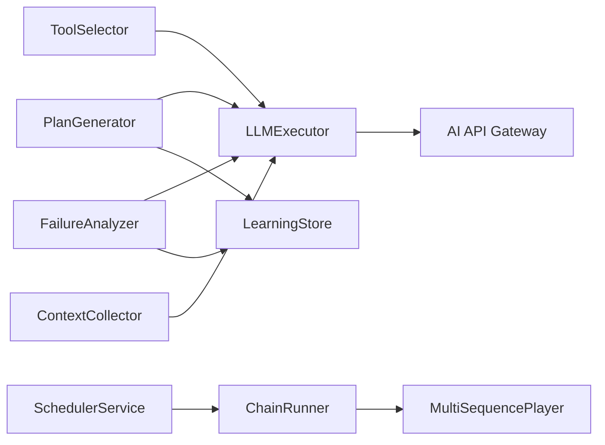
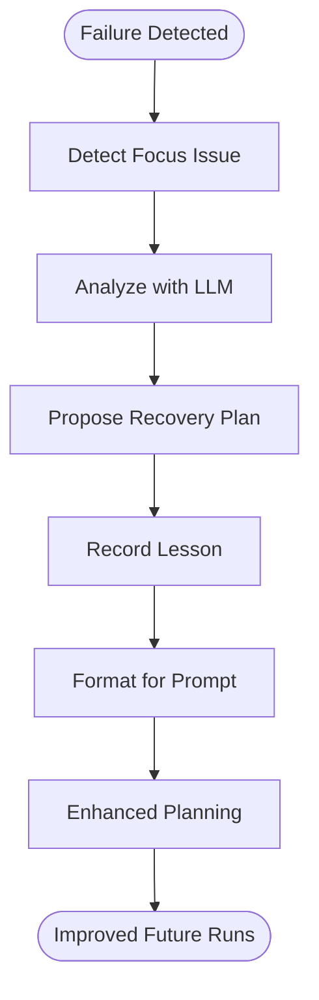

# Agent Learning System

<cite>
**Referenced Files in This Document**
- [learning_store.py](file://LoOper/player/agentic_ops/learning_store.py)
- [plan_generator.py](file://LoOper/player/agentic_ops/plan_generator.py)
- [failure_analyzer.py](file://LoOper/player/agentic_ops/failure_analyzer.py)
- [tool_selector.py](file://LoOper/player/agentic_ops/tool_selector.py)
- [status_utils.py](file://LoOper/player/agentic_ops/status_utils.py)
- [chain_runner.py](file://LoOper/player/agentic_ops/chain_runner.py)
- [multi_sequence_player.py](file://LoOper/player/multi_sequence_player.py)
- [scheduler_service.py](file://LoOper/NGUI/scheduler_service.py)
- [agent_learnings.json](file://LoOper/AI/agent_learnings.json)
- [context_collector.py](file://LoOper/AI/context_collector.py)
- [llm_executor.py](file://LoOper/player/multi_sequence/llm_executor.py)
- [api.py](file://LoOper/AI/api.py)
</cite>

## Table of Contents
1. [Introduction](#introduction)
2. [Project Structure](#project-structure)
3. [Core Components](#core-components)
4. [Architecture Overview](#architecture-overview)
5. [Detailed Component Analysis](#detailed-component-analysis)
6. [Dependency Analysis](#dependency-analysis)
7. [Performance Considerations](#performance-considerations)
8. [Troubleshooting Guide](#troubleshooting-guide)
9. [Conclusion](#conclusion)
10. [Appendices](#appendices)

## Introduction
This document explains the agent learning system that powers autonomous workflow optimization and decision-making in the automation framework. It focuses on:
- Learning store for experience accumulation, pattern recognition, and performance optimization
- Plan generation for workflow optimization, decision making, and resource planning
- Integration with the playback engine to improve reliability and reduce errors
- Relationships with the scheduler and AI layer for enhanced decision making
- Practical guidance on learning data management, plan validation, and system adaptation

The system learns from execution experiences, records lessons, retrieves relevant patterns, and augments planning and tool selection to prevent common failures and improve throughput.

## Project Structure
The learning system spans several modules:
- Agentic ops: learning store, plan generator, failure analyzer, tool selector, status utilities, and chain runner
- Playback engine: multi-sequence player orchestrating workflow execution
- Scheduling: scheduler service for automated chain runs
- AI layer: LLM executor and API gateway for model orchestration
- Context collector: optional integration for visual and workflow context

**Diagram sources**
- [learning_store.py:6-125](file://LoOper/player/agentic_ops/learning_store.py#L6-L125)
- [plan_generator.py:4-94](file://LoOper/player/agentic_ops/plan_generator.py#L4-L94)
- [failure_analyzer.py:4-130](file://LoOper/player/agentic_ops/failure_analyzer.py#L4-L130)
- [tool_selector.py:4-75](file://LoOper/player/agentic_ops/tool_selector.py#L4-L75)
- [status_utils.py:1-75](file://LoOper/player/agentic_ops/status_utils.py#L1-L75)
- [chain_runner.py:6-194](file://LoOper/player/agentic_ops/chain_runner.py#L6-L194)
- [multi_sequence_player.py:32-532](file://LoOper/player/multi_sequence_player.py#L32-L532)
- [scheduler_service.py:12-315](file://LoOper/NGUI/scheduler_service.py#L12-L315)
- [llm_executor.py:1-12](file://LoOper/player/multi_sequence/llm_executor.py#L1-L12)
- [api.py:1-800](file://LoOper/AI/api.py#L1-L800)
- [context_collector.py:1-248](file://LoOper/AI/context_collector.py#L1-L248)

**Section sources**
- [learning_store.py:6-125](file://LoOper/player/agentic_ops/learning_store.py#L6-L125)
- [plan_generator.py:4-94](file://LoOper/player/agentic_ops/plan_generator.py#L4-L94)
- [failure_analyzer.py:4-130](file://LoOper/player/agentic_ops/failure_analyzer.py#L4-L130)
- [tool_selector.py:4-75](file://LoOper/player/agentic_ops/tool_selector.py#L4-L75)
- [status_utils.py:1-75](file://LoOper/player/agentic_ops/status_utils.py#L1-L75)
- [chain_runner.py:6-194](file://LoOper/player/agentic_ops/chain_runner.py#L6-L194)
- [multi_sequence_player.py:32-532](file://LoOper/player/multi_sequence_player.py#L32-L532)
- [scheduler_service.py:12-315](file://LoOper/NGUI/scheduler_service.py#L12-L315)
- [llm_executor.py:1-12](file://LoOper/player/multi_sequence/llm_executor.py#L1-L12)
- [api.py:1-800](file://LoOper/AI/api.py#L1-L800)
- [context_collector.py:1-248](file://LoOper/AI/context_collector.py#L1-L248)

## Core Components
- LearningStore: central experience repository that records lessons, retrieves relevant learnings, and formats them for prompts. It integrates with an external Honcho backend when available and falls back to local storage.
- PlanGenerator: produces executable step-by-step plans grounded in known learnings and available tools, using an LLM node via the LLM executor.
- FailureAnalyzer: detects failure causes, proposes recovery plans, and records structured lessons for future prevention.
- ToolSelector: selects appropriate tools for a given request, with special handling for status queries and direct tool hints.
- StatusUtils: utilities to detect and normalize status-related steps and subjects.
- ChainRunner: executes chain configurations, manages lifecycle, and surfaces results for downstream learning.
- MultiSequencePlayer: orchestrates workflow execution, supports conditional fallbacks, and exposes runtime context for analysis.
- SchedulerService: schedules and launches chains automatically, integrating with the playback engine.
- ContextCollector: collects screenshot, automation JSON, and workflow state context for LLM consumption.
- LLMExecutor and AI API Gateway: provide model execution and orchestration, including vision-capable models and health checks.

**Section sources**
- [learning_store.py:6-125](file://LoOper/player/agentic_ops/learning_store.py#L6-L125)
- [plan_generator.py:4-94](file://LoOper/player/agentic_ops/plan_generator.py#L4-L94)
- [failure_analyzer.py:4-130](file://LoOper/player/agentic_ops/failure_analyzer.py#L4-L130)
- [tool_selector.py:4-75](file://LoOper/player/agentic_ops/tool_selector.py#L4-L75)
- [status_utils.py:1-75](file://LoOper/player/agentic_ops/status_utils.py#L1-L75)
- [chain_runner.py:6-194](file://LoOper/player/agentic_ops/chain_runner.py#L6-L194)
- [multi_sequence_player.py:32-532](file://LoOper/player/multi_sequence_player.py#L32-L532)
- [scheduler_service.py:12-315](file://LoOper/NGUI/scheduler_service.py#L12-L315)
- [context_collector.py:1-248](file://LoOper/AI/context_collector.py#L1-L248)
- [llm_executor.py:1-12](file://LoOper/player/multi_sequence/llm_executor.py#L1-L12)
- [api.py:1-800](file://LoOper/AI/api.py#L1-L800)

## Architecture Overview
The learning system follows a closed-loop:
- Execution runs via MultiSequencePlayer
- Failures are captured and analyzed by FailureAnalyzer
- Lessons are recorded in LearningStore and formatted for prompt injection
- Planning is enhanced by PlanGenerator using known learnings
- Tool selection is guided by ToolSelector and StatusUtils
- Chains can be scheduled and executed automatically by SchedulerService
- LLMExecutor and AI API Gateway provide model infrastructure

**Diagram sources**
- [plan_generator.py:10-94](file://LoOper/player/agentic_ops/plan_generator.py#L10-L94)
- [tool_selector.py:11-75](file://LoOper/player/agentic_ops/tool_selector.py#L11-L75)
- [multi_sequence_player.py:192-358](file://LoOper/player/multi_sequence_player.py#L192-L358)
- [failure_analyzer.py:11-130](file://LoOper/player/agentic_ops/failure_analyzer.py#L11-L130)
- [learning_store.py:22-125](file://LoOper/player/agentic_ops/learning_store.py#L22-L125)

## Detailed Component Analysis

### LearningStore
Responsibilities:
- Record lessons with structured fields (issue, cause, fix, examples, tags)
- Retrieve relevant learnings via Honcho search when available
- Format learnings for LLM prompts
- Provide a fallback mechanism when Honcho is unavailable

Key behaviors:
- Normalizes and sanitizes entries before recording
- Uses Honcho peers and sessions to persist and search learnings
- Falls back to local storage path for agent_learnings.json when Honcho is not initialized

Common usage patterns:
- After a failure, FailureAnalyzer calls record with a structured analysis
- PlanGenerator injects formatted learnings into its planning prompt
- Status queries are detected and handled to avoid redundant tool selection

**Section sources**
- [learning_store.py:6-125](file://LoOper/player/agentic_ops/learning_store.py#L6-L125)
- [agent_learnings.json:1-15](file://LoOper/AI/agent_learnings.json#L1-L15)

### PlanGenerator
Responsibilities:
- Generate a numbered, executable plan from a user request
- Incorporate known learnings and available tools
- Enforce strict formatting for reliable parsing

Processing logic:
- Builds a structured prompt including user request, known learnings, and tool descriptions
- Executes an LLM node via LLMExecutor to produce a plan
- Parses the LLM output into discrete steps, handling various bullet and numbering formats
- Logs LLM interactions for observability

Validation and robustness:
- Defaults to returning the original request if parsing fails
- Uses conservative temperature and token limits to improve determinism

**Section sources**
- [plan_generator.py:4-94](file://LoOper/player/agentic_ops/plan_generator.py#L4-L94)
- [llm_executor.py:1-12](file://LoOper/player/multi_sequence/llm_executor.py#L1-L12)

### FailureAnalyzer
Responsibilities:
- Analyze execution results to identify root causes
- Propose recovery plans and tag lessons appropriately
- Record lessons into LearningStore for reuse

Processing logic:
- Detects focus-related issues by scanning last result and failed steps
- Gathers known learnings and available tools for context
- Calls LLM to produce a structured analysis and recovery plan
- Falls back to heuristic-based analysis when LLM fails
- Records the resulting lesson with recovery steps

Integration points:
- Uses LearningStore to format and persist lessons
- Leverages ToolSelector utilities for status detection

**Section sources**
- [failure_analyzer.py:4-130](file://LoOper/player/agentic_ops/failure_analyzer.py#L4-L130)
- [learning_store.py:22-125](file://LoOper/player/agentic_ops/learning_store.py#L22-L125)

### ToolSelector and StatusUtils
Responsibilities:
- Select the most suitable tool for a given request
- Detect and normalize status queries to avoid mis-selection
- Provide specialized tool picking for status checks

Processing logic:
- If the input already contains a direct tool hint, validates against available tools
- Otherwise, constructs a tool selection prompt and executes via LLMExecutor
- For status queries, picks the best matching tool based on keyword scoring
- Logs events and LLM interactions for auditability

**Section sources**
- [tool_selector.py:4-75](file://LoOper/player/agentic_ops/tool_selector.py#L4-L75)
- [status_utils.py:1-75](file://LoOper/player/agentic_ops/status_utils.py#L1-L75)

### ChainRunner and MultiSequencePlayer
Responsibilities:
- Execute chain configurations and manage playback lifecycle
- Surface results and summaries for downstream learning
- Integrate with global monitoring and sandbox contexts

Processing logic:
- Builds a temporary chain configuration for batch tool execution
- Starts global monitoring and playback via MultiSequencePlayer
- Captures and forwards results (tool results and last result text) to LLM variables
- Restores UI state and cleans up resources after execution

Integration points:
- Works with LLMExecutor to propagate variables across nodes
- Integrates with scheduler for automated runs

**Section sources**
- [chain_runner.py:6-194](file://LoOper/player/agentic_ops/chain_runner.py#L6-L194)
- [multi_sequence_player.py:32-532](file://LoOper/player/multi_sequence_player.py#L32-L532)

### SchedulerService
Responsibilities:
- Schedule and launch chains at configured intervals or times
- Persist schedules and track next run times
- Launch playback as subprocesses with platform-specific considerations

Processing logic:
- Maintains an in-memory schedule list with locking
- Runs a background loop to check due schedules and launch chains
- Updates schedule metadata (last run, next run) after execution

Integration points:
- Launches player.main with the target chain path
- Supports Linux headless execution via xvfb-run when available

**Section sources**
- [scheduler_service.py:12-315](file://LoOper/NGUI/scheduler_service.py#L12-L315)

### ContextCollector
Responsibilities:
- Collect context for LLM consumption including screenshots, automation JSON, and workflow state
- Optionally extract OCR text from images
- Maintain a bounded context window for performance

Processing logic:
- Encodes images to base64 and optionally extracts OCR text
- Builds context items with metadata and timestamps
- Provides methods to get formatted context for LLMs and summarize collected data

Integration points:
- Can feed context into LLM prompts to improve understanding of visual state

**Section sources**
- [context_collector.py:1-248](file://LoOper/AI/context_collector.py#L1-L248)

### LLMExecutor and AI API Gateway
Responsibilities:
- Execute LLM nodes with configurable models and parameters
- Provide health checks and model management for Ollama-based engines
- Support streaming and vision-capable models

Processing logic:
- Exposes LLMExecutor and default API URL for LLM nodes
- API gateway routes chat/generate requests to Ollama, supports images for vision models, and performs model bootstrapping

Integration points:
- Used by PlanGenerator, ToolSelector, and FailureAnalyzer to execute prompts
- MultiSequencePlayer conditionally initializes and clears memory for ComoRAG

**Section sources**
- [llm_executor.py:1-12](file://LoOper/player/multi_sequence/llm_executor.py#L1-L12)
- [api.py:1-800](file://LoOper/AI/api.py#L1-L800)
- [multi_sequence_player.py:157-234](file://LoOper/player/multi_sequence_player.py#L157-L234)

## Dependency Analysis
The learning system exhibits cohesive coupling around LLM execution and playback orchestration:
- PlanGenerator, ToolSelector, and FailureAnalyzer depend on LLMExecutor and the AI API gateway
- LearningStore depends on Honcho when available and falls back to local JSON
- MultiSequencePlayer coordinates execution and provides results for FailureAnalyzer
- SchedulerService triggers ChainRunner and playback
- ContextCollector optionally enriches prompts with visual context

**Diagram sources**
- [plan_generator.py:10-94](file://LoOper/player/agentic_ops/plan_generator.py#L10-L94)
- [tool_selector.py:11-75](file://LoOper/player/agentic_ops/tool_selector.py#L11-L75)
- [failure_analyzer.py:11-130](file://LoOper/player/agentic_ops/failure_analyzer.py#L11-L130)
- [learning_store.py:22-125](file://LoOper/player/agentic_ops/learning_store.py#L22-L125)
- [chain_runner.py:26-104](file://LoOper/player/agentic_ops/chain_runner.py#L26-L104)
- [multi_sequence_player.py:192-358](file://LoOper/player/multi_sequence_player.py#L192-L358)
- [scheduler_service.py:184-210](file://LoOper/NGUI/scheduler_service.py#L184-L210)
- [context_collector.py:193-221](file://LoOper/AI/context_collector.py#L193-L221)
- [llm_executor.py:1-12](file://LoOper/player/multi_sequence/llm_executor.py#L1-L12)
- [api.py:581-766](file://LoOper/AI/api.py#L581-L766)

**Section sources**
- [plan_generator.py:10-94](file://LoOper/player/agentic_ops/plan_generator.py#L10-L94)
- [tool_selector.py:11-75](file://LoOper/player/agentic_ops/tool_selector.py#L11-L75)
- [failure_analyzer.py:11-130](file://LoOper/player/agentic_ops/failure_analyzer.py#L11-L130)
- [learning_store.py:22-125](file://LoOper/player/agentic_ops/learning_store.py#L22-L125)
- [chain_runner.py:26-104](file://LoOper/player/agentic_ops/chain_runner.py#L26-L104)
- [multi_sequence_player.py:192-358](file://LoOper/player/multi_sequence_player.py#L192-L358)
- [scheduler_service.py:184-210](file://LoOper/NGUI/scheduler_service.py#L184-L210)
- [context_collector.py:193-221](file://LoOper/AI/context_collector.py#L193-L221)
- [llm_executor.py:1-12](file://LoOper/player/multi_sequence/llm_executor.py#L1-L12)
- [api.py:581-766](file://LoOper/AI/api.py#L581-L766)

## Performance Considerations
- Prompt engineering: Low temperature and constrained tokens improve determinism and reduce hallucinations in planning and tool selection.
- Context management: Limit context size and use targeted OCR extraction to balance accuracy and latency.
- Execution orchestration: Preload chains and sequences to minimize on-demand IO overhead during playback.
- Memory hygiene: Clear LLM and vision model runners between runs to avoid resource contention.
- Scheduling: Use background threads and non-blocking subprocess launching to keep scheduling responsive.

[No sources needed since this section provides general guidance]

## Troubleshooting Guide
Common issues and resolutions:
- LearningStore Honcho initialization failures:
  - Symptom: Learnings not persisted or retrieved
  - Resolution: Verify environment variables for Honcho base URL, API key, and workspace/session IDs; fallback to local JSON is automatic
- Plan parsing failures:
  - Symptom: PlanGenerator returns the original request
  - Resolution: Ensure LLM output follows the expected numbering/bullet format; adjust system message or increase max tokens
- Tool selection ambiguity:
  - Symptom: Incorrect tool chosen for status queries
  - Resolution: Improve tool descriptions and leverage StatusUtils to detect and normalize status steps
- Playback interruptions:
  - Symptom: Execution stops unexpectedly
  - Resolution: Check stop flags and global monitoring; ensure proper cleanup of sandbox contexts
- Scheduler inconsistencies:
  - Symptom: Missed or duplicate runs
  - Resolution: Validate schedule configuration, next run computation, and platform-specific subprocess flags

**Section sources**
- [learning_store.py:102-125](file://LoOper/player/agentic_ops/learning_store.py#L102-L125)
- [plan_generator.py:64-94](file://LoOper/player/agentic_ops/plan_generator.py#L64-L94)
- [tool_selector.py:25-75](file://LoOper/player/agentic_ops/tool_selector.py#L25-L75)
- [multi_sequence_player.py:192-358](file://LoOper/player/multi_sequence_player.py#L192-L358)
- [scheduler_service.py:112-182](file://LoOper/NGUI/scheduler_service.py#L112-L182)

## Conclusion
The agent learning system creates a self-improving automation loop by capturing lessons from failures, grounding planning in reusable patterns, and selecting tools with precision. Its integration with the playback engine, scheduler, and AI layer enables scalable, reliable, and adaptive automation. By focusing on structured learning, robust plan parsing, and careful context management, teams can achieve higher throughput and fewer errors over time.

[No sources needed since this section summarizes without analyzing specific files]

## Appendices

### Example: Learning from Execution Experience
- Scenario: Browser not open or focused leads to plan failure
- FailureAnalyzer detects focus-related keywords and proposes a recovery plan
- Recovery plan includes steps to open the browser and bring it to the foreground
- LearningStore records the lesson with tags and examples
- Future planning incorporates the recorded fix to prevent recurrence

**Diagram sources**
- [failure_analyzer.py:11-130](file://LoOper/player/agentic_ops/failure_analyzer.py#L11-L130)
- [learning_store.py:22-125](file://LoOper/player/agentic_ops/learning_store.py#L22-L125)
- [plan_generator.py:10-94](file://LoOper/player/agentic_ops/plan_generator.py#L10-L94)