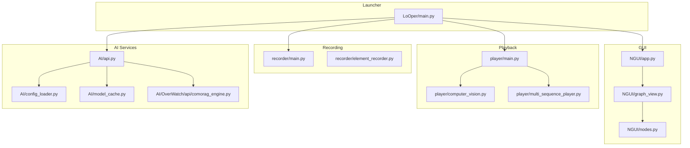
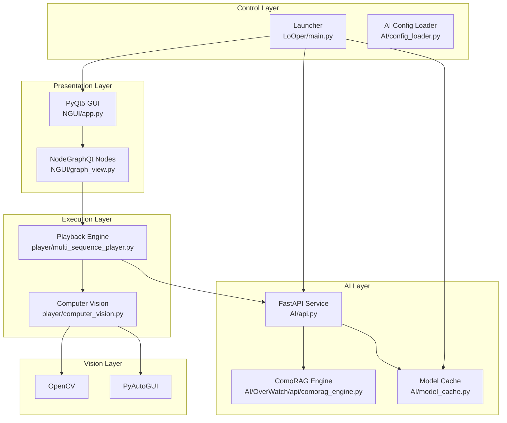
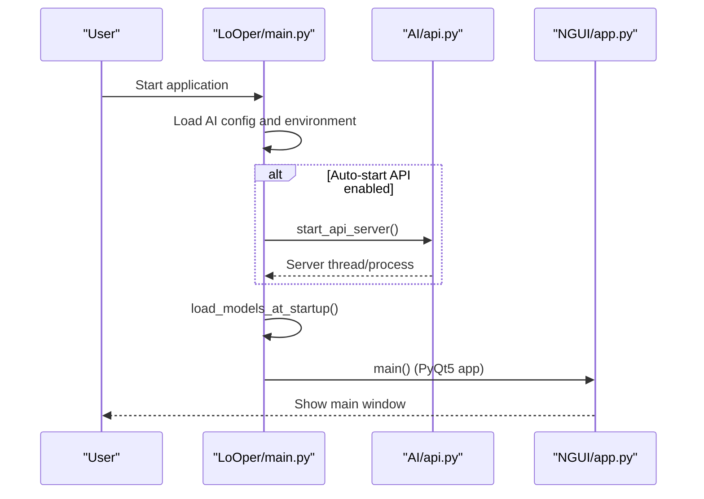
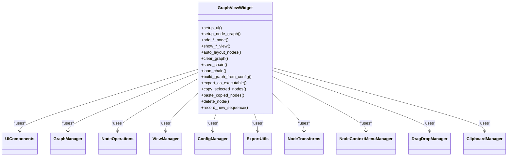
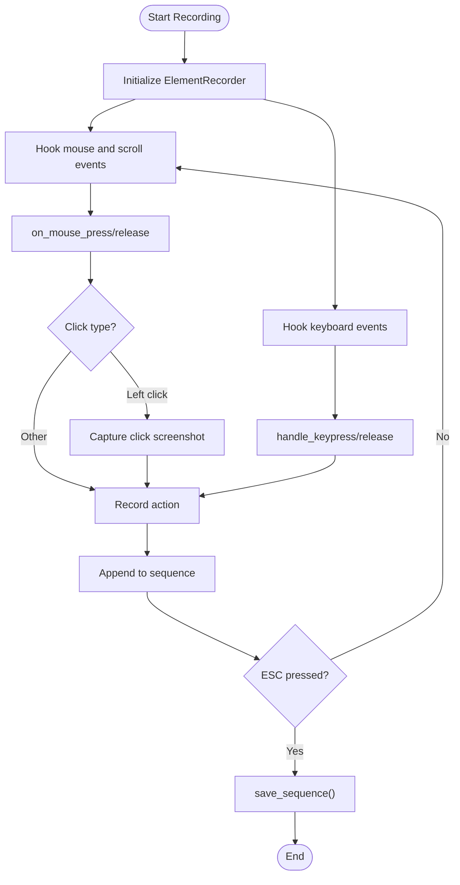
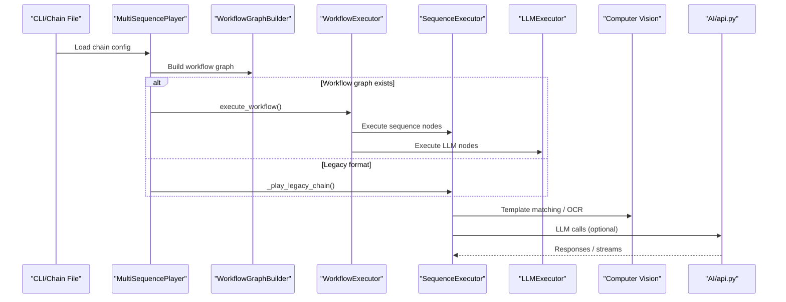
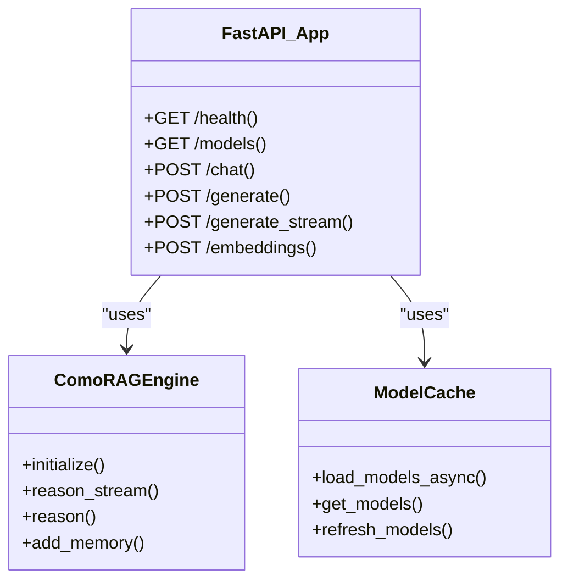
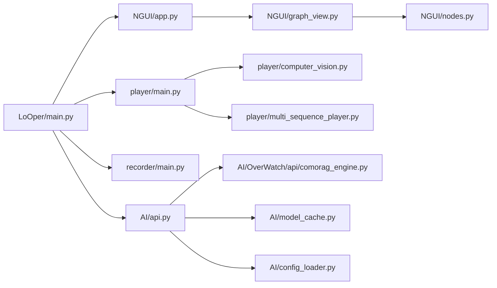

# Architecture Overview

<cite>
**Referenced Files in This Document**
- [LoOper/main.py](file://LoOper/main.py)
- [NGUI/app.py](file://LoOper/NGUI/app.py)
- [NGUI/graph_view.py](file://LoOper/NGUI/graph_view.py)
- [NGUI/nodes.py](file://LoOper/NGUI/nodes.py)
- [recorder/main.py](file://LoOper/recorder/main.py)
- [recorder/element_recorder.py](file://LoOper/recorder/element_recorder.py)
- [player/main.py](file://LoOper/player/main.py)
- [player/computer_vision.py](file://LoOper/player/computer_vision.py)
- [player/multi_sequence_player.py](file://LoOper/player/multi_sequence_player.py)
- [AI/api.py](file://LoOper/AI/api.py)
- [AI/config_loader.py](file://LoOper/AI/config_loader.py)
- [AI/model_cache.py](file://LoOper/AI/model_cache.py)
- [AI/OverWatch/api/comorag_engine.py](file://LoOper/AI/OverWatch/api/comorag_engine.py)
- [requirements.txt](file://requirements.txt)
</cite>

## Table of Contents
1. [Introduction](#introduction)
2. [Project Structure](#project-structure)
3. [Core Components](#core-components)
4. [Architecture Overview](#architecture-overview)
5. [Detailed Component Analysis](#detailed-component-analysis)
6. [Dependency Analysis](#dependency-analysis)
7. [Performance Considerations](#performance-considerations)
8. [Troubleshooting Guide](#troubleshooting-guide)
9. [Conclusion](#conclusion)

## Introduction
This document describes the LoOper V2 system architecture, focusing on the high-level design and modular separation of concerns across the GUI, visual workflow builder, recording system, playback engine, and AI integration layers. The system leverages PyQt5 for the desktop GUI, NodeGraphQt for visual programming, PyAutoGUI and OpenCV for computer vision, and FastAPI for local AI services. It also documents the process architecture that separates the GUI and AI services for stability and scalability.

## Project Structure
LoOper V2 is organized into distinct modules:
- Launcher and process orchestration
- GUI and visual workflow builder
- Recording subsystem
- Playback and automation engine
- AI services and local LLM integration
- Computer vision and OCR

**Diagram sources**
- [LoOper/main.py:1-419](file://LoOper/main.py#L1-L419)
- [NGUI/app.py:1-153](file://LoOper/NGUI/app.py#L1-L153)
- [NGUI/graph_view.py:1-869](file://LoOper/NGUI/graph_view.py#L1-L869)
- [NGUI/nodes.py:1-14](file://LoOper/NGUI/nodes.py#L1-L14)
- [recorder/main.py:1-75](file://LoOper/recorder/main.py#L1-L75)
- [recorder/element_recorder.py:1-155](file://LoOper/recorder/element_recorder.py#L1-L155)
- [player/main.py:1-108](file://LoOper/player/main.py#L1-L108)
- [player/computer_vision.py:1-606](file://LoOper/player/computer_vision.py#L1-L606)
- [player/multi_sequence_player.py:1-532](file://LoOper/player/multi_sequence_player.py#L1-L532)
- [AI/api.py:1-1449](file://LoOper/AI/api.py#L1-L1449)
- [AI/config_loader.py:1-66](file://LoOper/AI/config_loader.py#L1-L66)
- [AI/model_cache.py:1-217](file://LoOper/AI/model_cache.py#L1-L217)
- [AI/OverWatch/api/comorag_engine.py:1-1179](file://LoOper/AI/OverWatch/api/comorag_engine.py#L1-L1179)

**Section sources**
- [LoOper/main.py:1-419](file://LoOper/main.py#L1-L419)
- [NGUI/app.py:1-153](file://LoOper/NGUI/app.py#L1-L153)
- [NGUI/graph_view.py:1-869](file://LoOper/NGUI/graph_view.py#L1-L869)
- [recorder/main.py:1-75](file://LoOper/recorder/main.py#L1-L75)
- [player/main.py:1-108](file://LoOper/player/main.py#L1-L108)
- [AI/api.py:1-1449](file://LoOper/AI/api.py#L1-L1449)

## Core Components
- Launcher and process orchestration
  - Manages GUI lifecycle, AI service startup, and environment configuration.
  - Supports auto-starting the AI API server and preloading models.
- GUI and visual workflow builder
  - PyQt5-based main window with NodeGraphQt integration for drag-and-drop node editing.
  - Modular graph widget coordinating UI, graph management, node operations, and exports.
- Recording subsystem
  - Event-driven recorder capturing mouse, keyboard, scroll, and drag gestures.
  - Produces JSON sequences with associated screenshots for later playback.
- Playback engine
  - Executes single sequences and complex chains with conditional fallbacks.
  - Integrates computer vision for robust visual matching and OCR.
- AI services and local LLM integration
  - FastAPI service exposing chat/generate endpoints backed by Ollama.
  - Provides streaming responses, model management, and optional vision support.
  - Includes a sophisticated RAG engine (ComoRAG) for long-form, stateful reasoning.

**Section sources**
- [LoOper/main.py:355-419](file://LoOper/main.py#L355-L419)
- [NGUI/app.py:11-153](file://LoOper/NGUI/app.py#L11-L153)
- [NGUI/graph_view.py:43-128](file://LoOper/NGUI/graph_view.py#L43-L128)
- [recorder/main.py:7-75](file://LoOper/recorder/main.py#L7-L75)
- [recorder/element_recorder.py:11-155](file://LoOper/recorder/element_recorder.py#L11-L155)
- [player/main.py:18-108](file://LoOper/player/main.py#L18-L108)
- [player/computer_vision.py:47-606](file://LoOper/player/computer_vision.py#L47-L606)
- [player/multi_sequence_player.py:32-135](file://LoOper/player/multi_sequence_player.py#L32-L135)
- [AI/api.py:1-1449](file://LoOper/AI/api.py#L1-L1449)
- [AI/OverWatch/api/comorag_engine.py:233-664](file://LoOper/AI/OverWatch/api/comorag_engine.py#L233-L664)

## Architecture Overview
LoOper V2 follows a modular, layered architecture:
- Presentation layer: PyQt5 GUI with NodeGraphQt for visual workflow authoring.
- Control layer: Launcher and GUI controllers manage processes and UI state.
- Execution layer: Playback engine executes sequences and chains with fallback logic.
- Vision layer: Computer vision and OCR for robust UI interaction.
- AI layer: Local FastAPI service for LLM inference and optional vision processing; optional RAG engine for long-form reasoning.

**Diagram sources**
- [LoOper/main.py:133-381](file://LoOper/main.py#L133-L381)
- [NGUI/app.py:38-153](file://LoOper/NGUI/app.py#L38-L153)
- [NGUI/graph_view.py:94-120](file://LoOper/NGUI/graph_view.py#L94-L120)
- [player/multi_sequence_player.py:104-119](file://LoOper/player/multi_sequence_player.py#L104-L119)
- [player/computer_vision.py:34-44](file://LoOper/player/computer_vision.py#L34-L44)
- [AI/api.py:37-41](file://LoOper/AI/api.py#L37-L41)
- [AI/OverWatch/api/comorag_engine.py:233-286](file://LoOper/AI/OverWatch/api/comorag_engine.py#L233-L286)
- [AI/model_cache.py:15-25](file://LoOper/AI/model_cache.py#L15-L25)
- [AI/config_loader.py:9-66](file://LoOper/AI/config_loader.py#L9-L66)

## Detailed Component Analysis

### Launcher and Process Orchestration
The launcher initializes the environment, optionally starts the AI API server, preloads models, and launches the GUI. It manages process isolation for the AI service and ensures proper shutdown hooks.

**Diagram sources**
- [LoOper/main.py:355-419](file://LoOper/main.py#L355-L419)
- [AI/api.py:171-353](file://LoOper/AI/api.py#L171-L353)
- [NGUI/app.py:11-153](file://LoOper/NGUI/app.py#L11-L153)

**Section sources**
- [LoOper/main.py:133-381](file://LoOper/main.py#L133-L381)
- [AI/config_loader.py:9-66](file://LoOper/AI/config_loader.py#L9-L66)

### GUI and Visual Workflow Builder
The GUI uses PyQt5 with a dark theme and integrates NodeGraphQt for constructing automation chains. The graph widget coordinates UI components, graph management, node operations, view management, configuration, export utilities, transforms, context menus, drag-and-drop, and clipboard operations.

**Diagram sources**
- [NGUI/graph_view.py:43-128](file://LoOper/NGUI/graph_view.py#L43-L128)
- [NGUI/graph_view.py:94-120](file://LoOper/NGUI/graph_view.py#L94-L120)
- [NGUI/nodes.py:1-14](file://LoOper/NGUI/nodes.py#L1-L14)

**Section sources**
- [NGUI/app.py:11-153](file://LoOper/NGUI/app.py#L11-L153)
- [NGUI/graph_view.py:129-622](file://LoOper/NGUI/graph_view.py#L129-L622)

### Recording Subsystem
The recorder captures mouse, keyboard, and scroll events, groups scroll bursts, and records screenshots for click actions. It saves sequences to JSON files for later playback.

**Diagram sources**
- [recorder/main.py:7-75](file://LoOper/recorder/main.py#L7-L75)
- [recorder/element_recorder.py:11-155](file://LoOper/recorder/element_recorder.py#L11-L155)

**Section sources**
- [recorder/main.py:7-75](file://LoOper/recorder/main.py#L7-L75)
- [recorder/element_recorder.py:11-155](file://LoOper/recorder/element_recorder.py#L11-L155)

### Playback Engine and Computer Vision
The playback engine supports both legacy linear chains and modern workflow graphs. It integrates computer vision for robust template matching, OCR, and optional sandboxed environments. It also coordinates with the AI service for LLM-driven actions and can initialize the RAG engine when needed.

**Diagram sources**
- [player/multi_sequence_player.py:32-135](file://LoOper/player/multi_sequence_player.py#L32-L135)
- [player/multi_sequence_player.py:192-358](file://LoOper/player/multi_sequence_player.py#L192-L358)
- [player/computer_vision.py:47-606](file://LoOper/player/computer_vision.py#L47-L606)
- [AI/api.py:547-800](file://LoOper/AI/api.py#L547-L800)

**Section sources**
- [player/main.py:18-108](file://LoOper/player/main.py#L18-L108)
- [player/multi_sequence_player.py:32-135](file://LoOper/player/multi_sequence_player.py#L32-L135)
- [player/computer_vision.py:47-606](file://LoOper/player/computer_vision.py#L47-L606)

### AI Services and RAG Engine
The AI service exposes FastAPI endpoints for chat, generation, embeddings, and health checks. It integrates with Ollama, supports vision-capable models, and can bootstrap required models. The RAG engine (ComoRAG) performs iterative, confidence-guided reasoning with a dynamic memory workspace.

**Diagram sources**
- [AI/api.py:37-800](file://LoOper/AI/api.py#L37-L800)
- [AI/OverWatch/api/comorag_engine.py:233-664](file://LoOper/AI/OverWatch/api/comorag_engine.py#L233-L664)
- [AI/model_cache.py:15-217](file://LoOper/AI/model_cache.py#L15-L217)

**Section sources**
- [AI/api.py:1-1449](file://LoOper/AI/api.py#L1-L1449)
- [AI/OverWatch/api/comorag_engine.py:1-1179](file://LoOper/AI/OverWatch/api/comorag_engine.py#L1-L1179)
- [AI/model_cache.py:15-217](file://LoOper/AI/model_cache.py#L15-L217)

## Dependency Analysis
The system exhibits clear separation of concerns:
- Launcher depends on GUI and AI modules for startup orchestration.
- GUI depends on graph management and node operations modules.
- Playback depends on computer vision and AI services.
- AI services depend on external model providers and optional RAG engines.
- Recording is decoupled from playback and GUI.

**Diagram sources**
- [LoOper/main.py:133-381](file://LoOper/main.py#L133-L381)
- [NGUI/app.py:11-153](file://LoOper/NGUI/app.py#L11-L153)
- [NGUI/graph_view.py:94-120](file://LoOper/NGUI/graph_view.py#L94-L120)
- [player/multi_sequence_player.py:104-119](file://LoOper/player/multi_sequence_player.py#L104-L119)
- [AI/api.py:37-41](file://LoOper/AI/api.py#L37-L41)

**Section sources**
- [LoOper/main.py:133-381](file://LoOper/main.py#L133-L381)
- [NGUI/graph_view.py:94-120](file://LoOper/NGUI/graph_view.py#L94-L120)
- [player/multi_sequence_player.py:104-119](file://LoOper/player/multi_sequence_player.py#L104-L119)
- [AI/api.py:37-41](file://LoOper/AI/api.py#L37-L41)

## Performance Considerations
- Computer vision operations use caching and adaptive multi-scale matching to balance accuracy and speed.
- Model preloading and asynchronous loading reduce UI blocking during startup.
- Streaming responses from the AI service improve responsiveness for long-running generations.
- Process isolation for the AI service prevents UI freezes and enables graceful shutdown.

[No sources needed since this section provides general guidance]

## Troubleshooting Guide
- GUI DPI and theme issues: The GUI sets high-DPI awareness and applies a dark theme stylesheet.
- DLL initialization conflicts: The launcher ensures proper library loading order and environment variables before importing key libraries.
- AI service readiness: The launcher waits for the API to become healthy and initializes the RAG engine if needed.
- Logging and error handling: Components use structured logging and exception handling to surface actionable errors.

**Section sources**
- [NGUI/app.py:14-38](file://LoOper/NGUI/app.py#L14-L38)
- [LoOper/main.py:106-131](file://LoOper/main.py#L106-L131)
- [LoOper/main.py:138-170](file://LoOper/main.py#L138-L170)
- [AI/api.py:581-607](file://LoOper/AI/api.py#L581-L607)

## Conclusion
LoOper V2 delivers a modular desktop automation platform with a clear separation of concerns. The launcher orchestrates GUI and AI services, the GUI provides a visual workflow builder, the recording subsystem captures user interactions, the playback engine executes robust automation with fallbacks, and the AI layer offers local LLM inference and optional RAG capabilities. The architecture emphasizes process isolation, performance, and maintainability to support scalable desktop automation workflows.