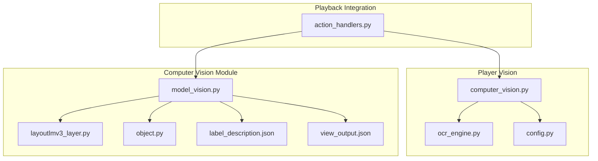
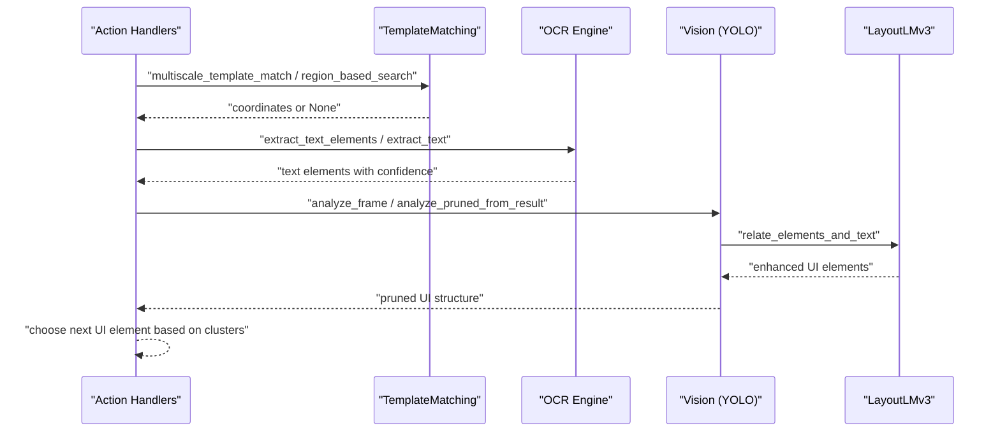
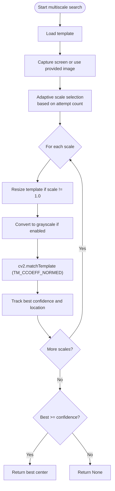
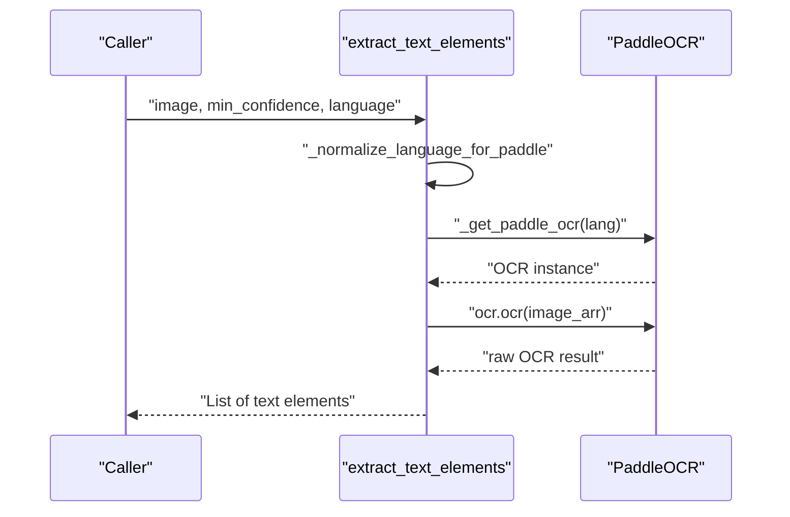
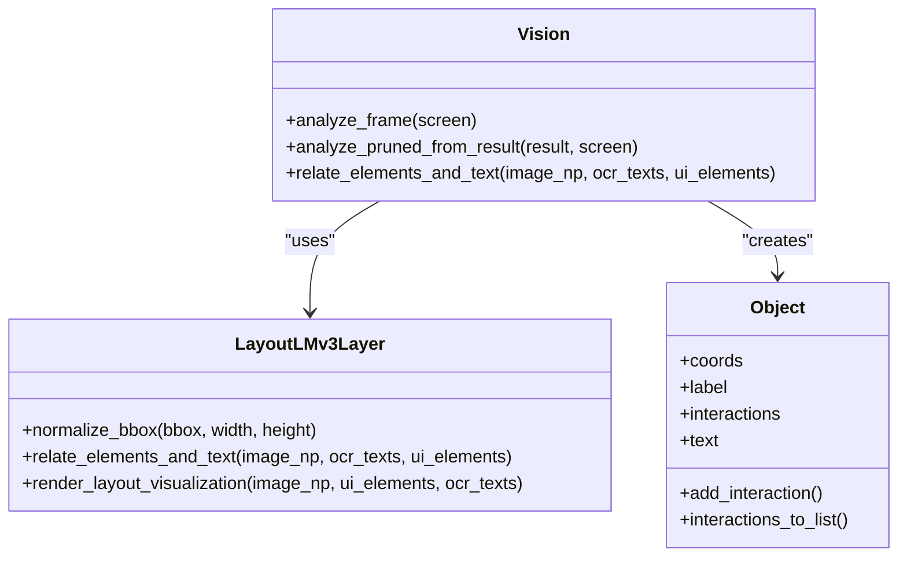
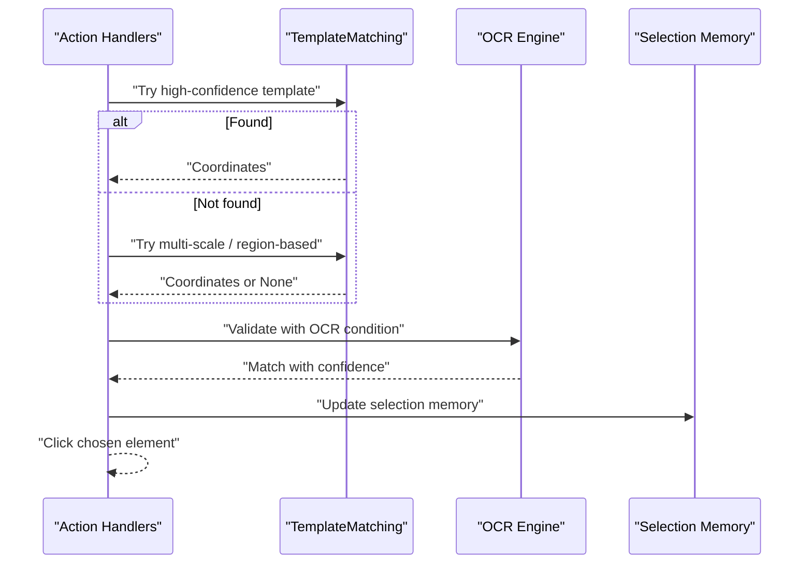
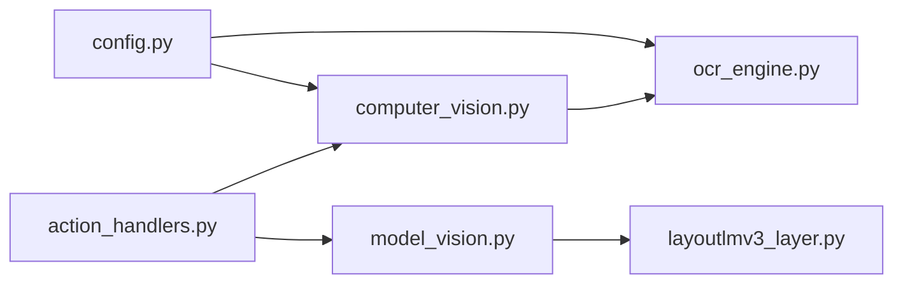

# Computer Vision System

<cite>
**Referenced Files in This Document**
- [computer_vision.py](file://LoOper/player/computer_vision.py)
- [ocr_engine.py](file://LoOper/player/ocr_engine.py)
- [model_vision.py](file://LoOper/player/Computer_vision/model_vision.py)
- [layoutlmv3_layer.py](file://LoOper/player/Computer_vision/layoutlmv3_layer.py)
- [object.py](file://LoOper/player/Computer_vision/object.py)
- [config.py](file://LoOper/player/config.py)
- [action_handlers.py](file://LoOper/player/action_handlers.py)
- [README.md](file://LoOper/player/Computer_vision/README.md)
- [label_description.json](file://LoOper/player/Computer_vision/label_description.json)
- [view_output.json](file://LoOper/player/Computer_vision/view_output.json)
- [test_vision.py](file://LoOper/player/Computer_vision/test_vision.py)
- [test_ocr.py](file://LoOper/player/Computer_vision/test_ocr.py)
</cite>

## Table of Contents
1. [Introduction](#introduction)
2. [Project Structure](#project-structure)
3. [Core Components](#core-components)
4. [Architecture Overview](#architecture-overview)
5. [Detailed Component Analysis](#detailed-component-analysis)
6. [Dependency Analysis](#dependency-analysis)
7. [Performance Considerations](#performance-considerations)
8. [Troubleshooting Guide](#troubleshooting-guide)
9. [Conclusion](#conclusion)
10. [Appendices](#appendices)

## Introduction
This document explains the computer vision system that powers visual recognition and OCR within the automation framework. It covers:
- Template matching with adaptive scaling and confidence thresholds
- Region-based processing and OCR-based conditions
- PaddleOCR integration for text recognition, language support, and model bundling
- ONNX-based inference and LayoutLMv3 integration for structured UI understanding
- Playback engine integration for reliable UI interactions
- Practical examples and troubleshooting guidance

## Project Structure
The vision system spans several modules:
- Player-level vision helpers for template matching and OCR
- Computer vision module with YOLO-based UI element detection, LayoutLMv3, and object modeling
- OCR engine with PaddleOCR integration and model caching
- Configuration and tests for validation

**Diagram sources**
- [computer_vision.py](file://LoOper/player/computer_vision.py)
- [ocr_engine.py](file://LoOper/player/ocr_engine.py)
- [model_vision.py](file://LoOper/player/Computer_vision/model_vision.py)
- [layoutlmv3_layer.py](file://LoOper/player/Computer_vision/layoutlmv3_layer.py)
- [object.py](file://LoOper/player/Computer_vision/object.py)
- [label_description.json](file://LoOper/player/Computer_vision/label_description.json)
- [view_output.json](file://LoOper/player/Computer_vision/view_output.json)
- [action_handlers.py](file://LoOper/player/action_handlers.py)

**Section sources**
- [README.md](file://LoOper/player/Computer_vision/README.md)
- [computer_vision.py](file://LoOper/player/computer_vision.py)
- [ocr_engine.py](file://LoOper/player/ocr_engine.py)
- [model_vision.py](file://LoOper/player/Computer_vision/model_vision.py)
- [layoutlmv3_layer.py](file://LoOper/player/Computer_vision/layoutlmv3_layer.py)
- [object.py](file://LoOper/player/Computer_vision/object.py)
- [label_description.json](file://LoOper/player/Computer_vision/label_description.json)
- [view_output.json](file://LoOper/player/Computer_vision/view_output.json)
- [action_handlers.py](file://LoOper/player/action_handlers.py)

## Core Components
- TemplateMatching: Multi-scale template matching with adaptive scaling, grayscale conversion, and region-based search fallbacks.
- OCR Engine: PaddleOCR integration with language normalization, model caching, and bundled model support for PyInstaller builds.
- Vision (YOLO-based): Object detection pipeline with TTA, NMS averaging, masking, and LayoutLMv3 labeling.
- LayoutLMv3 Layer: Semantic and spatial text-to-element association with visualization.
- Playback Integration: Action handlers orchestrate UI interactions using vision and OCR results.

**Section sources**
- [computer_vision.py](file://LoOper/player/computer_vision.py)
- [ocr_engine.py](file://LoOper/player/ocr_engine.py)
- [model_vision.py](file://LoOper/player/Computer_vision/model_vision.py)
- [layoutlmv3_layer.py](file://LoOper/player/Computer_vision/layoutlmv3_layer.py)
- [action_handlers.py](file://LoOper/player/action_handlers.py)

## Architecture Overview
The system combines template matching for precise icon/button detection, OCR for text-based conditions, and deep learning for structured UI understanding.

**Diagram sources**
- [action_handlers.py](file://LoOper/player/action_handlers.py)
- [computer_vision.py](file://LoOper/player/computer_vision.py)
- [ocr_engine.py](file://LoOper/player/ocr_engine.py)
- [model_vision.py](file://LoOper/player/Computer_vision/model_vision.py)
- [layoutlmv3_layer.py](file://LoOper/player/Computer_vision/layoutlmv3_layer.py)

## Detailed Component Analysis

### Template Matching and Adaptive Scaling
TemplateMatching provides:
- Multi-scale matching with configurable scales and grayscale conversion
- Adaptive scaling strategy that adjusts search sets based on repeated failures
- Region-based search around hints with expandable regions
- Fallback to PyAutoGUI when OpenCV is unavailable

Key behaviors:
- Attempt counters per template drive adaptive scale sets
- Scales prioritized by proximity to 1.0 for speed
- Early evaluation across all scales to select the best match

**Diagram sources**
- [computer_vision.py](file://LoOper/player/computer_vision.py)

**Section sources**
- [computer_vision.py](file://LoOper/player/computer_vision.py)

### OCR Integration with PaddleOCR
OCR Engine integrates PaddleOCR:
- Language normalization for “eng” and “ch”
- Caching of OCR instances via LRU cache
- Bundled model discovery for PyInstaller builds
- Robust result parsing supporting multiple formats

Highlights:
- MKLDNN flags disabled to avoid runtime errors
- Color/BGR normalization and numpy array preparation
- Extraction of text elements with confidence and bounding boxes

**Diagram sources**
- [ocr_engine.py](file://LoOper/player/ocr_engine.py)

**Section sources**
- [ocr_engine.py](file://LoOper/player/ocr_engine.py)
- [config.py](file://LoOper/player/config.py)

### ONNX-Based Inference and LayoutLMv3
The Vision module:
- Loads YOLO models for UI element detection
- Applies Test-Time Augmentation (TTA) and NMS averaging
- Uses masking to improve detection of large UI elements
- Integrates LayoutLMv3 to associate OCR text with UI elements

LayoutLMv3 Layer:
- Normalizes bounding boxes to a fixed coordinate space
- Computes embeddings and spatial heuristics to match OCR text to UI elements
- Renders a unified visualization overlay

**Diagram sources**
- [model_vision.py](file://LoOper/player/Computer_vision/model_vision.py)
- [layoutlmv3_layer.py](file://LoOper/player/Computer_vision/layoutlmv3_layer.py)
- [object.py](file://LoOper/player/Computer_vision/object.py)

**Section sources**
- [model_vision.py](file://LoOper/player/Computer_vision/model_vision.py)
- [layoutlmv3_layer.py](file://LoOper/player/Computer_vision/layoutlmv3_layer.py)
- [object.py](file://LoOper/player/Computer_vision/object.py)
- [label_description.json](file://LoOper/player/Computer_vision/label_description.json)
- [view_output.json](file://LoOper/player/Computer_vision/view_output.json)

### Region-Based Processing and OCR Conditions
Region-based search:
- Expands around a hint coordinate to constrain search space
- Falls back to PyAutoGUI when OpenCV is unavailable
- Supports grayscale matching and pre-captured screen reuse

OCR-based conditions:
- Extracts text elements with confidence thresholds
- Implements balanced matching logic to avoid single-character false positives
- Provides full-text extraction and targeted text detection

**Section sources**
- [computer_vision.py](file://LoOper/player/computer_vision.py)
- [ocr_engine.py](file://LoOper/player/ocr_engine.py)

### Playback Engine Integration
Action handlers orchestrate UI interactions:
- Iterates through a prioritized list of search strategies
- Uses template matching, multi-scale matching, and region-based search
- Applies OCR-based conditions to validate matches
- Manages selection memory to avoid clicking the same element repeatedly

**Diagram sources**
- [action_handlers.py](file://LoOper/player/action_handlers.py)
- [computer_vision.py](file://LoOper/player/computer_vision.py)
- [ocr_engine.py](file://LoOper/player/ocr_engine.py)

**Section sources**
- [action_handlers.py](file://LoOper/player/action_handlers.py)
- [computer_vision.py](file://LoOper/player/computer_vision.py)

## Dependency Analysis
- OpenCV and NumPy are required for template matching and image processing
- PaddleOCR and Paddle are required for OCR
- Ultralytics YOLO is required for UI element detection
- Transformers and Torch are required for LayoutLMv3
- mss and Pillow are used for fast screenshot capture and image handling

**Diagram sources**
- [config.py](file://LoOper/player/config.py)
- [computer_vision.py](file://LoOper/player/computer_vision.py)
- [ocr_engine.py](file://LoOper/player/ocr_engine.py)
- [model_vision.py](file://LoOper/player/Computer_vision/model_vision.py)
- [layoutlmv3_layer.py](file://LoOper/player/Computer_vision/layoutlmv3_layer.py)
- [action_handlers.py](file://LoOper/player/action_handlers.py)

**Section sources**
- [config.py](file://LoOper/player/config.py)
- [computer_vision.py](file://LoOper/player/computer_vision.py)
- [ocr_engine.py](file://LoOper/player/ocr_engine.py)
- [model_vision.py](file://LoOper/player/Computer_vision/model_vision.py)
- [layoutlmv3_layer.py](file://LoOper/player/Computer_vision/layoutlmv3_layer.py)
- [action_handlers.py](file://LoOper/player/action_handlers.py)

## Performance Considerations
- Prefer grayscale template matching when color is not required to reduce computation
- Use multi-scale matching judiciously; start with narrow scale sets and widen only when needed
- Reuse pre-captured screenshots to avoid redundant captures
- Apply region-based search with conservative expand factors to limit search space
- Cache OCR instances and leverage bundled models to minimize cold-start latency
- Use TTA and masking selectively to balance accuracy and speed
- For LayoutLMv3, keep the number of OCR + UI elements manageable to avoid truncation

[No sources needed since this section provides general guidance]

## Troubleshooting Guide
Common issues and resolutions:
- OpenCV not available: Template matching falls back to PyAutoGUI; install opencv-python and numpy for full functionality
- PaddleOCR not available: OCR functions return empty results; install paddleocr and ensure MKLDNN flags are disabled
- Low confidence matches: Increase confidence thresholds or adjust adaptive scales; verify lighting and contrast
- False positives in OCR: Use balanced matching logic and minimum confidence thresholds; consider language normalization
- Large UI elements missed: Enable masking pass and re-run detection with lower confidence thresholds
- LayoutLMv3 truncation: Reduce input length or split processing; ensure bounding boxes are normalized correctly
- DLL/runtime errors: Ensure proper DLL path setup and environment variables for onnxruntime and torch

**Section sources**
- [config.py](file://LoOper/player/config.py)
- [ocr_engine.py](file://LoOper/player/ocr_engine.py)
- [model_vision.py](file://LoOper/player/Computer_vision/model_vision.py)
- [layoutlmv3_layer.py](file://LoOper/player/Computer_vision/layoutlmv3_layer.py)

## Conclusion
The computer vision system combines robust template matching, OCR-based conditions, and deep learning–driven UI understanding to deliver reliable automation. By tuning confidence thresholds, leveraging adaptive scaling, and integrating LayoutLMv3 for contextual labeling, the system improves both accuracy and resilience. Playback integration ensures that UI interactions are deterministic and maintainable.

[No sources needed since this section summarizes without analyzing specific files]

## Appendices

### Practical Examples
- Template matching with adaptive scaling: Use multiscale_template_match with a tight initial scale set and gradually widen if needed
- Region-based search: Provide hint coordinates and expand the region to capture nearby UI elements
- OCR-based conditions: Validate matches using extract_text_elements with a minimum confidence threshold
- Vision pipeline: Run analyze_frame and analyze_pruned_from_result to obtain structured UI elements and OCR associations
- Layout visualization: Render unified overlays to debug OCR-to-element associations

**Section sources**
- [computer_vision.py](file://LoOper/player/computer_vision.py)
- [ocr_engine.py](file://LoOper/player/ocr_engine.py)
- [model_vision.py](file://LoOper/player/Computer_vision/model_vision.py)
- [layoutlmv3_layer.py](file://LoOper/player/Computer_vision/layoutlmv3_layer.py)
- [test_vision.py](file://LoOper/player/Computer_vision/test_vision.py)
- [test_ocr.py](file://LoOper/player/Computer_vision/test_ocr.py)