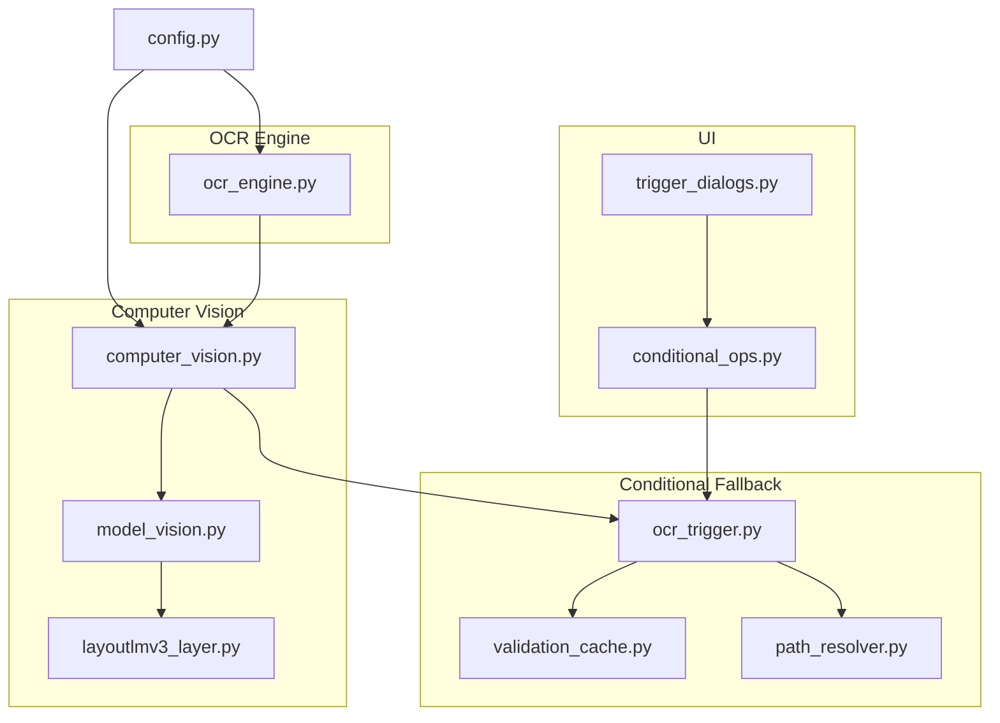
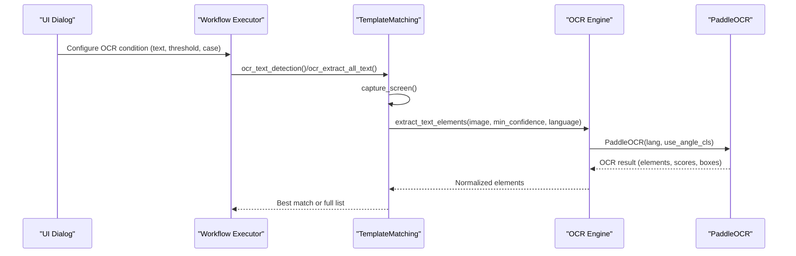
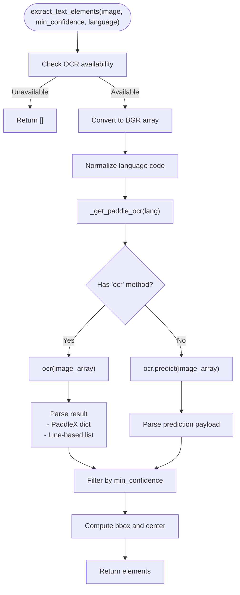
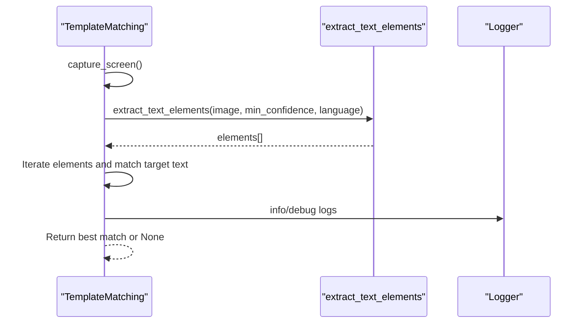
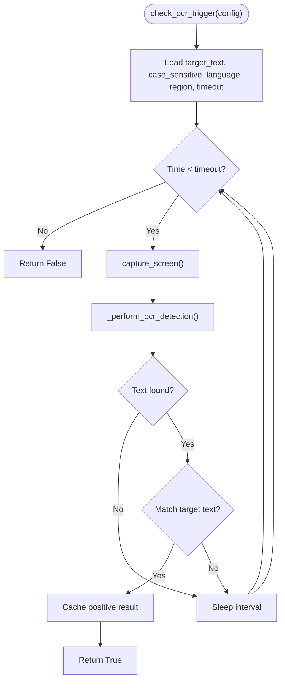
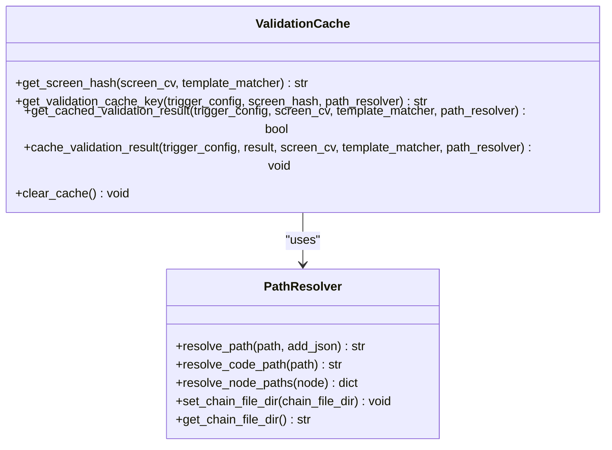
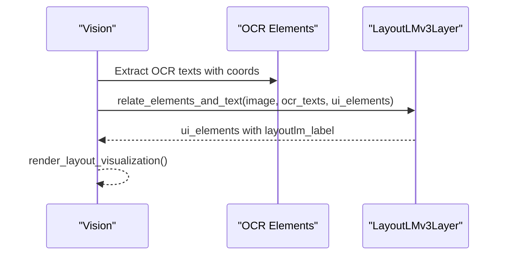
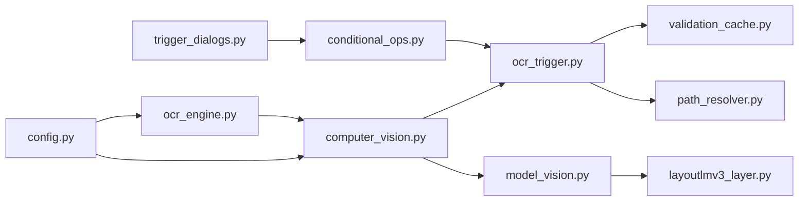

# OCR Integration

<cite>
**Referenced Files in This Document**
- [ocr_engine.py](file://LoOper/player/ocr_engine.py)
- [computer_vision.py](file://LoOper/player/computer_vision.py)
- [config.py](file://LoOper/player/config.py)
- [ocr_trigger.py](file://LoOper/player/multi_sequence/conditional_fallback_resources/ocr_trigger.py)
- [validation_cache.py](file://LoOper/player/multi_sequence/conditional_fallback_resources/validation_cache.py)
- [path_resolver.py](file://LoOper/player/multi_sequence/conditional_fallback_resources/path_resolver.py)
- [model_vision.py](file://LoOper/player/Computer_vision/model_vision.py)
- [layoutlmv3_layer.py](file://LoOper/player/Computer_vision/layoutlmv3_layer.py)
- [test_ocr.py](file://LoOper/player/Computer_vision/test_ocr.py)
- [conditional_ops.py](file://LoOper/player/multi_sequence/worflow_interpreter_modules/executor_modules/conditional_ops.py)
- [trigger_dialogs.py](file://LoOper/NGUI/dialogs/trigger_dialogs.py)
</cite>

## Table of Contents
1. [Introduction](#introduction)
2. [Project Structure](#project-structure)
3. [Core Components](#core-components)
4. [Architecture Overview](#architecture-overview)
5. [Detailed Component Analysis](#detailed-component-analysis)
6. [Dependency Analysis](#dependency-analysis)
7. [Performance Considerations](#performance-considerations)
8. [Troubleshooting Guide](#troubleshooting-guide)
9. [Conclusion](#conclusion)
10. [Appendices](#appendices)

## Introduction
This document explains the OCR integration system used for text recognition and extraction across the automation platform. It focuses on the PaddleOCR engine configuration, text element extraction algorithms, language support mechanisms, and the end-to-end workflows that use OCR for detection, validation, and condition checking. It also covers confidence threshold management, bounding box processing, integration with the computer vision system, stop flag handling for operation cancellation, and performance considerations for real-time text processing.

## Project Structure
The OCR integration spans several modules:
- OCR engine wrapper and utilities
- Computer vision orchestration and OCR-based detection/extraction
- Conditional fallback resources for OCR-triggered workflows
- UI dialog configurations for OCR conditions
- Supporting vision components for layout-aware OCR usage

**Diagram sources**
- [ocr_engine.py:1-367](file://LoOper/player/ocr_engine.py#L1-L367)
- [computer_vision.py:1-606](file://LoOper/player/computer_vision.py#L1-L606)
- [model_vision.py:1-800](file://LoOper/player/Computer_vision/model_vision.py#L1-L800)
- [layoutlmv3_layer.py:1-203](file://LoOper/player/Computer_vision/layoutlmv3_layer.py#L1-L203)
- [ocr_trigger.py:1-266](file://LoOper/player/multi_sequence/conditional_fallback_resources/ocr_trigger.py#L1-L266)
- [validation_cache.py:1-208](file://LoOper/player/multi_sequence/conditional_fallback_resources/validation_cache.py#L1-L208)
- [path_resolver.py:1-198](file://LoOper/player/multi_sequence/conditional_fallback_resources/path_resolver.py#L1-L198)
- [trigger_dialogs.py:781-1221](file://LoOper/NGUI/dialogs/trigger_dialogs.py#L781-L1221)
- [conditional_ops.py:930-956](file://LoOper/player/multi_sequence/worflow_interpreter_modules/executor_modules/conditional_ops.py#L930-L956)

**Section sources**
- [ocr_engine.py:1-367](file://LoOper/player/ocr_engine.py#L1-L367)
- [computer_vision.py:1-606](file://LoOper/player/computer_vision.py#L1-L606)
- [ocr_trigger.py:1-266](file://LoOper/player/multi_sequence/conditional_fallback_resources/ocr_trigger.py#L1-L266)
- [config.py:1-46](file://LoOper/player/config.py#L1-L46)

## Core Components
- OCR engine wrapper: Provides PaddleOCR initialization, language normalization, image preprocessing, and extraction APIs for both raw text and structured text elements.
- Computer vision orchestrator: Integrates OCR into detection and extraction workflows, supports stop flag handling, and normalizes results for downstream consumers.
- Conditional fallback OCR trigger: Implements OCR-based presence/absence checks with configurable thresholds, case sensitivity, and optional region cropping.
- Validation cache: Manages cached validation results with TTL and screen-hash awareness to optimize repeated checks.
- Path resolver: Resolves file paths for OCR-related assets and sequences.
- UI and workflow integration: Exposes OCR condition parameters via dialogs and interprets them in workflow executors.

Key responsibilities:
- PaddleOCR engine configuration and model bundling for frozen builds
- Confidence threshold management and bounding box processing
- Stop flag propagation to cancel long-running OCR operations
- Multi-language support via language normalization
- Structured text element extraction with polygonal geometry and center calculation

**Section sources**
- [ocr_engine.py:131-345](file://LoOper/player/ocr_engine.py#L131-L345)
- [computer_vision.py:452-605](file://LoOper/player/computer_vision.py#L452-L605)
- [ocr_trigger.py:29-160](file://LoOper/player/multi_sequence/conditional_fallback_resources/ocr_trigger.py#L29-L160)
- [validation_cache.py:94-201](file://LoOper/player/multi_sequence/conditional_fallback_resources/validation_cache.py#L94-L201)
- [path_resolver.py:22-198](file://LoOper/player/multi_sequence/conditional_fallback_resources/path_resolver.py#L22-L198)

## Architecture Overview
The OCR pipeline integrates tightly with the computer vision subsystem. At runtime:
- The system captures a screen image (via mss or pyautogui).
- OCR extracts text elements with confidence scores and bounding polygons.
- Detection and extraction functions filter by confidence and optionally crop regions.
- Conditional triggers use OCR results to satisfy presence/absence conditions.
- Layout-aware components can refine OCR-label associations using contextual embeddings.

**Diagram sources**
- [computer_vision.py:452-605](file://LoOper/player/computer_vision.py#L452-L605)
- [ocr_engine.py:131-240](file://LoOper/player/ocr_engine.py#L131-L240)

## Detailed Component Analysis

### OCR Engine Wrapper
The OCR engine wrapper encapsulates PaddleOCR initialization, language normalization, and extraction utilities. It supports:
- PaddleOCR initialization with bundled model directories in frozen environments
- Image preprocessing to BGR arrays and grayscale conversion
- Extraction of structured text elements with confidence, polygonal boxes, and centers
- Extraction of concatenated text from elements

Implementation highlights:
- Language normalization maps common aliases to PaddleOCR codes
- Caching of PaddleOCR instances to reduce initialization overhead
- Robust result parsing for both PaddleOCR and PaddleX formats
- Confidence filtering and bounding box computation

**Diagram sources**
- [ocr_engine.py:131-345](file://LoOper/player/ocr_engine.py#L131-L345)

**Section sources**
- [ocr_engine.py:21-27](file://LoOper/player/ocr_engine.py#L21-L27)
- [ocr_engine.py:30-103](file://LoOper/player/ocr_engine.py#L30-L103)
- [ocr_engine.py:131-240](file://LoOper/player/ocr_engine.py#L131-L240)
- [ocr_engine.py:348-367](file://LoOper/player/ocr_engine.py#L348-L367)

### Computer Vision OCR Integration
The computer vision module exposes two primary OCR workflows:
- Text detection for a specific target: returns the best match with confidence and bounding box
- Full-screen text extraction: returns all detected text elements above a threshold

Both functions:
- Respect a stop flag to abort long-running operations
- Capture the screen image when not provided
- Normalize and filter OCR results
- Support case-sensitive matching

**Diagram sources**
- [computer_vision.py:452-549](file://LoOper/player/computer_vision.py#L452-L549)
- [computer_vision.py:551-605](file://LoOper/player/computer_vision.py#L551-L605)

**Section sources**
- [computer_vision.py:452-549](file://LoOper/player/computer_vision.py#L452-L549)
- [computer_vision.py:551-605](file://LoOper/player/computer_vision.py#L551-L605)

### Conditional Fallback OCR Trigger
The OCR trigger module implements OCR-based conditional checks:
- Periodic polling with stop flag support
- Optional region cropping and grayscale preprocessing
- Immediate and timed checks
- Validation caching (currently bypassed in code comments)

**Diagram sources**
- [ocr_trigger.py:29-110](file://LoOper/player/multi_sequence/conditional_fallback_resources/ocr_trigger.py#L29-L110)
- [ocr_trigger.py:112-159](file://LoOper/player/multi_sequence/conditional_fallback_resources/ocr_trigger.py#L112-L159)

**Section sources**
- [ocr_trigger.py:29-110](file://LoOper/player/multi_sequence/conditional_fallback_resources/ocr_trigger.py#L29-L110)
- [ocr_trigger.py:112-159](file://LoOper/player/multi_sequence/conditional_fallback_resources/ocr_trigger.py#L112-L159)

### Validation Cache and Path Resolver
- Validation cache generates screen hashes and keys to ensure cache validity per screen state and TTL.
- Path resolver resolves relative/absolute paths for images and sequences, supporting JSON variants and common subdirectories.

**Diagram sources**
- [validation_cache.py:12-201](file://LoOper/player/multi_sequence/conditional_fallback_resources/validation_cache.py#L12-L201)
- [path_resolver.py:10-198](file://LoOper/player/multi_sequence/conditional_fallback_resources/path_resolver.py#L10-L198)

**Section sources**
- [validation_cache.py:12-201](file://LoOper/player/multi_sequence/conditional_fallback_resources/validation_cache.py#L12-L201)
- [path_resolver.py:10-198](file://LoOper/player/multi_sequence/conditional_fallback_resources/path_resolver.py#L10-L198)

### Layout-Aware OCR Association
The vision system integrates OCR with LayoutLMv3 to associate UI elements with nearby text labels, improving reliability for form-filling and labeling tasks.

**Diagram sources**
- [model_vision.py:310-637](file://LoOper/player/Computer_vision/model_vision.py#L310-L637)
- [layoutlmv3_layer.py:29-136](file://LoOper/player/Computer_vision/layoutlmv3_layer.py#L29-L136)

**Section sources**
- [model_vision.py:310-637](file://LoOper/player/Computer_vision/model_vision.py#L310-L637)
- [layoutlmv3_layer.py:29-136](file://LoOper/player/Computer_vision/layoutlmv3_layer.py#L29-L136)

## Dependency Analysis
- OCR availability and engine selection are controlled by configuration.
- The OCR engine depends on PaddleOCR and handles model bundling for frozen builds.
- Computer vision functions depend on the OCR engine and OpenCV/pyautogui for screen capture.
- Conditional triggers depend on computer vision and validation cache.
- UI dialogs configure OCR conditions and pass them to workflow executors.

**Diagram sources**
- [config.py:21-30](file://LoOper/player/config.py#L21-L30)
- [ocr_engine.py:1-10](file://LoOper/player/ocr_engine.py#L1-L10)
- [computer_vision.py:11-12](file://LoOper/player/computer_vision.py#L11-L12)
- [ocr_trigger.py:7-8](file://LoOper/player/multi_sequence/conditional_fallback_resources/ocr_trigger.py#L7-L8)
- [trigger_dialogs.py:781-811](file://LoOper/NGUI/dialogs/trigger_dialogs.py#L781-L811)
- [conditional_ops.py:930-956](file://LoOper/player/multi_sequence/worflow_interpreter_modules/executor_modules/conditional_ops.py#L930-L956)

**Section sources**
- [config.py:21-30](file://LoOper/player/config.py#L21-L30)
- [ocr_engine.py:1-10](file://LoOper/player/ocr_engine.py#L1-L10)
- [computer_vision.py:11-12](file://LoOper/player/computer_vision.py#L11-L12)
- [ocr_trigger.py:7-8](file://LoOper/player/multi_sequence/conditional_fallback_resources/ocr_trigger.py#L7-L8)
- [trigger_dialogs.py:781-811](file://LoOper/NGUI/dialogs/trigger_dialogs.py#L781-L811)
- [conditional_ops.py:930-956](file://LoOper/player/multi_sequence/worflow_interpreter_modules/executor_modules/conditional_ops.py#L930-L956)

## Performance Considerations
- PaddleOCR initialization is cached to avoid repeated overhead.
- MKLDNN is disabled to prevent OneDnnContext errors and improve stability.
- Screen capture uses mss when available; otherwise falls back to pyautogui.
- Confidence thresholds filter out low-quality detections early.
- Stop flags allow cancellation of long-running OCR operations.
- Region-based OCR reduces computational load by limiting the search area.
- LayoutLMv3 association adds accuracy at the cost of extra inference time.

[No sources needed since this section provides general guidance]

## Troubleshooting Guide
Common issues and remedies:
- OCR not available: Verify PaddleOCR installation and environment variables; check configuration flags.
- Initialization failures: Ensure MKLDNN is disabled and bundled models are accessible in frozen builds.
- Low detection quality: Adjust confidence thresholds, crop to regions, or preprocess images to grayscale/high contrast.
- Slow performance: Use stop flags for cancellation, limit regions, and leverage caching where appropriate.
- Accuracy problems: Enable case-sensitive matching when needed, and consider LayoutLMv3 association for contextual labeling.

**Section sources**
- [config.py:21-30](file://LoOper/player/config.py#L21-L30)
- [ocr_engine.py:30-103](file://LoOper/player/ocr_engine.py#L30-L103)
- [computer_vision.py:452-605](file://LoOper/player/computer_vision.py#L452-L605)
- [ocr_trigger.py:112-159](file://LoOper/player/multi_sequence/conditional_fallback_resources/ocr_trigger.py#L112-L159)

## Conclusion
The OCR integration system provides robust text detection and extraction capabilities integrated with the broader computer vision and workflow automation framework. It supports configurable confidence thresholds, bounding box processing, stop flag handling, and multi-language text recognition. Through conditional triggers, UI dialogs, and layout-aware association, it enables reliable automation workflows that respond to textual cues in real-world applications.

[No sources needed since this section summarizes without analyzing specific files]

## Appendices

### Practical Examples and Workflows
- OCR text detection for a specific pattern:
  - Use the detection function with a target text and confidence threshold; case sensitivity can be toggled.
  - Stop flag allows cancellation during long waits or repeated checks.
  - Example reference: [computer_vision.py:452-549](file://LoOper/player/computer_vision.py#L452-L549)

- All-text extraction for comprehensive screen analysis:
  - Capture the screen and extract all text elements above a given confidence.
  - Use stop flag to abort if needed.
  - Example reference: [computer_vision.py:551-605](file://LoOper/player/computer_vision.py#L551-L605)

- OCR-triggered conditional checks:
  - Configure OCR conditions in UI dialogs and pass parameters to workflow executors.
  - Example references:
    - [trigger_dialogs.py:781-811](file://LoOper/NGUI/dialogs/trigger_dialogs.py#L781-L811)
    - [conditional_ops.py:930-956](file://LoOper/player/multi_sequence/worflow_interpreter_modules/executor_modules/conditional_ops.py#L930-L956)
    - [ocr_trigger.py:29-110](file://LoOper/player/multi_sequence/conditional_fallback_resources/ocr_trigger.py#L29-L110)

- Layout-aware OCR association:
  - Associate UI elements with nearby OCR text labels using LayoutLMv3 embeddings.
  - Example reference: [layoutlmv3_layer.py:29-136](file://LoOper/player/Computer_vision/layoutlmv3_layer.py#L29-L136)

### Language Support and Confidence Management
- Language normalization maps common aliases to PaddleOCR codes.
- Confidence thresholds filter low-quality detections; bounding boxes are computed from polygonal geometry.
- Example references:
  - [ocr_engine.py:21-27](file://LoOper/player/ocr_engine.py#L21-L27)
  - [ocr_engine.py:131-240](file://LoOper/player/ocr_engine.py#L131-L240)

### Stop Flag Handling
- Stop flags are checked before capturing the screen, during OCR processing, and after results are computed.
- Example reference: [computer_vision.py:472-497](file://LoOper/player/computer_vision.py#L472-L497)

### Testing OCR
- A dedicated test script demonstrates extracting text elements from an image path and simple text extraction.
- Example reference: [test_ocr.py:34-61](file://LoOper/player/Computer_vision/test_ocr.py#L34-L61)