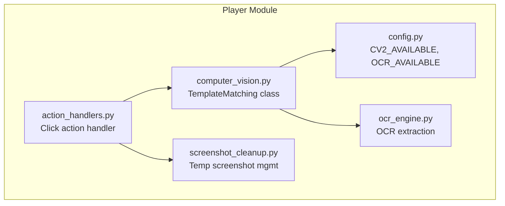
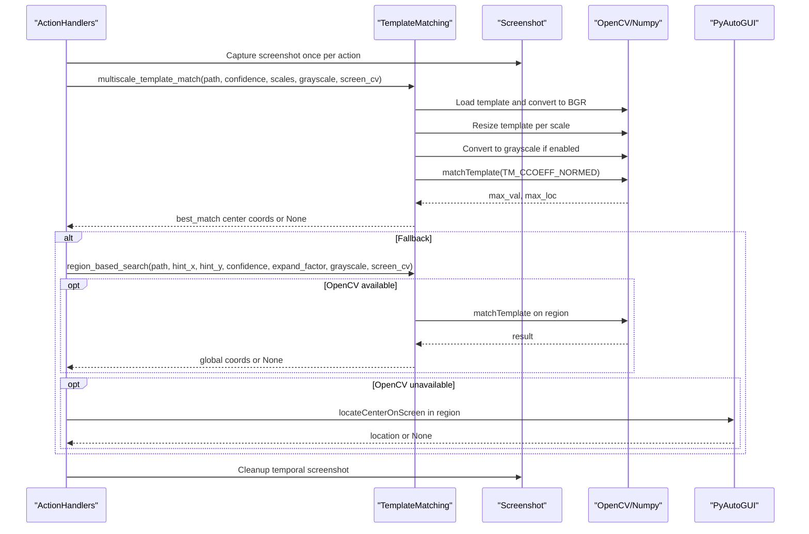
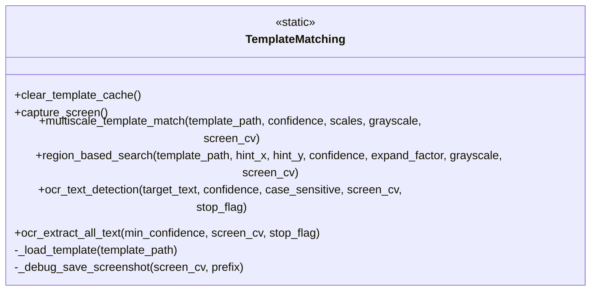
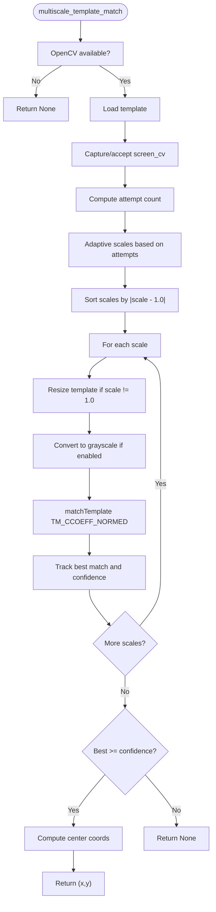
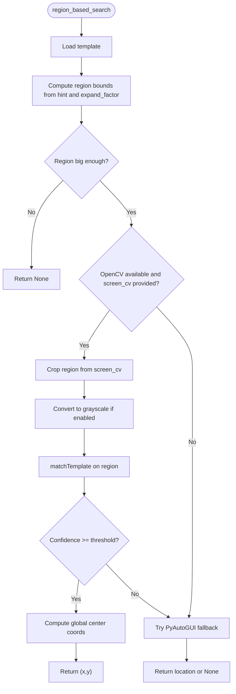
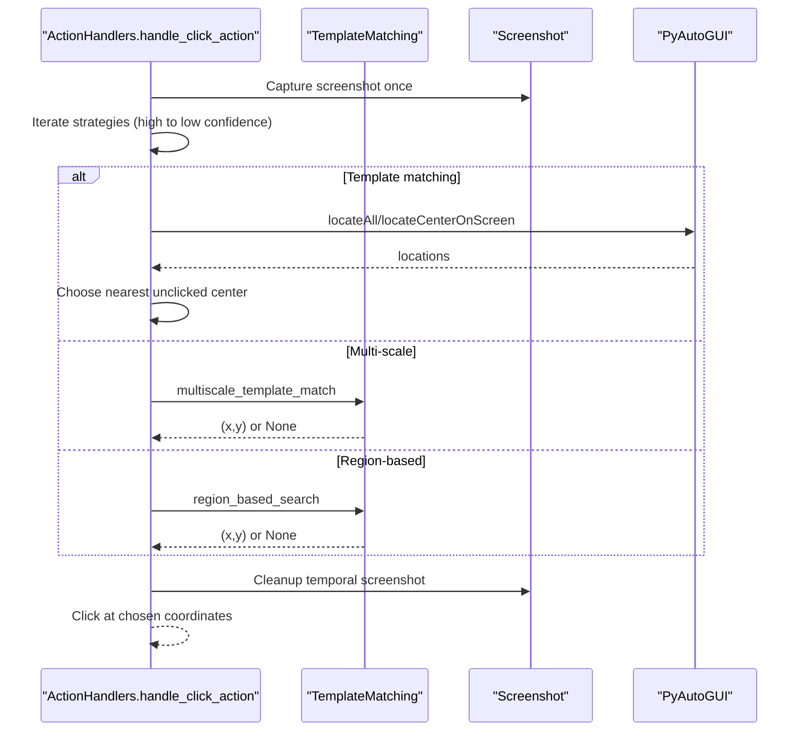
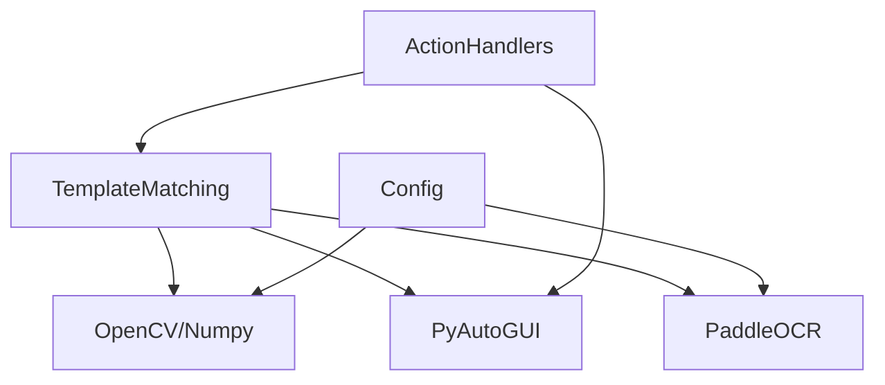

# Template Matching

<cite>
**Referenced Files in This Document**
- [computer_vision.py](file://LoOper/player/computer_vision.py)
- [action_handlers.py](file://LoOper/player/action_handlers.py)
- [config.py](file://LoOper/player/config.py)
- [ocr_engine.py](file://LoOper/player/ocr_engine.py)
- [screenshot_cleanup.py](file://LoOper/player/screenshot_cleanup.py)
- [README.MD](file://LoOper/README.MD)
- [requirements.txt](file://requirements.txt)
</cite>

## Table of Contents
1. [Introduction](#introduction)
2. [Project Structure](#project-structure)
3. [Core Components](#core-components)
4. [Architecture Overview](#architecture-overview)
5. [Detailed Component Analysis](#detailed-component-analysis)
6. [Dependency Analysis](#dependency-analysis)
7. [Performance Considerations](#performance-considerations)
8. [Troubleshooting Guide](#troubleshooting-guide)
9. [Conclusion](#conclusion)
10. [Appendices](#appendices)

## Introduction
This document explains the template matching system used for computer vision operations in UI recognition. It focuses on the TemplateMatching class, covering multi-scale template matching algorithms, adaptive scaling strategies, confidence threshold management, template loading and caching, grayscale processing, region-based search, fallback mechanisms when OpenCV is unavailable, and performance optimization techniques. Practical examples demonstrate how template matching is used for UI element detection, coordinate calculation, and adaptive retry logic in workflow execution contexts.

## Project Structure
The template matching system resides in the Player module and integrates with action handlers, configuration, OCR, and screenshot management utilities.

**Diagram sources**
- [computer_vision.py:47-606](file://LoOper/player/computer_vision.py#L47-L606)
- [action_handlers.py:26-604](file://LoOper/player/action_handlers.py#L26-L604)
- [config.py:11-31](file://LoOper/player/config.py#L11-L31)
- [ocr_engine.py:131-345](file://LoOper/player/ocr_engine.py#L131-L345)
- [screenshot_cleanup.py:6-125](file://LoOper/player/screenshot_cleanup.py#L6-L125)

**Section sources**
- [README.MD:275-287](file://LoOper/README.MD#L275-L287)
- [requirements.txt:90-92](file://requirements.txt#L90-L92)

## Core Components
- TemplateMatching: Central class providing multi-scale template matching, region-based search, grayscale conversion, adaptive scaling, and screenshot capture.
- ActionHandlers: Orchestrates click actions using template matching with progressive fallback strategies and adaptive retry logic.
- Configuration: Detects availability of OpenCV and OCR and sets flags accordingly.
- OCR Engine: Provides OCR text detection and extraction for complementary UI recognition.
- Screenshot Cleanup: Manages temporary screenshots for debugging and cleanup.

**Section sources**
- [computer_vision.py:47-606](file://LoOper/player/computer_vision.py#L47-L606)
- [action_handlers.py:26-604](file://LoOper/player/action_handlers.py#L26-L604)
- [config.py:11-31](file://LoOper/player/config.py#L11-L31)
- [ocr_engine.py:131-345](file://LoOper/player/ocr_engine.py#L131-L345)
- [screenshot_cleanup.py:6-125](file://LoOper/player/screenshot_cleanup.py#L6-L125)

## Architecture Overview
The template matching pipeline integrates with action execution to locate UI elements reliably across varying UI scales and template qualities. It prioritizes speed and accuracy through adaptive strategies and fallbacks.

**Diagram sources**
- [action_handlers.py:133-604](file://LoOper/player/action_handlers.py#L133-L604)
- [computer_vision.py:198-450](file://LoOper/player/computer_vision.py#L198-L450)

## Detailed Component Analysis

### TemplateMatching Class
The TemplateMatching class encapsulates:
- Template loading and grayscale conversion
- Multi-scale matching with configurable scale factors
- Adaptive scaling based on repeated attempts
- Region-based search around hints
- Screenshot capture with fallbacks
- Debugging capability to save screenshots

Key methods and behaviors:
- _load_template: Loads templates from disk; currently bypasses cache to always read from disk.
- capture_screen: Fast screenshot capture using mss when available, with fallback to PyAutoGUI and sandbox agent support.
- _debug_save_screenshot: Saves debug screenshots for troubleshooting.
- multiscale_template_match: Performs multi-scale matching with adaptive strategy and returns center coordinates when confidence threshold is met.
- region_based_search: Searches within an expanded region around a hint coordinate, with OpenCV or PyAutoGUI fallback.
- ocr_text_detection and ocr_extract_all_text: OCR-based text detection and extraction.

**Diagram sources**
- [computer_vision.py:47-606](file://LoOper/player/computer_vision.py#L47-L606)

**Section sources**
- [computer_vision.py:56-84](file://LoOper/player/computer_vision.py#L56-L84)
- [computer_vision.py:92-177](file://LoOper/player/computer_vision.py#L92-L177)
- [computer_vision.py:179-193](file://LoOper/player/computer_vision.py#L179-L193)
- [computer_vision.py:198-331](file://LoOper/player/computer_vision.py#L198-L331)
- [computer_vision.py:333-450](file://LoOper/player/computer_vision.py#L333-L450)
- [computer_vision.py:452-606](file://LoOper/player/computer_vision.py#L452-L606)

### Multi-Scale Template Matching
- Adaptive scaling strategy:
  - First 1–3 attempts: use only 1.0 scale for speed.
  - Next 4–6 attempts: use reduced scales [1.0, 0.9, 1.1].
  - Beyond 6 attempts: use full provided scales.
- Sorting scales by proximity to 1.0 prioritizes the original size for speed.
- Grayscale conversion is optional and performed before matching.
- Confidence threshold determines whether a match is accepted; the method returns the best match across all scales.

**Diagram sources**
- [computer_vision.py:198-331](file://LoOper/player/computer_vision.py#L198-L331)

**Section sources**
- [computer_vision.py:238-273](file://LoOper/player/computer_vision.py#L238-L273)
- [computer_vision.py:282-331](file://LoOper/player/computer_vision.py#L282-L331)

### Region-Based Search
- Uses a hint coordinate (original click position) and expands the search region by a factor proportional to template dimensions.
- Validates region size against template dimensions to avoid invalid searches.
- Performs matching either with OpenCV on a cropped region or falls back to PyAutoGUI’s locateCenterOnScreen.
- Converts local coordinates to global coordinates when OpenCV is used.

**Diagram sources**
- [computer_vision.py:333-450](file://LoOper/player/computer_vision.py#L333-L450)

**Section sources**
- [computer_vision.py:377-446](file://LoOper/player/computer_vision.py#L377-L446)

### Action Execution Integration
The ActionHandlers orchestrates click actions using template matching with:
- Single-shot screenshot capture for all strategies to reduce overhead.
- A prioritized list of strategies: high-confidence grayscale template matching, multi-scale matching, region-based search, and progressively lower confidence fallbacks.
- Adaptive retry logic with configurable attempts and delays.
- Temporal screenshot registration and cleanup for debugging.

**Diagram sources**
- [action_handlers.py:133-604](file://LoOper/player/action_handlers.py#L133-L604)
- [computer_vision.py:198-450](file://LoOper/player/computer_vision.py#L198-L450)

**Section sources**
- [action_handlers.py:193-251](file://LoOper/player/action_handlers.py#L193-L251)
- [action_handlers.py:253-498](file://LoOper/player/action_handlers.py#L253-L498)
- [action_handlers.py:508-511](file://LoOper/player/action_handlers.py#L508-L511)

### Fallback Mechanisms and OpenCV Availability
- If OpenCV is unavailable, multiscale_template_match returns None and the system falls back to PyAutoGUI-based strategies.
- Region-based search also falls back to PyAutoGUI when OpenCV is not available.
- Configuration detects OpenCV and OCR availability and sets flags accordingly.

**Section sources**
- [computer_vision.py:213-215](file://LoOper/player/computer_vision.py#L213-L215)
- [computer_vision.py:350-376](file://LoOper/player/computer_vision.py#L350-L376)
- [config.py:11-31](file://LoOper/player/config.py#L11-L31)

### Template Loading and Caching
- Template loading reads from disk and converts to BGR for OpenCV compatibility.
- The cache mechanism is present but intentionally disabled to always read from disk, reducing stale cache risks when templates change frequently.

**Section sources**
- [computer_vision.py:56-84](file://LoOper/player/computer_vision.py#L56-L84)

### Grayscale Processing
- Grayscale conversion is optional and performed on both template and screen region before matching to improve robustness under varying lighting conditions.

**Section sources**
- [computer_vision.py:294-302](file://LoOper/player/computer_vision.py#L294-L302)
- [computer_vision.py:409-413](file://LoOper/player/computer_vision.py#L409-L413)

### Confidence Threshold Management
- Confidence thresholds vary across strategies, starting from high (0.85) and decreasing progressively.
- The system tracks the best match across all scales and only accepts if it meets the threshold.

**Section sources**
- [action_handlers.py:231-250](file://LoOper/player/action_handlers.py#L231-L250)
- [computer_vision.py:310-331](file://LoOper/player/computer_vision.py#L310-L331)

### Performance Optimization Techniques
- Single screenshot capture per action reduces repeated I/O and CPU usage.
- Shared screen_cv across strategies avoids redundant captures.
- Adaptive scaling prioritizes 1.0 scale for speed and expands scale sets only when needed.
- Region-based search constrains search area to template size multiplied by expand_factor.
- mss-based screenshot capture is used when available for speed.

**Section sources**
- [action_handlers.py:193-218](file://LoOper/player/action_handlers.py#L193-L218)
- [computer_vision.py:92-177](file://LoOper/player/computer_vision.py#L92-L177)
- [computer_vision.py:272-273](file://LoOper/player/computer_vision.py#L272-L273)
- [computer_vision.py:379-394](file://LoOper/player/computer_vision.py#L379-L394)

### Practical Examples
- UI element detection: Use multiscale_template_match with grayscale=True and a moderate confidence threshold to detect UI elements across varying UI scales.
- Coordinate calculation: The method returns center coordinates; region_based_search converts local coordinates to global ones when using OpenCV.
- Adaptive retry logic: The action handler retries with different strategies and confidence levels, capturing a single screenshot for all attempts.

**Section sources**
- [action_handlers.py:231-250](file://LoOper/player/action_handlers.py#L231-L250)
- [action_handlers.py:457-477](file://LoOper/player/action_handlers.py#L457-L477)
- [computer_vision.py:314-328](file://LoOper/player/computer_vision.py#L314-L328)

## Dependency Analysis
- OpenCV and NumPy are required for template matching; availability is checked at runtime.
- PyAutoGUI is used as a fallback for locating UI elements when OpenCV is unavailable.
- PaddleOCR is used for OCR-based text detection and extraction; availability is checked at runtime.

**Diagram sources**
- [config.py:11-31](file://LoOper/player/config.py#L11-L31)
- [requirements.txt:90-92](file://requirements.txt#L90-L92)

**Section sources**
- [config.py:11-31](file://LoOper/player/config.py#L11-L31)
- [requirements.txt:90-92](file://requirements.txt#L90-L92)

## Performance Considerations
- Prefer grayscale matching for faster processing when color is not essential.
- Use region-based search to limit search area and reduce computation.
- Keep confidence thresholds balanced to minimize false positives while maintaining reliability.
- Reuse a single screenshot across multiple strategies to avoid repeated captures.

[No sources needed since this section provides general guidance]

## Troubleshooting Guide
- OpenCV not available: The system prints a warning and disables multi-scale template matching; fallback strategies rely on PyAutoGUI.
- Template loading failures: The system logs failures and returns None; verify template paths and image formats.
- Debug screenshots: Use the built-in debug screenshot saving to inspect images being evaluated.
- Screenshot cleanup: Use the cleanup utility to remove temporary screenshots and manage storage.

**Section sources**
- [config.py:16-19](file://LoOper/player/config.py#L16-L19)
- [computer_vision.py:80-82](file://LoOper/player/computer_vision.py#L80-L82)
- [computer_vision.py:179-193](file://LoOper/player/computer_vision.py#L179-L193)
- [screenshot_cleanup.py:16-47](file://LoOper/player/screenshot_cleanup.py#L16-L47)

## Conclusion
The template matching system provides robust, adaptive, and efficient UI recognition through multi-scale matching, region-based search, and fallback mechanisms. Its integration with action handlers ensures reliable click automation across varying UI scales and template qualities, while performance optimizations and debugging capabilities support both development and production usage.

[No sources needed since this section summarizes without analyzing specific files]

## Appendices

### Configuration Options
- OpenCV availability: Detected at startup; if unavailable, multi-scale matching is disabled.
- OCR availability: Detected at startup; OCR-based text detection is disabled if not available.
- Template cache: Present but intentionally disabled to always read from disk.

**Section sources**
- [config.py:11-31](file://LoOper/player/config.py#L11-L31)
- [computer_vision.py:52-54](file://LoOper/player/computer_vision.py#L52-L54)

### Example Usage Patterns
- High-confidence grayscale template matching for stable UI elements.
- Multi-scale matching with fine-grained scales for variable UI sizes.
- Region-based search with expand factors tailored to expected UI changes.
- Progressive fallbacks with decreasing confidence thresholds.

**Section sources**
- [action_handlers.py:231-250](file://LoOper/player/action_handlers.py#L231-L250)
- [action_handlers.py:457-477](file://LoOper/player/action_handlers.py#L457-L477)