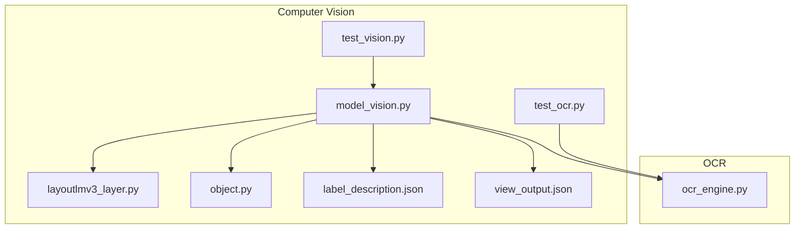
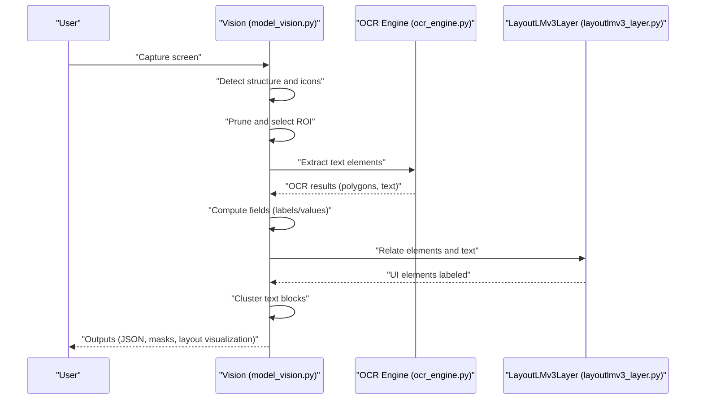
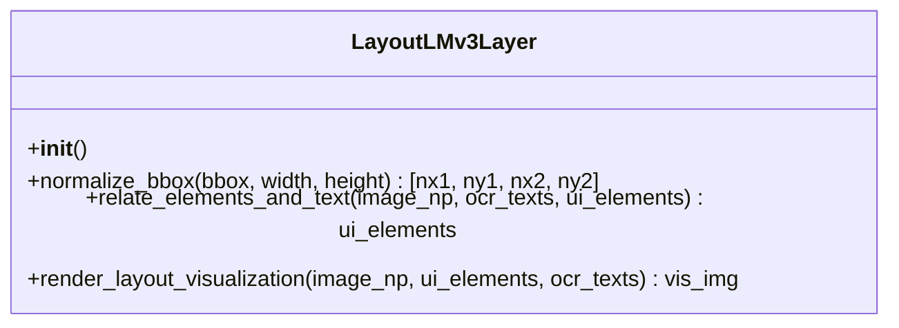
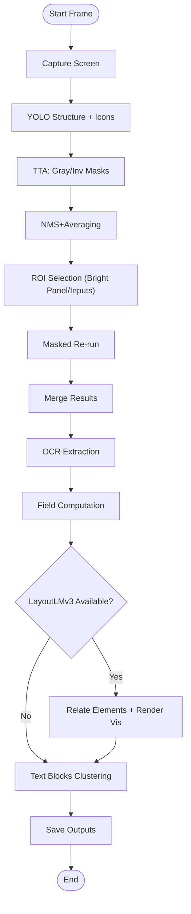
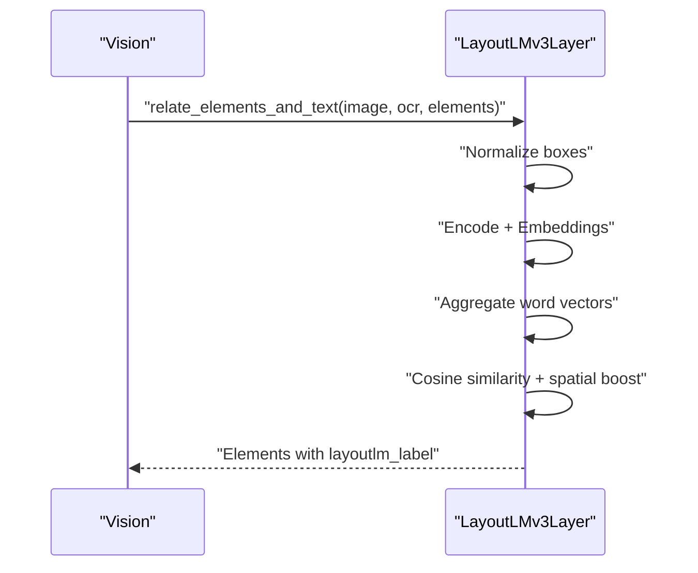
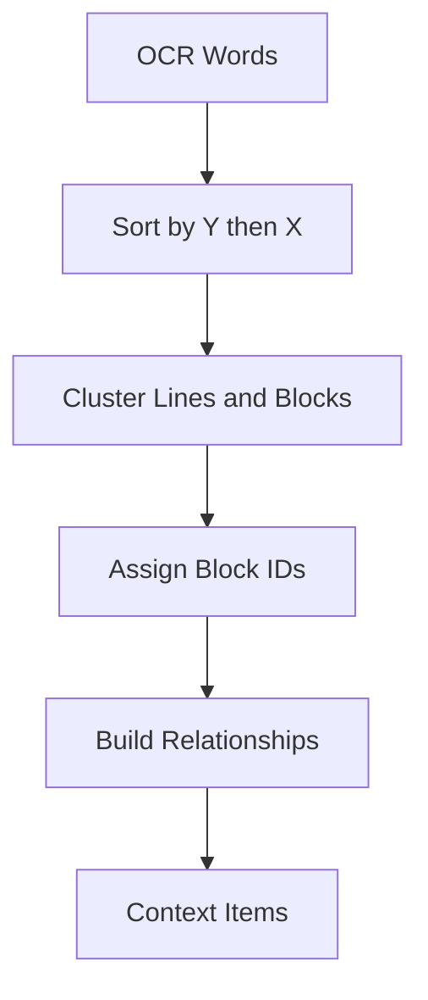
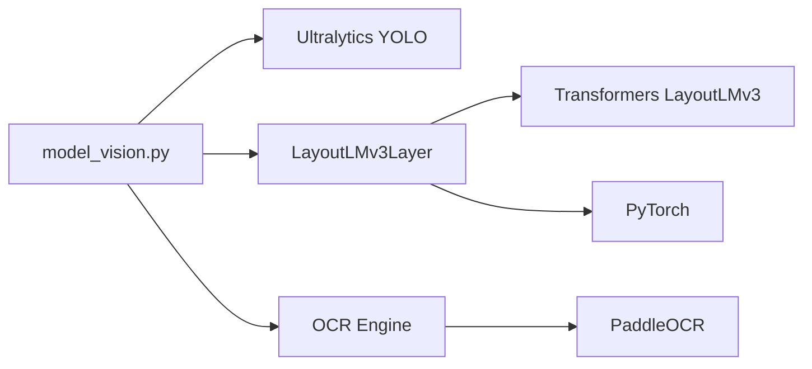

# LayoutLMv3 Processing

<cite>
**Referenced Files in This Document**
- [layoutlmv3_layer.py](file://LoOper/player/Computer_vision/layoutlmv3_layer.py)
- [model_vision.py](file://LoOper/player/Computer_vision/model_vision.py)
- [ocr_engine.py](file://LoOper/player/ocr_engine.py)
- [label_description.json](file://LoOper/player/Computer_vision/label_description.json)
- [view_output.json](file://LoOper/player/Computer_vision/view_output.json)
- [object.py](file://LoOper/player/Computer_vision/object.py)
- [test_ocr.py](file://LoOper/player/Computer_vision/test_ocr.py)
- [test_vision.py](file://LoOper/player/Computer_vision/test_vision.py)
</cite>

## Table of Contents
1. [Introduction](#introduction)
2. [Project Structure](#project-structure)
3. [Core Components](#core-components)
4. [Architecture Overview](#architecture-overview)
5. [Detailed Component Analysis](#detailed-component-analysis)
6. [Dependency Analysis](#dependency-analysis)
7. [Performance Considerations](#performance-considerations)
8. [Troubleshooting Guide](#troubleshooting-guide)
9. [Conclusion](#conclusion)

## Introduction
This document explains the LayoutLMv3 processing system integrated into the LoOper computer vision pipeline. It focuses on how LayoutLMv3 enhances document understanding and layout-aware text recognition by relating OCR-extracted text to UI elements through contextual embeddings and spatial heuristics. The system combines:
- Multi-modal inputs: images, OCR text, and UI element bounding boxes
- Layout-aware embeddings via LayoutLMv3
- Spatial reasoning to improve label assignment and field parsing
- Post-processing and visualization for downstream agents

The goal is to demonstrate how LayoutLMv3 improves OCR accuracy by leveraging layout context, enabling robust document parsing workflows, and integrating seamlessly with existing computer vision and OCR stacks.

## Project Structure
The LayoutLMv3 processing resides within the Computer Vision module and interacts with OCR and UI detection models. Key files:
- LayoutLMv3 embedding and matching logic
- Vision pipeline orchestrating detection, pruning, OCR, and LayoutLMv3 labeling
- OCR engine abstraction and utilities
- Supporting data structures and tests

**Diagram sources**
- [model_vision.py](file://LoOper/player/Computer_vision/model_vision.py)
- [layoutlmv3_layer.py](file://LoOper/player/Computer_vision/layoutlmv3_layer.py)
- [ocr_engine.py](file://LoOper/player/ocr_engine.py)
- [label_description.json](file://LoOper/player/Computer_vision/label_description.json)
- [view_output.json](file://LoOper/player/Computer_vision/view_output.json)
- [object.py](file://LoOper/player/Computer_vision/object.py)
- [test_vision.py](file://LoOper/player/Computer_vision/test_vision.py)
- [test_ocr.py](file://LoOper/player/Computer_vision/test_ocr.py)

**Section sources**
- [model_vision.py](file://LoOper/player/Computer_vision/model_vision.py)
- [layoutlmv3_layer.py](file://LoOper/player/Computer_vision/layoutlmv3_layer.py)
- [ocr_engine.py](file://LoOper/player/ocr_engine.py)
- [label_description.json](file://LoOper/player/Computer_vision/label_description.json)
- [view_output.json](file://LoOper/player/Computer_vision/view_output.json)
- [object.py](file://LoOper/player/Computer_vision/object.py)
- [test_vision.py](file://LoOper/player/Computer_vision/test_vision.py)
- [test_ocr.py](file://LoOper/player/Computer_vision/test_ocr.py)

## Core Components
- LayoutLMv3Layer: Loads the LayoutLMv3 processor and model, normalizes bounding boxes to the 0..1000 grid, encodes multi-modal inputs (image, words, boxes), computes token-level embeddings, aggregates to word-level vectors, and relates UI elements to OCR text using semantic similarity plus spatial heuristics. It also renders a unified visualization overlay.
- Vision: Orchestrates the full pipeline: screen capture, multi-model detection (structure and icons), NMS-based refinement, ROI selection, OCR extraction, field computation, LayoutLMv3 labeling, text block clustering, and saving outputs.
- OCR Engine: Abstraction over PaddleOCR with model bundling and normalization for OCR results.
- Data Structures: Object hierarchy representing detected UI elements, interactions, and text.

Key responsibilities:
- Input preprocessing: normalize image and bounding boxes, convert OCR polygons to pixel coordinates
- Embedding generation: LayoutLMv3 encodings with truncation handling
- Matching: cosine similarity + spatial heuristics to assign labels to UI elements
- Post-processing: dedupe, clustering, and context building for agents

**Section sources**
- [layoutlmv3_layer.py](file://LoOper/player/Computer_vision/layoutlmv3_layer.py)
- [model_vision.py](file://LoOper/player/Computer_vision/model_vision.py)
- [ocr_engine.py](file://LoOper/player/ocr_engine.py)
- [object.py](file://LoOper/player/Computer_vision/object.py)

## Architecture Overview
The system follows a multi-stage pipeline:
1. Detection: YOLO-based structure and icon models yield bounding boxes.
2. Pruning and ROI: Focus on top-layer windows and dense input clusters; optionally refine with masked passes.
3. OCR: Extract per-word polygons and text with confidence; normalize coordinates to pixel space.
4. Field computation: Determine labels and values for inputs using spatial heuristics and OCR overlap.
5. LayoutLMv3 enhancement: Relate UI elements to OCR text via embeddings and spatial cues.
6. Text blocks: Cluster OCR words into logical blocks for broader context.
7. Output: Save pruned JSON, masked overlays, and LayoutLMv3 visualizations.

**Diagram sources**
- [model_vision.py](file://LoOper/player/Computer_vision/model_vision.py)
- [layoutlmv3_layer.py](file://LoOper/player/Computer_vision/layoutlmv3_layer.py)
- [ocr_engine.py](file://LoOper/player/ocr_engine.py)

## Detailed Component Analysis

### LayoutLMv3Layer
Responsibilities:
- Load LayoutLMv3 processor and model
- Normalize bounding boxes to 0..1000 grid
- Encode multi-modal inputs (image, words, boxes)
- Compute token-level embeddings and aggregate to word-level vectors
- Match UI elements to OCR text using cosine similarity and spatial heuristics
- Render unified visualization overlay

Implementation highlights:
- Normalization ensures consistent coordinate scaling for LayoutLMv3’s internal 1000-grid
- Processor encoding with truncation and max length control
- Token-to-word aggregation via averaging; fallback zero vector for truncated words
- Spatial heuristics boost similarity for text positioned above or to the left of inputs
- Visualization overlays UI boxes with assigned labels and OCR boxes

**Diagram sources**
- [layoutlmv3_layer.py](file://LoOper/player/Computer_vision/layoutlmv3_layer.py)

**Section sources**
- [layoutlmv3_layer.py](file://LoOper/player/Computer_vision/layoutlmv3_layer.py)

### Vision Pipeline (model_vision.py)
Responsibilities:
- Screen capture and multi-model inference
- TTA (Test-Time Augmentation) with grayscale/high-contrast and inverted masks
- NMS averaging to consolidate overlapping detections
- ROI selection via bright panel detection and input clustering
- OCR integration and coordinate normalization
- Field computation: label assignment and value extraction
- LayoutLMv3 integration and visualization
- Text block clustering for document context
- Output persistence and overlay rendering

Key stages:
- Detection and pruning: structure and icon models produce boxes; NMS merges overlaps
- ROI refinement: masked re-pass to capture hidden elements
- OCR: extract per-word polygons and normalize to pixel coordinates
- Field computation: nearest-label heuristics and value-inside checks; optional LayoutLMv3 enhancement
- Text blocks: cluster words into logical blocks
- Outputs: pruned JSON, masked overlays, and layout visualization

**Diagram sources**
- [model_vision.py](file://LoOper/player/Computer_vision/model_vision.py)

**Section sources**
- [model_vision.py](file://LoOper/player/Computer_vision/model_vision.py)

### OCR Engine Integration
Responsibilities:
- Abstraction over PaddleOCR with bundled model support
- Language normalization and caching
- Result normalization to consistent structures (polygons, text, confidence)
- Coordinate conversion and shape normalization

Integration points:
- Vision pipeline calls OCR to enrich field computation with surrounding text
- Coordinates normalized to pixel space for spatial matching

**Section sources**
- [ocr_engine.py](file://LoOper/player/ocr_engine.py)
- [model_vision.py](file://LoOper/player/Computer_vision/model_vision.py)

### Data Structures and Label Descriptions
- Object hierarchy: encapsulates UI elements, interactions, and text with update and visibility logic
- Label descriptions: map model labels to roles (Object, Property, Text, Interaction) for pruning and rendering

**Section sources**
- [object.py](file://LoOper/player/Computer_vision/object.py)
- [label_description.json](file://LoOper/player/Computer_vision/label_description.json)
- [view_output.json](file://LoOper/player/Computer_vision/view_output.json)

### Example Workflows

#### Workflow 1: Layout-aware Label Assignment
- Input: screen image, OCR text elements, UI element boxes
- Steps:
  - Normalize boxes to 0..1000 grid
  - Encode with LayoutLMv3 processor
  - Aggregate token embeddings to word vectors
  - Compute similarity between UI element vectors and OCR vectors
  - Apply spatial heuristics (above/left alignment)
  - Assign best-matching OCR text as label
- Output: UI elements enriched with layout-aware labels

**Diagram sources**
- [layoutlmv3_layer.py](file://LoOper/player/Computer_vision/layoutlmv3_layer.py)
- [model_vision.py](file://LoOper/player/Computer_vision/model_vision.py)

#### Workflow 2: Document Parsing with Text Blocks
- Input: OCR results, UI elements, ROI
- Steps:
  - Cluster OCR words into text blocks by proximity
  - Build relationships between fields and OCR indices
  - Construct context items for downstream agents
- Output: structured JSON with fields, OCR relations, and context items

**Diagram sources**
- [model_vision.py](file://LoOper/player/Computer_vision/model_vision.py)

## Dependency Analysis
- Vision depends on:
  - Ultralytics YOLO models for structure and icon detection
  - LayoutLMv3Layer for layout-aware matching
  - OCR engine for text extraction
  - Label descriptions for pruning and rendering
- LayoutLMv3Layer depends on:
  - Transformers LayoutLMv3 processor and model
  - PIL and Torch for image processing and inference
- OCR engine depends on PaddleOCR with bundled models

**Diagram sources**
- [model_vision.py](file://LoOper/player/Computer_vision/model_vision.py)
- [layoutlmv3_layer.py](file://LoOper/player/Computer_vision/layoutlmv3_layer.py)
- [ocr_engine.py](file://LoOper/player/ocr_engine.py)

**Section sources**
- [model_vision.py](file://LoOper/player/Computer_vision/model_vision.py)
- [layoutlmv3_layer.py](file://LoOper/player/Computer_vision/layoutlmv3_layer.py)
- [ocr_engine.py](file://LoOper/player/ocr_engine.py)

## Performance Considerations
- Model loading and warm-up: Initialize LayoutLMv3 once and reuse tensors to minimize overhead
- Truncation handling: Processor truncation to 512 tokens; fallback zero vectors for missing tokens
- Memory management:
  - Explicit cache clearing and GPU cache cleanup when unloading
  - Thread pool for async analysis in overlay mode
- Preprocessing:
  - Normalize coordinates once per frame
  - Use TTA judiciously; consider toggling based on performance needs
- Visualization:
  - Unified overlay rendering minimizes repeated image copies

[No sources needed since this section provides general guidance]

## Troubleshooting Guide
Common issues and resolutions:
- LayoutLMv3 errors: Wrapped in try/catch; check processor encoding and tensor shapes
- OCR failures: Verify model availability and language settings; ensure image arrays are BGR
- Coordinate mismatches: Confirm pixel vs. normalized coordinates; validate bounding box normalization
- Memory pressure: Use unload routine to clear models and caches; reduce batch sizes or disable TTA

**Section sources**
- [layoutlmv3_layer.py](file://LoOper/player/Computer_vision/layoutlmv3_layer.py)
- [model_vision.py](file://LoOper/player/Computer_vision/model_vision.py)
- [ocr_engine.py](file://LoOper/player/ocr_engine.py)

## Conclusion
The LayoutLMv3 processing system augments OCR with layout-aware semantics, improving label assignment and document parsing accuracy. By combining multi-modal embeddings, spatial heuristics, and robust OCR integration, the pipeline delivers reliable field extraction and contextual understanding suitable for downstream automation tasks. Proper configuration, truncation handling, and memory management ensure stable performance across diverse UI layouts.