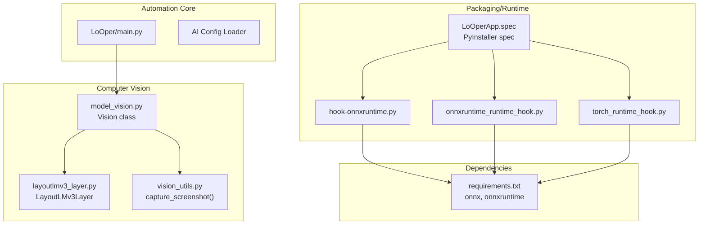
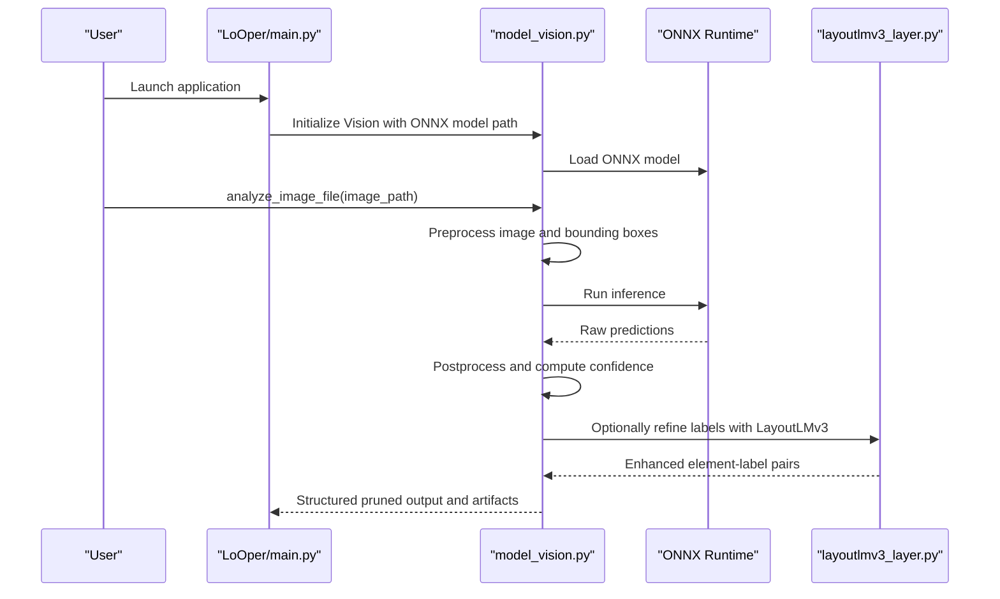
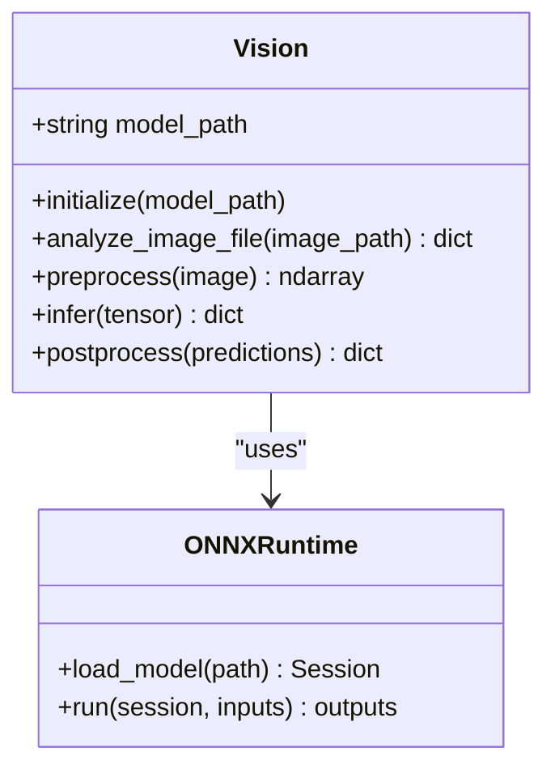
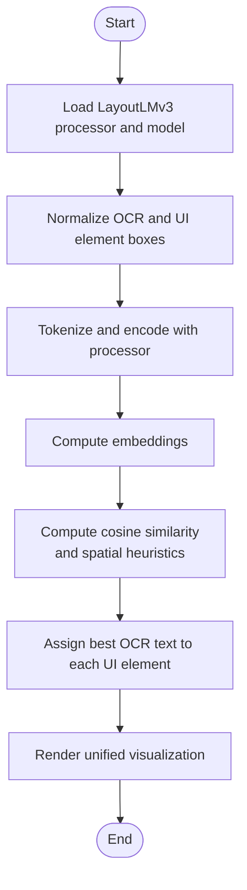
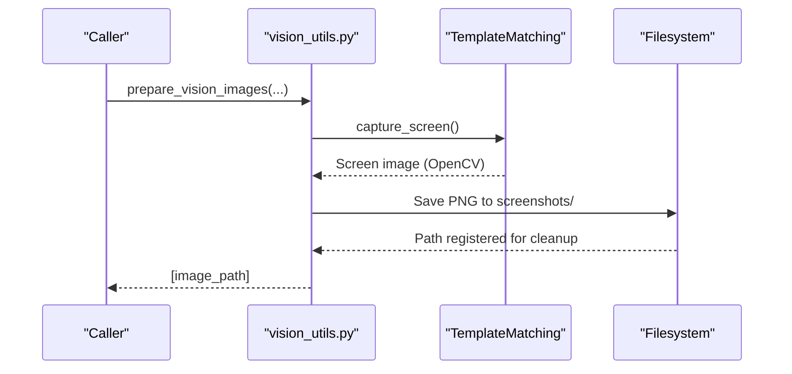
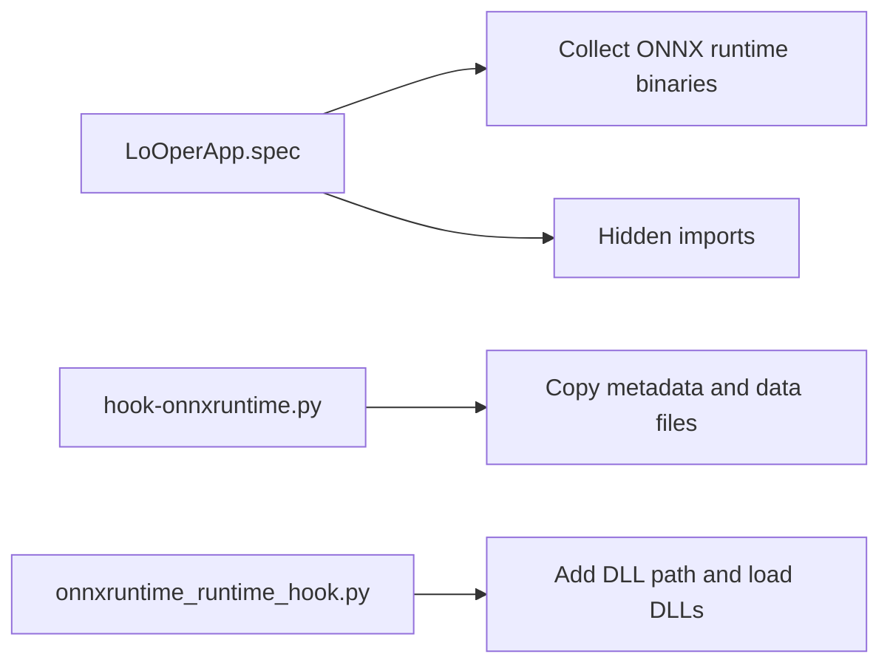
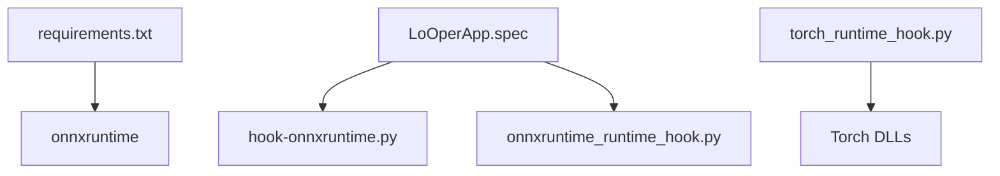

# ONNX Inference Engine

<cite>
**Referenced Files in This Document**
- [model_vision.py](file://LoOper/player/Computer_vision/model_vision.py)
- [test_vision.py](file://LoOper/player/Computer_vision/test_vision.py)
- [layoutlmv3_layer.py](file://LoOper/player/Computer_vision/layoutlmv3_layer.py)
- [vision_utils.py](file://LoOper/player/multi_sequence/llm_executor_resources/vision_utils.py)
- [requirements.txt](file://requirements.txt)
- [LoOper/main.py](file://LoOper/main.py)
- [hook-onnxruntime.py](file://hook-onnxruntime.py)
- [onnxruntime_runtime_hook.py](file://onnxruntime_runtime_hook.py)
- [LoOperApp.spec](file://LoOperApp.spec)
- [torch_runtime_hook.py](file://torch_runtime_hook.py)
</cite>

## Table of Contents
1. [Introduction](#introduction)
2. [Project Structure](#project-structure)
3. [Core Components](#core-components)
4. [Architecture Overview](#architecture-overview)
5. [Detailed Component Analysis](#detailed-component-analysis)
6. [Dependency Analysis](#dependency-analysis)
7. [Performance Considerations](#performance-considerations)
8. [Troubleshooting Guide](#troubleshooting-guide)
9. [Conclusion](#conclusion)

## Introduction
This document describes the ONNX inference engine and its integration within the desktop automation platform. It focuses on runtime configuration, model loading, inference pipeline management, caching, memory optimization, batch processing, result processing, confidence scoring, output formatting, error handling, validation, fallback strategies, versioning, updates, and cross-hardware compatibility. The ONNX runtime is primarily used for computer vision tasks such as form field detection and layout understanding, complemented by other engines (e.g., OCR) and LLM integrations.

## Project Structure
The ONNX inference engine is embedded in the computer vision subsystem and integrates with the broader automation framework:
- ONNX model usage: Vision inference via an ONNX runtime provider
- Supporting modules: OCR, LayoutLMv3, screenshot capture, and LLM vision integration
- Packaging and runtime hooks: Ensuring ONNX runtime DLLs are bundled and discoverable

**Diagram sources**
- [LoOper/main.py:133-200](file://LoOper/main.py#L133-L200)
- [model_vision.py:1-200](file://LoOper/player/Computer_vision/model_vision.py#L1-L200)
- [layoutlmv3_layer.py:1-200](file://LoOper/player/Computer_vision/layoutlmv3_layer.py#L1-L200)
- [vision_utils.py:1-66](file://LoOper/player/multi_sequence/llm_executor_resources/vision_utils.py#L1-L66)
- [LoOperApp.spec:126-167](file://LoOperApp.spec#L126-L167)
- [hook-onnxruntime.py:1-39](file://hook-onnxruntime.py#L1-L39)
- [onnxruntime_runtime_hook.py:1-34](file://onnxruntime_runtime_hook.py#L1-L34)
- [torch_runtime_hook.py:97-117](file://torch_runtime_hook.py#L97-L117)
- [requirements.txt:88-89](file://requirements.txt#L88-L89)

**Section sources**
- [LoOper/main.py:133-200](file://LoOper/main.py#L133-L200)
- [model_vision.py:1-200](file://LoOper/player/Computer_vision/model_vision.py#L1-L200)
- [layoutlmv3_layer.py:1-200](file://LoOper/player/Computer_vision/layoutlmv3_layer.py#L1-L200)
- [vision_utils.py:1-66](file://LoOper/player/multi_sequence/llm_executor_resources/vision_utils.py#L1-L66)
- [LoOperApp.spec:126-167](file://LoOperApp.spec#L126-L167)
- [hook-onnxruntime.py:1-39](file://hook-onnxruntime.py#L1-L39)
- [onnxruntime_runtime_hook.py:1-34](file://onnxruntime_runtime_hook.py#L1-L34)
- [torch_runtime_hook.py:97-117](file://torch_runtime_hook.py#L97-L117)
- [requirements.txt:88-89](file://requirements.txt#L88-L89)

## Core Components
- Vision inference engine: Loads and runs an ONNX model for detecting UI elements and extracting structured field data from screenshots.
- LayoutLMv3 integration: Enhances field labeling by associating OCR text with UI elements using contextual embeddings.
- Screenshot capture: Provides image inputs for vision-enabled LLMs and vision models.
- Packaging/runtime hooks: Ensures ONNX runtime DLLs are bundled and discoverable at runtime.

Key responsibilities:
- ONNX runtime configuration and model loading
- Inference pipeline orchestration (preprocessing, inference, postprocessing)
- Result formatting and confidence scoring
- Error handling and fallback strategies
- Resource management and memory optimization

**Section sources**
- [model_vision.py:1-200](file://LoOper/player/Computer_vision/model_vision.py#L1-L200)
- [layoutlmv3_layer.py:1-200](file://LoOper/player/Computer_vision/layoutlmv3_layer.py#L1-L200)
- [vision_utils.py:1-66](file://LoOper/player/multi_sequence/llm_executor_resources/vision_utils.py#L1-L66)
- [requirements.txt:88-89](file://requirements.txt#L88-L89)

## Architecture Overview
The ONNX inference engine is part of a multi-modal pipeline:
- Input: Screenshots captured via OpenCV or MSS
- Preprocessing: Image normalization, cropping, and bounding box scaling
- Inference: ONNX runtime executes the model to detect UI elements and regions
- Postprocessing: Structured output assembly, confidence scoring, and optional LayoutLMv3 refinement
- Output: JSON-like pruned output, masked images, and visualization artifacts

**Diagram sources**
- [LoOper/main.py:133-200](file://LoOper/main.py#L133-L200)
- [model_vision.py:1-200](file://LoOper/player/Computer_vision/model_vision.py#L1-L200)
- [layoutlmv3_layer.py:1-200](file://LoOper/player/Computer_vision/layoutlmv3_layer.py#L1-L200)

## Detailed Component Analysis

### Vision Inference Engine (ONNX)
The Vision class encapsulates ONNX model loading and inference:
- Runtime configuration: Adds ONNX runtime DLL directory to the process path and loads required DLLs before importing ONNX modules.
- Model loading: Accepts an ONNX model path and prepares the inference session.
- Inference pipeline: Converts images to the expected input tensors, runs the model, and parses outputs into structured UI elements.
- Postprocessing: Normalizes bounding boxes, computes confidence scores, and produces pruned outputs suitable for downstream automation.

**Diagram sources**
- [model_vision.py:1-200](file://LoOper/player/Computer_vision/model_vision.py#L1-L200)

**Section sources**
- [model_vision.py:1-200](file://LoOper/player/Computer_vision/model_vision.py#L1-L200)
- [test_vision.py:15-52](file://LoOper/player/Computer_vision/test_vision.py#L15-L52)

### LayoutLMv3 Enhancement
The LayoutLMv3Layer refines UI element labeling by aligning OCR text with detected elements using contextual embeddings:
- Normalizes bounding boxes to the model’s expected coordinate space.
- Builds a joint token sequence of OCR words and UI element placeholders.
- Computes embeddings and selects the most semantically and spatially aligned OCR text for each UI element.
- Renders a unified visualization overlay.

**Diagram sources**
- [layoutlmv3_layer.py:1-200](file://LoOper/player/Computer_vision/layoutlmv3_layer.py#L1-L200)

**Section sources**
- [layoutlmv3_layer.py:1-200](file://LoOper/player/Computer_vision/layoutlmv3_layer.py#L1-L200)

### Screenshot Capture for Vision
Vision-enabled workflows require high-quality screenshots:
- Captures screen content using a preferred backend and saves to disk.
- Registers temporary files for cleanup after use.
- Integrates with LLM vision pipelines to supply images and placeholder OCR text.

**Diagram sources**
- [vision_utils.py:1-66](file://LoOper/player/multi_sequence/llm_executor_resources/vision_utils.py#L1-L66)

**Section sources**
- [vision_utils.py:1-66](file://LoOper/player/multi_sequence/llm_executor_resources/vision_utils.py#L1-L66)

### Packaging and Runtime Hooks (ONNX)
Ensures ONNX runtime DLLs are bundled and discoverable:
- PyInstaller spec collects ONNX runtime binaries and metadata, including the C-API DLLs.
- Hidden imports and data files are included to prevent missing modules.
- Runtime hook adds the ONNX runtime C-API directory to the process path and loads required DLLs early.

**Diagram sources**
- [LoOperApp.spec:126-167](file://LoOperApp.spec#L126-L167)
- [hook-onnxruntime.py:1-39](file://hook-onnxruntime.py#L1-L39)
- [onnxruntime_runtime_hook.py:1-34](file://onnxruntime_runtime_hook.py#L1-L34)

**Section sources**
- [LoOperApp.spec:126-167](file://LoOperApp.spec#L126-L167)
- [hook-onnxruntime.py:1-39](file://hook-onnxruntime.py#L1-L39)
- [onnxruntime_runtime_hook.py:1-34](file://onnxruntime_runtime_hook.py#L1-L34)
- [torch_runtime_hook.py:97-117](file://torch_runtime_hook.py#L97-L117)

## Dependency Analysis
- ONNX and ONNX Runtime: Explicitly declared in requirements.
- PyInstaller hooks: Ensure bundling of ONNX runtime C-API DLLs and metadata.
- Runtime hooks: Resolve DLL loading issues on Windows and guarantee early initialization.

**Diagram sources**
- [requirements.txt:88-89](file://requirements.txt#L88-L89)
- [LoOperApp.spec:126-167](file://LoOperApp.spec#L126-L167)
- [hook-onnxruntime.py:1-39](file://hook-onnxruntime.py#L1-L39)
- [onnxruntime_runtime_hook.py:1-34](file://onnxruntime_runtime_hook.py#L1-L34)
- [torch_runtime_hook.py:97-117](file://torch_runtime_hook.py#L97-L117)

**Section sources**
- [requirements.txt:88-89](file://requirements.txt#L88-L89)
- [LoOperApp.spec:126-167](file://LoOperApp.spec#L126-L167)
- [hook-onnxruntime.py:1-39](file://hook-onnxruntime.py#L1-L39)
- [onnxruntime_runtime_hook.py:1-34](file://onnxruntime_runtime_hook.py#L1-L34)
- [torch_runtime_hook.py:97-117](file://torch_runtime_hook.py#L97-L117)

## Performance Considerations
- Model selection and quantization: Prefer optimized ONNX models and consider quantization to reduce memory footprint and latency.
- Batch processing: Group inference calls when possible to amortize overhead; ensure inputs are properly padded and normalized.
- Memory optimization: Reuse inference sessions, clear caches, and avoid unnecessary copies of large arrays.
- GPU acceleration: If available, leverage GPU providers through the ONNX runtime to accelerate inference.
- Pre/post-processing efficiency: Minimize conversions between OpenCV and PIL; keep arrays contiguous and use appropriate dtypes.
- Concurrency: Use thread pools for preprocessing and postprocessing while keeping ONNX sessions thread-safe.

[No sources needed since this section provides general guidance]

## Troubleshooting Guide
Common issues and resolutions:
- DLL loading failures on Windows:
  - Ensure the ONNX runtime C-API directory is on the process path and required DLLs are loaded early.
  - Verify bundling of required DLLs via PyInstaller hooks.
- Missing or incompatible ONNX runtime:
  - Confirm the correct version is installed and matches the packaged binaries.
- Inference errors:
  - Validate input shapes and data types against the model’s expected schema.
  - Enable verbose logging to inspect intermediate tensors and outputs.
- Memory pressure:
  - Reduce batch sizes, free caches, and unload unused models.
- Cross-hardware compatibility:
  - Test with CPU-only and GPU-enabled configurations; adjust provider settings accordingly.

**Section sources**
- [onnxruntime_runtime_hook.py:1-34](file://onnxruntime_runtime_hook.py#L1-L34)
- [LoOperApp.spec:126-167](file://LoOperApp.spec#L126-L167)
- [hook-onnxruntime.py:1-39](file://hook-onnxruntime.py#L1-L39)

## Conclusion
The ONNX inference engine integrates tightly with the computer vision pipeline to enable robust UI element detection and layout understanding. Through careful packaging, runtime hooks, and modular design, it supports reliable deployment across diverse environments. By following the outlined performance and troubleshooting practices, teams can maintain high throughput and stability in production automation workflows.