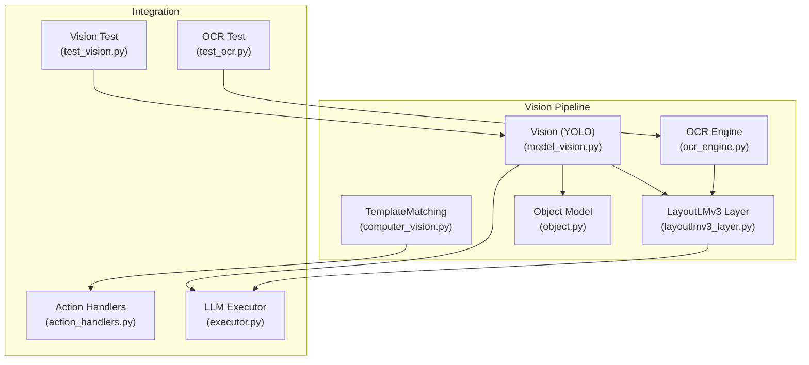
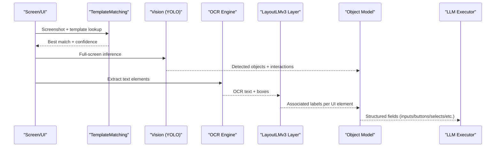
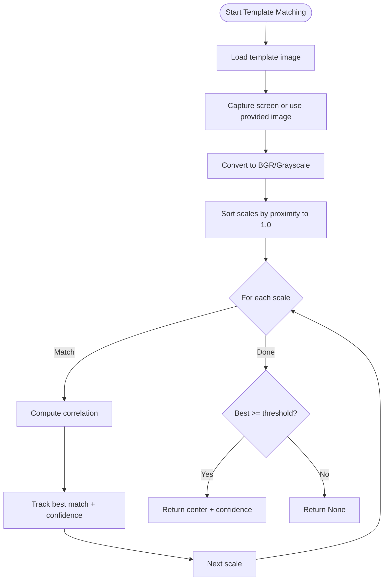
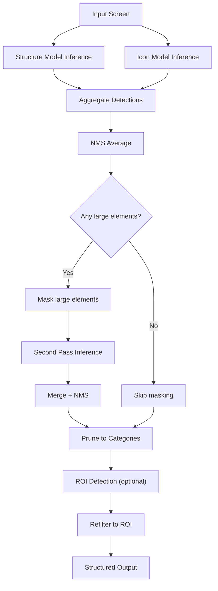
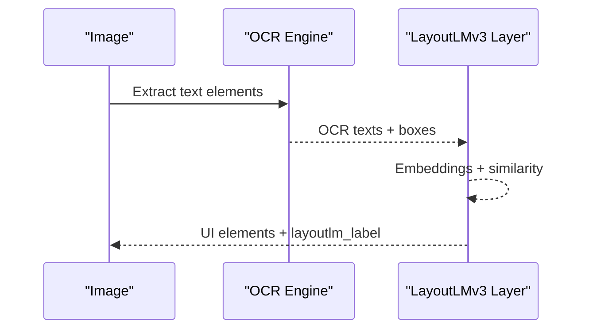
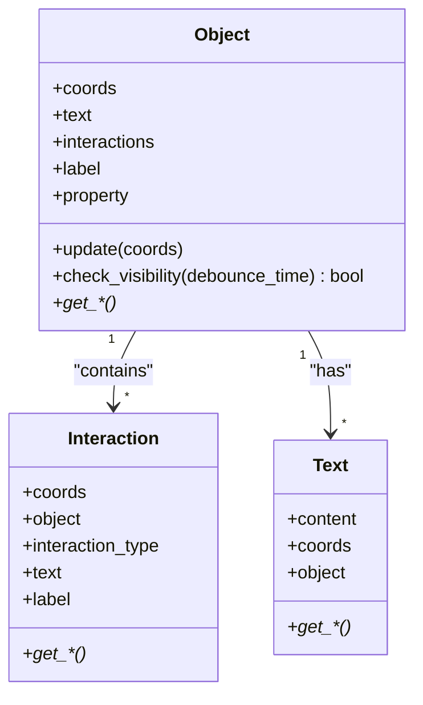
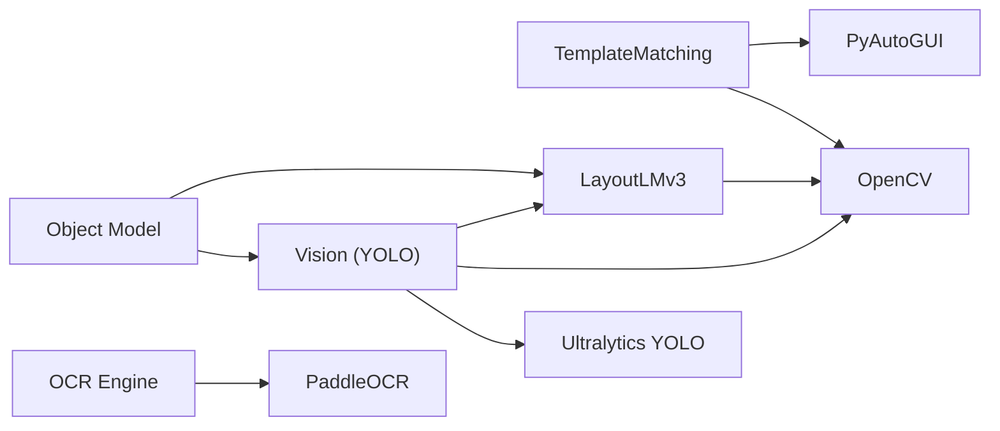

# Object Detection

<cite>
**Referenced Files in This Document**
- [computer_vision.py](file://LoOper/player/computer_vision.py)
- [model_vision.py](file://LoOper/player/Computer_vision/model_vision.py)
- [layoutlmv3_layer.py](file://LoOper/player/Computer_vision/layoutlmv3_layer.py)
- [ocr_engine.py](file://LoOper/player/ocr_engine.py)
- [label_description.json](file://LoOper/player/Computer_vision/label_description.json)
- [view_output.json](file://LoOper/player/Computer_vision/view_output.json)
- [object.py](file://LoOper/player/Computer_vision/object.py)
- [test_vision.py](file://LoOper/player/Computer_vision/test_vision.py)
- [test_ocr.py](file://LoOper/player/Computer_vision/test_ocr.py)
- [action_handlers.py](file://LoOper/player/action_handlers.py)
- [executor.py](file://LoOper/player/multi_sequence/llm_executor_resources/executor.py)
</cite>

## Table of Contents
1. [Introduction](#introduction)
2. [Project Structure](#project-structure)
3. [Core Components](#core-components)
4. [Architecture Overview](#architecture-overview)
5. [Detailed Component Analysis](#detailed-component-analysis)
6. [Dependency Analysis](#dependency-analysis)
7. [Performance Considerations](#performance-considerations)
8. [Troubleshooting Guide](#troubleshooting-guide)
9. [Conclusion](#conclusion)

## Introduction
This document explains the object detection system used for computer vision–driven UI recognition and spatial analysis. It covers:
- Object detection algorithms and bounding box processing
- Spatial relationship analysis and multi-object handling
- Integration with template matching and OCR
- Detection confidence scoring and multi-scale strategies
- Real-time performance and tracking mechanisms
- Error handling and debugging aids

The system combines YOLO-based detection, OCR-driven text association, and structured layout modeling to produce robust, spatially aware UI element representations suitable for automated UI interaction.

## Project Structure
The object detection pipeline spans several modules:
- Vision and template matching: [computer_vision.py](file://LoOper/player/computer_vision.py)
- YOLO-based UI element detection and pruning: [model_vision.py](file://LoOper/player/Computer_vision/model_vision.py)
- OCR engine and text extraction: [ocr_engine.py](file://LoOper/player/ocr_engine.py)
- Layout-aware text association: [layoutlmv3_layer.py](file://LoOper/player/Computer_vision/layoutlmv3_layer.py)
- Data models for objects and interactions: [object.py](file://LoOper/player/Computer_vision/object.py)
- Label taxonomy and example outputs: [label_description.json](file://LoOper/player/Computer_vision/label_description.json), [view_output.json](file://LoOper/player/Computer_vision/view_output.json)
- Example tests and integration points: [test_vision.py](file://LoOper/player/Computer_vision/test_vision.py), [test_ocr.py](file://LoOper/player/Computer_vision/test_ocr.py), [action_handlers.py](file://LoOper/player/action_handlers.py), [executor.py](file://LoOper/player/multi_sequence/llm_executor_resources/executor.py)

**Diagram sources**
- [computer_vision.py:47-606](file://LoOper/player/computer_vision.py#L47-L606)
- [model_vision.py:310-1200](file://LoOper/player/Computer_vision/model_vision.py#L310-L1200)
- [ocr_engine.py:131-367](file://LoOper/player/ocr_engine.py#L131-L367)
- [layoutlmv3_layer.py:1-203](file://LoOper/player/Computer_vision/layoutlmv3_layer.py#L1-L203)
- [object.py:1-167](file://LoOper/player/Computer_vision/object.py#L1-L167)
- [action_handlers.py:239-251](file://LoOper/player/action_handlers.py#L239-L251)
- [executor.py:78-108](file://LoOper/player/multi_sequence/llm_executor_resources/executor.py#L78-L108)
- [test_vision.py:1-52](file://LoOper/player/Computer_vision/test_vision.py#L1-L52)
- [test_ocr.py:1-62](file://LoOper/player/Computer_vision/test_ocr.py#L1-L62)

**Section sources**
- [computer_vision.py:47-606](file://LoOper/player/computer_vision.py#L47-L606)
- [model_vision.py:310-1200](file://LoOper/player/Computer_vision/model_vision.py#L310-L1200)
- [ocr_engine.py:131-367](file://LoOper/player/ocr_engine.py#L131-L367)
- [layoutlmv3_layer.py:1-203](file://LoOper/player/Computer_vision/layoutlmv3_layer.py#L1-L203)
- [object.py:1-167](file://LoOper/player/Computer_vision/object.py#L1-L167)
- [label_description.json:1-9](file://LoOper/player/Computer_vision/label_description.json#L1-L9)
- [view_output.json:1-1292](file://LoOper/player/Computer_vision/view_output.json#L1-L1292)
- [test_vision.py:1-52](file://LoOper/player/Computer_vision/test_vision.py#L1-L52)
- [test_ocr.py:1-62](file://LoOper/player/Computer_vision/test_ocr.py#L1-L62)
- [action_handlers.py:239-251](file://LoOper/player/action_handlers.py#L239-L251)
- [executor.py:78-108](file://LoOper/player/multi_sequence/llm_executor_resources/executor.py#L78-L108)

## Core Components
- TemplateMatching: Provides multi-scale template matching, region-based search, and OCR-based text detection. It supports adaptive scaling and caching to improve robustness and speed.
- Vision (YOLO-based): Performs multi-model inference (structure and icon), applies NMS averaging, masks large elements, and prunes detections into structured categories (inputs, buttons, selects, checkboxes, radios, texts).
- OCR Engine: Extracts text elements with confidence scores and bounding boxes from images.
- LayoutLMv3 Layer: Associates OCR text with UI elements using contextual embeddings and spatial heuristics.
- Object Model: Represents detected UI elements, their properties, interactions, and associated text with visibility debouncing.
- Integration points: Action handlers and LLM executor consume structured outputs for reliable UI interaction and natural language reasoning.

**Section sources**
- [computer_vision.py:47-606](file://LoOper/player/computer_vision.py#L47-L606)
- [model_vision.py:310-1200](file://LoOper/player/Computer_vision/model_vision.py#L310-L1200)
- [ocr_engine.py:131-367](file://LoOper/player/ocr_engine.py#L131-L367)
- [layoutlmv3_layer.py:1-203](file://LoOper/player/Computer_vision/layoutlmv3_layer.py#L1-L203)
- [object.py:1-167](file://LoOper/player/Computer_vision/object.py#L1-L167)
- [action_handlers.py:239-251](file://LoOper/player/action_handlers.py#L239-L251)
- [executor.py:78-108](file://LoOper/player/multi_sequence/llm_executor_resources/executor.py#L78-L108)

## Architecture Overview
The system integrates three detection streams:
- Template matching for precise icon/button locations
- YOLO-based UI element detection with refinement
- OCR-based text extraction and layout association

**Diagram sources**
- [computer_vision.py:198-332](file://LoOper/player/computer_vision.py#L198-L332)
- [model_vision.py:423-637](file://LoOper/player/Computer_vision/model_vision.py#L423-L637)
- [ocr_engine.py:131-367](file://LoOper/player/ocr_engine.py#L131-L367)
- [layoutlmv3_layer.py:29-136](file://LoOper/player/Computer_vision/layoutlmv3_layer.py#L29-L136)
- [object.py:1-167](file://LoOper/player/Computer_vision/object.py#L1-L167)
- [executor.py:78-108](file://LoOper/player/multi_sequence/llm_executor_resources/executor.py#L78-L108)

## Detailed Component Analysis

### Template Matching and Region-Based Search
- Multi-scale matching: Iterates over adaptive scale sets, converts to grayscale if requested, and uses normalized cross-correlation to find the best match across scales.
- Region-based search: Expands around a hint coordinate to reduce search space and uses either OpenCV template matching on a cropped region or falls back to PyAutoGUI.
- Confidence scoring: Returns the highest-scoring match meeting the threshold; otherwise None.
- Debugging: Optional screenshot saving for inspection.

**Diagram sources**
- [computer_vision.py:198-332](file://LoOper/player/computer_vision.py#L198-L332)

**Section sources**
- [computer_vision.py:198-332](file://LoOper/player/computer_vision.py#L198-L332)

### YOLO-Based Object Detection and Pruning
- Dual-model inference: Runs structure and icon models, aggregates detections, and applies NMS averaging to merge overlapping boxes.
- Large-element masking: Masks large UI regions to improve detection of nested or occluded elements, followed by a second pass.
- Pruning: Converts raw detections into structured categories (inputs, buttons, selects, checkboxes, radios, texts) and deduplicates with overlap thresholds.
- ROI detection: Heuristically identifies a focus region (bright panel or central region) to constrain downstream processing.

**Diagram sources**
- [model_vision.py:423-552](file://LoOper/player/Computer_vision/model_vision.py#L423-L552)
- [model_vision.py:1000-1047](file://LoOper/player/Computer_vision/model_vision.py#L1000-L1047)
- [model_vision.py:1049-1200](file://LoOper/player/Computer_vision/model_vision.py#L1049-L1200)

**Section sources**
- [model_vision.py:423-552](file://LoOper/player/Computer_vision/model_vision.py#L423-L552)
- [model_vision.py:1000-1047](file://LoOper/player/Computer_vision/model_vision.py#L1000-L1047)
- [model_vision.py:1049-1200](file://LoOper/player/Computer_vision/model_vision.py#L1049-L1200)

### OCR Integration and Layout Association
- OCR extraction: Normalizes image formats, initializes PaddleOCR, and extracts text with bounding boxes and confidence.
- Layout association: Uses LayoutLMv3 embeddings to align OCR text with UI elements, applying spatial heuristics (above/left) to boost logical associations.
- Visualization: Produces overlay images highlighting matched UI elements and associated labels.

**Diagram sources**
- [ocr_engine.py:131-367](file://LoOper/player/ocr_engine.py#L131-L367)
- [layoutlmv3_layer.py:29-136](file://LoOper/player/Computer_vision/layoutlmv3_layer.py#L29-L136)

**Section sources**
- [ocr_engine.py:131-367](file://LoOper/player/ocr_engine.py#L131-L367)
- [layoutlmv3_layer.py:29-136](file://LoOper/player/Computer_vision/layoutlmv3_layer.py#L29-L136)

### Object Model and Spatial Relationship Analysis
- Object: Holds coordinates, label, property, text, and interactions; supports visibility debouncing.
- Interaction: Captures child UI elements (buttons, inputs, etc.) contained within an object.
- Text: Stores OCR-derived text associated with an object.
- Spatial checks: Utilities to determine containment and center proximity for matching related objects.

**Diagram sources**
- [object.py:1-167](file://LoOper/player/Computer_vision/object.py#L1-L167)

**Section sources**
- [object.py:1-167](file://LoOper/player/Computer_vision/object.py#L1-L167)

### Multi-Object Handling and Field Computation
- Deduplication: Overlapping detections are merged by taking union bounding boxes to avoid duplicates.
- Category mapping: Raw labels are mapped to structured categories (inputs, buttons, selects, etc.) using label taxonomy and heuristics.
- ROI refinement: Optional focus region constrains detection to a central area, improving accuracy for dense UIs.

**Section sources**
- [model_vision.py:874-908](file://LoOper/player/Computer_vision/model_vision.py#L874-L908)
- [label_description.json:1-9](file://LoOper/player/Computer_vision/label_description.json#L1-L9)

### Integration with Action Handlers and LLM Executor
- Action handlers: Configure detection strategies (template, multiscale, region) with varying confidence thresholds and expansion factors.
- LLM executor: Formats structured UI data into a readable, spatially ordered string for language models, enabling reliable instruction-following.

**Section sources**
- [action_handlers.py:239-251](file://LoOper/player/action_handlers.py#L239-L251)
- [executor.py:78-108](file://LoOper/player/multi_sequence/llm_executor_resources/executor.py#L78-L108)

## Dependency Analysis
- Vision depends on Ultralytics YOLO, OpenCV, and optional LayoutLMv3.
- OCR depends on PaddleOCR and bundled model directories.
- TemplateMatching depends on OpenCV and PyAutoGUI fallbacks.
- Object model is used across Vision and LayoutLMv3 outputs.

**Diagram sources**
- [computer_vision.py:42-44](file://LoOper/player/computer_vision.py#L42-L44)
- [model_vision.py:65-90](file://LoOper/player/Computer_vision/model_vision.py#L65-L90)
- [ocr_engine.py:49-103](file://LoOper/player/ocr_engine.py#L49-L103)
- [layoutlmv3_layer.py:1-12](file://LoOper/player/Computer_vision/layoutlmv3_layer.py#L1-L12)
- [object.py:1-167](file://LoOper/player/Computer_vision/object.py#L1-L167)

**Section sources**
- [computer_vision.py:42-44](file://LoOper/player/computer_vision.py#L42-L44)
- [model_vision.py:65-90](file://LoOper/player/Computer_vision/model_vision.py#L65-L90)
- [ocr_engine.py:49-103](file://LoOper/player/ocr_engine.py#L49-L103)
- [layoutlmv3_layer.py:1-12](file://LoOper/player/Computer_vision/layoutlmv3_layer.py#L1-L12)
- [object.py:1-167](file://LoOper/player/Computer_vision/object.py#L1-L167)

## Performance Considerations
- Multi-scale template matching prioritizes 1.0 scale initially and expands gradually to balance speed and robustness.
- NMS averaging reduces duplicate detections and stabilizes bounding boxes across multiple model passes.
- ROI detection narrows processing to a central region, reducing computational overhead.
- Adaptive reset thresholds for template matching attempts prevent stale caches from degrading performance.
- LayoutLMv3 embedding normalization and spatial heuristics minimize false associations.

[No sources needed since this section provides general guidance]

## Troubleshooting Guide
Common issues and remedies:
- Template matching returns None:
  - Verify OpenCV availability and template path correctness.
  - Adjust confidence thresholds and scales; leverage region-based search with appropriate expansion.
- OCR extraction yields empty results:
  - Confirm PaddleOCR initialization and model directories; check image preprocessing (grayscale/RGB conversion).
  - Increase OCR confidence thresholds or adjust language settings.
- YOLO detections are fragmented:
  - Inspect NMS averaging thresholds and large-element masking steps.
  - Validate label taxonomy and category mapping.
- Layout association mismatches:
  - Review spatial heuristics and embedding normalization; ensure consistent coordinate spaces.
- Visibility debouncing affects tracking:
  - Tune debounce time to balance stability and responsiveness.

**Section sources**
- [computer_vision.py:198-332](file://LoOper/player/computer_vision.py#L198-L332)
- [ocr_engine.py:131-367](file://LoOper/player/ocr_engine.py#L131-L367)
- [model_vision.py:484-552](file://LoOper/player/Computer_vision/model_vision.py#L484-L552)
- [layoutlmv3_layer.py:138-203](file://LoOper/player/Computer_vision/layoutlmv3_layer.py#L138-L203)
- [object.py:21-24](file://LoOper/player/Computer_vision/object.py#L21-L24)

## Conclusion
The object detection system combines robust template matching, multi-model YOLO inference, and OCR-driven layout association to deliver accurate, spatially aware UI understanding. Its structured outputs power reliable automated UI interactions and LLM-guided workflows, with built-in performance optimizations and debugging hooks for real-world deployment.