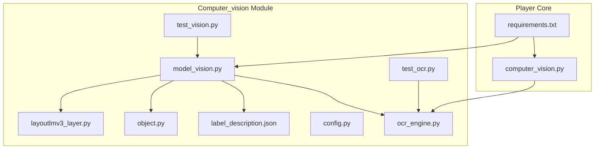
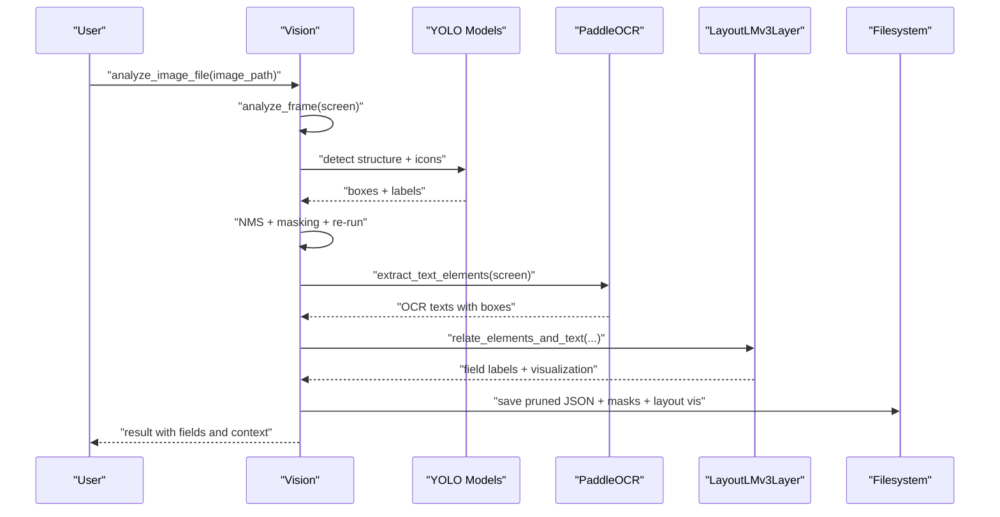
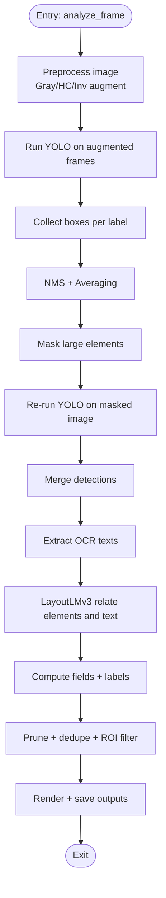
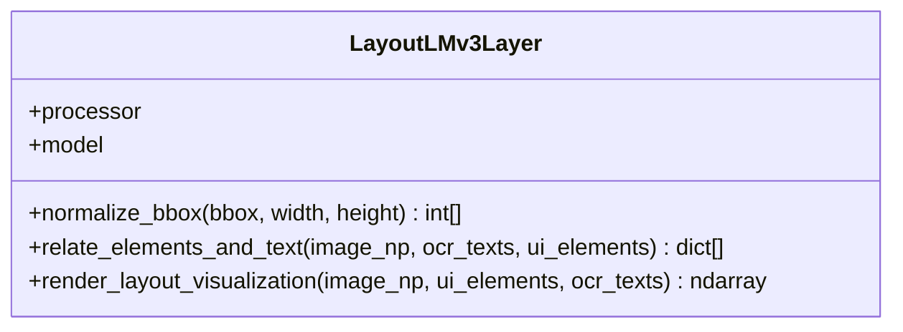
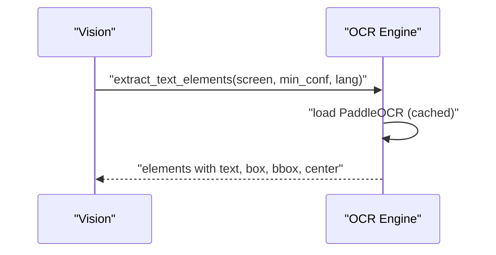
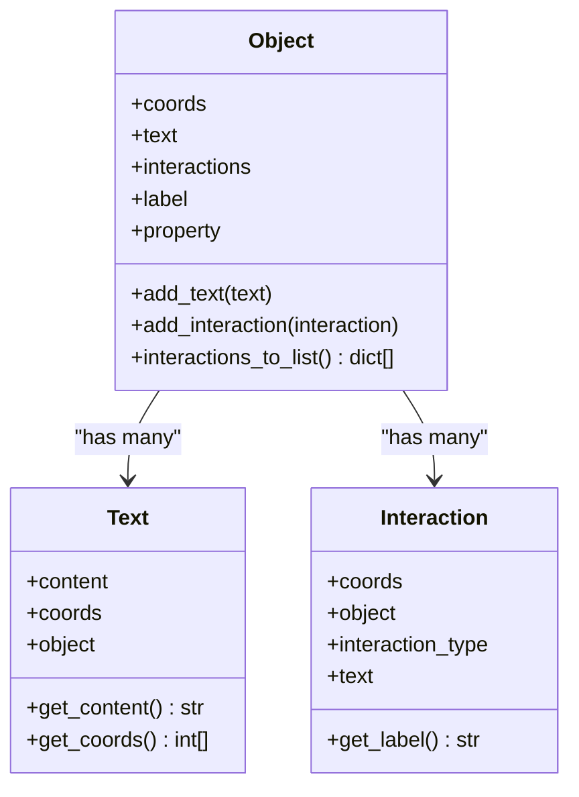
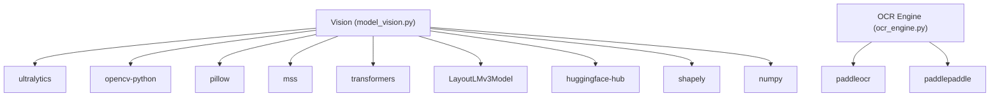

# Vision Models

<cite>
**Referenced Files in This Document**
- [model_vision.py](file://LoOper/player/Computer_vision/model_vision.py)
- [layoutlmv3_layer.py](file://LoOper/player/Computer_vision/layoutlmv3_layer.py)
- [object.py](file://LoOper/player/Computer_vision/object.py)
- [test_vision.py](file://LoOper/player/Computer_vision/test_vision.py)
- [test_ocr.py](file://LoOper/player/Computer_vision/test_ocr.py)
- [README.md](file://LoOper/player/Computer_vision/README.md)
- [label_description.json](file://LoOper/player/Computer_vision/label_description.json)
- [ocr_engine.py](file://LoOper/player/ocr_engine.py)
- [config.py](file://LoOper/player/config.py)
- [computer_vision.py](file://LoOper/player/computer_vision.py)
- [requirements.txt](file://requirements.txt)
</cite>

## Table of Contents
1. [Introduction](#introduction)
2. [Project Structure](#project-structure)
3. [Core Components](#core-components)
4. [Architecture Overview](#architecture-overview)
5. [Detailed Component Analysis](#detailed-component-analysis)
6. [Dependency Analysis](#dependency-analysis)
7. [Performance Considerations](#performance-considerations)
8. [Troubleshooting Guide](#troubleshooting-guide)
9. [Conclusion](#conclusion)
10. [Appendices](#appendices)

## Introduction
This document explains the vision models system that powers ONNX-based inference and LayoutLMv3 integration for advanced computer vision tasks. It covers model loading and initialization, runtime configuration, inference pipeline management, LayoutLMv3 layer implementation for document understanding, object detection capabilities, model caching strategies, and practical integration examples into the automation workflow. It also details performance optimization, memory management, error handling and fallback strategies, debugging capabilities, model versioning/update mechanisms, and hardware-specific tuning.

## Project Structure
The vision system resides under the Computer_vision module and integrates with OCR and higher-level automation players. Key files include:
- Vision pipeline and inference orchestration
- LayoutLMv3 layer for text-field labeling and visualization
- OCR engine integration
- Configuration and environment setup
- Tests and documentation

**Diagram sources**
- [model_vision.py](file://LoOper/player/Computer_vision/model_vision.py)
- [layoutlmv3_layer.py](file://LoOper/player/Computer_vision/layoutlmv3_layer.py)
- [object.py](file://LoOper/player/Computer_vision/object.py)
- [test_vision.py](file://LoOper/player/Computer_vision/test_vision.py)
- [test_ocr.py](file://LoOper/player/Computer_vision/test_ocr.py)
- [label_description.json](file://LoOper/player/Computer_vision/label_description.json)
- [ocr_engine.py](file://LoOper/player/ocr_engine.py)
- [config.py](file://LoOper/player/config.py)
- [computer_vision.py](file://LoOper/player/computer_vision.py)
- [requirements.txt](file://requirements.txt)

**Section sources**
- [README.md](file://LoOper/player/Computer_vision/README.md)
- [requirements.txt](file://requirements.txt)

## Core Components
- Vision: Orchestrates YOLO-based object detection, OCR integration, pruning, deduplication, and LayoutLMv3 labeling. It supports screen capture, overlay rendering, and saving outputs.
- LayoutLMv3Layer: Provides LayoutLMv3-based text-field association and visualization overlays.
- OCR Engine: PaddleOCR wrapper with caching and model bundling for offline use.
- Object/Interaction/Text: Data structures representing detected UI elements and their relationships.
- Configuration: Environment setup, OCR availability detection, and logging.

Key responsibilities:
- Model loading and initialization
- Runtime configuration and environment preparation
- Inference pipeline management (YOLO + OCR + LayoutLMv3)
- Pruning and deduplication of detections
- Visualization and output persistence
- Memory cleanup and unload routines

**Section sources**
- [model_vision.py](file://LoOper/player/Computer_vision/model_vision.py)
- [layoutlmv3_layer.py](file://LoOper/player/Computer_vision/layoutlmv3_layer.py)
- [ocr_engine.py](file://LoOper/player/ocr_engine.py)
- [object.py](file://LoOper/player/Computer_vision/object.py)
- [config.py](file://LoOper/player/config.py)

## Architecture Overview
The vision system combines:
- YOLOv8 models for UI structure and icon detection
- PaddleOCR for text extraction
- LayoutLMv3 for contextual text-field labeling
- OpenCV/MSS for screen capture and visualization
- JSON-based pruning and deduplication

**Diagram sources**
- [model_vision.py](file://LoOper/player/Computer_vision/model_vision.py)
- [layoutlmv3_layer.py](file://LoOper/player/Computer_vision/layoutlmv3_layer.py)
- [ocr_engine.py](file://LoOper/player/ocr_engine.py)

## Detailed Component Analysis

### Vision Pipeline
The Vision class encapsulates:
- Model initialization (YOLO structure and optional icon model)
- Screen capture and preprocessing
- Multi-augmentation inference (original, grayscale-high-contrast, inverted)
- Non-Maximum Suppression averaging and large-element masking
- Field computation via OCR and LayoutLMv3
- Pruning and deduplication
- Visualization and persistence

**Diagram sources**
- [model_vision.py](file://LoOper/player/Computer_vision/model_vision.py)

**Section sources**
- [model_vision.py](file://LoOper/player/Computer_vision/model_vision.py)

### LayoutLMv3 Layer Implementation
The LayoutLMv3Layer:
- Initializes processor and model from pretrained weights
- Normalizes bounding boxes to LayoutLMv3’s 1000-scale
- Builds unified token sets combining OCR words and UI element placeholders
- Computes embeddings and cosine similarities with spatial heuristics
- Produces labeled UI elements and a visualization overlay

**Diagram sources**
- [layoutlmv3_layer.py](file://LoOper/player/Computer_vision/layoutlmv3_layer.py)

**Section sources**
- [layoutlmv3_layer.py](file://LoOper/player/Computer_vision/layoutlmv3_layer.py)

### OCR Engine Integration
The OCR engine:
- Detects OCR availability and engine type
- Initializes PaddleOCR with bundled model directories when frozen
- Normalizes languages and caches engines
- Extracts text elements with polygons and confidence scores
- Converts coordinates to absolute pixel space

**Diagram sources**
- [ocr_engine.py](file://LoOper/player/ocr_engine.py)
- [model_vision.py](file://LoOper/player/Computer_vision/model_vision.py)

**Section sources**
- [ocr_engine.py](file://LoOper/player/ocr_engine.py)
- [config.py](file://LoOper/player/config.py)

### Object Model and Relationships
The object model defines:
- Object: UI element with coordinates, property, and interactions
- Text: OCR-derived text with coordinates
- Interaction: Relationship between Object and detected UI interactions

**Diagram sources**
- [object.py](file://LoOper/player/Computer_vision/object.py)

**Section sources**
- [object.py](file://LoOper/player/Computer_vision/object.py)

### ONNX Runtime and YOLO Integration
- YOLO models are loaded via Ultralytics and used for structure and icon detection.
- The system prepares environment paths for ONNX runtime and related DLLs on Windows.
- It supports model paths and label descriptions for categorizing detections.

Notes:
- The Vision class initializes YOLO models and manages their lifecycle.
- Label descriptions map labels to roles (Object, Property, Interaction, Text).

**Section sources**
- [model_vision.py](file://LoOper/player/Computer_vision/model_vision.py)
- [label_description.json](file://LoOper/player/Computer_vision/label_description.json)

### Inference Pipeline Management
- Multi-augmentation inference improves robustness across lighting and contrast.
- NMS averaging reduces duplicates and stabilizes coordinates.
- Large-element masking prevents overlapping detections from interfering.
- ROI-based refinement focuses subsequent detection on salient regions.

**Section sources**
- [model_vision.py](file://LoOper/player/Computer_vision/model_vision.py)

### Pruning, Deduplication, and Field Computation
- Pruning filters detections by category and merges overlapping boxes.
- Deduplication prefers semantically meaningful types (e.g., input/select over button).
- Field computation uses OCR to assign labels and detect filled values, with LayoutLMv3 enhancing spatial context.

**Section sources**
- [model_vision.py](file://LoOper/player/Computer_vision/model_vision.py)

### Visualization and Output Persistence
- Annotated overlays and masks are rendered and saved.
- JSON snapshots capture pruned outputs, fields, and context items.
- LayoutLMv3 visualization overlays UI elements with assigned labels.

**Section sources**
- [model_vision.py](file://LoOper/player/Computer_vision/model_vision.py)
- [layoutlmv3_layer.py](file://LoOper/player/Computer_vision/layoutlmv3_layer.py)

### Practical Integration Examples
- Single image analysis: Use analyze_image_file to process a static image and persist outputs.
- Live overlay: start_vision captures live frames, renders overlays, and optionally describes scenes with external LLMs.

Examples (paths only):
- [test_vision.py](file://LoOper/player/Computer_vision/test_vision.py)
- [model_vision.py](file://LoOper/player/Computer_vision/model_vision.py)

**Section sources**
- [test_vision.py](file://LoOper/player/Computer_vision/test_vision.py)
- [model_vision.py](file://LoOper/player/Computer_vision/model_vision.py)

## Dependency Analysis
External dependencies include:
- Ultralytics (YOLO)
- OpenCV/Pillow/MSS
- PaddleOCR
- Transformers/LayoutLMv3
- HuggingFace Hub (for model downloads)
- NumPy, Shapely, etc.

**Diagram sources**
- [requirements.txt](file://requirements.txt)
- [model_vision.py](file://LoOper/player/Computer_vision/model_vision.py)
- [ocr_engine.py](file://LoOper/player/ocr_engine.py)

**Section sources**
- [requirements.txt](file://requirements.txt)

## Performance Considerations
- Multi-augmentation inference improves accuracy but increases cost; tune augmentation count and confidence thresholds.
- NMS averaging stabilizes coordinates; adjust overlap thresholds to balance precision/recall.
- Large-element masking reduces redundant detections; tune thresholds to avoid missing small but important UI elements.
- LayoutLMv3 embedding computation is CPU-bound; consider reducing input length or disabling visualization for latency-sensitive flows.
- Memory management: unload models and empty CUDA cache when idle; Vision.unload performs cleanup.

[No sources needed since this section provides general guidance]

## Troubleshooting Guide
Common issues and remedies:
- Model loading failures:
  - Verify model paths and labels; the Vision class prints explicit errors when models fail to load.
  - Ensure environment paths for ONNX runtime DLLs are configured (Windows-specific).
- OCR not available:
  - Confirm PaddleOCR installation and engine detection; OCR_AVAILABLE and OCR_ENGINE are set accordingly.
- Resource constraints:
  - Reduce inference frequency or resolution.
  - Use unload to free GPU/CPU resources.
- Visualization anomalies:
  - Adjust NMS thresholds and ROI filtering.
  - Inspect label_description.json mappings.

**Section sources**
- [model_vision.py](file://LoOper/player/Computer_vision/model_vision.py)
- [config.py](file://LoOper/player/config.py)
- [ocr_engine.py](file://LoOper/player/ocr_engine.py)

## Conclusion
The vision models system integrates YOLO-based detection, OCR, and LayoutLMv3 to deliver robust UI understanding and labeling. Its modular design enables flexible inference pipelines, strong pruning/deduplication, and rich visualizations. With careful configuration, memory management, and fallback strategies, it scales across diverse automation scenarios.

[No sources needed since this section summarizes without analyzing specific files]

## Appendices

### Model Loading and Initialization
- Vision constructor loads YOLO structure model and optional icon model; falls back gracefully if unavailable.
- LayoutLMv3Layer initializes processor and model from pretrained weights.
- Environment preparation ensures ONNX runtime DLLs are discoverable on Windows.

**Section sources**
- [model_vision.py](file://LoOper/player/Computer_vision/model_vision.py)
- [layoutlmv3_layer.py](file://LoOper/player/Computer_vision/layoutlmv3_layer.py)

### ONNX Runtime Configuration
- Windows-specific path prepends ONNX runtime directories to PATH and loads required DLLs.
- Ultralytics YOLO models are used; ensure compatible versions are installed.

**Section sources**
- [model_vision.py](file://LoOper/player/Computer_vision/model_vision.py)
- [requirements.txt](file://requirements.txt)

### Inference Pipeline Management
- Multi-frame augmentation, NMS averaging, masking, and ROI refinement improve robustness.
- OCR integration normalizes coordinates and confidence; LayoutLMv3 enhances spatial labeling.

**Section sources**
- [model_vision.py](file://LoOper/player/Computer_vision/model_vision.py)

### LayoutLMv3 Layer Implementation
- Normalizes bounding boxes to 1000-scale.
- Aggregates token embeddings and computes similarity with spatial heuristics.
- Renders unified overlays with element-type-specific colors.

**Section sources**
- [layoutlmv3_layer.py](file://LoOper/player/Computer_vision/layoutlmv3_layer.py)

### Object Detection Capabilities
- Structure and icon detection via YOLO.
- Label-role mapping via label_description.json.
- Interaction classification and property assignment.

**Section sources**
- [model_vision.py](file://LoOper/player/Computer_vision/model_vision.py)
- [label_description.json](file://LoOper/player/Computer_vision/label_description.json)

### Model Caching Strategies
- PaddleOCR engines are cached to avoid repeated initialization.
- Template matching cache is available for computer vision operations.

**Section sources**
- [ocr_engine.py](file://LoOper/player/ocr_engine.py)
- [computer_vision.py](file://LoOper/player/computer_vision.py)

### Practical Usage Scenarios
- Static image analysis: analyze_image_file for batch processing.
- Live overlay: start_vision for interactive debugging and automation assistance.

**Section sources**
- [test_vision.py](file://LoOper/player/Computer_vision/test_vision.py)
- [model_vision.py](file://LoOper/player/Computer_vision/model_vision.py)

### Error Handling and Fallbacks
- Graceful degradation when models or OCR are unavailable.
- Overlay rendering and saving even if parts of the pipeline fail.
- Unload routine clears models and empties CUDA cache.

**Section sources**
- [model_vision.py](file://LoOper/player/Computer_vision/model_vision.py)

### Debugging Capabilities
- Extensive logging and printed diagnostics.
- Saved overlays, masks, and JSON snapshots aid inspection.
- OCR tests demonstrate end-to-end extraction.

**Section sources**
- [model_vision.py](file://LoOper/player/Computer_vision/model_vision.py)
- [test_ocr.py](file://LoOper/player/Computer_vision/test_ocr.py)

### Model Versioning and Updates
- YOLO model path is configurable; update to newer versions by changing the path.
- LayoutLMv3 uses pretrained weights; update by switching to a different checkpoint.
- OCR models can be bundled in frozen environments.

**Section sources**
- [model_vision.py](file://LoOper/player/Computer_vision/model_vision.py)
- [ocr_engine.py](file://LoOper/player/ocr_engine.py)

### Performance Tuning for Hardware Configurations
- CPU-only: reduce augmentation count, lower resolution, disable LayoutLMv3 visualization.
- GPU-enabled: ensure CUDA cache is emptied periodically; unload models between runs.
- Mixed environments: prefer headless OpenCV builds when GUI is not needed.

**Section sources**
- [model_vision.py](file://LoOper/player/Computer_vision/model_vision.py)
- [requirements.txt](file://requirements.txt)