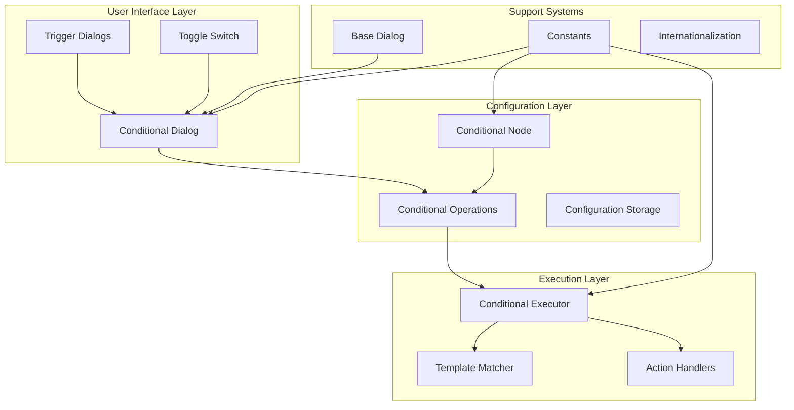
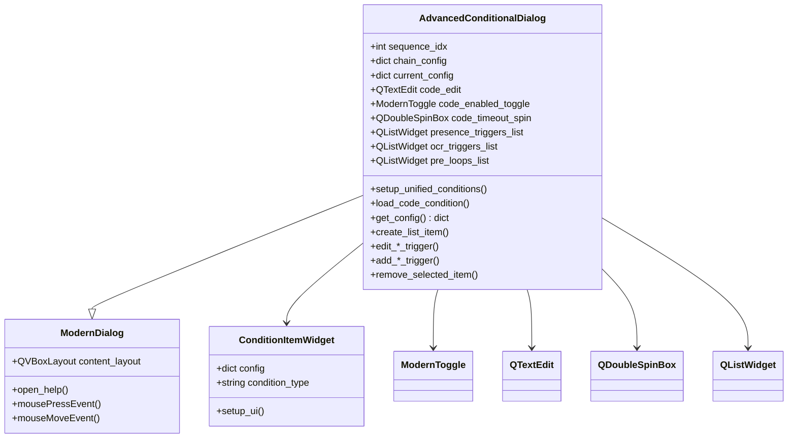
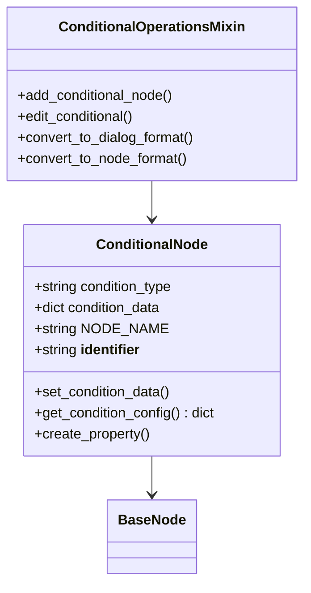
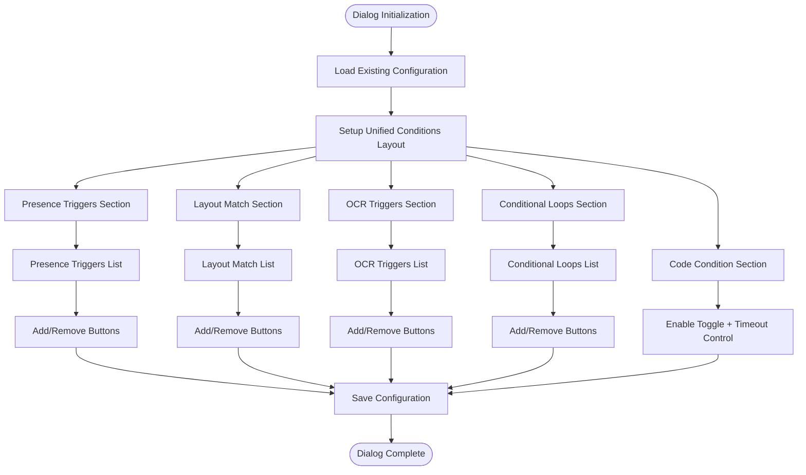
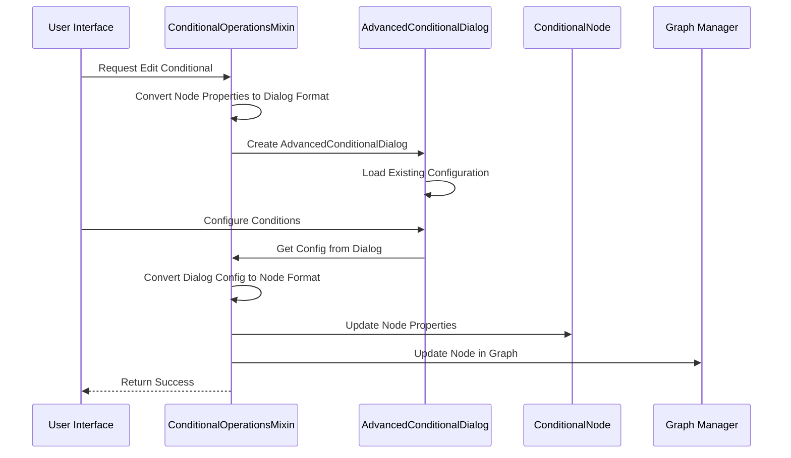
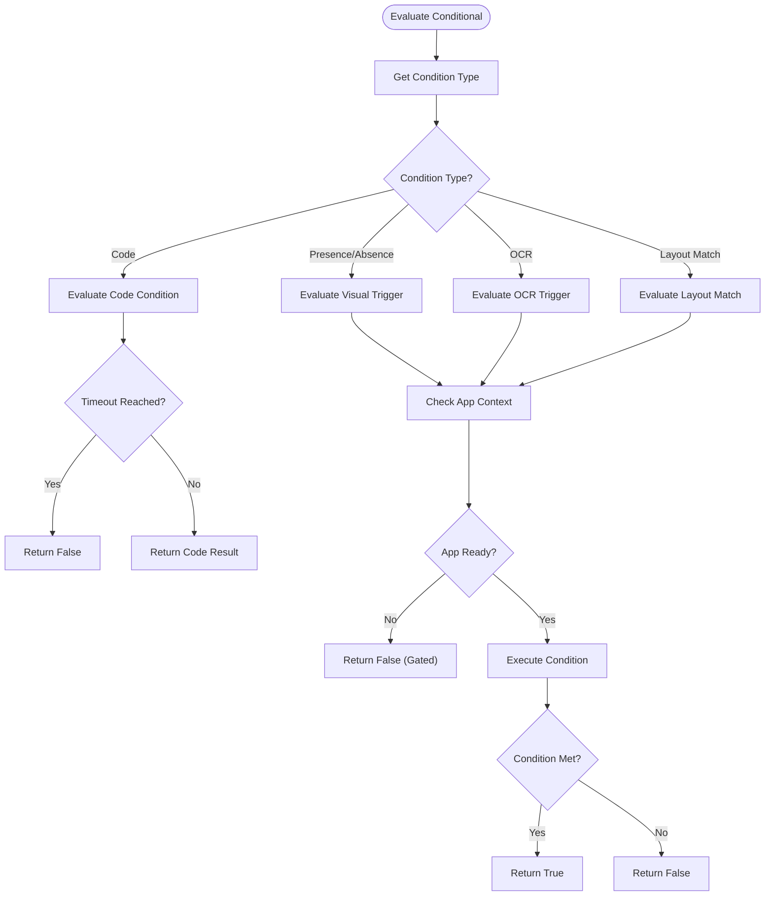
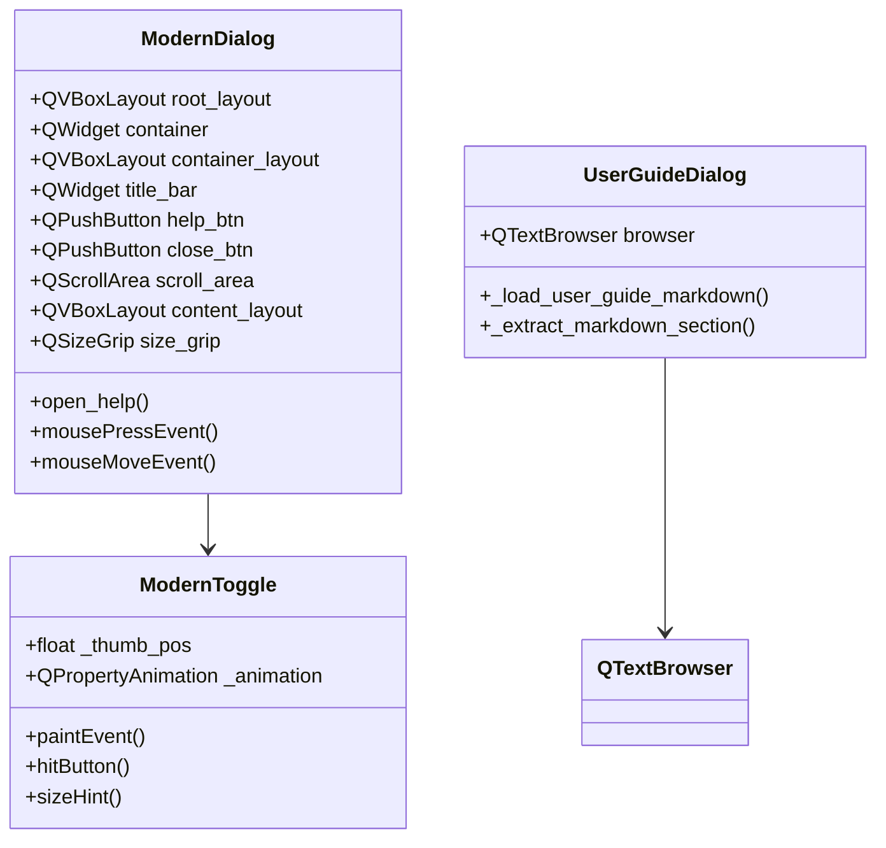
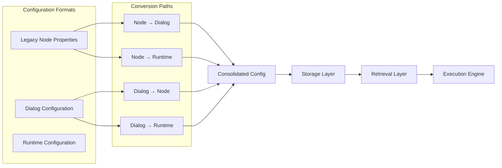

# Conditional Dialogs

<cite>
**Referenced Files in This Document**
- [conditional_dialogs.py](file://LoOper/NGUI/dialogs/conditional_dialogs.py)
- [conditional.py](file://LoOper/NGUI/graph_elements/node_operations_modules/conditional.py)
- [conditional_node.py](file://LoOper/NGUI/nodes_resources/conditional_node.py)
- [conditional_ops.py](file://LoOper/player/multi_sequence/worflow_interpreter_modules/executor_modules/conditional_ops.py)
- [trigger_dialogs.py](file://LoOper/NGUI/dialogs/trigger_dialogs.py)
- [toggle_switch.py](file://LoOper/NGUI/dialogs/toggle_switch.py)
- [base_dialog.py](file://LoOper/NGUI/dialogs/base_dialog.py)
- [constants.py](file://LoOper/NGUI/constants.py)
</cite>

## Table of Contents
1. [Introduction](#introduction)
2. [System Architecture](#system-architecture)
3. [Core Components](#core-components)
4. [Conditional Dialog Implementation](#conditional-dialog-implementation)
5. [Conditional Node Management](#conditional-node-management)
6. [Execution Engine Integration](#execution-engine-integration)
7. [User Interface Design](#user-interface-design)
8. [Configuration Management](#configuration-management)
9. [Performance Considerations](#performance-considerations)
10. [Troubleshooting Guide](#troubleshooting-guide)
11. [Conclusion](#conclusion)

## Introduction

The Conditional Dialogs system in LoOper provides a comprehensive framework for creating sophisticated conditional logic within automation workflows. This system enables users to define complex decision-making structures that control the flow of automated sequences based on various trigger conditions, including image recognition, OCR text matching, conditional loops, and custom Python code execution.

The system consists of three primary layers: a user-friendly dialog interface for configuration, a node-based representation for workflow integration, and an execution engine that evaluates conditions during runtime. This architecture supports both simple and complex conditional scenarios while maintaining intuitive usability.

## System Architecture

The Conditional Dialogs system follows a layered architecture that separates concerns between user interface, configuration management, and execution logic.

**Diagram sources**
- [conditional_dialogs.py:119-790](file://LoOper/NGUI/dialogs/conditional_dialogs.py#L119-L790)
- [conditional.py:8-264](file://LoOper/NGUI/graph_elements/node_operations_modules/conditional.py#L8-L264)
- [conditional_node.py:10-164](file://LoOper/NGUI/nodes_resources/conditional_node.py#L10-L164)

## Core Components

### AdvancedConditionalDialog Class

The `AdvancedConditionalDialog` serves as the primary user interface for configuring conditional logic. It provides a unified, tab-free interface that consolidates all conditional types into a single, cohesive experience.

**Diagram sources**
- [conditional_dialogs.py:23-790](file://LoOper/NGUI/dialogs/conditional_dialogs.py#L23-L790)
- [base_dialog.py:88-382](file://LoOper/NGUI/dialogs/base_dialog.py#L88-L382)

**Section sources**
- [conditional_dialogs.py:119-790](file://LoOper/NGUI/dialogs/conditional_dialogs.py#L119-L790)

### Conditional Node System

The conditional node system provides a persistent representation of conditional logic within the workflow graph. Each conditional node maintains its own configuration and can be connected to other nodes in the graph.

**Diagram sources**
- [conditional_node.py:10-164](file://LoOper/NGUI/nodes_resources/conditional_node.py#L10-L164)
- [conditional.py:8-264](file://LoOper/NGUI/graph_elements/node_operations_modules/conditional.py#L8-L264)

**Section sources**
- [conditional_node.py:10-164](file://LoOper/NGUI/nodes_resources/conditional_node.py#L10-L164)
- [conditional.py:8-264](file://LoOper/NGUI/graph_elements/node_operations_modules/conditional.py#L8-L264)

## Conditional Dialog Implementation

### Unified Dialog Interface

The AdvancedConditionalDialog implements a unified interface that eliminates the complexity of traditional tabbed dialogs. This design choice improves user experience by presenting all conditional options in a single, organized layout.

**Diagram sources**
- [conditional_dialogs.py:137-331](file://LoOper/NGUI/dialogs/conditional_dialogs.py#L137-L331)

### Condition Item Widget

The `ConditionItemWidget` provides a visual representation of each condition in the list, displaying preview information and configuration details in a compact format.

**Section sources**
- [conditional_dialogs.py:23-118](file://LoOper/NGUI/dialogs/conditional_dialogs.py#L23-L118)

## Conditional Node Management

### Node Operations Mixin

The `ConditionalOperationsMixin` handles the creation, editing, and conversion of conditional nodes between dialog and node formats.

**Diagram sources**
- [conditional.py:37-264](file://LoOper/NGUI/graph_elements/node_operations_modules/conditional.py#L37-L264)

**Section sources**
- [conditional.py:8-264](file://LoOper/NGUI/graph_elements/node_operations_modules/conditional.py#L8-L264)

## Execution Engine Integration

### Conditional Evaluation Engine

The execution engine evaluates conditional logic during workflow execution, supporting multiple condition types and providing robust error handling.

**Diagram sources**
- [conditional_ops.py:245-334](file://LoOper/player/multi_sequence/worflow_interpreter_modules/executor_modules/conditional_ops.py#L245-L334)

### Conditional Loop Execution

The system supports both pre-execution and post-execution conditional loops, enabling iterative automation workflows.

**Section sources**
- [conditional_ops.py:752-892](file://LoOper/player/multi_sequence/worflow_interpreter_modules/executor_modules/conditional_ops.py#L752-L892)

## User Interface Design

### Modern Dialog Framework

The dialog system follows a modern, dark-themed design with consistent styling and responsive behavior.

**Diagram sources**
- [base_dialog.py:88-382](file://LoOper/NGUI/dialogs/base_dialog.py#L88-L382)
- [toggle_switch.py:8-104](file://LoOper/NGUI/dialogs/toggle_switch.py#L8-L104)

**Section sources**
- [base_dialog.py:88-382](file://LoOper/NGUI/dialogs/base_dialog.py#L88-L382)
- [toggle_switch.py:8-104](file://LoOper/NGUI/dialogs/toggle_switch.py#L8-L104)

## Configuration Management

### Data Persistence and Migration

The system handles configuration persistence across different condition types and provides backward compatibility for legacy configurations.

**Diagram sources**
- [conditional.py:37-264](file://LoOper/NGUI/graph_elements/node_operations_modules/conditional.py#L37-L264)

**Section sources**
- [conditional.py:37-264](file://LoOper/NGUI/graph_elements/node_operations_modules/conditional.py#L37-L264)

## Performance Considerations

### Optimization Strategies

The conditional system implements several performance optimizations to ensure responsive operation during complex workflows.

- **Lazy Loading**: Conditional configurations are loaded only when needed
- **Efficient Matching**: Template matching uses optimized algorithms for visual conditions
- **Memory Management**: Proper cleanup of resources during conditional evaluation
- **Timeout Handling**: Prevents infinite waits in conditional loops and trigger detection

### Resource Management

The system carefully manages system resources during conditional evaluation:

- **Screen Capture Optimization**: Minimizes screenshot operations for visual triggers
- **Thread Safety**: Ensures safe concurrent execution of conditional checks
- **Error Recovery**: Provides graceful degradation when conditions fail to evaluate

## Troubleshooting Guide

### Common Issues and Solutions

**Conditional Not Triggering**
- Verify image paths are correct and accessible
- Check confidence thresholds are appropriate for the target images
- Ensure timeout values are sufficient for the target environment

**Code Conditions Failing**
- Validate Python syntax in code blocks
- Check timeout values are adequate for complex operations
- Verify required dependencies are installed

**Layout Match Failures**
- Confirm target coordinates are within screen boundaries
- Adjust position tolerance values for screen scaling
- Verify template images are properly captured and saved

**Performance Issues**
- Reduce the number of concurrent conditional checks
- Optimize image sizes for faster matching
- Consider increasing timeout values for slower systems

**Section sources**
- [conditional_dialogs.py:675-681](file://LoOper/NGUI/dialogs/conditional_dialogs.py#L675-L681)
- [conditional_ops.py:575-750](file://LoOper/player/multi_sequence/worflow_interpreter_modules/executor_modules/conditional_ops.py#L575-L750)

## Conclusion

The Conditional Dialogs system in LoOper provides a robust, extensible framework for implementing sophisticated conditional logic in automation workflows. Through its unified dialog interface, comprehensive node system, and powerful execution engine, it enables users to create complex decision-making structures that adapt to various runtime conditions.

The system's modular architecture ensures maintainability and extensibility, while its performance optimizations provide responsive operation even in complex scenarios. The combination of visual trigger detection, OCR capabilities, conditional loops, and custom code execution creates a versatile foundation for advanced automation workflows.

Future enhancements could include additional condition types, improved visualization of conditional relationships, and enhanced debugging capabilities for complex conditional scenarios.