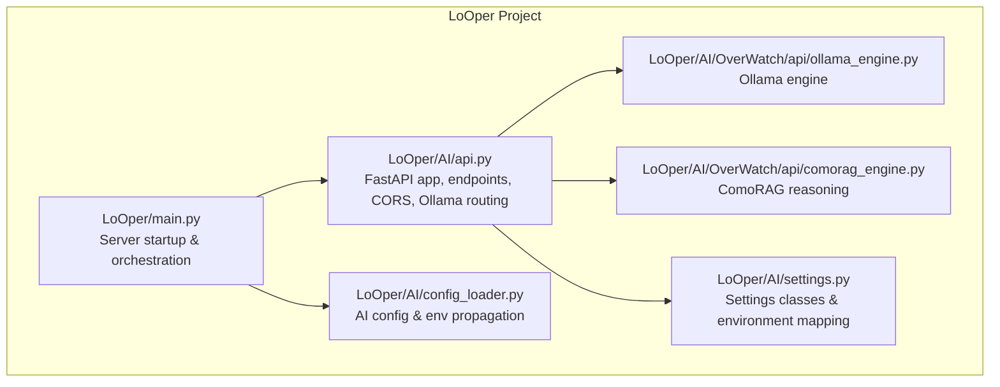
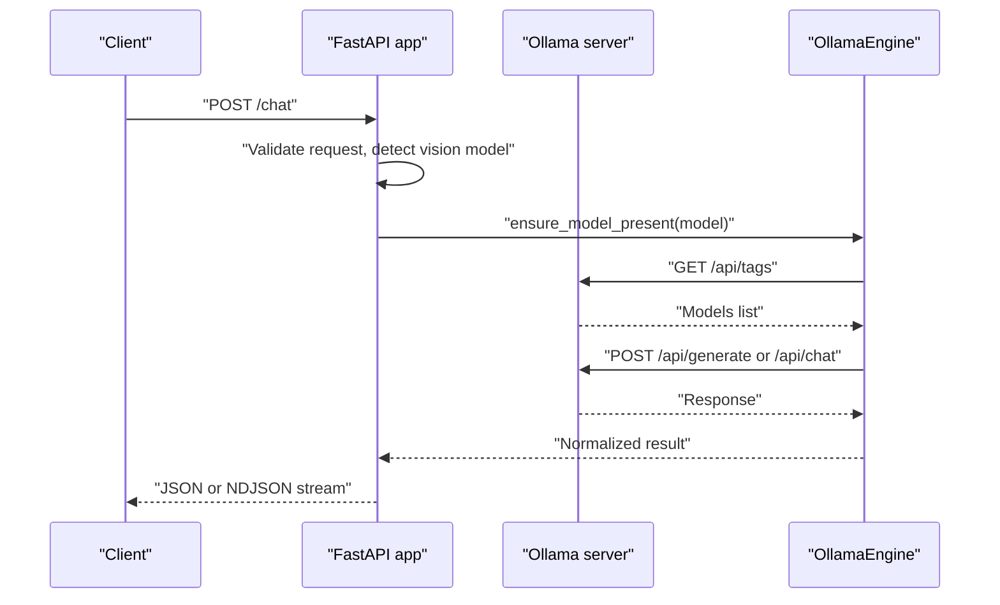
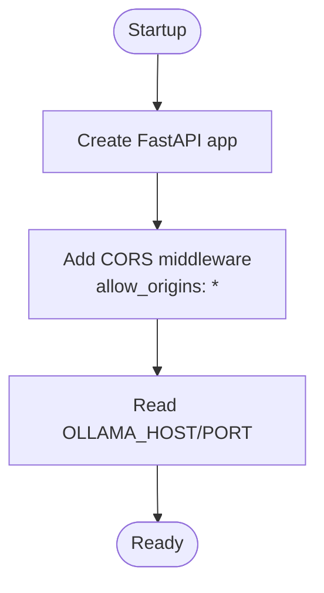
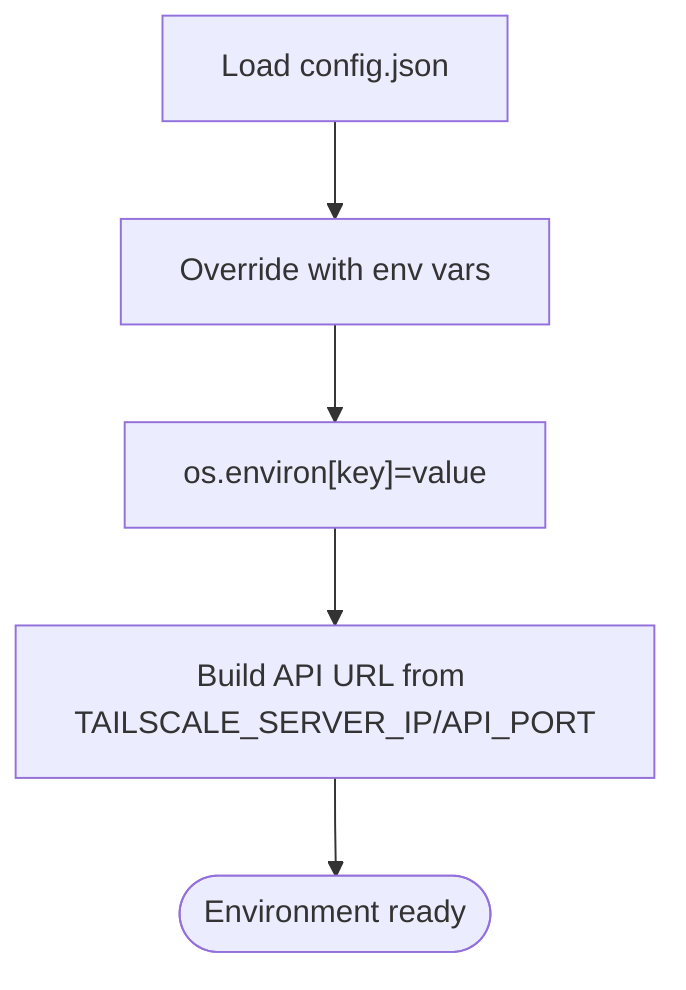
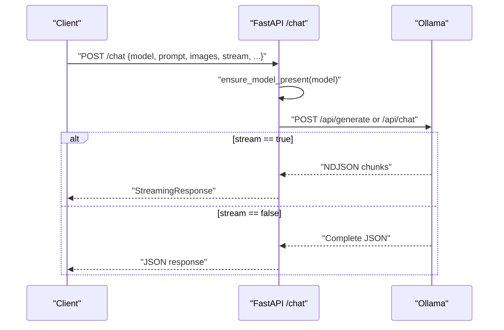
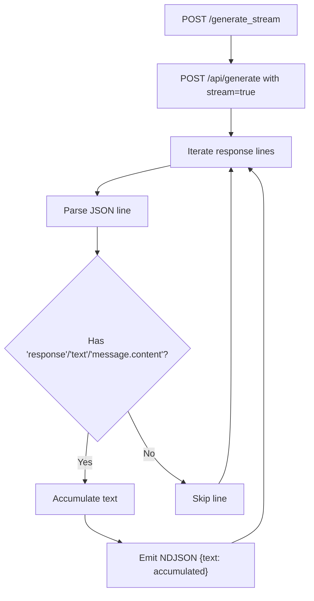
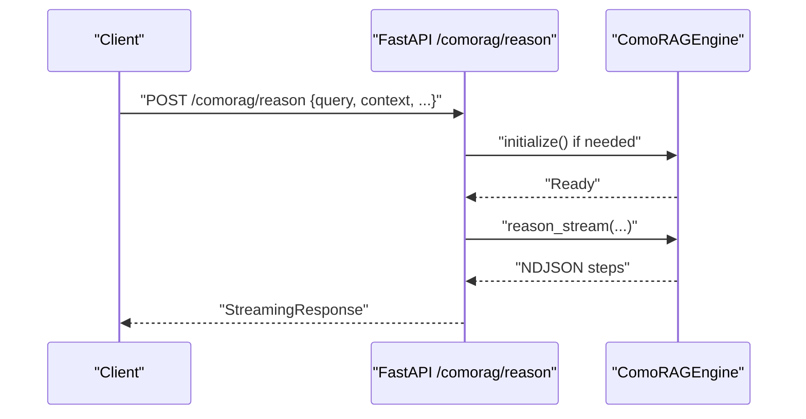
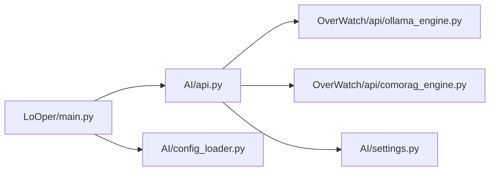
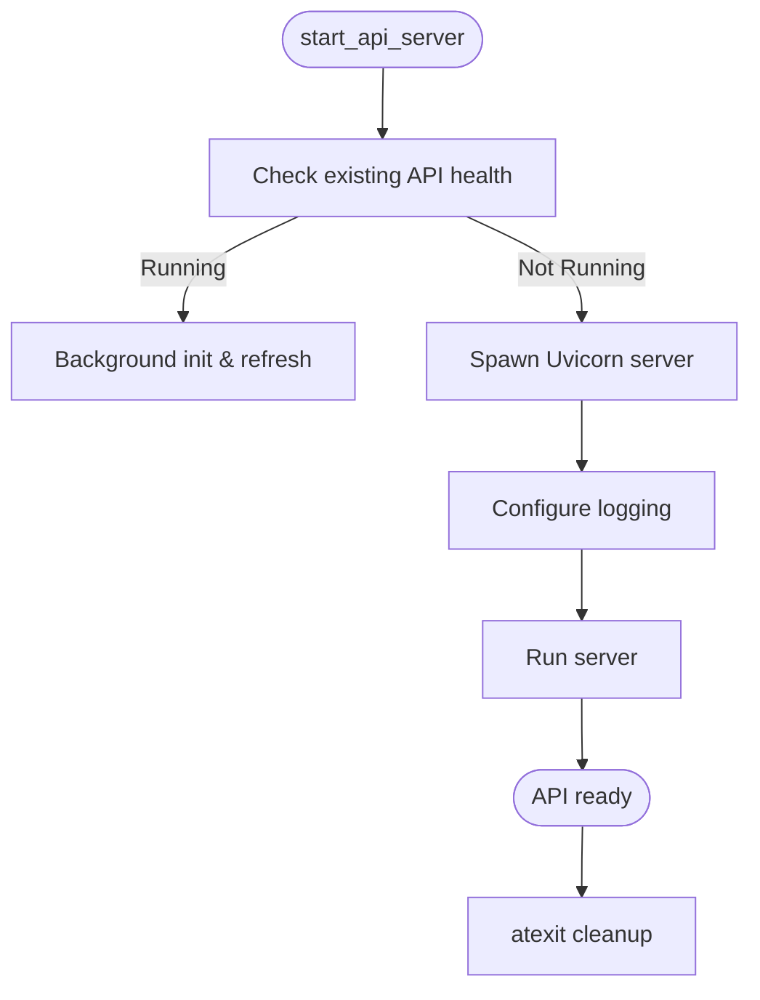

# AI API Server

<cite>
**Referenced Files in This Document**
- [main.py](file://LoOper/main.py)
- [api.py](file://LoOper/AI/api.py)
- [settings.py](file://LoOper/AI/settings.py)
- [config_loader.py](file://LoOper/AI/config_loader.py)
- [ollama_engine.py](file://LoOper/AI/OverWatch/api/ollama_engine.py)
- [comorag_engine.py](file://LoOper/AI/OverWatch/api/comorag_engine.py)
- [README.MD](file://LoOper/README.MD)
</cite>

## Table of Contents
1. [Introduction](#introduction)
2. [Project Structure](#project-structure)
3. [Core Components](#core-components)
4. [Architecture Overview](#architecture-overview)
5. [Detailed Component Analysis](#detailed-component-analysis)
6. [Dependency Analysis](#dependency-analysis)
7. [Performance Considerations](#performance-considerations)
8. [Troubleshooting Guide](#troubleshooting-guide)
9. [Conclusion](#conclusion)
10. [Appendices](#appendices)

## Introduction
This document describes the AI API server built with FastAPI and Uvicorn, designed to route requests to Ollama models behind an API gateway. It covers the API gateway architecture, CORS configuration for Tailscale network access, environment variable handling, HTTP endpoints (/chat, /generate, /models, /health, /embeddings), streaming responses, error handling, timeouts, client integration patterns, authentication considerations, performance optimization, server startup, graceful shutdown, and monitoring capabilities.

## Project Structure
The AI API server is implemented as a FastAPI application embedded within the broader LoOper project. Key elements include:
- FastAPI application definition and middleware configuration
- Endpoint implementations for chat, generation, embeddings, model listing, health checks, and memory management
- Ollama integration for model inference and embeddings
- Optional ComoRAG engine integration for advanced reasoning
- Configuration management via environment variables and JSON settings
- Startup/shutdown orchestration with Uvicorn and optional subprocess-based server management

**Diagram sources**
- [main.py:171-353](file://LoOper/main.py#L171-L353)
- [api.py:37-51](file://LoOper/AI/api.py#L37-L51)
- [settings.py:16-83](file://LoOper/AI/settings.py#L16-L83)
- [config_loader.py:9-66](file://LoOper/AI/config_loader.py#L9-L66)
- [ollama_engine.py:34-96](file://LoOper/AI/OverWatch/api/ollama_engine.py#L34-L96)
- [comorag_engine.py:233-287](file://LoOper/AI/OverWatch/api/comorag_engine.py#L233-L287)

**Section sources**
- [README.MD:13-47](file://LoOper/README.MD#L13-L47)
- [main.py:171-353](file://LoOper/main.py#L171-L353)
- [api.py:37-51](file://LoOper/AI/api.py#L37-L51)

## Core Components
- FastAPI application with CORS middleware configured for Tailscale access
- Ollama integration for model inference and embeddings
- Optional ComoRAG engine for stateful reasoning with memory consolidation
- Configuration loader that merges JSON and environment variables
- Server startup logic supporting both in-process Uvicorn and external subprocess

Key responsibilities:
- Expose REST endpoints for chat, generation, embeddings, model listing, and health
- Route requests to Ollama with proper model availability checks and cleanup
- Stream responses for real-time interactions
- Manage environment variables for Tailscale and API binding
- Initialize engines and background bootstrap tasks

**Section sources**
- [api.py:37-51](file://LoOper/AI/api.py#L37-L51)
- [api.py:512-541](file://LoOper/AI/api.py#L512-L541)
- [api.py:530-540](file://LoOper/AI/api.py#L530-L540)
- [config_loader.py:9-66](file://LoOper/AI/config_loader.py#L9-L66)
- [settings.py:16-83](file://LoOper/AI/settings.py#L16-L83)

## Architecture Overview
The API gateway sits between clients and the Ollama server. Requests are validated, optionally routed to vision-capable models, and streamed back to clients. Optional ComoRAG endpoints provide stateful reasoning with memory consolidation.

**Diagram sources**
- [api.py:655-761](file://LoOper/AI/api.py#L655-L761)
- [ollama_engine.py:53-96](file://LoOper/AI/OverWatch/api/ollama_engine.py#L53-L96)

**Section sources**
- [api.py:655-761](file://LoOper/AI/api.py#L655-L761)
- [ollama_engine.py:53-96](file://LoOper/AI/OverWatch/api/ollama_engine.py#L53-L96)

## Detailed Component Analysis

### FastAPI Application and CORS
- Application instance configured with title, description, and version
- CORS middleware allows all origins, credentials, methods, and headers to support Tailscale network access
- Environment-driven Ollama base URL derived from environment variables

**Diagram sources**
- [api.py:37-51](file://LoOper/AI/api.py#L37-L51)
- [api.py:52-59](file://LoOper/AI/api.py#L52-L59)

**Section sources**
- [api.py:37-51](file://LoOper/AI/api.py#L37-L51)
- [api.py:52-59](file://LoOper/AI/api.py#L52-L59)

### Environment Variable Handling
- AI configuration loader merges JSON and environment variables, setting process environment for current session
- API URL resolution supports Tailscale server IP and port
- Settings module defines structured settings with environment overrides

**Diagram sources**
- [config_loader.py:22-48](file://LoOper/AI/config_loader.py#L22-L48)
- [config_loader.py:50-66](file://LoOper/AI/config_loader.py#L50-L66)
- [settings.py:128-174](file://LoOper/AI/settings.py#L128-L174)

**Section sources**
- [config_loader.py:22-48](file://LoOper/AI/config_loader.py#L22-L48)
- [config_loader.py:50-66](file://LoOper/AI/config_loader.py#L50-L66)
- [settings.py:128-174](file://LoOper/AI/settings.py#L128-L174)

### HTTP Endpoints

#### GET /
- Returns API info, network configuration, environment variables, and endpoint list
- Useful for client discovery and diagnostics

**Section sources**
- [api.py:547-579](file://LoOper/AI/api.py#L547-L579)

#### GET /health
- Probes Ollama server for availability
- Reports bootstrap state and model readiness
- Returns 503 on connectivity issues

**Section sources**
- [api.py:581-607](file://LoOper/AI/api.py#L581-L607)

#### GET /models
- Lists Ollama models with name, size, digest, and modified date
- Returns 503/500 on errors

**Section sources**
- [api.py:608-654](file://LoOper/AI/api.py#L608-L654)

#### POST /chat
- Supports both text and vision models
- Accepts system prompt, temperature, max_tokens, images, and cleanup flag
- Streams responses when requested; otherwise returns aggregated result
- Performs model availability checks and cleanup after use

**Diagram sources**
- [api.py:655-761](file://LoOper/AI/api.py#L655-L761)

**Section sources**
- [api.py:513-523](file://LoOper/AI/api.py#L513-L523)
- [api.py:655-761](file://LoOper/AI/api.py#L655-L761)

#### POST /generate
- Alias to /chat for compatibility

**Section sources**
- [api.py:763-766](file://LoOper/AI/api.py#L763-L766)

#### POST /generate_stream
- Dedicated streaming endpoint for text generation
- Returns application/x-ndjson with incremental text updates

**Section sources**
- [api.py:768-794](file://LoOper/AI/api.py#L768-L794)

#### POST /embeddings
- Generates embeddings for input texts using Ollama
- Handles both batch and single-vector responses
- Includes fallback logic for legacy endpoints and per-input queries

**Section sources**
- [api.py:795-980](file://LoOper/AI/api.py#L795-L980)

#### GET /vision-models
- Lists models capable of vision processing

**Section sources**
- [api.py:997-1030](file://LoOper/AI/api.py#L997-L1030)

### Streaming Response Implementation
- StreamingResponse streams NDJSON chunks for both chat and generation endpoints
- Incremental text accumulation ensures real-time updates
- Media type application/x-ndjson enables client-side parsing

**Diagram sources**
- [api.py:768-794](file://LoOper/AI/api.py#L768-L794)

**Section sources**
- [api.py:768-794](file://LoOper/AI/api.py#L768-L794)

### Error Handling and Timeouts
- Explicit HTTPException raised for timeouts (408), Ollama unavailability (503), and internal errors (500)
- Timeout handling for Ollama requests and model bootstrap
- Robust fallbacks for vision model detection and embeddings normalization

**Section sources**
- [api.py:747-761](file://LoOper/AI/api.py#L747-L761)
- [api.py:976-980](file://LoOper/AI/api.py#L976-L980)

### ComoRAG Integration
- Optional endpoints for stateful reasoning with memory consolidation
- Streaming and non-streaming modes
- Lazy initialization and readiness checks

**Diagram sources**
- [api.py:1117-1228](file://LoOper/AI/api.py#L1117-L1228)
- [comorag_engine.py:328-642](file://LoOper/AI/OverWatch/api/comorag_engine.py#L328-L642)

**Section sources**
- [api.py:1117-1228](file://LoOper/AI/api.py#L1117-L1228)
- [comorag_engine.py:328-642](file://LoOper/AI/OverWatch/api/comorag_engine.py#L328-L642)

## Dependency Analysis
- FastAPI app depends on OllamaEngine for model operations and optional ComoRAG engine for advanced reasoning
- Configuration flows from JSON and environment variables into settings and runtime behavior
- Startup orchestrator manages Uvicorn server lifecycle and background initialization

**Diagram sources**
- [api.py:25-31](file://LoOper/AI/api.py#L25-L31)
- [ollama_engine.py:34-96](file://LoOper/AI/OverWatch/api/ollama_engine.py#L34-L96)
- [comorag_engine.py:233-287](file://LoOper/AI/OverWatch/api/comorag_engine.py#L233-L287)
- [settings.py:16-83](file://LoOper/AI/settings.py#L16-L83)
- [main.py:171-353](file://LoOper/main.py#L171-L353)
- [config_loader.py:9-66](file://LoOper/AI/config_loader.py#L9-L66)

**Section sources**
- [api.py:25-31](file://LoOper/AI/api.py#L25-L31)
- [main.py:171-353](file://LoOper/main.py#L171-L353)

## Performance Considerations
- Keep-alive and cleanup strategies reduce resource contention
- Vision model detection caches results to avoid repeated Ollama calls
- Embeddings normalization and fallback logic ensure robustness under varying server responses
- Streaming minimizes latency for real-time interactions
- Background bootstrap avoids blocking server startup

[No sources needed since this section provides general guidance]

## Troubleshooting Guide
Common issues and resolutions:
- Ollama not reachable: Health endpoint returns unhealthy; verify OLLAMA_HOST/PORT and firewall rules
- Missing models: Use bootstrap helpers or ensure models are pulled before use
- Streaming failures: Check NDJSON parsing on client side; ensure media type matches
- CORS errors: Confirm allow_origins configuration for Tailscale networks
- Timeout errors: Increase timeouts or reduce model context length

**Section sources**
- [api.py:581-607](file://LoOper/AI/api.py#L581-L607)
- [api.py:747-761](file://LoOper/AI/api.py#L747-L761)
- [api.py:976-980](file://LoOper/AI/api.py#L976-L980)

## Conclusion
The AI API server provides a robust, extensible gateway to Ollama with streaming support, Tailscale-friendly CORS, and optional advanced reasoning via ComoRAG. Its configuration-driven design and comprehensive error handling make it suitable for production deployments requiring secure, low-latency AI interactions.

[No sources needed since this section summarizes without analyzing specific files]

## Appendices

### Server Startup and Shutdown
- In-process Uvicorn server with custom logging configuration
- Subprocess-based startup for external server management
- Background bootstrap and engine initialization
- Graceful termination via process signals and cleanup hooks

**Diagram sources**
- [main.py:171-353](file://LoOper/main.py#L171-L353)
- [api.py:1385-1449](file://LoOper/AI/api.py#L1385-L1449)

**Section sources**
- [main.py:171-353](file://LoOper/main.py#L171-L353)
- [api.py:1385-1449](file://LoOper/AI/api.py#L1385-L1449)

### Monitoring Capabilities
- Health endpoint reports Ollama status and bootstrap progress
- Memory usage exposed via engine utilities
- Structured logging with configurable formats
- Access logs via Uvicorn access logger

**Section sources**
- [api.py:581-607](file://LoOper/AI/api.py#L581-L607)
- [ollama_engine.py:710-721](file://LoOper/AI/OverWatch/api/ollama_engine.py#L710-L721)
- [api.py:1405-1449](file://LoOper/AI/api.py#L1405-L1449)