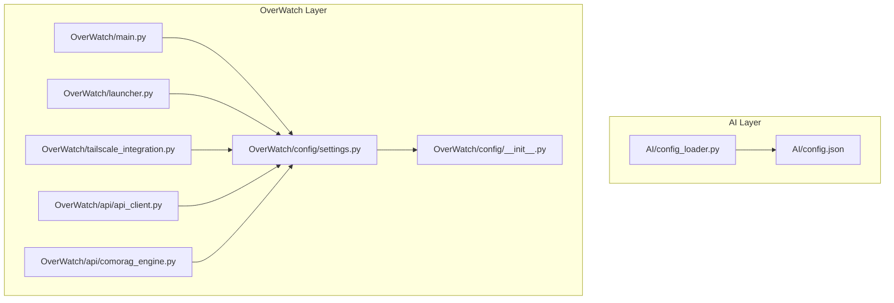
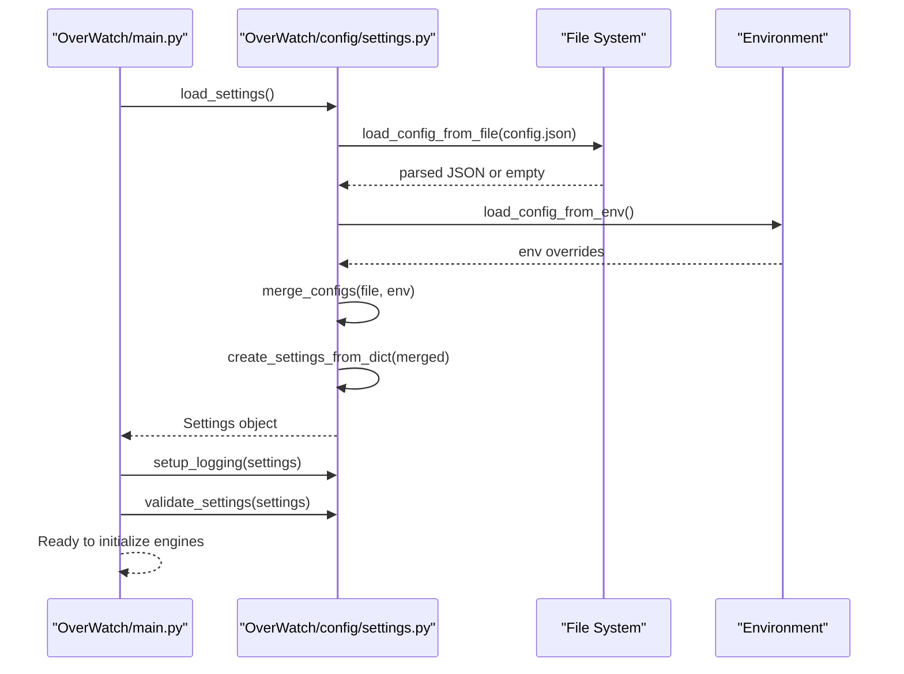
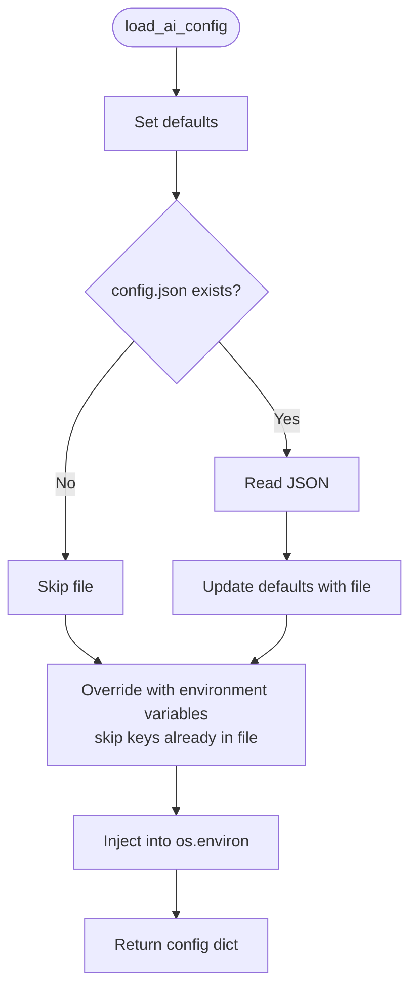
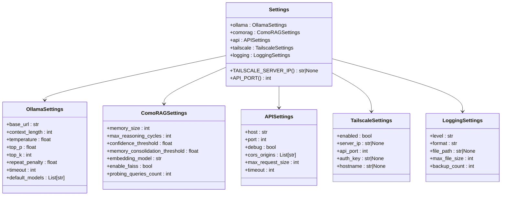
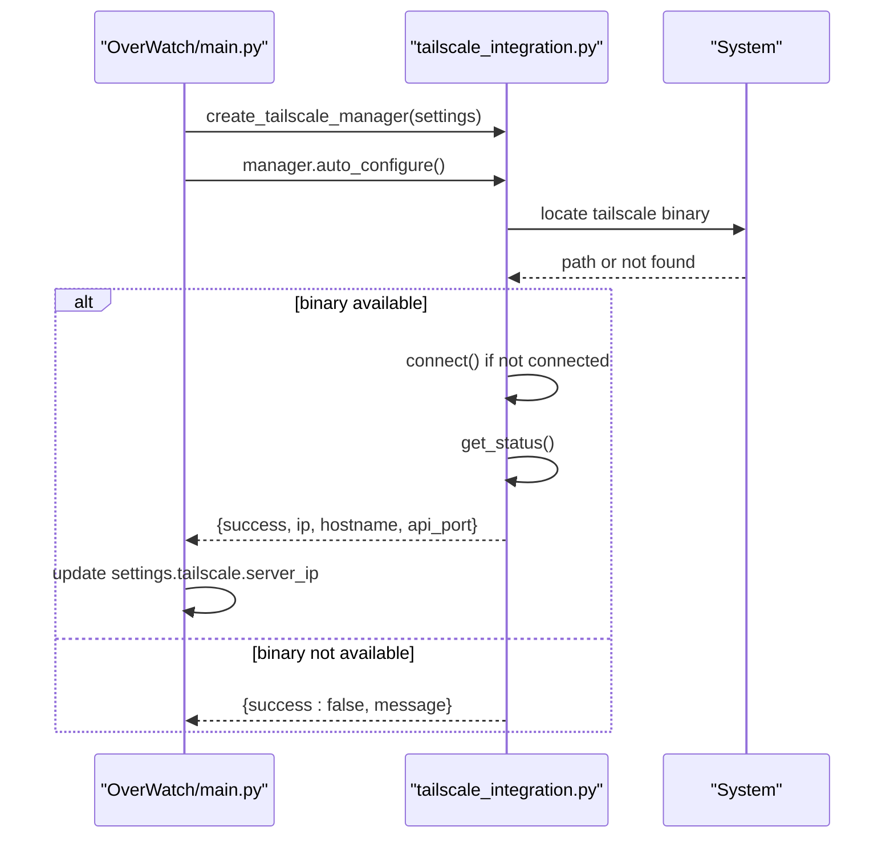
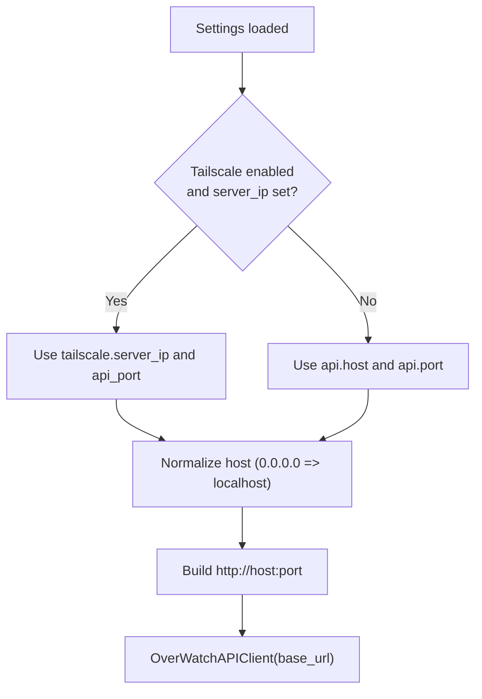
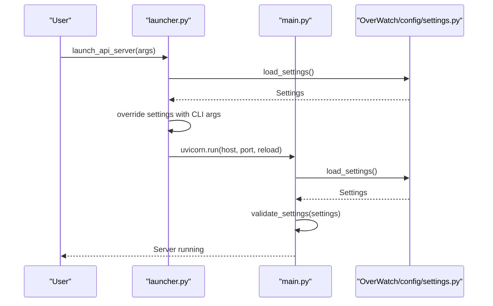
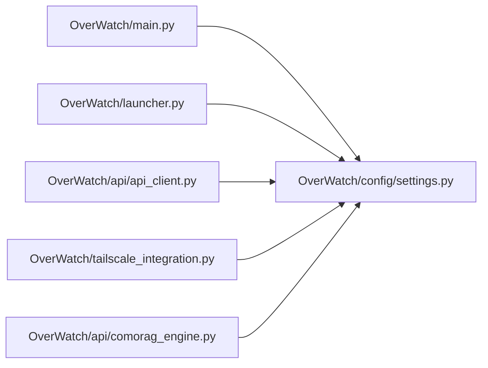

# AI Configuration Management

<cite>
**Referenced Files in This Document**
- [config_loader.py](file://LoOper/AI/config_loader.py)
- [config.json](file://LoOper/AI/config.json)
- [settings.py](file://LoOper/AI/settings.py)
- [settings.py](file://LoOper/AI/OverWatch/config/settings.py)
- [__init__.py](file://LoOper/AI/OverWatch/config/__init__.py)
- [main.py](file://LoOper/AI/OverWatch/main.py)
- [launcher.py](file://LoOper/AI/OverWatch/launcher.py)
- [tailscale_integration.py](file://LoOper/AI/OverWatch/tailscale_integration.py)
- [api_client.py](file://LoOper/AI/OverWatch/api/api_client.py)
- [comorag_engine.py](file://LoOper/AI/OverWatch/api/comorag_engine.py)
</cite>

## Table of Contents
1. [Introduction](#introduction)
2. [Project Structure](#project-structure)
3. [Core Components](#core-components)
4. [Architecture Overview](#architecture-overview)
5. [Detailed Component Analysis](#detailed-component-analysis)
6. [Dependency Analysis](#dependency-analysis)
7. [Performance Considerations](#performance-considerations)
8. [Troubleshooting Guide](#troubleshooting-guide)
9. [Conclusion](#conclusion)
10. [Appendices](#appendices)

## Introduction
This document explains how AI configuration is managed across the LoOper project, focusing on configuration loading, validation, environment variable injection, and runtime parameter overrides. It covers the configuration file structure, default settings, and how environment variables override defaults. It also documents auto-start capabilities for AI services, environment variable management for Tailscale integration, and how API URLs are resolved. Practical examples demonstrate customization for different deployment scenarios, plus troubleshooting common configuration issues. Finally, it outlines the relationship between configuration and AI service initialization, security considerations for sensitive parameters, and best practices for managing configuration across environments.

## Project Structure
The configuration system spans two primary modules:
- AI-level configuration loader and simple helpers for legacy compatibility
- Overwatch-specific configuration management with robust settings, validation, and environment integration

**Diagram sources**
- [config_loader.py:1-66](file://LoOper/AI/config_loader.py#L1-L66)
- [config.json:1-9](file://Looper/AI/config.json#L1-L9)
- [settings.py:1-440](file://Looper/AI/OverWatch/config/settings.py#L1-L440)
- [__init__.py:1-8](file://Looper/AI/OverWatch/config/__init__.py#L1-L8)
- [main.py:1-767](file://Looper/AI/OverWatch/main.py#L1-L767)
- [launcher.py:1-333](file://Looper/AI/OverWatch/launcher.py#L1-L333)
- [tailscale_integration.py:1-449](file://Looper/AI/OverWatch/tailscale_integration.py#L1-L449)
- [api_client.py:1-268](file://Looper/AI/OverWatch/api/api_client.py#L1-L268)
- [comorag_engine.py:1-1179](file://Looper/AI/OverWatch/api/comorag_engine.py#L1-L1179)

**Section sources**
- [config_loader.py:1-66](file://Looper/AI/config_loader.py#L1-L66)
- [config.json:1-9](file://Looper/AI/config.json#L1-L9)
- [settings.py:1-440](file://Looper/AI/OverWatch/config/settings.py#L1-L440)
- [__init__.py:1-8](file://Looper/AI/OverWatch/config/__init__.py#L1-L8)
- [main.py:1-767](file://Looper/AI/OverWatch/main.py#L1-L767)
- [launcher.py:1-333](file://Looper/AI/OverWatch/launcher.py#L1-L333)
- [tailscale_integration.py:1-449](file://Looper/AI/OverWatch/tailscale_integration.py#L1-L449)
- [api_client.py:1-268](file://Looper/AI/OverWatch/api/api_client.py#L1-L268)
- [comorag_engine.py:1-1179](file://Looper/AI/OverWatch/api/comorag_engine.py#L1-L1179)

## Core Components
- AI configuration loader: Loads defaults, merges file-based configuration, injects environment variables, and exposes helpers for API URL and auto-start checks.
- Overwatch settings: Provides strongly typed settings, environment variable mapping, merging strategies, validation, logging setup, and API URL resolution.
- Tailscale integration: Manages Tailscale connectivity and updates settings for secure remote access.
- API client: Builds API base URL from settings and handles timeouts and error propagation.
- Engines: Ollama and ComoRAG engines consume settings for initialization and runtime behavior.

Key behaviors:
- Environment variables override file-based settings.
- Settings are validated before use; invalid values produce warnings or errors.
- API URL resolution respects Tailscale configuration when enabled.
- Auto-start flags are supported at both AI and Overwatch layers.

**Section sources**
- [config_loader.py:9-66](file://Looper/AI/config_loader.py#L9-L66)
- [settings.py:265-283](file://Looper/AI/OverWatch/config/settings.py#L265-L283)
- [settings.py:328-341](file://Looper/AI/OverWatch/config/settings.py#L328-L341)
- [tailscale_integration.py:260-296](file://Looper/AI/OverWatch/tailscale_integration.py#L260-L296)
- [api_client.py:261-268](file://Looper/AI/OverWatch/api/api_client.py#L261-L268)
- [main.py:28-41](file://Looper/AI/OverWatch/main.py#L28-L41)

## Architecture Overview
The configuration architecture separates concerns between a lightweight AI loader and a comprehensive Overwatch settings system. The Overwatch settings system loads from JSON and environment variables, merges them, validates, and exposes typed settings to the application lifecycle.

**Diagram sources**
- [main.py:26-41](file://Looper/AI/OverWatch/main.py#L26-L41)
- [settings.py:265-283](file://Looper/AI/OverWatch/config/settings.py#L265-L283)
- [settings.py:109-125](file://Looper/AI/OverWatch/config/settings.py#L109-L125)
- [settings.py:128-173](file://Looper/AI/OverWatch/config/settings.py#L128-L173)
- [settings.py:176-187](file://Looper/AI/OverWatch/config/settings.py#L176-L187)
- [settings.py:190-238](file://Looper/AI/OverWatch/config/settings.py#L190-L238)
- [settings.py:286-326](file://Looper/AI/OverWatch/config/settings.py#L286-L326)

## Detailed Component Analysis

### AI Configuration Loader (Legacy)
- Loads defaults for AI services, including ports, hosts, timeouts, and auto-start flags.
- Attempts to load JSON from a fixed path; on failure, logs a warning and continues with defaults.
- Merges environment variables, skipping keys that were explicitly set in the file.
- Injects all configuration keys into the current process environment.
- Provides helpers to compute API URL and check auto-start flag.

**Diagram sources**
- [config_loader.py:9-48](file://Looper/AI/config_loader.py#L9-L48)

**Section sources**
- [config_loader.py:9-66](file://Looper/AI/config_loader.py#L9-L66)
- [config.json:1-9](file://Looper/AI/config.json#L1-L9)

### Overwatch Settings System
- Defines strongly typed settings for Ollama, ComoRAG, API, Tailscale, and Logging.
- Loads configuration from a JSON file at a configurable path (environment override).
- Loads environment variables into nested dictionaries for each domain.
- Merges file and environment configurations with precedence rules.
- Creates a Settings object from the merged dictionary, mapping keys to attributes.
- Validates settings and provides a human-readable list of issues.
- Sets up logging with console and optional rotating file handlers.
- Computes API URL respecting Tailscale configuration.

**Diagram sources**
- [settings.py:16-82](file://Looper/AI/OverWatch/config/settings.py#L16-L82)

**Section sources**
- [settings.py:98-106](file://Looper/AI/OverWatch/config/settings.py#L98-L106)
- [settings.py:109-125](file://Looper/AI/OverWatch/config/settings.py#L109-L125)
- [settings.py:128-173](file://Looper/AI/OverWatch/config/settings.py#L128-L173)
- [settings.py:176-187](file://Looper/AI/OverWatch/config/settings.py#L176-L187)
- [settings.py:190-238](file://Looper/AI/OverWatch/config/settings.py#L190-L238)
- [settings.py:241-262](file://Looper/AI/OverWatch/config/settings.py#L241-L262)
- [settings.py:265-283](file://Looper/AI/OverWatch/config/settings.py#L265-L283)
- [settings.py:286-326](file://Looper/AI/OverWatch/config/settings.py#L286-L326)
- [settings.py:328-341](file://Looper/AI/OverWatch/config/settings.py#L328-L341)
- [settings.py:382-420](file://Looper/AI/OverWatch/config/settings.py#L382-L420)

### Tailscale Integration
- Detects Tailscale binary availability and locates it across platforms.
- Connects/disconnects to Tailscale networks, optionally using an auth key and hostname.
- Retrieves status, IP, and device information.
- Auto-configures settings for OverWatch by updating server IP and hostname.
- Tests API connectivity over Tailscale and provides network diagnostics.

**Diagram sources**
- [main.py:28-41](file://Looper/AI/OverWatch/main.py#L28-L41)
- [tailscale_integration.py:394-396](file://Looper/AI/OverWatch/tailscale_integration.py#L394-L396)
- [tailscale_integration.py:399-408](file://Looper/AI/OverWatch/tailscale_integration.py#L399-L408)
- [tailscale_integration.py:339-391](file://Looper/AI/OverWatch/tailscale_integration.py#L339-L391)

**Section sources**
- [tailscale_integration.py:43-91](file://Looper/AI/OverWatch/tailscale_integration.py#L43-L91)
- [tailscale_integration.py:117-180](file://Looper/AI/OverWatch/tailscale_integration.py#L117-L180)
- [tailscale_integration.py:192-238](file://Looper/AI/OverWatch/tailscale_integration.py#L192-L238)
- [tailscale_integration.py:260-296](file://Looper/AI/OverWatch/tailscale_integration.py#L260-L296)
- [tailscale_integration.py:298-313](file://Looper/AI/OverWatch/tailscale_integration.py#L298-L313)
- [tailscale_integration.py:315-337](file://Looper/AI/OverWatch/tailscale_integration.py#L315-L337)
- [tailscale_integration.py:339-391](file://Looper/AI/OverWatch/tailscale_integration.py#L339-L391)

### API Client and URL Resolution
- The API client constructs the base URL from settings and applies a timeout.
- The API URL is derived from either Tailscale-enabled settings or standard API settings, with special handling for host binding.

**Diagram sources**
- [settings.py:328-341](file://Looper/AI/OverWatch/config/settings.py#L328-L341)
- [api_client.py:261-268](file://Looper/AI/OverWatch/api/api_client.py#L261-L268)

**Section sources**
- [api_client.py:261-268](file://Looper/AI/OverWatch/api/api_client.py#L261-L268)
- [settings.py:328-341](file://Looper/AI/OverWatch/config/settings.py#L328-L341)

### Auto-Start Capabilities
- AI layer: A dedicated helper checks the AUTO_START_API flag to decide whether to auto-start the API.
- Overwatch layer: The launcher supports starting the API server programmatically and can accept CLI overrides for host, port, and debug mode.

**Diagram sources**
- [launcher.py:30-71](file://Looper/AI/OverWatch/launcher.py#L30-L71)
- [main.py:748-766](file://Looper/AI/OverWatch/main.py#L748-L766)
- [settings.py:265-283](file://Looper/AI/OverWatch/config/settings.py#L265-L283)

**Section sources**
- [config_loader.py:62-66](file://Looper/AI/config_loader.py#L62-L66)
- [launcher.py:30-71](file://Looper/AI/OverWatch/launcher.py#L30-L71)
- [main.py:748-766](file://Looper/AI/OverWatch/main.py#L748-L766)

## Dependency Analysis
- The Overwatch main module depends on the settings loader for configuration, logging setup, and validation.
- The launcher depends on the settings loader to apply CLI overrides and start the server.
- The API client depends on settings to resolve the base URL and timeout.
- The Tailscale integration can update settings to reflect network configuration.

**Diagram sources**
- [main.py:26-41](file://Looper/AI/OverWatch/main.py#L26-L41)
- [launcher.py:40-43](file://Looper/AI/OverWatch/launcher.py#L40-L43)
- [api_client.py:261-268](file://Looper/AI/OverWatch/api/api_client.py#L261-L268)
- [tailscale_integration.py:260-296](file://Looper/AI/OverWatch/tailscale_integration.py#L260-L296)
- [comorag_engine.py:236-242](file://Looper/AI/OverWatch/api/comorag_engine.py#L236-L242)

**Section sources**
- [main.py:26-41](file://Looper/AI/OverWatch/main.py#L26-L41)
- [launcher.py:40-43](file://Looper/AI/OverWatch/launcher.py#L40-L43)
- [api_client.py:261-268](file://Looper/AI/OverWatch/api/api_client.py#L261-L268)
- [tailscale_integration.py:260-296](file://Looper/AI/OverWatch/tailscale_integration.py#L260-L296)
- [comorag_engine.py:236-242](file://Looper/AI/OverWatch/api/comorag_engine.py#L236-L242)

## Performance Considerations
- Environment variable parsing is linear in the number of keys mapped; keep the number of mapped keys reasonable.
- Logging setup with file handlers adds minimal overhead; ensure log rotation parameters are tuned for disk usage.
- Tailscale commands are executed synchronously with timeouts; avoid frequent repeated calls during normal operation.
- API URL computation is constant-time; caching is unnecessary.
- Settings validation is performed once at startup; keep validation logic efficient.

## Troubleshooting Guide
Common configuration issues and resolutions:
- Invalid API port: Ensure the port is within the valid range; the validator enforces bounds.
- Invalid GPU memory utilization or vLLM settings: Ensure values meet required constraints.
- Invalid memory size or reasoning cycles: Ensure positive integers and thresholds within valid ranges.
- Tailscale enabled without server IP: When Tailscale is enabled, a server IP must be present; the validator reports this condition.
- Configuration file not found or invalid JSON: The loader logs informational or error messages and falls back to defaults.
- Environment variable overrides not taking effect: Confirm that the environment variable names match the expected keys and that they are exported before process start.
- API URL resolves to unexpected host: Verify Tailscale settings and host normalization rules; hosts bound to 0.0.0.0 are normalized to localhost.

**Section sources**
- [settings.py:344-371](file://Looper/AI/OverWatch/config/settings.py#L344-L371)
- [settings.py:382-420](file://Looper/AI/OverWatch/config/settings.py#L382-L420)
- [settings.py:115-125](file://Looper/AI/OverWatch/config/settings.py#L115-L125)
- [settings.py:128-173](file://Looper/AI/OverWatch/config/settings.py#L128-L173)

## Conclusion
The configuration system combines a simple AI loader with a robust Overwatch settings framework. It supports layered configuration (defaults, file, environment), validation, logging, and Tailscale-aware URL resolution. By following the guidelines below, teams can reliably manage AI configurations across diverse environments while maintaining security and operational stability.

## Appendices

### Configuration File Structure and Defaults
- AI-level defaults include ports, hosts, timeouts, and auto-start flags. These are overridden by a JSON file and then by environment variables.
- Overwatch-level defaults include Ollama, ComoRAG, API, Tailscale, and Logging settings. These are overridden by environment variables and saved to JSON for persistence.

Practical examples:
- Set API host and port via environment variables for containerized deployments.
- Enable Tailscale by setting the server IP; the system will update the API URL accordingly.
- Persist settings to JSON for reproducible deployments.

**Section sources**
- [config_loader.py:11-20](file://Looper/AI/config_loader.py#L11-L20)
- [config.json:1-9](file://Looper/AI/config.json#L1-L9)
- [settings.py:16-82](file://Looper/AI/OverWatch/config/settings.py#L16-L82)

### Environment Variable Management for Tailscale Integration
- Tailscale settings are populated from environment variables when present.
- The integration attempts to connect automatically and updates settings with the device’s Tailscale IP and hostname.
- Use the auto-configure routine to validate connectivity and finalize configuration.

**Section sources**
- [settings.py:140-149](file://Looper/AI/OverWatch/config/settings.py#L140-L149)
- [tailscale_integration.py:260-296](file://Looper/AI/OverWatch/tailscale_integration.py#L260-L296)
- [tailscale_integration.py:339-391](file://Looper/AI/OverWatch/tailscale_integration.py#L339-L391)

### Model Path Resolution
- The Ollama engine settings define a base URL and default models; these are consumed by engines to load and use models.
- The engines rely on the configured base URL and model lists to operate.

**Section sources**
- [settings.py:17-30](file://Looper/AI/OverWatch/config/settings.py#L17-L30)
- [comorag_engine.py:236-242](file://Looper/AI/OverWatch/api/comorag_engine.py#L236-L242)

### Security Considerations
- Treat sensitive values (e.g., auth keys) as environment variables rather than storing them in JSON.
- Avoid committing configuration files containing secrets to version control.
- Restrict file permissions on configuration files to minimize exposure.
- Prefer Tailscale for secure remote access; ensure proper auth keys and hostnames are used.

**Section sources**
- [settings.py:146-149](file://Looper/AI/OverWatch/config/settings.py#L146-L149)
- [tailscale_integration.py:192-214](file://Looper/AI/OverWatch/tailscale_integration.py#L192-L214)

### Best Practices for Configuration Management
- Use environment variables for environment-specific overrides (ports, hosts, credentials).
- Keep defaults minimal and documented; rely on environment variables for customization.
- Validate configuration early in the application lifecycle and fail fast on invalid settings.
- Persist validated settings to JSON for reproducibility in CI/CD and production.
- Separate concerns: AI-level defaults for legacy compatibility, Overwatch-level settings for modern features.

**Section sources**
- [settings.py:265-283](file://Looper/AI/OverWatch/config/settings.py#L265-L283)
- [settings.py:382-420](file://Looper/AI/OverWatch/config/settings.py#L382-L420)
- [launcher.py:40-53](file://Looper/AI/OverWatch/launcher.py#L40-L53)