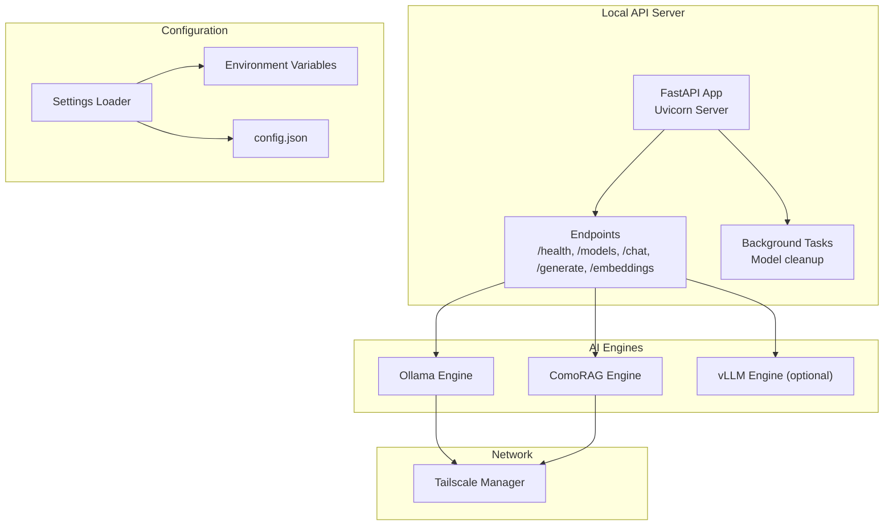
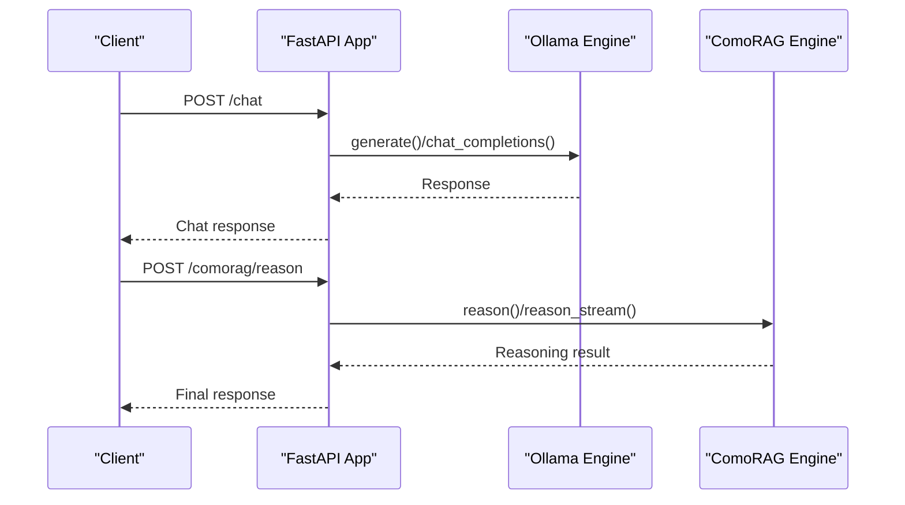
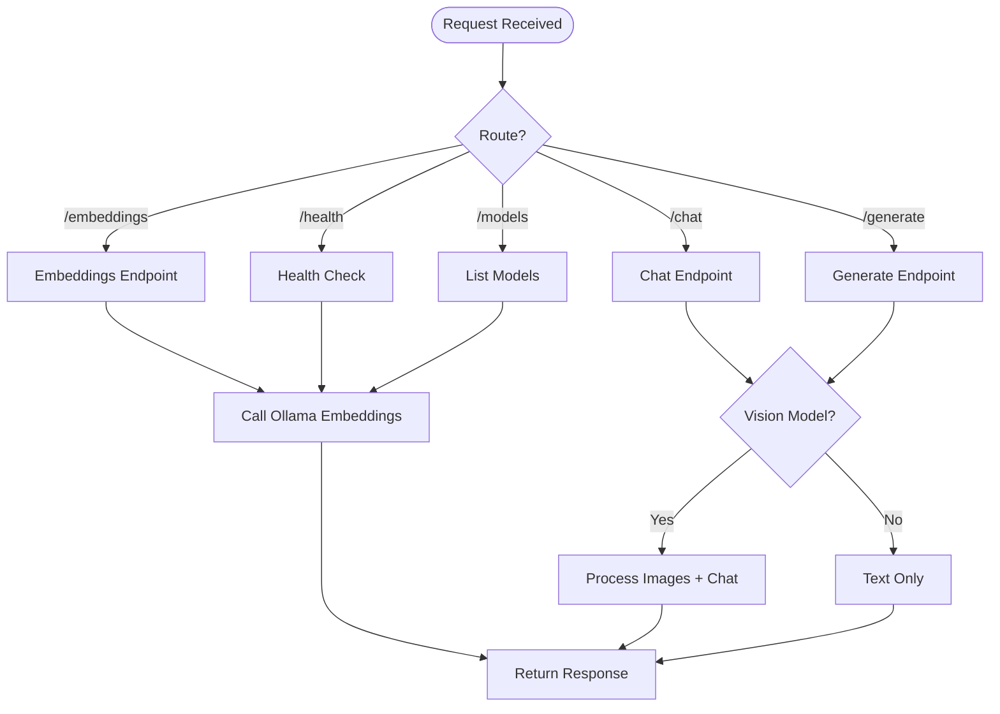
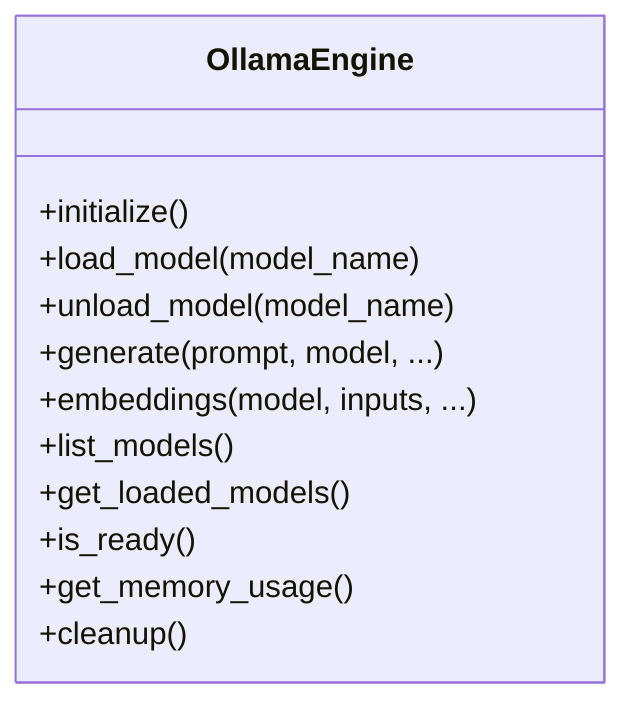
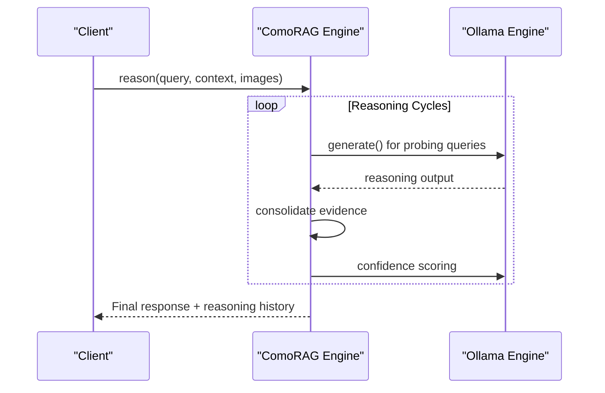
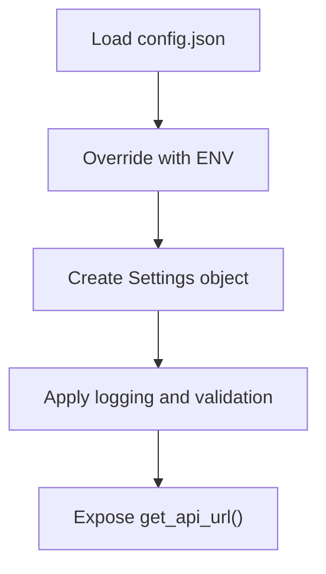
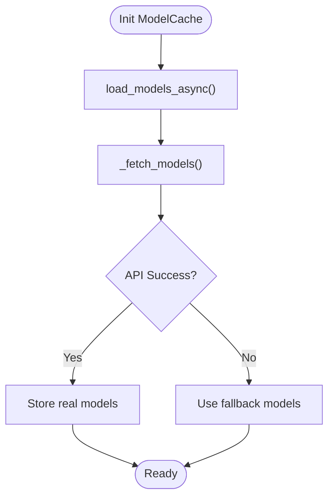
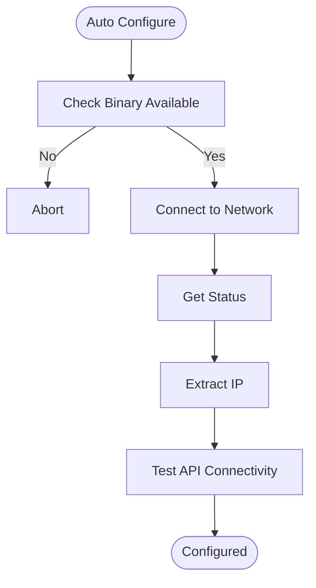
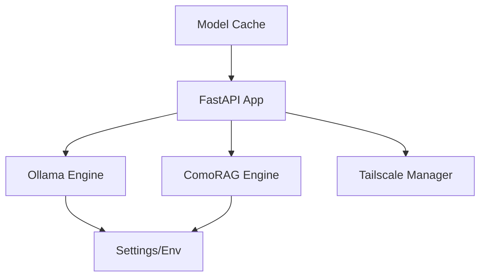

# AI Integration Layer

<cite>
**Referenced Files in This Document**
- [api.py](file://LoOper/AI/api.py)
- [config_loader.py](file://LoOper/AI/config_loader.py)
- [settings.py](file://LoOper/AI/settings.py)
- [model_cache.py](file://LoOper/AI/model_cache.py)
- [comorag_engine.py](file://LoOper/AI/OverWatch/api/comorag_engine.py)
- [ollama_engine.py](file://LoOper/AI/OverWatch/api/ollama_engine.py)
- [vllm_engine.py](file://LoOper/AI/OverWatch/api/vllm_engine.py)
- [settings.py](file://LoOper/AI/OverWatch/config/settings.py)
- [tailscale_integration.py](file://LoOper/AI/OverWatch/tailscale_integration.py)
- [main.py](file://LoOper/AI/OverWatch/main.py)
- [config.json](file://LoOper/AI/config.json)
- [requirements.txt](file://LoOper/requirements.txt)
</cite>

## Table of Contents
1. [Introduction](#introduction)
2. [Project Structure](#project-structure)
3. [Core Components](#core-components)
4. [Architecture Overview](#architecture-overview)
5. [Detailed Component Analysis](#detailed-component-analysis)
6. [Dependency Analysis](#dependency-analysis)
7. [Performance Considerations](#performance-considerations)
8. [Troubleshooting Guide](#troubleshooting-guide)
9. [Conclusion](#conclusion)
10. [Appendices](#appendices)

## Introduction
This document describes the AI integration layer responsible for the local API server, configuration management, and AI engine coordination. It covers:
- FastAPI implementation for AI services
- Uvicorn server management with CORS and security configuration
- Model caching strategies
- Ollama integration for local LLM access
- ComoRAG engine orchestration
- Tailscale integration for remote access
- Practical API usage, request/response schemas, error handling, and performance optimization
- Configuration loading, environment variable injection, and auto-start capabilities
- Guidance for extending AI functionality and managing model resources efficiently

## Project Structure
The AI integration layer is organized into:
- Local API server and orchestration: FastAPI app, endpoints, and background tasks
- Configuration management: Environment-driven settings and JSON-backed configuration
- AI engines: Ollama engine for inference, ComoRAG engine for cognitive reasoning, and optional vLLM engine
- Network integration: Tailscale for secure remote access
- UI and utilities: Model cache for UI responsiveness and helper scripts

**Diagram sources**
- [api.py:37-41](file://LoOper/AI/api.py#L37-L41)
- [main.py:106-122](file://LoOper/AI/OverWatch/main.py#L106-L122)
- [config_loader.py:9-48](file://LoOper/AI/config_loader.py#L9-L48)
- [settings.py:265-283](file://LoOper/AI/settings.py#L265-L283)
- [ollama_engine.py:34-96](file://LoOper/AI/OverWatch/api/ollama_engine.py#L34-L96)
- [comorag_engine.py:233-287](file://LoOper/AI/OverWatch/api/comorag_engine.py#L233-L287)
- [vllm_engine.py:91-143](file://LoOper/AI/OverWatch/api/vllm_engine.py#L91-L143)
- [tailscale_integration.py:43-91](file://LoOper/AI/OverWatch/tailscale_integration.py#L43-L91)

**Section sources**
- [api.py:37-41](file://LoOper/AI/api.py#L37-L41)
- [main.py:106-122](file://LoOper/AI/OverWatch/main.py#L106-L122)
- [config_loader.py:9-48](file://LoOper/AI/config_loader.py#L9-L48)
- [settings.py:265-283](file://LoOper/AI/settings.py#L265-L283)

## Core Components
- FastAPI application with CORS middleware and health/model endpoints
- Ollama engine for model loading, inference, embeddings, and cleanup
- ComoRAG engine for cognitive memory-organized RAG reasoning
- Configuration loader supporting JSON and environment variables
- Model cache for UI responsiveness and fallback strategies
- Tailscale manager for secure remote access and network diagnostics

**Section sources**
- [api.py:37-41](file://LoOper/AI/api.py#L37-L41)
- [ollama_engine.py:34-96](file://LoOper/AI/OverWatch/api/ollama_engine.py#L34-L96)
- [comorag_engine.py:233-287](file://LoOper/AI/OverWatch/api/comorag_engine.py#L233-L287)
- [config_loader.py:9-48](file://LoOper/AI/config_loader.py#L9-L48)
- [model_cache.py:15-25](file://LoOper/AI/model_cache.py#L15-L25)
- [tailscale_integration.py:43-91](file://LoOper/AI/OverWatch/tailscale_integration.py#L43-L91)

## Architecture Overview
The system exposes a FastAPI server that routes requests to either Ollama or ComoRAG engines. Configuration is injected via environment variables and JSON, with optional Tailscale for remote access. Background tasks handle model cleanup to free resources after use.

**Diagram sources**
- [main.py:442-477](file://LoOper/AI/OverWatch/main.py#L442-L477)
- [ollama_engine.py:519-573](file://LoOper/AI/OverWatch/api/ollama_engine.py#L519-L573)
- [comorag_engine.py:643-664](file://LoOper/AI/OverWatch/api/comorag_engine.py#L643-L664)

## Detailed Component Analysis

### FastAPI Application and Endpoints
- CORS is configured to allow all origins for Tailscale networks
- Root endpoint provides environment variables and endpoint documentation
- Health endpoint checks Ollama availability and bootstrap state
- Model listing endpoint proxies to Ollama tags
- Chat and generate endpoints support both text and image inputs for vision-capable models
- Embeddings endpoint supports batch and normalization options
- Streaming endpoints for continuous text generation

**Diagram sources**
- [api.py:547-579](file://LoOper/AI/api.py#L547-L579)
- [api.py:581-653](file://LoOper/AI/api.py#L581-L653)
- [api.py:655-761](file://LoOper/AI/api.py#L655-L761)
- [api.py:795-800](file://LoOper/AI/api.py#L795-L800)

**Section sources**
- [api.py:37-41](file://LoOper/AI/api.py#L37-L41)
- [api.py:547-579](file://LoOper/AI/api.py#L547-L579)
- [api.py:581-653](file://LoOper/AI/api.py#L581-L653)
- [api.py:655-761](file://LoOper/AI/api.py#L655-L761)
- [api.py:763-794](file://LoOper/AI/api.py#L763-L794)
- [api.py:795-800](file://LoOper/AI/api.py#L795-L800)

### Ollama Engine
- Initializes async HTTP session and validates Ollama availability
- Loads default models and ensures required models are present
- Supports model loading/unloading, embeddings, and text/image generation
- Implements cleanup routines to stop stale runners
- Provides memory usage metrics

**Diagram sources**
- [ollama_engine.py:34-96](file://LoOper/AI/OverWatch/api/ollama_engine.py#L34-L96)
- [ollama_engine.py:161-215](file://LoOper/AI/OverWatch/api/ollama_engine.py#L161-L215)
- [ollama_engine.py:320-424](file://LoOper/AI/OverWatch/api/ollama_engine.py#L320-L424)
- [ollama_engine.py:519-573](file://LoOper/AI/OverWatch/api/ollama_engine.py#L519-L573)

**Section sources**
- [ollama_engine.py:34-96](file://LoOper/AI/OverWatch/api/ollama_engine.py#L34-L96)
- [ollama_engine.py:161-215](file://LoOper/AI/OverWatch/api/ollama_engine.py#L161-L215)
- [ollama_engine.py:320-424](file://LoOper/AI/OverWatch/api/ollama_engine.py#L320-L424)
- [ollama_engine.py:519-573](file://LoOper/AI/OverWatch/api/ollama_engine.py#L519-L573)

### ComoRAG Engine
- Implements cognitive memory-organized RAG with dynamic memory workspace
- Supports memory consolidation, confidence scoring, and iterative reasoning
- Integrates with Ollama for generation and embeddings
- Provides streaming reasoning with structured progress events

**Diagram sources**
- [comorag_engine.py:328-664](file://LoOper/AI/OverWatch/api/comorag_engine.py#L328-L664)
- [comorag_engine.py:666-809](file://LoOper/AI/OverWatch/api/comorag_engine.py#L666-L809)

**Section sources**
- [comorag_engine.py:233-287](file://LoOper/AI/OverWatch/api/comorag_engine.py#L233-L287)
- [comorag_engine.py:328-664](file://LoOper/AI/OverWatch/api/comorag_engine.py#L328-L664)
- [comorag_engine.py:666-809](file://LoOper/AI/OverWatch/api/comorag_engine.py#L666-L809)

### Configuration Management
- Environment variables override JSON-configured values
- Provides API URL composition and auto-start flags
- Settings loader merges file and environment, validates, and applies defaults

**Diagram sources**
- [config_loader.py:9-48](file://LoOper/AI/config_loader.py#L9-L48)
- [settings.py:265-283](file://LoOper/AI/settings.py#L265-L283)
- [settings.py:128-173](file://LoOper/AI/settings.py#L128-L173)

**Section sources**
- [config_loader.py:9-48](file://LoOper/AI/config_loader.py#L9-L48)
- [settings.py:265-283](file://LoOper/AI/settings.py#L265-L283)
- [settings.py:128-173](file://LoOper/AI/settings.py#L128-L173)

### Model Cache
- Asynchronously loads models from the API to avoid UI blocking
- Uses fallback models if API is unavailable
- Provides refresh and real-model-only getters

**Diagram sources**
- [model_cache.py:36-77](file://LoOper/AI/model_cache.py#L36-L77)
- [model_cache.py:102-163](file://LoOper/AI/model_cache.py#L102-L163)

**Section sources**
- [model_cache.py:15-25](file://LoOper/AI/model_cache.py#L15-L25)
- [model_cache.py:36-77](file://LoOper/AI/model_cache.py#L36-L77)
- [model_cache.py:102-163](file://LoOper/AI/model_cache.py#L102-L163)

### Tailscale Integration
- Discovers Tailscale binary, connects/disconnects, and pings devices
- Retrieves status, logs, and network info
- Auto-configures server IP and port for remote access

**Diagram sources**
- [tailscale_integration.py:399-408](file://LoOper/AI/OverWatch/tailscale_integration.py#L399-L408)
- [tailscale_integration.py:339-391](file://LoOper/AI/OverWatch/tailscale_integration.py#L339-L391)

**Section sources**
- [tailscale_integration.py:43-91](file://LoOper/AI/OverWatch/tailscale_integration.py#L43-L91)
- [tailscale_integration.py:339-391](file://LoOper/AI/OverWatch/tailscale_integration.py#L339-L391)

### Uvicorn Server Management
- FastAPI app configured with CORS and lifespan hooks
- Server runs on host/port derived from settings or Tailscale
- Debug mode and logging level controlled by settings

**Section sources**
- [main.py:106-122](file://LoOper/AI/OverWatch/main.py#L106-L122)
- [main.py:748-767](file://LoOper/AI/OverWatch/main.py#L748-L767)

## Dependency Analysis
- FastAPI app depends on Ollama and ComoRAG engines
- Engines depend on configuration settings and environment variables
- Tailscale manager integrates with system binaries and network status
- Model cache depends on API URL and environment variables

**Diagram sources**
- [main.py:106-122](file://LoOper/AI/OverWatch/main.py#L106-L122)
- [ollama_engine.py:34-96](file://LoOper/AI/OverWatch/api/ollama_engine.py#L34-L96)
- [comorag_engine.py:233-287](file://LoOper/AI/OverWatch/api/comorag_engine.py#L233-L287)
- [tailscale_integration.py:43-91](file://LoOper/AI/OverWatch/tailscale_integration.py#L43-L91)
- [model_cache.py:26-34](file://LoOper/AI/model_cache.py#L26-L34)

**Section sources**
- [main.py:106-122](file://LoOper/AI/OverWatch/main.py#L106-L122)
- [ollama_engine.py:34-96](file://LoOper/AI/OverWatch/api/ollama_engine.py#L34-L96)
- [comorag_engine.py:233-287](file://LoOper/AI/OverWatch/api/comorag_engine.py#L233-L287)
- [tailscale_integration.py:43-91](file://LoOper/AI/OverWatch/tailscale_integration.py#L43-L91)
- [model_cache.py:26-34](file://LoOper/AI/model_cache.py#L26-L34)

## Performance Considerations
- Use ephemeral flag to unload models after single-use requests
- Enable streaming for long-running generations to reduce latency
- Leverage background cleanup tasks to stop stale model runners
- Tune temperature, max_tokens, and keep_alive to balance quality and speed
- Use embeddings pooling and normalization for downstream tasks
- Monitor memory usage via engine-provided metrics

[No sources needed since this section provides general guidance]

## Troubleshooting Guide
Common issues and resolutions:
- Ollama not reachable: Verify base URL and port; check health endpoint
- Missing models: Use ensure-model-present logic or pull via engine
- Streaming failures: Validate endpoint and payload; ensure keep_alive is set
- Memory pressure: Use ephemeral and cleanup_after flags; leverage background tasks
- Tailscale connectivity: Confirm binary availability and network status

**Section sources**
- [api.py:581-606](file://LoOper/AI/api.py#L581-L606)
- [ollama_engine.py:503-517](file://LoOper/AI/OverWatch/api/ollama_engine.py#L503-L517)
- [main.py:544-582](file://LoOper/AI/OverWatch/main.py#L544-L582)
- [tailscale_integration.py:117-180](file://LoOper/AI/OverWatch/tailscale_integration.py#L117-L180)

## Conclusion
The AI integration layer provides a robust, configurable, and extensible foundation for local AI inference and reasoning. It combines FastAPI orchestration, Ollama-backed engines, and ComoRAG’s cognitive memory system, while enabling secure remote access via Tailscale. Configuration is environment-driven with sensible defaults, and performance is optimized through streaming, ephemeral models, and background cleanup.

[No sources needed since this section summarizes without analyzing specific files]

## Appendices

### API Usage Examples and Schemas
- Chat endpoint: accepts model, messages, temperature, max_tokens, stream, use_comorag, ephemeral, cleanup_after
- Generate endpoint: accepts model, prompt, temperature, max_tokens, stream, use_comorag, ephemeral, cleanup_after
- Embeddings endpoint: accepts model, inputs, normalize, pooling, ephemeral, cleanup_after
- Health endpoint: returns status, ollama_status, comorag_status, models_loaded, memory_usage, init_error, init_in_progress

**Section sources**
- [main.py:124-170](file://LoOper/AI/OverWatch/main.py#L124-L170)
- [main.py:352-382](file://LoOper/AI/OverWatch/main.py#L352-L382)

### Configuration Loading and Environment Injection
- config.json provides defaults for TAILSCALE_SERVER_IP, API_PORT, OLLAMA_HOST, OLLAMA_PORT, API_TIMEOUT, AUTO_START_API
- Environment variables override config.json entries
- get_api_url constructs the API URL from settings

**Section sources**
- [config.json:1-9](file://LoOper/AI/config.json#L1-L9)
- [config_loader.py:9-48](file://LoOper/AI/config_loader.py#L9-L48)
- [settings.py:328-341](file://LoOper/AI/settings.py#L328-L341)

### Extending AI Functionality
- To add a new engine: implement engine interface similar to OllamaEngine, register endpoints in FastAPI app, and wire into configuration
- To manage model resources: use ephemeral flags, cleanup_after tasks, and engine-specific unload methods
- To support new vision models: update vision capability detection and image processing pipeline

**Section sources**
- [ollama_engine.py:503-517](file://LoOper/AI/OverWatch/api/ollama_engine.py#L503-L517)
- [api.py:254-288](file://LoOper/AI/api.py#L254-L288)