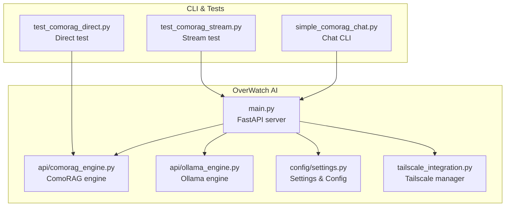
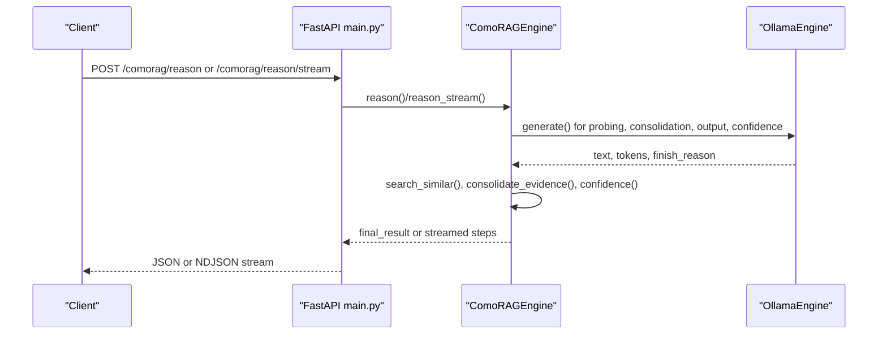
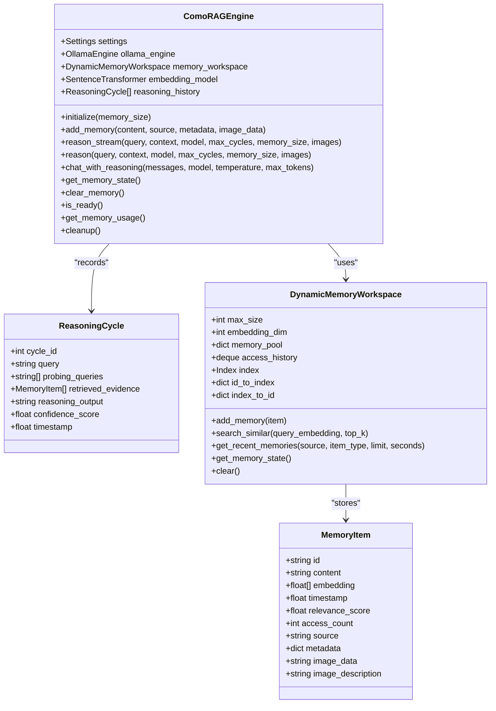
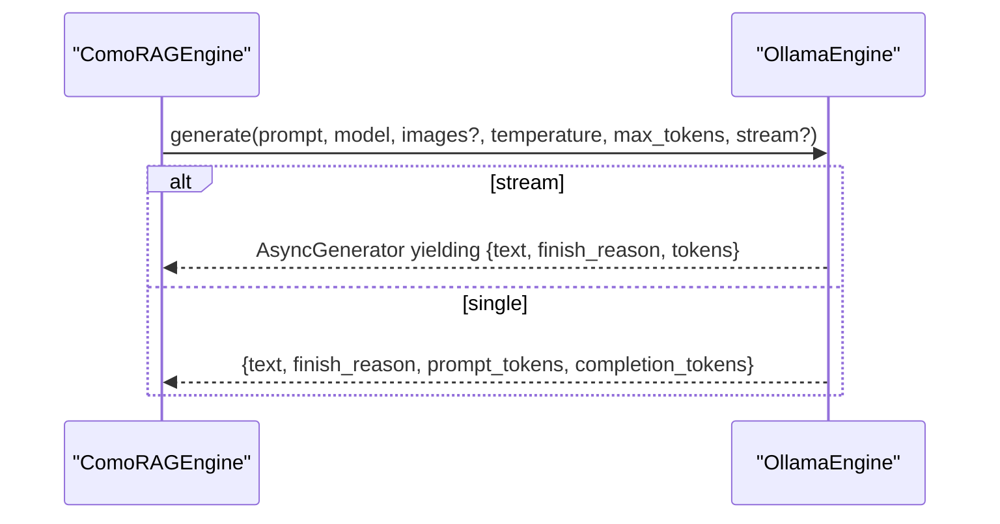
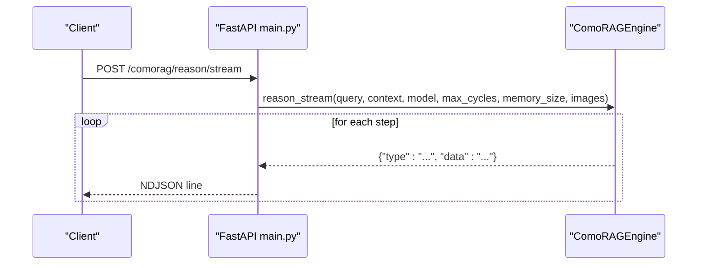
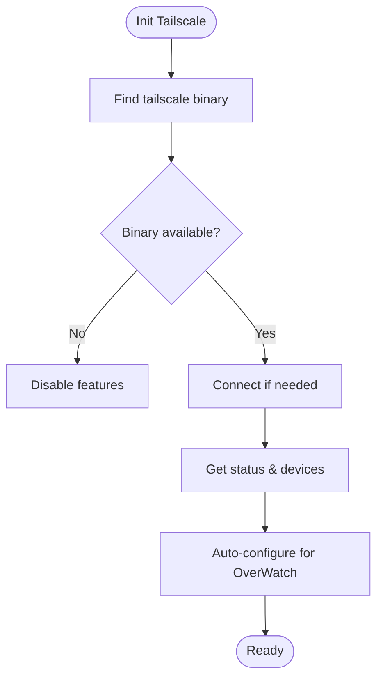
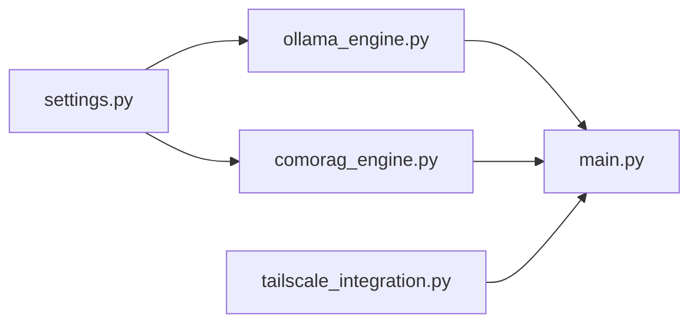

# ComoRAG Engine

<cite>
**Referenced Files in This Document**
- [comorag_engine.py](file://LoOper/AI/OverWatch/api/comorag_engine.py)
- [ollama_engine.py](file://LoOper/AI/OverWatch/api/ollama_engine.py)
- [settings.py](file://LoOper/AI/OverWatch/config/settings.py)
- [main.py](file://LoOper/AI/OverWatch/main.py)
- [tailscale_integration.py](file://LoOper/AI/OverWatch/tailscale_integration.py)
- [simple_comorag_chat.py](file://LoOper/AI/OverWatch/simple_comorag_chat.py)
- [test_comorag_stream.py](file://LoOper/AI/OverWatch/test_comorag_stream.py)
- [test_comorag_direct.py](file://LoOper/AI/OverWatch/test_comorag_direct.py)
- [README.md](file://LoOper/AI/OverWatch/README.md)
</cite>

## Table of Contents
1. [Introduction](#introduction)
2. [Project Structure](#project-structure)
3. [Core Components](#core-components)
4. [Architecture Overview](#architecture-overview)
5. [Detailed Component Analysis](#detailed-component-analysis)
6. [Dependency Analysis](#dependency-analysis)
7. [Performance Considerations](#performance-considerations)
8. [Troubleshooting Guide](#troubleshooting-guide)
9. [Conclusion](#conclusion)
10. [Appendices](#appendices)

## Introduction
This document explains the ComoRAG engine—its architecture, cognitive reasoning patterns, and memory management—within the OverWatch AI system. It covers how the engine performs iterative, confidence-guided reasoning, manages a dynamic memory workspace, integrates with Ollama for inference, streams responses, and interacts with Tailscale for secure remote access. Practical usage examples, configuration options, and performance considerations are included for desktop automation scenarios.

## Project Structure
The OverWatch project organizes the ComoRAG engine under the AI module’s API layer, alongside an Ollama engine, configuration management, and a FastAPI server. The Tailscale integration provides optional secure networking.

**Diagram sources**
- [main.py:105-767](file://LoOper/AI/OverWatch/main.py#L105-L767)
- [comorag_engine.py:233-1179](file://LoOper/AI/OverWatch/api/comorag_engine.py#L233-L1179)
- [ollama_engine.py:34-737](file://LoOper/AI/OverWatch/api/ollama_engine.py#L34-L737)
- [settings.py:16-440](file://LoOper/AI/OverWatch/config/settings.py#L16-L440)
- [tailscale_integration.py:43-449](file://LoOper/AI/OverWatch/tailscale_integration.py#L43-L449)
- [simple_comorag_chat.py:15-217](file://LoOper/AI/OverWatch/simple_comorag_chat.py#L15-L217)
- [test_comorag_stream.py:22-137](file://LoOper/AI/OverWatch/test_comorag_stream.py#L22-L137)
- [test_comorag_direct.py:26-120](file://LoOper/AI/OverWatch/test_comorag_direct.py#L26-L120)

**Section sources**
- [README.md:1-401](file://LoOper/AI/OverWatch/README.md#L1-L401)
- [main.py:105-767](file://LoOper/AI/OverWatch/main.py#L105-L767)

## Core Components
- ComoRAG Engine: Implements cognitive-inspired memory-organized RAG with iterative reasoning, confidence scoring, and memory consolidation.
- Ollama Engine: Provides model loading, inference, embeddings, and streaming via Ollama’s API.
- Settings: Centralized configuration for API, ComoRAG, Ollama, and Tailscale.
- FastAPI Server: Exposes endpoints for chat, generation, embeddings, and ComoRAG reasoning (including streaming).
- Tailscale Manager: Optional secure networking for remote access.

Key implementation references:
- Engine initialization, memory workspace, and reasoning loop: [comorag_engine.py:233-642](file://LoOper/AI/OverWatch/api/comorag_engine.py#L233-L642)
- Ollama inference and streaming: [ollama_engine.py:519-626](file://LoOper/AI/OverWatch/api/ollama_engine.py#L519-L626)
- API endpoints and streaming: [main.py:602-657](file://LoOper/AI/OverWatch/main.py#L602-L657)
- Settings and environment overrides: [settings.py:16-440](file://LoOper/AI/OverWatch/config/settings.py#L16-L440)
- Tailscale integration: [tailscale_integration.py:43-449](file://LoOper/AI/OverWatch/tailscale_integration.py#L43-L449)

**Section sources**
- [comorag_engine.py:233-642](file://LoOper/AI/OverWatch/api/comorag_engine.py#L233-L642)
- [ollama_engine.py:519-626](file://LoOper/AI/OverWatch/api/ollama_engine.py#L519-L626)
- [main.py:602-657](file://LoOper/AI/OverWatch/main.py#L602-L657)
- [settings.py:16-440](file://LoOper/AI/OverWatch/config/settings.py#L16-L440)
- [tailscale_integration.py:43-449](file://LoOper/AI/OverWatch/tailscale_integration.py#L43-L449)

## Architecture Overview
The system initializes engines at startup, exposes REST endpoints, and routes requests to either Ollama or the ComoRAG engine depending on configuration. The ComoRAG engine maintains a dynamic memory workspace, retrieves evidence, consolidates context, generates reasoning outputs, calculates confidence, and produces final answers.

**Diagram sources**
- [main.py:602-657](file://LoOper/AI/OverWatch/main.py#L602-L657)
- [comorag_engine.py:328-642](file://LoOper/AI/OverWatch/api/comorag_engine.py#L328-L642)
- [ollama_engine.py:519-626](file://LoOper/AI/OverWatch/api/ollama_engine.py#L519-L626)

## Detailed Component Analysis

### ComoRAG Engine
The engine orchestrates multi-cycle reasoning with confidence-guided convergence. It builds a memory workspace, generates probing queries, retrieves evidence, consolidates context, and computes confidence.

**Diagram sources**
- [comorag_engine.py:51-231](file://LoOper/AI/OverWatch/api/comorag_engine.py#L51-L231)
- [comorag_engine.py:233-1179](file://LoOper/AI/OverWatch/api/comorag_engine.py#L233-L1179)

Key behaviors:
- Memory workspace with eviction and optional FAISS-backed similarity search.
- Probing queries generation, evidence retrieval, and consolidation.
- Confidence calculation and cycle termination.
- Vision analysis integration for image-based context.
- Streaming reasoning pipeline with structured events.

**Section sources**
- [comorag_engine.py:82-231](file://LoOper/AI/OverWatch/api/comorag_engine.py#L82-L231)
- [comorag_engine.py:233-642](file://LoOper/AI/OverWatch/api/comorag_engine.py#L233-L642)
- [comorag_engine.py:826-1179](file://LoOper/AI/OverWatch/api/comorag_engine.py#L826-L1179)

### Ollama Engine
Provides model lifecycle management, embeddings, and generation with optional streaming. It supports both single and streaming responses and normalizes outputs to a common format.

**Diagram sources**
- [ollama_engine.py:519-626](file://LoOper/AI/OverWatch/api/ollama_engine.py#L519-L626)
- [comorag_engine.py:826-1033](file://LoOper/AI/OverWatch/api/comorag_engine.py#L826-L1033)

**Section sources**
- [ollama_engine.py:34-737](file://LoOper/AI/OverWatch/api/ollama_engine.py#L34-L737)

### API Endpoints and Streaming
The FastAPI server exposes endpoints for chat, generation, embeddings, and ComoRAG reasoning. Streaming is supported for both generation and reasoning.

**Diagram sources**
- [main.py:632-657](file://LoOper/AI/OverWatch/main.py#L632-L657)
- [comorag_engine.py:328-413](file://LoOper/AI/OverWatch/api/comorag_engine.py#L328-L413)

**Section sources**
- [main.py:602-746](file://LoOper/AI/OverWatch/main.py#L602-L746)
- [test_comorag_stream.py:22-137](file://LoOper/AI/OverWatch/test_comorag_stream.py#L22-L137)

### Tailscale Integration
Optional secure networking for remote access. The manager checks availability, connects/disconnects, pings devices, and tests API accessibility.

**Diagram sources**
- [tailscale_integration.py:43-391](file://LoOper/AI/OverWatch/tailscale_integration.py#L43-L391)

**Section sources**
- [tailscale_integration.py:43-449](file://LoOper/AI/OverWatch/tailscale_integration.py#L43-L449)
- [main.py:748-767](file://LoOper/AI/OverWatch/main.py#L748-L767)

### Memory Management and Context Preservation
- MemoryItem encapsulates content, embeddings, metadata, and access stats.
- DynamicMemoryWorkspace maintains a bounded pool, supports similarity search (FAISS or fallback), and evicts least-used entries.
- Evidence consolidation adds synthesized context back into memory for reuse.
- Conversation history is transformed into context for reasoning; vision analysis augments context with image insights.

**Section sources**
- [comorag_engine.py:51-231](file://LoOper/AI/OverWatch/api/comorag_engine.py#L51-L231)
- [comorag_engine.py:867-941](file://LoOper/AI/OverWatch/api/comorag_engine.py#L867-L941)
- [comorag_engine.py:1034-1089](file://LoOper/AI/OverWatch/api/comorag_engine.py#L1034-L1089)

## Dependency Analysis
- ComoRAG depends on Ollama for inference and embeddings.
- FastAPI server wires endpoints to engines and exposes streaming.
- Settings drive model sizes, memory limits, and network configuration.
- Tailscale is optional and influences API binding.

**Diagram sources**
- [settings.py:16-440](file://LoOper/AI/OverWatch/config/settings.py#L16-L440)
- [ollama_engine.py:34-737](file://LoOper/AI/OverWatch/api/ollama_engine.py#L34-L737)
- [comorag_engine.py:233-1179](file://LoOper/AI/OverWatch/api/comorag_engine.py#L233-L1179)
- [main.py:105-767](file://LoOper/AI/OverWatch/main.py#L105-L767)
- [tailscale_integration.py:43-449](file://LoOper/AI/OverWatch/tailscale_integration.py#L43-L449)

**Section sources**
- [main.py:50-103](file://LoOper/AI/OverWatch/main.py#L50-L103)
- [settings.py:16-440](file://LoOper/AI/OverWatch/config/settings.py#L16-L440)

## Performance Considerations
- Embedding and similarity search: FAISS accelerates retrieval; fallback uses cosine similarity when unavailable.
- Memory size tuning: Larger pools improve recall but increase memory and search cost.
- Reasoning cycles: Fewer cycles reduce latency; confidence thresholds balance accuracy and speed.
- Streaming: Enables responsive UX for long reasoning and generation tasks.
- GPU/CPU: Ollama leverages local hardware; ensure adequate VRAM and CPU headroom.
- Vision analysis: Adds compute overhead; enable only when needed.

[No sources needed since this section provides general guidance]

## Troubleshooting Guide
Common issues and remedies:
- Ollama not running or unreachable: Verify service status and base URL in settings.
- Missing sentence-transformers or FAISS: Install optional dependencies for richer memory search.
- CUDA out of memory: Reduce model sizes, lower memory pool, or decrease cycles.
- Streaming failures: Confirm server endpoints and client parsing of NDJSON.
- Tailscale connectivity: Validate binary path, auth key, and network health.

**Section sources**
- [README.md:302-341](file://LoOper/AI/OverWatch/README.md#L302-L341)
- [settings.py:382-421](file://LoOper/AI/OverWatch/config/settings.py#L382-L421)
- [main.py:352-383](file://LoOper/AI/OverWatch/main.py#L352-L383)

## Conclusion
The ComoRAG engine augments Ollama-based inference with iterative, confidence-guided reasoning and a dynamic memory workspace. Together with streaming endpoints and optional Tailscale networking, it enables robust, scalable cognitive reasoning suitable for desktop automation and remote collaboration.

[No sources needed since this section summarizes without analyzing specific files]

## Appendices

### Practical Usage Examples
- Streaming reasoning: Use the streaming endpoint to receive structured events during each cycle.
- Chat with reasoning: Wrap conversation history into a messages array and route through the engine.
- Memory management: Add, inspect, and clear memory programmatically via API.

**Section sources**
- [test_comorag_stream.py:22-137](file://LoOper/AI/OverWatch/test_comorag_stream.py#L22-L137)
- [simple_comorag_chat.py:15-217](file://LoOper/AI/OverWatch/simple_comorag_chat.py#L15-L217)
- [main.py:602-728](file://LoOper/AI/OverWatch/main.py#L602-L728)

### Configuration Options
- API: host, port, debug, CORS origins, timeouts.
- Ollama: base URL, context length, temperature, top-p, top-k, repeat penalty, default models.
- ComoRAG: memory size, max cycles, confidence threshold, embedding model, FAISS enablement.
- Tailscale: enable, server IP, API port, auth key, hostname.

**Section sources**
- [settings.py:16-440](file://LoOper/AI/OverWatch/config/settings.py#L16-L440)
- [README.md:170-211](file://LoOper/AI/OverWatch/README.md#L170-L211)

### Best Practices for Desktop Automation
- Prefer streaming for long-running tasks to keep UI responsive.
- Use structured context (e.g., flattened screen maps) to guide retrieval and reduce reliance on model context windows.
- Enable vision analysis selectively to avoid unnecessary compute.
- Monitor memory usage and adjust pool size and eviction policies.
- Integrate Tailscale for secure remote access when deploying servers.

[No sources needed since this section provides general guidance]