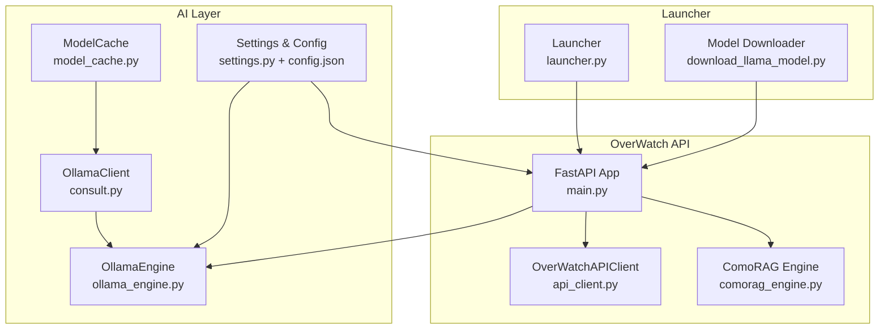
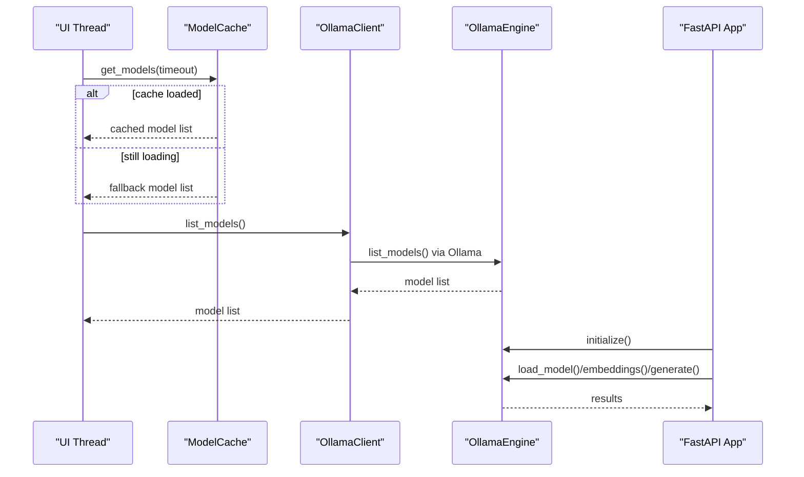
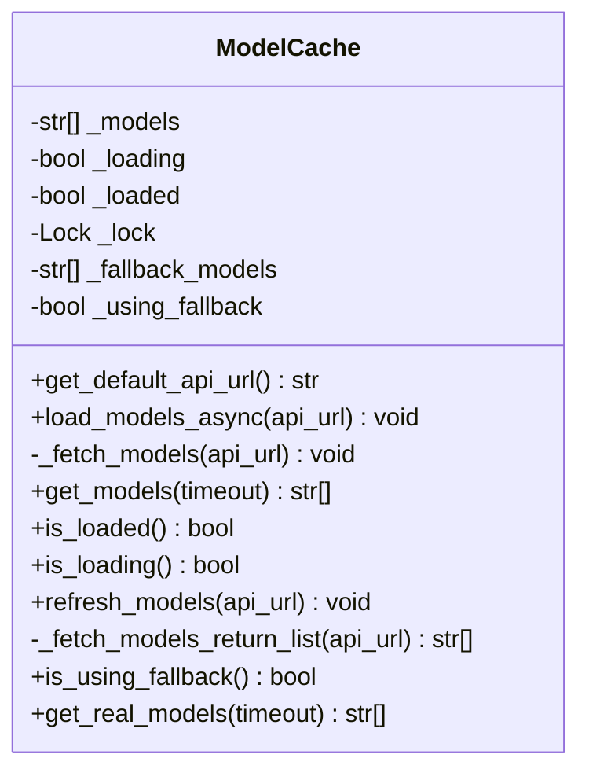
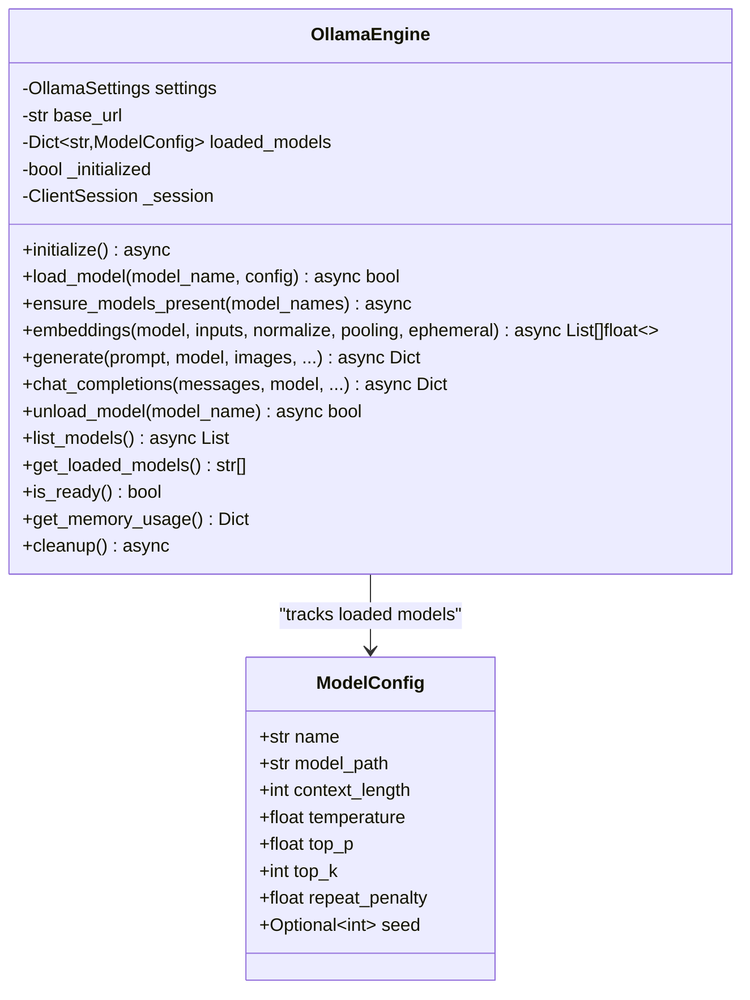
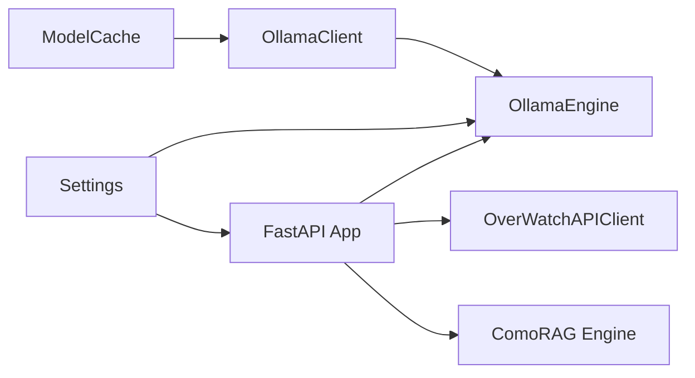

# Model Cache System

<cite>
**Referenced Files in This Document**
- [model_cache.py](file://LoOper/AI/model_cache.py)
- [ollama_engine.py](file://LoOper/AI/ollama_engine.py)
- [settings.py](file://LoOper/AI/settings.py)
- [config.json](file://LoOper/AI/config.json)
- [consult.py](file://LoOper/AI/consult.py)
- [api_client.py](file://LoOper/AI/OverWatch/api/api_client.py)
- [main.py](file://LoOper/AI/OverWatch/main.py)
- [launcher.py](file://LoOper/AI/OverWatch/launcher.py)
- [download_llama_model.py](file://LoOper/AI/OverWatch/download_llama_model.py)
- [comorag_engine.py](file://LoOper/AI/OverWatch/api/comorag_engine.py)
</cite>

## Table of Contents
1. [Introduction](#introduction)
2. [Project Structure](#project-structure)
3. [Core Components](#core-components)
4. [Architecture Overview](#architecture-overview)
5. [Detailed Component Analysis](#detailed-component-analysis)
6. [Dependency Analysis](#dependency-analysis)
7. [Performance Considerations](#performance-considerations)
8. [Troubleshooting Guide](#troubleshooting-guide)
9. [Conclusion](#conclusion)
10. [Appendices](#appendices)

## Introduction
This document explains the model cache system designed to optimize performance and manage resources for AI models in desktop applications. It focuses on:
- Caching strategies for model discovery and availability
- Memory management for model loading/unloading
- Cache invalidation and refresh policies
- Model loading/unloading mechanisms integrated with Ollama
- Cache warming procedures and performance monitoring
- Practical configuration examples, memory optimization tips, and troubleshooting steps
- Integration with Ollama model management and persistence across sessions

## Project Structure
The model cache system spans several modules:
- A lightweight model cache for UI responsiveness
- An Ollama engine for model lifecycle management
- Configuration and environment-driven settings
- API clients for model discovery and orchestration
- A FastAPI server exposing model management endpoints

**Diagram sources**
- [model_cache.py:15-217](file://LoOper/AI/model_cache.py#L15-L217)
- [ollama_engine.py:34-708](file://LoOper/AI/ollama_engine.py#L34-L708)
- [consult.py:30-132](file://LoOper/AI/consult.py#L30-L132)
- [settings.py:16-96](file://LoOper/AI/settings.py#L16-L96)
- [config.json:1-9](file://LoOper/AI/config.json#L1-L9)
- [api_client.py:25-268](file://LoOper/AI/OverWatch/api/api_client.py#L25-L268)
- [main.py:24-767](file://LoOper/AI/OverWatch/main.py#L24-L767)
- [launcher.py:30-333](file://LoOper/AI/OverWatch/launcher.py#L30-L333)
- [download_llama_model.py:11-57](file://LoOper/AI/OverWatch/download_llama_model.py#L11-L57)
- [comorag_engine.py:82-200](file://LoOper/AI/OverWatch/api/comorag_engine.py#L82-L200)

**Section sources**
- [model_cache.py:1-217](file://LoOper/AI/model_cache.py#L1-L217)
- [ollama_engine.py:1-708](file://LoOper/AI/ollama_engine.py#L1-L708)
- [settings.py:1-439](file://LoOper/AI/settings.py#L1-L439)
- [config.json:1-9](file://LoOper/AI/config.json#L1-L9)
- [consult.py:1-800](file://LoOper/AI/consult.py#L1-L800)
- [api_client.py:1-268](file://LoOper/AI/OverWatch/api/api_client.py#L1-L268)
- [main.py:1-767](file://LoOper/AI/OverWatch/main.py#L1-L767)
- [launcher.py:1-333](file://LoOper/AI/OverWatch/launcher.py#L1-L333)
- [download_llama_model.py:1-57](file://LoOper/AI/OverWatch/download_llama_model.py#L1-L57)
- [comorag_engine.py:1-200](file://LoOper/AI/OverWatch/api/comorag_engine.py#L1-L200)

## Core Components
- ModelCache: Provides a thread-safe, async model discovery cache with fallback behavior and refresh capability.
- OllamaEngine: Manages model lifecycle (load, test, unload), integrates with Ollama, and exposes embeddings and generation APIs.
- Settings and Config: Centralized configuration for Ollama base URL, timeouts, default models, and API/Tailscale settings.
- API Clients: OverWatchAPIClient and OllamaClient for model discovery and API orchestration.
- FastAPI App: Exposes endpoints for model management, health checks, and cleanup routines.
- Launcher and Downloader: Utilities to start the server and download example models.

Key responsibilities:
- Asynchronous model discovery and caching to avoid UI blocking
- Robust fallback to predefined models when API is unavailable
- Controlled model loading/unloading to manage memory footprint
- Health and memory monitoring endpoints

**Section sources**
- [model_cache.py:15-217](file://LoOper/AI/model_cache.py#L15-L217)
- [ollama_engine.py:34-708](file://LoOper/AI/ollama_engine.py#L34-L708)
- [settings.py:16-96](file://LoOper/AI/settings.py#L16-L96)
- [api_client.py:25-268](file://LoOper/AI/OverWatch/api/api_client.py#L25-L268)
- [main.py:352-600](file://LoOper/AI/OverWatch/main.py#L352-L600)

## Architecture Overview
The system separates concerns between UI-friendly caching and backend model management:
- UI uses ModelCache to quickly present available models without blocking.
- Backend uses OllamaEngine to validate and load models, and exposes endpoints for external clients.
- API layer orchestrates model discovery, health checks, and cleanup.

**Diagram sources**
- [model_cache.py:78-91](file://LoOper/AI/model_cache.py#L78-L91)
- [consult.py:98-131](file://LoOper/AI/consult.py#L98-L131)
- [ollama_engine.py:144-198](file://LoOper/AI/ollama_engine.py#L144-L198)
- [main.py:352-542](file://LoOper/AI/OverWatch/main.py#L352-L542)

## Detailed Component Analysis

### ModelCache: Asynchronous Model Discovery and Fallback
ModelCache maintains a thread-safe cache of available models, supports async loading, and falls back to predefined models when the API is unreachable.

Key behaviors:
- Async preload via a dedicated thread
- Fallback to hardcoded models when API fails or returns empty
- Synchronization via threading.Lock
- Refresh mechanism to force re-fetch and replace cache

**Diagram sources**
- [model_cache.py:15-217](file://LoOper/AI/model_cache.py#L15-L217)

**Section sources**
- [model_cache.py:15-217](file://LoOper/AI/model_cache.py#L15-L217)

### OllamaEngine: Model Lifecycle and Integration
OllamaEngine manages model lifecycle, including initialization, model loading, testing, and unloading. It integrates with Ollama’s HTTP API and supports embeddings and generation.

Highlights:
- Initialization validates Ollama availability and loads default models
- Ensures required models are present
- Tests model readiness (generation or embedding)
- Supports ephemeral usage to unload after request
- Provides memory usage metrics

**Diagram sources**
- [ollama_engine.py:21-708](file://LoOper/AI/ollama_engine.py#L21-L708)

**Section sources**
- [ollama_engine.py:34-708](file://LoOper/AI/ollama_engine.py#L34-L708)

### Settings and Configuration
Centralized configuration controls:
- Ollama base URL, context length, temperature, top_p, top_k, repeat penalty, timeout, default models
- API host/port, debug, CORS, request size limits, timeout
- Tailscale server IP, API port, auth key, hostname
- Logging level, format, file path, rotation

Environment variables override file-based settings.

**Section sources**
- [settings.py:16-96](file://LoOper/AI/settings.py#L16-L96)
- [settings.py:128-174](file://LoOper/AI/settings.py#L128-L174)
- [config.json:1-9](file://LoOper/AI/config.json#L1-L9)

### API Clients and Orchestration
- OverWatchAPIClient: HTTP client for OverWatch endpoints (health, models, generate, embeddings, memory).
- OllamaClient: Client for model discovery and fallback to local Ollama endpoints.

These clients integrate with ModelCache and OllamaEngine to provide a robust model management pipeline.

**Section sources**
- [api_client.py:25-268](file://LoOper/AI/OverWatch/api/api_client.py#L25-L268)
- [consult.py:30-132](file://LoOper/AI/consult.py#L30-L132)

### FastAPI App: Model Management Endpoints
The API server exposes:
- Health checks with memory usage and initialization status
- Model listing and dynamic load/unload
- Embeddings and generation endpoints
- Cleanup utilities to stop lingering models
- ComoRAG endpoints for memory-enhanced reasoning

Background tasks trigger cleanup after requests when configured.

**Section sources**
- [main.py:352-600](file://LoOper/AI/OverWatch/main.py#L352-L600)
- [main.py:602-746](file://LoOper/AI/OverWatch/main.py#L602-L746)

### Launcher and Model Downloader
- Launcher starts the API server and GUI, checks dependencies, and displays system status.
- Model downloader fetches a Llama model snapshot for testing.

**Section sources**
- [launcher.py:30-333](file://LoOper/AI/OverWatch/launcher.py#L30-L333)
- [download_llama_model.py:11-57](file://LoOper/AI/OverWatch/download_llama_model.py#L11-L57)

## Dependency Analysis
High-level dependencies:
- ModelCache depends on OllamaClient for model discovery
- OllamaEngine depends on aiohttp and psutil for HTTP and memory metrics
- API layer depends on OllamaEngine and OverWatchAPIClient
- Settings drive both OllamaEngine and API configuration

**Diagram sources**
- [model_cache.py:12-13](file://LoOper/AI/model_cache.py#L12-L13)
- [consult.py:30-46](file://LoOper/AI/consult.py#L30-L46)
- [ollama_engine.py:37-48](file://LoOper/AI/ollama_engine.py#L37-L48)
- [api_client.py:25-40](file://LoOper/AI/OverWatch/api/api_client.py#L25-L40)
- [main.py:24-46](file://LoOper/AI/OverWatch/main.py#L24-L46)
- [settings.py:16-96](file://LoOper/AI/settings.py#L16-L96)

**Section sources**
- [model_cache.py:12-13](file://LoOper/AI/model_cache.py#L12-L13)
- [consult.py:30-46](file://LoOper/AI/consult.py#L30-L46)
- [ollama_engine.py:37-48](file://LoOper/AI/ollama_engine.py#L37-L48)
- [api_client.py:25-40](file://LoOper/AI/OverWatch/api/api_client.py#L25-L40)
- [main.py:24-46](file://LoOper/AI/OverWatch/main.py#L24-L46)
- [settings.py:16-96](file://LoOper/AI/settings.py#L16-L96)

## Performance Considerations
- Asynchronous model loading prevents UI blocking; use ModelCache.load_models_async at startup.
- Fallback models ensure minimal latency when API is slow or unreachable.
- Ephemeral model usage reduces memory footprint for short-lived tasks.
- Cleanup endpoints stop lingering models to free memory.
- Health and memory endpoints monitor system status for proactive scaling.

Practical tips:
- Warm the cache early in application lifecycle using ModelCache.load_models_async.
- Prefer ephemeral models for one-off tasks to avoid long-term memory pressure.
- Use cleanup_after/background tasks to reclaim resources post-processing.
- Monitor health and memory endpoints to detect bottlenecks.

[No sources needed since this section provides general guidance]

## Troubleshooting Guide
Common issues and resolutions:
- Ollama not reachable: Verify base_url and network connectivity; fallback to local endpoints via OllamaClient.
- Slow model discovery: Preload cache at startup; consider increasing timeout in ModelCache.get_models.
- Memory pressure: Use ephemeral models and cleanup endpoints; reduce default model count.
- API health failures: Check health endpoint; inspect initialization logs and error fields.
- Embeddings failures: Validate model presence and endpoint compatibility; fall back to per-input processing.

**Section sources**
- [model_cache.py:36-77](file://LoOper/AI/model_cache.py#L36-L77)
- [consult.py:98-131](file://LoOper/AI/consult.py#L98-L131)
- [main.py:352-382](file://LoOper/AI/OverWatch/main.py#L352-L382)

## Conclusion
The model cache system provides responsive model discovery, robust fallbacks, and efficient lifecycle management for Ollama-backed AI models. By combining asynchronous caching, controlled loading/unloading, and monitoring endpoints, it enables desktop applications to deliver smooth user experiences while managing memory effectively across sessions.

[No sources needed since this section summarizes without analyzing specific files]

## Appendices

### Practical Configuration Examples
- Environment variables override file settings; typical keys include OVERWATCH_HOST, OVERWATCH_PORT, TAILSCALE_SERVER_IP, TAILSCALE_API_PORT, LOG_LEVEL, LOG_FILE.
- Example keys in config.json: TAILSCALE_SERVER_IP, API_PORT, OLLAMA_HOST, OLLAMA_PORT, API_TIMEOUT, AUTO_START_API.

**Section sources**
- [settings.py:128-174](file://LoOper/AI/settings.py#L128-L174)
- [config.json:1-9](file://LoOper/AI/config.json#L1-L9)

### Cache Warming Procedures
- At startup, call ModelCache.load_models_async to populate the cache.
- Optionally call ModelCache.refresh_models to force a re-fetch and replace cache entries.
- Use get_real_cached_models to retrieve only non-fallback models.

**Section sources**
- [model_cache.py:213-217](file://LoOper/AI/model_cache.py#L213-L217)
- [model_cache.py:102-163](file://LoOper/AI/model_cache.py#L102-L163)
- [model_cache.py:191-197](file://LoOper/AI/model_cache.py#L191-L197)

### Memory Usage Optimization
- Use ephemeral models for one-off tasks to unload after use.
- Enable cleanup_after/background tasks to stop lingering models.
- Monitor health and memory endpoints to adjust model counts and sizes.
- Reduce default_models to minimize initial memory footprint.

**Section sources**
- [ollama_engine.py:494-547](file://LoOper/AI/ollama_engine.py#L494-L547)
- [main.py:472-539](file://LoOper/AI/OverWatch/main.py#L472-L539)

### Integration with Ollama Model Management
- OllamaEngine ensures required models are present and tests readiness.
- API endpoints expose load/unload/cleanup for runtime management.
- Launcher and downloader assist in deployment and testing.

**Section sources**
- [ollama_engine.py:76-98](file://LoOper/AI/ollama_engine.py#L76-L98)
- [main.py:399-440](file://LoOper/AI/OverWatch/main.py#L399-L440)
- [launcher.py:30-72](file://LoOper/AI/OverWatch/launcher.py#L30-L72)
- [download_llama_model.py:11-57](file://LoOper/AI/OverWatch/download_llama_model.py#L11-L57)