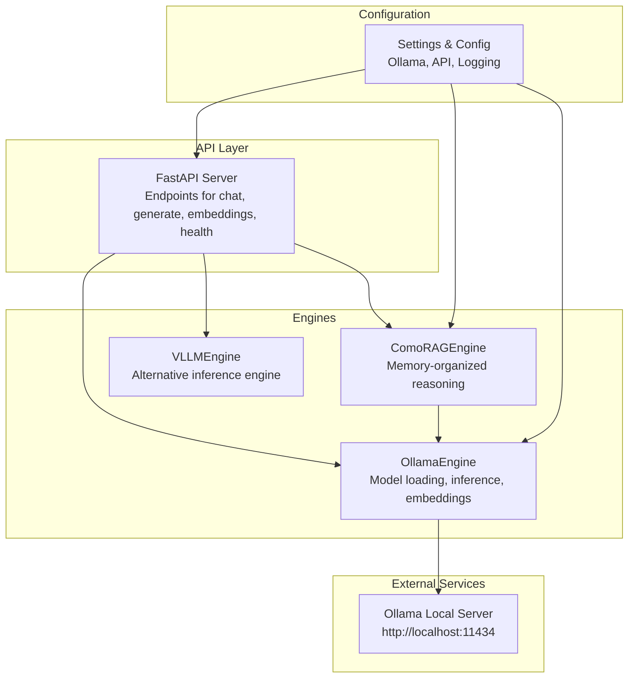
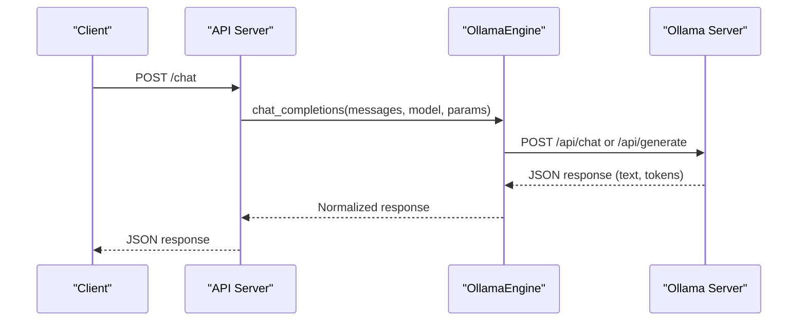
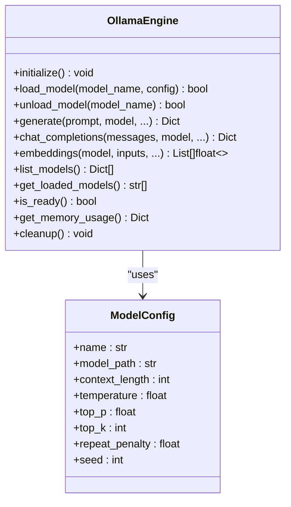
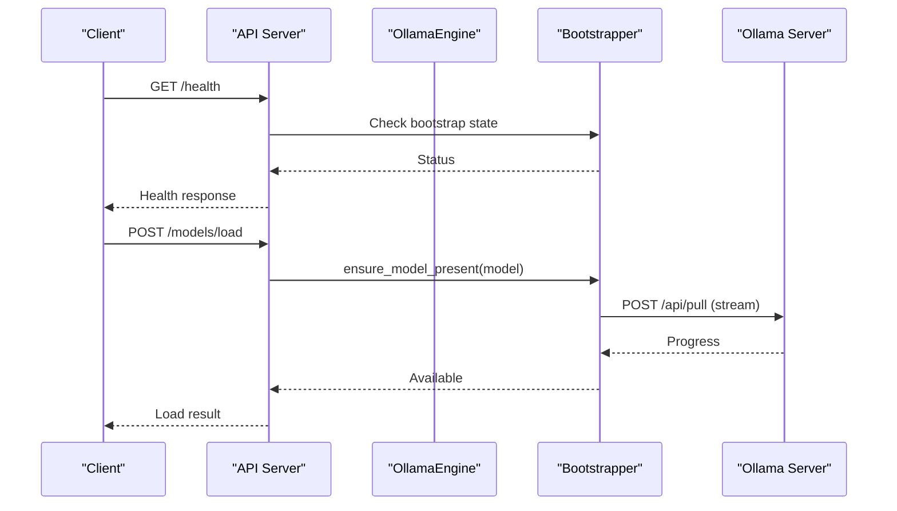
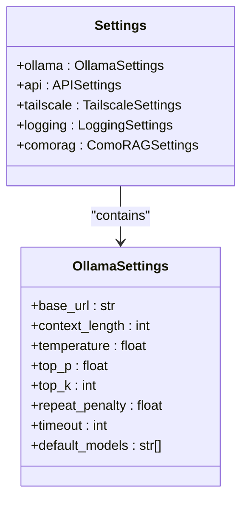
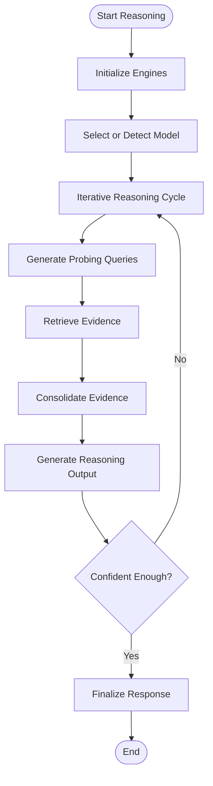
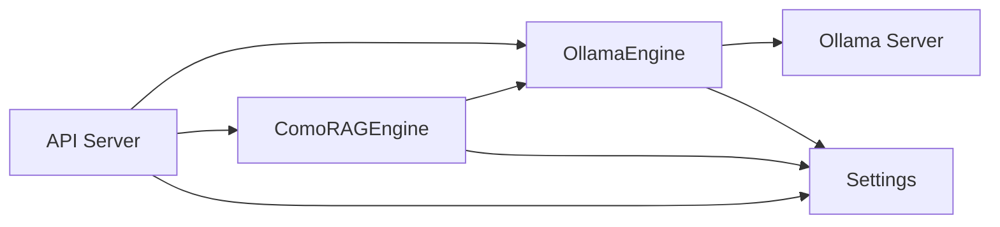

# Ollama Integration

<cite>
**Referenced Files in This Document**
- [ollama_engine.py](file://LoOper/AI/OverWatch/api/ollama_engine.py)
- [comorag_engine.py](file://LoOper/AI/OverWatch/api/comorag_engine.py)
- [vllm_engine.py](file://LoOper/AI/OverWatch/api/vllm_engine.py)
- [settings.py](file://LoOper/AI/OverWatch/config/settings.py)
- [api.py](file://LoOper/AI/api.py)
- [main.py](file://LoOper/AI/OverWatch/main.py)
</cite>

## Table of Contents
1. [Introduction](#introduction)
2. [Project Structure](#project-structure)
3. [Core Components](#core-components)
4. [Architecture Overview](#architecture-overview)
5. [Detailed Component Analysis](#detailed-component-analysis)
6. [Dependency Analysis](#dependency-analysis)
7. [Performance Considerations](#performance-considerations)
8. [Troubleshooting Guide](#troubleshooting-guide)
9. [Conclusion](#conclusion)

## Introduction
This document explains the Ollama integration within the LoOper project, focusing on local Large Language Model (LLM) access, model lifecycle management, and response processing. It covers the Ollama engine architecture, model detection and validation, automatic model downloading, error handling for unavailable models, and integration with the AI API server. Practical examples demonstrate model selection, parameter tuning, and performance optimization, alongside fallback mechanisms and best practices for desktop applications.

## Project Structure
The Ollama integration spans several modules:
- Ollama engine module: Handles model loading, inference, embeddings, and lifecycle management.
- API server module: Exposes endpoints for chat, generation, embeddings, and health checks.
- Settings module: Defines configuration for Ollama, API, and other subsystems.
- ComoRAG engine module: Provides cognitive-inspired reasoning with memory-organized retrieval-augmented generation.
- vLLM engine module: Alternative engine for comparison and migration scenarios.

**Diagram sources**
- [main.py:105-122](file://LoOper/AI/OverWatch/main.py#L105-L122)
- [ollama_engine.py:34-51](file://LoOper/AI/OverWatch/api/ollama_engine.py#L34-L51)
- [comorag_engine.py:233-242](file://LoOper/AI/OverWatch/api/comorag_engine.py#L233-L242)
- [vllm_engine.py:91-111](file://LoOper/AI/OverWatch/api/vllm_engine.py#L91-L111)
- [settings.py:76-82](file://LoOper/AI/OverWatch/config/settings.py#L76-L82)

**Section sources**
- [main.py:105-122](file://LoOper/AI/OverWatch/main.py#L105-L122)
- [settings.py:76-82](file://LoOper/AI/OverWatch/config/settings.py#L76-L82)

## Core Components
- OllamaEngine: Manages model lifecycle, loads models, validates them via tests, generates text, streams responses, produces embeddings, and supports ephemeral usage.
- API Server: Exposes endpoints for chat, generation, embeddings, streaming, and health checks; integrates model bootstrapping and cleanup.
- Settings: Central configuration for Ollama base URL, default models, timeouts, and other parameters.
- ComoRAGEngine: Adds cognitive reasoning with memory consolidation and iterative refinement.
- VLLMEngine: Alternative engine for comparison and migration scenarios.

**Section sources**
- [ollama_engine.py:34-96](file://LoOper/AI/OverWatch/api/ollama_engine.py#L34-L96)
- [api.py:37-51](file://LoOper/AI/api.py#L37-L51)
- [settings.py:16-30](file://LoOper/AI/OverWatch/config/settings.py#L16-L30)
- [comorag_engine.py:233-242](file://LoOper/AI/OverWatch/api/comorag_engine.py#L233-L242)
- [vllm_engine.py:91-111](file://LoOper/AI/OverWatch/api/vllm_engine.py#L91-L111)

## Architecture Overview
The system initializes engines at startup, exposes REST endpoints, and routes requests to either direct Ollama inference or enhanced reasoning via ComoRAG. The OllamaEngine communicates with the local Ollama server, while the API server manages HTTP transport, streaming, and cleanup tasks.

**Diagram sources**
- [main.py:442-477](file://LoOper/AI/OverWatch/main.py#L442-L477)
- [ollama_engine.py:627-671](file://LoOper/AI/OverWatch/api/ollama_engine.py#L627-L671)
- [api.py:655-761](file://LoOper/AI/api.py#L655-L761)

## Detailed Component Analysis

### Ollama Engine
The OllamaEngine encapsulates model lifecycle management and inference:
- Initialization: Validates connectivity to the Ollama server, loads default models, ensures required models are present, and prepares the HTTP client.
- Model Loading: Checks availability, pulls missing models, runs validation tests, and tracks loaded models.
- Inference: Supports both single and streaming generation, converting responses to a normalized format.
- Embeddings: Handles batch and single-vector responses, with fallbacks for legacy endpoints and normalization.
- Cleanup: Stops runners and unloads models when requested.

**Diagram sources**
- [ollama_engine.py:21-51](file://LoOper/AI/OverWatch/api/ollama_engine.py#L21-L51)
- [ollama_engine.py:34-96](file://LoOper/AI/OverWatch/api/ollama_engine.py#L34-L96)

**Section sources**
- [ollama_engine.py:53-96](file://LoOper/AI/OverWatch/api/ollama_engine.py#L53-L96)
- [ollama_engine.py:161-216](file://LoOper/AI/OverWatch/api/ollama_engine.py#L161-L216)
- [ollama_engine.py:248-266](file://LoOper/AI/OverWatch/api/ollama_engine.py#L248-L266)
- [ollama_engine.py:267-291](file://LoOper/AI/OverWatch/api/ollama_engine.py#L267-L291)
- [ollama_engine.py:292-319](file://LoOper/AI/OverWatch/api/ollama_engine.py#L292-L319)
- [ollama_engine.py:320-424](file://LoOper/AI/OverWatch/api/ollama_engine.py#L320-L424)
- [ollama_engine.py:425-501](file://LoOper/AI/OverWatch/api/ollama_engine.py#L425-L501)
- [ollama_engine.py:503-518](file://LoOper/AI/OverWatch/api/ollama_engine.py#L503-L518)
- [ollama_engine.py:519-574](file://LoOper/AI/OverWatch/api/ollama_engine.py#L519-L574)
- [ollama_engine.py:575-626](file://LoOper/AI/OverWatch/api/ollama_engine.py#L575-L626)
- [ollama_engine.py:627-671](file://LoOper/AI/OverWatch/api/ollama_engine.py#L627-L671)
- [ollama_engine.py:690-704](file://LoOper/AI/OverWatch/api/ollama_engine.py#L690-L704)
- [ollama_engine.py:706-720](file://LoOper/AI/OverWatch/api/ollama_engine.py#L706-L720)
- [ollama_engine.py:722-737](file://LoOper/AI/OverWatch/api/ollama_engine.py#L722-L737)

### API Server Integration
The API server orchestrates model bootstrapping, request routing, and cleanup:
- Bootstrapping: Ensures required models are present during startup or on-demand.
- Vision Model Detection: Determines whether a model supports images and processes image inputs accordingly.
- Endpoints: Expose chat, generate, embeddings, health, and streaming responses.
- Cleanup: Stops model runners post-request to free resources.

**Diagram sources**
- [api.py:581-606](file://LoOper/AI/api.py#L581-L606)
- [api.py:181-216](file://LoOper/AI/api.py#L181-L216)
- [api.py:131-139](file://LoOper/AI/api.py#L131-L139)

**Section sources**
- [api.py:581-606](file://LoOper/AI/api.py#L581-L606)
- [api.py:181-216](file://LoOper/AI/api.py#L181-L216)
- [api.py:217-253](file://LoOper/AI/api.py#L217-L253)
- [api.py:254-288](file://LoOper/AI/api.py#L254-L288)
- [api.py:290-387](file://LoOper/AI/api.py#L290-L387)

### Settings and Configuration
Centralized configuration defines Ollama base URL, default models, timeouts, and API parameters. Environment variables override defaults for flexible deployment.

**Diagram sources**
- [settings.py:76-82](file://LoOper/AI/OverWatch/config/settings.py#L76-L82)
- [settings.py:16-30](file://LoOper/AI/OverWatch/config/settings.py#L16-L30)

**Section sources**
- [settings.py:16-30](file://LoOper/AI/OverWatch/config/settings.py#L16-L30)
- [settings.py:265-283](file://LoOper/AI/OverWatch/config/settings.py#L265-L283)
- [settings.py:328-342](file://LoOper/AI/OverWatch/config/settings.py#L328-L342)

### ComoRAG Engine
The ComoRAG engine augments reasoning with a dynamic memory workspace, similarity search, and iterative refinement cycles. It integrates with the OllamaEngine for model inference and memory consolidation.

**Diagram sources**
- [comorag_engine.py:328-642](file://LoOper/AI/OverWatch/api/comorag_engine.py#L328-L642)
- [comorag_engine.py:643-664](file://LoOper/AI/OverWatch/api/comorag_engine.py#L643-L664)

**Section sources**
- [comorag_engine.py:233-286](file://LoOper/AI/OverWatch/api/comorag_engine.py#L233-L286)
- [comorag_engine.py:328-642](file://LoOper/AI/OverWatch/api/comorag_engine.py#L328-L642)
- [comorag_engine.py:643-664](file://LoOper/AI/OverWatch/api/comorag_engine.py#L643-L664)

### vLLM Engine (Comparison)
The vLLM engine demonstrates an alternative inference backend with GPU-aware configuration and streaming support. While not used for Ollama, it provides a reference for performance tuning and resource management.

**Section sources**
- [vllm_engine.py:91-143](file://LoOper/AI/OverWatch/api/vllm_engine.py#L91-L143)
- [vllm_engine.py:144-218](file://LoOper/AI/OverWatch/api/vllm_engine.py#L144-L218)
- [vllm_engine.py:249-307](file://LoOper/AI/OverWatch/api/vllm_engine.py#L249-L307)
- [vllm_engine.py:308-319](file://LoOper/AI/OverWatch/api/vllm_engine.py#L308-L319)
- [vllm_engine.py:380-395](file://LoOper/AI/OverWatch/api/vllm_engine.py#L380-L395)
- [vllm_engine.py:396-411](file://LoOper/AI/OverWatch/api/vllm_engine.py#L396-L411)
- [vllm_engine.py:412-440](file://LoOper/AI/OverWatch/api/vllm_engine.py#L412-L440)

## Dependency Analysis
The Ollama integration exhibits clear separation of concerns:
- API server depends on OllamaEngine and optionally ComoRAGEngine.
- OllamaEngine depends on the Ollama server and aiohttp for HTTP communication.
- Settings provide configuration to both API server and engines.
- ComoRAGEngine depends on OllamaEngine for inference and optional embedding models.

**Diagram sources**
- [main.py:24-26](file://LoOper/AI/OverWatch/main.py#L24-L26)
- [ollama_engine.py:34-51](file://LoOper/AI/OverWatch/api/ollama_engine.py#L34-L51)
- [comorag_engine.py:236-238](file://LoOper/AI/OverWatch/api/comorag_engine.py#L236-L238)
- [settings.py:76-82](file://LoOper/AI/OverWatch/config/settings.py#L76-L82)

**Section sources**
- [main.py:24-26](file://LoOper/AI/OverWatch/main.py#L24-L26)
- [ollama_engine.py:34-51](file://LoOper/AI/OverWatch/api/ollama_engine.py#L34-L51)
- [comorag_engine.py:236-238](file://LoOper/AI/OverWatch/api/comorag_engine.py#L236-L238)
- [settings.py:76-82](file://LoOper/AI/OverWatch/config/settings.py#L76-L82)

## Performance Considerations
- Model Selection: Choose appropriate model sizes for your hardware. Smaller instruct models are suitable for CPU or constrained environments; larger models benefit from GPU acceleration.
- Parameter Tuning:
  - Temperature: Lower values (e.g., 0.3) increase determinism; higher values (e.g., 0.9) increase creativity.
  - Top-p and Top-k: Control nucleus and token-level sampling diversity.
  - Repeat penalty: Mitigates repetition; tune based on desired verbosity.
  - Max tokens: Balance response length against latency.
- Streaming: Enable streaming for long responses to improve perceived performance.
- Ephemeral Usage: Use ephemeral mode to unload models after single-use, freeing memory.
- Cleanup: Leverage background cleanup to stop lingering runners and reclaim resources.
- Bootstrapping: Pre-download required models to avoid runtime delays.

[No sources needed since this section provides general guidance]

## Troubleshooting Guide
Common issues and resolutions:
- Ollama Not Running: The initialization routine raises an error if the Ollama server is unreachable. Verify the base URL and service status.
- Model Not Available: The engine attempts to pull missing models; if pull fails, ensure network connectivity and disk space.
- Validation Failures: Embedding and generation tests confirm model readiness; failures indicate model corruption or incompatibility.
- Vision Models: Ensure the selected model supports images; otherwise, requests may fail. Use the vision detection helper to verify capability.
- Streaming Errors: Streaming responses require proper handling of incremental chunks; ensure clients consume NDJSON streams correctly.
- Cleanup Failures: The cleanup routines attempt multiple strategies (HTTP and CLI); persistent runners may require manual intervention.

**Section sources**
- [ollama_engine.py:53-64](file://LoOper/AI/OverWatch/api/ollama_engine.py#L53-L64)
- [ollama_engine.py:175-179](file://LoOper/AI/OverWatch/api/ollama_engine.py#L175-L179)
- [ollama_engine.py:205-211](file://LoOper/AI/OverWatch/api/ollama_engine.py#L205-L211)
- [api.py:217-253](file://LoOper/AI/api.py#L217-L253)
- [api.py:768-794](file://LoOper/AI/api.py#L768-L794)

## Conclusion
The Ollama integration provides a robust foundation for local LLM inference, embedding generation, and advanced reasoning via ComoRAG. By leveraging automatic model bootstrapping, validation, and cleanup, the system delivers reliable performance for desktop applications. Proper configuration, parameter tuning, and fallback strategies ensure resilience and optimal resource utilization across diverse deployment scenarios.