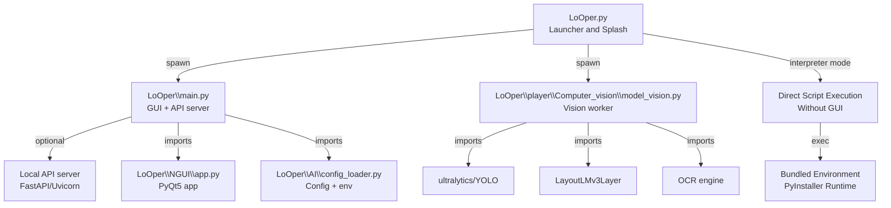
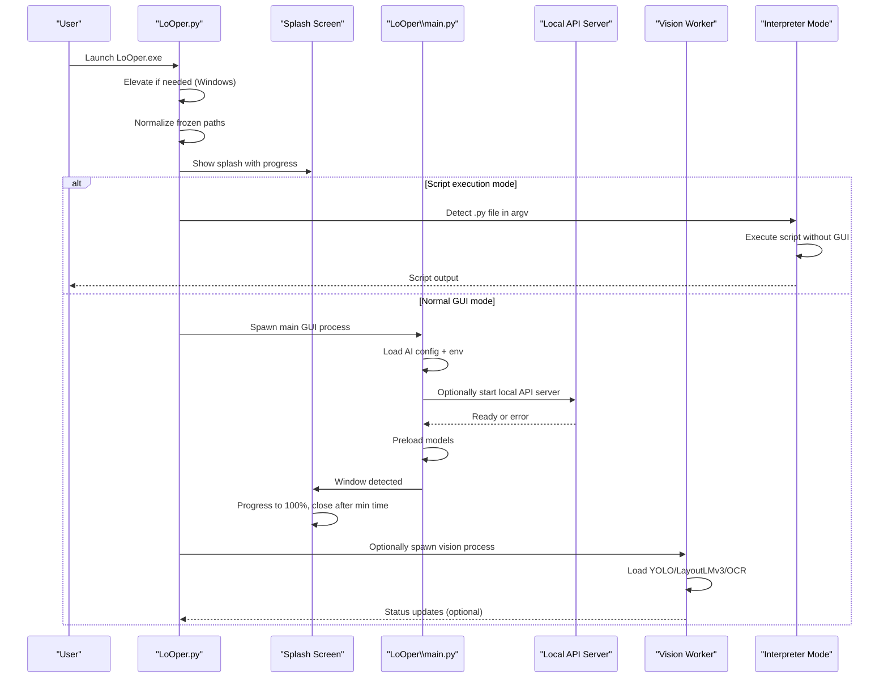
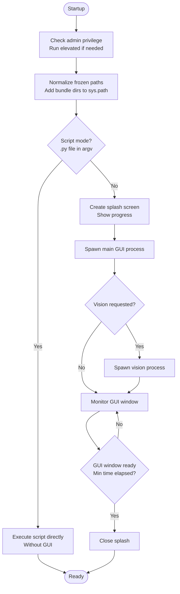
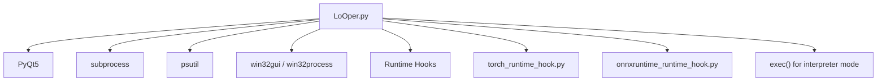

# Application Launcher

<cite>
**Referenced Files in This Document**
- [LoOper.py](file://LoOper.py)
- [LoOperApp.spec](file://LoOperApp.spec)
- [torch_runtime_hook.py](file://torch_runtime_hook.py)
- [onnxruntime_runtime_hook.py](file://onnxruntime_runtime_hook.py)
- [LoOper\main.py](file://LoOper\main.py)
- [LoOper\NGUI\app.py](file://LoOper\NGUI\app.py)
- [LoOper\AI\config_loader.py](file://LoOper\AI\config_loader.py)
- [LoOper\player\Computer_vision\model_vision.py](file://LoOper\player\Computer_vision\model_vision.py)
- [LoOper\player\Computer_vision\layoutlmv3_layer.py](file://LoOper\player\Computer_vision\layoutlmv3_layer.py)
- [LoOper\player\Computer_vision\object.py](file://LoOper\player\Computer_vision\object.py)
- [LoOper\sandbox_agent.py](file://LoOper\sandbox_agent.py)
- [run_looper.bat](file://run_looper.bat)
- [install_dependencies.ps1](file://install_dependencies.ps1)
- [README.md](file://README.md)
</cite>

## Update Summary
**Changes Made**
- Added comprehensive documentation for the new interpreter mode feature in LoOper.py
- Updated interpreter mode implementation details with sophisticated script detection logic
- Enhanced documentation for PyInstaller frozen mode compatibility
- Added practical examples of interpreter mode usage in workflow systems
- Updated bundle optimization strategies to include interpreter mode considerations

## Table of Contents
1. [Introduction](#introduction)
2. [Project Structure](#project-structure)
3. [Core Components](#core-components)
4. [Architecture Overview](#architecture-overview)
5. [Detailed Component Analysis](#detailed-component-analysis)
6. [Dependency Analysis](#dependency-analysis)
7. [Performance Considerations](#performance-considerations)
8. [Troubleshooting Guide](#troubleshooting-guide)
9. [Conclusion](#conclusion)
10. [Appendices](#appendices)

## Introduction
This document explains the application launcher centered on the LoOper.py entry point and startup management. It covers process isolation between the main GUI and the vision model, Windows elevation handling, splash screen implementation with progress tracking, PyInstaller integration, multiprocessing support, cross-platform considerations, critical DLL loading order for PyTorch/Qt compatibility, environment variable management, frozen build handling, **interpreter mode for code nodes**, bundle optimization strategies, practical startup sequences, error handling during initialization, and graceful shutdown procedures.

## Project Structure
The launcher orchestrates:
- A splash screen process that monitors the main GUI lifecycle
- A main GUI process (LoOper\main.py) that optionally starts an API server and loads models
- A vision model process (LoOper\player\Computer_vision\model_vision.py) that runs independently for OCR and UI element detection
- **An interpreter mode that enables direct script execution without GUI for compiled builds**
- PyInstaller bundling and runtime hooks for DLL resolution and environment normalization

**Diagram sources**
- [LoOper.py:19-42](file://LoOper.py#L19-L42)
- [LoOper.py:314-536](file://LoOper.py#L314-L536)
- [LoOper\main.py:133-372](file://LoOper\main.py#L133-L372)
- [LoOper\player\Computer_vision\model_vision.py:65-102](file://LoOper\player\Computer_vision\model_vision.py#L65-L102)
- [LoOper\NGUI\app.py:11-149](file://LoOper\NGUI\app.py#L11-L149)
- [LoOper\AI\config_loader.py:9-66](file://LoOper\AI\config_loader.py#L9-L66)

**Section sources**
- [LoOper.py:19-42](file://LoOper.py#L19-L42)
- [LoOper.py:314-536](file://LoOper.py#L314-L536)
- [LoOper\main.py:133-372](file://LoOper\main.py#L133-L372)
- [LoOper\player\Computer_vision\model_vision.py:65-102](file://LoOper\player\Computer_vision\model_vision.py#L65-L102)
- [LoOper\NGUI\app.py:11-149](file://LoOper\NGUI\app.py#L11-L149)
- [LoOper\AI\config_loader.py:9-66](file://LoOper\AI\config_loader.py#L9-L66)

## Core Components
- Launcher and splash screen: Initializes environment, elevates on Windows, sets frozen paths, displays splash, spawns GUI and optional vision processes, tracks readiness, and manages graceful shutdown.
- Main GUI entry: Loads AI configuration, optionally starts local API server, preloads models, and launches the PyQt5 UI.
- Vision model worker: Loads YOLO and LayoutLMv3 models, performs OCR and UI element detection, and writes outputs.
- **Interpreter mode: Executes Python scripts directly without opening the GUI, enabling seamless integration with workflow systems and code nodes.**
- PyInstaller spec and runtime hooks: Ensures proper DLL loading order, normalizes bundle contents, and avoids conflicts between PyTorch, ONNX Runtime, and Qt.

**Section sources**
- [LoOper.py:183-536](file://LoOper.py#L183-L536)
- [LoOper\main.py:355-381](file://LoOper\main.py#L355-L381)
- [LoOper\player\Computer_vision\model_vision.py:310-400](file://LoOper\player\Computer_vision\model_vision.py#L310-L400)
- [LoOperApp.spec:420-499](file://LoOperApp.spec#L420-L499)
- [torch_runtime_hook.py:75-118](file://torch_runtime_hook.py#L75-L118)
- [onnxruntime_runtime_hook.py:21-34](file://onnxruntime_runtime_hook.py#L21-L34)

## Architecture Overview
The launcher enforces strict startup sequencing and process isolation:
- Windows elevation is handled before any heavy imports.
- Frozen build paths are normalized to ensure imports resolve correctly.
- A splash screen monitors the main GUI process and ensures a minimum UX time.
- The main GUI process optionally starts a local API server and loads models.
- The vision model runs as a separate process with its own environment and model loading.
- **The interpreter mode provides direct script execution capability for compiled builds, enabling seamless integration with workflow systems.**
- Runtime hooks prime DLLs in a deterministic order to avoid WinError 1114 on Windows.

**Diagram sources**
- [LoOper.py:19-42](file://LoOper.py#L19-L42)
- [LoOper.py:314-536](file://LoOper.py#L314-L536)
- [LoOper\main.py:171-381](file://LoOper\main.py#L171-L381)
- [LoOper\player\Computer_vision\model_vision.py:310-341](file://LoOper\player\Computer_vision\model_vision.py#L310-L341)

## Detailed Component Analysis

### Launcher and Startup Management
Key responsibilities:
- Windows elevation handling for administrative privileges
- Frozen build path normalization and environment setup
- Splash screen lifecycle and progress tracking
- Process spawning for GUI and optional vision model
- **Interpreter mode for direct script execution without GUI**
- Graceful shutdown and process tree termination

**Diagram sources**
- [LoOper.py:28-56](file://LoOper.py#L28-L56)
- [LoOper.py:65-104](file://LoOper.py#L65-L104)
- [LoOper.py:183-247](file://LoOper.py#L183-L247)
- [LoOper.py:314-536](file://LoOper.py#L314-L536)
- [LoOper.py:19-42](file://LoOper.py#L19-L42)

**Section sources**
- [LoOper.py:28-56](file://LoOper.py#L28-L56)
- [LoOper.py:65-104](file://LoOper.py#L65-L104)
- [LoOper.py:183-247](file://LoOper.py#L183-L247)
- [LoOper.py:314-536](file://LoOper.py#L314-L536)
- [LoOper.py:19-42](file://LoOper.py#L19-L42)

### Windows Elevation Handling
- Detects admin status and relaunches with "runas" if needed.
- Supports both frozen and script modes.
- Removes internal flags before relaunch to avoid recursion.

**Section sources**
- [LoOper.py:28-56](file://LoOper.py#L28-L56)

### Frozen Build and Environment Normalization
- Determines bundle root and internal directories.
- Adds bundle roots to sys.path for import resolution.
- Prepends PaddleOCR/Paddle libraries to PATH and DLL search path for frozen builds.
- Ensures working directory is set to executable location.

**Section sources**
- [LoOper.py:65-104](file://LoOper.py#L65-L104)

### Splash Screen Implementation
- Frameless, translucent, centered window with a progress bar.
- Advances progress at a fixed interval up to a threshold.
- Resizes to fit logo and aligns to primary screen geometry.

**Section sources**
- [LoOper.py:183-247](file://LoOper.py#L183-L247)

### Process Isolation: GUI vs Vision Model
- GUI process is launched with a dedicated flag and optional API server.
- Vision process is spawned separately with its own working directory and sys.path adjustments.
- Both processes are monitored; on GUI exit, the launcher attempts to terminate child processes gracefully.

**Section sources**
- [LoOper.py:314-536](file://LoOper.py#L314-L536)
- [LoOper.py:121-182](file://LoOper.py#L121-L182)

### Interpreter Mode for Code Nodes
**Updated** The interpreter mode provides a sophisticated mechanism for executing Python scripts directly without opening the GUI, particularly useful for compiled builds and workflow systems.

Key features:
- **Script Detection**: Automatically detects Python files passed as command-line arguments ending with `.py`
- **Environment Integration**: Executes scripts within the bundled PyInstaller environment
- **Path Management**: Properly manipulates sys.path and sys.argv for correct script execution
- **Error Handling**: Comprehensive error handling with detailed traceback output
- **Cross-Platform Support**: Works in both frozen and script modes
- **Workflow Integration**: Seamlessly integrates with the workflow system for code node execution

Implementation details:
- Checks `len(sys.argv) > 1` and `sys.argv[1].endswith('.py')` for script detection
- Validates script existence using `os.path.exists()` or bypasses check in frozen mode
- Adjusts `sys.argv` so the script sees itself as `sys.argv[0]`
- Prepends script directory to `sys.path` for proper imports
- Executes script content using `exec()` with proper global namespace
- Handles both success and error scenarios with appropriate exit codes

**Section sources**
- [LoOper.py:19-42](file://LoOper.py#L19-L42)
- [LoOper.py:575-606](file://LoOper.py#L575-L606)
- [LoOper\main.py:387-415](file://LoOper\main.py#L387-L415)

### Main GUI Entry and API Server
- Loads AI configuration and environment variables.
- Optionally starts a local API server (FastAPI/Uvicorn) in a separate thread or process.
- Preloads models asynchronously before launching the PyQt5 UI.

**Section sources**
- [LoOper\main.py:355-381](file://LoOper\main.py#L355-L381)
- [LoOper\main.py:171-381](file://LoOper\main.py#L171-L381)
- [LoOper\AI\config_loader.py:9-66](file://LoOper\AI\config_loader.py#L9-L66)

### Vision Model Worker
- Loads YOLO structure/icon models and LayoutLMv3 layer.
- Performs OCR and UI element detection with pruning and ROI computation.
- Writes annotated outputs and masks to disk.

**Section sources**
- [LoOper\player\Computer_vision\model_vision.py:310-400](file://LoOper\player\Computer_vision\model_vision.py#L310-L400)
- [LoOper\player\Computer_vision\layoutlmv3_layer.py:6-136](file://LoOper\player\Computer_vision\layoutlmv3_layer.py#L6-L136)

### PyInstaller Integration and Runtime Hooks
- Runtime hooks prime DLLs in a specific order to avoid loader conflicts.
- Torch hook adds torch, torchvision, paddle, and onnxruntime search paths and preloads critical DLLs.
- ONNX Runtime hook ensures providers and runtime DLLs are discoverable.

**Section sources**
- [LoOperApp.spec:420-499](file://LoOperApp.spec#L420-L499)
- [torch_runtime_hook.py:75-118](file://torch_runtime_hook.py#L75-L118)
- [onnxruntime_runtime_hook.py:21-34](file://onnxruntime_runtime_hook.py#L21-L34)

### Multiprocessing Support
- freeze_support is called in both launcher and main entry to ensure compatibility in frozen builds.
- Child processes are spawned with appropriate creation flags to hide windows on Windows.

**Section sources**
- [LoOper.py:539](file://LoOper.py#L539)
- [LoOper\main.py:52](file://LoOper\main.py#L52)

### Cross-Platform Considerations
- Windows-specific elevation and DLL search path handling.
- High-DPI awareness and Qt scaling are configured in the GUI app.
- Batch and PowerShell scripts assist in developer environments and installer helpers.

**Section sources**
- [LoOper.py:28-56](file://LoOper.py#L28-L56)
- [LoOper\NGUI\app.py:14-38](file://LoOper\NGUI\app.py#L14-L38)
- [run_looper.bat:1-88](file://run_looper.bat#L1-L88)
- [install_dependencies.ps1:1-62](file://install_dependencies.ps1#L1-L62)

### Critical DLL Loading Order (PyTorch/Qt Compatibility)
- Torch hook preloads VC redistributables, OpenMP, and core Torch/ONNX Runtime DLLs in a specific order.
- This prevents WinError 1114 by ensuring dependencies are resolved before Qt attempts to load conflicting libraries.

**Section sources**
- [torch_runtime_hook.py:75-118](file://torch_runtime_hook.py#L75-L118)

### Environment Variable Management
- Launcher sets environment variables for OCR and OpenMP behavior.
- Main GUI sets high-DPI and Qt-related environment variables.
- AI configuration is loaded from file and environment variables, then exported to the process environment.

**Section sources**
- [LoOper.py:10, 42-43](file://LoOper.py#L10)
- [LoOper\main.py:39-44](file://LoOper\main.py#L39-L44)
- [LoOper\NGUI\app.py:14-18](file://LoOper\NGUI\app.py#L14-L18)
- [LoOper\AI\config_loader.py:9-48](file://LoOper\AI\config_loader.py#L9-L48)

### Frozen Build Handling
- Detects frozen mode and adjusts sys.path and working directory.
- Adds internal bundle directories and ensures imports resolve correctly in both GUI and vision workers.
- **Interpreter mode works seamlessly in frozen builds, allowing direct script execution without GUI.**

**Section sources**
- [LoOper.py:112-129](file://LoOper.py#L112-L129)
- [Looper.py:125-158](file://Looper.py#L125-L158)
- [Looper\main.py:112-129](file://Looper\main.py#L112-L129)

### Bundle Optimization Strategies
- PyInstaller spec collects data and binaries, normalizes destinations to avoid nested _internal/_internal paths.
- Filters conflicting OpenMP DLLs between Torch and Paddle.
- Includes ONNX Runtime providers and VC redistributables in multiple locations for compatibility.
- **Interpreter mode optimization: Ensures bundled environment is properly initialized for script execution.**

**Section sources**
- [LoOperApp.spec:447-461](file://LoOperApp.spec#L447-L461)
- [LoOperApp.spec:440-446](file://LoOperApp.spec#L440-L446)
- [LoOperApp.spec:381-401](file://LoOperApp.spec#L381-L401)

### Practical Startup Sequences
- **Script execution mode**: `LoOper.exe script.py` → Direct script execution without GUI → Exit with script result.
- **Normal startup**: Launcher → Splash → GUI process → Optional API server → Optional vision process → Ready.
- **Installer helper**: PowerShell script verifies Ollama and triggers OCR model verification via the launcher.

**Section sources**
- [LoOper.py:19-42](file://LoOper.py#L19-L42)
- [LoOper.py:314-536](file://LoOper.py#L314-L536)
- [install_dependencies.ps1:48-61](file://install_dependencies.ps1#L48-L61)

### Error Handling During Initialization
- Launcher prints exceptions and stack traces for GUI and vision import failures.
- **Interpreter mode provides detailed error reporting with traceback output.**
- GUI waits for API readiness and handles failures gracefully.
- Vision worker catches exceptions during model loading and continues with fallbacks.

**Section sources**
- [LoOper.py:115-119](file://LoOper.py#L115-L119)
- [LoOper.py:177-181](file://LoOper.py#L177-L181)
- [LoOper.py:37-41](file://LoOper.py#L37-L41)
- [LoOper\main.py:138-169](file://LoOper\main.py#L138-L169)
- [LoOper\player\Computer_vision\model_vision.py:323-330](file://LoOper\player\Computer_vision\model_vision.py#L323-L330)

### Graceful Shutdown Procedures
- On GUI exit, the launcher attempts to terminate the main process and child processes.
- Uses process trees and signals (including Windows CTRL_BREAK_EVENT) to ensure termination.
- API server is terminated on exit.

**Section sources**
- [LoOper.py:413-483](file://LoOper.py#L413-L483)
- [LoOper\main.py:310-325](file://LoOper\main.py#L310-L325)

## Dependency Analysis
The launcher depends on:
- PyQt5 for the splash and GUI
- subprocess for process spawning
- psutil for process tree termination
- win32gui/win32process for window detection on Windows
- PyInstaller runtime hooks for DLL priming
- **exec() for interpreter mode script execution**

**Diagram sources**
- [LoOper.py:105-107](file://LoOper.py#L105-L107)
- [LoOper.py:416-417](file://LoOper.py#L416-L417)
- [LoOper.py:420-423](file://LoOper.py#L420-L423)
- [torch_runtime_hook.py:1-3](file://torch_runtime_hook.py#L1-L3)
- [onnxruntime_runtime_hook.py:1-3](file://onnxruntime_runtime_hook.py#L1-L3)

**Section sources**
- [LoOper.py:105-107](file://LoOper.py#L105-L107)
- [LoOper.py:416-423](file://LoOper.py#L416-L423)
- [torch_runtime_hook.py:1-3](file://torch_runtime_hook.py#L1-L3)
- [onnxruntime_runtime_hook.py:1-3](file://onnxruntime_runtime_hook.py#L1-L3)

## Performance Considerations
- Minimize splash duration to balance UX and perceived responsiveness.
- Defer heavy model loading to background threads to keep the GUI responsive.
- Use process isolation to prevent blocking the main GUI thread.
- Ensure runtime hooks preload only necessary DLLs to reduce cold-start overhead.
- **Interpreter mode provides immediate script execution without GUI overhead.**

## Troubleshooting Guide
- Windows elevation failures: Verify the "runas" dialog is accepted and relaunch arguments are correct.
- DLL conflicts on Windows: Confirm runtime hooks are executed and DLL search paths are set.
- Vision model not starting: Check vision script path resolution and model availability.
- API server not reachable: Validate port binding and environment overrides.
- **Script execution failures: Check script path validity and ensure proper .py file extension.**
- **Interpreter mode issues: Verify frozen build integrity and bundled environment paths.**

**Section sources**
- [LoOper.py:28-56](file://LoOper.py#L28-L56)
- [torch_runtime_hook.py:61-74](file://torch_runtime_hook.py#L61-L74)
- [LoOper.py:370-400](file://LoOper.py#L370-L400)
- [LoOper\main.py:171-277](file://LoOper\main.py#L171-L277)
- [LoOper.py:37-41](file://LoOper.py#L37-L41)

## Conclusion
The LoOper launcher provides a robust, cross-platform startup pipeline with strong process isolation, careful DLL loading order, and comprehensive error handling. It supports both interactive GUI usage and background vision processing, **includes sophisticated interpreter mode for direct script execution without GUI**, integrates tightly with PyInstaller, and offers practical tools for installer and developer workflows.

## Appendices
- Batch and PowerShell helpers streamline installation and environment setup.
- README outlines repository layout, quick start, and configuration options.
- **Interpreter mode enables seamless integration with workflow systems and code nodes.**

**Section sources**
- [run_looper.bat:1-88](file://run_looper.bat#L1-L88)
- [install_dependencies.ps1:1-62](file://install_dependencies.ps1#L1-L62)
- [README.md:109-123](file://README.md#L109-L123)
- [README.md:125-147](file://README.md#L125-L147)
- [README.md:148-158](file://README.md#L148-L158)