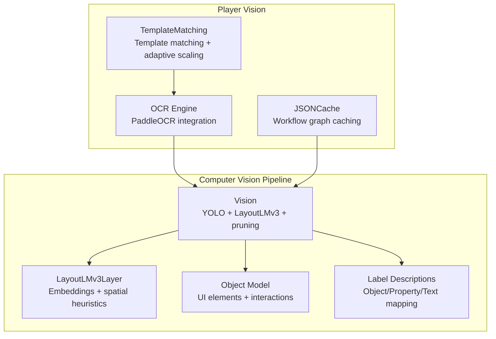
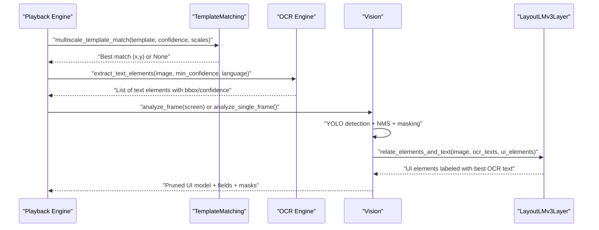
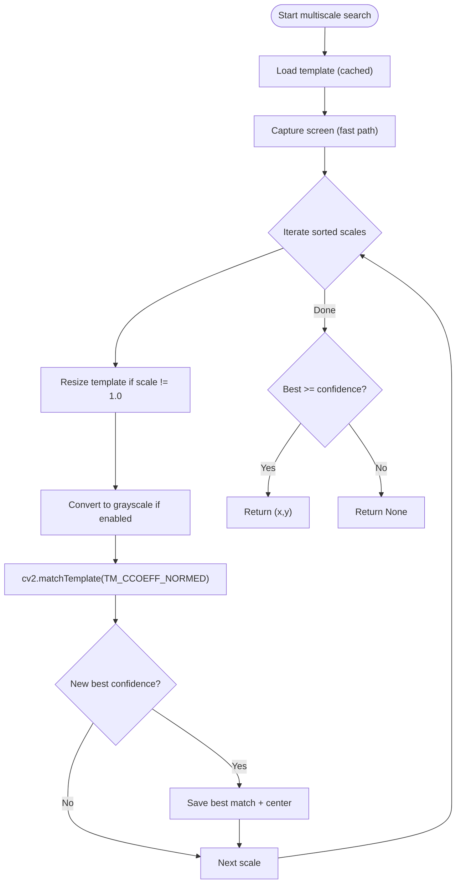
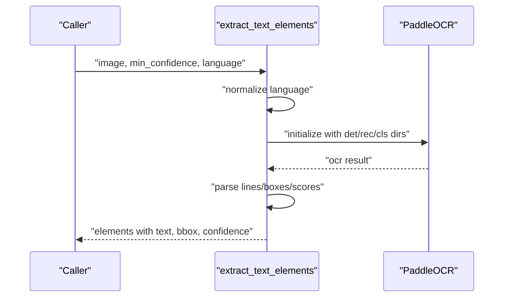
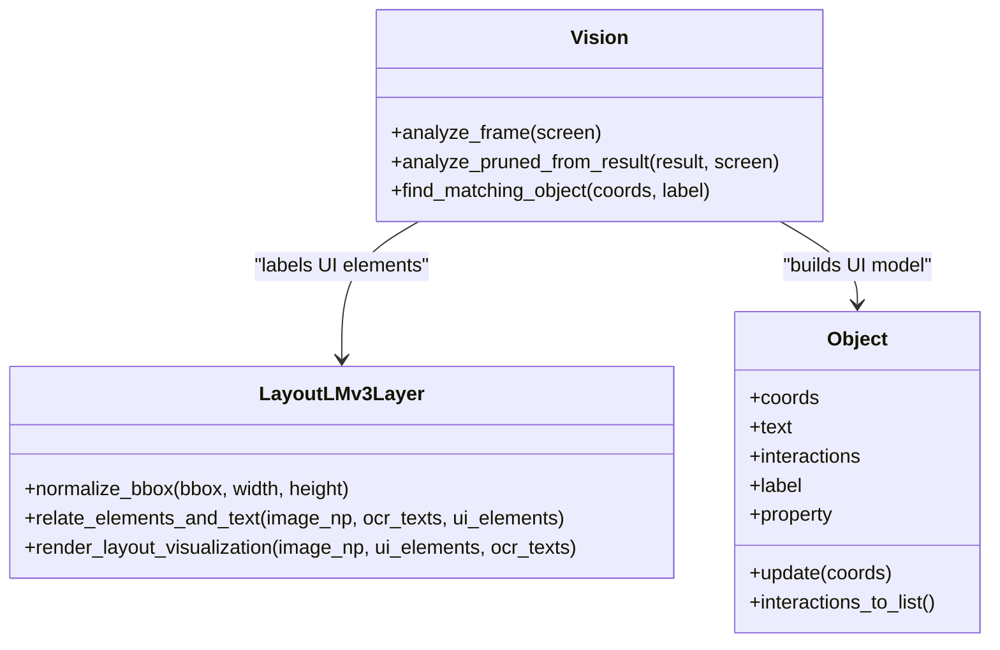
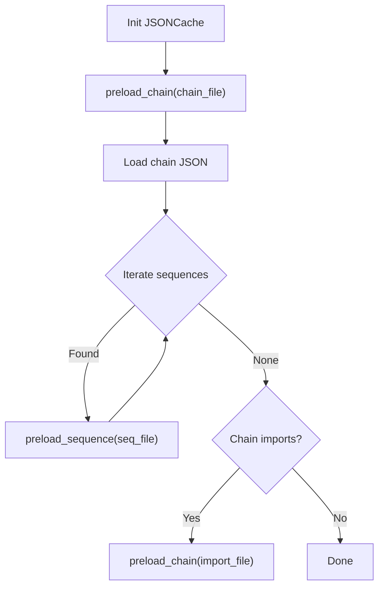
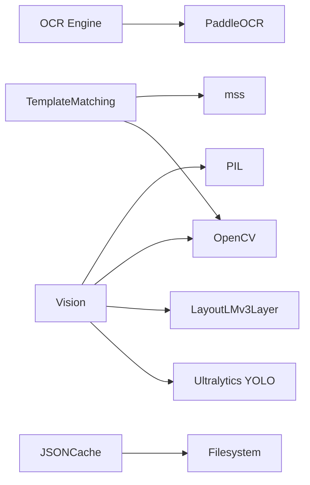

# Computer Vision System

<cite>
**Referenced Files in This Document**
- [computer_vision.py](file://LoOper/player/computer_vision.py)
- [ocr_engine.py](file://LoOper/player/ocr_engine.py)
- [json_cache.py](file://LoOper/player/json_cache.py)
- [model_vision.py](file://LoOper/player/Computer_vision/model_vision.py)
- [layoutlmv3_layer.py](file://LoOper/player/Computer_vision/layoutlmv3_layer.py)
- [object.py](file://LoOper/player/Computer_vision/object.py)
- [label_description.json](file://LoOper/player/Computer_vision/label_description.json)
- [view_output.json](file://LoOper/player/Computer_vision/view_output.json)
- [test_ocr.py](file://LoOper/player/Computer_vision/test_ocr.py)
- [test_vision.py](file://LoOper/player/Computer_vision/test_vision.py)
- [action_handlers.py](file://LoOper/player/action_handlers.py)
</cite>

## Table of Contents
1. [Introduction](#introduction)
2. [Project Structure](#project-structure)
3. [Core Components](#core-components)
4. [Architecture Overview](#architecture-overview)
5. [Detailed Component Analysis](#detailed-component-analysis)
6. [Dependency Analysis](#dependency-analysis)
7. [Performance Considerations](#performance-considerations)
8. [Troubleshooting Guide](#troubleshooting-guide)
9. [Conclusion](#conclusion)
10. [Appendices](#appendices)

## Introduction
This document describes the computer vision system responsible for template matching, OCR integration, and vision model processing. It explains:
- Template matching with confidence threshold management and adaptive scaling strategies
- PaddleOCR engine configuration for text recognition, region-based processing, and language support
- ONNX-based inference with LayoutLMv3 integration, model loading and caching strategies, and performance tuning
- Practical workflows, accuracy optimization, and integration with the playback engine
- JSON cache system for performance, memory management, and deployment strategies

## Project Structure
The computer vision system spans several modules:
- Player-level template matching and OCR orchestration
- Vision pipeline with YOLO-based UI element detection and LayoutLMv3-based labeling
- JSON cache for efficient workflow graph loading
- Test utilities for validating OCR and vision pipelines

**Diagram sources**
- [computer_vision.py:47-606](file://LoOper/player/computer_vision.py#L47-L606)
- [ocr_engine.py:1-367](file://LoOper/player/ocr_engine.py#L1-L367)
- [json_cache.py:15-584](file://LoOper/player/json_cache.py#L15-L584)
- [model_vision.py:310-800](file://LoOper/player/Computer_vision/model_vision.py#L310-L800)
- [layoutlmv3_layer.py:6-203](file://LoOper/player/Computer_vision/layoutlmv3_layer.py#L6-L203)
- [object.py:3-167](file://LoOper/player/Computer_vision/object.py#L3-L167)
- [label_description.json:1-9](file://LoOper/player/Computer_vision/label_description.json#L1-L9)

**Section sources**
- [computer_vision.py:1-606](file://LoOper/player/computer_vision.py#L1-L606)
- [ocr_engine.py:1-367](file://LoOper/player/ocr_engine.py#L1-L367)
- [json_cache.py:1-584](file://LoOper/player/json_cache.py#L1-L584)
- [model_vision.py:1-800](file://LoOper/player/Computer_vision/model_vision.py#L1-L800)
- [layoutlmv3_layer.py:1-203](file://LoOper/player/Computer_vision/layoutlmv3_layer.py#L1-L203)
- [object.py:1-167](file://LoOper/player/Computer_vision/object.py#L1-L167)
- [label_description.json:1-9](file://LoOper/player/Computer_vision/label_description.json#L1-L9)

## Core Components
- TemplateMatching: Multi-scale template matching with adaptive scaling, confidence thresholds, and region-based search fallbacks.
- OCR Engine: PaddleOCR integration with language normalization, model bundling for frozen builds, and robust result parsing.
- Vision: YOLO-based UI element detection, pruning, ROI computation, and LayoutLMv3 labeling.
- LayoutLMv3Layer: Layout-aware text-label association using embeddings and spatial heuristics.
- JSONCache: Preloading and caching of workflow graphs and sequences to minimize I/O overhead.

**Section sources**
- [computer_vision.py:47-606](file://LoOper/player/computer_vision.py#L47-L606)
- [ocr_engine.py:131-345](file://LoOper/player/ocr_engine.py#L131-L345)
- [model_vision.py:310-800](file://LoOper/player/Computer_vision/model_vision.py#L310-L800)
- [layoutlmv3_layer.py:6-203](file://LoOper/player/Computer_vision/layoutlmv3_layer.py#L6-L203)
- [json_cache.py:15-584](file://LoOper/player/json_cache.py#L15-L584)

## Architecture Overview
The system integrates template matching, OCR, and deep vision models to produce structured UI understanding and actionable coordinates.

**Diagram sources**
- [computer_vision.py:198-331](file://LoOper/player/computer_vision.py#L198-L331)
- [ocr_engine.py:131-240](file://LoOper/player/ocr_engine.py#L131-L240)
- [model_vision.py:423-637](file://LoOper/player/Computer_vision/model_vision.py#L423-L637)
- [layoutlmv3_layer.py:29-136](file://LoOper/player/Computer_vision/layoutlmv3_layer.py#L29-L136)

## Detailed Component Analysis

### Template Matching and Adaptive Scaling
TemplateMatching implements:
- Multi-scale template matching with configurable scales and grayscale conversion
- Adaptive scaling strategy that adjusts the tested scales based on repeated failures
- Region-based search fallback leveraging OpenCV or PyAutoGUI
- Confidence threshold management and best-match selection across scales

**Diagram sources**
- [computer_vision.py:198-331](file://LoOper/player/computer_vision.py#L198-L331)

**Section sources**
- [computer_vision.py:47-606](file://LoOper/player/computer_vision.py#L47-L606)

### OCR Integration with PaddleOCR
The OCR engine:
- Normalizes languages to supported PaddleOCR codes
- Initializes PaddleOCR with angle classification and language selection
- Supports bundled model directories for frozen executables
- Parses diverse OCR result formats and extracts text, confidence, and bounding boxes

**Diagram sources**
- [ocr_engine.py:131-240](file://LoOper/player/ocr_engine.py#L131-L240)

**Section sources**
- [ocr_engine.py:1-367](file://LoOper/player/ocr_engine.py#L1-L367)

### Vision Pipeline with YOLO and LayoutLMv3
The Vision pipeline:
- Loads structure and icon detection models via YOLO
- Applies Test-Time Augmentation (grayscale, high contrast, inverted)
- Merges detections via NMS-style averaging
- Sequentially subtracts large elements to improve recall
- Prunes detections for downstream LLM-friendly representation
- Integrates LayoutLMv3 to associate UI elements with nearest OCR text using embeddings and spatial heuristics

**Diagram sources**
- [model_vision.py:310-800](file://LoOper/player/Computer_vision/model_vision.py#L310-L800)
- [layoutlmv3_layer.py:6-203](file://LoOper/player/Computer_vision/layoutlmv3_layer.py#L6-L203)
- [object.py:3-167](file://LoOper/player/Computer_vision/object.py#L3-L167)

**Section sources**
- [model_vision.py:310-800](file://LoOper/player/Computer_vision/model_vision.py#L310-L800)
- [layoutlmv3_layer.py:6-203](file://LoOper/player/Computer_vision/layoutlmv3_layer.py#L6-L203)
- [object.py:1-167](file://LoOper/player/Computer_vision/object.py#L1-L167)
- [label_description.json:1-9](file://LoOper/player/Computer_vision/label_description.json#L1-L9)
- [view_output.json:1-800](file://LoOper/player/Computer_vision/view_output.json#L1-L800)

### JSON Cache System
The JSONCache:
- Preloads entire chains and referenced sequences at startup
- Caches file contents and modification times to avoid redundant loads
- Supports invalidation by file, directory, or explicit clearing
- Provides convenience functions for global cache access

**Diagram sources**
- [json_cache.py:29-115](file://LoOper/player/json_cache.py#L29-L115)

**Section sources**
- [json_cache.py:1-584](file://LoOper/player/json_cache.py#L1-L584)

## Dependency Analysis
Key dependencies and relationships:
- TemplateMatching depends on OpenCV and optional mss for fast screenshots
- OCR Engine depends on PaddleOCR and supports frozen model directories
- Vision depends on Ultralytics YOLO, Transformers LayoutLMv3, and OpenCV/PIL
- JSONCache is used by higher-level orchestration to reduce I/O overhead

**Diagram sources**
- [computer_vision.py:34-44](file://LoOper/player/computer_vision.py#L34-L44)
- [ocr_engine.py:49-103](file://LoOper/player/ocr_engine.py#L49-L103)
- [model_vision.py:65-88](file://LoOper/player/Computer_vision/model_vision.py#L65-L88)
- [json_cache.py:15-28](file://LoOper/player/json_cache.py#L15-L28)

**Section sources**
- [computer_vision.py:1-606](file://LoOper/player/computer_vision.py#L1-L606)
- [ocr_engine.py:1-367](file://LoOper/player/ocr_engine.py#L1-L367)
- [model_vision.py:1-800](file://LoOper/player/Computer_vision/model_vision.py#L1-L800)
- [json_cache.py:1-584](file://LoOper/player/json_cache.py#L1-L584)

## Performance Considerations
- Template Matching
  - Adaptive scaling reduces unnecessary multi-scale evaluations after repeated misses
  - Prefer grayscale matching when appropriate to improve speed
  - Use region-based search with expand_factor tuned to expected drift
- OCR
  - Normalize language codes to supported variants to avoid initialization failures
  - Use min_confidence thresholds to filter low-quality OCR results
  - Leverage bundled models in frozen builds to avoid network/model downloads
- Vision Pipeline
  - Apply TTA (grayscale, high-contrast, inverted) to improve detection robustness
  - Use NMS-style averaging to consolidate overlapping detections
  - Sequential subtraction improves recall for large UI elements
  - LayoutLMv3 labeling adds semantic and spatial context to UI elements
- JSON Cache
  - Preload chains and sequences at startup to avoid runtime I/O
  - Invalidate caches on file changes to keep configurations fresh
  - Monitor cache stats to tune memory usage

[No sources needed since this section provides general guidance]

## Troubleshooting Guide
Common issues and resolutions:
- Template Matching
  - If matches fail consistently, increase confidence threshold or adjust scales
  - Verify grayscale parameter matches template characteristics
  - Use region-based search with larger expand_factor for drift-prone UI
- OCR
  - If PaddleOCR fails to initialize, ensure language normalization succeeds and bundled models are present
  - Reduce min_confidence to capture more text at the cost of noise
- Vision Pipeline
  - If detections are fragmented, lower overlap threshold or adjust NMS averaging
  - If large elements are missed, verify sequential subtraction logic and masking
  - If LayoutLMv3 labeling is weak, review spatial heuristics and embedding quality
- JSON Cache
  - If stale data is served, invalidate affected files or clear cache
  - If memory grows unexpectedly, monitor cache stats and reduce preloading scope

**Section sources**
- [computer_vision.py:198-331](file://LoOper/player/computer_vision.py#L198-L331)
- [ocr_engine.py:131-240](file://LoOper/player/ocr_engine.py#L131-L240)
- [model_vision.py:423-637](file://LoOper/player/Computer_vision/model_vision.py#L423-L637)
- [json_cache.py:533-544](file://LoOper/player/json_cache.py#L533-L544)

## Conclusion
The computer vision system combines robust template matching, reliable OCR, and deep learning–based UI understanding to deliver accurate, efficient automation. By tuning confidence thresholds, leveraging adaptive strategies, and integrating LayoutLMv3 for contextual labeling, the system achieves strong performance across varied UIs. The JSON cache further optimizes workflow execution by minimizing I/O overhead.

[No sources needed since this section summarizes without analyzing specific files]

## Appendices

### Practical Workflows and Accuracy Optimization
- Template Matching Workflow
  - Start with multiscale search using moderate confidence
  - Fall back to region-based search with increasing expand_factor if needed
  - Adjust grayscale and scales based on template complexity
- OCR Workflow
  - Capture screen region once and reuse for multiple queries
  - Filter results by min_confidence and post-process for substrings
  - Normalize language to supported variants
- Vision Workflow
  - Run TTA and NMS averaging to consolidate detections
  - Compute ROI around input clusters and re-run on masked regions
  - Use LayoutLMv3 to label UI elements with nearest OCR text
- Integration with Playback Engine
  - Use action handlers’ predefined strategies for fallback tiers
  - Combine template matches, OCR results, and vision outputs to drive clicks and fills

**Section sources**
- [computer_vision.py:198-331](file://LoOper/player/computer_vision.py#L198-L331)
- [ocr_engine.py:131-240](file://LoOper/player/ocr_engine.py#L131-L240)
- [model_vision.py:423-637](file://LoOper/player/Computer_vision/model_vision.py#L423-L637)
- [action_handlers.py:239-251](file://LoOper/player/action_handlers.py#L239-L251)

### Example Validation Scripts
- OCR validation script demonstrates extracting text elements and full text from images
- Vision validation script initializes the Vision pipeline and prints pruned fields and saves outputs

**Section sources**
- [test_ocr.py:1-62](file://LoOper/player/Computer_vision/test_ocr.py#L1-L62)
- [test_vision.py:1-52](file://LoOper/player/Computer_vision/test_vision.py#L1-L52)