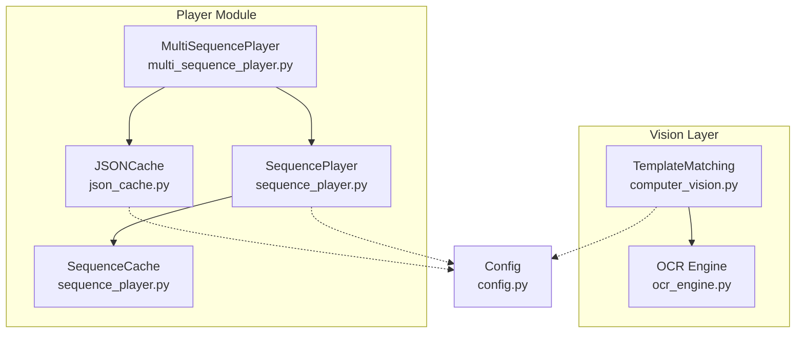
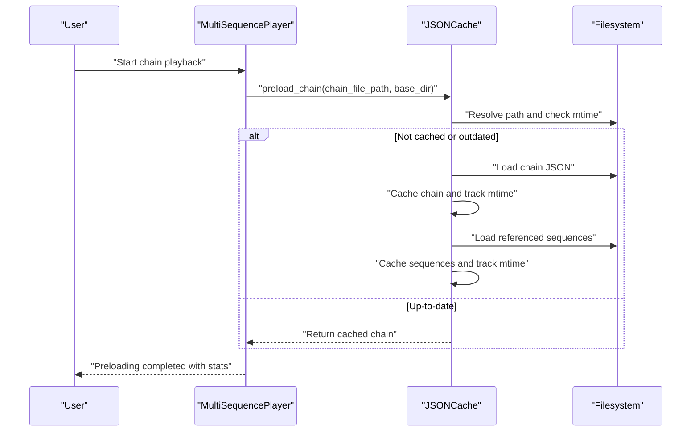
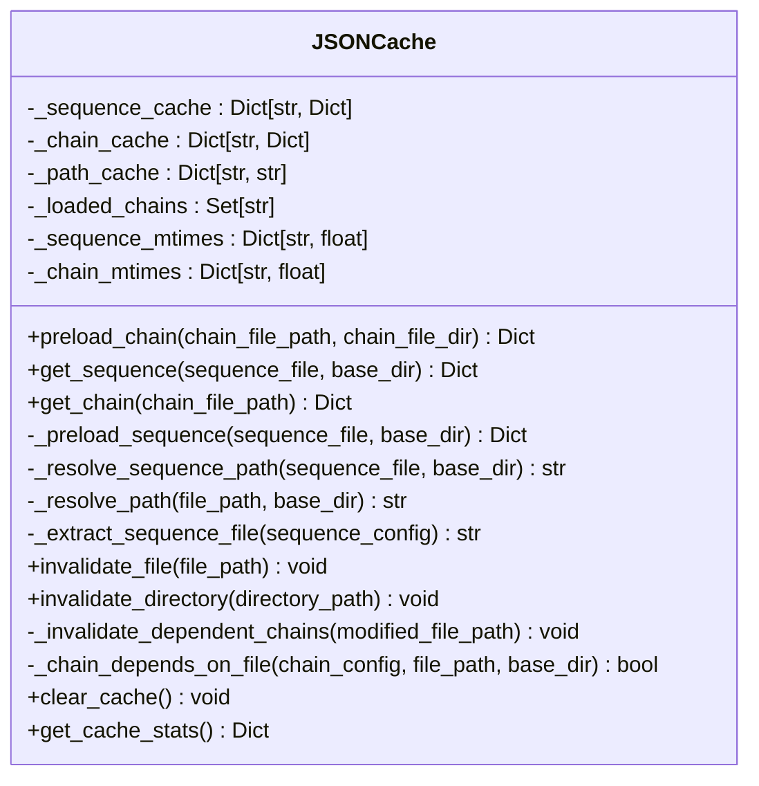
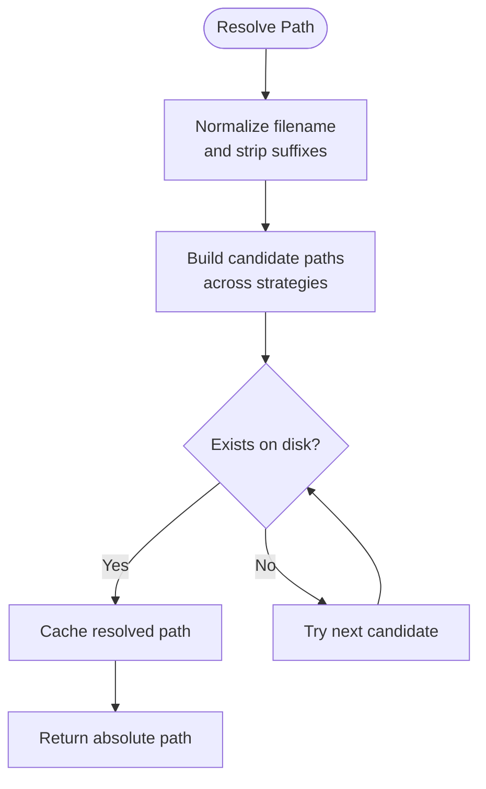
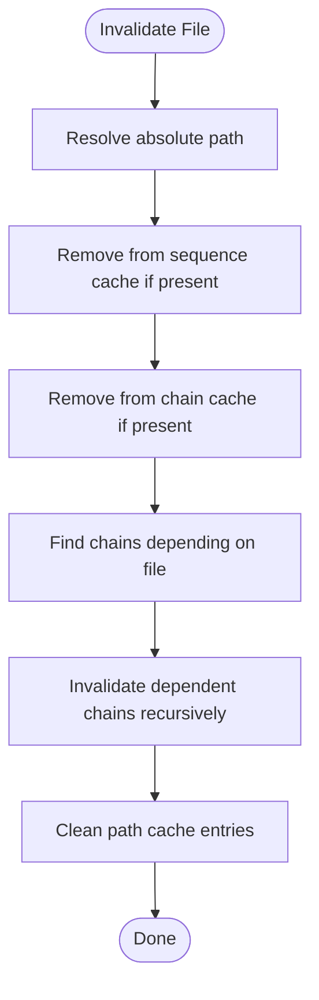
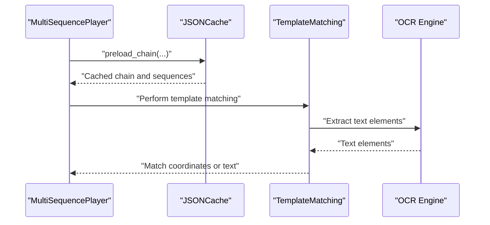
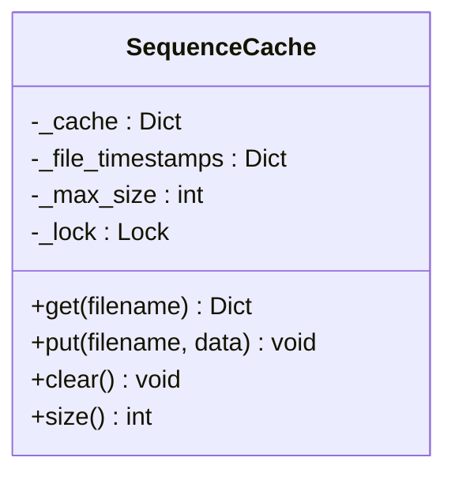
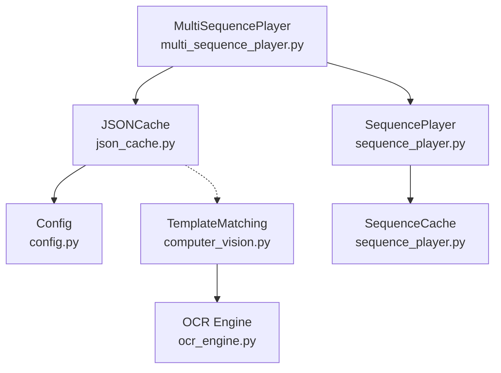

# JSON Cache System

<cite>
**Referenced Files in This Document**
- [json_cache.py](file://LoOper/player/json_cache.py)
- [computer_vision.py](file://LoOper/player/computer_vision.py)
- [ocr_engine.py](file://LoOper/player/ocr_engine.py)
- [multi_sequence_player.py](file://LoOper/player/multi_sequence_player.py)
- [sequence_player.py](file://LoOper/player/sequence_player.py)
- [config.py](file://LoOper/player/config.py)
- [test_vision.py](file://LoOper/player/Computer_vision/test_vision.py)
</cite>

## Table of Contents
1. [Introduction](#introduction)
2. [Project Structure](#project-structure)
3. [Core Components](#core-components)
4. [Architecture Overview](#architecture-overview)
5. [Detailed Component Analysis](#detailed-component-analysis)
6. [Dependency Analysis](#dependency-analysis)
7. [Performance Considerations](#performance-considerations)
8. [Troubleshooting Guide](#troubleshooting-guide)
9. [Conclusion](#conclusion)

## Introduction
This document provides comprehensive technical documentation for the JSON cache system in the LoOper project, focusing on performance optimization and memory management for storing processed computer vision data. The cache system eliminates redundant file loading by preloading entire workflow chains and all referenced sequences at startup, enabling fast runtime access during automation playback. It also supports intelligent cache invalidation, path resolution strategies for robust asset discovery, and integration with vision processing workflows.

The JSON cache complements the computer vision pipeline by caching chain and sequence configurations, reducing I/O overhead and improving responsiveness during multi-sequence playback. It tracks file modification times to ensure cache freshness, supports global invalidation for updates, and exposes statistics for monitoring cache health.

## Project Structure
The JSON cache system resides in the player module alongside related automation and vision components. The key files involved are:
- JSON cache implementation and global accessors
- Multi-sequence player that orchestrates chain preloading
- Sequence player with its own lightweight cache for individual sequences
- Computer vision utilities and OCR engine used within vision workflows
- Configuration module that defines logging and feature availability

**Diagram sources**
- [json_cache.py:15-584](file://LoOper/player/json_cache.py#L15-L584)
- [multi_sequence_player.py:13-13](file://LoOper/player/multi_sequence_player.py#L13-L13)
- [sequence_player.py:14-92](file://LoOper/player/sequence_player.py#L14-L92)
- [computer_vision.py:47-606](file://LoOper/player/computer_vision.py#L47-L606)
- [ocr_engine.py:131-367](file://LoOper/player/ocr_engine.py#L131-L367)
- [config.py:1-46](file://LoOper/player/config.py#L1-L46)

**Section sources**
- [json_cache.py:1-584](file://LoOper/player/json_cache.py#L1-L584)
- [multi_sequence_player.py:1-532](file://LoOper/player/multi_sequence_player.py#L1-L532)
- [sequence_player.py:1-252](file://LoOper/player/sequence_player.py#L1-L252)
- [computer_vision.py:1-606](file://LoOper/player/computer_vision.py#L1-L606)
- [ocr_engine.py:1-367](file://LoOper/player/ocr_engine.py#L1-L367)
- [config.py:1-46](file://LoOper/player/config.py#L1-L46)

## Core Components
- JSONCache: Centralized cache for chains and sequences with path resolution, modification-time tracking, and dependency-aware invalidation.
- Global convenience functions: preload_chain, get_sequence, get_chain, invalidate_file, invalidate_directory, clear_cache.
- MultiSequencePlayer: Orchestrates chain preloading at startup and logs cache statistics.
- SequencePlayer and SequenceCache: Lightweight per-sequence caching with thread-safety and LRU-style eviction.
- TemplateMatching and OCR Engine: Computer vision utilities integrated with the broader automation pipeline.

Key responsibilities:
- Eliminate redundant file I/O by caching entire chains and sequences.
- Maintain cache freshness via file modification timestamps.
- Provide robust path resolution for assets across development and frozen environments.
- Support targeted invalidation for updated files and transitive dependencies.
- Enable monitoring via cache statistics.

**Section sources**
- [json_cache.py:15-584](file://LoOper/player/json_cache.py#L15-L584)
- [multi_sequence_player.py:39-135](file://LoOper/player/multi_sequence_player.py#L39-L135)
- [sequence_player.py:14-92](file://LoOper/player/sequence_player.py#L14-L92)
- [computer_vision.py:47-606](file://LoOper/player/computer_vision.py#L47-L606)
- [ocr_engine.py:131-367](file://LoOper/player/ocr_engine.py#L131-L367)

## Architecture Overview
The JSON cache system sits between the MultiSequencePlayer and the filesystem, caching chain and sequence configurations. During playback, the MultiSequencePlayer preloads the entire chain and referenced sequences, leveraging the JSONCache to avoid repeated disk reads. The SequencePlayer maintains its own cache for individual sequences to further reduce I/O during action execution.

**Diagram sources**
- [multi_sequence_player.py:58-71](file://LoOper/player/multi_sequence_player.py#L58-L71)
- [json_cache.py:29-115](file://LoOper/player/json_cache.py#L29-L115)

**Section sources**
- [multi_sequence_player.py:58-71](file://LoOper/player/multi_sequence_player.py#L58-L71)
- [json_cache.py:29-115](file://LoOper/player/json_cache.py#L29-L115)

## Detailed Component Analysis

### JSONCache Implementation
The JSONCache class centralizes caching of chain and sequence configurations with the following features:
- Dual caches: separate dictionaries for sequences and chains, plus a path cache for resolved asset paths.
- Modification-time tracking: stores last-modified timestamps to detect staleness.
- Cycle prevention: tracks loaded chains to avoid infinite recursion.
- Robust path resolution: resolves asset paths across multiple strategies, including development and frozen builds.
- Dependency-aware invalidation: detects chains that depend on a modified file and invalidates them recursively.
- Convenience APIs: global functions for preload, retrieval, invalidation, and clearing.

**Diagram sources**
- [json_cache.py:15-584](file://LoOper/player/json_cache.py#L15-L584)

**Section sources**
- [json_cache.py:15-584](file://LoOper/player/json_cache.py#L15-L584)

### Path Resolution Strategy
The JSONCache employs a multi-strategy path resolution to locate assets reliably:
- Accepts bare filenames and normalizes them (e.g., removing suffixes like trailing digits).
- Searches across conventional locations: relative to base directory, under sequences subdirectories, under project roots, and in frozen build locations.
- Adds .json extension automatically when missing.
- Caches resolved paths to minimize repeated filesystem checks.
- Supports nested sequences directories for deeper organization.

**Diagram sources**
- [json_cache.py:228-358](file://LoOper/player/json_cache.py#L228-L358)

**Section sources**
- [json_cache.py:228-358](file://LoOper/player/json_cache.py#L228-L358)

### Cache Invalidation Mechanisms
The JSONCache supports targeted invalidation to keep cached data fresh:
- File-level invalidation: removes entries for a specific file and clears dependent chain entries.
- Directory-level invalidation: scans cached entries under a directory and invalidates them.
- Recursive dependency invalidation: traverses chains to find those depending on the modified file and invalidates them transitively.
- Path cache cleanup: removes cached path entries that reference invalidated files.

**Diagram sources**
- [json_cache.py:412-503](file://LoOper/player/json_cache.py#L412-L503)

**Section sources**
- [json_cache.py:412-503](file://LoOper/player/json_cache.py#L412-L503)

### Integration with Vision Processing Workflows
While the JSON cache primarily handles configuration data, it integrates with vision workflows indirectly:
- MultiSequencePlayer preloads chains that may include vision-related actions (e.g., click with screenshot fallbacks).
- Computer vision utilities (TemplateMatching) rely on image assets whose paths are resolved by the JSONCache’s path resolution logic.
- OCR engine is used within vision workflows; although not cached directly, its initialization and model loading are managed separately.

**Diagram sources**
- [multi_sequence_player.py:58-71](file://LoOper/player/multi_sequence_player.py#L58-L71)
- [computer_vision.py:198-331](file://LoOper/player/computer_vision.py#L198-L331)
- [ocr_engine.py:131-367](file://LoOper/player/ocr_engine.py#L131-L367)

**Section sources**
- [multi_sequence_player.py:58-71](file://LoOper/player/multi_sequence_player.py#L58-L71)
- [computer_vision.py:198-331](file://LoOper/player/computer_vision.py#L198-L331)
- [ocr_engine.py:131-367](file://LoOper/player/ocr_engine.py#L131-L367)

### Sequence-Level Caching (SequenceCache)
The SequencePlayer maintains its own lightweight cache for individual sequences:
- Thread-safe cache with lock protection.
- LRU-style eviction when capacity is exceeded.
- File timestamp tracking to detect staleness.
- Optimized JSON loading with buffer sizing based on file size.

**Diagram sources**
- [sequence_player.py:14-92](file://LoOper/player/sequence_player.py#L14-L92)

**Section sources**
- [sequence_player.py:14-92](file://LoOper/player/sequence_player.py#L14-L92)

## Dependency Analysis
The JSON cache system exhibits low coupling with external modules:
- Depends on the configuration logger for diagnostics.
- Integrates with MultiSequencePlayer for preloading and with SequencePlayer for complementary caching.
- Computer vision utilities depend on the cache’s path resolution for locating assets.

**Diagram sources**
- [json_cache.py:12-12](file://LoOper/player/json_cache.py#L12-L12)
- [multi_sequence_player.py:13-13](file://LoOper/player/multi_sequence_player.py#L13-L13)
- [sequence_player.py:9-11](file://LoOper/player/sequence_player.py#L9-L11)
- [computer_vision.py:11-12](file://LoOper/player/computer_vision.py#L11-L12)
- [ocr_engine.py:4-4](file://LoOper/player/ocr_engine.py#L4-L4)

**Section sources**
- [json_cache.py:12-12](file://LoOper/player/json_cache.py#L12-L12)
- [multi_sequence_player.py:13-13](file://LoOper/player/multi_sequence_player.py#L13-L13)
- [sequence_player.py:9-11](file://LoOper/player/sequence_player.py#L9-L11)
- [computer_vision.py:11-12](file://LoOper/player/computer_vision.py#L11-L12)
- [ocr_engine.py:4-4](file://LoOper/player/ocr_engine.py#L4-L4)

## Performance Considerations
- Preloading strategy: Chains and referenced sequences are preloaded at startup, eliminating repeated I/O during playback and improving responsiveness.
- Path resolution caching: Resolved asset paths are cached to avoid repeated filesystem traversal.
- Modification-time checks: Cached data is validated against file modification times to ensure freshness without unnecessary reloads.
- Thread safety: SequenceCache uses locks to prevent race conditions in multi-threaded scenarios.
- Buffer optimization: Sequence-level JSON loading uses buffer sizing tuned to file sizes for faster parsing.
- Monitoring: Cache statistics expose counts of cached sequences, chains, and paths to assess effectiveness.

Practical tuning tips:
- Increase cache capacity for SequenceCache if frequently switching between many sequences.
- Use invalidate_file or invalidate_directory after updating assets to ensure immediate cache refresh.
- Prefer absolute paths for assets to reduce path resolution overhead.
- Monitor cache stats periodically to identify potential memory pressure or excessive misses.

[No sources needed since this section provides general guidance]

## Troubleshooting Guide
Common issues and resolutions:
- Cache not reflecting updates:
  - Use invalidate_file or invalidate_directory to force cache refresh.
  - Verify that modification-time checks are functioning (mtime tracking).
- Path resolution failures:
  - Confirm asset paths exist across supported strategies (relative, sequences subdirectories, project roots).
  - Check frozen build paths if running a packaged application.
- Performance degradation:
  - Review cache stats to ensure adequate hit rates.
  - Consider increasing SequenceCache capacity or adjusting buffer sizes.
- Memory pressure:
  - Periodically call clear_cache to free memory when running long sessions.
  - Monitor sequence counts and adjust preload scope accordingly.

**Section sources**
- [json_cache.py:404-544](file://LoOper/player/json_cache.py#L404-L544)
- [sequence_player.py:82-92](file://LoOper/player/sequence_player.py#L82-L92)

## Conclusion
The JSON cache system in LoOper provides a robust foundation for performance optimization and memory management in automation workflows. By preloading chains and sequences, tracking file modifications, and offering targeted invalidation, it minimizes I/O overhead and ensures data freshness. Its integration with MultiSequencePlayer and SequencePlayer enables seamless caching at both configuration and action levels. With monitoring capabilities and practical invalidation APIs, the system supports efficient operation across diverse datasets and environments.

[No sources needed since this section summarizes without analyzing specific files]