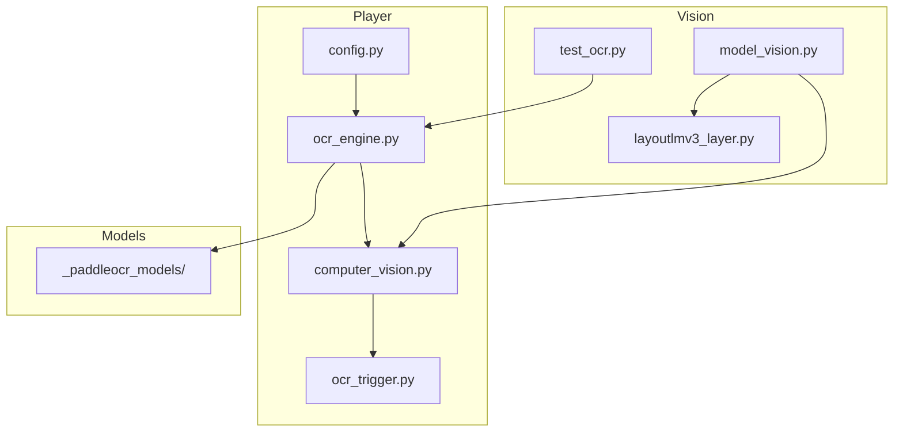
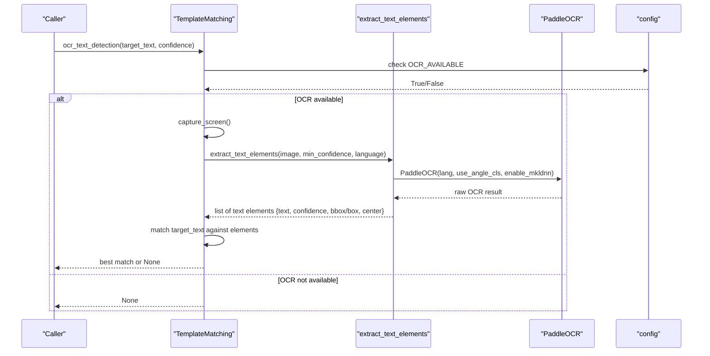
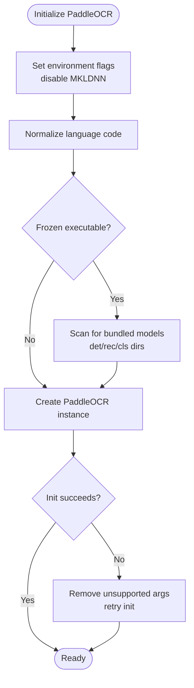
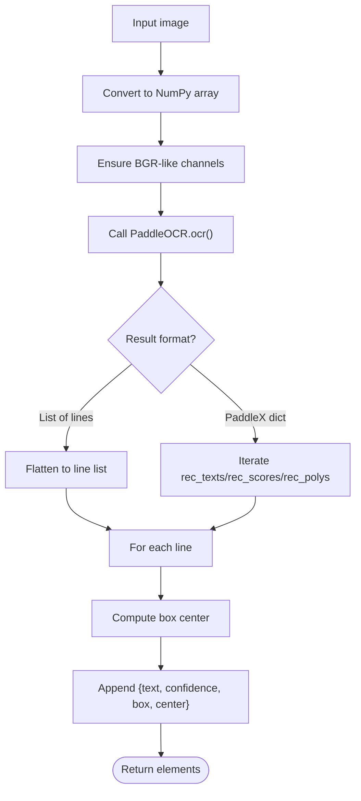
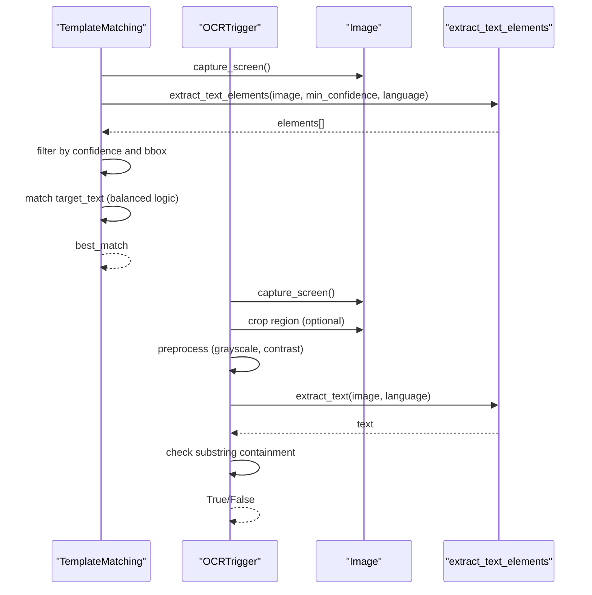
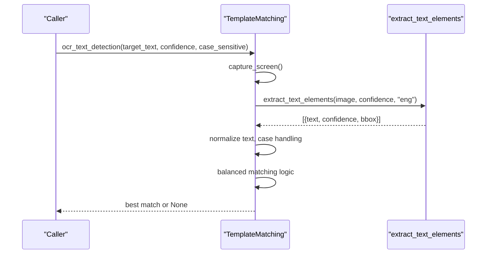
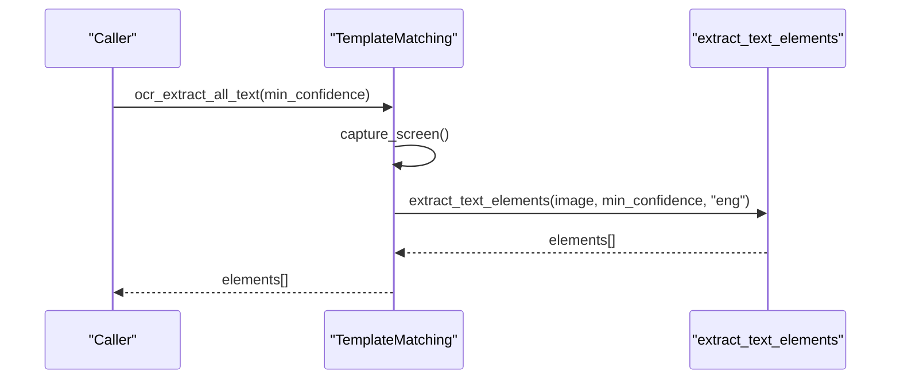
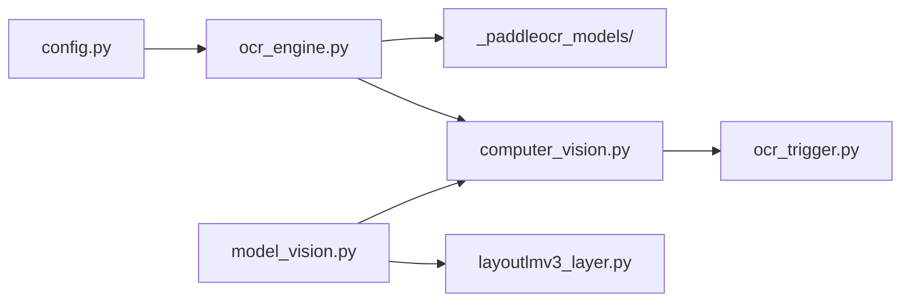

# OCR Integration

<cite>
**Referenced Files in This Document**
- [ocr_engine.py](file://LoOper/player/ocr_engine.py)
- [computer_vision.py](file://LoOper/player/computer_vision.py)
- [ocr_trigger.py](file://LoOper/player/multi_sequence/conditional_fallback_resources/ocr_trigger.py)
- [config.py](file://LoOper/player/config.py)
- [test_ocr.py](file://LoOper/player/Computer_vision/test_ocr.py)
- [_paddleocr_models](file://_paddleocr_models)
- [model_vision.py](file://LoOper/player/Computer_vision/model_vision.py)
- [layoutlmv3_layer.py](file://LoOper/player/Computer_vision/layoutlmv3_layer.py)
</cite>

## Table of Contents
1. [Introduction](#introduction)
2. [Project Structure](#project-structure)
3. [Core Components](#core-components)
4. [Architecture Overview](#architecture-overview)
5. [Detailed Component Analysis](#detailed-component-analysis)
6. [Dependency Analysis](#dependency-analysis)
7. [Performance Considerations](#performance-considerations)
8. [Troubleshooting Guide](#troubleshooting-guide)
9. [Conclusion](#conclusion)

## Introduction
This document explains the OCR integration built on the PaddleOCR engine for text recognition and processing. It covers engine configuration, text element extraction algorithms, region-based processing strategies, confidence threshold management, language support, OCR text detection for finding specific text on screen, all-text extraction capabilities, and integration with the TemplateMatching system. Practical workflows, accuracy optimization techniques, text matching algorithms, and performance considerations for different languages and text sizes are included.

## Project Structure
The OCR integration spans several modules:
- OCR engine wrapper and utilities
- Computer vision and template matching with OCR-aware operations
- Conditional fallback resources that use OCR triggers
- Configuration and environment setup for OCR availability and PaddleOCR models
- Tests and supporting vision components

**Diagram sources**
- [config.py:1-46](file://LoOper/player/config.py#L1-L46)
- [ocr_engine.py:1-367](file://LoOper/player/ocr_engine.py#L1-L367)
- [computer_vision.py:1-606](file://LoOper/player/computer_vision.py#L1-L606)
- [ocr_trigger.py:1-266](file://LoOper/player/multi_sequence/conditional_fallback_resources/ocr_trigger.py#L1-L266)
- [model_vision.py:1-800](file://LoOper/player/Computer_vision/model_vision.py#L1-L800)
- [layoutlmv3_layer.py:1-203](file://LoOper/player/Computer_vision/layoutlmv3_layer.py#L1-L203)
- [test_ocr.py:1-62](file://LoOper/player/Computer_vision/test_ocr.py#L1-L62)
- [_paddleocr_models](file://_paddleocr_models)

**Section sources**
- [config.py:1-46](file://LoOper/player/config.py#L1-L46)
- [ocr_engine.py:1-367](file://LoOper/player/ocr_engine.py#L1-L367)
- [computer_vision.py:1-606](file://LoOper/player/computer_vision.py#L1-L606)
- [ocr_trigger.py:1-266](file://LoOper/player/multi_sequence/conditional_fallback_resources/ocr_trigger.py#L1-L266)
- [model_vision.py:1-800](file://LoOper/player/Computer_vision/model_vision.py#L1-L800)
- [layoutlmv3_layer.py:1-203](file://LoOper/player/Computer_vision/layoutlmv3_layer.py#L1-L203)
- [test_ocr.py:1-62](file://LoOper/player/Computer_vision/test_ocr.py#L1-L62)

## Core Components
- OCR engine wrapper: initializes PaddleOCR with language normalization, bundled model discovery, and robust fallbacks.
- Text extraction APIs: element-level extraction with bounding boxes and confidence, plus full-text extraction.
- TemplateMatching integration: OCR-aware text detection and all-text extraction with stop-flag safety and confidence thresholds.
- Conditional OCR triggers: polling and immediate OCR checks with region cropping and preprocessing.
- Configuration and models: OCR availability detection, environment flags, and bundled PaddleOCR models.

**Section sources**
- [ocr_engine.py:131-367](file://LoOper/player/ocr_engine.py#L131-L367)
- [computer_vision.py:452-606](file://LoOper/player/computer_vision.py#L452-L606)
- [ocr_trigger.py:29-266](file://LoOper/player/multi_sequence/conditional_fallback_resources/ocr_trigger.py#L29-L266)
- [config.py:21-31](file://LoOper/player/config.py#L21-L31)

## Architecture Overview
The OCR pipeline integrates with computer vision and conditional fallback systems. PaddleOCR is configured centrally, and results are normalized into a consistent structure for downstream consumers.

**Diagram sources**
- [computer_vision.py:452-550](file://LoOper/player/computer_vision.py#L452-L550)
- [ocr_engine.py:131-241](file://LoOper/player/ocr_engine.py#L131-L241)
- [config.py:21-31](file://LoOper/player/config.py#L21-L31)

## Detailed Component Analysis

### PaddleOCR Engine Configuration
- Environment flags: disables MKLDNN to avoid OneDnnContext errors before importing paddle.
- Language normalization: maps common aliases to PaddleOCR codes (e.g., English to "en", Chinese to "ch").
- Lazy initialization with LRU cache: creates a PaddleOCR instance per language with angle classification enabled.
- Bundled models: detects bundled PaddleOCR models in frozen executables and injects detector, recognizer, and classifier paths.
- Robust fallback: handles missing enable_mkldnn argument gracefully.

**Diagram sources**
- [ocr_engine.py:30-104](file://LoOper/player/ocr_engine.py#L30-L104)
- [config.py:21-31](file://LoOper/player/config.py#L21-L31)

**Section sources**
- [ocr_engine.py:7-104](file://LoOper/player/ocr_engine.py#L7-L104)
- [config.py:21-31](file://LoOper/player/config.py#L21-L31)

### Text Element Extraction Algorithms
- Input conversion: ensures images are NumPy arrays in BGR-like format.
- PaddleOCR result normalization: supports both list-of-lines and PaddleX-style dictionaries.
- Bounding geometry: computes center points from polygon vertices for each detected text.
- Confidence filtering: returns only elements meeting the minimum confidence threshold.

**Diagram sources**
- [ocr_engine.py:131-241](file://LoOper/player/ocr_engine.py#L131-L241)

**Section sources**
- [ocr_engine.py:131-241](file://LoOper/player/ocr_engine.py#L131-L241)

### Region-Based Processing Strategies
- Full-screen extraction: captures screen, runs OCR, and returns all elements above threshold.
- Specific text detection: extracts elements, normalizes text, applies balanced matching logic, and selects the highest-confidence match.
- Region cropping: OCR trigger can crop to a region-of-interest before OCR to reduce noise and improve accuracy.

**Diagram sources**
- [computer_vision.py:552-606](file://LoOper/player/computer_vision.py#L552-L606)
- [computer_vision.py:452-550](file://LoOper/player/computer_vision.py#L452-L550)
- [ocr_trigger.py:112-160](file://LoOper/player/multi_sequence/conditional_fallback_resources/ocr_trigger.py#L112-L160)

**Section sources**
- [computer_vision.py:552-606](file://LoOper/player/computer_vision.py#L552-L606)
- [computer_vision.py:452-550](file://LoOper/player/computer_vision.py#L452-L550)
- [ocr_trigger.py:112-160](file://LoOper/player/multi_sequence/conditional_fallback_resources/ocr_trigger.py#L112-L160)

### Confidence Threshold Management
- Minimum confidence: configurable via min_confidence parameter in extraction APIs.
- Filtering: elements below threshold are excluded from results.
- Matching: OCR text detection compares normalized text and balances exact, substring, and reverse-substring heuristics to avoid false positives.

Practical guidance:
- Lower thresholds increase recall but may include noisy detections.
- Raise thresholds for critical validations to reduce false positives.

**Section sources**
- [ocr_engine.py:348-353](file://LoOper/player/ocr_engine.py#L348-L353)
- [computer_vision.py:518-523](file://LoOper/player/computer_vision.py#L518-L523)

### Language Support Configurations
- Language normalization: maps aliases to PaddleOCR codes (English to "en", Chinese to "ch").
- Model bundling: bundled detector, recognizer, and classifier models are automatically discovered in frozen builds.
- Default language: falls back to "en" if unknown.

Supported languages in practice:
- English ("en")
- Chinese ("ch")

**Section sources**
- [ocr_engine.py:21-27](file://LoOper/player/ocr_engine.py#L21-L27)
- [ocr_engine.py:76-89](file://LoOper/player/ocr_engine.py#L76-L89)

### OCR Text Detection Workflow
- Captures screen or uses provided image.
- Runs OCR extraction with confidence threshold.
- Normalizes text and applies balanced matching (exact, substring, reverse-substring).
- Returns the best match with confidence and bounding box.

**Diagram sources**
- [computer_vision.py:452-550](file://LoOper/player/computer_vision.py#L452-L550)
- [ocr_engine.py:131-241](file://LoOper/player/ocr_engine.py#L131-L241)

**Section sources**
- [computer_vision.py:452-550](file://LoOper/player/computer_vision.py#L452-L550)

### All-Text Extraction Capability
- Captures screen and extracts all readable text elements above the minimum confidence.
- Returns structured elements with text, confidence, bounding boxes, and centers.

**Diagram sources**
- [computer_vision.py:552-606](file://LoOper/player/computer_vision.py#L552-L606)
- [ocr_engine.py:131-241](file://LoOper/player/ocr_engine.py#L131-L241)

**Section sources**
- [computer_vision.py:552-606](file://LoOper/player/computer_vision.py#L552-L606)

### Integration with TemplateMatching System
- OCR-aware operations: TemplateMatching exposes OCR-based detection and extraction methods.
- Stop-flag safety: All OCR operations respect a stop flag to abort long-running checks.
- Region-based search: Combines template matching with OCR for robustness and speed.

**Section sources**
- [computer_vision.py:47-606](file://LoOper/player/computer_vision.py#L47-L606)

### OCR Trigger Integration
- Polling and immediate checks: OCRTrigger supports periodic checks and single-shot validations.
- Region cropping and preprocessing: Optionally crops to region and enhances contrast for better OCR.
- Validation caching: Results can be cached to avoid redundant OCR checks.

**Section sources**
- [ocr_trigger.py:29-266](file://LoOper/player/multi_sequence/conditional_fallback_resources/ocr_trigger.py#L29-L266)

### Practical Examples of OCR Workflows
- Detect specific text on screen:
  - Use TemplateMatching.ocr_text_detection with a target string and confidence threshold.
- Extract all text:
  - Use TemplateMatching.ocr_extract_all_text to get a list of text elements.
- Conditional trigger:
  - Use OCRTrigger.check_ocr_trigger for periodic checks or check_ocr_immediate for a single check.
- Region-specific extraction:
  - Use OCRTrigger.extract_text_from_region with a bounding box to constrain OCR.

**Section sources**
- [computer_vision.py:452-606](file://LoOper/player/computer_vision.py#L452-L606)
- [ocr_trigger.py:29-266](file://LoOper/player/multi_sequence/conditional_fallback_resources/ocr_trigger.py#L29-L266)

## Dependency Analysis
- OCR availability: determined by detecting the paddleocr module and setting engine type.
- PaddleOCR models: bundled models under _paddleocr_models are auto-detected in frozen builds.
- Computer vision: TemplateMatching depends on OpenCV availability; OCR is optional.
- Vision pipeline: model_vision.py integrates OCR outputs with LayoutLMv3 for contextual labeling.

**Diagram sources**
- [config.py:21-31](file://LoOper/player/config.py#L21-L31)
- [ocr_engine.py:58-104](file://LoOper/player/ocr_engine.py#L58-L104)
- [computer_vision.py:47-606](file://LoOper/player/computer_vision.py#L47-L606)
- [ocr_trigger.py:1-266](file://LoOper/player/multi_sequence/conditional_fallback_resources/ocr_trigger.py#L1-L266)
- [model_vision.py:1-800](file://LoOper/player/Computer_vision/model_vision.py#L1-L800)
- [layoutlmv3_layer.py:1-203](file://LoOper/player/Computer_vision/layoutlmv3_layer.py#L1-L203)

**Section sources**
- [config.py:21-31](file://LoOper/player/config.py#L21-L31)
- [ocr_engine.py:58-104](file://LoOper/player/ocr_engine.py#L58-L104)
- [computer_vision.py:47-606](file://LoOper/player/computer_vision.py#L47-L606)
- [ocr_trigger.py:1-266](file://LoOper/player/multi_sequence/conditional_fallback_resources/ocr_trigger.py#L1-L266)
- [model_vision.py:1-800](file://LoOper/player/Computer_vision/model_vision.py#L1-L800)
- [layoutlmv3_layer.py:1-203](file://LoOper/player/Computer_vision/layoutlmv3_layer.py#L1-L203)

## Performance Considerations
- Minimize repeated OCR calls: reuse captured frames and leverage stop flags to abort long waits.
- Adjust confidence thresholds: higher thresholds reduce false positives but may miss low-quality text.
- Prefer region-based extraction: crop to regions of interest to reduce computational load and improve accuracy.
- Language choice: "en" and "ch" are supported; choose the appropriate language to optimize model performance.
- Preprocessing: converting to grayscale and adjusting contrast can help OCR on low-contrast or noisy images.
- Model bundling: ensure bundled models are available in frozen builds to avoid network downloads and delays.

[No sources needed since this section provides general guidance]

## Troubleshooting Guide
- OCR not available:
  - Verify paddleocr installation and availability detection.
  - Check environment flags for MKLDNN disabling.
- Initialization errors:
  - Ensure bundled models exist under the expected directory structure.
  - Retry initialization with fallback arguments if enable_mkldnn is unsupported.
- Accuracy issues:
  - Increase contrast and convert to grayscale for low-contrast text.
  - Narrow the region of interest to reduce noise.
  - Adjust confidence thresholds based on the environment.
- Stuttering or timeouts:
  - Use stop flags to abort long-running OCR checks.
  - Reduce min_confidence or language complexity for faster results.

**Section sources**
- [config.py:21-31](file://LoOper/player/config.py#L21-L31)
- [ocr_engine.py:58-104](file://LoOper/player/ocr_engine.py#L58-L104)
- [computer_vision.py:452-606](file://LoOper/player/computer_vision.py#L452-L606)
- [ocr_trigger.py:112-160](file://LoOper/player/multi_sequence/conditional_fallback_resources/ocr_trigger.py#L112-L160)

## Conclusion
The OCR integration leverages PaddleOCR with robust configuration, language normalization, and bundled model support. It provides reliable text detection and extraction through TemplateMatching and OCRTrigger, with region-based strategies and confidence management. By tuning thresholds, preprocessing, and region selection, teams can achieve accurate OCR across diverse languages and text sizes while maintaining responsive performance.