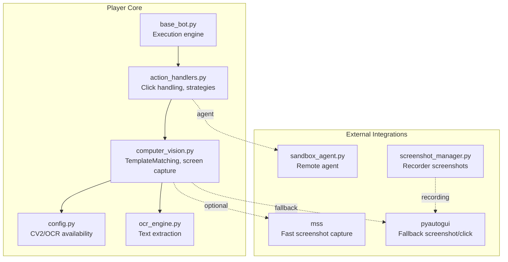
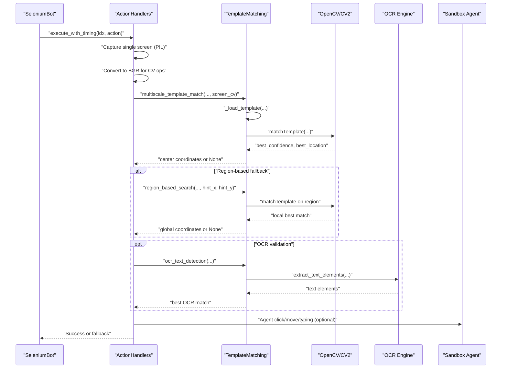
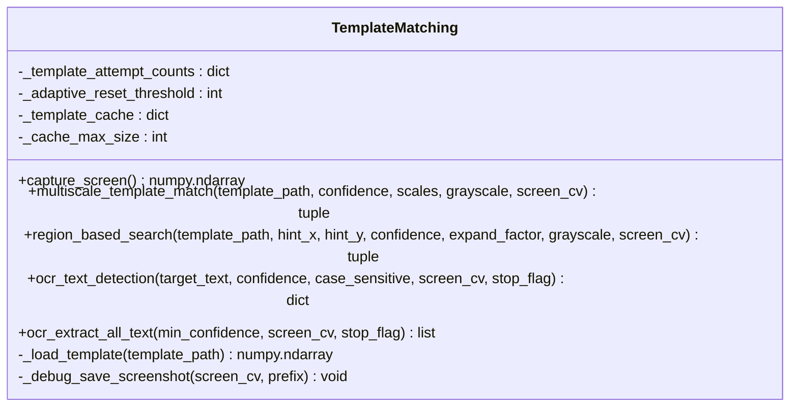
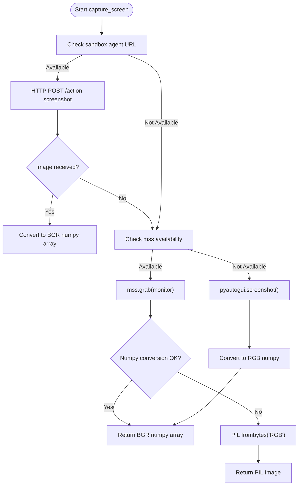
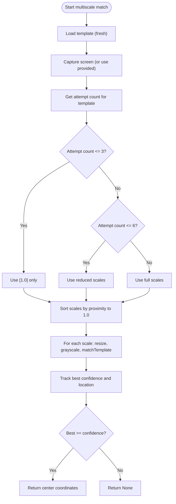
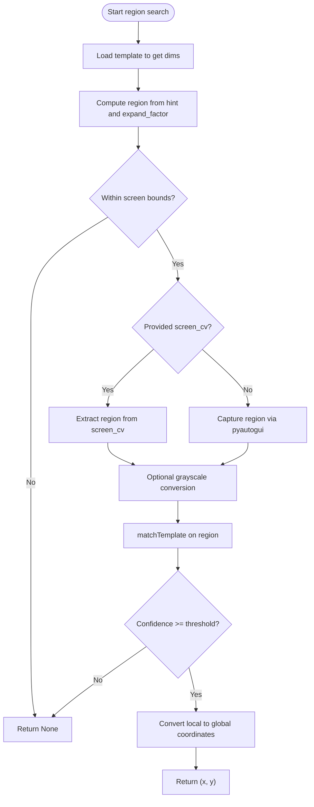
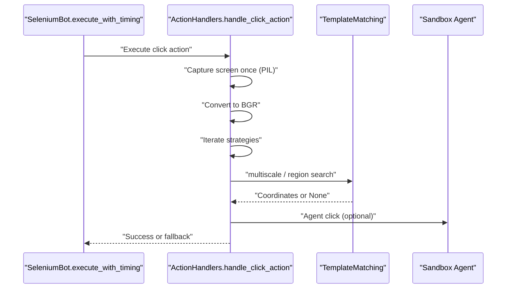
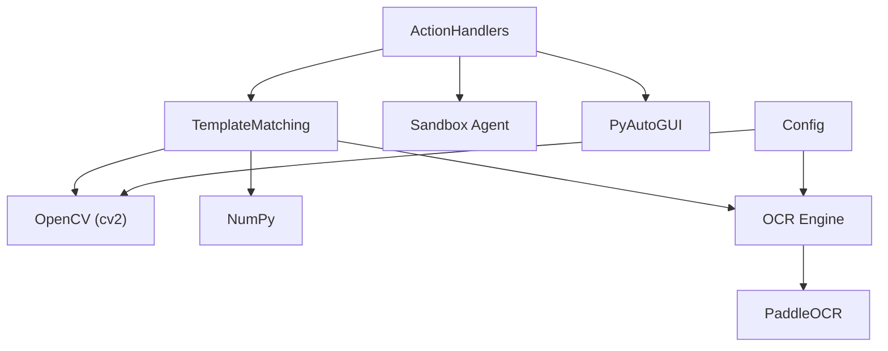

# Template Matching

<cite>
**Referenced Files in This Document**
- [computer_vision.py](file://LoOper/player/computer_vision.py)
- [action_handlers.py](file://LoOper/player/action_handlers.py)
- [base_bot.py](file://LoOper/player/base_bot.py)
- [config.py](file://LoOper/player/config.py)
- [ocr_engine.py](file://LoOper/player/ocr_engine.py)
- [screenshot_manager.py](file://LoOper/recorder/screenshot_manager.py)
- [sandbox_agent.py](file://LoOper/sandbox_agent.py)
</cite>

## Table of Contents
1. [Introduction](#introduction)
2. [Project Structure](#project-structure)
3. [Core Components](#core-components)
4. [Architecture Overview](#architecture-overview)
5. [Detailed Component Analysis](#detailed-component-analysis)
6. [Dependency Analysis](#dependency-analysis)
7. [Performance Considerations](#performance-considerations)
8. [Troubleshooting Guide](#troubleshooting-guide)
9. [Conclusion](#conclusion)

## Introduction
This document explains the template matching system used for computer vision operations and image recognition within the automation framework. It focuses on:
- Template loading and caching strategies
- Multi-scale template matching with adaptive scaling algorithms
- Confidence threshold management
- Screen capture methods using mss for fast screenshots, pyautogui fallback, and sandbox agent integration
- An adaptive multi-scale tracking system that adjusts search scales based on attempt history
- Region-based search functionality around hint coordinates
- Practical examples of template matching workflows, confidence tuning, and integration with the playback engine for UI interaction

## Project Structure
The template matching system spans several modules:
- Computer vision and template matching core
- Action handlers that orchestrate UI interactions
- OCR engine for text-based verification
- Configuration and environment detection
- Sandbox agent for remote UI automation
- Recorder utilities for screenshot capture

**Diagram sources**
- [computer_vision.py:93-177](file://LoOper/player/computer_vision.py#L93-L177)
- [action_handlers.py:133-511](file://LoOper/player/action_handlers.py#L133-L511)
- [base_bot.py:207-283](file://LoOper/player/base_bot.py#L207-L283)
- [config.py:11-31](file://LoOper/player/config.py#L11-L31)
- [ocr_engine.py:131-240](file://LoOper/player/ocr_engine.py#L131-L240)
- [sandbox_agent.py:14-100](file://LoOper/sandbox_agent.py#L14-L100)
- [screenshot_manager.py:21-49](file://LoOper/recorder/screenshot_manager.py#L21-L49)

**Section sources**
- [computer_vision.py:1-606](file://LoOper/player/computer_vision.py#L1-L606)
- [action_handlers.py:1-800](file://LoOper/player/action_handlers.py#L1-L800)
- [base_bot.py:1-299](file://LoOper/player/base_bot.py#L1-L299)
- [config.py:1-46](file://LoOper/player/config.py#L1-L46)
- [ocr_engine.py:1-367](file://LoOper/player/ocr_engine.py#L1-L367)
- [screenshot_manager.py:1-49](file://LoOper/recorder/screenshot_manager.py#L1-L49)
- [sandbox_agent.py:1-157](file://LoOper/sandbox_agent.py#L1-L157)

## Core Components
- TemplateMatching: Central class implementing template loading, multi-scale matching, region-based search, and OCR text detection. It manages adaptive scaling, confidence thresholds, and screen capture strategies.
- ActionHandlers: Orchestrates click actions, applies multiple search strategies, captures a single screen snapshot for reuse, and integrates with the sandbox agent for remote UI control.
- base_bot: Provides the execution engine, human-like motion simulation, and screenshot capture utilities used by the system.
- OCR engine: Supplies text extraction capabilities for OCR-based validation and detection.
- Config: Detects availability of OpenCV and OCR engines and sets logging.

Key responsibilities:
- Efficient template loading with caching disabled to avoid stale templates
- Multi-scale matching with adaptive scale selection based on prior attempts
- Region-based search around hint coordinates with dynamic expansion
- Robust screen capture using mss, pyautogui fallback, and sandbox agent
- Confidence threshold management across strategies and OCR

**Section sources**
- [computer_vision.py:47-606](file://LoOper/player/computer_vision.py#L47-L606)
- [action_handlers.py:133-511](file://LoOper/player/action_handlers.py#L133-L511)
- [base_bot.py:66-93](file://LoOper/player/base_bot.py#L66-L93)
- [config.py:11-31](file://LoOper/player/config.py#L11-L31)
- [ocr_engine.py:131-240](file://LoOper/player/ocr_engine.py#L131-L240)

## Architecture Overview
The template matching pipeline integrates computer vision, action orchestration, and UI automation:

**Diagram sources**
- [action_handlers.py:133-511](file://LoOper/player/action_handlers.py#L133-L511)
- [computer_vision.py:198-450](file://LoOper/player/computer_vision.py#L198-L450)
- [ocr_engine.py:131-240](file://LoOper/player/ocr_engine.py#L131-L240)
- [sandbox_agent.py:14-100](file://LoOper/sandbox_agent.py#L14-L100)

## Detailed Component Analysis

### TemplateMatching Class
The TemplateMatching class encapsulates all computer vision operations:
- Template loading with caching disabled to ensure fresh templates on each load
- Multi-scale matching with adaptive scaling based on attempt history
- Region-based search around hint coordinates with dynamic expansion
- OCR text detection and extraction
- Screen capture with mss, pyautogui fallback, and sandbox agent integration

**Diagram sources**
- [computer_vision.py:47-606](file://LoOper/player/computer_vision.py#L47-L606)

Implementation highlights:
- Template loading: Loads templates from disk using OpenCV; caching is intentionally disabled to avoid stale templates.
- Multi-scale matching: Computes adaptive scales based on the number of prior attempts, prioritizes 1.0 scale initially, and expands the search set progressively.
- Region-based search: Uses hint coordinates to define a search region, dynamically expanding it based on template dimensions and an expansion factor.
- OCR integration: Extracts text elements and performs balanced text matching to reduce false positives.
- Screen capture: Attempts sandbox agent capture first, then mss for fast screenshots, and falls back to pyautogui.

**Section sources**
- [computer_vision.py:47-606](file://LoOper/player/computer_vision.py#L47-L606)

### Screen Capture Methods
The system supports multiple capture backends:
- Sandbox agent: Sends HTTP requests to a local agent for screenshots and actions.
- mss: Fast screenshot capture using the monitor’s primary display.
- pyautogui: Universal fallback for screenshots and actions.

**Diagram sources**
- [computer_vision.py:93-177](file://LoOper/player/computer_vision.py#L93-L177)
- [sandbox_agent.py:56-66](file://LoOper/sandbox_agent.py#L56-L66)

**Section sources**
- [computer_vision.py:93-177](file://LoOper/player/computer_vision.py#L93-L177)
- [sandbox_agent.py:14-100](file://LoOper/sandbox_agent.py#L14-L100)

### Adaptive Multi-Scale Tracking
The system adapts the search scales based on the number of attempts for a given template:
- First few attempts: Use only 1.0 scale for speed
- Medium attempts: Use a reduced set of scales
- Many attempts: Use the full scale set
- Reset threshold: Periodically resets the attempt counter to avoid bias

**Diagram sources**
- [computer_vision.py:198-331](file://LoOper/player/computer_vision.py#L198-L331)

**Section sources**
- [computer_vision.py:198-331](file://LoOper/player/computer_vision.py#L198-L331)

### Region-Based Search Around Hint Coordinates
Region-based search leverages hint coordinates to constrain the search area:
- Computes region size based on template dimensions and an expansion factor
- Validates region bounds against screen dimensions
- Performs template matching on the cropped region or falls back to pyautogui
- Converts local coordinates to global coordinates

**Diagram sources**
- [computer_vision.py:333-450](file://LoOper/player/computer_vision.py#L333-L450)

**Section sources**
- [computer_vision.py:333-450](file://LoOper/player/computer_vision.py#L333-L450)

### Confidence Threshold Management
Confidence thresholds are applied consistently across:
- Template matching (both single-scale and multi-scale)
- Region-based search
- OCR text detection

Threshold tuning guidelines:
- High confidence (0.8–0.9): Prefer for critical UI elements
- Medium confidence (0.7–0.8): General-purpose matching
- Lower confidence (0.6–0.7): Fallback or noisy environments

**Section sources**
- [action_handlers.py:231-251](file://LoOper/player/action_handlers.py#L231-L251)
- [computer_vision.py:198-331](file://LoOper/player/computer_vision.py#L198-L331)
- [computer_vision.py:333-450](file://LoOper/player/computer_vision.py#L333-L450)
- [computer_vision.py:452-549](file://LoOper/player/computer_vision.py#L452-L549)

### Integration with Playback Engine
The playback engine orchestrates actions and applies multiple strategies:
- Captures a single screen snapshot for reuse across strategies
- Iterates through a predefined list of strategies with decreasing confidence
- Uses TemplateMatching methods for template and region searches
- Supports OCR validation and fallback sequences
- Integrates with sandbox agent for remote UI control

**Diagram sources**
- [base_bot.py:207-283](file://LoOper/player/base_bot.py#L207-L283)
- [action_handlers.py:133-511](file://LoOper/player/action_handlers.py#L133-L511)
- [computer_vision.py:198-450](file://LoOper/player/computer_vision.py#L198-L450)
- [sandbox_agent.py:34-54](file://LoOper/sandbox_agent.py#L34-L54)

**Section sources**
- [base_bot.py:207-283](file://LoOper/player/base_bot.py#L207-L283)
- [action_handlers.py:133-511](file://LoOper/player/action_handlers.py#L133-L511)

## Dependency Analysis
- TemplateMatching depends on:
  - OpenCV (cv2) and NumPy for image processing
  - OCR engine for text-based validation
  - Environment configuration for availability checks
- ActionHandlers depends on:
  - TemplateMatching for vision operations
  - Sandbox agent for remote UI control
  - PyAutoGUI for fallback actions
- OCR engine depends on PaddleOCR and environment flags
- Screen capture backends are optional and selected based on availability

**Diagram sources**
- [computer_vision.py:42-44](file://LoOper/player/computer_vision.py#L42-L44)
- [action_handlers.py:17-23](file://LoOper/player/action_handlers.py#L17-L23)
- [config.py:11-31](file://LoOper/player/config.py#L11-L31)
- [ocr_engine.py:31-103](file://LoOper/player/ocr_engine.py#L31-L103)

**Section sources**
- [computer_vision.py:42-44](file://LoOper/player/computer_vision.py#L42-L44)
- [action_handlers.py:17-23](file://LoOper/player/action_handlers.py#L17-L23)
- [config.py:11-31](file://LoOper/player/config.py#L11-L31)
- [ocr_engine.py:31-103](file://LoOper/player/ocr_engine.py#L31-L103)

## Performance Considerations
- Template caching is disabled to avoid stale templates; this ensures accuracy at the cost of repeated disk reads. Consider enabling a lightweight cache with invalidation if performance becomes a bottleneck.
- Multi-scale matching sorts scales by proximity to 1.0 to favor faster matches first.
- Single-screen capture is reused across strategies to minimize overhead.
- mss is preferred for fast screenshots; pyautogui is used as a reliable fallback.
- OCR processing is guarded by stop flags and can be skipped if not available.

[No sources needed since this section provides general guidance]

## Troubleshooting Guide
Common issues and resolutions:
- OpenCV not available: The system logs a warning and disables template matching features. Install OpenCV and NumPy to enable full functionality.
- OCR not available: The system logs a warning and skips OCR-based operations. Ensure PaddleOCR is installed and configured.
- Sandbox agent failures: The system retries and falls back to mss/pyautogui. Verify the agent URL and network connectivity.
- Stale templates: Templates are loaded fresh each time; ensure template files are accessible and not locked by other processes.
- Low confidence matches: Adjust confidence thresholds in strategies or use region-based search with larger expansion factors.
- Region too small: Ensure the expansion factor and template dimensions produce a region at least twice the template size.

**Section sources**
- [config.py:12-31](file://LoOper/player/config.py#L12-L31)
- [computer_vision.py:148-150](file://LoOper/player/computer_vision.py#L148-L150)
- [computer_vision.py:396-398](file://LoOper/player/computer_vision.py#L396-L398)
- [action_handlers.py:231-251](file://LoOper/player/action_handlers.py#L231-L251)

## Conclusion
The template matching system provides a robust, adaptive, and efficient foundation for computer vision-driven UI interactions. By combining multi-scale matching, region-based search, and OCR validation, it achieves high accuracy across diverse scenarios. The integration with the playback engine and sandbox agent enables flexible deployment across local and remote environments. Tuning confidence thresholds and leveraging adaptive scaling further improves reliability and performance.