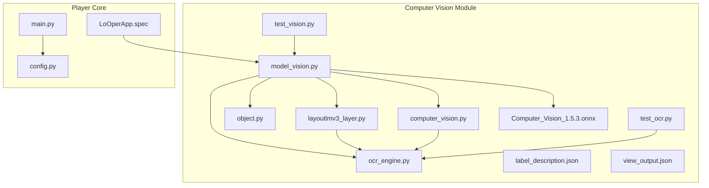
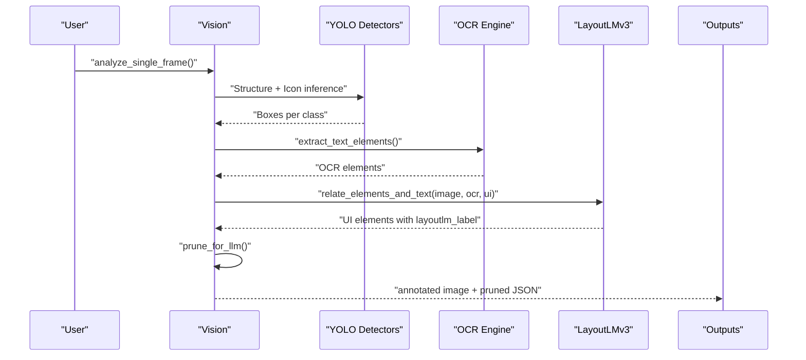
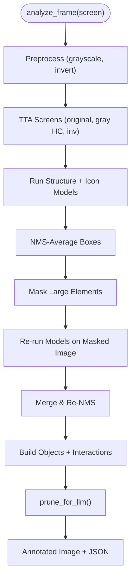
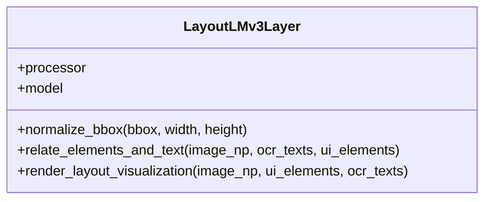
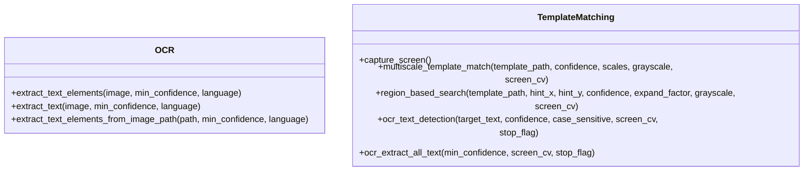
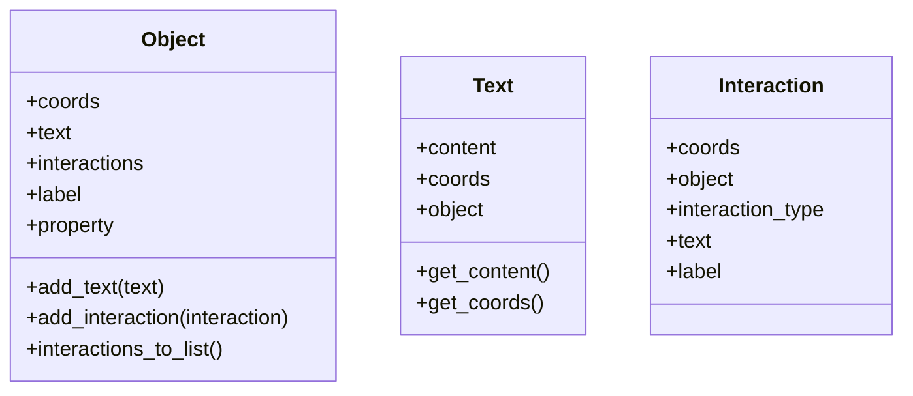
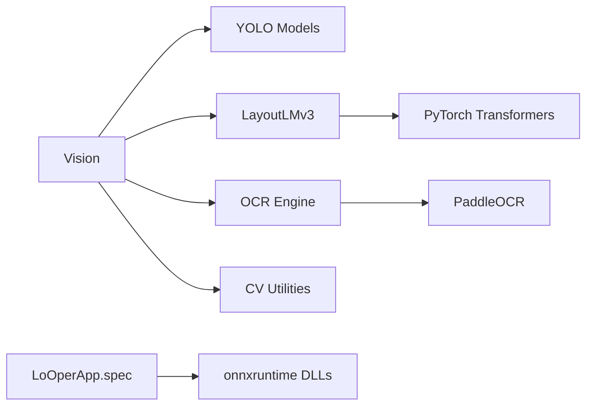

# Vision Models

<cite>
**Referenced Files in This Document**
- [model_vision.py](file://LoOper/player/Computer_vision/model_vision.py)
- [layoutlmv3_layer.py](file://LoOper/player/Computer_vision/layoutlmv3_layer.py)
- [object.py](file://LoOper/player/Computer_vision/object.py)
- [computer_vision.py](file://LoOper/player/computer_vision.py)
- [ocr_engine.py](file://LoOper/player/ocr_engine.py)
- [test_vision.py](file://LoOper/player/Computer_vision/test_vision.py)
- [test_ocr.py](file://LoOper/player/Computer_vision/test_ocr.py)
- [label_description.json](file://LoOper/player/Computer_vision/label_description.json)
- [view_output.json](file://LoOper/player/Computer_vision/view_output.json)
- [Computer_Vision_1.5.3.onnx](file://LoOper/player/Computer_vision/Computer_Vision_1.5.3.onnx)
- [config.py](file://LoOper/player/config.py)
- [main.py](file://LoOper/main.py)
- [LoOperApp.spec](file://LoOperApp.spec)
</cite>

## Table of Contents
1. [Introduction](#introduction)
2. [Project Structure](#project-structure)
3. [Core Components](#core-components)
4. [Architecture Overview](#architecture-overview)
5. [Detailed Component Analysis](#detailed-component-analysis)
6. [Dependency Analysis](#dependency-analysis)
7. [Performance Considerations](#performance-considerations)
8. [Troubleshooting Guide](#troubleshooting-guide)
9. [Conclusion](#conclusion)
10. [Appendices](#appendices)

## Introduction
This document explains the vision model subsystem focused on ONNX-based inference and LayoutLMv3 integration for document understanding and UI element detection. It covers model loading and caching strategies, the inference pipeline, performance optimizations, LayoutLMv3 layer integration, object detection capabilities, deployment considerations, and practical workflows for accuracy tuning, batch processing, and troubleshooting.

## Project Structure
The vision system is primarily located under the Computer Vision module and integrates with OCR and general computer vision utilities.

**Diagram sources**
- [model_vision.py](file://LoOper/player/Computer_vision/model_vision.py)
- [layoutlmv3_layer.py](file://LoOper/player/Computer_vision/layoutlmv3_layer.py)
- [object.py](file://LoOper/player/Computer_vision/object.py)
- [computer_vision.py](file://LoOper/player/computer_vision.py)
- [ocr_engine.py](file://LoOper/player/ocr_engine.py)
- [test_vision.py](file://LoOper/player/Computer_vision/test_vision.py)
- [test_ocr.py](file://LoOper/player/Computer_vision/test_ocr.py)
- [label_description.json](file://LoOper/player/Computer_vision/label_description.json)
- [view_output.json](file://LoOper/player/Computer_vision/view_output.json)
- [Computer_Vision_1.5.3.onnx](file://LoOper/player/Computer_vision/Computer_Vision_1.5.3.onnx)
- [config.py](file://LoOper/player/config.py)
- [main.py](file://LoOper/main.py)
- [LoOperApp.spec](file://LoOperApp.spec)

**Section sources**
- [model_vision.py](file://LoOper/player/Computer_vision/model_vision.py)
- [computer_vision.py](file://LoOper/player/computer_vision.py)
- [ocr_engine.py](file://LoOper/player/ocr_engine.py)
- [config.py](file://LoOper/player/config.py)
- [main.py](file://LoOper/main.py)
- [LoOperApp.spec](file://LoOperApp.spec)

## Core Components
- Vision orchestrator: loads structure/icon models, manages tracking, and runs the full pipeline.
- LayoutLMv3 layer: computes embeddings and relates OCR text to UI elements using layout context.
- OCR engine: PaddleOCR wrapper with model bundling and caching.
- Computer vision utilities: template matching, region-based search, and OCR text detection.
- Object model: structured representation of UI elements and interactions.

Key responsibilities:
- Vision: screen capture, multi-model inference, pruning, ROI detection, and output serialization.
- LayoutLMv3: semantic + spatial matching to label UI elements with nearby text.
- OCR: robust text extraction with language normalization and model discovery.
- CV utilities: efficient template matching and region-based search.

**Section sources**
- [model_vision.py](file://LoOper/player/Computer_vision/model_vision.py)
- [layoutlmv3_layer.py](file://LoOper/player/Computer_vision/layoutlmv3_layer.py)
- [object.py](file://LoOper/player/Computer_vision/object.py)
- [computer_vision.py](file://LoOper/player/computer_vision.py)
- [ocr_engine.py](file://LoOper/player/ocr_engine.py)

## Architecture Overview
High-level flow:
- Vision captures the screen and runs structure and icon detectors.
- OCR extracts text elements.
- LayoutLMv3 generates embeddings and relates OCR text to UI elements.
- Vision prunes detections into a compact, LLM-friendly representation.
- Outputs include annotated images, pruned JSON, and optional LayoutLMv3 visualization.

**Diagram sources**
- [model_vision.py](file://LoOper/player/Computer_vision/model_vision.py)
- [layoutlmv3_layer.py](file://LoOper/player/Computer_vision/layoutlmv3_layer.py)
- [ocr_engine.py](file://LoOper/player/ocr_engine.py)

## Detailed Component Analysis

### Vision Orchestrator
Responsibilities:
- Initialize YOLO structure and icon models.
- Manage StableContextTracker for temporal consistency.
- Run multi-stage inference with TTA and sequential subtraction.
- Prune detections and produce LLM-ready data.
- Save annotated images and pruned outputs.

Key implementation patterns:
- Test-Time Augmentation (TTA): multiple preprocessed variants of the input.
- Non-Maximum Suppression averaging: group overlapping boxes and average coordinates.
- Sequential subtraction: mask large elements and re-run detection to recover missed items.
- Pruning: focus on top-layer windows and dense clusters of inputs/buttons.

**Diagram sources**
- [model_vision.py](file://LoOper/player/Computer_vision/model_vision.py)

**Section sources**
- [model_vision.py](file://LoOper/player/Computer_vision/model_vision.py)

### LayoutLMv3 Layer Integration
Responsibilities:
- Load LayoutLMv3 processor and model.
- Normalize OCR/UI bounding boxes to LayoutLMv3’s 0–1000 scale.
- Encode combined OCR + UI tokens with boxes.
- Compute word embeddings via token averaging.
- Match UI elements to best OCR text using cosine similarity plus spatial heuristics.
- Render visualization overlay with labeled UI elements.

**Diagram sources**
- [layoutlmv3_layer.py](file://LoOper/player/Computer_vision/layoutlmv3_layer.py)

**Section sources**
- [layoutlmv3_layer.py](file://LoOper/player/Computer_vision/layoutlmv3_layer.py)

### OCR Engine and Template Matching
Responsibilities:
- PaddleOCR initialization with model bundling for frozen builds.
- Text element extraction with confidence thresholds and polygon handling.
- Template matching with multi-scale and adaptive strategies.
- Region-based search around hints with expansion factor.
- OCR text detection and extraction utilities.

**Diagram sources**
- [ocr_engine.py](file://LoOper/player/ocr_engine.py)
- [computer_vision.py](file://LoOper/player/computer_vision.py)

**Section sources**
- [ocr_engine.py](file://LoOper/player/ocr_engine.py)
- [computer_vision.py](file://LoOper/player/computer_vision.py)

### Object Model
Responsibilities:
- Represent UI objects, interactions, and associated text.
- Provide conversion helpers for serialization and UI rendering.

**Diagram sources**
- [object.py](file://LoOper/player/Computer_vision/object.py)

**Section sources**
- [object.py](file://LoOper/player/Computer_vision/object.py)

### Practical Workflows and Examples
- Single-frame analysis: capture, detect, prune, annotate, and persist outputs.
- LayoutLMv3 labeling: attach OCR-derived labels to UI elements for downstream agents.
- Batch processing: iterate frames or images with consistent preprocessing and pruning.

Example paths:
- Single-frame analysis: [model_vision.py](file://LoOper/player/Computer_vision/model_vision.py)
- LayoutLMv3 labeling: [layoutlmv3_layer.py](file://LoOper/player/Computer_vision/layoutlmv3_layer.py)
- OCR extraction: [ocr_engine.py](file://LoOper/player/ocr_engine.py)
- Template matching: [computer_vision.py](file://LoOper/player/computer_vision.py)

**Section sources**
- [model_vision.py](file://LoOper/player/Computer_vision/model_vision.py)
- [layoutlmv3_layer.py](file://LoOper/player/Computer_vision/layoutlmv3_layer.py)
- [ocr_engine.py](file://LoOper/player/ocr_engine.py)
- [computer_vision.py](file://LoOper/player/computer_vision.py)

## Dependency Analysis
- Vision depends on YOLO for structure/icon detection and LayoutLMv3 for text-to-element association.
- OCR engine is decoupled and used by both Vision and CV utilities.
- ONNX runtime DLLs are bundled and injected into PATH for frozen builds.
- Computer vision utilities rely on OpenCV and numpy availability.

**Diagram sources**
- [model_vision.py](file://LoOper/player/Computer_vision/model_vision.py)
- [layoutlmv3_layer.py](file://LoOper/player/Computer_vision/layoutlmv3_layer.py)
- [ocr_engine.py](file://LoOper/player/ocr_engine.py)
- [computer_vision.py](file://LoOper/player/computer_vision.py)
- [LoOperApp.spec](file://LoOperApp.spec)

**Section sources**
- [model_vision.py](file://LoOper/player/Computer_vision/model_vision.py)
- [layoutlmv3_layer.py](file://LoOper/player/Computer_vision/layoutlmv3_layer.py)
- [ocr_engine.py](file://LoOper/player/ocr_engine.py)
- [computer_vision.py](file://LoOper/player/computer_vision.py)
- [LoOperApp.spec](file://LoOperApp.spec)

## Performance Considerations
- Multi-stage inference with TTA and sequential subtraction improves recall at the cost of latency; tune confidence thresholds and overlap thresholds to balance accuracy and speed.
- NMS averaging reduces duplicates; adjust overlap threshold to trade off precision/recall.
- Mask large elements before re-inference to reduce false negatives in dense UIs.
- Use region-based search with adaptive scales to minimize computation.
- Leverage frozen builds and bundled model paths to avoid repeated disk I/O and initialization overhead.
- Ensure ONNX runtime DLLs are available in the executable’s internal directory to avoid dynamic load failures.

[No sources needed since this section provides general guidance]

## Troubleshooting Guide
Common issues and remedies:
- Missing OCR/PaddleOCR: Verify installation and environment variables; check OCR availability in configuration.
- ONNX runtime DLL load errors: Ensure onnxruntime DLLs are bundled and PATH includes the internal directory.
- Template matching failures: Confirm OpenCV availability and use region-based search with appropriate expand factor.
- LayoutLMv3 errors: Validate image shape and ensure OCR texts and UI elements are provided; check bounding box normalization.

**Section sources**
- [config.py](file://LoOper/player/config.py)
- [LoOperApp.spec](file://LoOperApp.spec)
- [computer_vision.py](file://LoOper/player/computer_vision.py)
- [layoutlmv3_layer.py](file://LoOper/player/Computer_vision/layoutlmv3_layer.py)

## Conclusion
The vision system combines YOLO-based UI detection, OCR-driven text extraction, and LayoutLMv3 contextual labeling to produce a compact, LLM-friendly representation of interactive UIs. With careful model loading, caching, and inference strategies, it enables robust document understanding and automation-ready UI parsing. Deployment benefits from frozen packaging and bundled model resources to ensure reliability across environments.

[No sources needed since this section summarizes without analyzing specific files]

## Appendices

### Model Loading and Caching Strategies
- Vision initializes YOLO models and LayoutLMv3 layer on demand.
- OCR engine caches PaddleOCR instances with language normalization.
- Frozen builds inject onnxruntime DLLs into PATH to avoid runtime load failures.

**Section sources**
- [model_vision.py](file://LoOper/player/Computer_vision/model_vision.py)
- [layoutlmv3_layer.py](file://LoOper/player/Computer_vision/layoutlmv3_layer.py)
- [ocr_engine.py](file://LoOper/player/ocr_engine.py)
- [LoOperApp.spec](file://LoOperApp.spec)

### Inference Pipeline Implementation
- Multi-stage inference with TTA and sequential subtraction.
- NMS averaging and ROI-based focusing.
- Pruning to LLM-friendly JSON with optional annotated outputs.

**Section sources**
- [model_vision.py](file://LoOper/player/Computer_vision/model_vision.py)

### LayoutLMv3 Integration Details
- Normalized bounding boxes mapped to 0–1000 scale.
- Token-level embeddings aggregated to word vectors.
- Cosine similarity plus spatial heuristics for best match.

**Section sources**
- [layoutlmv3_layer.py](file://LoOper/player/Computer_vision/layoutlmv3_layer.py)

### Object Detection Capabilities
- Structure and icon detection via YOLO.
- Property assignment and interaction classification.
- Stable context tracking across frames.

**Section sources**
- [model_vision.py](file://LoOper/player/Computer_vision/model_vision.py)
- [object.py](file://LoOper/player/Computer_vision/object.py)

### Model Deployment Strategies
- Bundle onnxruntime DLLs and PaddleOCR models in frozen builds.
- Use internal directory injection for reliable runtime loading.
- Validate OCR availability and configure engines accordingly.

**Section sources**
- [LoOperApp.spec](file://LoOperApp.spec)
- [config.py](file://LoOper/player/config.py)

### Vision Model Configuration
- Confidence thresholds and overlap parameters tuned per environment.
- Label descriptions map detector classes to roles (Object, Property, Interaction, Text).
- Example outputs demonstrate structured UI representation.

**Section sources**
- [label_description.json](file://LoOper/player/Computer_vision/label_description.json)
- [view_output.json](file://LoOper/player/Computer_vision/view_output.json)

### Memory Management for Large Models
- Lazy initialization of LayoutLMv3 and OCR engines.
- LRU cache for OCR engines to limit memory footprint.
- Avoid repeated disk reads by leveraging bundled models in frozen builds.

**Section sources**
- [layoutlmv3_layer.py](file://LoOper/player/Computer_vision/layoutlmv3_layer.py)
- [ocr_engine.py](file://LoOper/player/ocr_engine.py)

### Integration with Computer Vision System
- Template matching and region-based search complement OCR and YOLO.
- Unified OCR extraction utilities support both single images and live screens.

**Section sources**
- [computer_vision.py](file://LoOper/player/computer_vision.py)
- [ocr_engine.py](file://LoOper/player/ocr_engine.py)

### Practical Examples and Accuracy Tuning
- Use test scripts to validate OCR and Vision pipelines.
- Adjust confidence thresholds and overlap parameters to improve accuracy.
- Batch processing: iterate images or frames with consistent preprocessing.

**Section sources**
- [test_vision.py](file://LoOper/player/Computer_vision/test_vision.py)
- [test_ocr.py](file://LoOper/player/Computer_vision/test_ocr.py)
- [model_vision.py](file://LoOper/player/Computer_vision/model_vision.py)