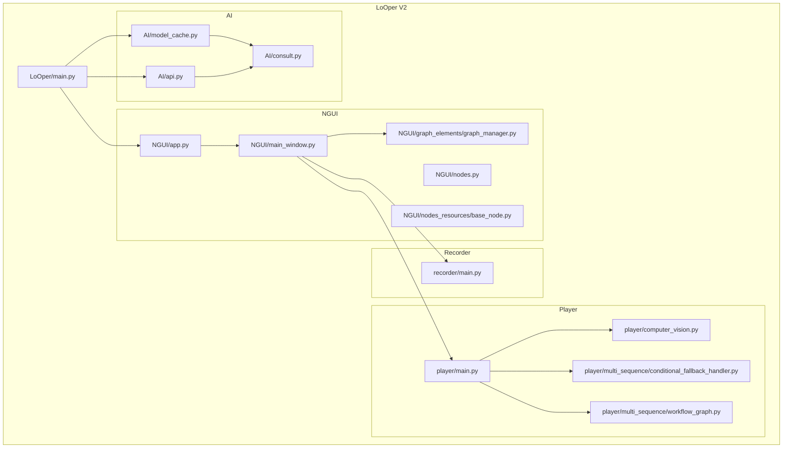
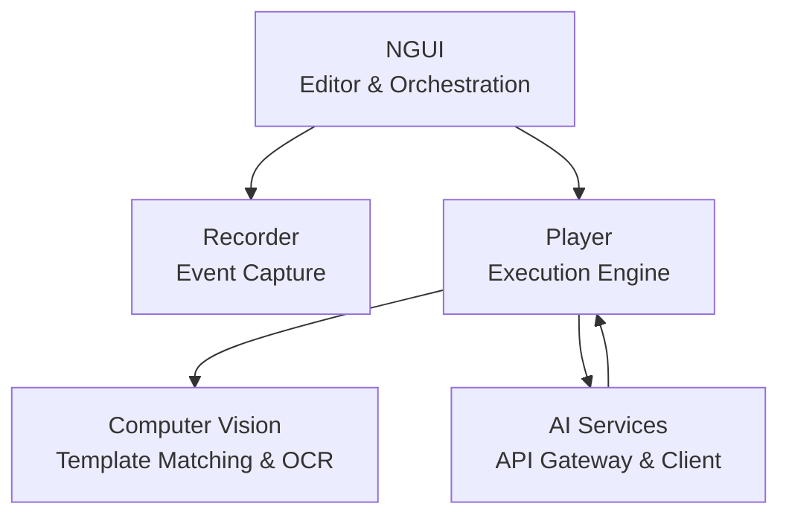
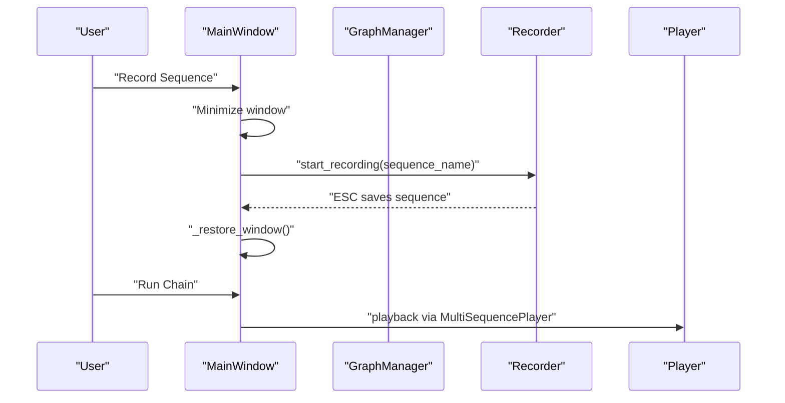
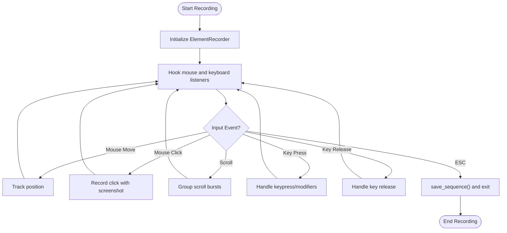
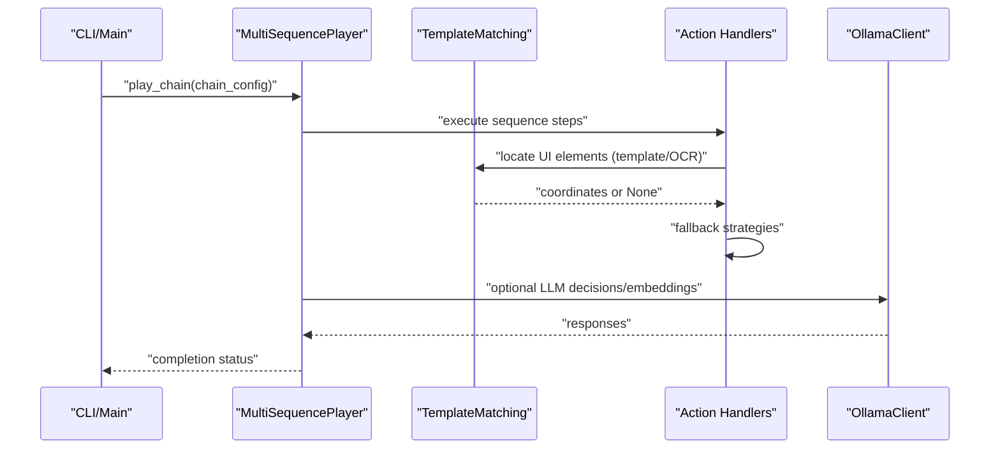
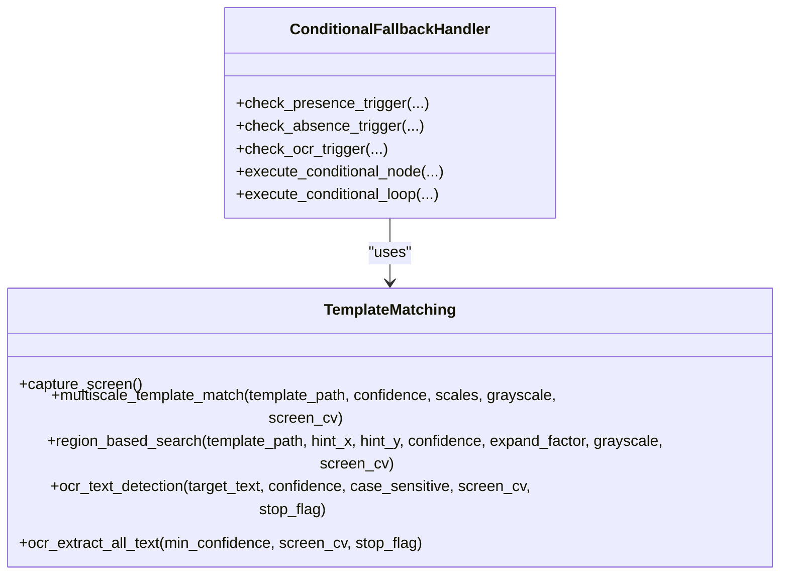
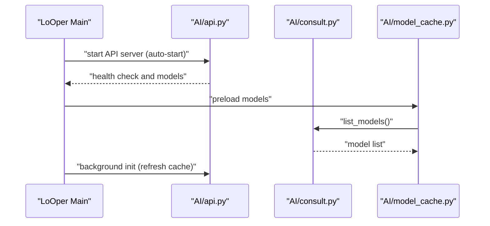
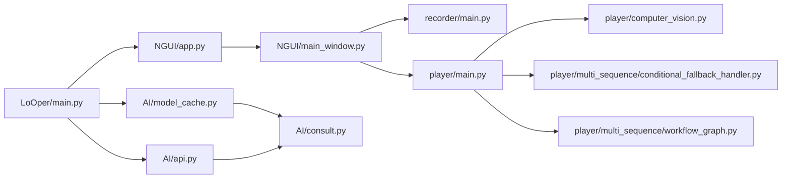

# Core Components

<cite>
**Referenced Files in This Document**
- [main.py](file://LoOper/main.py)
- [README.MD](file://LoOper/README.MD)
- [app.py](file://LoOper/NGUI/app.py)
- [main_window.py](file://LoOper/NGUI/main_window.py)
- [graph_manager.py](file://LoOper/NGUI/graph_elements/graph_manager.py)
- [nodes.py](file://LoOper/NGUI/nodes.py)
- [base_node.py](file://LoOper/NGUI/nodes_resources/base_node.py)
- [main.py](file://LoOper/recorder/main.py)
- [main.py](file://LoOper/player/main.py)
- [computer_vision.py](file://LoOper/player/computer_vision.py)
- [conditional_fallback_handler.py](file://LoOper/player/multi_sequence/conditional_fallback_handler.py)
- [workflow_graph.py](file://LoOper/player/multi_sequence/workflow_graph.py)
- [model_cache.py](file://LoOper/AI/model_cache.py)
- [consult.py](file://LoOper/AI/consult.py)
- [api.py](file://LoOper/AI/api.py)
</cite>

## Table of Contents
1. [Introduction](#introduction)
2. [Project Structure](#project-structure)
3. [Core Components](#core-components)
4. [Architecture Overview](#architecture-overview)
5. [Detailed Component Analysis](#detailed-component-analysis)
6. [Dependency Analysis](#dependency-analysis)
7. [Performance Considerations](#performance-considerations)
8. [Troubleshooting Guide](#troubleshooting-guide)
9. [Conclusion](#conclusion)

## Introduction
This document explains the core subsystems that make up LoOper V2: the visual workflow builder (NGUI), the recording system, the playback engine, the computer vision layer, and the AI integration services. It describes how these components collaborate to deliver a complete desktop automation solution, covering architectural patterns, data flows, integration points, and extensibility. The goal is to help both beginners and experienced developers understand how LoOper works and how to extend it independently.

## Project Structure
LoOper V2 is organized into five major subsystems:
- NGUI: Visual node-based editor for designing automation workflows
- Recorder: Modular action capture and sequence recording
- Player: Playback engine with computer vision and AI integration
- AI: API gateway and client for LLMs and embeddings
- Shared utilities: Computer vision, caching, and cross-cutting concerns

**Diagram sources**
- [main.py:133-136](file://LoOper/main.py#L133-L136)
- [app.py:11-149](file://LoOper/NGUI/app.py#L11-L149)
- [main_window.py:85-150](file://LoOper/NGUI/main_window.py#L85-L150)
- [graph_manager.py:51-92](file://LoOper/NGUI/graph_elements/graph_manager.py#L51-L92)
- [nodes.py:1-14](file://LoOper/NGUI/nodes.py#L1-L14)
- [base_node.py:1-60](file://LoOper/NGUI/nodes_resources/base_node.py#L1-L60)
- [main.py:7-75](file://LoOper/recorder/main.py#L7-L75)
- [main.py:18-105](file://LoOper/player/main.py#L18-L105)
- [computer_vision.py:47-606](file://LoOper/player/computer_vision.py#L47-L606)
- [conditional_fallback_handler.py:20-108](file://LoOper/player/multi_sequence/conditional_fallback_handler.py#L20-L108)
- [workflow_graph.py:1-10](file://LoOper/player/multi_sequence/workflow_graph.py#L1-L10)
- [api.py:1-800](file://LoOper/AI/api.py#L1-L800)
- [model_cache.py:15-217](file://LoOper/AI/model_cache.py#L15-L217)
- [consult.py:30-800](file://LoOper/AI/consult.py#L30-L800)

**Section sources**
- [README.MD:13-47](file://LoOper/README.MD#L13-L47)
- [main.py:133-136](file://LoOper/main.py#L133-L136)

## Core Components
This section introduces each core component, its purpose, and how it fits into the overall system.

- NGUI (Visual Workflow Builder)
  - Purpose: Provides a node-based visual editor to design automation workflows. Users create nodes (sequences, actions, conditionals, LLM, TTS, imports, etc.), connect them, and save/load chains.
  - Key modules: app.py (Qt application bootstrap), main_window.py (menu, recording, playback orchestration), graph_elements/graph_manager.py (NodeGraphQt integration), nodes.py and nodes_resources/base_node.py (node types and utilities).
  - Integration: Starts the GUI, opens the recorder, and triggers playback via MultiSequencePlayer.

- Recorder
  - Purpose: Captures user interactions (mouse, keyboard, scroll) and produces structured JSON sequences with optional screenshots. Supports smart grouping and visual template capture.
  - Key modules: recorder/main.py (listener orchestration), element_recorder (coordinator), sequence_manager, screenshot_manager, scroll_manager, keyboard_handler, mouse_handler.
  - Integration: Launched from NGUI main window; writes sequences to disk for later playback.

- Player
  - Purpose: Executes recorded sequences and complex chains with computer vision, fallback strategies, and human-like motion. Integrates AI for decision-making and dynamic behavior.
  - Key modules: player/main.py (CLI entry), computer_vision.py (template matching, OCR, screen capture), multi_sequence/* (conditional fallback, workflow builder, navigator, executor).
  - Integration: Reads chain configs and sequences; invokes action handlers and vision routines.

- Computer Vision Layer
  - Purpose: Provides robust template matching, OCR, and screen capture with adaptive strategies and fallbacks. Supports sandboxed environments and performance optimizations.
  - Key modules: player/computer_vision.py (TemplateMatching, OCR, screen capture), multi_sequence/conditional_fallback_handler.py (orchestrates triggers and loops).
  - Integration: Used by player and conditional nodes to locate UI elements and validate conditions.

- AI Integration Services
  - Purpose: Exposes an API gateway to Ollama-compatible models, supports embeddings, streaming, and vision-capable models. Includes a client for programmatic access and a model cache for responsiveness.
  - Key modules: AI/api.py (FastAPI gateway), AI/consult.py (OllamaClient), AI/model_cache.py (model caching).
  - Integration: NGUI and Player can query models for decisions, text generation, and embeddings; LoOper main entry can auto-start the API server.

**Section sources**
- [README.MD:71-130](file://LoOper/README.MD#L71-L130)
- [README.MD:147-222](file://LoOper/README.MD#L147-L222)
- [README.MD:251-356](file://LoOper/README.MD#L251-L356)
- [README.MD:357-440](file://LoOper/README.MD#L357-L440)
- [README.MD:441-499](file://LoOper/README.MD#L441-L499)

## Architecture Overview
LoOper V2 follows a modular, layered architecture:
- Presentation layer: NGUI (Qt + NodeGraphQt) for workflow authoring
- Recording layer: Event capture and sequence serialization
- Playback layer: Action execution, computer vision, and AI-driven decisions
- AI layer: API gateway and client for LLMs and embeddings
- Shared utilities: Computer vision primitives, caching, and configuration

**Diagram sources**
- [app.py:11-149](file://LoOper/NGUI/app.py#L11-L149)
- [main_window.py:262-452](file://LoOper/NGUI/main_window.py#L262-L452)
- [main.py:7-75](file://LoOper/recorder/main.py#L7-L75)
- [main.py:18-105](file://LoOper/player/main.py#L18-L105)
- [computer_vision.py:47-606](file://LoOper/player/computer_vision.py#L47-L606)
- [api.py:1-800](file://LoOper/AI/api.py#L1-L800)

## Detailed Component Analysis

### NGUI: Visual Workflow Builder
NGUI is the central authoring environment. It initializes the Qt application, applies a dark theme, and hosts the node graph. The main window integrates menu actions for recording, playback, scheduling, and documentation. It delegates recording to the recorder module and playback to the player module.

**Diagram sources**
- [main_window.py:262-452](file://LoOper/NGUI/main_window.py#L262-L452)
- [main.py:7-75](file://LoOper/recorder/main.py#L7-L75)
- [main.py:18-105](file://LoOper/player/main.py#L18-L105)

Key responsibilities:
- UI orchestration and theming
- Menu actions for recording and playback
- Temporary chain execution and ESC abort handling
- Integration with scheduler service and dialogs

Extensibility:
- New node types are registered via GraphManager.register_nodes
- Node properties and multi-input ports are standardized in base_node utilities

**Section sources**
- [app.py:11-149](file://LoOper/NGUI/app.py#L11-L149)
- [main_window.py:85-150](file://LoOper/NGUI/main_window.py#L85-L150)
- [graph_manager.py:51-120](file://LoOper/NGUI/graph_elements/graph_manager.py#L51-L120)
- [nodes.py:1-14](file://LoOper/NGUI/nodes.py#L1-L14)
- [base_node.py:15-60](file://LoOper/NGUI/nodes_resources/base_node.py#L15-L60)

### Recorder: Modular Action Capture
The recorder captures mouse, keyboard, and scroll events, groups actions intelligently, and writes sequences to JSON with optional screenshots. It uses listeners to capture input and coordinates screenshot capture with each click.

**Diagram sources**
- [main.py:7-75](file://LoOper/recorder/main.py#L7-L75)

Integration highlights:
- ESC triggers immediate save and stops listeners
- Screenshots are captured for click actions and organized by sequence
- Recording runs in a dedicated thread to avoid blocking the UI

**Section sources**
- [main.py:7-75](file://LoOper/recorder/main.py#L7-L75)

### Player: Playback Engine with Computer Vision and AI
The player interprets JSON sequences and chains, executes actions, and uses computer vision for reliable targeting. It supports human-like delays, retries, and fallback strategies. AI integration enables dynamic decisions and text generation.

**Diagram sources**
- [main.py:18-105](file://LoOper/player/main.py#L18-L105)
- [computer_vision.py:47-606](file://LoOper/player/computer_vision.py#L47-L606)
- [conditional_fallback_handler.py:20-108](file://LoOper/player/multi_sequence/conditional_fallback_handler.py#L20-L108)
- [consult.py:30-800](file://LoOper/AI/consult.py#L30-L800)

Key capabilities:
- Multi-sequence chaining with loops and delays
- Conditional branches using image presence, OCR, and custom triggers
- Human-like motion and timing
- Fallback mechanisms for robustness
- Sandbox agent integration for remote screens

**Section sources**
- [main.py:18-105](file://LoOper/player/main.py#L18-L105)
- [computer_vision.py:47-606](file://LoOper/player/computer_vision.py#L47-L606)
- [conditional_fallback_handler.py:20-108](file://LoOper/player/multi_sequence/conditional_fallback_handler.py#L20-L108)
- [workflow_graph.py:1-10](file://LoOper/player/multi_sequence/workflow_graph.py#L1-L10)

### Computer Vision Layer
The computer vision layer provides:
- Template matching with multi-scale and adaptive strategies
- Region-based search around hints
- OCR text detection and extraction
- Fast screenshot capture with fallbacks
- Sandbox agent support for remote environments

**Diagram sources**
- [computer_vision.py:47-606](file://LoOper/player/computer_vision.py#L47-L606)
- [conditional_fallback_handler.py:20-108](file://LoOper/player/multi_sequence/conditional_fallback_handler.py#L20-L108)

**Section sources**
- [computer_vision.py:47-606](file://LoOper/player/computer_vision.py#L47-L606)
- [conditional_fallback_handler.py:20-108](file://LoOper/player/multi_sequence/conditional_fallback_handler.py#L20-L108)

### AI Integration Services
LoOper exposes an API gateway to Ollama-compatible models and provides a client for programmatic access. It caches models to avoid UI blocking and supports vision-capable models and embeddings.

**Diagram sources**
- [main.py:171-381](file://LoOper/main.py#L171-L381)
- [api.py:1-800](file://LoOper/AI/api.py#L1-L800)
- [model_cache.py:15-217](file://LoOper/AI/model_cache.py#L15-L217)
- [consult.py:30-800](file://LoOper/AI/consult.py#L30-L800)

Key features:
- Health checks and model bootstrapping
- Vision model detection and image preprocessing
- Streaming and non-streaming generations
- Embeddings with fallbacks and cleanup
- Queue-based asynchronous requests for ComoRAG

**Section sources**
- [api.py:1-800](file://LoOper/AI/api.py#L1-L800)
- [model_cache.py:15-217](file://LoOper/AI/model_cache.py#L15-L217)
- [consult.py:30-800](file://LoOper/AI/consult.py#L30-L800)
- [main.py:171-381](file://LoOper/main.py#L171-L381)

## Dependency Analysis
The following diagram shows key dependencies among components:

**Diagram sources**
- [main.py:133-136](file://LoOper/main.py#L133-L136)
- [app.py:11-149](file://LoOper/NGUI/app.py#L11-L149)
- [main_window.py:262-452](file://LoOper/NGUI/main_window.py#L262-L452)
- [main.py:7-75](file://LoOper/recorder/main.py#L7-L75)
- [main.py:18-105](file://LoOper/player/main.py#L18-L105)
- [computer_vision.py:47-606](file://LoOper/player/computer_vision.py#L47-L606)
- [conditional_fallback_handler.py:20-108](file://LoOper/player/multi_sequence/conditional_fallback_handler.py#L20-L108)
- [workflow_graph.py:1-10](file://LoOper/player/multi_sequence/workflow_graph.py#L1-L10)
- [api.py:1-800](file://LoOper/AI/api.py#L1-L800)
- [model_cache.py:15-217](file://LoOper/AI/model_cache.py#L15-L217)
- [consult.py:30-800](file://LoOper/AI/consult.py#L30-L800)

**Section sources**
- [main.py:133-136](file://LoOper/main.py#L133-L136)
- [main_window.py:262-452](file://LoOper/NGUI/main_window.py#L262-L452)
- [computer_vision.py:47-606](file://LoOper/player/computer_vision.py#L47-L606)

## Performance Considerations
- Computer vision
  - Multi-scale matching adapts to repeated checks; consider tuning scales and confidence thresholds to balance accuracy and speed.
  - Region-based search reduces search space; ensure minimum template-relative sizes to avoid tiny regions.
  - Template cache bypassed intentionally to avoid stale disk reads; cache judiciously in custom integrations.
- OCR
  - OCR extraction can be expensive; adjust min_confidence and leverage stop flags for cancellation.
- AI
  - Model cache avoids UI stalls; pre-load models at startup.
  - Streaming vs. non-streaming generation trade-offs; streaming reduces latency for long responses.
  - Embeddings fallbacks and cleanup help manage memory; batch inputs when possible.
- UI
  - Qt DPI awareness and high-DPI scaling are configured to improve rendering performance and clarity.

[No sources needed since this section provides general guidance]

## Troubleshooting Guide
Common issues and resolutions:
- Recording problems
  - Missing screenshots: verify Pillow installation and permissions.
  - Missing actions: rapid actions may be grouped; adjust grouping logic if needed.
  - ESC not working: ensure no other application is intercepting ESC.
- Playback issues
  - Images not found: verify screenshot paths and image quality; adjust match thresholds and region constraints.
  - Wrong clicks: use region constraints and increase confidence thresholds.
  - Timing problems: increase delays between actions.
- GUI issues
  - Nodes not appearing: confirm NodeGraphQt installation and node registration.
  - Slow performance: reduce graph complexity or restart the application.
  - Theme problems: verify PyQt5 installation and stylesheet application.
- AI/API issues
  - API not ready: use health checks and auto-start logic; verify environment variables for Tailscale and ports.
  - Model loading failures: fallback models are used; check network connectivity and Ollama availability.

**Section sources**
- [README.MD:598-625](file://LoOper/README.MD#L598-L625)
- [main.py:138-170](file://LoOper/main.py#L138-L170)
- [api.py:581-607](file://LoOper/AI/api.py#L581-L607)

## Conclusion
LoOper V2 delivers a modular desktop automation platform by combining a visual workflow builder, a robust recording system, a powerful playback engine with computer vision, and an AI integration layer. The architecture emphasizes separation of concerns, enabling independent understanding and extension of each component. By leveraging computer vision for reliable targeting, AI for dynamic decisions, and a flexible node-based editor, LoOper provides a scalable foundation for complex automation scenarios.