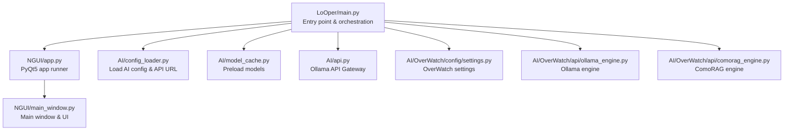
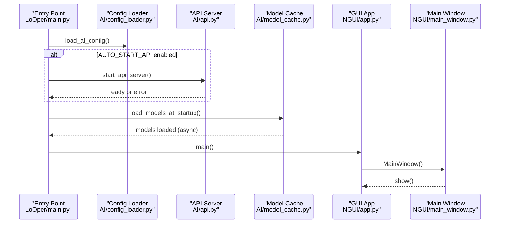
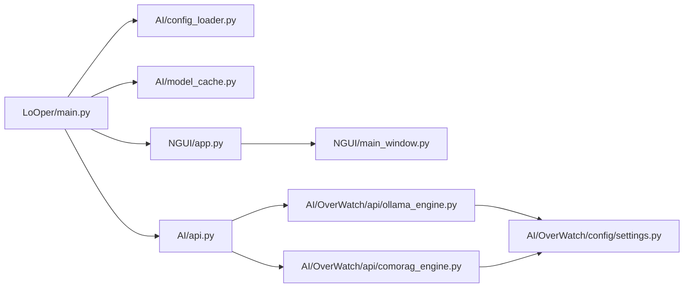

# GUI Application

<cite>
**Referenced Files in This Document**
- [main.py](file://LoOper/main.py)
- [app.py](file://LoOper/NGUI/app.py)
- [main_window.py](file://LoOper/NGUI/main_window.py)
- [config_loader.py](file://LoOper/AI/config_loader.py)
- [config.json](file://LoOper/AI/config.json)
- [model_cache.py](file://LoOper/AI/model_cache.py)
- [api.py](file://LoOper/AI/api.py)
- [consult.py](file://LoOper/AI/consult.py)
- [settings.py](file://LoOper/AI/OverWatch/config/settings.py)
- [ollama_engine.py](file://LoOper/AI/OverWatch/api/ollama_engine.py)
- [comorag_engine.py](file://LoOper/AI/OverWatch/api/comorag_engine.py)
</cite>

## Table of Contents
1. [Introduction](#introduction)
2. [Project Structure](#project-structure)
3. [Core Components](#core-components)
4. [Architecture Overview](#architecture-overview)
5. [Detailed Component Analysis](#detailed-component-analysis)
6. [Dependency Analysis](#dependency-analysis)
7. [Performance Considerations](#performance-considerations)
8. [Troubleshooting Guide](#troubleshooting-guide)
9. [Conclusion](#conclusion)
10. [Appendices](#appendices)

## Introduction
This document explains the GUI application’s main entry point and component coordination hub. It focuses on how the application orchestrates startup, loads AI configuration, manages the API server lifecycle, preloads models for responsive UI, and ensures graceful shutdown. It also covers thread-safe operations, inter-process communication, configuration validation, and practical examples of initialization order, error recovery, and resource cleanup. Guidance is included for extending the application with new components while preserving architectural coherence.

## Project Structure
The GUI application is organized around a main entry point that coordinates:
- GUI startup via a PyQt5 application
- AI configuration loading and API server management
- Model caching and preloading
- Graceful shutdown and cleanup

**Diagram sources**
- [main.py:133-136](file://LoOper/main.py#L133-L136)
- [app.py:11-153](file://LoOper/NGUI/app.py#L11-L153)
- [config_loader.py:9-66](file://LoOper/AI/config_loader.py#L9-L66)
- [model_cache.py:15-217](file://LoOper/AI/model_cache.py#L15-L217)
- [api.py:1-800](file://LoOper/AI/api.py#L1-L800)
- [settings.py:16-440](file://LoOper/AI/OverWatch/config/settings.py#L16-L440)
- [ollama_engine.py:34-200](file://LoOper/AI/OverWatch/api/ollama_engine.py#L34-L200)
- [comorag_engine.py:34-200](file://LoOper/AI/OverWatch/api/comorag_engine.py#L34-L200)
- [main_window.py:85-200](file://LoOper/NGUI/main_window.py#L85-L200)

**Section sources**
- [main.py:133-136](file://LoOper/main.py#L133-L136)
- [app.py:11-153](file://LoOper/NGUI/app.py#L11-L153)
- [main_window.py:85-200](file://LoOper/NGUI/main_window.py#L85-L200)

## Core Components
- Main entry point and orchestration: [main.py:133-136](file://LoOper/main.py#L133-L136)
- GUI application runner: [app.py:11-153](file://LoOper/NGUI/app.py#L11-L153)
- AI configuration loader and API URL provider: [config_loader.py:9-66](file://LoOper/AI/config_loader.py#L9-L66)
- Model cache and preload: [model_cache.py:15-217](file://LoOper/AI/model_cache.py#L15-L217)
- API server management: [api.py:1-800](file://LoOper/AI/api.py#L1-L800)
- OverWatch settings and engines: [settings.py:16-440](file://LoOper/AI/OverWatch/config/settings.py#L16-L440), [ollama_engine.py:34-200](file://LoOper/AI/OverWatch/api/ollama_engine.py#L34-L200), [comorag_engine.py:34-200](file://LoOper/AI/OverWatch/api/comorag_engine.py#L34-L200)
- GUI main window: [main_window.py:85-200](file://LoOper/NGUI/main_window.py#L85-L200)

**Section sources**
- [main.py:133-136](file://LoOper/main.py#L133-L136)
- [app.py:11-153](file://LoOper/NGUI/app.py#L11-L153)
- [config_loader.py:9-66](file://LoOper/AI/config_loader.py#L9-L66)
- [model_cache.py:15-217](file://LoOper/AI/model_cache.py#L15-L217)
- [api.py:1-800](file://LoOper/AI/api.py#L1-L800)
- [settings.py:16-440](file://LoOper/AI/OverWatch/config/settings.py#L16-L440)
- [ollama_engine.py:34-200](file://LoOper/AI/OverWatch/api/ollama_engine.py#L34-L200)
- [comorag_engine.py:34-200](file://LoOper/AI/OverWatch/api/comorag_engine.py#L34-L200)
- [main_window.py:85-200](file://LoOper/NGUI/main_window.py#L85-L200)

## Architecture Overview
The application follows a layered architecture:
- Entry point layer: initializes environment, loads configuration, starts API server, preloads models, and launches the GUI.
- GUI layer: PyQt5-based main window and UI components.
- AI layer: API gateway to Ollama, OverWatch settings and engines, and model cache.
- Inter-process communication: API server runs separately (subprocess or in-process) and exposes endpoints consumed by the GUI and clients.

**Diagram sources**
- [main.py:355-373](file://LoOper/main.py#L355-L373)
- [config_loader.py:9-66](file://LoOper/AI/config_loader.py#L9-L66)
- [api.py:1-800](file://LoOper/AI/api.py#L1-L800)
- [model_cache.py:213-217](file://LoOper/AI/model_cache.py#L213-L217)
- [app.py:11-153](file://LoOper/NGUI/app.py#L11-L153)
- [main_window.py:85-200](file://LoOper/NGUI/main_window.py#L85-L200)

## Detailed Component Analysis

### Main Entry Point Orchestration
The entry point coordinates startup:
- Environment preparation and platform-specific fixes
- AI configuration loading and API URL determination
- Optional API server startup (subprocess or in-process)
- Model preload before GUI launch
- GUI startup

Key behaviors:
- Auto-start API based on configuration
- Wait-for-API health checks and post-initialization refresh
- Threaded server startup and background initialization
- atexit registration for API server cleanup

Practical examples:
- Component initialization order: config → API server (optional) → model cache → GUI
- Error recovery: if API fails to start, continue with GUI and fallback model cache
- Resource cleanup: atexit hooks terminate API subprocess or in-process server

**Section sources**
- [main.py:133-136](file://LoOper/main.py#L133-L136)
- [main.py:138-170](file://LoOper/main.py#L138-L170)
- [main.py:171-354](file://LoOper/main.py#L171-L354)
- [main.py:355-381](file://LoOper/main.py#L355-L381)
- [main.py:383-419](file://LoOper/main.py#L383-L419)

### AI Configuration Loading and API URL Management
Configuration loading:
- Loads defaults and merges with file and environment variables
- Exposes API URL and auto-start flags
- Sets environment variables for current session

Validation and URL construction:
- Validates and constructs API URL from configuration
- Supports Tailscale and local development modes

**Section sources**
- [config_loader.py:9-66](file://LoOper/AI/config_loader.py#L9-L66)
- [config.json:1-9](file://LoOper/AI/config.json#L1-L9)

### API Server Lifecycle Management
Two modes:
- Subprocess mode: spawns a separate process for the API server; forwards output; registers atexit cleanup
- In-process mode: runs Uvicorn server inside the same process; sets up logging and runs in a dedicated thread

Health checks and initialization:
- Health-check loop until ready
- Post-initialization refresh of model cache
- Background threads for non-blocking startup

Graceful shutdown:
- atexit handler terminates subprocess or stops in-process server
- Windows-specific process tree termination

Inter-process communication:
- API server exposes endpoints for models, chat, embeddings, health, and cleanup
- Clients (GUI and others) communicate via HTTP requests

**Section sources**
- [main.py:171-354](file://LoOper/main.py#L171-L354)
- [api.py:1-800](file://LoOper/AI/api.py#L1-L800)

### Model Caching and Preloading Strategies
Model cache:
- Thread-safe cache with locks
- Asynchronous preload to avoid UI blocking
- Fallback models when API is unavailable
- Refresh mechanism with async event loop handling
- Real-model-only getter to avoid fallbacks

Integration:
- Called before GUI startup to ensure UI responsiveness
- Refresh triggered after API becomes ready

**Section sources**
- [model_cache.py:15-217](file://LoOper/AI/model_cache.py#L15-L217)

### GUI Application Runner and Main Window
GUI runner:
- Sets DPI awareness and high-DPI scaling
- Applies dark theme stylesheet
- Creates and shows main window

Main window:
- Initializes UI components and menu bar
- Starts scheduler service
- Integrates with recording and playback subsystems

**Section sources**
- [app.py:11-153](file://LoOper/NGUI/app.py#L11-L153)
- [main_window.py:85-200](file://LoOper/NGUI/main_window.py#L85-L200)

### OverWatch Engines and Settings
OverWatch settings:
- Strongly typed settings for Ollama, ComoRAG, API, Tailscale, and logging
- Environment variable overrides and validation
- URL construction helpers

Engines:
- Ollama engine: async initialization, model loading, status checks, runner cleanup
- ComoRAG engine: memory workspace, dynamic memory, reasoning cycles, embedding support

**Section sources**
- [settings.py:16-440](file://LoOper/AI/OverWatch/config/settings.py#L16-L440)
- [ollama_engine.py:34-200](file://LoOper/AI/OverWatch/api/ollama_engine.py#L34-L200)
- [comorag_engine.py:34-200](file://LoOper/AI/OverWatch/api/comorag_engine.py#L34-L200)

### Client Integration Example
Client usage:
- OllamaClient encapsulates API calls, health checks, model listing, chat/generate, embeddings, and queue-based ComoRAG requests
- Supports fallback to local Ollama endpoints when gateway is unavailable
- Provides shutdown/cleanup routines

**Section sources**
- [consult.py:30-800](file://LoOper/AI/consult.py#L30-L800)

## Dependency Analysis
The main entry point depends on:
- Configuration loader for environment and API URL
- Model cache for preloading
- API server for backend services
- GUI app and main window for UI

**Diagram sources**
- [main.py:133-136](file://LoOper/main.py#L133-L136)
- [config_loader.py:9-66](file://LoOper/AI/config_loader.py#L9-L66)
- [model_cache.py:15-217](file://LoOper/AI/model_cache.py#L15-L217)
- [api.py:1-800](file://LoOper/AI/api.py#L1-L800)
- [app.py:11-153](file://LoOper/NGUI/app.py#L11-L153)
- [main_window.py:85-200](file://LoOper/NGUI/main_window.py#L85-L200)
- [settings.py:16-440](file://LoOper/AI/OverWatch/config/settings.py#L16-L440)
- [ollama_engine.py:34-200](file://LoOper/AI/OverWatch/api/ollama_engine.py#L34-L200)
- [comorag_engine.py:34-200](file://LoOper/AI/OverWatch/api/comorag_engine.py#L34-L200)

**Section sources**
- [main.py:133-136](file://LoOper/main.py#L133-L136)
- [app.py:11-153](file://LoOper/NGUI/app.py#L11-L153)
- [main_window.py:85-200](file://LoOper/NGUI/main_window.py#L85-L200)
- [config_loader.py:9-66](file://LoOper/AI/config_loader.py#L9-L66)
- [model_cache.py:15-217](file://LoOper/AI/model_cache.py#L15-L217)
- [api.py:1-800](file://LoOper/AI/api.py#L1-L800)
- [settings.py:16-440](file://LoOper/AI/OverWatch/config/settings.py#L16-L440)
- [ollama_engine.py:34-200](file://LoOper/AI/OverWatch/api/ollama_engine.py#L34-L200)
- [comorag_engine.py:34-200](file://LoOper/AI/OverWatch/api/comorag_engine.py#L34-L200)

## Performance Considerations
- Asynchronous model preload: prevents UI stalls during initial load
- Background API initialization: keeps startup responsive
- Thread-safe caches and queues: minimize contention and improve throughput
- Health checks with timeouts: avoid indefinite waits
- Event-driven GUI updates: integrate with background tasks without blocking the UI thread

[No sources needed since this section provides general guidance]

## Troubleshooting Guide
Common issues and remedies:
- API server not ready: health-check loop with timeouts; background initialization continues even if server is slow
- Port binding conflicts: subprocess mode attempts to detect and handle failures; falls back to logging errors
- Model loading failures: fallback models are used; refresh mechanism retries with timeouts
- Graceful shutdown: atexit handlers terminate subprocess or in-process server; Windows-specific process tree termination is attempted
- DPI and DLL issues: environment setup and DLL path adjustments are performed at startup

**Section sources**
- [main.py:138-170](file://LoOper/main.py#L138-L170)
- [main.py:171-354](file://LoOper/main.py#L171-L354)
- [main.py:310-326](file://LoOper/main.py#L310-L326)
- [model_cache.py:46-77](file://LoOper/AI/model_cache.py#L46-L77)
- [model_cache.py:102-163](file://LoOper/AI/model_cache.py#L102-L163)

## Conclusion
The GUI application’s entry point orchestrates a robust startup sequence: configuration loading, optional API server management, asynchronous model preloading, and GUI initialization. Thread-safe caches, health checks, and graceful shutdown ensure reliability. The architecture cleanly separates concerns across layers, enabling straightforward extension with new components while maintaining coherence.

[No sources needed since this section summarizes without analyzing specific files]

## Appendices

### Practical Examples

- Component initialization order
  - Load AI configuration
  - Optionally start API server
  - Preload models asynchronously
  - Launch GUI

- Error recovery mechanisms
  - Health checks with timeouts
  - Fallback to cached models
  - Graceful shutdown via atexit

- Resource cleanup
  - API server termination (subprocess or in-process)
  - Session and queue shutdown for clients
  - Logging and UI cleanup

**Section sources**
- [main.py:355-381](file://LoOper/main.py#L355-L381)
- [main.py:310-326](file://LoOper/main.py#L310-L326)
- [model_cache.py:102-163](file://LoOper/AI/model_cache.py#L102-L163)
- [consult.py:626-659](file://LoOper/AI/consult.py#L626-L659)