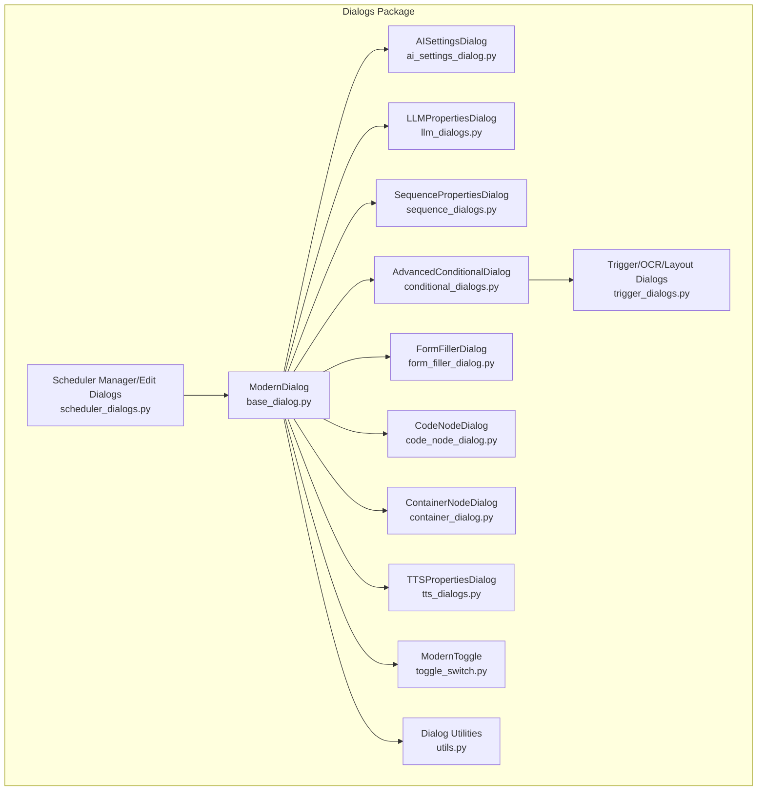
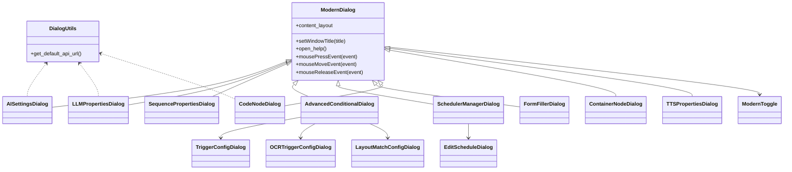
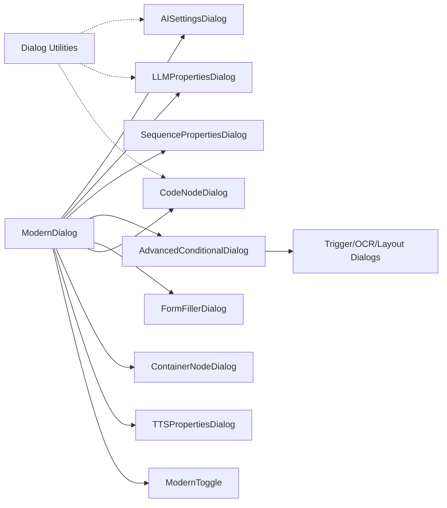

# Dialog System

<cite>
**Referenced Files in This Document**
- [base_dialog.py](file://LoOper/NGUI/dialogs/base_dialog.py)
- [__init__.py](file://LoOper/NGUI/dialogs/__init__.py)
- [utils.py](file://LoOper/NGUI/dialogs/utils.py)
- [toggle_switch.py](file://LoOper/NGUI/dialogs/toggle_switch.py)
- [ai_settings_dialog.py](file://LoOper/NGUI/dialogs/ai_settings_dialog.py)
- [llm_dialogs.py](file://LoOper/NGUI/dialogs/llm_dialogs.py)
- [sequence_dialogs.py](file://LoOper/NGUI/dialogs/sequence_dialogs.py)
- [conditional_dialogs.py](file://LoOper/NGUI/dialogs/conditional_dialogs.py)
- [trigger_dialogs.py](file://LoOper/NGUI/dialogs/trigger_dialogs.py)
- [scheduler_dialogs.py](file://LoOper/NGUI/dialogs/scheduler_dialogs.py)
- [form_filler_dialog.py](file://LoOper/NGUI/dialogs/form_filler_dialog.py)
- [code_node_dialog.py](file://LoOper/NGUI/dialogs/code_node_dialog.py)
- [container_dialog.py](file://LoOper/NGUI/dialogs/container_dialog.py)
- [tts_dialogs.py](file://LoOper/NGUI/dialogs/tts_dialogs.py)
</cite>

## Table of Contents
1. [Introduction](#introduction)
2. [Project Structure](#project-structure)
3. [Core Components](#core-components)
4. [Architecture Overview](#architecture-overview)
5. [Detailed Component Analysis](#detailed-component-analysis)
6. [Dependency Analysis](#dependency-analysis)
7. [Performance Considerations](#performance-considerations)
8. [Troubleshooting Guide](#troubleshooting-guide)
9. [Conclusion](#conclusion)
10. [Appendices](#appendices)

## Introduction
This document describes the dialog system used for node property editing, configuration interfaces, and user input handling across the LoOper application. It explains the base dialog architecture, validation mechanisms, property binding patterns, and specialized dialogs for different node types. It also covers dialog utilities for common UI patterns, form validation, error presentation, and practical examples for creating custom node dialogs, implementing complex property editors, and integrating with the node transformation system. Accessibility considerations, keyboard navigation, and responsive dialog layouts are addressed for different screen sizes.

## Project Structure
The dialog system is organized under the NGUI dialogs package. It defines a modern dialog base class and numerous specialized dialogs for nodes such as LLM, conditional logic, scheduling, form filling, code execution, containers, and TTS. A toggle switch widget provides a modern on/off control. Utilities centralize API URL retrieval and configuration loading.

**Diagram sources**
- [base_dialog.py:88-382](file://LoOper/NGUI/dialogs/base_dialog.py#L88-L382)
- [toggle_switch.py:8-104](file://LoOper/NGUI/dialogs/toggle_switch.py#L8-L104)
- [utils.py:1-25](file://LoOper/NGUI/dialogs/utils.py#L1-L25)
- [ai_settings_dialog.py:109-500](file://LoOper/NGUI/dialogs/ai_settings_dialog.py#L109-L500)
- [llm_dialogs.py:30-800](file://LoOper/NGUI/dialogs/llm_dialogs.py#L30-L800)
- [sequence_dialogs.py:8-51](file://LoOper/NGUI/dialogs/sequence_dialogs.py#L8-L51)
- [conditional_dialogs.py:119-790](file://LoOper/NGUI/dialogs/conditional_dialogs.py#L119-L790)
- [trigger_dialogs.py:232-800](file://LoOper/NGUI/dialogs/trigger_dialogs.py#L232-L800)
- [scheduler_dialogs.py:15-574](file://LoOper/NGUI/dialogs/scheduler_dialogs.py#L15-L574)
- [form_filler_dialog.py:17-79](file://LoOper/NGUI/dialogs/form_filler_dialog.py#L17-L79)
- [code_node_dialog.py:73-434](file://LoOper/NGUI/dialogs/code_node_dialog.py#L73-L434)
- [container_dialog.py:9-117](file://LoOper/NGUI/dialogs/container_dialog.py#L9-L117)
- [tts_dialogs.py:16-88](file://LoOper/NGUI/dialogs/tts_dialogs.py#L16-L88)

**Section sources**
- [__init__.py:1-35](file://LoOper/NGUI/dialogs/__init__.py#L1-L35)

## Core Components
- ModernDialog: Provides a modern, themed dialog with draggable title bar, scrollable content area, shadow effects, and consistent styling. It exposes a content_layout for child dialogs to populate.
- UserGuideDialog: Displays contextual help from the user guide markdown, filtered by topic.
- ModernToggle: A smooth animated toggle switch widget suitable for on/off settings.
- Dialog Utilities: Centralized helpers for retrieving default API URLs and configuration loading.

Key responsibilities:
- Base theming and layout management
- Drag-and-drop movement by title bar
- Scrollable content with optional resize grip
- Help integration via user guide topics
- Consistent focus and hover states for controls

**Section sources**
- [base_dialog.py:88-382](file://LoOper/NGUI/dialogs/base_dialog.py#L88-L382)
- [toggle_switch.py:8-104](file://LoOper/NGUI/dialogs/toggle_switch.py#L8-L104)
- [utils.py:1-25](file://LoOper/NGUI/dialogs/utils.py#L1-L25)

## Architecture Overview
The dialog architecture follows a layered pattern:
- Base dialog layer: ModernDialog encapsulates UI shell, styling, and behavior.
- Specialized dialog layer: Each node type has a dedicated dialog inheriting from ModernDialog.
- Utility layer: Shared helpers for configuration and API URL resolution.
- Widget composition: Dialogs compose standard Qt widgets and custom widgets (e.g., ModernToggle).

**Diagram sources**
- [base_dialog.py:88-382](file://LoOper/NGUI/dialogs/base_dialog.py#L88-L382)
- [ai_settings_dialog.py:109-500](file://LoOper/NGUI/dialogs/ai_settings_dialog.py#L109-L500)
- [llm_dialogs.py:30-800](file://LoOper/NGUI/dialogs/llm_dialogs.py#L30-L800)
- [sequence_dialogs.py:8-51](file://LoOper/NGUI/dialogs/sequence_dialogs.py#L8-L51)
- [conditional_dialogs.py:119-790](file://LoOper/NGUI/dialogs/conditional_dialogs.py#L119-L790)
- [trigger_dialogs.py:232-800](file://LoOper/NGUI/dialogs/trigger_dialogs.py#L232-L800)
- [scheduler_dialogs.py:15-574](file://LoOper/NGUI/dialogs/scheduler_dialogs.py#L15-L574)
- [form_filler_dialog.py:17-79](file://LoOper/NGUI/dialogs/form_filler_dialog.py#L17-L79)
- [code_node_dialog.py:73-434](file://LoOper/NGUI/dialogs/code_node_dialog.py#L73-L434)
- [container_dialog.py:9-117](file://LoOper/NGUI/dialogs/container_dialog.py#L9-L117)
- [tts_dialogs.py:16-88](file://LoOper/NGUI/dialogs/tts_dialogs.py#L16-L88)
- [toggle_switch.py:8-104](file://LoOper/NGUI/dialogs/toggle_switch.py#L8-L104)
- [utils.py:1-25](file://LoOper/NGUI/dialogs/utils.py#L1-L25)

## Detailed Component Analysis

### Base Dialog Architecture
ModernDialog establishes a consistent shell:
- Frameless window with translucent background and drop shadow
- Draggable title bar with close and optional help button
- Scrollable content area with padding and spacing
- Styled controls (buttons, inputs, groups, tabs) using theme constants
- Resize grip for manual resizing

User interaction:
- Dragging the title bar moves the dialog
- Close button rejects the dialog
- Help button opens a UserGuideDialog filtered by topic

Accessibility and responsiveness:
- Scroll areas adapt to content
- Minimum sizes prevent clipping
- Focus styling applied to inputs

**Section sources**
- [base_dialog.py:88-382](file://LoOper/NGUI/dialogs/base_dialog.py#L88-L382)

### AI Settings Dialog
Purpose:
- Configure AI backend endpoints, local API server, and advanced settings.

Key features:
- Remote API configuration (Tailscale IP, API port, Ollama host/port)
- Local API server management (start/stop with threading)
- Connection testing and model listing
- Advanced settings (auto-start, timeouts)
- Persistent configuration via JSON and environment variables
- Integration with model cache refresh

Validation and error handling:
- Connection tests with health checks
- Model listing with robust parsing
- Graceful fallbacks to environment variables
- Thread-safe server lifecycle management

**Section sources**
- [ai_settings_dialog.py:109-500](file://LoOper/NGUI/dialogs/ai_settings_dialog.py#L109-L500)
- [utils.py:1-25](file://LoOper/NGUI/dialogs/utils.py#L1-L25)

### LLM Properties Dialog
Purpose:
- Configure LLM node properties including model selection, prompts, generation parameters, vision, and RAG.

Structure:
- Tabs: Basic, Prompt, Advanced, Features, RAG, Tools
- Property binding: Loads from current_config; writes to dictionary on accept
- Dynamic UI: Visibility toggles based on input source; template-driven configuration

Validation and UX:
- Input source radio group with dynamic OCR configuration
- Template descriptions and quick selection
- Async processing and typing speed controls
- Vision model selection and screenshot options
- RAG configuration toggles and parameters

**Section sources**
- [llm_dialogs.py:30-800](file://LoOper/NGUI/dialogs/llm_dialogs.py#L30-L800)

### Sequence Properties Dialog
Purpose:
- Edit sequence-specific properties such as loop count, extra delay, and app context usage.

Pattern:
- Inherits from ModernDialog
- Uses content_layout for widget placement
- Returns a dictionary of properties on accept

**Section sources**
- [sequence_dialogs.py:8-51](file://LoOper/NGUI/dialogs/sequence_dialogs.py#L8-L51)

### Conditional Logic Dialog
Purpose:
- Configure advanced conditional fallbacks, presence/absence triggers, OCR triggers, layout match conditionals, and conditional loops.

Structure:
- Unified layout without tabs for better usability
- List widgets with custom item previews
- Sub-dialogs for each trigger type (TriggerConfigDialog, OCRTriggerConfigDialog, LayoutMatchConfigDialog, WaitConditionDialog, ConditionalLoopDialog)

Validation and UX:
- Presence triggers require no timeout (infinite wait)
- Absence triggers enforce a minimum timeout to prevent workflow freezing
- Code condition toggle enables/disables code editor and timeout spinbox
- Preview widgets summarize trigger configurations

**Section sources**
- [conditional_dialogs.py:119-790](file://LoOper/NGUI/dialogs/conditional_dialogs.py#L119-L790)
- [trigger_dialogs.py:232-800](file://LoOper/NGUI/dialogs/trigger_dialogs.py#L232-L800)

### Trigger, OCR, and Layout Match Dialogs
Purpose:
- Configure image-based triggers, OCR triggers, and layout match conditionals with capture utilities.

Features:
- Image capture overlays with crosshair selection
- File browsing for images
- Confidence thresholds and timeout settings
- Layout match with position tolerance, attempts, and delays
- Coordinate capture and preview

UX:
- Snip capture dialogs freeze the screen and allow rectangle selection
- Automatic saving to sequences screenshots folder
- Real-time coordinate preview for layout matches

**Section sources**
- [trigger_dialogs.py:232-800](file://LoOper/NGUI/dialogs/trigger_dialogs.py#L232-L800)

### Scheduler Dialogs
Purpose:
- Manage scheduled runs for chains with a table view and edit dialogs.

Structure:
- SchedulerManagerDialog: Lists schedules, enables toggling, run-now, edit, delete
- EditScheduleDialog: Configures schedule type (once, daily, weekly, interval), chain file, timing, and days

UX:
- Fixed column widths with interactive resizing
- Alternating row colors for readability
- Tooltips and localized button labels

**Section sources**
- [scheduler_dialogs.py:15-574](file://LoOper/NGUI/dialogs/scheduler_dialogs.py#L15-L574)

### Form Filler Dialog
Purpose:
- Configure Form Filler node properties including instruction, model, and confidence threshold.

Pattern:
- Inherits from ModernDialog
- Uses QFormLayout for clean alignment
- Loads from current_config and returns a dictionary on accept

**Section sources**
- [form_filler_dialog.py:17-79](file://LoOper/NGUI/dialogs/form_filler_dialog.py#L17-L79)

### Code Node Dialog
Purpose:
- Configure code execution nodes with AI-assisted generation and manual editing.

Structure:
- Tabs: AI Generator, Code Editor, Settings
- AI Generator: Select model, enter prompt, generate code in background thread
- Code Editor: Plain text editor with syntax-friendly font
- Settings: External file path, output variable, execution options, timeout

Validation and UX:
- Model refresh from cache
- Generation progress and error reporting
- Automatic tab switching after generation

**Section sources**
- [code_node_dialog.py:73-434](file://LoOper/NGUI/dialogs/code_node_dialog.py#L73-L434)

### Container Node Dialog
Purpose:
- Configure Container (VM) node properties including ISO path, memory/CPU, execution behavior, output variable, and timeout.

Pattern:
- Inherits from ModernDialog
- Uses ModernToggle for boolean options
- Returns a dictionary on accept

**Section sources**
- [container_dialog.py:9-117](file://LoOper/NGUI/dialogs/container_dialog.py#L9-L117)

### TTS Properties Dialog
Purpose:
- Configure TTS node properties including text content and language.

Pattern:
- Inherits from ModernDialog
- Uses QTextEdit for multi-line text and QComboBox for language selection
- Returns a dictionary on accept

**Section sources**
- [tts_dialogs.py:16-88](file://LoOper/NGUI/dialogs/tts_dialogs.py#L16-L88)

### Dialog Utilities
Purpose:
- Provide shared utilities for dialog implementations.

Capabilities:
- get_default_api_url: Retrieves default API URL using configuration loader or environment variables
- Fallback logic ensures sensible defaults if configuration is unavailable

**Section sources**
- [utils.py:1-25](file://LoOper/NGUI/dialogs/utils.py#L1-L25)

## Dependency Analysis
The dialog system exhibits low coupling and high cohesion:
- ModernDialog centralizes UI shell and styling
- Specialized dialogs depend on ModernDialog and shared utilities
- Conditional dialog composes sub-dialogs for triggers and loops
- Utilities are imported only where needed (e.g., AI settings, LLM, code node)

**Diagram sources**
- [base_dialog.py:88-382](file://LoOper/NGUI/dialogs/base_dialog.py#L88-L382)
- [ai_settings_dialog.py:109-500](file://LoOper/NGUI/dialogs/ai_settings_dialog.py#L109-L500)
- [llm_dialogs.py:30-800](file://LoOper/NGUI/dialogs/llm_dialogs.py#L30-L800)
- [sequence_dialogs.py:8-51](file://LoOper/NGUI/dialogs/sequence_dialogs.py#L8-L51)
- [conditional_dialogs.py:119-790](file://LoOper/NGUI/dialogs/conditional_dialogs.py#L119-L790)
- [trigger_dialogs.py:232-800](file://LoOper/NGUI/dialogs/trigger_dialogs.py#L232-L800)
- [scheduler_dialogs.py:15-574](file://LoOper/NGUI/dialogs/scheduler_dialogs.py#L15-L574)
- [form_filler_dialog.py:17-79](file://LoOper/NGUI/dialogs/form_filler_dialog.py#L17-L79)
- [code_node_dialog.py:73-434](file://LoOper/NGUI/dialogs/code_node_dialog.py#L73-L434)
- [container_dialog.py:9-117](file://LoOper/NGUI/dialogs/container_dialog.py#L9-L117)
- [tts_dialogs.py:16-88](file://LoOper/NGUI/dialogs/tts_dialogs.py#L16-L88)
- [toggle_switch.py:8-104](file://LoOper/NGUI/dialogs/toggle_switch.py#L8-L104)
- [utils.py:1-25](file://LoOper/NGUI/dialogs/utils.py#L1-L25)

**Section sources**
- [__init__.py:1-35](file://LoOper/NGUI/dialogs/__init__.py#L1-L35)

## Performance Considerations
- Asynchronous operations: AI server start/stop, code generation, and model refresh use threads to avoid blocking the UI.
- Lazy model loading: LLM dialogs populate model lists from cache without triggering network calls on dialog open.
- Minimal repaints: ModernDialog applies stylesheets once; child dialogs add content without re-styling.
- Scrollable content: Large forms use scroll areas to reduce layout overhead.

## Troubleshooting Guide
Common issues and resolutions:
- API connectivity failures: Use the AI settings dialog’s connection test and health checks; verify Tailscale IP and ports.
- Local server startup problems: Ensure ports are free; check logs emitted by the server thread; force stop and retry.
- Model availability: Refresh models from the LLM dialog; confirm cache is populated; fallback to environment defaults.
- Trigger captures: If capture fails, ensure the main window can be minimized and screen capture succeeds; verify file permissions for screenshots directory.
- Scheduler errors: Validate chain file paths; ensure readable dates/times; check schedule type-specific fields.

**Section sources**
- [ai_settings_dialog.py:400-499](file://LoOper/NGUI/dialogs/ai_settings_dialog.py#L400-L499)
- [llm_dialogs.py:51-64](file://LoOper/NGUI/dialogs/llm_dialogs.py#L51-L64)
- [trigger_dialogs.py:346-424](file://LoOper/NGUI/dialogs/trigger_dialogs.py#L346-L424)

## Conclusion
The dialog system provides a cohesive, accessible, and extensible foundation for node property editing and configuration. By centralizing UI shell and styling in ModernDialog, composing specialized dialogs for each node type, and offering utilities for configuration and API URL resolution, the system supports rapid development of new dialogs while maintaining consistent UX. Validation, error handling, and responsive layouts ensure reliability across different screen sizes and user needs.

## Appendices

### Practical Examples

#### Creating a Custom Node Dialog
Steps:
1. Inherit from ModernDialog.
2. Use content_layout to add widgets.
3. Implement load_current_config to populate fields from current_config.
4. Implement get_config to return a dictionary of edited properties.
5. Add localized button labels and connect signals to accept/reject.

Example references:
- [sequence_dialogs.py:8-51](file://LoOper/NGUI/dialogs/sequence_dialogs.py#L8-L51)
- [form_filler_dialog.py:17-79](file://LoOper/NGUI/dialogs/form_filler_dialog.py#L17-L79)

**Section sources**
- [sequence_dialogs.py:8-51](file://LoOper/NGUI/dialogs/sequence_dialogs.py#L8-L51)
- [form_filler_dialog.py:17-79](file://LoOper/NGUI/dialogs/form_filler_dialog.py#L17-L79)

#### Implementing Complex Property Editors
Patterns:
- Use tabs for grouping related settings (e.g., LLM dialog).
- Compose sub-dialogs for complex triggers (e.g., conditional dialog).
- Bind UI state to dictionaries for serialization.
- Apply dynamic visibility based on selections.

Example references:
- [llm_dialogs.py:65-194](file://LoOper/NGUI/dialogs/llm_dialogs.py#L65-L194)
- [conditional_dialogs.py:164-331](file://LoOper/NGUI/dialogs/conditional_dialogs.py#L164-L331)

**Section sources**
- [llm_dialogs.py:65-194](file://LoOper/NGUI/dialogs/llm_dialogs.py#L65-L194)
- [conditional_dialogs.py:164-331](file://LoOper/NGUI/dialogs/conditional_dialogs.py#L164-L331)

#### Integrating with Node Transformation System
Approach:
- Retrieve edited configuration via get_config in each dialog.
- Pass configuration to node transformation functions or node creation APIs.
- Use dialog utilities (e.g., get_default_api_url) to normalize settings.

Example references:
- [llm_dialogs.py:724-786](file://LoOper/NGUI/dialogs/llm_dialogs.py#L724-L786)
- [code_node_dialog.py:424-433](file://LoOper/NGUI/dialogs/code_node_dialog.py#L424-L433)
- [utils.py:22-25](file://LoOper/NGUI/dialogs/utils.py#L22-L25)

**Section sources**
- [llm_dialogs.py:724-786](file://LoOper/NGUI/dialogs/llm_dialogs.py#L724-L786)
- [code_node_dialog.py:424-433](file://LoOper/NGUI/dialogs/code_node_dialog.py#L424-L433)
- [utils.py:22-25](file://LoOper/NGUI/dialogs/utils.py#L22-L25)

### Accessibility and Responsive Layouts
Guidelines:
- Keyboard navigation: Ensure focus order is logical; provide tab stops for all interactive elements.
- Screen reader support: Use meaningful labels and tooltips; avoid purely decorative elements.
- Responsive sizing: Use minimum sizes and scroll areas; avoid fixed widths that overflow on small screens.
- High contrast: Rely on theme constants for text/background contrasts; avoid custom colors.

References:
- [base_dialog.py:88-382](file://LoOper/NGUI/dialogs/base_dialog.py#L88-L382)
- [toggle_switch.py:8-104](file://LoOper/NGUI/dialogs/toggle_switch.py#L8-L104)

**Section sources**
- [base_dialog.py:88-382](file://LoOper/NGUI/dialogs/base_dialog.py#L88-L382)
- [toggle_switch.py:8-104](file://LoOper/NGUI/dialogs/toggle_switch.py#L8-L104)