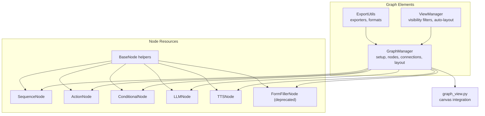
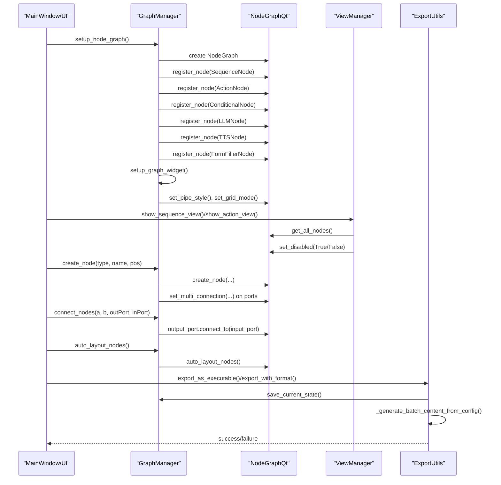
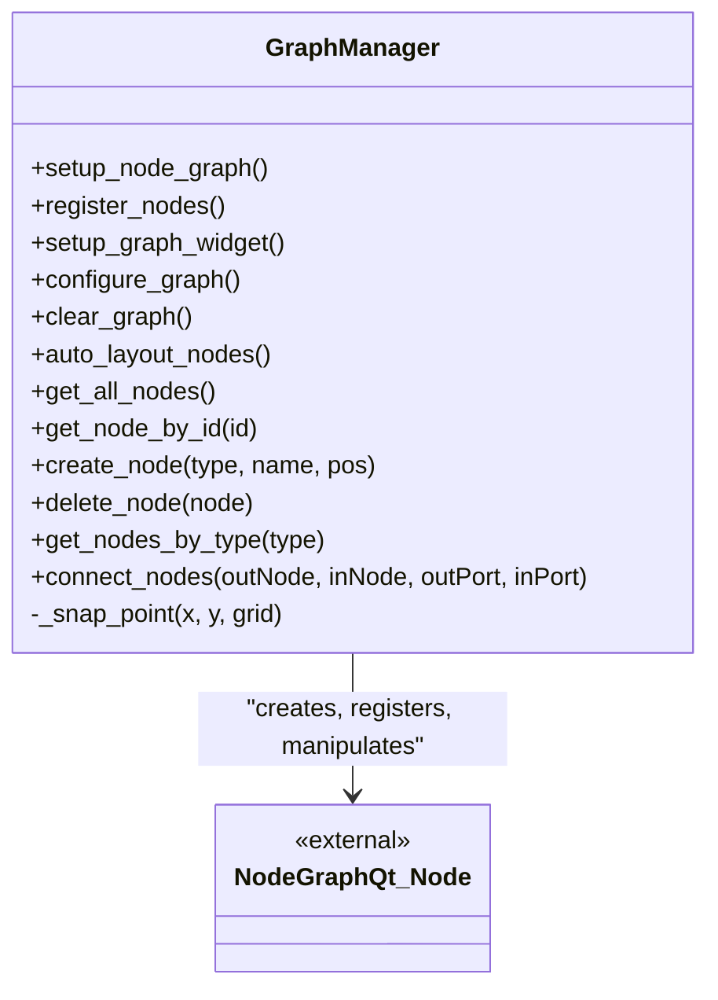
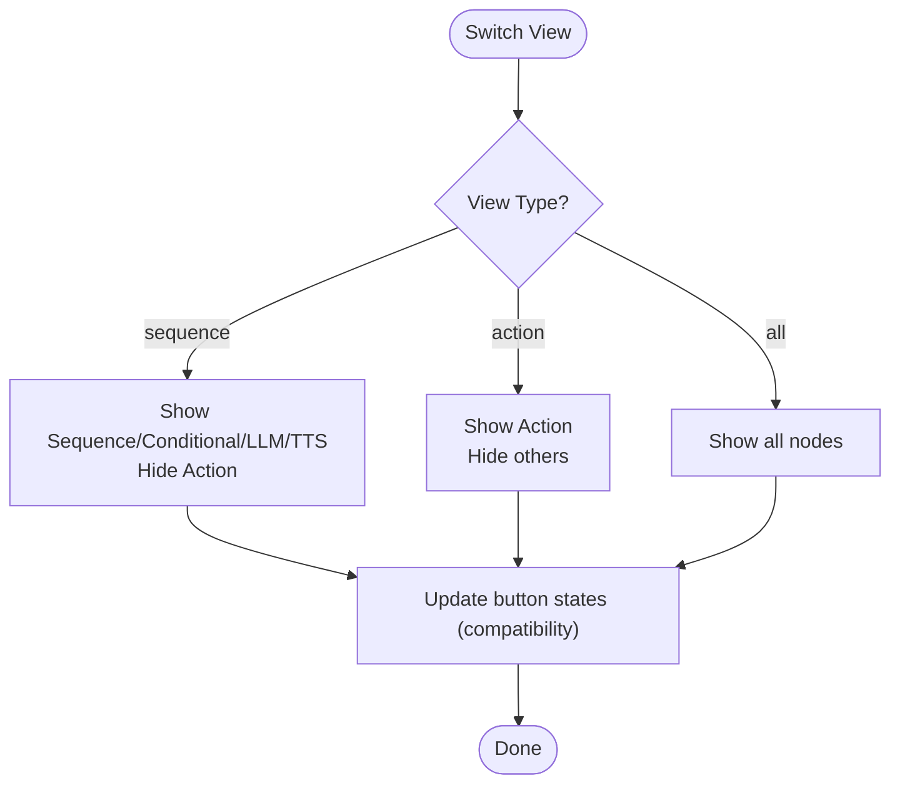
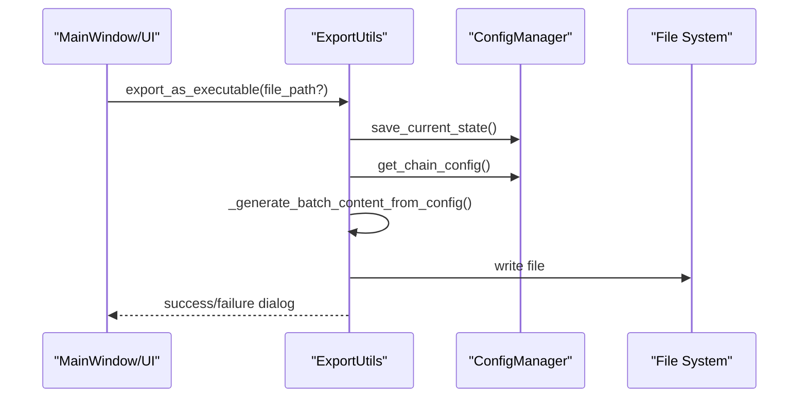
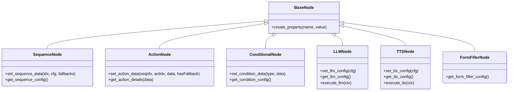
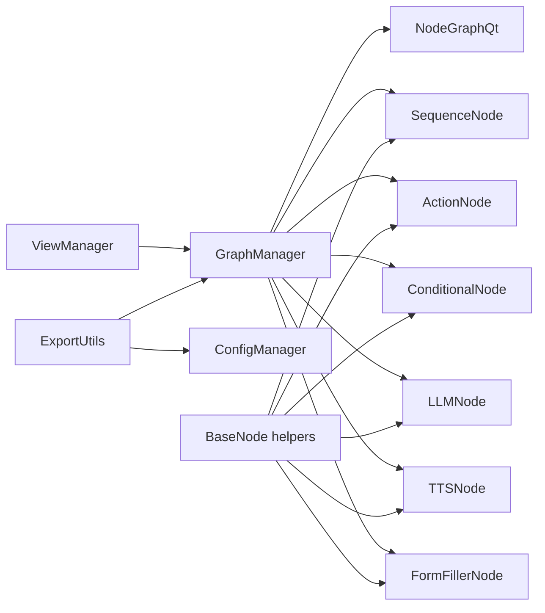

# Graph Management

<cite>
**Referenced Files in This Document**
- [graph_manager.py](file://LoOper/NGUI/graph_elements/graph_manager.py)
- [view_manager.py](file://LoOper/NGUI/graph_elements/view_manager.py)
- [export_utils.py](file://LoOper/NGUI/graph_elements/export_utils.py)
- [graph_view.py](file://LoOper/NGUI/graph_view.py)
- [base_node.py](file://LoOper/NGUI/nodes_resources/base_node.py)
- [sequence_node.py](file://LoOper/NGUI/nodes_resources/sequence_node.py)
- [action_node.py](file://LoOper/NGUI/nodes_resources/action_node.py)
- [conditional_node.py](file://LoOper/NGUI/nodes_resources/conditional_node.py)
- [llm_node.py](file://LoOper/NGUI/nodes_resources/llm_node.py)
- [tts_node.py](file://LoOper/NGUI/nodes_resources/tts_node.py)
- [form_filler_node.py](file://LoOper/NGUI/nodes_resources/form_filler_node.py)
</cite>

## Table of Contents
1. [Introduction](#introduction)
2. [Project Structure](#project-structure)
3. [Core Components](#core-components)
4. [Architecture Overview](#architecture-overview)
5. [Detailed Component Analysis](#detailed-component-analysis)
6. [Dependency Analysis](#dependency-analysis)
7. [Performance Considerations](#performance-considerations)
8. [Troubleshooting Guide](#troubleshooting-guide)
9. [Conclusion](#conclusion)
10. [Appendices](#appendices)

## Introduction
This document explains the graph management system for the LoOper NGUI module, focusing on NodeGraphQt integration, canvas operations, and workflow visualization. It covers:
- Graph view implementation and NodeGraphQt widget integration
- Zoom and pan behavior and viewport control
- Node positioning and snapping algorithms
- Graph manager responsibilities for node lifecycle, connections, and serialization
- View manager responsibilities for filtering and visibility
- Practical customization examples, visualization modes, and performance tips
- Export utilities for workflow sharing and persistence

## Project Structure
The graph management system is organized around three primary layers:
- Graph elements: GraphManager, ViewManager, ExportUtils
- Node resources: Custom NodeGraphQt nodes (Sequence, Action, Conditional, LLM, TTS, Form Filler)
- Graph view: The main UI canvas and integration with NodeGraphQt

**Diagram sources**
- [graph_manager.py:64-214](file://LoOper/NGUI/graph_elements/graph_manager.py#L64-L214)
- [view_manager.py:26-234](file://LoOper/NGUI/graph_elements/view_manager.py#L26-L234)
- [export_utils.py:32-370](file://LoOper/NGUI/graph_elements/export_utils.py#L32-L370)
- [graph_view.py](file://LoOper/NGUI/graph_view.py)
- [base_node.py:1-60](file://LoOper/NGUI/nodes_resources/base_node.py#L1-L60)
- [sequence_node.py:12-127](file://LoOper/NGUI/nodes_resources/sequence_node.py#L12-L127)
- [action_node.py:10-109](file://LoOper/NGUI/nodes_resources/action_node.py#L10-L109)
- [conditional_node.py:10-162](file://LoOper/NGUI/nodes_resources/conditional_node.py#L10-L162)
- [llm_node.py:11-390](file://LoOper/NGUI/nodes_resources/llm_node.py#L11-L390)
- [tts_node.py:9-150](file://LoOper/NGUI/nodes_resources/tts_node.py#L9-L150)
- [form_filler_node.py:8-57](file://LoOper/NGUI/nodes_resources/form_filler_node.py#L8-L57)

**Section sources**
- [graph_manager.py:64-214](file://LoOper/NGUI/graph_elements/graph_manager.py#L64-L214)
- [view_manager.py:26-234](file://LoOper/NGUI/graph_elements/view_manager.py#L26-L234)
- [export_utils.py:32-370](file://LoOper/NGUI/graph_elements/export_utils.py#L32-L370)
- [graph_view.py](file://LoOper/NGUI/graph_view.py)
- [base_node.py:1-60](file://LoOper/NGUI/nodes_resources/base_node.py#L1-L60)

## Core Components
- GraphManager: Initializes NodeGraphQt, registers custom nodes, sets up the widget, applies viewer preferences, clears sessions, auto-layouts nodes, retrieves nodes, creates/deletes nodes, connects nodes, and snaps positions.
- ViewManager: Switches between sequence/action/all views, filters nodes by type, refreshes current view, and auto-layouts only visible nodes while preserving visibility state.
- ExportUtils: Generates executable scripts (batch, Python) from current or provided chain configurations, integrates with the configuration manager, and reports progress/errors.

Key responsibilities:
- GraphManager orchestrates NodeGraphQt lifecycle and operations.
- ViewManager controls visibility and layout scope.
- ExportUtils persists workflows for external execution.

**Section sources**
- [graph_manager.py:51-445](file://LoOper/NGUI/graph_elements/graph_manager.py#L51-L445)
- [view_manager.py:26-295](file://LoOper/NGUI/graph_elements/view_manager.py#L26-L295)
- [export_utils.py:32-370](file://LoOper/NGUI/graph_elements/export_utils.py#L32-L370)

## Architecture Overview
The system integrates NodeGraphQt with custom nodes and UI controls. The GraphManager creates and configures the NodeGraph, registers nodes, and exposes APIs for node and connection manipulation. The ViewManager toggles visibility and triggers auto-layout on demand. ExportUtils reads the current configuration and emits runnable artifacts.

**Diagram sources**
- [graph_manager.py:64-214](file://LoOper/NGUI/graph_elements/graph_manager.py#L64-L214)
- [view_manager.py:39-135](file://LoOper/NGUI/graph_elements/view_manager.py#L39-L135)
- [export_utils.py:44-92](file://LoOper/NGUI/graph_elements/export_utils.py#L44-L92)

## Detailed Component Analysis

### GraphManager
Responsibilities:
- Initialize NodeGraphQt and register custom nodes
- Embed the NodeGraphQt widget into the UI container
- Configure viewer style (pipe layout, grid)
- Manage nodes: create, delete, query, connect
- Auto-layout and snapping utilities

Implementation highlights:
- Node registration includes SequenceNode, ActionNode, ConditionalNode, LLMNode, TTSNode, ChainImportNode, FormFillerNode, CodeNode.
- Widget replacement supports both QSplitter and standard layouts.
- Safe auto-layout and visibility restoration for partial-view layouts.
- Snapping grid-based positioning for consistent alignment.

**Diagram sources**
- [graph_manager.py:51-445](file://LoOper/NGUI/graph_elements/graph_manager.py#L51-L445)

**Section sources**
- [graph_manager.py:64-214](file://LoOper/NGUI/graph_elements/graph_manager.py#L64-L214)
- [graph_manager.py:277-334](file://LoOper/NGUI/graph_elements/graph_manager.py#L277-L334)
- [graph_manager.py:366-436](file://LoOper/NGUI/graph_elements/graph_manager.py#L366-L436)
- [graph_manager.py:438-445](file://LoOper/NGUI/graph_elements/graph_manager.py#L438-L445)

### ViewManager
Responsibilities:
- Switch between sequence, action, and all-node views
- Filter nodes by type and compute visibility
- Refresh current view and auto-layout only visible nodes
- Preserve original visibility during temporary layout operations

Behavior:
- Sequence view hides ActionNodes; Action view hides Sequence/Conditional/LLM nodes; All shows everything.
- Auto-layout for visible nodes temporarily hides non-visible nodes, runs layout, then restores visibility.

**Diagram sources**
- [view_manager.py:39-135](file://LoOper/NGUI/graph_elements/view_manager.py#L39-L135)

**Section sources**
- [view_manager.py:26-295](file://LoOper/NGUI/graph_elements/view_manager.py#L26-L295)
- [view_manager.py:253-295](file://LoOper/NGUI/graph_elements/view_manager.py#L253-L295)

### ExportUtils
Capabilities:
- Export current chain as Windows batch file or Python script
- Export arbitrary chain configuration to target formats
- Generate content from current configuration or provided chain config
- Integrate with configuration manager and main script path discovery

**Diagram sources**
- [export_utils.py:44-92](file://LoOper/NGUI/graph_elements/export_utils.py#L44-L92)
- [export_utils.py:115-240](file://LoOper/NGUI/graph_elements/export_utils.py#L115-L240)

**Section sources**
- [export_utils.py:32-370](file://LoOper/NGUI/graph_elements/export_utils.py#L32-L370)

### Node Resources and Positioning
Custom nodes define ports, properties, and visual styling. BaseNode helpers provide robust multi-input port creation and property fallbacks. Nodes expose getters/setters for runtime configuration.

**Diagram sources**
- [base_node.py:1-60](file://LoOper/NGUI/nodes_resources/base_node.py#L1-L60)
- [sequence_node.py:12-127](file://LoOper/NGUI/nodes_resources/sequence_node.py#L12-L127)
- [action_node.py:10-109](file://LoOper/NGUI/nodes_resources/action_node.py#L10-L109)
- [conditional_node.py:10-162](file://LoOper/NGUI/nodes_resources/conditional_node.py#L10-L162)
- [llm_node.py:11-390](file://LoOper/NGUI/nodes_resources/llm_node.py#L11-L390)
- [tts_node.py:9-150](file://LoOper/NGUI/nodes_resources/tts_node.py#L9-L150)
- [form_filler_node.py:8-57](file://LoOper/NGUI/nodes_resources/form_filler_node.py#L8-L57)

**Section sources**
- [base_node.py:1-60](file://LoOper/NGUI/nodes_resources/base_node.py#L1-L60)
- [sequence_node.py:71-127](file://LoOper/NGUI/nodes_resources/sequence_node.py#L71-L127)
- [action_node.py:59-109](file://LoOper/NGUI/nodes_resources/action_node.py#L59-L109)
- [conditional_node.py:101-162](file://LoOper/NGUI/nodes_resources/conditional_node.py#L101-L162)
- [llm_node.py:143-250](file://LoOper/NGUI/nodes_resources/llm_node.py#L143-L250)
- [tts_node.py:68-93](file://LoOper/NGUI/nodes_resources/tts_node.py#L68-L93)
- [form_filler_node.py:50-57](file://LoOper/NGUI/nodes_resources/form_filler_node.py#L50-L57)

## Dependency Analysis
- GraphManager depends on NodeGraphQt for graph operations and on custom node classes for registration.
- ViewManager depends on GraphManager for node queries and visibility toggles.
- ExportUtils depends on GraphManager’s parent widget for configuration access and on the configuration manager for chain serialization.
- Node resources depend on BaseNode helpers for port creation and property registration.

**Diagram sources**
- [graph_manager.py:93-116](file://LoOper/NGUI/graph_elements/graph_manager.py#L93-L116)
- [view_manager.py:40-135](file://LoOper/NGUI/graph_elements/view_manager.py#L40-L135)
- [export_utils.py:44-92](file://LoOper/NGUI/graph_elements/export_utils.py#L44-L92)
- [base_node.py:1-60](file://LoOper/NGUI/nodes_resources/base_node.py#L1-L60)

**Section sources**
- [graph_manager.py:93-116](file://LoOper/NGUI/graph_elements/graph_manager.py#L93-L116)
- [view_manager.py:40-135](file://LoOper/NGUI/graph_elements/view_manager.py#L40-L135)
- [export_utils.py:44-92](file://LoOper/NGUI/graph_elements/export_utils.py#L44-L92)

## Performance Considerations
- Multi-connection ports: Enabling multi-connections on inputs/outputs reduces visual clutter and improves scalability for complex workflows.
- Auto-layout scope: Use ViewManager’s visible-node auto-layout to reduce computation when working with large graphs.
- Snapping: Grid-based snapping keeps nodes aligned and improves readability; adjust grid size if needed.
- Rendering: Limit simultaneous visibility toggles and avoid frequent repeated auto-layout calls in loops.
- Export generation: Batch generation writes once to disk; cache chain configs when repeatedly exporting similar workflows.

[No sources needed since this section provides general guidance]

## Troubleshooting Guide
Common issues and resolutions:
- KeyError in node movement: A monkey patch prevents crashes when a node view exists without a corresponding model node. Review logs for warnings and ensure node creation/deletion is synchronized with the model.
- Node creation failures: Verify the node type is registered and the graph is initialized before creating nodes.
- Connection errors: Ensure output/input ports exist and are named correctly; the manager resolves default ports if unspecified.
- Visibility resets: When auto-layouting visible nodes, the system temporarily hides non-visible nodes and restores visibility afterward; ensure the current view is set appropriately.

**Section sources**
- [graph_manager.py:19-47](file://LoOper/NGUI/graph_elements/graph_manager.py#L19-L47)
- [graph_manager.py:277-334](file://LoOper/NGUI/graph_elements/graph_manager.py#L277-L334)
- [graph_manager.py:366-436](file://LoOper/NGUI/graph_elements/graph_manager.py#L366-L436)
- [view_manager.py:253-295](file://LoOper/NGUI/graph_elements/view_manager.py#L253-L295)

## Conclusion
The graph management system integrates NodeGraphQt with custom nodes and UI controls to support workflow visualization and execution. GraphManager handles initialization, node lifecycle, and connections; ViewManager manages visibility and scoped auto-layout; ExportUtils enables persistence and sharing via runnable scripts. Together, they provide a flexible foundation for building, refining, and exporting complex automation workflows.

[No sources needed since this section summarizes without analyzing specific files]

## Appendices

### Practical Examples

- Customizing graph appearance
  - Pipe style and grid mode are configured during graph setup. Adjust pipe layout and grid display to improve readability for dense graphs.
  - Node colors and fonts are set in each node class; modify colors/constants to align with branding or accessibility needs.

- Implementing new visualization modes
  - Extend ViewManager to add filters (e.g., “debug” mode) by adding a new method that toggles node visibility based on node properties or tags.
  - Use the existing pattern of temporarily hiding non-visible nodes during auto-layout to implement scoped layouts.

- Optimizing rendering performance for complex workflows
  - Prefer multi-connection ports to minimize visual overhead.
  - Use ViewManager’s visible-node auto-layout to reduce layout computation.
  - Avoid frequent repeated auto-layout calls; batch UI updates when adding/removing many nodes.

- Export utilities for workflow sharing
  - Export current chain as a batch file or Python script using ExportUtils.
  - For external tools, serialize the chain configuration and generate platform-appropriate scripts.

**Section sources**
- [graph_manager.py:198-214](file://LoOper/NGUI/graph_elements/graph_manager.py#L198-L214)
- [view_manager.py:137-164](file://LoOper/NGUI/graph_elements/view_manager.py#L137-L164)
- [export_utils.py:44-92](file://LoOper/NGUI/graph_elements/export_utils.py#L44-L92)