# Main Application

<cite>
**Referenced Files in This Document**
- [main.py](file://LoOper/main.py)
- [app.py](file://LoOper/NGUI/app.py)
- [i18n.py](file://LoOper/NGUI/i18n.py)
- [main_window.py](file://LoOper/NGUI/main_window.py)
- [constants.py](file://LoOper/NGUI/constants.py)
- [graph_view.py](file://LoOper/NGUI/graph_view.py)
- [base_dialog.py](file://LoOper/NGUI/dialogs/base_dialog.py)
- [scheduler_service.py](file://LoOper/NGUI/scheduler_service.py)
- [README.md](file://README.md)
</cite>

## Table of Contents
1. [Introduction](#introduction)
2. [Project Structure](#project-structure)
3. [Core Components](#core-components)
4. [Architecture Overview](#architecture-overview)
5. [Detailed Component Analysis](#detailed-component-analysis)
6. [Dependency Analysis](#dependency-analysis)
7. [Performance Considerations](#performance-considerations)
8. [Troubleshooting Guide](#troubleshooting-guide)
9. [Conclusion](#conclusion)
10. [Appendices](#appendices)

## Introduction
This document focuses on the main application component responsible for initializing the PyQt5-based desktop application, applying a dark theme, enabling internationalization, configuring DPI awareness and high-DPI scaling, and ensuring cross-platform compatibility. It explains the application startup sequence, language detection from OS settings, and error handling strategies. Practical examples are provided for theme customization, adding new UI languages, and extending the application lifecycle. Performance considerations for large-scale node graphs and memory management during extended editing sessions are also addressed.

## Project Structure
The main application entrypoint and core UI are organized under the NGUI package, with supporting modules for internationalization, theming, and scheduling. The high-level structure relevant to this document is:

- Entry point and lifecycle management: [main.py](file://LoOper/main.py)
- PyQt5 application initialization and theme: [app.py](file://LoOper/NGUI/app.py)
- Internationalization and language detection: [i18n.py](file://LoOper/NGUI/i18n.py)
- Main window and UI composition: [main_window.py](file://LoOper/NGUI/main_window.py)
- Theme constants and color palette: [constants.py](file://LoOper/NGUI/constants.py)
- Node graph view and large graph operations: [graph_view.py](file://LoOper/NGUI/graph_view.py)
- Dialog framework and styling: [base_dialog.py](file://LoOper/NGUI/dialogs/base_dialog.py)
- Background scheduler service: [scheduler_service.py](file://LoOper/NGUI/scheduler_service.py)
- Project overview and capabilities: [README.md](file://README.md)

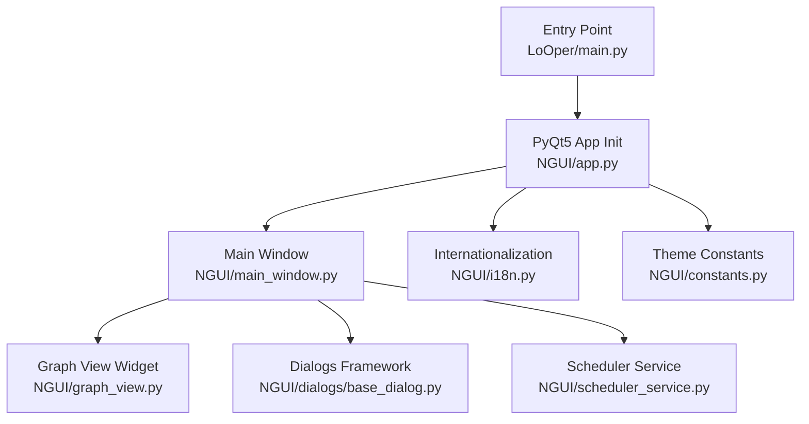

**Diagram sources**
- [main.py:1-419](file://LoOper/main.py#L1-L419)
- [app.py:1-153](file://LoOper/NGUI/app.py#L1-L153)
- [main_window.py:1-770](file://LoOper/NGUI/main_window.py#L1-L770)
- [graph_view.py:1-869](file://LoOper/NGUI/graph_view.py#L1-L869)
- [i18n.py:1-427](file://LoOper/NGUI/i18n.py#L1-L427)
- [constants.py:1-32](file://LoOper/NGUI/constants.py#L1-L32)
- [base_dialog.py:1-382](file://LoOper/NGUI/dialogs/base_dialog.py#L1-L382)
- [scheduler_service.py:1-315](file://LoOper/NGUI/scheduler_service.py#L1-L315)

**Section sources**
- [README.md:1-168](file://README.md#L1-L168)
- [main.py:1-419](file://LoOper/main.py#L1-L419)
- [app.py:1-153](file://LoOper/NGUI/app.py#L1-L153)

## Core Components
- Application entrypoint and lifecycle: orchestrates environment setup, optional API server startup, model preload, and GUI launch.
- PyQt5 application initialization: sets DPI awareness, high-DPI attributes, applies dark theme stylesheet, detects OS language, and creates the main window.
- Internationalization: supports English and Spanish, with a translation function and OS-based language detection.
- Dark theme system: centralizes color constants and applies stylesheets to windows, menus, scrollbars, dialogs, and graph components.
- Main window: composes the UI, initializes the node graph, manages menus, and handles long-running operations safely.
- Large graph operations: provides graph manipulation, validation, and export utilities suitable for extended editing sessions.
- Background scheduler: runs chains on schedules with persistence and subprocess execution.
- Dialog framework: provides modern, styled dialogs with help integration and consistent theming.

**Section sources**
- [main.py:355-381](file://LoOper/main.py#L355-L381)
- [app.py:11-149](file://LoOper/NGUI/app.py#L11-L149)
- [i18n.py:398-427](file://LoOper/NGUI/i18n.py#L398-L427)
- [constants.py:1-32](file://LoOper/NGUI/constants.py#L1-L32)
- [main_window.py:85-120](file://LoOper/NGUI/main_window.py#L85-L120)
- [graph_view.py:43-128](file://LoOper/NGUI/graph_view.py#L43-L128)
- [scheduler_service.py:12-110](file://LoOper/NGUI/scheduler_service.py#L12-L110)
- [base_dialog.py:58-382](file://LoOper/NGUI/dialogs/base_dialog.py#L58-L382)

## Architecture Overview
The application follows a layered architecture:
- Entry point layer: prepares environment, optional API server, and starts the GUI.
- UI layer: PyQt5 application with dark theme and internationalization.
- Domain layer: main window and graph view for workflow authoring.
- Services layer: scheduler service for background execution.
- Dialogs layer: themed dialogs for configuration and help.

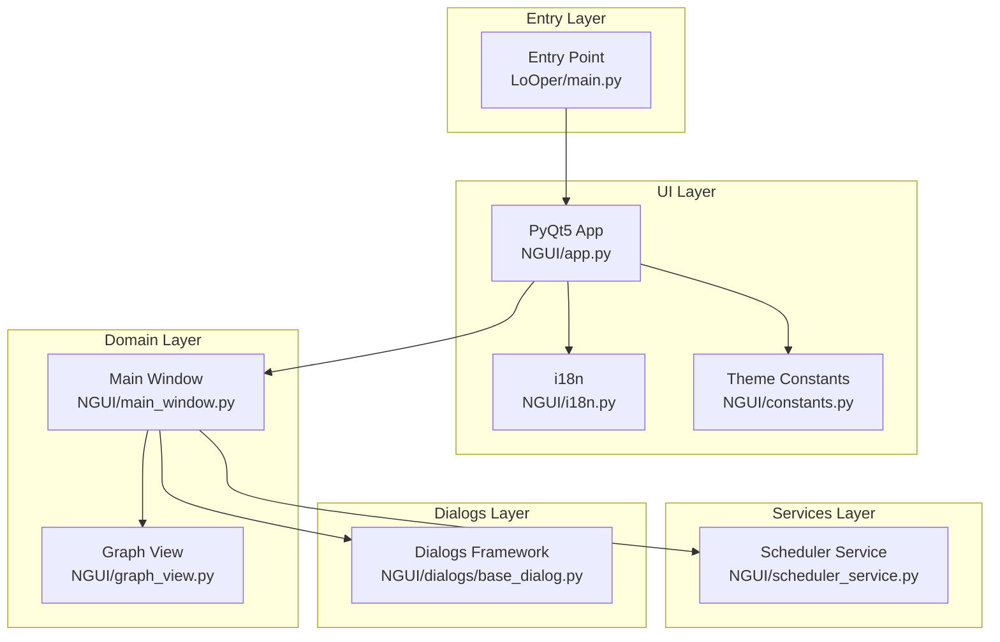

**Diagram sources**
- [main.py:355-381](file://LoOper/main.py#L355-L381)
- [app.py:11-149](file://LoOper/NGUI/app.py#L11-L149)
- [i18n.py:1-427](file://LoOper/NGUI/i18n.py#L1-427)
- [constants.py:1-32](file://LoOper/NGUI/constants.py#L1-L32)
- [main_window.py:85-120](file://LoOper/NGUI/main_window.py#L85-L120)
- [graph_view.py:43-128](file://LoOper/NGUI/graph_view.py#L43-L128)
- [scheduler_service.py:12-110](file://LoOper/NGUI/scheduler_service.py#L12-L110)
- [base_dialog.py:58-382](file://LoOper/NGUI/dialogs/base_dialog.py#L58-L382)

## Detailed Component Analysis

### Application Initialization and Lifecycle
- Environment preparation: ensures proper stdout/stderr encoding, disables conflicting runtime flags, and configures Windows DLL paths for Torch.
- Optional API server: checks readiness, starts in-process or external process, and registers cleanup hooks.
- GUI startup: loads AI configuration, optionally preloads models, and launches the PyQt5 application.
- Entry point behavior: supports interpreter mode for bundled scripts and frozen builds.

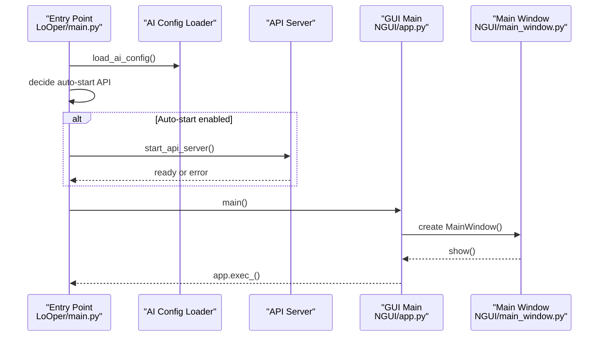

**Diagram sources**
- [main.py:355-381](file://LoOper/main.py#L355-L381)
- [main.py:138-169](file://LoOper/main.py#L138-L169)
- [main.py:171-353](file://LoOper/main.py#L171-L353)
- [app.py:11-149](file://LoOper/NGUI/app.py#L11-L149)
- [main_window.py:85-120](file://LoOper/NGUI/main_window.py#L85-L120)

**Section sources**
- [main.py:12-131](file://LoOper/main.py#L12-L131)
- [main.py:138-169](file://LoOper/main.py#L138-L169)
- [main.py:171-353](file://LoOper/main.py#L171-L353)
- [main.py:355-381](file://LoOper/main.py#L355-L381)

### DPI Awareness and High-DPI Scaling
- Environment variables enable high-DPI scaling and screen factor auto-scaling.
- Windows DPI awareness is set via shcore or user32 APIs.
- Qt attributes enable high-DPI scaling and high-DPI pixmaps.
- These settings ensure consistent rendering across displays with different pixel densities.

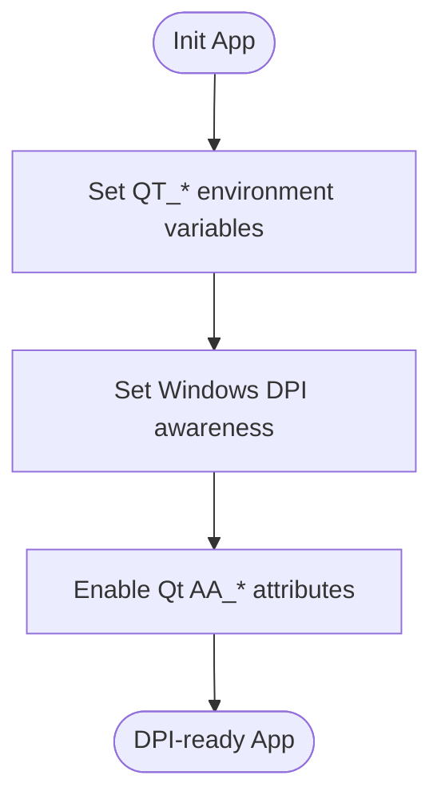

**Diagram sources**
- [app.py:14-38](file://LoOper/NGUI/app.py#L14-L38)

**Section sources**
- [app.py:14-38](file://LoOper/NGUI/app.py#L14-L38)

### Dark Theme Stylesheet System
- Centralized color constants define the palette used across the UI.
- Stylesheets are applied to:
  - Application-wide: main window, widgets, dialogs, and scrollbars.
  - Menus: menubar and menu items with hover/pressed states.
  - Dialogs: modern dialog container, title bar, scroll areas, and controls.
  - Graph view: widget backgrounds and scrollbars.
- Menu customization includes rounded corners, hover effects, and accent colors.

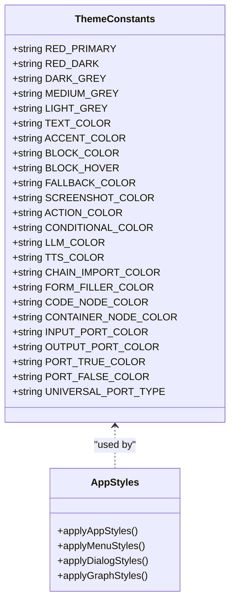

**Diagram sources**
- [constants.py:1-32](file://LoOper/NGUI/constants.py#L1-L32)
- [app.py:43-143](file://LoOper/NGUI/app.py#L43-L143)
- [base_dialog.py:106-335](file://LoOper/NGUI/dialogs/base_dialog.py#L106-L335)
- [graph_view.py:48-71](file://LoOper/NGUI/graph_view.py#L48-L71)
- [main_window.py:156-185](file://LoOper/NGUI/main_window.py#L156-L185)

**Section sources**
- [constants.py:1-32](file://LoOper/NGUI/constants.py#L1-L32)
- [app.py:43-143](file://LoOper/NGUI/app.py#L43-L143)
- [base_dialog.py:106-335](file://LoOper/NGUI/dialogs/base_dialog.py#L106-L335)
- [graph_view.py:48-71](file://LoOper/NGUI/graph_view.py#L48-L71)
- [main_window.py:156-185](file://LoOper/NGUI/main_window.py#L156-L185)

### Internationalization and Language Detection
- Supported languages: English (default) and Spanish.
- Translation function: returns translated text if available, otherwise original English text.
- OS-based detection: extracts language from locale and falls back to English if unsupported.
- UI strings are wrapped with the translation function for dynamic localization.

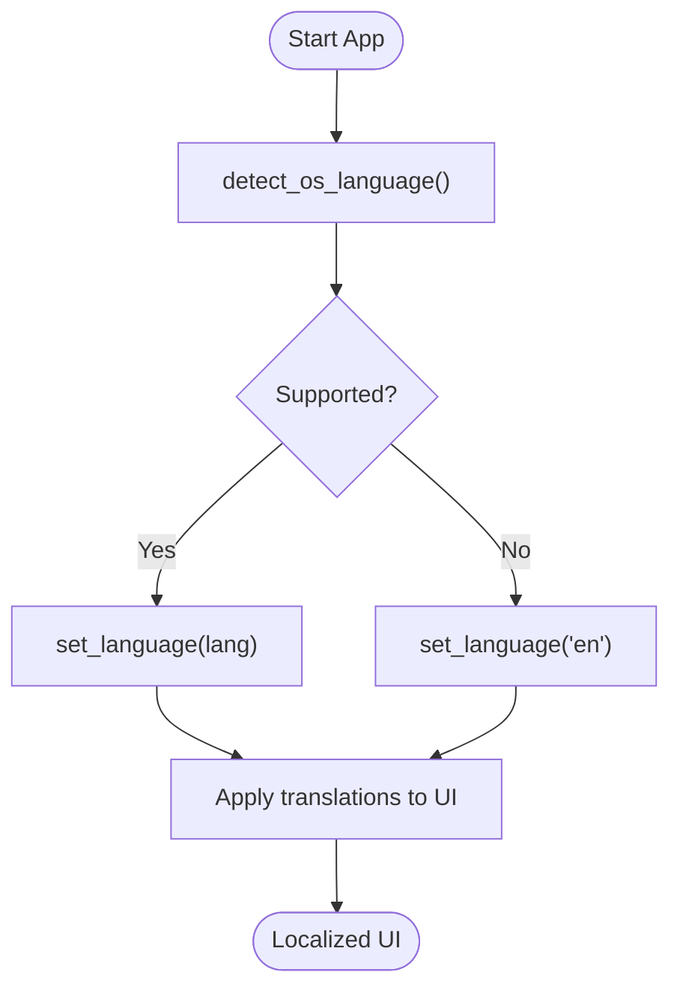

**Diagram sources**
- [i18n.py:398-427](file://LoOper/NGUI/i18n.py#L398-L427)

**Section sources**
- [i18n.py:3-427](file://LoOper/NGUI/i18n.py#L3-L427)
- [app.py:39-40](file://LoOper/NGUI/app.py#L39-L40)

### Main Window and Startup Sequence
- Initializes logging, sets window title and icon, and composes the UI.
- Creates the graph view widget and menu bar with localized labels.
- Starts the scheduler service and handles close events to stop background tasks.
- Provides actions for recording, running, saving/loading chains, and managing schedules.

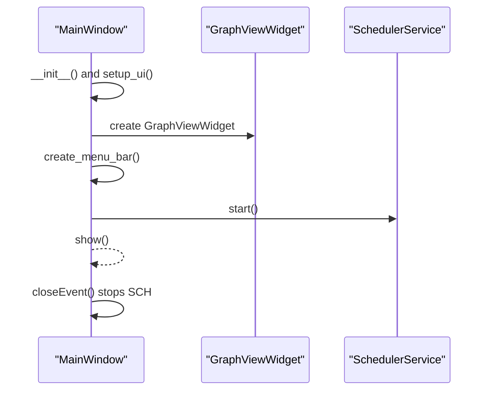

**Diagram sources**
- [main_window.py:85-120](file://LoOper/NGUI/main_window.py#L85-L120)
- [main_window.py:121-149](file://LoOper/NGUI/main_window.py#L121-L149)
- [main_window.py:151-257](file://LoOper/NGUI/main_window.py#L151-L257)
- [main_window.py:762-770](file://LoOper/NGUI/main_window.py#L762-L770)

**Section sources**
- [main_window.py:85-120](file://LoOper/NGUI/main_window.py#L85-L120)
- [main_window.py:121-149](file://LoOper/NGUI/main_window.py#L121-L149)
- [main_window.py:151-257](file://LoOper/NGUI/main_window.py#L151-L257)
- [main_window.py:762-770](file://LoOper/NGUI/main_window.py#L762-L770)

### Graph Operations and Large-Scale Editing
- Modular components handle UI, graph management, node operations, view management, configuration, export, transforms, and context menus.
- Provides operations for adding/removing nodes, copying/pasting, auto-layout, validation, and exporting.
- Includes safeguards for initialization readiness and error handling during operations.

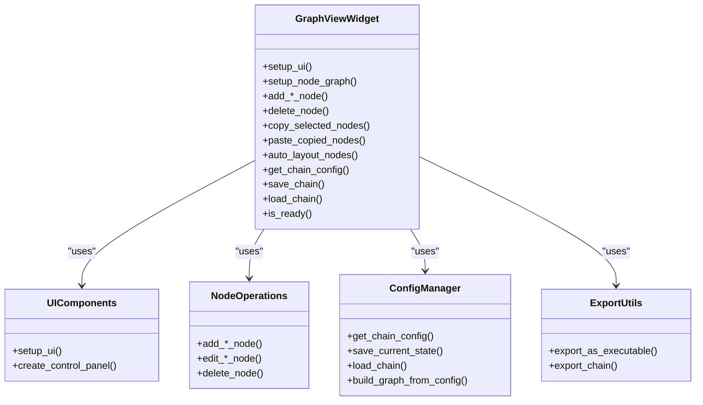

**Diagram sources**
- [graph_view.py:43-128](file://LoOper/NGUI/graph_view.py#L43-L128)
- [graph_view.py:548-622](file://LoOper/NGUI/graph_view.py#L548-L622)
- [graph_view.py:624-642](file://LoOper/NGUI/graph_view.py#L624-L642)
- [graph_view.py:644-721](file://LoOper/NGUI/graph_view.py#L644-L721)
- [graph_view.py:722-735](file://LoOper/NGUI/graph_view.py#L722-L735)
- [graph_view.py:756-781](file://LoOper/NGUI/graph_view.py#L756-L781)
- [graph_view.py:782-799](file://LoOper/NGUI/graph_view.py#L782-L799)

**Section sources**
- [graph_view.py:43-128](file://LoOper/NGUI/graph_view.py#L43-L128)
- [graph_view.py:548-622](file://LoOper/NGUI/graph_view.py#L548-L622)
- [graph_view.py:624-642](file://LoOper/NGUI/graph_view.py#L624-L642)
- [graph_view.py:644-721](file://LoOper/NGUI/graph_view.py#L644-L721)
- [graph_view.py:722-735](file://LoOper/NGUI/graph_view.py#L722-L735)
- [graph_view.py:756-781](file://LoOper/NGUI/graph_view.py#L756-L781)
- [graph_view.py:782-799](file://LoOper/NGUI/graph_view.py#L782-L799)

### Dialog Framework and Theming
- ModernDialog provides a frameless, shadowed dialog with draggable title bar, help integration, and consistent styling.
- Styled controls include scroll areas, tabs, buttons, and input fields using theme constants.
- UserGuideDialog integrates with the project’s documentation for contextual help.

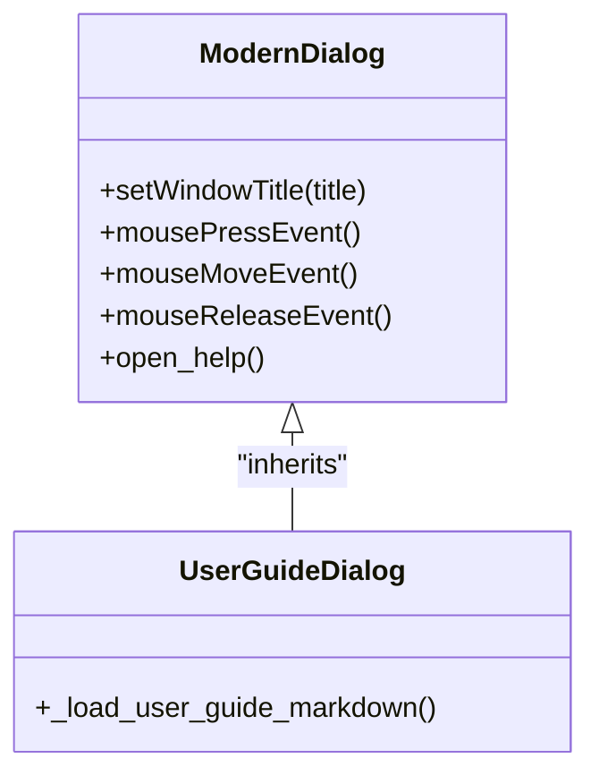

**Diagram sources**
- [base_dialog.py:88-382](file://LoOper/NGUI/dialogs/base_dialog.py#L88-L382)

**Section sources**
- [base_dialog.py:58-382](file://LoOper/NGUI/dialogs/base_dialog.py#L58-L382)

### Background Scheduler Service
- Manages schedules persisted to a JSON file, computes next run times, and launches chain executions as subprocesses.
- Supports once, daily, weekly, and interval schedules with concurrency safeguards.
- Thread-safe operations with locking and graceful shutdown.

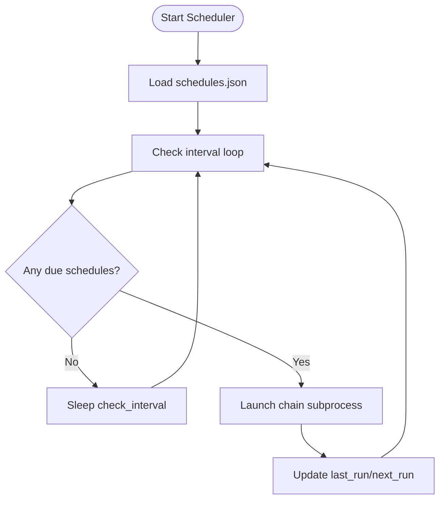

**Diagram sources**
- [scheduler_service.py:112-182](file://LoOper/NGUI/scheduler_service.py#L112-L182)
- [scheduler_service.py:184-210](file://LoOper/NGUI/scheduler_service.py#L184-L210)
- [scheduler_service.py:211-266](file://LoOper/NGUI/scheduler_service.py#L211-L266)

**Section sources**
- [scheduler_service.py:12-110](file://LoOper/NGUI/scheduler_service.py#L12-L110)
- [scheduler_service.py:112-182](file://LoOper/NGUI/scheduler_service.py#L112-L182)
- [scheduler_service.py:184-210](file://LoOper/NGUI/scheduler_service.py#L184-L210)
- [scheduler_service.py:211-266](file://LoOper/NGUI/scheduler_service.py#L211-L266)

## Dependency Analysis
- Entry point depends on NGUI app initialization and AI configuration/model loading.
- NGUI app depends on constants for theming and i18n for language detection.
- Main window depends on graph view, dialogs, and scheduler service.
- Graph view composes modular managers for UI, graph, nodes, view, config, export, transforms, and context menus.
- Dialogs depend on theme constants and i18n for localized content.
- Scheduler service depends on filesystem for persistence and subprocess for chain execution.

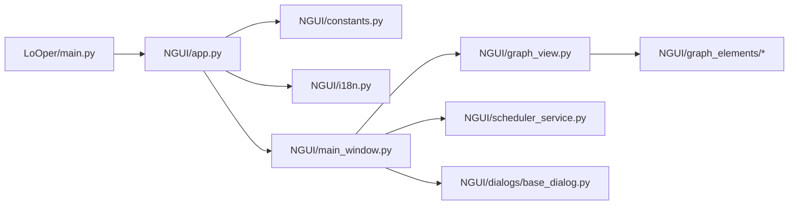

**Diagram sources**
- [main.py:133-135](file://LoOper/main.py#L133-L135)
- [app.py:8-9](file://LoOper/NGUI/app.py#L8-L9)
- [main_window.py:52-63](file://LoOper/NGUI/main_window.py#L52-L63)
- [graph_view.py:11-22](file://LoOper/NGUI/graph_view.py#L11-L22)

**Section sources**
- [main.py:133-135](file://LoOper/main.py#L133-L135)
- [app.py:8-9](file://LoOper/NGUI/app.py#L8-L9)
- [main_window.py:52-63](file://LoOper/NGUI/main_window.py#L52-L63)
- [graph_view.py:11-22](file://LoOper/NGUI/graph_view.py#L11-L22)

## Performance Considerations
- Large-scale node graphs:
  - Use auto-layout sparingly; prefer incremental updates and selective re-layouts.
  - Avoid frequent deep copies of chain configurations; cache and invalidate as needed.
  - Limit real-time validation during heavy operations; defer to background threads.
- Memory management during extended editing sessions:
  - Periodically clear caches (e.g., JSON cache) before long operations to reduce memory pressure.
  - Ensure temporary files are cleaned up after playback/execution attempts.
  - Use thread-safe operations and avoid blocking the UI thread for extended periods.
- High-DPI and rendering:
  - Keep stylesheets minimal and centralized to reduce repaint overhead.
  - Prefer rounded corners and subtle shadows judiciously to balance aesthetics and performance.

[No sources needed since this section provides general guidance]

## Troubleshooting Guide
- API server startup failures:
  - Verify environment variables and ports; check logs for initialization errors.
  - Confirm API readiness and refresh model cache after startup.
- Recording/playback interruptions:
  - Ensure ESC key monitoring is active; restore window state after exceptions.
  - Clear caches before retrying operations.
- Graph readiness issues:
  - Check initialization flags and view/graph availability before loading/saving.
  - Use readiness checks before performing operations.
- Scheduler errors:
  - Inspect schedule persistence and next-run computation; ensure subprocess launch succeeds.

**Section sources**
- [main.py:138-169](file://LoOper/main.py#L138-L169)
- [main_window.py:408-452](file://LoOper/NGUI/main_window.py#L408-L452)
- [main_window.py:487-637](file://LoOper/NGUI/main_window.py#L487-L637)
- [main_window.py:575-597](file://LoOper/NGUI/main_window.py#L575-L597)
- [scheduler_service.py:184-210](file://LoOper/NGUI/scheduler_service.py#L184-L210)

## Conclusion
The main application component integrates PyQt5 initialization, DPI awareness, a cohesive dark theme, and internationalization to deliver a robust, cross-platform desktop automation environment. The modular architecture supports scalable node graph editing, background scheduling, and consistent theming across dialogs and menus. By following the outlined practices for performance and troubleshooting, developers can extend the application lifecycle effectively while maintaining stability and responsiveness during extended editing sessions.

[No sources needed since this section summarizes without analyzing specific files]

## Appendices

### Practical Examples

- Theme customization
  - Modify color constants in [constants.py:1-32](file://LoOper/NGUI/constants.py#L1-L32) to adjust the palette.
  - Update stylesheets in [app.py:43-143](file://LoOper/NGUI/app.py#L43-L143), [main_window.py:156-185](file://LoOper/NGUI/main_window.py#L156-L185), and [base_dialog.py:106-335](file://LoOper/NGUI/dialogs/base_dialog.py#L106-L335) to reflect new colors.

- Adding a new UI language
  - Extend supported languages in [i18n.py](file://LoOper/NGUI/i18n.py#L3) and add translations keyed by English text in [i18n.py:7-396](file://LoOper/NGUI/i18n.py#L7-L396).
  - Ensure OS language detection falls back to English if needed in [i18n.py:398-427](file://LoOper/NGUI/i18n.py#L398-L427).

- Extending the application lifecycle
  - Add pre/post hooks around GUI startup in [main.py:355-381](file://LoOper/main.py#L355-L381).
  - Integrate new services similarly to the scheduler in [scheduler_service.py:12-110](file://LoOper/NGUI/scheduler_service.py#L12-L110).

[No sources needed since this section provides general guidance]