# Node Graph Editor

<cite>
**Referenced Files in This Document**
- [graph_view.py](file://LoOper/NGUI/graph_view.py)
- [graph_manager.py](file://LoOper/NGUI/graph_elements/graph_manager.py)
- [node_operations.py](file://LoOper/NGUI/graph_elements/node_operations.py)
- [node_operations_modules/__init__.py](file://LoOper/NGUI/graph_elements/node_operations_modules/__init__.py)
- [base.py](file://LoOper/NGUI/graph_elements/node_operations_modules/base.py)
- [node_context_menu.py](file://LoOper/NGUI/node_context_menu.py)
- [clipboard_manager.py](file://LoOper/NGUI/graph_elements/clipboard_manager.py)
- [dnd_manager.py](file://LoOper/NGUI/graph_elements/dnd_manager.py)
- [export_utils.py](file://LoOper/NGUI/graph_elements/export_utils.py)
- [view_manager.py](file://LoOper/NGUI/graph_elements/view_manager.py)
- [node_transforms.py](file://LoOper/NGUI/graph_elements/node_transforms.py)
- [ui_components.py](file://LoOper/NGUI/graph_elements/ui_components.py)
- [nodes_resources/base_node.py](file://LoOper/NGUI/nodes_resources/base_node.py)
- [nodes_resources/action_node.py](file://LoOper/NGUI/nodes_resources/action_node.py)
- [nodes_resources/conditional_node.py](file://LoOper/NGUI/nodes_resources/conditional_node.py)
- [nodes_resources/llm_node.py](file://LoOper/NGUI/nodes_resources/llm_node.py)
- [nodes_resources/tts_node.py](file://LoOper/NGUI/nodes_resources/tts_node.py)
- [nodes_resources/code_node.py](file://LoOper/NGUI/nodes_resources/code_node.py)
- [nodes_resources/container_node.py](file://LoOper/NGUI/nodes_resources/container_node.py)
- [nodes_resources/chain_import_node.py](file://LoOper/NGUI/nodes_resources/chain_import_node.py)
- [nodes_resources/form_filler_node.py](file://LoOper/NGUI/nodes_resources/form_filler_node.py)
- [nodes.py](file://LoOper/NGUI/nodes.py)
- [main_window.py](file://LoOper/NGUI/main_window.py)
- [app.py](file://LoOper/NGUI/app.py)
</cite>

## Table of Contents
1. [Introduction](#introduction)
2. [Project Structure](#project-structure)
3. [Core Components](#core-components)
4. [Architecture Overview](#architecture-overview)
5. [Detailed Component Analysis](#detailed-component-analysis)
6. [Dependency Analysis](#dependency-analysis)
7. [Performance Considerations](#performance-considerations)
8. [Troubleshooting Guide](#troubleshooting-guide)
9. [Conclusion](#conclusion)
10. [Appendices](#appendices)

## Introduction
This document describes the node graph editor built with PyQt5 and NodeGraphQt. It focuses on the visual workflow builder, dark theme integration, transformable node types, context menu editing, drag-and-drop creation, node-based programming paradigms, UI component architecture, graph view management, clipboard operations, and export utilities. Practical examples illustrate node creation, connection management, and workflow composition, along with guidance for extending the editor with custom node types and maintaining visual consistency.

## Project Structure
The node graph editor resides under the NGUI package and integrates tightly with NodeGraphQt. The primary entry point is the GraphViewWidget, which orchestrates UI components, graph management, node operations, view management, configuration, transforms, clipboard, drag-and-drop, and export utilities. Node resources define the visual and behavioral types used in the graph.

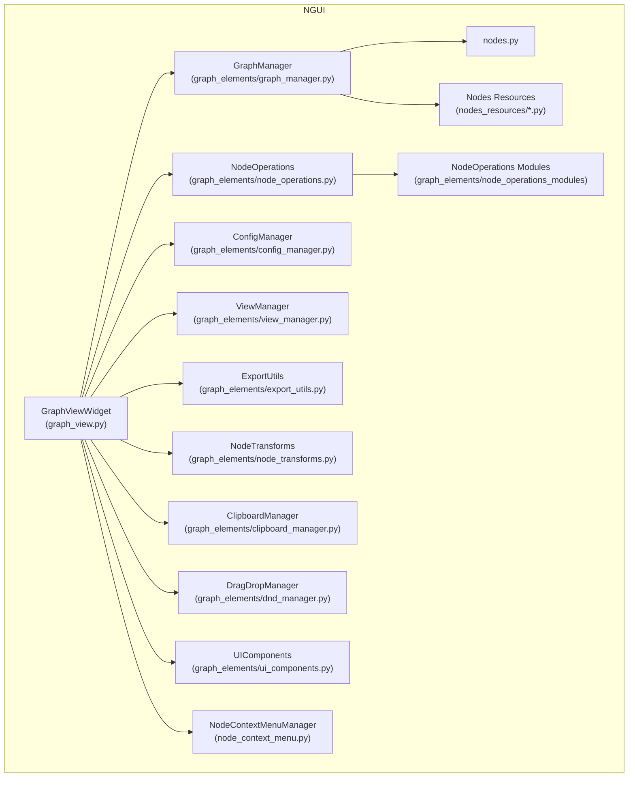

**Diagram sources**
- [graph_view.py:43-128](file://LoOper/NGUI/graph_view.py#L43-L128)
- [graph_manager.py:51-92](file://LoOper/NGUI/graph_elements/graph_manager.py#L51-L92)
- [node_operations.py:1-2](file://LoOper/NGUI/graph_elements/node_operations.py#L1-L2)
- [node_operations_modules/__init__.py:1-27](file://LoOper/NGUI/graph_elements/node_operations_modules/__init__.py#L1-L27)
- [nodes.py](file://LoOper/NGUI/nodes.py)

**Section sources**
- [graph_view.py:43-128](file://LoOper/NGUI/graph_view.py#L43-L128)
- [graph_manager.py:51-92](file://LoOper/NGUI/graph_elements/graph_manager.py#L51-L92)
- [node_operations_modules/__init__.py:13-27](file://LoOper/NGUI/graph_elements/node_operations_modules/__init__.py#L13-L27)

## Core Components
- GraphViewWidget: Central widget hosting the NodeGraphQt view, wiring UI, clipboard, drag-and-drop, context menus, and exposing convenience APIs for node creation, editing, and graph manipulation.
- GraphManager: Initializes NodeGraphQt, registers custom node types, sets up the graph widget in the UI, configures pipes/grid, and manages node creation/deletion and auto-layout.
- NodeOperations: Orchestrates node-specific operations (add/edit/delete) by composing mixins for each node type.
- NodeOperations Modules: Mixins encapsulate operations per node category (sequence, action, conditional, LLM, TTS, chain import, form filler, code, container, node management).
- ViewManager: Switches between sequence and action views and manages view state.
- ConfigManager: Loads/saves chain configurations and builds graphs from config.
- ExportUtils: Validates conditional nodes and exports chains to executable/batch formats.
- NodeTransforms: Applies transformations to nodes (e.g., scaling/rotation) and snapping.
- ClipboardManager: Copies and pastes nodes with property whitelisting.
- DragDropManager: Handles drag-and-drop creation of nodes from the toolbar.
- UIComponents: Sets up UI scaffolding and toolbars.
- NodeContextMenuManager: Presents context-sensitive menus for graph and node operations.

**Section sources**
- [graph_view.py:43-128](file://LoOper/NGUI/graph_view.py#L43-L128)
- [graph_manager.py:51-92](file://LoOper/NGUI/graph_elements/graph_manager.py#L51-L92)
- [node_operations_modules/__init__.py:13-27](file://LoOper/NGUI/graph_elements/node_operations_modules/__init__.py#L13-L27)
- [view_manager.py](file://LoOper/NGUI/graph_elements/view_manager.py)
- [export_utils.py](file://LoOper/NGUI/graph_elements/export_utils.py)
- [node_transforms.py](file://LoOper/NGUI/graph_elements/node_transforms.py)
- [clipboard_manager.py](file://LoOper/NGUI/graph_elements/clipboard_manager.py)
- [dnd_manager.py](file://LoOper/NGUI/graph_elements/dnd_manager.py)
- [ui_components.py](file://LoOper/NGUI/graph_elements/ui_components.py)
- [node_context_menu.py](file://LoOper/NGUI/node_context_menu.py)

## Architecture Overview
The editor follows a modular architecture:
- GraphViewWidget acts as the facade, delegating to specialized managers.
- NodeGraphQt provides the rendering and interaction layer; GraphManager wires it to the UI and registers custom node types.
- NodeOperations composes mixins to handle node-specific logic.
- Utilities (Clipboard, Drag-and-Drop, Export, Transforms, View) encapsulate cross-cutting concerns.

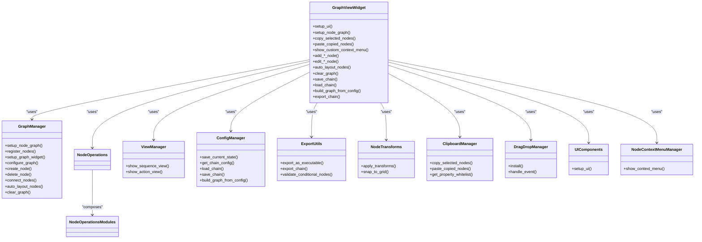

**Diagram sources**
- [graph_view.py:43-128](file://LoOper/NGUI/graph_view.py#L43-L128)
- [graph_manager.py:51-92](file://LoOper/NGUI/graph_elements/graph_manager.py#L51-L92)
- [node_operations_modules/__init__.py:13-27](file://LoOper/NGUI/graph_elements/node_operations_modules/__init__.py#L13-L27)

## Detailed Component Analysis

### GraphViewWidget: Facade and Orchestration
- Initialization: Creates and wires UIComponents, GraphManager, NodeOperations, ViewManager, ConfigManager, ExportUtils, NodeTransforms, NodeContextMenuManager, DragDropManager, and ClipboardManager.
- UI and Graph Setup: Delegates to GraphManager to initialize NodeGraphQt, register nodes, embed the graph widget into the UI, and configure pipe/grid modes.
- Keyboard Shortcuts: Implements copy/paste/delete shortcuts and delegates focus to the graph view.
- Node Creation: Provides typed methods to add nodes (sequence, action, conditional, LLM, TTS, chain import, code) with automatic snapping and optional button bar attachment.
- Editing: Exposes edit_*_node methods for each node type.
- Clipboard: Delegates copy/paste to ClipboardManager.
- Context Menu: Captures scene positions and invokes NodeContextMenuManager.
- Drag-and-Drop: Installs DragDropManager to enable toolbar-to-graph node creation.
- Graph Operations: Auto-layout, clear, save/load/build, and export.

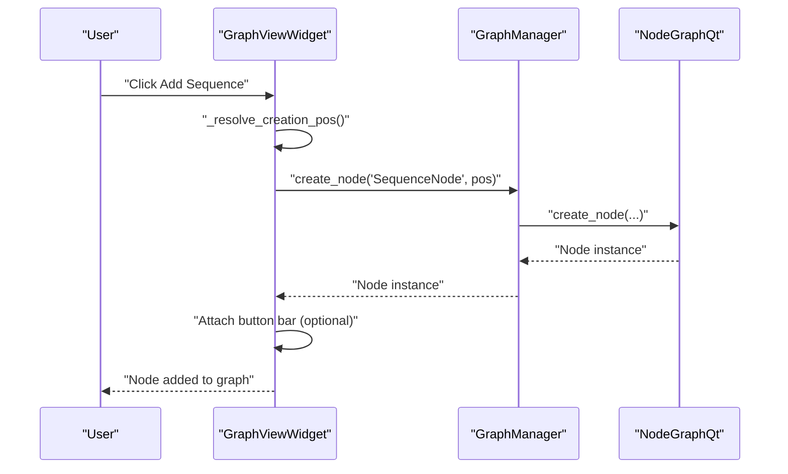

**Diagram sources**
- [graph_view.py:441-493](file://LoOper/NGUI/graph_view.py#L441-L493)
- [graph_manager.py:277-334](file://LoOper/NGUI/graph_elements/graph_manager.py#L277-L334)

**Section sources**
- [graph_view.py:43-128](file://LoOper/NGUI/graph_view.py#L43-L128)
- [graph_view.py:164-186](file://LoOper/NGUI/graph_view.py#L164-L186)
- [graph_view.py:192-217](file://LoOper/NGUI/graph_view.py#L192-L217)
- [graph_view.py:276-280](file://LoOper/NGUI/graph_view.py#L276-L280)
- [graph_view.py:282-306](file://LoOper/NGUI/graph_view.py#L282-L306)
- [graph_view.py:320-423](file://LoOper/NGUI/graph_view.py#L320-L423)

### GraphManager: NodeGraphQt Integration
- Registers custom node types with NodeGraphQt.
- Embeds the NodeGraphQt widget into the parent’s layout or splitter.
- Configures pipe style and grid mode.
- Provides helpers to create, connect, delete, auto-layout, and clear nodes.

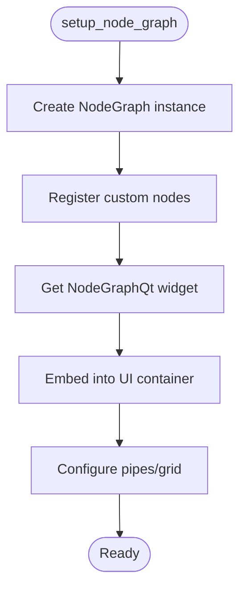

**Diagram sources**
- [graph_manager.py:64-92](file://LoOper/NGUI/graph_elements/graph_manager.py#L64-L92)
- [graph_manager.py:121-197](file://LoOper/NGUI/graph_elements/graph_manager.py#L121-L197)
- [graph_manager.py:198-214](file://LoOper/NGUI/graph_elements/graph_manager.py#L198-L214)

**Section sources**
- [graph_manager.py:51-92](file://LoOper/NGUI/graph_elements/graph_manager.py#L51-L92)
- [graph_manager.py:93-119](file://LoOper/NGUI/graph_elements/graph_manager.py#L93-L119)
- [graph_manager.py:121-197](file://LoOper/NGUI/graph_elements/graph_manager.py#L121-L197)
- [graph_manager.py:198-214](file://LoOper/NGUI/graph_elements/graph_manager.py#L198-L214)

### NodeOperations and Modules: Node-Based Programming
- Composition via mixins enables a clean separation of concerns per node type while sharing a unified API surface.
- BaseNodeOperations provides shared logging and parent binding.
- Mixins implement add/edit/delete/connect behaviors specific to each node category.

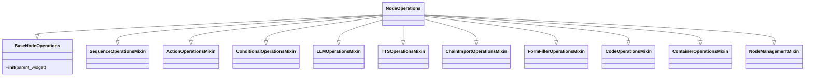

**Diagram sources**
- [node_operations_modules/__init__.py:13-27](file://LoOper/NGUI/graph_elements/node_operations_modules/__init__.py#L13-L27)
- [base.py:5-13](file://LoOper/NGUI/graph_elements/node_operations_modules/base.py#L5-L13)

**Section sources**
- [node_operations_modules/__init__.py:1-27](file://LoOper/NGUI/graph_elements/node_operations_modules/__init__.py#L1-L27)
- [base.py:5-13](file://LoOper/NGUI/graph_elements/node_operations_modules/base.py#L5-L13)

### Context Menu Editing
- GraphViewWidget captures the last context menu scene position and delegates to NodeContextMenuManager to show a context menu appropriate for the selected node or graph area.
- Editing methods (e.g., edit_llm, edit_code, edit_sequence) route to NodeOperations for dialog orchestration.

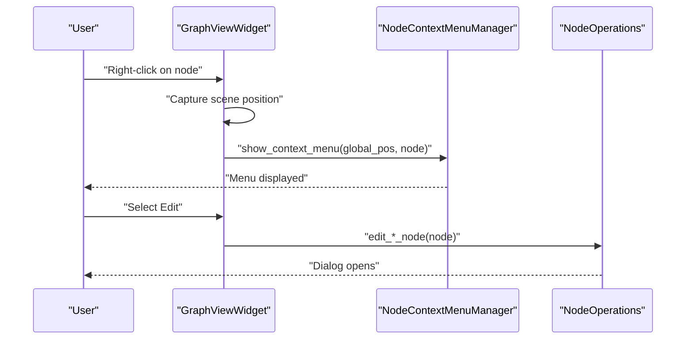

**Diagram sources**
- [graph_view.py:282-306](file://LoOper/NGUI/graph_view.py#L282-L306)
- [node_context_menu.py](file://LoOper/NGUI/node_context_menu.py)

**Section sources**
- [graph_view.py:282-306](file://LoOper/NGUI/graph_view.py#L282-L306)

### Drag-and-Drop Node Creation
- DragDropManager installs an event filter on the graph widget to intercept drag-and-drop events originating from the toolbar.
- On drop, GraphViewWidget resolves a creation position and delegates to NodeOperations to create the node.

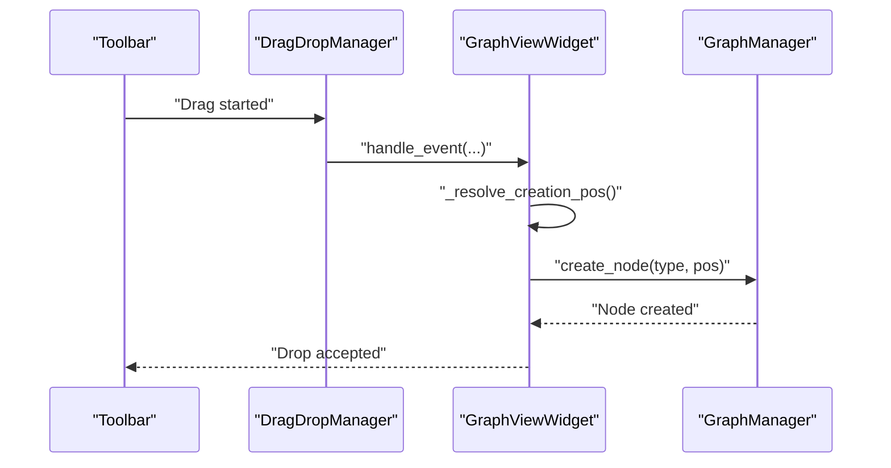

**Diagram sources**
- [graph_view.py:240-271](file://LoOper/NGUI/graph_view.py#L240-L271)
- [dnd_manager.py](file://LoOper/NGUI/graph_elements/dnd_manager.py)
- [graph_manager.py:277-334](file://LoOper/NGUI/graph_elements/graph_manager.py#L277-L334)

**Section sources**
- [graph_view.py:240-271](file://LoOper/NGUI/graph_view.py#L240-L271)
- [dnd_manager.py](file://LoOper/NGUI/graph_elements/dnd_manager.py)

### Clipboard Operations
- Copy: GraphViewWidget delegates to ClipboardManager to copy selected nodes.
- Paste: ClipboardManager pastes nodes at the mouse cursor or last context scene position, with property whitelisting per node type.

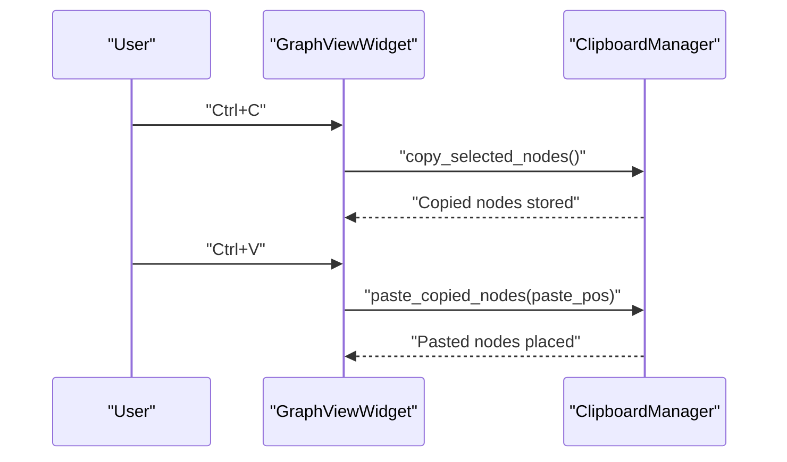

**Diagram sources**
- [graph_view.py:192-217](file://LoOper/NGUI/graph_view.py#L192-L217)
- [graph_view.py:276-280](file://LoOper/NGUI/graph_view.py#L276-L280)
- [clipboard_manager.py](file://LoOper/NGUI/graph_elements/clipboard_manager.py)

**Section sources**
- [graph_view.py:192-217](file://LoOper/NGUI/graph_view.py#L192-L217)
- [graph_view.py:276-280](file://LoOper/NGUI/graph_view.py#L276-L280)
- [clipboard_manager.py](file://LoOper/NGUI/graph_elements/clipboard_manager.py)

### Transformable Node Types and Snapping
- NodeTransforms applies transformations and snapping to grid positions.
- GraphManager and GraphViewWidget coordinate snapping during creation and movement.

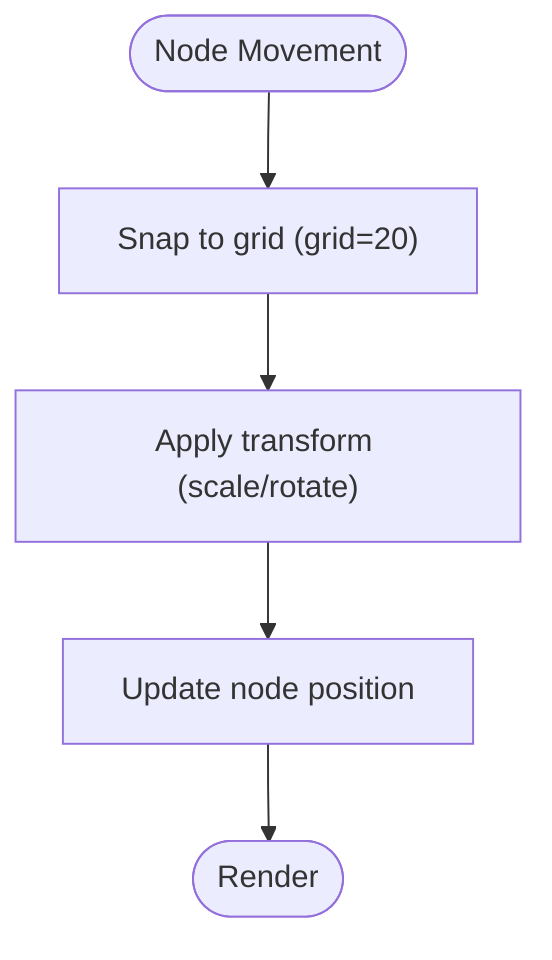

**Diagram sources**
- [graph_manager.py:438-445](file://LoOper/NGUI/graph_elements/graph_manager.py#L438-L445)
- [graph_view.py:313-319](file://LoOper/NGUI/graph_view.py#L313-L319)
- [node_transforms.py](file://LoOper/NGUI/graph_elements/node_transforms.py)

**Section sources**
- [graph_manager.py:438-445](file://LoOper/NGUI/graph_elements/graph_manager.py#L438-L445)
- [graph_view.py:313-319](file://LoOper/NGUI/graph_view.py#L313-L319)
- [node_transforms.py](file://LoOper/NGUI/graph_elements/node_transforms.py)

### Export Utilities
- ExportUtils validates conditional nodes and supports exporting to executable/batch formats.
- GraphViewWidget exposes export methods to the UI.

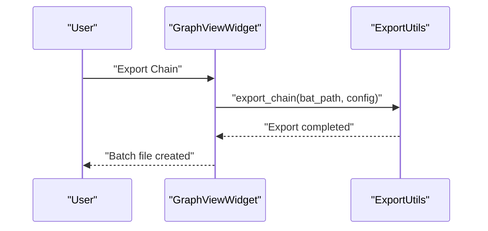

**Diagram sources**
- [graph_view.py:634-642](file://LoOper/NGUI/graph_view.py#L634-L642)
- [export_utils.py](file://LoOper/NGUI/graph_elements/export_utils.py)

**Section sources**
- [graph_view.py:624-642](file://LoOper/NGUI/graph_view.py#L624-L642)
- [export_utils.py](file://LoOper/NGUI/graph_elements/export_utils.py)

### Dark Theme Implementation
- NodeGraphQt grid mode and pipe layout are configured in GraphManager to improve contrast and readability.
- The editor relies on NodeGraphQt’s viewer settings for grid display and pipe style.

Practical steps:
- Adjust grid mode and pipe style in GraphManager’s configuration routine.
- Ensure NodeGraphQt theme settings align with your application’s dark palette.

**Section sources**
- [graph_manager.py:198-214](file://LoOper/NGUI/graph_elements/graph_manager.py#L198-L214)

### Node-Based Programming Paradigm and Workflow Composition
- Nodes represent atomic units of work (actions, conditions, LLM calls, TTS synthesis, code execution, containers, chain imports).
- Connections define data/control flow between nodes.
- Sequences group actions; conditional branches allow branching logic; chain imports enable modular reuse.

Practical examples:
- Creating a sequence and adding actions to it.
- Adding a conditional node and connecting outcomes to different branches.
- Connecting an LLM node to a code node to post-process outputs.
- Using chain import nodes to compose reusable sub-workflows.

**Section sources**
- [graph_view.py:480-502](file://LoOper/NGUI/graph_view.py#L480-L502)
- [graph_view.py:791-826](file://LoOper/NGUI/graph_view.py#L791-L826)
- [graph_view.py:800-817](file://LoOper/NGUI/graph_view.py#L800-L817)

### UI Component Architecture
- UIComponents sets up the overall UI scaffolding.
- Toolbars and panes are integrated via GraphViewWidget and splitter management.
- Right-side toolbar visibility can be toggled programmatically.

**Section sources**
- [graph_view.py:129-138](file://LoOper/NGUI/graph_view.py#L129-L138)
- [graph_view.py:139-163](file://LoOper/NGUI/graph_view.py#L139-L163)

## Dependency Analysis
The following diagram highlights key internal dependencies among core components.

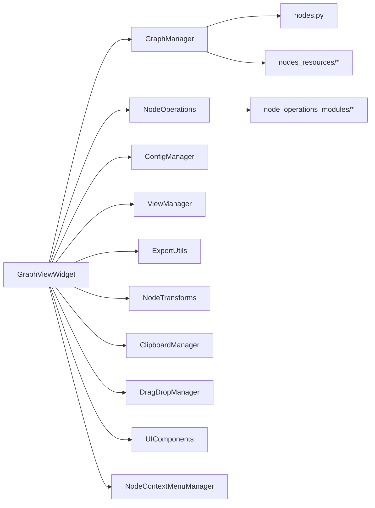

**Diagram sources**
- [graph_view.py:43-128](file://LoOper/NGUI/graph_view.py#L43-L128)
- [graph_manager.py:51-92](file://LoOper/NGUI/graph_elements/graph_manager.py#L51-L92)
- [node_operations_modules/__init__.py:13-27](file://LoOper/NGUI/graph_elements/node_operations_modules/__init__.py#L13-L27)

**Section sources**
- [graph_view.py:43-128](file://LoOper/NGUI/graph_view.py#L43-L128)
- [graph_manager.py:51-92](file://LoOper/NGUI/graph_elements/graph_manager.py#L51-L92)
- [node_operations_modules/__init__.py:13-27](file://LoOper/NGUI/graph_elements/node_operations_modules/__init__.py#L13-L27)

## Performance Considerations
- Auto-layout and connection operations scale with node count; prefer incremental updates and batch operations when possible.
- Logging is enabled; excessive logging can impact performance—consider adjusting log levels in production.
- Snapping and transform operations are lightweight but can accumulate during bulk edits; disable unnecessary repaints during large operations.

## Troubleshooting Guide
Common issues and resolutions:
- Graph not ready: Ensure GraphViewWidget initialization completes and GraphManager has created the NodeGraphQt instance before performing operations.
- Node creation failures: Verify node registration and that the graph widget is embedded in the UI.
- Context menu not appearing: Confirm the view is initialized and the custom context menu signal is connected.
- Drag-and-drop not working: Check DragDropManager installation and that the toolbar emits drag events.
- Clipboard paste errors: Validate that ClipboardManager has copied nodes and that paste position resolution succeeds.

**Section sources**
- [graph_view.py:569-574](file://LoOper/NGUI/graph_view.py#L569-L574)
- [graph_manager.py:64-92](file://LoOper/NGUI/graph_elements/graph_manager.py#L64-L92)
- [graph_view.py:282-306](file://LoOper/NGUI/graph_view.py#L282-L306)
- [graph_view.py:240-271](file://LoOper/NGUI/graph_view.py#L240-L271)
- [graph_view.py:276-280](file://LoOper/NGUI/graph_view.py#L276-L280)

## Conclusion
The node graph editor leverages NodeGraphQt within a modular PyQt5 architecture to deliver a powerful visual workflow builder. Its design cleanly separates concerns across managers and mixins, enabling straightforward extension with new node types and UI components while maintaining visual consistency and usability.

## Appendices

### Extending with Custom Node Types
Steps to add a new node type:
1. Define a new node class inheriting from the base node resource and register it in GraphManager.
2. Implement node-specific operations in a new mixin under node_operations_modules and include it in NodeOperations composition.
3. Integrate UI affordances (context menu entries, toolbar items) via NodeContextMenuManager and UIComponents.
4. Wire keyboard shortcuts and clipboard behavior as needed.

References:
- Node base and resource examples: [base_node.py](file://LoOper/NGUI/nodes_resources/base_node.py), [action_node.py](file://LoOper/NGUI/nodes_resources/action_node.py), [conditional_node.py](file://LoOper/NGUI/nodes_resources/conditional_node.py), [llm_node.py](file://LoOper/NGUI/nodes_resources/llm_node.py), [tts_node.py](file://LoOper/NGUI/nodes_resources/tts_node.py), [code_node.py](file://LoOper/NGUI/nodes_resources/code_node.py), [container_node.py](file://LoOper/NGUI/nodes_resources/container_node.py), [chain_import_node.py](file://LoOper/NGUI/nodes_resources/chain_import_node.py), [form_filler_node.py](file://LoOper/NGUI/nodes_resources/form_filler_node.py)
- Node registration: [graph_manager.py:93-119](file://LoOper/NGUI/graph_elements/graph_manager.py#L93-L119)
- NodeOperations composition: [node_operations_modules/__init__.py:13-27](file://LoOper/NGUI/graph_elements/node_operations_modules/__init__.py#L13-L27)

### Implementing New UI Components
- Use UIComponents to scaffold new panels or toolbars.
- Integrate with GraphViewWidget splitter and visibility controls.
- Ensure focus delegation and context menu policies are set appropriately.

References:
- UIComponents: [ui_components.py](file://LoOper/NGUI/graph_elements/ui_components.py)
- Splitter and toolbar visibility: [graph_view.py:139-163](file://LoOper/NGUI/graph_view.py#L139-L163)

### Maintaining Visual Consistency
- Grid mode and pipe style are configured centrally in GraphManager.
- Dark theme visuals rely on NodeGraphQt viewer settings; keep grid and pipe styles aligned with your theme.

References:
- Grid and pipe configuration: [graph_manager.py:198-214](file://LoOper/NGUI/graph_elements/graph_manager.py#L198-L214)