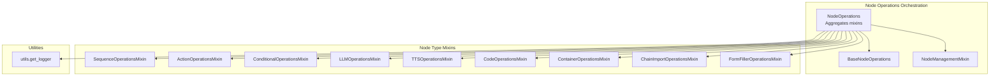
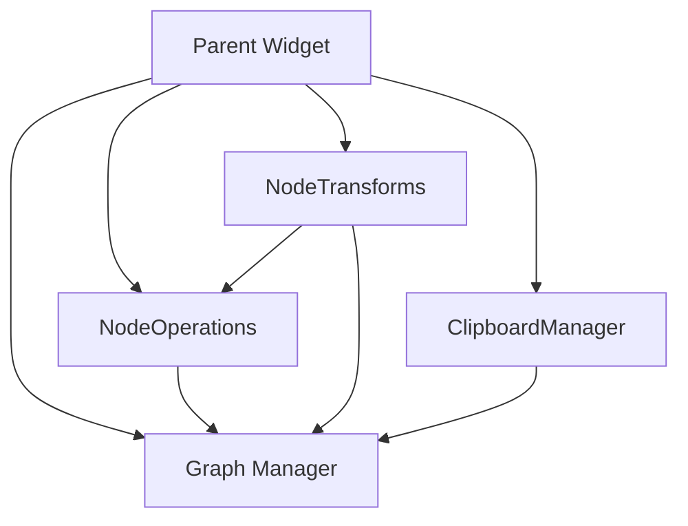
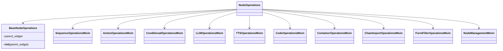
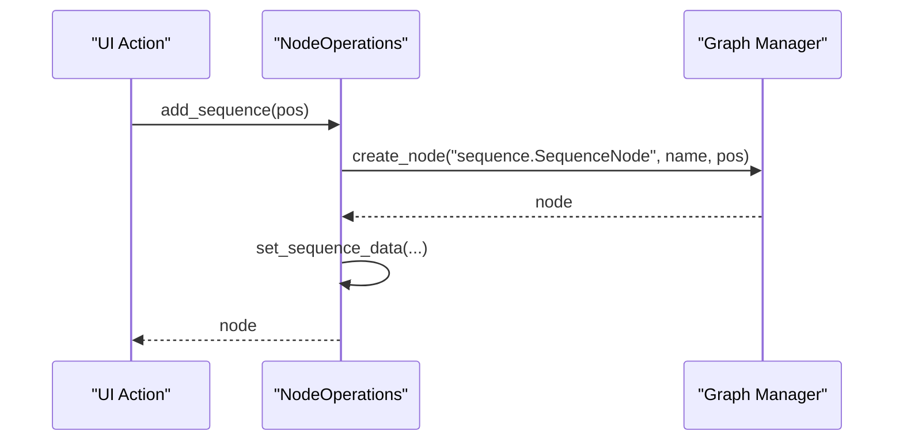
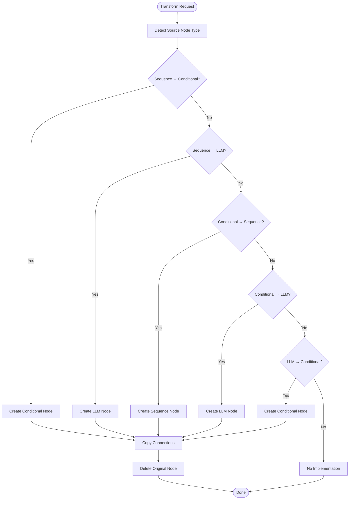
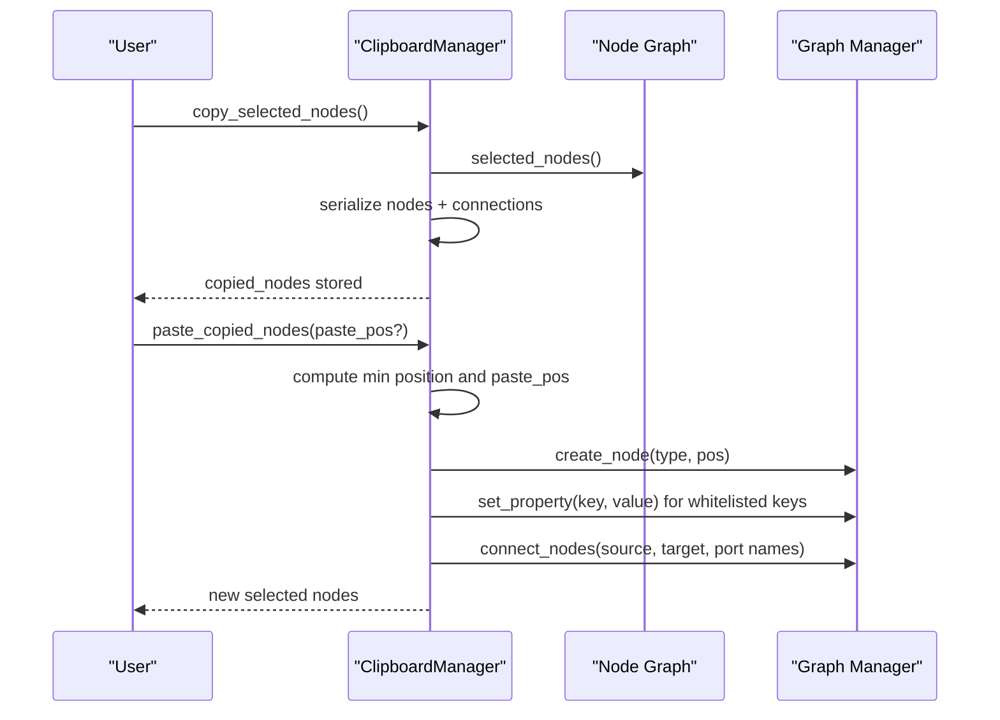
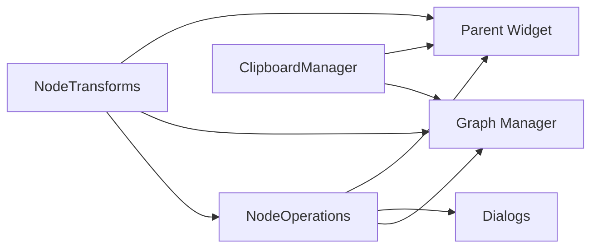

# Node Operations

<cite>
**Referenced Files in This Document**
- [node_operations.py](file://LoOper/NGUI/graph_elements/node_operations.py)
- [node_operations_modules/__init__.py](file://LoOper/NGUI/graph_elements/node_operations_modules/__init__.py)
- [node_operations_modules/base.py](file://LoOper/NGUI/graph_elements/node_operations_modules/base.py)
- [node_operations_modules/utils.py](file://LoOper/NGUI/graph_elements/node_operations_modules/utils.py)
- [node_operations_modules/node_management.py](file://LoOper/NGUI/graph_elements/node_operations_modules/node_management.py)
- [node_operations_modules/sequence.py](file://LoOper/NGUI/graph_elements/node_operations_modules/sequence.py)
- [node_operations_modules/action.py](file://LoOper/NGUI/graph_elements/node_operations_modules/action.py)
- [node_operations_modules/conditional.py](file://LoOper/NGUI/graph_elements/node_operations_modules/conditional.py)
- [node_operations_modules/llm.py](file://LoOper/NGUI/graph_elements/node_operations_modules/llm.py)
- [node_operations_modules/tts.py](file://LoOper/NGUI/graph_elements/node_operations_modules/tts.py)
- [node_operations_modules/code.py](file://LoOper/NGUI/graph_elements/node_operations_modules/code.py)
- [node_operations_modules/container.py](file://LoOper/NGUI/graph_elements/node_operations_modules/container.py)
- [node_operations_modules/chain_import.py](file://LoOper/NGUI/graph_elements/node_operations_modules/chain_import.py)
- [node_operations_modules/form_filler.py](file://LoOper/NGUI/graph_elements/node_operations_modules/form_filler.py)
- [node_transforms.py](file://LoOper/NGUI/graph_elements/node_transforms.py)
- [clipboard_manager.py](file://LoOper/NGUI/graph_elements/clipboard_manager.py)
</cite>

## Table of Contents
1. [Introduction](#introduction)
2. [Project Structure](#project-structure)
3. [Core Components](#core-components)
4. [Architecture Overview](#architecture-overview)
5. [Detailed Component Analysis](#detailed-component-analysis)
6. [Dependency Analysis](#dependency-analysis)
7. [Performance Considerations](#performance-considerations)
8. [Troubleshooting Guide](#troubleshooting-guide)
9. [Conclusion](#conclusion)

## Introduction
This document describes the node operations system responsible for creating, modifying, deleting, and transforming nodes in the graph editor. It covers:
- Node creation and editing workflows for each supported node type
- Transformations between sequence, conditional, and LLM nodes
- Clipboard manager for copy/paste and selection management
- Practical guidance for extending operations, optimizing clipboard performance, and maintaining graph integrity

## Project Structure
The node operations system is organized around a central orchestrator that aggregates mixins for each node type and a dedicated transformer and clipboard manager.

**Diagram sources**
- [node_operations_modules/__init__.py:13-25](file://LoOper/NGUI/graph_elements/node_operations_modules/__init__.py#L13-L25)
- [node_operations_modules/base.py:5-13](file://LoOper/NGUI/graph_elements/node_operations_modules/base.py#L5-L13)
- [node_operations_modules/node_management.py:7-25](file://LoOper/NGUI/graph_elements/node_operations_modules/node_management.py#L7-L25)
- [node_operations_modules/sequence.py:9-100](file://LoOper/NGUI/graph_elements/node_operations_modules/sequence.py#L9-L100)
- [node_operations_modules/action.py:8-56](file://LoOper/NGUI/graph_elements/node_operations_modules/action.py#L8-L56)
- [node_operations_modules/conditional.py:8-35](file://LoOper/NGUI/graph_elements/node_operations_modules/conditional.py#L8-L35)
- [node_operations_modules/llm.py:15-56](file://LoOper/NGUI/graph_elements/node_operations_modules/llm.py#L15-L56)
- [node_operations_modules/tts.py:7-39](file://LoOper/NGUI/graph_elements/node_operations_modules/tts.py#L7-L39)
- [node_operations_modules/code.py:6-36](file://LoOper/NGUI/graph_elements/node_operations_modules/code.py#L6-L36)
- [node_operations_modules/container.py:6-33](file://LoOper/NGUI/graph_elements/node_operations_modules/container.py#L6-L33)
- [node_operations_modules/chain_import.py:13-44](file://LoOper/NGUI/graph_elements/node_operations_modules/chain_import.py#L13-L44)
- [node_operations_modules/form_filler.py:3-10](file://LoOper/NGUI/graph_elements/node_operations_modules/form_filler.py#L3-L10)
- [node_operations_modules/utils.py:3-14](file://LoOper/NGUI/graph_elements/node_operations_modules/utils.py#L3-L14)

**Section sources**
- [node_operations.py:1-2](file://LoOper/NGUI/graph_elements/node_operations.py#L1-L2)
- [node_operations_modules/__init__.py:1-27](file://LoOper/NGUI/graph_elements/node_operations_modules/__init__.py#L1-L27)

## Core Components
- NodeOperations: Central orchestrator that inherits from multiple mixins to provide unified APIs for node creation, editing, deletion, and management.
- NodeTransforms: Converts nodes between sequence, conditional, and LLM types while preserving connections and properties.
- ClipboardManager: Implements copy/paste with property whitelisting, intra-selection connection restoration, and paste positioning.

Key responsibilities:
- Creation: add_* methods per node type (e.g., add_sequence, add_conditional, add_llm).
- Modification: edit_* methods per node type (e.g., edit_sequence, edit_conditional, edit_llm).
- Deletion: delete_* methods and centralized delete_node routing.
- Transformation: transform_* methods and a dispatcher to convert between node types.
- Clipboard: copy_selected_nodes and paste_copied_nodes with property whitelists and connection restoration.

**Section sources**
- [node_operations_modules/__init__.py:13-25](file://LoOper/NGUI/graph_elements/node_operations_modules/__init__.py#L13-L25)
- [node_operations_modules/node_management.py:7-25](file://LoOper/NGUI/graph_elements/node_operations_modules/node_management.py#L7-L25)
- [node_transforms.py:22-506](file://LoOper/NGUI/graph_elements/node_transforms.py#L22-L506)
- [clipboard_manager.py:5-243](file://LoOper/NGUI/graph_elements/clipboard_manager.py#L5-L243)

## Architecture Overview
The system integrates UI actions with graph operations through a parent widget reference. Node operations rely on a graph manager abstraction to create/delete nodes and connect ports. Transformations delegate to node operations to create new nodes and then restore connections before deleting originals. Clipboard operations serialize only whitelisted properties and reconstruct nodes with preserved intra-selection connectivity.

**Diagram sources**
- [node_transforms.py:25-33](file://LoOper/NGUI/graph_elements/node_transforms.py#L25-L33)
- [clipboard_manager.py:6-9](file://LoOper/NGUI/graph_elements/clipboard_manager.py#L6-L9)

## Detailed Component Analysis

### Node Operations Orchestration
- Composition: NodeOperations aggregates mixins for all node types and management helpers.
- Logging: Uses a shared logger factory to emit structured logs for debugging and diagnostics.
- Parent dependency: All mixins expect a parent widget exposing graph_manager, node_graph, and related UI contexts.

**Diagram sources**
- [node_operations_modules/__init__.py:13-25](file://LoOper/NGUI/graph_elements/node_operations_modules/__init__.py#L13-L25)
- [node_operations_modules/base.py:5-13](file://LoOper/NGUI/graph_elements/node_operations_modules/base.py#L5-L13)

**Section sources**
- [node_operations_modules/__init__.py:1-27](file://LoOper/NGUI/graph_elements/node_operations_modules/__init__.py#L1-L27)
- [node_operations_modules/base.py:5-13](file://LoOper/NGUI/graph_elements/node_operations_modules/base.py#L5-L13)
- [node_operations_modules/utils.py:3-14](file://LoOper/NGUI/graph_elements/node_operations_modules/utils.py#L3-L14)

### Node Types: Creation and Editing
- Sequence: add_sequence/add_new_sequence/edit_sequence; manages sequence files and loop/delay properties.
- Action: add_action/_create_action_file; creates action files and registers them in sequences.
- Conditional: add_conditional_node/edit_conditional; supports multiple trigger types and loop configurations.
- LLM: add_llm_node/edit_llm; manages prompts, models, OCR, vision, and advanced RAG settings.
- TTS: add_tts_node/edit_tts; sets text and language with dynamic node naming.
- Code: add_code_node/edit_code_node; stores code, file path, and execution settings.
- Container: add_container_node/edit_container_node; VM/container configuration.
- Chain Import: add_chain_import_node/add_chain_import_from_file/edit_chain_import_node/expand_chain_import; imports and expands external chains with connection restoration.
- Form Filler: marked deprecated; disallows creation and editing.

**Diagram sources**
- [node_operations_modules/sequence.py:41-100](file://LoOper/NGUI/graph_elements/node_operations_modules/sequence.py#L41-L100)

**Section sources**
- [node_operations_modules/sequence.py:9-310](file://LoOper/NGUI/graph_elements/node_operations_modules/sequence.py#L9-L310)
- [node_operations_modules/action.py:8-121](file://LoOper/NGUI/graph_elements/node_operations_modules/action.py#L8-L121)
- [node_operations_modules/conditional.py:8-262](file://LoOper/NGUI/graph_elements/node_operations_modules/conditional.py#L8-L262)
- [node_operations_modules/llm.py:15-372](file://LoOper/NGUI/graph_elements/node_operations_modules/llm.py#L15-L372)
- [node_operations_modules/tts.py:7-77](file://LoOper/NGUI/graph_elements/node_operations_modules/tts.py#L7-L77)
- [node_operations_modules/code.py:6-82](file://LoOper/NGUI/graph_elements/node_operations_modules/code.py#L6-L82)
- [node_operations_modules/container.py:6-80](file://LoOper/NGUI/graph_elements/node_operations_modules/container.py#L6-L80)
- [node_operations_modules/chain_import.py:13-369](file://LoOper/NGUI/graph_elements/node_operations_modules/chain_import.py#L13-L369)
- [node_operations_modules/form_filler.py:3-17](file://LoOper/NGUI/graph_elements/node_operations_modules/form_filler.py#L3-L17)

### Node Transforms System
Transforms convert nodes between sequence, conditional, and LLM types while:
- Preserving position
- Capturing input/output connections
- Restoring connections on the new node type
- Deleting the original node after successful transformation

Supported conversions:
- Sequence → Conditional
- Sequence → LLM
- Conditional → Sequence
- Conditional → LLM
- LLM → Conditional
- LLM → Sequence (not implemented yet)

**Diagram sources**
- [node_transforms.py:35-357](file://LoOper/NGUI/graph_elements/node_transforms.py#L35-L357)

**Section sources**
- [node_transforms.py:22-506](file://LoOper/NGUI/graph_elements/node_transforms.py#L22-L506)

### Clipboard Manager
ClipboardManager enables copy/paste of selected nodes with:
- Property whitelisting per node type
- Serialization of node metadata, positions, and intra-selection connections
- Paste positioning with snapping and offsetting to avoid overlap
- Connection restoration using port names and node IDs
- Selection clearing and re-selection after paste

**Diagram sources**
- [clipboard_manager.py:38-243](file://LoOper/NGUI/graph_elements/clipboard_manager.py#L38-L243)

**Section sources**
- [clipboard_manager.py:5-243](file://LoOper/NGUI/graph_elements/clipboard_manager.py#L5-L243)

## Dependency Analysis
- NodeOperations depends on:
  - Graph manager for node creation/deletion/connectivity
  - Dialogs for editing node properties
  - Parent widget for UI context (scene positions, node graph)
- NodeTransforms depends on:
  - NodeOperations for creating new nodes
  - Graph manager for deletion
  - Node introspection to capture connections
- ClipboardManager depends on:
  - Graph manager for node creation and connections
  - NodeGraphQt port APIs for intra-selection connection discovery

**Diagram sources**
- [node_transforms.py:25-33](file://LoOper/NGUI/graph_elements/node_transforms.py#L25-L33)
- [clipboard_manager.py:6-9](file://LoOper/NGUI/graph_elements/clipboard_manager.py#L6-L9)

**Section sources**
- [node_operations_modules/sequence.py:64-83](file://LoOper/NGUI/graph_elements/node_operations_modules/sequence.py#L64-L83)
- [node_operations_modules/conditional.py:15-19](file://LoOper/NGUI/graph_elements/node_operations_modules/conditional.py#L15-L19)
- [node_operations_modules/llm.py:22-26](file://LoOper/NGUI/graph_elements/node_operations_modules/llm.py#L22-L26)
- [node_operations_modules/tts.py:14-18](file://LoOper/NGUI/graph_elements/node_operations_modules/tts.py#L14-L18)
- [node_operations_modules/code.py:13-17](file://LoOper/NGUI/graph_elements/node_operations_modules/code.py#L13-L17)
- [node_operations_modules/container.py:13-17](file://LoOper/NGUI/graph_elements/node_operations_modules/container.py#L13-L17)
- [node_operations_modules/chain_import.py:20-24](file://LoOper/NGUI/graph_elements/node_operations_modules/chain_import.py#L20-L24)

## Performance Considerations
- Clipboard serialization
  - Whitelist properties to reduce payload size and speed up paste operations.
  - For large workflows, consider batching node creation and connection restoration to minimize UI updates.
- Transformations
  - Capture and restore connections efficiently by matching port names; avoid repeated lookups by caching port lists.
  - Prefer direct property assignment over redundant dialog interactions when programmatically generating nodes.
- Logging
  - Keep log levels appropriate for production to avoid overhead; use structured logs for diagnostics.

[No sources needed since this section provides general guidance]

## Troubleshooting Guide
Common issues and resolutions:
- Node creation failures
  - Verify graph manager availability and node type identifiers.
  - Inspect exceptions raised during node creation and property setting.
- Transformation errors
  - Ensure source node types match expected classes before transformation.
  - Confirm connection restoration succeeds; missing ports are handled by falling back to first available ports.
- Clipboard paste anomalies
  - If paste position is unavailable, a counter-based offset is used; verify scene mapping or view rect availability.
  - Connection restoration relies on matching port names; mismatched names will skip connections.
- Logging
  - Logs are written to a debug file and console; review for detailed error traces.

**Section sources**
- [node_operations_modules/sequence.py:92-99](file://LoOper/NGUI/graph_elements/node_operations_modules/sequence.py#L92-L99)
- [node_operations_modules/conditional.py:27-34](file://LoOper/NGUI/graph_elements/node_operations_modules/conditional.py#L27-L34)
- [node_operations_modules/llm.py:48-55](file://LoOper/NGUI/graph_elements/node_operations_modules/llm.py#L48-L55)
- [node_operations_modules/tts.py:31-38](file://LoOper/NGUI/graph_elements/node_operations_modules/tts.py#L31-L38)
- [node_operations_modules/code.py:28-35](file://LoOper/NGUI/graph_elements/node_operations_modules/code.py#L28-L35)
- [node_operations_modules/container.py:25-32](file://LoOper/NGUI/graph_elements/node_operations_modules/container.py#L25-L32)
- [node_operations_modules/chain_import.py:40-44](file://LoOper/NGUI/graph_elements/node_operations_modules/chain_import.py#L40-L44)
- [node_transforms.py:89-96](file://LoOper/NGUI/graph_elements/node_transforms.py#L89-L96)
- [clipboard_manager.py:92-114](file://LoOper/NGUI/graph_elements/clipboard_manager.py#L92-L114)

## Conclusion
The node operations system provides a cohesive framework for node lifecycle management, type transformations, and clipboard workflows. By leveraging typed mixins, a central orchestrator, and robust connection restoration, it supports flexible graph authoring. Extensibility is achieved by adding new mixins and updating the NodeOperations aggregator, while clipboard performance improves through property whitelisting and efficient connection reconstruction.