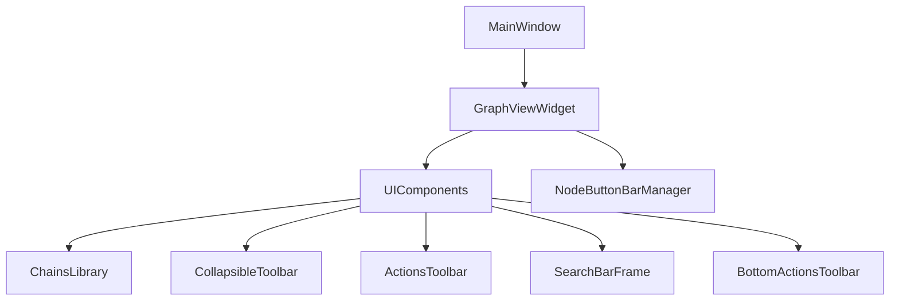
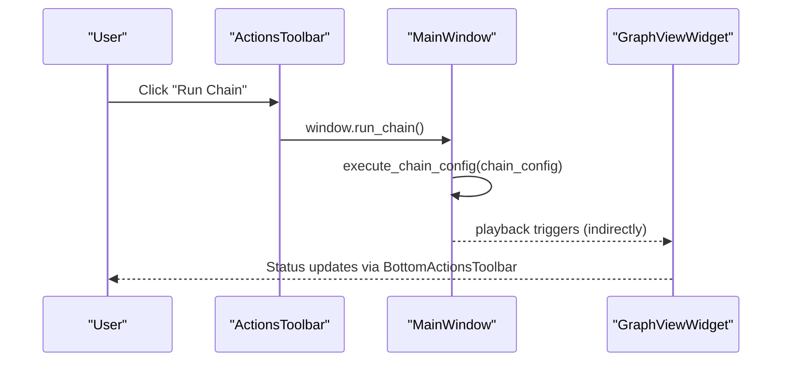
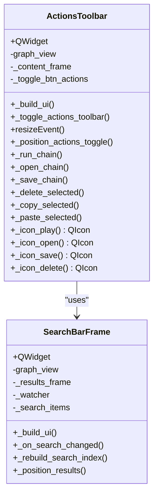
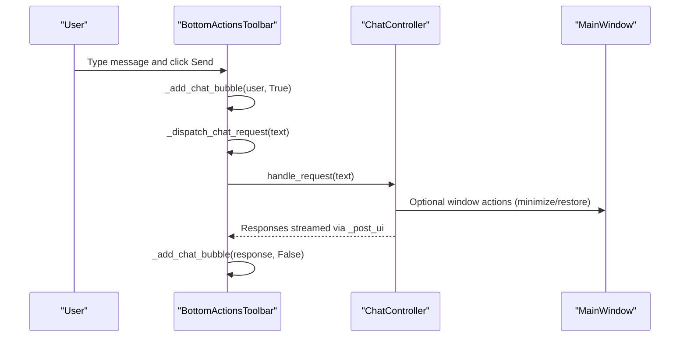
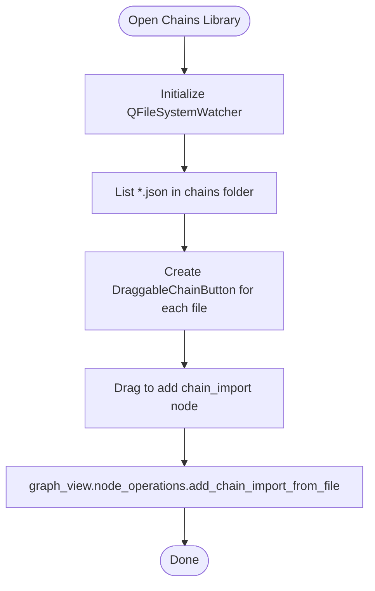
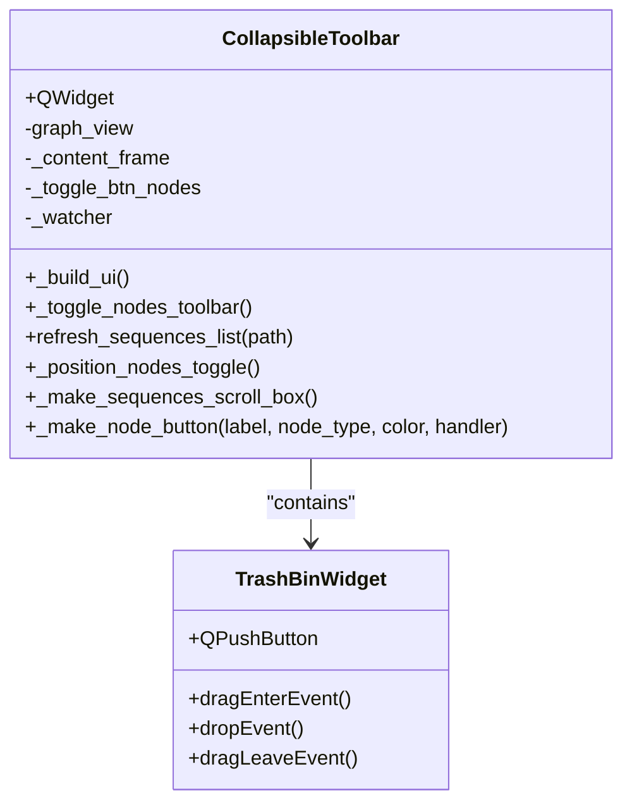
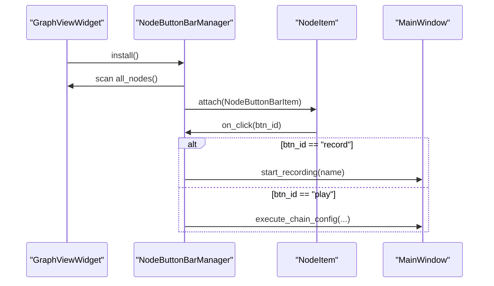
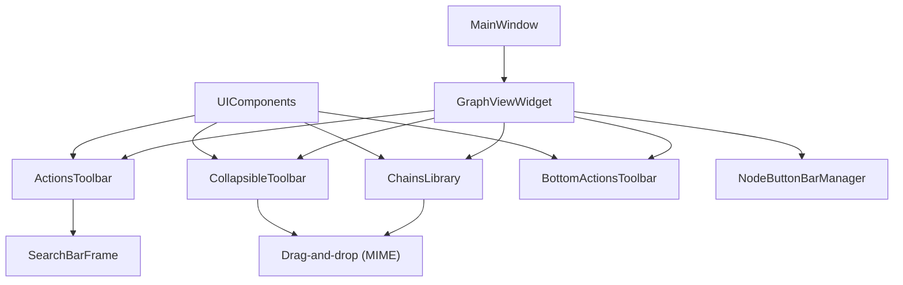

# UI Components

<cite>
**Referenced Files in This Document**
- [actions_toolbar.py](file://LoOper/NGUI/widgets/actions_toolbar.py)
- [bottom_toolbar.py](file://LoOper/NGUI/widgets/bottom_toolbar.py)
- [chains_library.py](file://LoOper/NGUI/widgets/chains_library.py)
- [collapsible_toolbar.py](file://LoOper/NGUI/widgets/collapsible_toolbar.py)
- [node_button_bar.py](file://LoOper/NGUI/graph_elements/node_button_bar.py)
- [main_window.py](file://LoOper/NGUI/main_window.py)
- [graph_view.py](file://LoOper/NGUI/graph_view.py)
- [ui_components.py](file://LoOper/NGUI/graph_elements/ui_components.py)
- [constants.py](file://LoOper/NGUI/constants.py)
</cite>

## Table of Contents
1. [Introduction](#introduction)
2. [Project Structure](#project-structure)
3. [Core Components](#core-components)
4. [Architecture Overview](#architecture-overview)
5. [Detailed Component Analysis](#detailed-component-analysis)
6. [Dependency Analysis](#dependency-analysis)
7. [Performance Considerations](#performance-considerations)
8. [Troubleshooting Guide](#troubleshooting-guide)
9. [Conclusion](#conclusion)
10. [Appendices](#appendices)

## Introduction
This document describes the UI components system responsible for reusable interface elements, toolbars, and workspace organization. It focuses on:
- Action toolbar for quick node creation and workflow execution
- Bottom toolbar for status display and controls
- Chains library for workflow templates and reuse
- Collapsible toolbar system for workspace optimization
- Practical guidance for customizing layouts, implementing new UI components, and integrating with the main application state

The goal is to help developers extend and maintain the interface while preserving visual consistency and responsiveness.

## Project Structure
The UI system is organized around a central GraphViewWidget that hosts three primary UI areas:
- Left Chains Library: reusable chain templates
- Center: Actions toolbar, search bar, node graph, and bottom toolbar
- Right Collapsible Toolbar: quick node creation and sequence list

**Diagram sources**
- [main_window.py:121-149](file://LoOper/NGUI/main_window.py#L121-L149)
- [graph_view.py:129-137](file://LoOper/NGUI/graph_view.py#L129-L137)
- [ui_components.py:42-149](file://LoOper/NGUI/graph_elements/ui_components.py#L42-L149)

**Section sources**
- [main_window.py:121-149](file://LoOper/NGUI/main_window.py#L121-L149)
- [graph_view.py:129-137](file://LoOper/NGUI/graph_view.py#L129-L137)
- [ui_components.py:42-149](file://LoOper/NGUI/graph_elements/ui_components.py#L42-L149)

## Core Components
- ActionsToolbar: top-center toolbar with workflow actions (run, save, open, delete, copy, paste) and a floating toggle to expand/collapse.
- SearchBarFrame: integrated search over sequences/chains with dynamic indexing and live results.
- BottomActionsToolbar: chat-enabled bottom panel with model selection, message bubbles, and send controls.
- ChainsLibrary: left panel with draggable chain cards and a toggle to collapse the panel.
- CollapsibleToolbar: right panel with draggable node buttons, sequence list, and a floating toggle to collapse/expand.
- NodeButtonBarManager: per-node contextual buttons rendered as a child of each node for quick actions.

These components share a consistent color palette and styling system for visual coherence.

**Section sources**
- [actions_toolbar.py:495-800](file://LoOper/NGUI/widgets/actions_toolbar.py#L495-L800)
- [actions_toolbar.py:167-493](file://LoOper/NGUI/widgets/actions_toolbar.py#L167-L493)
- [bottom_toolbar.py:19-501](file://LoOper/NGUI/widgets/bottom_toolbar.py#L19-L501)
- [chains_library.py:184-354](file://LoOper/NGUI/widgets/chains_library.py#L184-L354)
- [collapsible_toolbar.py:901-1210](file://LoOper/NGUI/widgets/collapsible_toolbar.py#L901-L1210)
- [node_button_bar.py:12-546](file://LoOper/NGUI/graph_elements/node_button_bar.py#L12-L546)
- [constants.py:1-32](file://LoOper/NGUI/constants.py#L1-L32)

## Architecture Overview
The UI is composed of modular widgets that communicate through:
- Parent-child relationships to the GraphViewWidget
- Shared graph_view references to invoke application actions
- Drag-and-drop MIME data for cross-widget operations
- Event-driven updates via watchers and timers

**Diagram sources**
- [actions_toolbar.py:655-704](file://LoOper/NGUI/widgets/actions_toolbar.py#L655-L704)
- [main_window.py:410-452](file://LoOper/NGUI/main_window.py#L410-L452)
- [bottom_toolbar.py:197-207](file://LoOper/NGUI/widgets/bottom_toolbar.py#L197-L207)

## Detailed Component Analysis

### ActionsToolbar
Responsibilities:
- Provides workflow actions: record, open, save, run, delete, copy, paste
- Floating toggle button to expand/collapse the toolbar
- Search integration for sequences/chains
- Uses a shared icon loader and consistent styling

Key behaviors:
- Toggle visibility and reposition toggle button on resize
- Invoke MainWindow methods via graph_view.window() when available
- Drag-and-drop support for adding nodes/sequences from search results

**Diagram sources**
- [actions_toolbar.py:495-800](file://LoOper/NGUI/widgets/actions_toolbar.py#L495-L800)
- [actions_toolbar.py:167-493](file://LoOper/NGUI/widgets/actions_toolbar.py#L167-L493)

**Section sources**
- [actions_toolbar.py:495-800](file://LoOper/NGUI/widgets/actions_toolbar.py#L495-L800)
- [actions_toolbar.py:167-493](file://LoOper/NGUI/widgets/actions_toolbar.py#L167-L493)

### BottomActionsToolbar
Responsibilities:
- Chat panel with model selection and message bubbles
- Send button and input field with dynamic height
- Processing indicator with animated dots
- Integration with ChatController for asynchronous messaging

Key behaviors:
- Toggle visibility with a floating chevron button
- Stretch layout adjustment to maximize graph area when expanded
- Dynamic bubble sizing based on viewport width
- Thread-safe UI updates via queued invocations

**Diagram sources**
- [bottom_toolbar.py:302-501](file://LoOper/NGUI/widgets/bottom_toolbar.py#L302-L501)
- [bottom_toolbar.py:19-173](file://LoOper/NGUI/widgets/bottom_toolbar.py#L19-L173)

**Section sources**
- [bottom_toolbar.py:19-501](file://LoOper/NGUI/widgets/bottom_toolbar.py#L19-L501)

### ChainsLibrary
Responsibilities:
- Lists chain files from the configured chains folder
- Draggable chain cards that add chain_import nodes to the graph
- Editable descriptions via context menu
- Watcher for automatic refresh on filesystem changes
- Toggle to collapse the panel

Key behaviors:
- Draggable chain cards emit MIME data for chain_import nodes
- Context menu supports editing descriptions
- Sync widths with viewport and update display text elision

**Diagram sources**
- [chains_library.py:184-354](file://LoOper/NGUI/widgets/chains_library.py#L184-L354)

**Section sources**
- [chains_library.py:184-354](file://LoOper/NGUI/widgets/chains_library.py#L184-L354)

### CollapsibleToolbar (Right Panel)
Responsibilities:
- Draggable node buttons for quick creation (LLM, Chain, Code, TTS, Conditional)
- Sequence list with drag-and-drop deletion via TrashBinWidget
- Floating toggle to collapse/expand the toolbar
- Watcher for sequences folder to keep lists current

Key behaviors:
- Draggable buttons emit MIME data for node creation
- TrashBinWidget confirms deletion via ModernDeleteDialog
- Toggle button positioned adjacent to the toolbar with smooth transitions

**Diagram sources**
- [collapsible_toolbar.py:901-1210](file://LoOper/NGUI/widgets/collapsible_toolbar.py#L901-L1210)
- [collapsible_toolbar.py:805-899](file://LoOper/NGUI/widgets/collapsible_toolbar.py#L805-L899)

**Section sources**
- [collapsible_toolbar.py:901-1210](file://LoOper/NGUI/widgets/collapsible_toolbar.py#L901-L1210)
- [collapsible_toolbar.py:805-899](file://LoOper/NGUI/widgets/collapsible_toolbar.py#L805-L899)

### NodeButtonBarManager (Per-Node Buttons)
Responsibilities:
- Renders contextual buttons on each node (record/play/options/expand)
- Attaches/detaches to nodes as they appear/disappear
- Delegates actions to MainWindow or GraphView methods

Key behaviors:
- Maintains a timer loop to synchronize with node graph
- Applies visibility rules per node type
- Positions bars relative to node width and header

**Diagram sources**
- [node_button_bar.py:226-546](file://LoOper/NGUI/graph_elements/node_button_bar.py#L226-L546)
- [main_window.py:258-452](file://LoOper/NGUI/main_window.py#L258-L452)

**Section sources**
- [node_button_bar.py:12-546](file://LoOper/NGUI/graph_elements/node_button_bar.py#L12-L546)
- [main_window.py:258-452](file://LoOper/NGUI/main_window.py#L258-L452)

## Dependency Analysis
- UIComponents orchestrates the splitter layout and instantiates all major UI widgets.
- Widgets depend on constants for consistent theming.
- GraphViewWidget exposes application actions and state to UI components.
- CollapsibleToolbar and ChainsLibrary both watch filesystem paths to keep lists current.
- Drag-and-drop relies on MIME types to transfer node types and file paths.

**Diagram sources**
- [ui_components.py:42-149](file://LoOper/NGUI/graph_elements/ui_components.py#L42-L149)
- [collapsible_toolbar.py:901-1210](file://LoOper/NGUI/widgets/collapsible_toolbar.py#L901-L1210)
- [chains_library.py:184-354](file://LoOper/NGUI/widgets/chains_library.py#L184-L354)
- [actions_toolbar.py:167-493](file://LoOper/NGUI/widgets/actions_toolbar.py#L167-L493)
- [graph_view.py:129-137](file://LoOper/NGUI/graph_view.py#L129-L137)
- [main_window.py:121-149](file://LoOper/NGUI/main_window.py#L121-L149)

**Section sources**
- [ui_components.py:42-149](file://LoOper/NGUI/graph_elements/ui_components.py#L42-L149)
- [graph_view.py:129-137](file://LoOper/NGUI/graph_view.py#L129-L137)
- [main_window.py:121-149](file://LoOper/NGUI/main_window.py#L121-L149)

## Performance Considerations
- Drag-and-drop uses lightweight pixmap feedback and deferred UI updates to reduce redraw overhead.
- SearchBarFrame rebuilds indices only when needed and filters results with a composite scoring function.
- BottomActionsToolbar throttles UI updates via queued invocations and timers.
- CollapsibleToolbar and ChainsLibrary use watchers to avoid polling and keep lists fresh.
- NodeButtonBarManager uses a periodic maintenance loop to avoid per-frame checks.

[No sources needed since this section provides general guidance]

## Troubleshooting Guide
Common issues and resolutions:
- Icons not rendering: The icon loader falls back to painter-drawn icons when external libraries are unavailable.
- Drag-and-drop failures: Verify MIME types and ensure the target widget accepts drops.
- Watcher errors: Directory watchers may fail silently; confirm folder paths exist and permissions allow watching.
- UI flicker on toggle: Timers are used to reposition toggle buttons after layout changes.
- Chat panel not expanding: Ensure the layout stretch factors are applied when toggling visibility.

**Section sources**
- [collapsible_toolbar.py:44-91](file://LoOper/NGUI/widgets/collapsible_toolbar.py#L44-L91)
- [bottom_toolbar.py:174-187](file://LoOper/NGUI/widgets/bottom_toolbar.py#L174-L187)
- [chains_library.py:192-203](file://LoOper/NGUI/widgets/chains_library.py#L192-L203)
- [actions_toolbar.py:566-571](file://LoOper/NGUI/widgets/actions_toolbar.py#L566-L571)

## Conclusion
The UI components system provides a cohesive, extensible framework for workspace organization and rapid workflow authoring. The toolbar system balances discoverability and screen real estate, while the chains library promotes reuse and standardization. Consistent theming and responsive patterns ensure a polished user experience across interactions.

[No sources needed since this section summarizes without analyzing specific files]

## Appendices

### Practical Examples

- Customizing toolbar layouts
  - Modify UIComponents layout to adjust splitter ratios or reorder widgets.
  - Example path: [ui_components.py:74-141](file://LoOper/NGUI/graph_elements/ui_components.py#L74-L141)

- Implementing new UI components
  - Follow the pattern of existing widgets: inherit QWidget, define a build method, and connect to graph_view actions.
  - Example paths:
    - [collapsible_toolbar.py:901-932](file://LoOper/NGUI/widgets/collapsible_toolbar.py#L901-L932)
    - [chains_library.py:184-205](file://LoOper/NGUI/widgets/chains_library.py#L184-L205)

- Integrating with main application state
  - Access MainWindow methods via graph_view.window() when available.
  - Example paths:
    - [actions_toolbar.py:655-704](file://LoOper/NGUI/widgets/actions_toolbar.py#L655-L704)
    - [main_window.py:410-452](file://LoOper/NGUI/main_window.py#L410-L452)

- Responsive design patterns
  - Use QSizePolicy and minimum/maximum dimensions to constrain growth.
  - Example paths:
    - [actions_toolbar.py:501-506](file://LoOper/NGUI/widgets/actions_toolbar.py#L501-L506)
    - [bottom_toolbar.py:54-68](file://LoOper/NGUI/widgets/bottom_toolbar.py#L54-L68)

- Component communication
  - Use signals/slots or direct method calls on shared graph_view references.
  - Example paths:
    - [graph_view.py:139-162](file://LoOper/NGUI/graph_view.py#L139-L162)
    - [collapsible_toolbar.py:1026-1027](file://LoOper/NGUI/widgets/collapsible_toolbar.py#L1026-L1027)

- Maintaining visual consistency
  - Use constants for colors and apply consistent stylesheets across widgets.
  - Example paths:
    - [constants.py:1-32](file://LoOper/NGUI/constants.py#L1-L32)
    - [actions_toolbar.py:602-616](file://LoOper/NGUI/widgets/actions_toolbar.py#L602-L616)