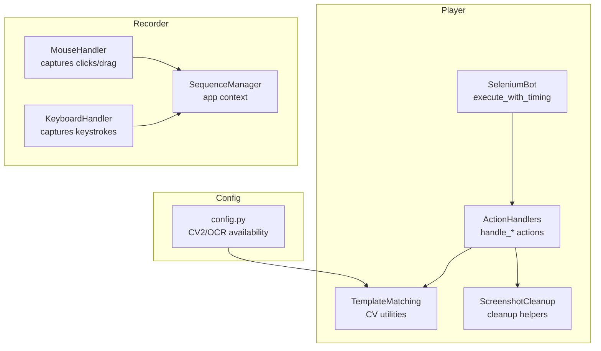
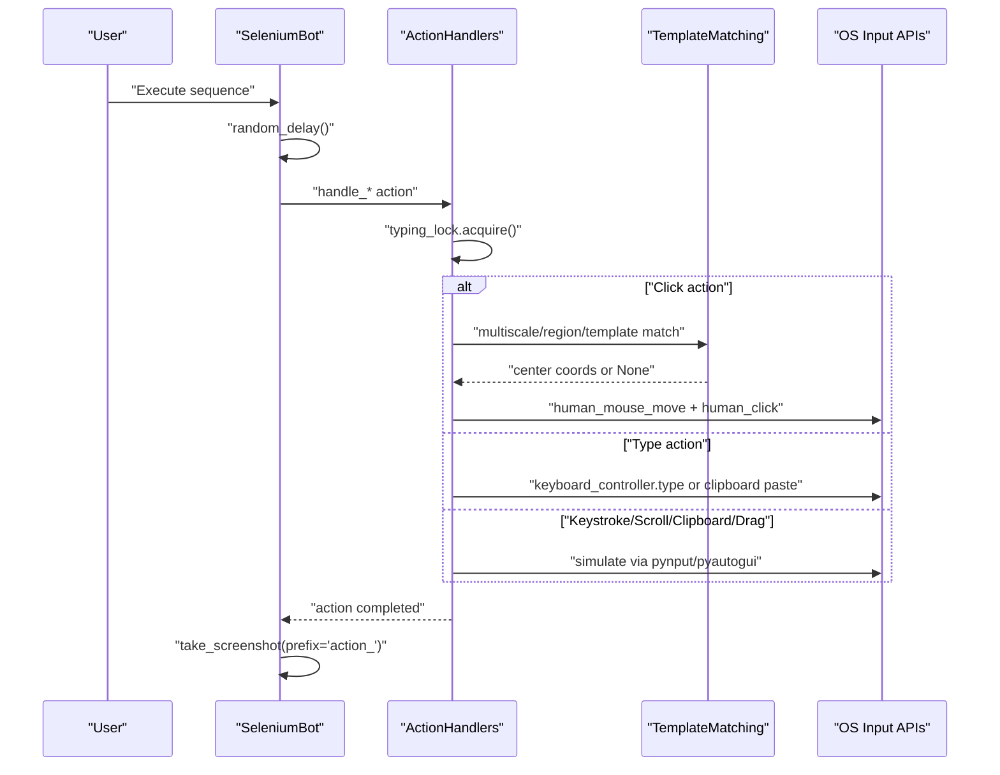
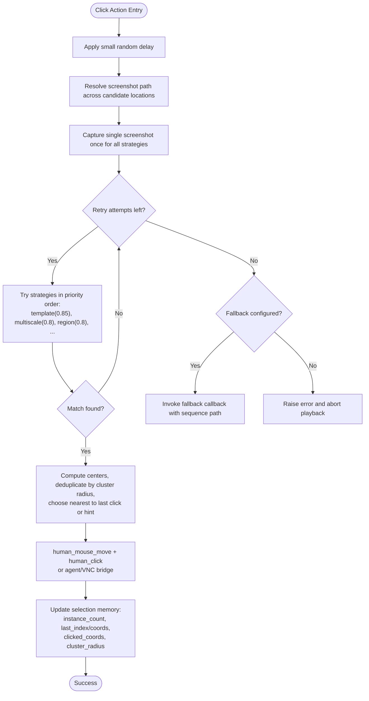
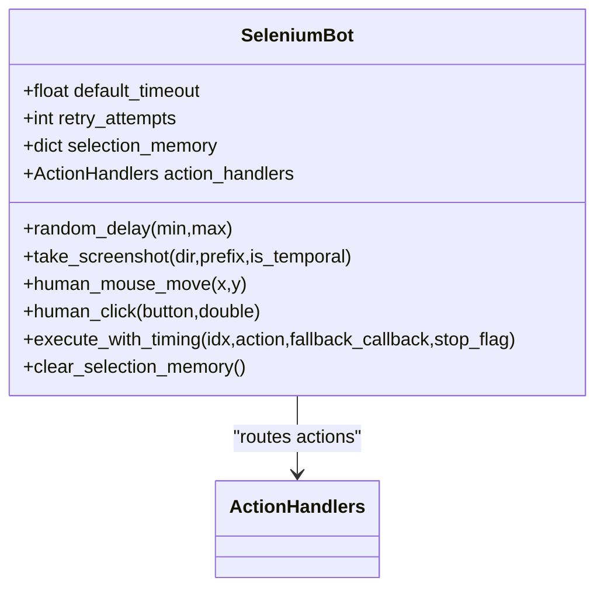
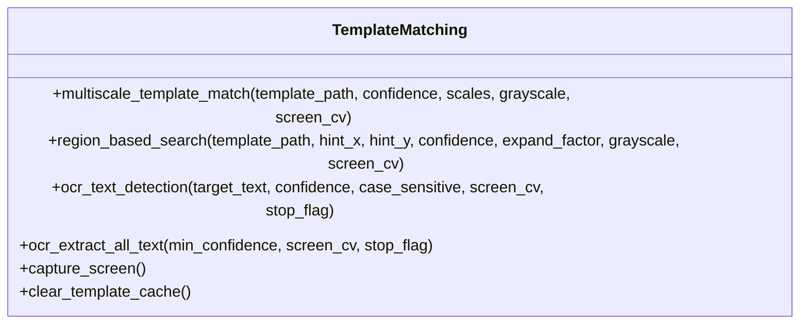
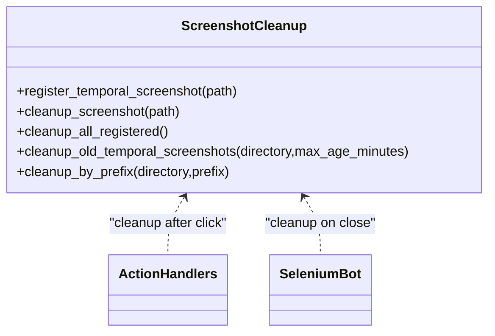
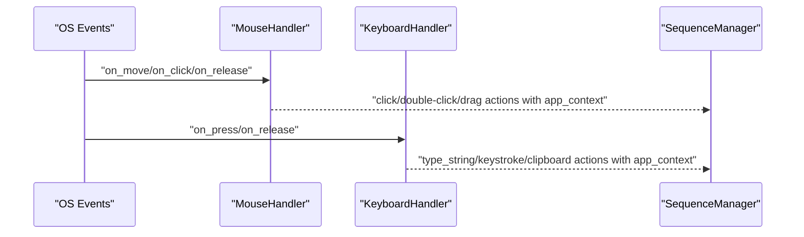
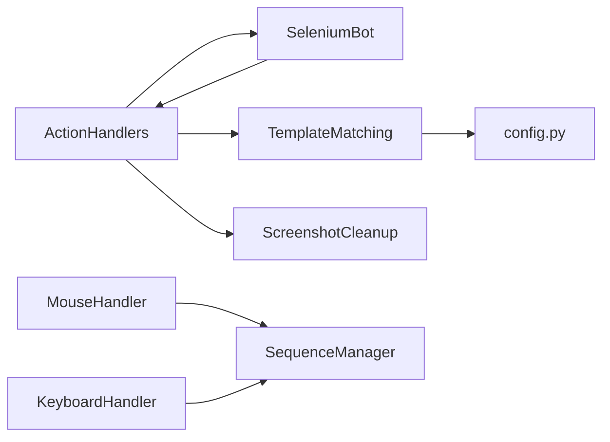

# Action Handlers

<cite>
**Referenced Files in This Document**
- [action_handlers.py](file://LoOper/player/action_handlers.py)
- [base_bot.py](file://LoOper/player/base_bot.py)
- [computer_vision.py](file://LoOper/player/computer_vision.py)
- [screenshot_cleanup.py](file://LoOper/player/screenshot_cleanup.py)
- [mouse_handler.py](file://LoOper/recorder/mouse_handler.py)
- [keyboard_handler.py](file://LoOper/recorder/keyboard_handler.py)
- [sequence_manager.py](file://LoOper/recorder/sequence_manager.py)
- [config.py](file://LoOper/player/config.py)
</cite>

## Table of Contents
1. [Introduction](#introduction)
2. [Project Structure](#project-structure)
3. [Core Components](#core-components)
4. [Architecture Overview](#architecture-overview)
5. [Detailed Component Analysis](#detailed-component-analysis)
6. [Dependency Analysis](#dependency-analysis)
7. [Performance Considerations](#performance-considerations)
8. [Troubleshooting Guide](#troubleshooting-guide)
9. [Conclusion](#conclusion)

## Introduction
This document explains the action handlers component responsible for mouse and keyboard control, text input handling, and application context management. It covers the action handler architecture, input simulation patterns, text input processing, and selection memory preservation mechanisms. It documents the implementation of various action types including mouse clicks, keyboard shortcuts, text input, and application switching, along with practical usage examples, error handling strategies, and performance optimization techniques. It also addresses integration with computer vision for UI interaction, context-aware action selection, and robust error recovery patterns, and provides guidance on extending action capabilities and optimizing input simulation performance.

## Project Structure
The action handlers are part of the automation player subsystem. They integrate with:
- Base bot orchestration and human-like motion simulation
- Computer vision for template matching and region-based search
- Recorder components for mouse and keyboard event capture
- Screenshot cleanup utilities for temporal artifacts
- Application context management for cross-application workflows

**Diagram sources**
- [action_handlers.py:26-42](file://LoOper/player/action_handlers.py#L26-L42)
- [base_bot.py:22-44](file://LoOper/player/base_bot.py#L22-L44)
- [computer_vision.py:47-50](file://LoOper/player/computer_vision.py#L47-L50)
- [screenshot_cleanup.py:6-14](file://LoOper/player/screenshot_cleanup.py#L6-L14)
- [mouse_handler.py:6-16](file://LoOper/recorder/mouse_handler.py#L6-L16)
- [keyboard_handler.py:6-18](file://LoOper/recorder/keyboard_handler.py#L6-L18)
- [sequence_manager.py:18-24](file://LoOper/recorder/sequence_manager.py#L18-L24)
- [config.py:11-30](file://LoOper/player/config.py#L11-L30)

**Section sources**
- [action_handlers.py:1-25](file://LoOper/player/action_handlers.py#L1-L25)
- [base_bot.py:22-44](file://LoOper/player/base_bot.py#L22-L44)
- [computer_vision.py:47-50](file://LoOper/player/computer_vision.py#L47-L50)
- [screenshot_cleanup.py:6-14](file://LoOper/player/screenshot_cleanup.py#L6-L14)
- [mouse_handler.py:6-16](file://LoOper/recorder/mouse_handler.py#L6-L16)
- [keyboard_handler.py:6-18](file://LoOper/recorder/keyboard_handler.py#L6-L18)
- [sequence_manager.py:18-24](file://LoOper/recorder/sequence_manager.py#L18-L24)
- [config.py:11-30](file://LoOper/player/config.py#L11-L30)

## Core Components
- ActionHandlers: Central dispatcher for action types, orchestrates input simulation, text typing, scrolling, clipboard operations, and drag-and-drop. Implements visual matching with fallback sequences and selection memory preservation.
- SeleniumBot: Provides human-like motion, random delays, and routes actions to ActionHandlers. Manages selection memory and screenshot capture after actions.
- TemplateMatching: Computer vision utilities for multi-scale template matching, region-based search, OCR text detection, and screen capture.
- ScreenshotCleanup: Registers and cleans up temporal screenshots to avoid disk clutter.
- MouseHandler and KeyboardHandler: Record mouse clicks, double-click detection, drag detection, and keyboard shortcuts (Ctrl+C/V/X/A/Z/Y).
- SequenceManager: Attaches application context (active window title, process info, rect) to recorded actions.

**Section sources**
- [action_handlers.py:26-42](file://LoOper/player/action_handlers.py#L26-L42)
- [base_bot.py:22-44](file://LoOper/player/base_bot.py#L22-L44)
- [computer_vision.py:47-50](file://LoOper/player/computer_vision.py#L47-L50)
- [screenshot_cleanup.py:6-14](file://LoOper/player/screenshot_cleanup.py#L6-L14)
- [mouse_handler.py:6-16](file://LoOper/recorder/mouse_handler.py#L6-L16)
- [keyboard_handler.py:6-18](file://LoOper/recorder/keyboard_handler.py#L6-L18)
- [sequence_manager.py:18-24](file://LoOper/recorder/sequence_manager.py#L18-L24)

## Architecture Overview
The action handler architecture separates concerns:
- Orchestration: SeleniumBot schedules delays, routes actions, and captures screenshots.
- Execution: ActionHandlers performs input simulation and visual matching.
- Vision: TemplateMatching encapsulates OpenCV and fallback strategies.
- Recording: MouseHandler and KeyboardHandler produce action payloads enriched with application context.

**Diagram sources**
- [base_bot.py:207-283](file://LoOper/player/base_bot.py#L207-L283)
- [action_handlers.py:133-672](file://LoOper/player/action_handlers.py#L133-L672)
- [computer_vision.py:198-450](file://LoOper/player/computer_vision.py#L198-L450)

## Detailed Component Analysis

### ActionHandlers: Input Simulation and Visual Matching
ActionHandlers centralizes action execution with:
- Human-like input simulation via SeleniumBot’s mouse movement and clicking.
- Visual template matching with multi-strategy search (high/medium/low confidence, multi-scale, region-based).
- Selection memory preservation to avoid random clicks among multiple matches.
- Fallback sequences when visual matching fails.
- Agent/VNC bridge support for remote environments.

Key capabilities:
- Click actions: Supports single, double, Ctrl-click, Shift-click with retry/backoff and fallback sequence injection.
- Move-to and absolute click: Direct coordinate targeting with human-like motion.
- Type string: Optimized batching, Unicode-safe clipboard fallback, configurable keystroke delays.
- Keystroke: Special keys (Enter, Tab, Backspace, arrows, etc.) with delays.
- Scroll: Step-wise scrolling preserving original timing.
- Clipboard: Copy/paste/cut/select-all/undo/redo.
- Drag-and-drop: Start, end, and full drag-drop sequences.

Selection memory preservation:
- Tracks instance counts, last indices, last coordinates, clicked histories, and dynamic cluster radius to intelligently choose the next target among multiple matches.

**Diagram sources**
- [action_handlers.py:133-603](file://LoOper/player/action_handlers.py#L133-L603)

**Section sources**
- [action_handlers.py:26-42](file://LoOper/player/action_handlers.py#L26-L42)
- [action_handlers.py:133-603](file://LoOper/player/action_handlers.py#L133-L603)
- [action_handlers.py:605-672](file://LoOper/player/action_handlers.py#L605-L672)
- [action_handlers.py:674-825](file://LoOper/player/action_handlers.py#L674-L825)
- [action_handlers.py:827-894](file://LoOper/player/action_handlers.py#L827-L894)
- [action_handlers.py:895-968](file://LoOper/player/action_handlers.py#L895-L968)
- [action_handlers.py:969-1009](file://LoOper/player/action_handlers.py#L969-L1009)
- [action_handlers.py:1010-1058](file://LoOper/player/action_handlers.py#L1010-L1058)

### SeleniumBot: Orchestration and Human Motion
SeleniumBot provides:
- Random delays with Gaussian distribution to mimic human behavior.
- Human-like mouse movement using Bézier curves with Perlin noise for micro-movements.
- Human-like clicking with jitter and randomized durations.
- Action routing to ActionHandlers with stop-flag support.
- Selection memory management and screenshot capture after actions.

**Diagram sources**
- [base_bot.py:22-44](file://LoOper/player/base_bot.py#L22-L44)
- [base_bot.py:50-64](file://LoOper/player/base_bot.py#L50-L64)
- [base_bot.py:119-161](file://LoOper/player/base_bot.py#L119-L161)
- [base_bot.py:207-283](file://LoOper/player/base_bot.py#L207-L283)

**Section sources**
- [base_bot.py:22-44](file://LoOper/player/base_bot.py#L22-L44)
- [base_bot.py:50-64](file://LoOper/player/base_bot.py#L50-L64)
- [base_bot.py:119-161](file://LoOper/player/base_bot.py#L119-L161)
- [base_bot.py:207-283](file://LoOper/player/base_bot.py#L207-L283)

### Computer Vision: Template Matching and Region Search
TemplateMatching offers:
- Multi-scale template matching with adaptive scale selection based on attempt history.
- Region-based search around hinted coordinates with expand factor.
- OCR text detection and extraction with confidence thresholds.
- Fast screen capture via mss/PIL/pyautogui fallbacks.

**Diagram sources**
- [computer_vision.py:47-50](file://LoOper/player/computer_vision.py#L47-L50)
- [computer_vision.py:198-332](file://LoOper/player/computer_vision.py#L198-L332)
- [computer_vision.py:333-450](file://LoOper/player/computer_vision.py#L333-L450)
- [computer_vision.py:452-606](file://LoOper/player/computer_vision.py#L452-L606)

**Section sources**
- [computer_vision.py:47-50](file://LoOper/player/computer_vision.py#L47-L50)
- [computer_vision.py:198-332](file://LoOper/player/computer_vision.py#L198-L332)
- [computer_vision.py:333-450](file://LoOper/player/computer_vision.py#L333-L450)
- [computer_vision.py:452-606](file://LoOper/player/computer_vision.py#L452-L606)

### Screenshot Cleanup: Temporal Artifacts Management
ScreenshotCleanup centralizes registration and cleanup of temporary screenshots produced during action execution and debugging.

**Diagram sources**
- [screenshot_cleanup.py:6-14](file://LoOper/player/screenshot_cleanup.py#L6-L14)
- [screenshot_cleanup.py:36-73](file://LoOper/player/screenshot_cleanup.py#L36-L73)

**Section sources**
- [screenshot_cleanup.py:6-14](file://LoOper/player/screenshot_cleanup.py#L6-L14)
- [screenshot_cleanup.py:36-73](file://LoOper/player/screenshot_cleanup.py#L36-L73)

### Mouse and Keyboard Recording: Event Capture and Context
MouseHandler detects clicks, double-clicks, and drags with thresholds for distance and time. KeyboardHandler captures printable characters and special Ctrl combinations (Copy/Cut/Paste/Select All/Undo/Redo) and tracks modifier keys.

**Diagram sources**
- [mouse_handler.py:25-88](file://LoOper/recorder/mouse_handler.py#L25-L88)
- [keyboard_handler.py:29-158](file://LoOper/recorder/keyboard_handler.py#L29-L158)
- [sequence_manager.py:111-123](file://LoOper/recorder/sequence_manager.py#L111-L123)

**Section sources**
- [mouse_handler.py:6-16](file://LoOper/recorder/mouse_handler.py#L6-L16)
- [mouse_handler.py:25-88](file://LoOper/recorder/mouse_handler.py#L25-L88)
- [keyboard_handler.py:6-18](file://LoOper/recorder/keyboard_handler.py#L6-L18)
- [keyboard_handler.py:29-158](file://LoOper/recorder/keyboard_handler.py#L29-L158)
- [sequence_manager.py:18-24](file://LoOper/recorder/sequence_manager.py#L18-L24)
- [sequence_manager.py:111-123](file://LoOper/recorder/sequence_manager.py#L111-L123)

## Dependency Analysis
- ActionHandlers depends on:
  - SeleniumBot for human-like motion and selection memory.
  - TemplateMatching for computer vision.
  - ScreenshotCleanup for artifact management.
  - pynput/pyautogui for input simulation.
- SeleniumBot depends on ActionHandlers and provides human motion primitives.
- TemplateMatching depends on OpenCV/Numpy and optionally PaddleOCR.
- MouseHandler and KeyboardHandler depend on pynput and contribute to action payloads.
- SequenceManager enriches actions with application context.

**Diagram sources**
- [action_handlers.py:31-42](file://LoOper/player/action_handlers.py#L31-L42)
- [base_bot.py:44-44](file://LoOper/player/base_bot.py#L44-L44)
- [computer_vision.py:11-12](file://LoOper/player/computer_vision.py#L11-L12)
- [mouse_handler.py:3-3](file://LoOper/recorder/mouse_handler.py#L3-L3)
- [keyboard_handler.py:3-3](file://LoOper/recorder/keyboard_handler.py#L3-L3)
- [sequence_manager.py:27-41](file://LoOper/recorder/sequence_manager.py#L27-L41)

**Section sources**
- [action_handlers.py:31-42](file://LoOper/player/action_handlers.py#L31-L42)
- [base_bot.py:44-44](file://LoOper/player/base_bot.py#L44-L44)
- [computer_vision.py:11-12](file://LoOper/player/computer_vision.py#L11-L12)
- [mouse_handler.py:3-3](file://LoOper/recorder/mouse_handler.py#L3-L3)
- [keyboard_handler.py:3-3](file://LoOper/recorder/keyboard_handler.py#L3-L3)
- [sequence_manager.py:27-41](file://LoOper/recorder/sequence_manager.py#L27-L41)

## Performance Considerations
- Single-shot screen capture: Capture once per click attempt and reuse for all strategies to reduce overhead.
- Adaptive multi-scale matching: Prioritize 1.0 scale initially and expand only after several attempts to minimize compute.
- Human-like motion: Curved paths with Perlin noise and micro-jitter reduce detection sensitivity while maintaining realism.
- Typing optimization: Batch characters with configurable batch sizes and delays; fallback to clipboard for large Unicode text.
- Retry/backoff: Small fixed delays between attempts and interruptible sleeps to allow stop-flag checks.
- Cleanup: Register and clean up temporal screenshots to avoid disk pressure.

[No sources needed since this section provides general guidance]

## Troubleshooting Guide
Common issues and remedies:
- Visual matching failures:
  - Enable fallback sequences and adjust retry attempts/delays.
  - Verify screenshot paths resolve across project roots.
  - Confirm confidence thresholds and grayscale toggles.
- Clipboard paste failures:
  - Fallback to character-by-character typing when clipboard is unavailable.
  - Increase post-type settle time for large texts.
- Double-click detection:
  - Tune thresholds for time and distance in MouseHandler.
- Stop-flag not respected:
  - Ensure stop_flag is passed through all handlers and checked before sleeps.
- Agent/VNC bridge connectivity:
  - Validate URLs and timeouts; ensure agent endpoints support required actions.

**Section sources**
- [action_handlers.py:593-603](file://LoOper/player/action_handlers.py#L593-L603)
- [action_handlers.py:154-178](file://LoOper/player/action_handlers.py#L154-L178)
- [action_handlers.py:741-758](file://LoOper/player/action_handlers.py#L741-L758)
- [mouse_handler.py:116-146](file://LoOper/recorder/mouse_handler.py#L116-L146)
- [base_bot.py:221-240](file://LoOper/player/base_bot.py#L221-L240)

## Conclusion
The action handlers component provides a robust, extensible framework for mouse and keyboard control, text input, and application context management. By combining human-like motion, computer vision-based visual matching, and intelligent fallback strategies, it achieves reliable automation across diverse UIs. The modular design allows seamless integration with agent/VNC bridges, OCR, and application context capture, while performance optimizations and cleanup utilities keep the system efficient and maintainable.