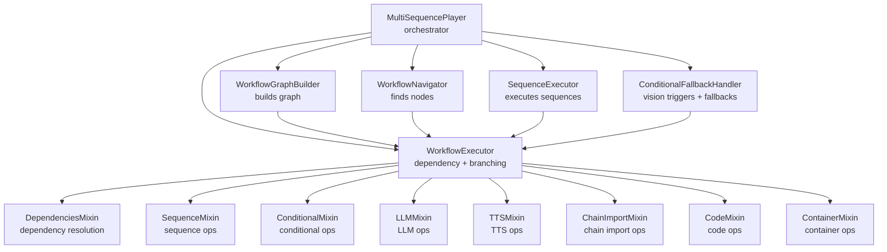
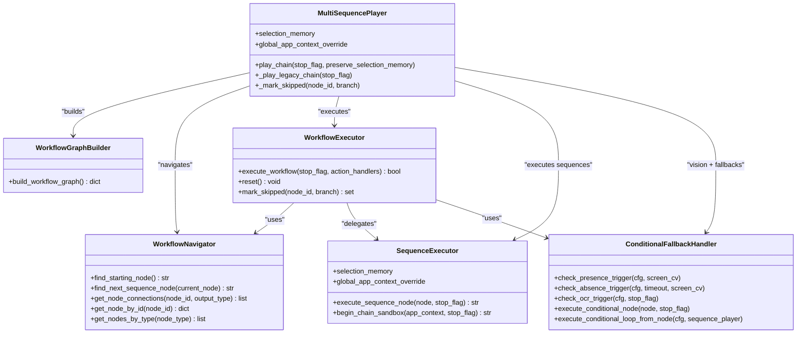
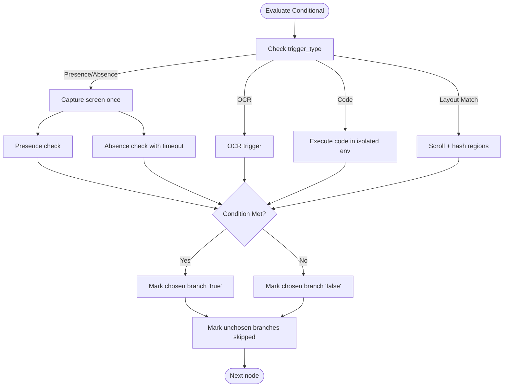
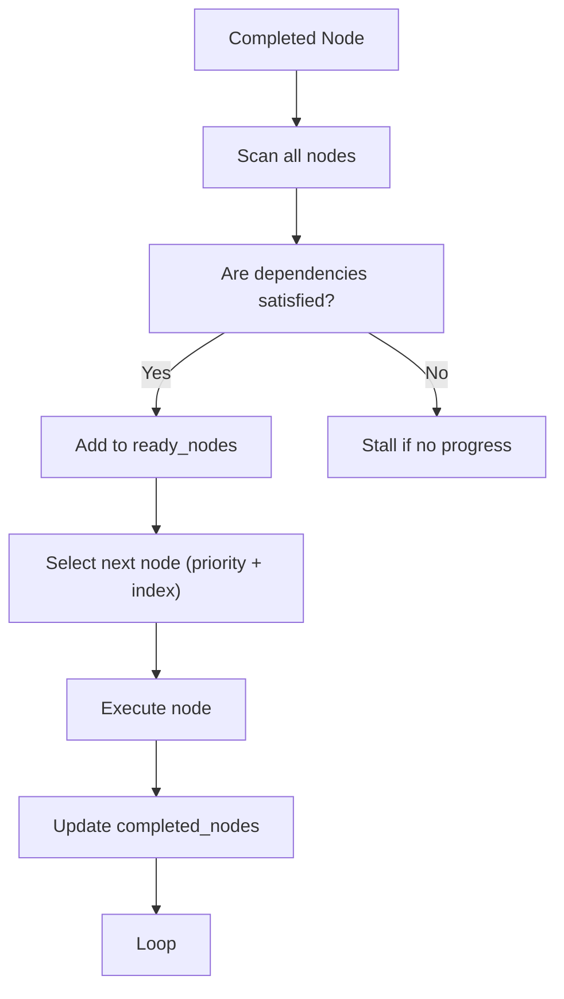

# Multi-Sequence Player

<cite>
**Referenced Files in This Document**
- [multi_sequence_player.py](file://LoOper/player/multi_sequence_player.py)
- [conditional_fallback_handler.py](file://LoOper/player/multi_sequence/conditional_fallback_handler.py)
- [workflow_graph.py](file://LoOper/player/multi_sequence/workflow_graph.py)
- [builder.py](file://LoOper/player/multi_sequence/worflow_interpreter_modules/builder.py)
- [navigator.py](file://LoOper/player/multi_sequence/worflow_interpreter_modules/navigator.py)
- [executor.py](file://LoOper/player/multi_sequence/worflow_interpreter_modules/executor.py)
- [core.py](file://LoOper/player/multi_sequence/worflow_interpreter_modules/executor_modules/core.py)
- [dependencies.py](file://LoOper/player/multi_sequence/worflow_interpreter_modules/executor_modules/dependencies.py)
- [sequence_ops.py](file://LoOper/player/multi_sequence/worflow_interpreter_modules/executor_modules/sequence_ops.py)
- [conditional_ops.py](file://LoOper/player/multi_sequence/worflow_interpreter_modules/executor_modules/conditional_ops.py)
- [node_executor.py](file://LoOper/player/multi_sequence/conditional_fallback_resources/node_executor.py)
- [path_resolver.py](file://LoOper/player/multi_sequence/conditional_fallback_resources/path_resolver.py)
- [sequence_executor.py](file://LoOper/player/multi_sequence/sequence_executor.py)
</cite>

## Table of Contents
1. [Introduction](#introduction)
2. [Project Structure](#project-structure)
3. [Core Components](#core-components)
4. [Architecture Overview](#architecture-overview)
5. [Detailed Component Analysis](#detailed-component-analysis)
6. [Dependency Analysis](#dependency-analysis)
7. [Performance Considerations](#performance-considerations)
8. [Troubleshooting Guide](#troubleshooting-guide)
9. [Conclusion](#conclusion)

## Introduction
This document describes the multi-sequence player component responsible for orchestrating complex automation workflows across multiple sequences, conditional branches, and specialized nodes (LLM, TTS, code, containers). It explains the workflow graph architecture, sequence executor implementation, dependency management, fallback mechanisms, memory sharing across executions, resource allocation patterns, execution tracking, and integration with computer vision for UI interaction. Practical examples illustrate multi-sequence workflows, conditional execution patterns, and error recovery strategies. Guidance is included for extending workflow capabilities, adding new sequence types, and implementing custom execution strategies.

## Project Structure
The multi-sequence player is organized around a modular workflow interpreter that builds a directed graph from sequences and conditional nodes, then executes nodes with strict dependency resolution and conditional branching. Supporting components handle computer vision triggers, path resolution, and fallback strategies.



**Diagram sources**
- [multi_sequence_player.py:32-135](file://LoOper/player/multi_sequence_player.py#L32-L135)
- [builder.py:3-489](file://LoOper/player/multi_sequence/worflow_interpreter_modules/builder.py#L3-L489)
- [navigator.py:3-145](file://LoOper/player/multi_sequence/worflow_interpreter_modules/navigator.py#L3-L145)
- [core.py:14-437](file://LoOper/player/multi_sequence/worflow_interpreter_modules/executor_modules/core.py#L14-L437)
- [dependencies.py:4-358](file://LoOper/player/multi_sequence/worflow_interpreter_modules/executor_modules/dependencies.py#L4-L358)
- [sequence_ops.py:1-20](file://LoOper/player/multi_sequence/worflow_interpreter_modules/executor_modules/sequence_ops.py#L1-L20)
- [conditional_ops.py:1-800](file://LoOper/player/multi_sequence/worflow_interpreter_modules/executor_modules/conditional_ops.py#L1-L800)

**Section sources**
- [multi_sequence_player.py:32-135](file://LoOper/player/multi_sequence_player.py#L32-L135)
- [workflow_graph.py:1-10](file://LoOper/player/multi_sequence/workflow_graph.py#L1-L10)

## Core Components
- MultiSequencePlayer: Top-level orchestrator that initializes modular components, resolves chain configuration formats, preloads chains, and coordinates execution lifecycle. It shares selection memory across components and integrates with sandbox contexts for remote UI automation.
- WorkflowGraphBuilder: Converts sequences and conditional nodes into a normalized graph with typed nodes, connections, and inputs for dependency tracking.
- WorkflowNavigator: Locates starting nodes and determines next nodes after sequences, supporting explicit connections and linear fallback ordering.
- WorkflowExecutor: Executes the graph with dependency resolution, conditional branching, LLM prioritization, and execution tracking. It defers execution while LLM nodes are "typing" and applies extra delays between nodes.
- SequenceExecutor: Executes individual sequences, manages application focus, and coordinates sandbox sessions for remote UI automation.
- ConditionalFallbackHandler: Provides modular components for presence/absence/OCR triggers, conditional loops, and node execution, including path resolution and validation caching.
- Conditional node execution: Evaluates conditions using computer vision or code, supports app context gating, and selects branch targets.

**Section sources**
- [multi_sequence_player.py:32-135](file://LoOper/player/multi_sequence_player.py#L32-L135)
- [builder.py:3-489](file://LoOper/player/multi_sequence/worflow_interpreter_modules/builder.py#L3-L489)
- [navigator.py:3-145](file://LoOper/player/multi_sequence/worflow_interpreter_modules/navigator.py#L3-L145)
- [core.py:14-437](file://LoOper/player/multi_sequence/worflow_interpreter_modules/executor_modules/core.py#L14-L437)
- [sequence_executor.py:17-800](file://LoOper/player/multi_sequence/sequence_executor.py#L17-L800)
- [conditional_fallback_handler.py:20-208](file://LoOper/player/multi_sequence/conditional_fallback_handler.py#L20-L208)
- [node_executor.py:11-800](file://LoOper/player/multi_sequence/conditional_fallback_resources/node_executor.py#L11-L800)

## Architecture Overview
The system separates concerns across modules:
- Graph construction: Normalizes node formats and builds typed connections.
- Navigation: Resolves starting nodes and successor nodes.
- Execution: Mixes dependency resolution, conditional evaluation, and node-specific execution.
- Fallback and vision: Handles computer vision triggers, path resolution, and conditional loops.
- Memory and context: Shares selection memory and app context across components for deterministic behavior.



**Diagram sources**
- [multi_sequence_player.py:32-135](file://LoOper/player/multi_sequence_player.py#L32-L135)
- [builder.py:3-489](file://LoOper/player/multi_sequence/worflow_interpreter_modules/builder.py#L3-L489)
- [navigator.py:3-145](file://LoOper/player/multi_sequence/worflow_interpreter_modules/navigator.py#L3-L145)
- [core.py:14-437](file://LoOper/player/multi_sequence/worflow_interpreter_modules/executor_modules/core.py#L14-L437)
- [sequence_executor.py:17-800](file://LoOper/player/multi_sequence/sequence_executor.py#L17-L800)
- [conditional_fallback_handler.py:20-208](file://LoOper/player/multi_sequence/conditional_fallback_handler.py#L20-L208)

## Detailed Component Analysis

### Workflow Graph Architecture
The graph builder normalizes heterogeneous node formats (old vs new) and converts connections to a unified outputs format. It enriches LLM nodes with tool descriptions from connected tool providers and constructs input dependencies for accurate dependency resolution.

Key behaviors:
- Accepts both legacy and modern node formats.
- Converts connections to outputs with explicit ports.
- Builds reverse input links for dependency tracking.
- Detects tool-provider chain imports and marks them for selection by LLMs.

**Section sources**
- [builder.py:15-489](file://LoOper/player/multi_sequence/worflow_interpreter_modules/builder.py#L15-L489)

### Workflow Navigator
The navigator locates starting nodes (nodes with no inputs), falls back to first sequence or LLM if needed, and determines the next node after a sequence using explicit connections or linear ordering.

**Section sources**
- [navigator.py:9-101](file://LoOper/player/multi_sequence/worflow_interpreter_modules/navigator.py#L9-L101)

### Workflow Executor
The executor performs dependency-driven execution with:
- Ready-node selection by priority and index.
- Conditional branching: evaluates conditions, stores results, marks skipped nodes, and adds chosen branches to ready set.
- LLM-aware scheduling: defers downstream nodes while LLM is "typing" and handles concatenation rules.
- Global context propagation for sandbox sessions.
- Execution tracking and extra delays.

```mermaid
sequenceDiagram
participant Orchestrator as "MultiSequencePlayer"
participant Exec as "WorkflowExecutor"
participant Nav as "WorkflowNavigator"
participant SeqEx as "SequenceExecutor"
participant CFH as "ConditionalFallbackHandler"
Orchestrator->>Exec : execute_workflow(stop_flag, action_handlers)
Exec->>Nav : find_starting_nodes()
loop While ready_nodes or progress
Exec->>Exec : select_next_node(ready_nodes)
alt node type
case sequence
Exec->>SeqEx : _execute_sequence_node(node, stop_flag)
SeqEx-->>Exec : next_node_id
case conditional
Exec->>Exec : _evaluate_conditional(node, stop_flag)
Exec->>Exec : mark_skipped(node, branch)
case llm/tts/chain_import/code/container
Exec->>Exec : _execute_*_node(...)
end
Exec->>Nav : find_newly_ready_nodes(completed_node_id, completed_nodes)
Exec->>Exec : apply_extra_delay(node, stop_flag)
end
Exec-->>Orchestrator : result
```

**Diagram sources**
- [core.py:51-317](file://LoOper/player/multi_sequence/worflow_interpreter_modules/executor_modules/core.py#L51-L317)
- [dependencies.py:72-147](file://LoOper/player/multi_sequence/worflow_interpreter_modules/executor_modules/dependencies.py#L72-L147)
- [sequence_ops.py:1-20](file://LoOper/player/multi_sequence/worflow_interpreter_modules/executor_modules/sequence_ops.py#L1-L20)
- [conditional_ops.py:245-335](file://LoOper/player/multi_sequence/worflow_interpreter_modules/executor_modules/conditional_ops.py#L245-L335)

**Section sources**
- [core.py:14-437](file://LoOper/player/multi_sequence/worflow_interpreter_modules/executor_modules/core.py#L14-L437)
- [dependencies.py:4-358](file://LoOper/player/multi_sequence/worflow_interpreter_modules/executor_modules/dependencies.py#L4-L358)
- [sequence_ops.py:1-20](file://LoOper/player/multi_sequence/worflow_interpreter_modules/executor_modules/sequence_ops.py#L1-L20)
- [conditional_ops.py:1-800](file://LoOper/player/multi_sequence/worflow_interpreter_modules/executor_modules/conditional_ops.py#L1-L800)

### Sequence Executor
Handles sequence execution with:
- Application focus management and sandbox session initialization.
- Selection memory propagation to maintain deterministic candidate selection across sequences.
- Global app context override for sandboxed environments.

**Section sources**
- [sequence_executor.py:17-800](file://LoOper/player/multi_sequence/sequence_executor.py#L17-L800)

### Conditional Fallback Handler and Vision Triggers
Provides modular components for:
- Presence/Absence/OCR triggers with timeout support.
- Conditional loops and node execution.
- Path resolution for images and sequences.
- Validation caching and screen hashing.



**Diagram sources**
- [conditional_fallback_handler.py:53-98](file://LoOper/player/multi_sequence/conditional_fallback_handler.py#L53-L98)
- [node_executor.py:529-793](file://LoOper/player/multi_sequence/conditional_fallback_resources/node_executor.py#L529-L793)
- [conditional_ops.py:245-335](file://LoOper/player/multi_sequence/worflow_interpreter_modules/executor_modules/conditional_ops.py#L245-L335)

**Section sources**
- [conditional_fallback_handler.py:20-208](file://LoOper/player/multi_sequence/conditional_fallback_handler.py#L20-L208)
- [node_executor.py:11-800](file://LoOper/player/multi_sequence/conditional_fallback_resources/node_executor.py#L11-L800)
- [path_resolver.py:10-198](file://LoOper/player/multi_sequence/conditional_fallback_resources/path_resolver.py#L10-L198)
- [conditional_ops.py:1-800](file://LoOper/player/multi_sequence/worflow_interpreter_modules/executor_modules/conditional_ops.py#L1-L800)

### Practical Examples

- Multi-sequence linear chain with conditional branching:
  - Define a sequence node followed by a conditional node with "true" and "false" outputs. The executor evaluates the condition, chooses the appropriate branch, marks the unchosen branch as skipped, and continues execution.

- Conditional loop pattern:
  - Use a conditional node with "loop" condition type to repeat a sequence until a presence/absence/OCR condition is met, integrating with the conditional loop executor.

- Computer vision triggers:
  - Presence/absence/OCR triggers enable UI-driven branching. The system captures a single screen snapshot per evaluation to optimize performance and uses path resolution for assets.

- Fallback mechanisms:
  - Legacy chain fallbacks inject fallback sequences into actions. The system shares selection memory across fallbacks to ensure deterministic behavior.

- Sandbox integration:
  - The sequence executor can initialize sandbox sessions and propagate global app context overrides to coordinate remote UI automation.

**Section sources**
- [multi_sequence_player.py:192-358](file://LoOper/player/multi_sequence_player.py#L192-L358)
- [conditional_fallback_handler.py:100-185](file://LoOper/player/multi_sequence/conditional_fallback_handler.py#L100-L185)
- [sequence_executor.py:778-800](file://LoOper/player/multi_sequence/sequence_executor.py#L778-L800)
- [conditional_ops.py:245-335](file://LoOper/player/multi_sequence/worflow_interpreter_modules/executor_modules/conditional_ops.py#L245-L335)

## Dependency Analysis
The executor relies on mixins to implement node-specific operations and a robust dependency system:
- Starting nodes: Nodes with no inputs or special cases (e.g., non-blocking tool inputs for LLMs).
- Dependency satisfaction: Requires all non-skipped, non-conditional inputs to be completed; allows any chosen conditional branch path to satisfy conditional inputs.
- LLM-aware scheduling: Defers downstream nodes while LLM is "typing" and handles direct concatenation rules.
- Full graph scan: Continuously scans the graph to discover reachable nodes after each completion.



**Diagram sources**
- [dependencies.py:72-147](file://LoOper/player/multi_sequence/worflow_interpreter_modules/executor_modules/dependencies.py#L72-L147)
- [core.py:94-132](file://LoOper/player/multi_sequence/worflow_interpreter_modules/executor_modules/core.py#L94-L132)

**Section sources**
- [dependencies.py:4-358](file://LoOper/player/multi_sequence/worflow_interpreter_modules/executor_modules/dependencies.py#L4-L358)
- [core.py:51-317](file://LoOper/player/multi_sequence/worflow_interpreter_modules/executor_modules/core.py#L51-L317)

## Performance Considerations
- Single-screen capture per conditional evaluation reduces repeated screenshot overhead.
- Validation caching and screen hashing minimize redundant computer vision work.
- Deferred execution while LLM nodes are "typing" prevents unnecessary node churn.
- Path resolution considers common directories and sequences to reduce I/O overhead.
- Preloading chains and sequences improves startup performance for large workflows.

[No sources needed since this section provides general guidance]

## Troubleshooting Guide
Common issues and strategies:
- Conditional gating by application focus:
  - If a conditional expects a specific app context, ensure the app is launched and focused before evaluation. The executor can gate execution if the expected app is not present.
- Sandbox session management:
  - Verify global app context overrides are propagated to the sequence executor and that sandbox URLs are reachable. The system logs errors if agents fail to initialize or become unreachable.
- Path resolution failures:
  - Confirm asset paths resolve correctly using the path resolver. The resolver checks chain file directory, common subdirectories, and current working directory.
- Execution stalls:
  - Check that dependencies are satisfied and that no conditional branches are entirely skipped. The executor logs remaining nodes when stalling.
- Legacy chain fallbacks:
  - Ensure fallback sequences are injected into actions and that selection memory is shared across fallbacks for deterministic behavior.

**Section sources**
- [conditional_ops.py:24-244](file://LoOper/player/multi_sequence/worflow_interpreter_modules/executor_modules/conditional_ops.py#L24-L244)
- [sequence_executor.py:778-800](file://LoOper/player/multi_sequence/sequence_executor.py#L778-L800)
- [path_resolver.py:22-91](file://LoOper/player/multi_sequence/conditional_fallback_resources/path_resolver.py#L22-L91)
- [core.py:117-132](file://LoOper/player/multi_sequence/worflow_interpreter_modules/executor_modules/core.py#L117-L132)
- [multi_sequence_player.py:402-456](file://LoOper/player/multi_sequence_player.py#L402-L456)

## Conclusion
The multi-sequence player provides a robust, modular framework for complex automation workflows. Its workflow graph architecture, dependency-driven execution, and integrated computer vision triggers enable sophisticated conditional branching and fallback strategies. Memory sharing, sandbox integration, and performance optimizations support reliable, scalable automation across diverse UI environments. Extending the system involves adding new node types via mixins, integrating new execution strategies, and leveraging the builder and navigator for seamless graph integration.